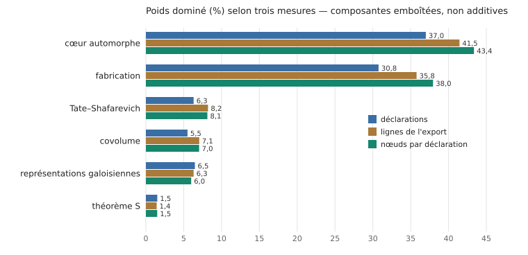
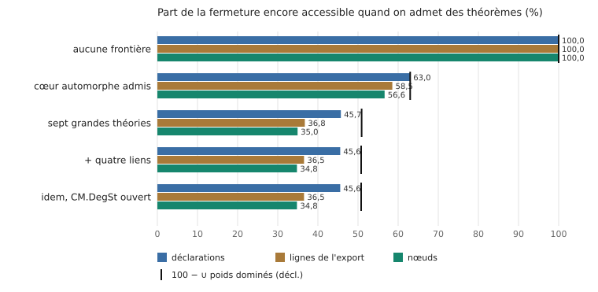
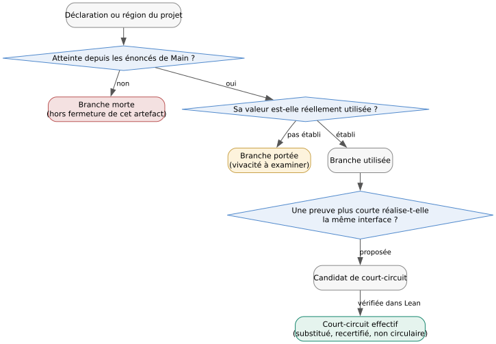
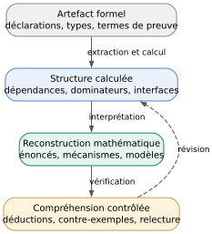

*English version: translation of version 1.3 in preparation. Texte compagnon, consacré au contenu mathématique : [synthèse](synthese.html). Outils : [tools/](tools/). Le rôle de chacun est précisé dans la déclaration d'usage de l'IA, en fin d'article.*

> **Statut des énoncés.** La validité formelle n'est pas en cause : compilation complète, axiomes standard (`propext`, `Classical.choice`, `Quot.sound`), rejeu par plusieurs noyaux indépendants (Sutherland [Su], Rubinstein [R], état au 23/11/2026). Ce texte cherche à **comprendre**. On y distingue trois statuts :
>
> - les **énoncés de l'export**, cités par leur nom Lean (`ainsi`) et lus avec les outils de [tools/](tools/) ; ils sont parfois transcrits en notation mathématique, en abrégeant les arguments implicites ;
> - les **mesures**, calculées sur le graphe extrait, avec leurs conventions ;
> - les **interprétations**, marquées ⟦I⟧.

---

## 1. Introduction : lire une preuve qu'on ne peut pas lire

Depuis Riemann, on sait que les nombres premiers sont gouvernés par les zéros de la fonction ζ. L'hypothèse de Riemann fixe à $\tfrac12$ l'exposant de ces oscillations : le terme d'erreur du théorème des nombres premiers est $O(x^{1/2+\varepsilon})$, et aucun exposant plus petit n'est possible. En novembre 2026, L. Alpöge a annoncé une preuve de cette hypothèse, étendue aux fonctions L de Dirichlet, sous la forme d'un développement Lean de dix-sept millions de lignes, produit avec un agent d'IA et accompagné d'une note de quelques pages [A]. En quelques jours, la communauté l'a recompilé, a vérifié que seuls les trois axiomes standard sont utilisés, et l'a rejoué dans plusieurs noyaux indépendants [Su, R, Li].

Ces vérifications établissent la validité. Elles ne disent rien de la compréhension, qui progresse depuis par des lectures partielles et des réécritures (§ 9.3). Comme le note Lipponen [Li], une recompilation « n'établirait pas que quelqu'un comprend l'argument ». Une preuve formelle de cette taille ne se lit pas ligne à ligne ; elle n'a pas été écrite pour être lue. Elle se laisse pourtant interroger, à condition de la regarder comme ce qu'elle est : un **graphe**. Chaque déclaration, définition ou théorème, dépend d'autres déclarations, par son énoncé et par sa preuve. Le théorème final est une racine, et l'on peut calculer exactement tout ce dont il dépend.

La question de cet article est donc méthodologique : **que peut-on comprendre d'une preuve formelle produite avec l'aide d'un agent d'IA, à une échelle qui excède la lecture humaine ordinaire, et comment mesurer ce que l'on a compris ?** Notre réponse est qu'un graphe de dépendances devient un instrument de lecture si l'on sépare soigneusement ce qui s'y **calcule** (des fermetures, des dominateurs, des volumes, des frontières) de ce qui s'y **interprète** (le sens mathématique d'une interface, le rôle d'un nœud). La preuve d'Alpöge sert d'étude de cas. Son contenu mathématique est exposé dans un texte compagnon, la [synthèse](synthese.html), organisée par questions ; nous y renvoyons pour tous les calculs et modèles.

**Contributions.**

1. **L'arbre des dominateurs comme outil de lecture.** Il attribue à chaque nœud un volume exclusif, mesuré selon trois pondérations, et localise le mécanisme : moins de 0,5 % de la fermeture (§§ 3–4).
2. **Un graphe des interfaces**, extrait automatiquement des types des prédicats de contrat de la preuve, puis regroupé et traduit à la main. Il montre comment les grandes composantes communiquent (§§ 3, 5).
3. **Des frontières de lecture.** Nous définissons la zone qui reste accessible quand on admet des théorèmes, en gardant leurs énoncés, et nous la mesurons. L'abstraction simultanée de plusieurs composantes masque un volume que les poids individuels ne voient pas, et ce qui reste est l'infrastructure des objets (§ 6).
4. **Une échelle de validation**, qui dit, nœud par nœud, ce qui est lu, interprété ou reconstruit, et une étude de cas où le graphe, joint à un contre-exemple, réfute une lecture (§ 7).
5. **Une taxonomie des branches** non exploitées, mortes, portées ou remplaçables, avec les critères qui permettent de les établir (§ 8).
6. **Un graphe des applications instanciées**, extrait des termes de preuve, qui dit à quels objets les théorèmes sont appliqués et d'où viennent leurs arguments. Il permet de vérifier des raccords que la lecture des énoncés laisse ouverts (§§ 3.4, 5).

Le § 2 présente l'objet en deux pages. Le § 3 décrit les graphes, le § 4 les mesures. Le § 5 parcourt la preuve en huit arrêts. Les §§ 6 à 8 présentent les résultats méthodologiques, et le § 9 discute leurs limites. L'annexe dit comment tout reproduire.

---

## 2. L'objet en deux pages

### 2.1 L'énoncé

Le module `Main` contient cinq énoncés : `riemannHypothesis`, de type `RiemannHypothesis` (la définition de Mathlib), et quatre énoncés sur les fonctions L de Dirichlet. Tous descendent d'un seul nœud :
```
allChi : EveryCharacter
EveryCharacter := ∀ N [NeZero N] (χ : DirichletCharacter ℂ N) (s : ℂ),
                    1/2 < re s → (χ ≠ 1 ∨ s ≠ 1) → LFunction χ s ≠ 0
```
Pour tout caractère de Dirichlet χ et tout $s$ de partie réelle $>\tfrac12$, $L(\chi,s)\ne0$, hors du pôle $s=1$ du caractère principal. `LFunction` et `DirichletCharacter` sont celles de Mathlib : l'énoncé ne dépend d'aucune définition du projet, ce qui le rend vérifiable indépendamment du reste. Le théorème couvre donc GRH pour les fonctions L de Dirichlet, RH, et RH pour les fonctions zêta de Dedekind des corps abéliens ; il ne couvre ni les corps non abéliens, ni les fonctions L automorphes générales.

### 2.2 L'argument en un paragraphe

Une analyse classique ramène GRH à une **majoration unilatérale** : une somme de $\log p$ à coefficients positifs, lissée par le poids de Riesz et dont on a retranché le terme principal, doit être au plus $x^{1/2+O(\varepsilon)}$ sur une suite de fenêtres d'échelles (Landau en fenêtres ; synthèse, § 1). Pour majorer une somme de premiers, la preuve suit Tchebychev : un objet arithmétique très divisible, dont la taille se calcule sans les premiers, fournit par la formule du produit une inégalité « premiers ≤ taille » (synthèse, § 2). L'objet est un réseau de périodes de formes automorphes. La divisibilité vient de dérivées de séries thêta en des points à multiplication complexe, qui garantissent, en chaque premier inerte, une valuation $a\,p/(p^2-1)-O(\log a)$ (le Théorème A ; synthèse, § 3). Produire ces gains ne suffit pas : il faut encore les répartir sur assez de directions et les préserver le long des orbites de Frobenius (synthèse, §§ 3.5 et 7). Comme chez Stepanov pour les courbes sur les corps finis, ces couches de divisibilité s'empilent, ici le long d'une chaîne de $m\approx\sqrt x$ relèvements thêta dont les valuations s'additionnent (synthèse, § 4). La divisibilité devient une montée de pente d'un réseau, que plafonne une inégalité de pentes de Bost ; les tailles archimédiennes sont **calculées** (Stirling, une formule de Chowla–Selberg démontrée dans le projet, des masses de Siegel, une quasi-orthogonalité) : identités pour certaines, bornes à erreur contrôlée pour d'autres. Le terme principal se compense alors dans un théorème de comptabilité (synthèse, §§ 5 et 6.2). Il reste une erreur de la forme $x/m+m$, minimale en $m\asymp\sqrt x$ : d'où l'exposant ½ (synthèse, § 6). Les grandes théories du projet servent à rendre la division des réseaux possible et les objets constructibles (synthèse, § 7).

### 2.3 Une architecture « abstraite puis instanciée »

Ce qui rend la lecture possible est une propriété d'architecture. Sous `allChi`, on rencontre une suite de théorèmes de la forme « hypothèses ⇒ `EveryCharacter` » :
```
everyCharacter_of_row : Row0b (… IsRecT …) → EveryCharacter
every_character_of_literature_of_vWin : OpenLiteratureStatements → VWin → EveryCharacter
every_character_of_theta_integrals_local_matching :
   UnitaryGroupThirdPlaceHypotheses → ThetaLocalInputs → ThetaIntegralsAgree → LocalMatching
   → CovolumeBoundOfX → RecTExists → VWin → EveryCharacter
```
Le dernier, le **cœur automorphe**, domine 41,5 % de la fermeture. Le mécanisme y est écrit sous hypothèses, et les grandes théories sont injectées tout en haut comme arguments. L'index inverse le confirme : chacune n'a qu'**un seul référent direct**.

| Théorie | Nœud | Référents directs | Consommateur |
|---|---|:-:|---|
| Tate–Shafarevich | `vwin_of_row` | 1 | `everyCharacter_of_row` |
| Représentations galoisiennes | `galoisLocalGlobalStrong_recParameter` | 1 | `everyCharacter` |
| Covolume | `topCovolSlim2_use_alt_alt` | 1 | `every_character_of_literature_of_vWin` |
| Théorème S | `CarrierGap.offDiag` | 1 | `LocalRows.at_choice_alt` |
| Masses de Siegel | `large_unramified_exponent_bundles_exist_alt` | 1 | `hypotheses_nonempty_of_unramified_exponents_alt` |
| Langlands local | `recTExists` | 25 | galoisien, borne de Ш… |

La correspondance de Langlands locale, partielle (démontrée en profondeur zéro, arbitraire ailleurs), fait exception : elle est interrogée directement en 25 points. Cette structure explique pourquoi le mécanisme est léger dans l'arbre des dominateurs, et pourquoi on peut le lire sans lire les théories.

{width=88%}

---

## 3. Quatre graphes

La méthode distingue quatre graphes de nature différente : le premier est **extrait**, le deuxième est **calculé**, le troisième est **interprété**, le quatrième **suit les objets** dans les termes de preuve.

### 3.1 Le graphe des dépendances

Ses sommets sont les déclarations de l'export. Une arête va de $d$ à $c$ si la constante $c$ apparaît dans le type **ou** dans la valeur de $d$ : énoncé, corps de définition ou terme de preuve. Les constructeurs, récurseurs et projections d'un inductif sont rattachés à leur inductif. Le graphe est extrait en une passe sur l'export NDJSON publié par Sutherland [Su] (62 Go décompressés), lu en flux sans être décompressé sur disque, par un programme C (`deps.c`) qui persiste le DAG des expressions.

Deux propriétés de ce graphe commandent toute la suite. Il **sur-approxime** l'usage : une constante citée dans un terme de preuve compte comme dépendance, même si son rôle est accessoire. Et il est **exact** sur ce qu'il affirme : une absence de dépendance, établie sur l'export, vaut pour cet artefact et cette convention, alors qu'une recherche textuelle dans le source la manque facilement (§ 5.1).

**Un exemple réel.** Le théorème `Deduction.ch_balance`, dont l'énoncé tient en une ligne ($\mathrm{ASK}-\mathrm{MAIN}=\mathrm{De}$, § 5.3), dépend directement de 338 constantes : 24 du projet, et 314 de Lean et de Mathlib, en grande partie des structures et des instances algébriques. Sa fermeture compte 34 253 déclarations, dont 66 seulement lui appartiennent en propre. Vers le haut, il n'a qu'un utilisateur, qui n'en a qu'un, et ainsi de suite : treize liens à référent unique le relient à `allChi`. C'est, à l'échelle d'un seul nœud, la signature de l'architecture « abstraite puis instanciée » du § 2.3.


### 3.2 L'arbre des dominateurs

Fixons une racine $r$. Un sommet $u$ **domine** $v$ si tout chemin dirigé de $r$ à $v$ passe par $u$. Les dominateurs de $v$ forment une chaîne ; le plus proche est son **dominateur immédiat**, et ces liens forment un arbre, calculé ici par l'algorithme de Cooper, Harvey et Kennedy [CHK]. Le **poids dominé** de $u$ est le poids de son sous-arbre : ce qui disparaîtrait de la fermeture si l'on retirait $u$. Nous prenons pour racine un sommet virtuel relié aux cinq énoncés de `Main`.


L'arbre n'est pas un arbre couvrant du graphe : une arête de l'arbre n'est pas nécessairement une dépendance directe. Sur l'exemple de la figure, A domine C et B domine E, mais ni A ni B ne domine D, qui est partagé. D'où quatre précautions de lecture :

- un théorème central partagé par plusieurs branches a un poids dominé faible, car il est rattaché plus haut ;
- une longue formalisation peut être conceptuellement simple, et une déclaration très courte peut porter l'idée décisive ;
- deux sous-arbres sont emboîtés ou disjoints : on additionne des poids disjoints, jamais des poids emboîtés ;
- une dépendance ne dit rien, à elle seule, de la fonction d'un nœud dans le raisonnement.

**Sur la preuve réelle.** La figure suivante montre le haut de l'arbre des dominateurs. On y lit l'**épine dorsale** : chaque nœud de la chaîne principale domine la suite, du cœur automorphe (41,5 %) à la fabrication (35,8 %), puis, sous elle, à la construction qui livre les masses de Siegel (6,8 %). Les grandes théories apparaissent comme des frères de l'épine, chacune avec son volume exclusif. La correspondance de Langlands locale n'y figure pas : partagée par 25 référents, elle est rattachée au-dessus d'eux, et son poids dominé n'est que de 0,05 % (première précaution). Comparé au schéma du sommet (§ 2.3), l'arbre ne garde qu'une arête par nœud, et ce n'est pas toujours une dépendance directe.

{width=80%}

### 3.3 Le graphe des interfaces

La preuve contient un module, `Formalism.MainNotions`, qui définit 207 prédicats à valeur dans `Prop` (`LinkG_at`, `LinkDIV_at`, `LinkN`, `Count_at`, `ChainTied`…). Ils servent de **contrats** entre les grandes composantes. Pour chaque théorème de l'export, `interfaces.py` relève automatiquement, dans son type, les prédicats qu'il prend en hypothèse et ceux qu'il conclut : on obtient 390 arêtes. `organes.py` dit ensuite, par l'index inverse, quels producteurs d'interfaces chaque composante utilise transitivement, et où chaque grande théorie est consommée.

Trois étapes restent **humaines** : le choix de la famille de prédicats (par défaut, ceux de `MainNotions`) ; le regroupement des théorèmes en composantes nommées (« hôte », « division »…) ; et surtout la lecture de chaque énoncé, sa traduction mathématique et l'explication de son rôle. Ce troisième graphe n'est pas fourni par Lean.

**Un extrait réel.** La figure suivante montre le voisinage de `linkCore` dans ce graphe, tel que `interfaces.py` l'extrait. On le lit comme un graphe biparti : les ellipses sont des interfaces, les boîtes des théorèmes qui en consomment certaines et en produisent d'autres. `linkCore` est un **nœud d'inférence** à quatorze entrées. On y voit par exemple que la quasi-orthogonalité (`LinkS`) n'atteint l'inégalité de pentes (`FrameF`) qu'à travers `frameRealF_of''`, qui demande aussi la division (`LinkDIV`) et l'irréductibilité (`LinkIRR`), et que les gains (`LinkG`) alimentent deux interfaces distinctes, la majoration des premiers (`LossFS`) et la montée de pente (`SlopesNF`). Le graphe complet, avec les organes et les plaques tournantes, est au § 5.4.


| Objet | Mode d'obtention | Ce qu'il apporte |
|---|---|---|
| Graphe des dépendances | extraction (`deps.c`) | les constantes que chaque déclaration référence |
| Arbre des dominateurs | calcul (`analyse_export.py`) | un volume exclusif par nœud |
| Graphe des interfaces | extraction des prédicats (`interfaces.py`, `organes.py`), puis lecture humaine | la nature des informations échangées entre composantes |
| Graphe des applications instanciées (§ 3.4) | extraction dans les termes de preuve (`trace_app.py`), sans vérification de convertibilité | les objets auxquels les théorèmes sont appliqués, et la provenance de leurs arguments |

### 3.4 Le graphe des applications instanciées

Les trois graphes précédents disent quels résultats interviennent, et quelles propriétés passent d'une composante à l'autre. Ils ne disent pas **à quoi** les théorèmes sont appliqués. Prenons trois théorèmes $T_1:\forall x,\,A(x)\Rightarrow B(x)$, $T_2:\forall x,\,B(x)\Rightarrow C(x)$, $T_3:\forall x,\,C(x)\Rightarrow D(x)$, et la preuve `final x h := T3 x (T2 x (T1 x h))`. Le graphe des dépendances retient que `final` dépend de $T_1$, $T_2$ et $T_3$. Le terme de preuve dit en outre que les trois sont appliqués **au même objet** $x$, et que chaque conclusion devient la prémisse suivante. Dans une preuve où des propriétés différentes doivent porter sur les mêmes objets, c'est cette information qui fait le raccord.

Le quatrième graphe la restitue. Ses nœuds sont les occurrences d'application d'un théorème ou d'un constructeur dans un terme de preuve. Chacune a plusieurs entrées : ses arguments, alignés sur le télescope du théorème appelé. Chaque argument a une **provenance** : variable introduite par un lieur, définition locale (`let`, `have`) produite par une autre occurrence, projection d'une structure, ou résultat d'une autre occurrence. Le script `trace_app.py` l'extrait du DAG d'expressions déjà construit, sans nouvelle passe sur l'export. Il suit la pile des lieurs, pour ne pas confondre un même sous-terme partagé dans deux contextes ; il traite les `have` comme des définitions locales ; il garde visibles les transports par égalité ; et il affiche les types attendus des arguments, instanciés par substitution. Un mode de **tranchage arrière** (`--slice`, *backward slicing*) remonte la provenance d'un seul argument d'une application, de proche en proche, jusqu'aux lieurs de la déclaration. Il ne vérifie pas la convertibilité : deux termes sont reconnus identiques s'ils sont le même nœud du DAG (l'export partage les sous-termes clos syntaxiquement égaux) ou, par construction, le même champ d'une structure.

| Représentation | Unité | Question |
|---|---|---|
| dépendances | déclaration | quels résultats sont référencés ? |
| dominateurs | sous-arbre dominé | quel volume ne sert qu'à ce nœud ? |
| interfaces | prédicat de contrat | quelles propriétés passent entre composantes ? |
| applications instanciées | occurrence d'application | à quels objets, avec quelles preuves ? |

Un premier exemple montre ce qu'apporte ce niveau. Au sommet (§ 5.1), la structure `OpenLiteratureStatements` est construite anonymement. Le graphe des applications donne ses champs : `caraianiLocalGlobalDual := h`, `localLanglandsExists := recTExists`, `galoisRepOfPolarizedPairLit := h`. **La même preuve `h`, la ligne galoisienne, remplit deux champs « littérature ».** Les résultats obtenus sur sept raccords sont rapportés au § 5 et consignés dans `analysis/raccords.md`.

---

## 4. Mesurer

### 4.1 Données et racines

L'export contient 1 468 418 déclarations et 1 065 214 335 enregistrements d'expressions, pour 1 080 769 508 lignes (Lean v4.33.1, Mathlib `0df444a3`). Une déclaration y regroupe un bloc inductif avec ses constructeurs et récurseurs ; l'environnement Lean, qui les compte séparément, contient 1 484 733 constantes utilisées sur 2 701 132. Nous travaillons dans le premier univers. La fermeture de `riemannHypothesis` compte 1 468 390 déclarations ; l'union des fermetures des cinq énoncés de `Main`, 1 468 414. Quatre déclarations de l'export (`Nat.lor`, `Nat.xor`, `String.mk` et une preuve auxiliaire) n'appartiennent à aucune. L'union est le dénominateur de tous les pourcentages. `allChi` domine à lui seul 96 % des déclarations.

### 4.2 Trois pondérations

Le poids d'une déclaration se mesure de trois façons : 1 par déclaration ; le nombre d'enregistrements d'expressions qu'elle introduit dans l'export (les « lignes », partagées dans tout l'export et attribuées à leur premier usage) ; ou le nombre de nœuds distincts de son type et de sa valeur (partage compté à l'intérieur de la déclaration seulement).

| Composante (nœud dominant) | décl. | lignes | nœuds |
|---|---:|---:|---:|
| `allChi` | 96,0 % | 99,3 % | 99,4 % |
| cœur automorphe (`every_character_of_theta_integrals_local_matching`) | 37,0 % | 41,5 % | 43,4 % |
| fabrication (`nonempty_hyps_definite_side_of_closed_bound`) | 30,8 % | 35,8 % | 38,0 % |
| Tate–Shafarevich (`vwin_of_row`) | 6,3 % | 8,2 % | 8,1 % |
| représentations galoisiennes (`galoisLocalGlobalStrong_recParameter`) | 6,5 % | 6,3 % | 6,0 % |
| covolume (`topCovolSlim2_use_alt_alt`) | 5,5 % | 7,1 % | 7,0 % |
| théorème S (`CarrierGap.offDiag`) | 1,5 % | 1,4 % | 1,5 % |
| Langlands local (`recTExists`) | 0,04 % | 0,05 % | 0,05 % |
| **mécanisme** (union de 13 sous-arbres, § 4.3) | **0,28 %** | **0,34 %** | **0,27 %** |



La hiérarchie des grandes composantes, et la faible part attribuable au mécanisme, sont stables sous les trois mesures. L'ordre exact peut changer entre composantes voisines : les représentations galoisiennes devancent Tate–Shafarevich en déclarations, pas en lignes ni en nœuds. La mesure en lignes dépend de l'ordre de sérialisation de l'export ; ce n'est pas une mesure intrinsèque. Sauf mention contraire, les pourcentages de cet article sont en lignes.

### 4.3 Ce que pèse le mécanisme

L'affirmation « le mécanisme pèse moins de 0,5 % » demande une définition opérationnelle. On part d'une liste explicite de 21 nœuds qui portent la réduction analytique, l'hôte, le Théorème A, la chaîne, la division et le bilan (`analysis/mecanisme.txt`). On garde ceux qu'aucun autre nœud de la liste ne domine : il en reste 13 (`analysis/mecanisme_maximal.txt`), de `zeroFreeOn_of_tiedWin_cyc` à `linkCore`. Leurs sous-arbres sont disjoints, et la somme de leurs poids dominés vaut 0,28 % des déclarations, 0,34 % des lignes, 0,27 % des nœuds.

Deux précautions. Le choix de la liste est humain : un seuil de poids ne définit pas un mécanisme. Et le nombre mesure ce qui appartient **en propre** à ces nœuds, non tout ce qu'il faut savoir pour les comprendre : leurs dépendances partagées (Mathlib, les structures communes, les grandes théories injectées en hypothèse) sont rattachées plus haut. Le § 6 mesure précisément cette différence.

### 4.4 Ce qu'un poids ne dit pas

Le contraste entre les poids et les rôles est frappant. Le Théorème A, qui porte l'idée de la divisibilité, pèse environ 0,02 % ; la fabrication des objets, 35,8 %. Une lecture ⟦I⟧ de ce contraste : une borne $p$-adique peut être grossière, puisqu'il suffit de minorer des valuations ; une taille archimédienne doit être exacte, et une division doit être sûre. Ce sont ces exigences d'exactitude et de sûreté qui coûtent. Mais l'inverse serait une erreur : un poids faible ne signale pas un nœud secondaire, et un poids fort ne signale pas une idée. Le poids localise ; il ne hiérarchise pas les idées.

---

## 5. Une traversée guidée

Cette section parcourt la preuve en huit arrêts, du sommet à la fabrication. Chaque arrêt suit le même gabarit : la **question** mathématique à laquelle le nœud répond ; le **nœud**, avec son énoncé lu sur l'export ; ce que le **graphe** montre de plus (poids, consommateurs, interfaces, chemins) ; ce qui reste **ouvert**. Le contenu mathématique est développé dans la synthèse, à laquelle chaque arrêt renvoie.

### 5.1 Le sommet, et une leçon sur les constructions anonymes

*Question.* Le sommet repose-t-il sur des énoncés admis ? Les noms le laissent craindre : `OpenLiteratureStatements`, `every_character_of_literature_of_vWin`, et dans le source un échafaudage nommé `LitN`, `published_inputs_combined`, `Published.LocalLanglandsGL`.

*Nœud.* Le chemin principal passe par
```
everyCharacter_of_row h := every_character_of_literature_of_vWin
                              ⟨h, Zero.LLC.recTExists, h⟩ (vwin_of_row h)
```
La structure `OpenLiteratureStatements` y est construite **anonymement**, par le constructeur `⟨…⟩`, à partir de théorèmes démontrés.

*Graphe.* Sur l'export, l'échafaudage « littérature » est hors de la fermeture des cinq énoncés : aucune de ses déclarations n'est atteinte. Aucun énoncé publié n'entre comme axiome. Une recherche textuelle dans le source ne permettait pas de le conclure : elle trouve les noms, mais rate le constructeur anonyme qui remplit la structure. **Toute conclusion négative doit être établie sur le graphe extrait**, et c'est la première règle de la méthode.

*Ouvert.* Rien, à ce niveau. Le sens des hypothèses du cœur automorphe est l'objet des arrêts suivants.

### 5.2 Des zéros à une inégalité : Landau en fenêtres

*Question.* Pourquoi une majoration d'une somme de premiers suffit-elle à exclure les zéros, et pourquoi seulement sur des fenêtres ? (synthèse, §§ 1.4–1.5).

*Nœud.*
```
zeroFreeOn_of_tiedWin_cyc :
  1 < λ → (∀ ψ, ChebyshevInequalityOnWindows core Tied (Level.cyc ψ))
        → (∀ ψ, Level.FormB (Level.cyc ψ))
        → (∀ ψ, ChebyshevInequalityAtWindowScale core Tied λ (Level.cyc ψ))
        → ZeroFreeOn Q
```
`Level.FormBAt` énonce le critère de Landau localisé : si $\{y: G_\psi(y)\le y^\theta\}$ contient des fenêtres $[Y,Y^\lambda]$ pour des $Y$ arbitrairement grands, aucune des fonctions L du niveau n'a de zéro de partie réelle $>\theta$. La quantité majorée, `Level.Gm`, est une combinaison positive $G(y)+\sum_\psi\mathrm{wt}(\psi)\operatorname{Re}g(y,\chi_\psi)$. Sur le chemin principal (`Level.cyc`), tous les poids `wt` valent $1/(3o+1)$, et ce profil se retrouve dans l'échantillonnage des classes de Frobenius par l'hôte (`Frame.lam` : $4/(3o+1)$ pour la classe neutre, $3/(3o+1)$ ailleurs, consommé par `BernoulliSumsFrobeniusOrbits.topsFrame`).

*Graphe.* Toute la réduction analytique pèse moins de 0,1 %. Le critère en fenêtres est démontré par `Comparison₂.formB` et `Deduction.zeroFree_of_rpow_window`, environ 140 000 lignes pour une centaine de déclarations propres ; on y lit un noyau gamma (`iteratedDeriv_laplace`), une borne de Chernoff (`landau_tails_chernoff`) et un lemme de dichotomie (`landau_dichotomy`). Le nœud demande en retour `ChebyshevInequalityOnWindows`, fourni par `level_gm_le_on_family_scales` (337 déclarations propres) dès qu'une famille porte une `ChainTied` à chaque échelle.

*Ouvert.* La nouveauté de la forme en fenêtres, que Slijepčević souligne [S], et la possibilité de la remplacer par un théorème d'oscillation classique [H]. C'est un premier candidat de court-circuit (§ 8).

### 5.3 Une identité exacte : `ch_balance`

*Question.* Qu'est-ce que la chaîne compare exactement à son terme principal ? (synthèse, partie II, « Cinq points éclaircis »).

*Nœud.* Le cœur de `ChainTied` est une quantité `gapA`, somme sur des colonnes $t$ et sur $m$ étages $j$ de différences $\mathrm{ASK}-\mathrm{MAIN}$ :
```
MAIN(a, w) = a · ( log a − 1 − γ + ℓ(χ) − (1/|Φ|) Σ_{ρ∈Φ} log w(ρ) )
```
`ASK` est une somme de von Mangoldt sur les premiers inertes d'un corps auxiliaire, l'**hôte** ; `MAIN` est son terme principal, écrit en toutes lettres. Le théorème `Deduction.ch_balance` établit l'identité $\mathrm{ASK}-\mathrm{MAIN}=\mathrm{De}$, où `De` est une combinaison, par orthogonalité des caractères du groupe de Galois de l'hôte, de sommes centrées $G_\psi$.

*Graphe.* Le voisinage de ce nœud est représenté au § 3.1. Cet arrêt illustre aussi le cycle de lecture élémentaire, en quatre commandes en bibliothèque standard :
```
python3 -I tools/show.py OUT Deduction.ch_balance          # l'énoncé
python3 -I tools/query.py OUT deps Deduction.ch_balance    # ce qu'il utilise
python3 -I tools/revindex.py OUT up Deduction.ch_balance   # qui l'utilise, jusqu'à la racine
python3 -I tools/query.py OUT cl Deduction.ch_balance      # fermeture et poids dominé
```
La première donne l'identité. La deuxième montre qu'elle repose sur `askExp` (le développement par orthogonalité) et sur les faits de ramification de l'hôte (`HostFactsS`). La troisième la situe sous `ch_core`, puis `core_gm`, sur le chemin de `allChi`. La traduction mathématique et l'explication du rôle (soustraire exactement le terme principal) restent le travail du lecteur.

*Raccord.* Le passage de `De` à la majoration de `Level.Gm` est reconstruit à partir du terme de `core_gm`. Une objection naturelle est qu'une somme sur des colonnes ne borne qu'une moyenne, non chacun de ses termes. La preuve l'évite ainsi. Le lemme `gmA_eq` établit que la combinaison produite par la somme sur les colonnes, pondérée par $1/(3o+1)$ sur les caractères « gardés » du niveau, est **identiquement** `Level.Gm` : la cible est cette combinaison à coefficients positifs, celle sur laquelle Landau opère (§ 5.2). Les caractères parasites, non gardés, sont bornés **un par un** (`sigA_le`, par l'hypothèse ponctuelle `EAtH.bdG` que fournit le choix des paires ; synthèse, § 3.4). Et l'échantillonnage des colonnes respecte le profil 4 : 3 à $x^{-1+\varepsilon}$ près (`EAtH.shares`).

### 5.4 Le cœur : quatorze interfaces

*Question.* Comment la majoration de `gapA` est-elle obtenue ? (synthèse, §§ 5.4 et 6.2).

*Nœud.* Sous `ChainTied`, le graphe passe par un théorème de 129 déclarations propres, presque entièrement fait d'hypothèses :
```
linkCore : CountF ∧ SlopesMF ∧ SlopesNF ∧ LatF ∧ NodesF ∧ FrameF ∧ LossFS ∧ CharF ∧ WinF
           ∧ ChosenTT ∧ ChosenQD ∧ ChosenThin ∧ LinkIRR ∧ LinkDIV  ⟹  ChainTied
```
Ces quatorze hypothèses sont les interfaces de `MainNotions` du § 3.3. Lues ensemble, elles forment un bilan de pentes de réseaux hermitiens : la somme de premiers est majorée par des gains locaux (`LossFS`), ceux-ci par une montée de pente (`SlopesNF`), celle-ci par une inégalité de pentes (`FrameF`) dont le second membre est fait de tailles archimédiennes (`CountF`, `CharF`), dans une fenêtre de paramètres (`WinF`). Le théorème `Deduction.ch_top` en tire le **crochet d'erreur** mot pour mot :
```
errorBracketSizeWindows x ε n nT nT2 m b k a
  = nT·a·(1 + m²/k)  +  m·( 2·n·m·b·x^ε  +  nT2·k·b·x^ε / (n·(n·x^(−ε))) ).
```
Normalisé, il donne $x^{O(\varepsilon)}(x/m+xm/k+m+k/n^2)$, et la fenêtre `Win_at` ($x^{1/2-\varepsilon}\le m\le x^{1/2+\varepsilon/2}$, $xm\le k$) le ramène à $x^{1/2+O(\varepsilon)}$.

*Graphe.* C'est ici que le graphe des interfaces prend son sens. Neuf liens (`Link…`) dépliés depuis `HypsAlt` alimentent les quatorze interfaces ; deux **plaques tournantes**, l'hôte (`supplyChi`) et `HypsAlt`, redistribuent les grandes théories.

```{=latex}
\begin{landscape}
```


```{=latex}
\end{landscape}
```

Quelques arêtes, lues telles quelles :

| Arête | Théorème (poids dominé) | Ce qui passe |
|---|---|---|
| `LinkS` → `FrameRealF` → `FrameF` | `frameRealF_of''`, `frameF_of` (231 k lignes) | la quasi-orthogonalité rend l'inégalité de pentes utilisable |
| `LinkG` → `LossesSmallShares` → `LossFS` | `losses_of_small_share_weight` (392 k) | premiers inertes ≤ gains locaux + perte |
| `LinkG`, `LinkMu` → `PlacesF` → `SlopesNF` | `placesF_min'` (196 k) | saut de pente = Σ longueurs locales × log N𝔭 |
| `LinkN` → `DIVinN` | `divinN_of_hypV` | la borne sur les places tordues conditionne la division |
| Galois → `LinkN` | `linkN_of_twGood_galoisPreconditions` (24,8 M) | représentations galoisiennes ⇒ `LinkN` |

*Deux niveaux de contrat.* Le graphe des interfaces fournit ici un contrat large, à quatorze entrées. Le graphe des applications en donne un second, plus proche du raisonnement numérique. `each_unit_bound_statement` démontre `PointwiseBoundVariant`, à onze hypothèses, et `Deduction.ch_top` exploite cette conclusion. L'expérience E17 du carnet apparie ces hypothèses aux entrées (A1)–(A7) et (H) du ch. 58 de l'exposition de Nelson pour la route d'origine [Ne0]. Elle les rattache aussi à leurs interfaces, en suivant dans la valeur de `linkCore` la preuve passée à chaque fabricant `Lnk.Mod.data_*`, dont le modèle `Lnk.Mod.mk` ne porte que des données. Il en ressort que trois entrées (la borne de division, les termes locaux, l'écart des hauteurs) sortent toutes d'un même lien, `LinkDIV`, et que `CountF`, `SlopesMF`, `SlopesNF`, `LatF`, `FrameF` et `LossFS` alimentent les autres. Une seule provenance passe par un choix intermédiaire que nous n'avons pas suivi : celle de la forme « cadres » de `SlopeIneq`, établie par son type. Les entrées (A1)–(A7) ne sont donc pas sept interfaces Lean, mais une lecture de onze prédicats d'un record. La synthèse (§ 6.2) en tire le bilan mathématique, avec ses trois compensations.

*Ouvert.* La correspondance entre interfaces et étapes mathématiques est une lecture ⟦I⟧, appuyée sur les énoncés, mais aucune des grandes arêtes n'a été suivie dans sa preuve.

### 5.5 Les gains : Théorème A, Behrend et `NoRel`

*Question.* D'où vient la divisibilité, et comment s'empile-t-elle ? (synthèse, §§ 3 et 4).

*Nœud.* Le Théorème A (`DworkPowerSeriesWeights.thmAGauss`) minore la valuation $p$-adique de la $a$-ième dérivée d'une série thêta renormalisée en un point CM par $a\,p/(p^2-1)-O(\log a)$, pour $p$ inerte. L'interface `LinkG_at` demande davantage : des gains de la forme $\sum_{e\text{ impair}}(a/p^e-\text{seuil})_+$, place par place, à chacun des $m$ étages. Entre les deux intervient une condition combinatoire, lue sur l'export :
```
Formalism.FrobeniusOrbits.NoRel (T : Finset ℕ) (L : ℕ) :=
  ∀ s₁ s₂ s₃ ∈ T, distincts, ∀ i j : ℤ, 0 < |i| ≤ L → 0 < |j| ≤ L → i ≠ j →
    j·(s₂ − s₁) ≠ i·(s₃ − s₁)
```
un ensemble de positions sans relation courte, plus fort que l'absence de progression arithmétique de longueur 3. La preuve l'obtient par la construction de Behrend.

*Graphe.* Le Théorème A pèse environ 0,02 %, alors que le producteur de `LinkG_at`, `linkG_fam_noKer`, compte 1,3 M de lignes. L'index inverse montre un **partage** que les dominateurs ne voient pas : `Behrend.box` alimente les orbites de Frobenius « épaisses » (`hostThickExists`), qui servent à la fois l'hôte (`supplyChi`) et le lien des gains (`linkG_fam_noKer`). Rattachée plus haut, la construction de Behrend a un poids dominé faible, bien qu'elle serve deux composantes (§ 3.2, première précaution). Un lemme élémentaire, démontré dans la synthèse (§ 3.5), explique pourquoi `NoRel` convient aux orbites : un segment d'orbite de longueur $L$ contient au plus deux points distincts de $T$. L'export contient littéralement cet énoncé (`dropping_proposition_holds`, avec un ensemble de densité de Behrend), mais il y est **inerte** : le paquet qui le contient est déstructuré par ses deux consommateurs, qui n'en projettent que d'autres clauses. Une recherche de dépendances le compte comme utilisé ; seul le suivi des projections montre le contraire. La propriété effective est portée par un champ de l'hôte et sert, par des grappes d'au plus deux lettres épaisses sur l'orbite, le lien côté Galois (`NLinkClose` → `linkN`).

*Raccord.* Le graphe des applications localise la provenance des gains. L'unique consommateur de `linkG_fam_noKer`, `link_of_local_closed`, tire ses dix hypothèses d'un seul paquet local, par projections. Les deux principales sont un « premier théorème » (`first_theorem_threshold_functions`) et un « second théorème », une borne de valuation le long des orbites (`second_theorem_absolute_constant`), construits à partir de résultats de modèle local, de platitude et de projecteurs extrémaux (`local_model_results`, `local_flatness_results`, `extremal_projector_tools_of_loc`). Les seuils de troncature `cap` sont définis par blocs de segments.

La lecture des énoncés donne la forme exacte de ce que fournissent ces deux théorèmes. Ils ont la même conclusion, `LPprime` : pour tout réseau $L$ de $\mathbb Q_q^{m+1}$ ($\mathbb Q_q$ non ramifiée sur $\mathbb Q_p$), il existe des arêtes de Hecke en $p$ aboutissant à $L$ et des fonctionnelles attachées à leurs sources, séparées modulo une puissance de l'uniformisante, dont l'accouplement avec l'espace cible est de rang au moins $(1-\kappa)\dim$ à la précision $p^D$. Ce « rang à la précision $p^D$ » a un sens exact (`GoodRankK`) : il existe $n\ge(1-\kappa)\dim$ directions et une matrice entière $M$ telles que $M\,\Phi=p^D\,I_n$ sur ces directions ; pour un accouplement entier, cela équivaut à $n$ facteurs invariants de Smith $\le D$ (synthèse, § 3.5). Le Théorème A, de son côté, minore la valuation par un gain brut diminué de l'optimum d'un **programme de flot** sur l'orbite de Frobenius, dont les variables sont les couches impaires ; sous des capacités équilibrées, cet optimum se calcule exactement (`LemmaFe`, reconstruit ; synthèse, § 3.5). C'est une propriété de **rang $p$-adique**, sous une condition de pavage des orbites de Frobenius (`IsGoodOrbit`), là où interviennent les ensembles sans relation courte. Elle est assemblée place par place par une entrée de programmation linéaire (`OrbitLatticeBounds`) et un sandwich de réseaux. **Le Théorème A n'est pas dans la fermeture de ces deux théorèmes** (`revindex.py path`) : il atteint `LinkG` par une autre hypothèse, l'admissibilité des lignes servies (`Adm2F`), sous la forme d'une borne uniforme (`SplitConstantsUniformBound 11 1` : la conclusion du Théorème A avec une perte de constante 1). Le gain combine donc deux ingrédients distincts : la divisibilité du Théorème A, qui rend les lignes admissibles, et une propriété de rang le long des arêtes de Hecke, qui la propage aux réseaux.

La preuve de `LPprime` a deux étages. L'assemblage est reconstruit : tout réseau reçoit au moins $\frac{q^k-1}{q-1}$ arêtes de type 1, et les rangs fournis par les arêtes s'additionnent parce que la séparation rend la matrice globale congrue à une matrice diagonale par blocs inversible (`rho_lower_bound_of_edge_count`, `isUnit_det_of_one_add`, `goodRank_core`). Le rang par arête est obtenu par une récurrence sur le plus haut poids d'un module de Weyl de $\mathrm{GL}_{m+1}$, avec la formule de dimension de Weyl.

Ce cœur est lu : le module de Weyl dual y est réalisé par des polynômes invariants par addition de colonnes, tordus par les puissances du Frobenius le long de l'orbite, et le modèle local fournit pour chaque arête une base commune aux deux réseaux, d'exposants $\pi_i$ (`elementary_divisor_basis`) ; le rang par arête revient à compter les vecteurs de poids dont l'exposant tient dans la précision.

Le lemme sur les mots est un énoncé de l'export, le Théorème B des arcs (`thmB_at`). Il borne l'exposant d'un morphisme de réseaux cristallins tant qu'il n'y a jamais trois lettres épaisses consécutives. Sans cette condition, la borne d'une suite de $R$ lettres épaisses est en $R^2$ : la propriété de fenêtre sert à éviter cette majoration quadratique.

*Ouvert.* Ce comptage (`cloud_count`), et les relèvements d'arcs (modules de Wach) qui démontrent le Théorème B. C'est la première des trois articulations ouvertes (§ 7.2).

### 5.6 La division et Ш

*Question.* Pourquoi la division des réseaux par les gains est-elle sûre, et à quel prix ? (synthèse, § 7).

*Nœud.* La borne de Tate–Shafarevich est lue exactement (`VAt`, via `VVle`) :
$$\sum_\ell\log\ell\sum_{1\le e<x^{401}}\operatorname{len}\,\mathrm{Sha}^1_\ell\big(E,\mathbb Q_\ell/\mathbb Z_\ell(-e)\big)\;\le\;\exp(x^\varepsilon/2).$$
Le nœud `LinkN` borne, à chaque étage, la masse pondérée des places **tordues** (où la donnée locale `muAt` diffère de sa valeur de base) par une taille plus une somme de longueurs de Ш ; `DIVinN` en déduit que cette masse tient dans le budget par étage $B_0$, lui-même imposé par `BNBoundsU` ($B_0\le2\,n\,m\,b\,x^\varepsilon$) ; l'erreur de division `EDiv` contient exactement le coût marginal $c_{\mathrm{Div}}\,m\,(B_0+N_c)\,x^{e_{\mathrm{Div}}\varepsilon}$.

*Graphe.* La borne de Ш (8,2 %) a un unique référent direct (§ 2.3). Elle est consommée exactement à la construction de l'hôte : `zero_free_all_of_green_v_win` applique `supplyChi ψ (hV ψ)`. Le **même** corps $E$ porte la sélection des premiers inertes et la borne de Ш. Le chemin se lit donc : Ш borne ce que les places tordues coûtent à chaque étage, et ce coût entre dans le budget linéaire de la division.

*Raccord.* Le terme de preuve précise la forme de la borne (`etaSum_le`). La masse des places tordues de l'étage $j$ est majorée par des termes de taille, par une somme sur les caractéristiques résiduelles des places tordues, où chaque premier ℓ n'est compté qu'une fois, et par $d_{Z_0}(j)\sum_\ell\mathrm{vvTerm}(\ell)$, avec $\mathrm{vvTerm}(\ell)=\log\ell\sum_{1\le e<t}\operatorname{len}\text{Ш}(\ell,e)$. Ш entre donc une fois par premier, avec un **facteur de multiplicité explicite** $d_{Z_0}(j)$ : ce n'est pas une injection conjointe des défauts locaux dans un groupe de Tate–Shafarevich. Les places concernées sont celles dont la caractéristique est l'un des deux premiers de l'hôte, sous une condition de « caractères appariés » (`PairedCharacterConditionAlt`) qui exige la finitude des longueurs de Ш.

La fiche de la donnée locale (`NData`) et la définition du défaut vont plus loin. Le défaut local `etaLoc` est la longueur du quotient de la projection du réseau de Hecke sur les espaces propres « bons » par la trace du réseau sur ces espaces : c'est **le module de congruences** de Ribet et Wiles, qui mesure les dénominateurs du projecteur de Hecke. L'analogie des dénominateurs de projection, présentée jusqu'ici comme une motivation, est donc la **définition** même de la quantité bornée. La condition de caractères appariés borne ce module par $\sum_\pi\mathrm{mult}(\pi)\,(\sum_{e<t}\operatorname{len}\text{Ш}(\ell,e)+\text{termes locaux})$, et le facteur $d_{Z_0}(j)$ est la dimension de l'espace de formes de l'étage, qui majore la multiplicité totale.

*Ouvert.* La preuve de cette borne, qui passe par la théorie de Hodge $p$-adique (`conclusion41_of_pAdicHodge_alt`, 4,7 M lignes) et la réciprocité d'Artin. Son schéma est celui de la méthode de Ribet ⟦I⟧ : des congruences produisent des classes de cohomologie galoisienne dans des torsions de Tate, dont Ш majore la taille. C'est la deuxième articulation ouverte, désormais réduite à ce transfert.

### 5.7 La formule CM et son chemin dans le graphe

*Question.* D'où viennent les constantes $-\gamma+\ell(\chi)$ du terme principal, côté archimédien ? (synthèse, atelier 5 et § 5.5).

*Nœud.* Le théorème `CM.DegSt`, démontré dans le projet (`CM.PureDeg.degSt`, fermeture de 114 806 déclarations), énonce :
```
CM.DegSt := ∀ E (corps CM) H χ (caractère de Kronecker) … ,
    2 · deg h (eigLat …)  =  CM.logOm E χ
CM.logOm E χ := γ + log (2π / rootDiscr E) − deriv (LFunction χ) 1 / LFunction χ 1
```
une formule de Chowla–Selberg pour le degré d'Arakelov d'une droite propre d'un objet CM. L'identité algébrique `key_identity5` vérifie que Stirling, cette formule et les termes Γ de `Count5` reconstituent exactement `MAIN`.

*Graphe.* L'index inverse donne le chemin de la formule jusqu'à l'inégalité de division :

1. `CM.DegSt` alimente `ArcCM.Known` (`known_holds`), puis `lamDegSt_logOm₂`, qui affirme que le degré normalisé de chaque droite CM de l'hôte vaut $\tfrac12\log\Omega$ ;
2. `numGood_of_famQ` (1,65 M lignes) et `cmArcDatumFamily_functional_bounded_linear_on_cuspForms` en déduisent une borne sur une fonctionnelle linéaire sur les formes paraboliques, un coefficient du jet en un point CM ;
3. ces bornes remontent par des bornes de réseaux « par pages » (`recursive_page_lattice_bound`) jusqu'à la fabrication (`ontoX`, puis `HypsAlt`) ;
4. de là, elles reviennent dans les enregistrements numériques de la division (`RecNums.logOm`, `HtNums.logOmτ`), puis dans `LinkDIV_at`.

La lecture des normalisations sur l'export a corrigé une interprétation : le $v$ de $\log\Omega=\gamma+\log(\pi/v)-\ell(\chi)$, d'abord pris pour un réel libre, est **défini** comme $\mathrm{rd}_E/2$ (`Host.v`), la moitié du discriminant racine du grand corps hôte (§ 7.4 ; tableau complet dans la synthèse, § 5.5).

*Raccords.* Rubinstein [R2] signale que, pour appliquer son inégalité de pentes, trois applications distinctes doivent coïncider : l'une porte l'intégralité, une autre la hauteur, la troisième le rang. Dans Lean, la question se pose autrement. L'énoncé général `TheoremF` exige les trois propriétés **d'une même famille** $B_i$ : l'intégralité ($B_i(N_i)$ contenu dans le réseau cible), la hauteur ($h(B_i)\le h_i$) et le rang, par une matrice définie comme $Y'^{-1}\,\mathrm{Mat}(B_i)\,Y_i$. Là où la donnée réelle entre, dans `frame_at_of`, $B$ est instancié par **un seul champ** de la structure de division, `DivData.Bk`, l'accouplement des périodes $V(N_u)\to V(R)^\vee$. Le raccord est assuré par construction, c'est-à-dire par le typage ; ce qui reste à comprendre est pourquoi le `Bk` fabriqué possède ces propriétés.

{width=85%}

Deux autres lectures précisent le chemin. Les « bornes par pages » sont des bornes de réseau étage par étage : une page est un étage $j<m$ de la chaîne, et `recursive_page_lattice_bound` transforme, à chaque étage, une condition de réseau en une borne de quotient. Le squelette de sa preuve permet d'aller plus loin. À chaque étage, l'espace des formes paraboliques contient un sous-espace $W$ qui est **exactement** le noyau commun des fonctionnelles « coefficient du jet en un point CM » (`KillQ` et `DetectQ`) ; et la borne de quotient se démontre par un argument classique de déterminant (formule du produit, inégalité de Hadamard), à partir de fonctionnelles « numériquement bonnes » à valeurs dans des droites hermitiennes de degré borné (`NumGood`). Cette étape est **reconstruite** (niveau 4 ; synthèse, § 5.5) : les constantes de Lean coïncident avec celles de la démonstration, jusqu'à la perte de Hadamard $\tfrac12\log\rho$ par vecteur. Et l'identité `key_identity5` n'est qu'une réécriture de `Data.key_identity` : après dépliage des définitions, un terme apparaît des deux côtés et s'annule, et la vérification est faite par `linear_combination`, sans lemme d'identification nommé.

Le tranchage arrière (`trace_app.py --slice`), qui remonte la provenance d'un argument précis, montre la forme de ces fonctionnelles : le jet, en un point CM, d'une section d'un fibré en droites sur une variété abélienne polarisée, à valeurs dans une droite produit tensoriel de droites propres de degré $\log\Omega/2$, dont le degré est borné linéairement en l'ordre du jet (`valLine_ndeg_le`).

*Ouvert.* La troisième articulation se réduit ainsi à l'**existence** de fonctionnelles CM numériquement bonnes, dont le degré est relié à $\tfrac12\log\Omega$ par le théorème CM (`cmArcDatumFamily_functional_bounded_linear_on_cuspForms`, 1,65 M lignes, et `numGood_of_famQ`), et à l'identification du degré d'Arakelov à l'opposé d'une hauteur de Faltings ⟦I⟧.

### 5.8 La fabrication

*Question.* Qui construit les objets qui satisfont toutes ces interfaces à la fois ?

*Nœud.* Au fond de la descente, les flèches convergent vers `UpperTheory.Lit.nonempty_hyps_definite_side_of_closed_bound`. Il domine 35,8 % de la fermeture et produit une structure `HypsAlt` de 46 champs : familles d'espaces hermitiens définis aux signatures prescrites, paramètres de séries discrètes, noyaux thêta à coefficients entiers, périodes rationnelles, et une sélection de réalisations compatibles avec la division. `HypsAlt` reçoit le théorème S (champs `sO`, `sLp`), les masses de Siegel (`hG`, `hU`), le Théorème A (par les lignes servies, `hServ`), le covolume et la correspondance de Langlands locale ; les 46 champs sont dépliés en neuf liens par `goal_of_shape_of_hyps`, puis `topDesWin`.

*Graphe.* Chacun des 46 champs est lu par une projection, toujours dans le même consommateur, `goal_of_shape_of_hyps`. Au niveau syntaxique, aucun champ n'est mort ; savoir si la valeur projetée sert réellement demanderait une analyse de vivacité (§ 8).

*Raccord.* Le graphe des applications montre comment ces champs atteignent le mécanisme. `goal_of_shape_of_hyps` est un branchement pur : une hypothèse `t` se déplie en une fonction à 53 paramètres, appliquée aux champs de `HypsAlt`. 42 champs passent tels quels, sous leur nom ; trois sont transformés ; huit paramètres sont construits à partir des champs de données, surtout la classe de familles `𝒜` et la sélection `σ`. Sur les 46 champs, six sont des **données** (`𝒜`, `σ`, une sélection dépendante `selJ` et trois constantes ou fonctions numériques) et 40 sont des **certificats**, dont le type est une proposition. Le témoin de `t`, `shape_closed_link_n_of_green`, les distribue aux théorèmes de liaison : les champs du théorème S à celui qui produit `LinkS`, les masses à celui qui produit `LinkGLOBAL`, les lignes servies du Théorème A à celui qui produit les parties quadratiques admissibles, et ainsi de suite. On y trouve aussi une condition explicite de carte unique sur les réalisations (`SingleMapCondition`). Le tableau complet est dans `analysis/raccords.md`.

*Ouvert.* Presque tout ce qui reste opaque est ici : la réalisation des gains, les preuves du transport CM, la raison pour laquelle Ш borne les places tordues, et les preuves internes de la quasi-orthogonalité (5,1 M de lignes) et du covolume. C'est la part de la preuve qu'on ne comprend pas en descendant. Elle est massive, mais sa **fonction** n'est plus mystérieuse : elle fabrique des objets qui satisfont des interfaces dont on connaît maintenant le sens.

---

## 6. Frontières de lecture

Un lecteur ne mesure pas des volumes exclusifs. Il choisit des résultats qu'il accepte provisoirement, et cherche à comprendre comment leurs conclusions suffisent. Cette section transforme ce geste en mesure.

### 6.1 Définition

Pour une cible $T$ et un ensemble $B$ de résultats admis, la zone à examiner est l'ensemble des sommets atteints depuis $T$ par un chemin qui ne traverse pas $B$. Pour une preuve Lean, il faut cependant séparer les arêtes de **type** et de **valeur** : admettre un théorème coupe sa preuve, pas les définitions qui servent à lire son énoncé. Notons $E_{\mathrm{type}}$ et $E_{\mathrm{val}}$ ces deux familles d'arêtes. La fermeture accessible sous la frontière $B$ est celle de $T$ dans
$$G_B=\big(V,\;E_{\mathrm{type}}\cup\{(u,v)\in E_{\mathrm{val}}:u\notin B\}\big).$$
Les autres déclarations gardent toutes leurs arêtes, et une définition n'est jamais rendue opaque.

### 6.2 Une frontière n'est pas une somme de dominateurs

Notons $D(b)$ l'ensemble des sommets dominés par $b$, et $C_B$ celui des sommets qui deviennent inaccessibles depuis $T$ quand on **supprime** les sommets de $B$. Alors
$$\bigcup_{b\in B}D(b)\;\subseteq\;C_B :$$
si tout chemin de $T$ à $v$ passe par $b$, aucun ne survit à la suppression de $B$. L'inclusion peut être stricte. Dans le losange $T\to A$, $T\to B$, $A\to D$, $B\to D$, ni A ni B ne domine D, mais D disparaît quand on supprime A et B ensemble. **Une abstraction collective peut masquer un volume que les poids dominés individuels ne voient pas.** La proposition porte sur la suppression de sommets ; la frontière $G_B$, qui garde les énoncés, peut en principe réintroduire des sommets. Notons $R$ la fermeture, $R_{\mathrm{del}}$ la zone atteinte quand on supprime $B$, et $R_{\mathrm{cut}}$ celle de $G_B$ : on a toujours $R_{\mathrm{del}}\subseteq R_{\mathrm{cut}}$, et l'expérience mesure l'écart.

### 6.3 L'expérience

Il suffit de recalculer les constantes du **type** des théorèmes admis, en parcourant leur énoncé dans le DAG des expressions déjà extrait. Le script `frontiere.py` le fait, après un test sur le losange. Les frontières sont emboîtées : le cœur automorphe ; puis sept grandes théories ; puis les mêmes et quatre liens du mécanisme ; puis la même chose avec la formule CM rouverte. Racine : `riemannHypothesis`.

| Théorèmes admis | $\lvert B\rvert$ | décl. | lignes | nœuds | $100\,\%-$ ∪ dom. |
|------------------------------|:--:|------:|------:|------:|----------:|
| aucun | 0 | 100 % | 100 % | 100 % | 100 % |
| le cœur automorphe | 1 | 63,0 % | 58,6 % | 56,6 % | 63,0 % |
| sept grandes théories¹ | 7 | 45,7 % | 36,8 % | 35,0 % | 50,9 % |
| les mêmes + quatre liens² | 11 | 45,6 % | 36,5 % | 34,8 % | 50,8 % |
| les mêmes, `CM.DegSt` ouvert | 10 | 45,6 % | 36,5 % | 34,8 % | 50,8 % |

¹ Fabrication, Ш, Galois, covolume, théorème S, Langlands local, `CM.DegSt`. ² `linkG_fam_noKer`, `linkDIVt_of_rowsF`, `linkN_of_twGood_galoisPreconditions`, `thmAGauss`. Colonnes : part de la fermeture encore accessible sous la frontière, selon les trois mesures ; dernière colonne : ce que laisserait l'union des poids dominés.



### 6.4 Trois constats

**L'effet collectif est réel.** Admettre les sept grandes théories cache 54,3 % des déclarations, alors que l'union de leurs poids dominés n'en cache que 49,1 %. Avec la racine virtuelle des cinq énoncés et les sept théories admises, les comptes exacts sont : $|R\setminus R_{\mathrm{cut}}|=797\,042$, contre $720\,807$ pour l'union des poids dominés. **Environ 76 000 déclarations (exactement 76 235) ne servent qu'à l'ensemble de ces théories**, sans appartenir à aucune en propre. Les pourcentages sont identiques, à l'arrondi, avec la racine `riemannHypothesis` seule.

**Garder les énoncés ne réintroduit presque rien.** On trouve $|R_{\mathrm{cut}}\cap B|=5$ (deux théorèmes de $B$ ne sont atteints qu'à travers les autres) et $|(R_{\mathrm{cut}}\setminus B)\setminus R_{\mathrm{del}}|=3$ : les énoncés des grandes théories ne parlent, à trois déclarations près, que d'objets déjà nécessaires ailleurs. La différence entre couper les preuves et supprimer les sommets, essentielle en principe, est négligeable ici.

**Ouvrir un lien du mécanisme ne change presque rien.** Admettre en plus les quatre liens du mécanisme, ou rouvrir la formule CM, déplace les parts d'au plus 0,2 point environ. Leurs preuves partagent l'essentiel de leurs dépendances avec le reste. C'est un constat de partage, non d'inactivité : une dépendance partagée peut être indispensable (§ 8).

### 6.5 Ce qui reste : l'infrastructure

Le plus instructif est ce qui **reste**. Même quand toutes les grandes théories sont admises, la fermeture accessible compte encore 45,6 % des déclarations, dont environ 568 000 du projet et 101 000 des bibliothèques (Lean, Mathlib). Le mécanisme propre pèse 0,3 % ; mais les objets dont parlent ses énoncés (groupes unitaires, réseaux hermitiens, séries thêta, données d'hôte) et les lemmes qui les relient forment une infrastructure massive. Lire la preuve au niveau du squelette ne demande pas les grandes théories ; cela demande cette infrastructure, au moins au niveau de ses définitions. **Le mécanisme est petit ; son vocabulaire ne l'est pas.**

Cette mesure est une mesure de dépendances, non d'effort cognitif. Une déclaration accessible n'est pas une déclaration qu'il faut lire, et une infrastructure bien conçue se lit par ses interfaces. Mais elle donne une borne honnête à l'affirmation « le mécanisme pèse 0,3 % » : ce chiffre dit ce qui appartient au mécanisme, non ce qu'il faut maîtriser pour le comprendre.

---

## 7. Valider une lecture

Une dépendance n'est pas une explication. Pour dire ce qui a été compris, il faut une échelle, des pièces justificatives, et la possibilité d'être réfuté.

### 7.1 Une échelle de reconstruction

| Niveau | Signification | Pièce justificative |
|---|---|---|
| 1 | une dépendance est identifiée | un chemin explicite dans le graphe |
| 2 | l'énoncé est lu | une transcription, avec ses hypothèses |
| 3 | le rôle mathématique est identifié | une interprétation argumentée |
| 4 | le passage est reconstruit | une déduction écrite, avec hypothèses, normalisations et erreurs |

La relecture externe est un indicateur distinct : à ce jour, elle n'a eu lieu pour aucun nœud. L'échelle n'est pas une mesure de la compréhension, et nous ne calculons aucune moyenne. Le niveau peut varier le long d'un même chemin ; un niveau 4 ne vaut que pour ce qui est effectivement reconstruit (une identité, par exemple), pas pour les hypothèses qu'il faut réaliser pour l'appliquer.

Pour un **raccord** entre deux énoncés, le graphe des applications (§ 3.4) permet une échelle plus fine : **localisation** (un chemin est identifié), **instanciation** (les arguments effectifs sont extraits), **identification** (les objets sont reconnus identiques, comme même nœud ou même champ, avec une compatibilité apparente des types ; un indicateur distinct dirait si Lean l'a vérifié, ce que l'outil ne fait pas), **reconstruction** (la déduction est écrite), **explication** (on sait ce qui échouerait sans lui), **transformation** (une alternative est démontrée et recertifiée). Les sept raccords étudiés au § 5 atteignent les niveaux 2 à 4 de cette échelle (`analysis/raccords.md`).

### 7.2 Le squelette annoté

Si l'on ne devait garder qu'une poignée d'énoncés pour raconter la preuve, ce seraient ceux-ci.

| Nœud | Ce qu'il dit | § | Niveau |
|---|---|:-:|:-:|
| `zeroFreeOn_of_tiedWin_cyc` | majoration sur des fenêtres ⇒ pas de zéro pour $\operatorname{Re}s>\tfrac12$ | 5.2 | 4 (global), 3 (fenêtres) |
| `level_gm_le_on_family_scales` | chaîne liée à chaque échelle ⇒ $G_\psi(x)\le x^{1/2+O(\varepsilon)}$ | 5.2 | 3 |
| `ch_balance` | $\mathrm{ASK}-\mathrm{MAIN}=\mathrm{De}$ | 5.3 | 4 (l'identité) |
| `core_gm`, `gmA_eq` | la somme sur les colonnes est exactement `Level.Gm` ; parasites bornés un par un | 5.3 | 3 |
| `frame_at_of`, `DivData.Bk` | intégralité, hauteur et rang portent sur un même champ | 5.7 | 3 |
| `HostFactsS`, `HostRaw` | ramification de l'hôte hors d'un ensemble $S$ | 7.3 | 2 |
| `ch_top` | `gapA` ≤ crochet d'erreur | 5.4 | 3 |
| `linkCore` | quatorze interfaces ⇒ le bilan de pentes | 5.4 | 3 |
| `each_unit_bound_statement` | onze prédicats du record ⇒ $\mathrm{ASK}\le\mathrm{MAIN}+$ erreurs (E17) | 5.4 | 3 (appariement et provenances) ; 4 pour la dérivation, sous la forme moyennée de (A3) |
| `key_identity5` | taille archimédienne = `MAIN` + erreur | 5.7 | 4 (l'identité) |
| `LinkG_at` | premiers ≤ gains, place par place | 5.5 | 2 |
| `thmAGauss` | $v_p(D^a\Theta)\ge a\,p/(p^2-1)-O(\log a)$ | 5.5 | 3 |
| `VWin`, `LinkN` | Ш borné ; places tordues dans le budget | 5.6 | 2 (le défaut, module de congruences : 4) |
| `LinkDIV_at` | pente du réseau divisé ≤ `MAIN` + erreurs | 5.7 | 2 (l'étape des pages : 4) |
| `CM.DegSt` | $2\widehat{\deg}=\gamma+\log(2\pi/\mathrm{rd}_E)-L'/L(1,\chi)$ | 5.7 | 3 |
| `HypsAlt` | existence des objets | 5.8 | 1 |

Ce tableau se lit comme une carte de ce qui reste à faire, non comme un score : une seule articulation indispensable non comprise suffit à bloquer la reconstruction. Les trois niveaux 2 du milieu, `LinkG_at`, `VWin`/`LinkN` et `LinkDIV_at`, sont précisément les trois **articulations ouvertes** : la réalisation des gains, le mécanisme par lequel Ш borne les places tordues, et le transport de la formule CM jusqu'à la division. Le raccord de trois applications distinctes, que Rubinstein [R2] signale comme nécessaire à son argument par propagation des pentes, est en revanche assuré dans Lean par construction (§ 5.7).

### 7.3 Quand une lecture est réfutée : une étude de cas

Le graphe ne sert pas seulement à illustrer une lecture ; joint à un argument mathématique, il permet de la réfuter et de la corriger. Deux opérations distinctes y interviennent : un contre-exemple mathématique réfute la transcription, puis l'exploration de l'export identifie ce qui avait été oublié.

*La première lecture.* Une version antérieure de notre lecture transcrivait `HostFactsS` ainsi : hors de $\{2,q\}$ et de $d$, tout premier est non ramifié dans l'hôte.

*Le test.* L'hôte doit contenir le corps découpé par le caractère ψ étudié. Prenons $\psi=(\frac\cdot5)$ : son corps est $\mathbb Q(\sqrt5)$, où 5 est ramifié, donc 5 est ramifié dans l'hôte. Or les congruences $q\equiv3\pmod8$ et $d\equiv7\pmod{16}$ interdisent $q=5$ et $d=5$. La transcription est donc fausse, ou l'énoncé dit autre chose.

*Le retour à l'export.* La réimpression de `HostFactsS.mk` montre un paramètre oublié : un ensemble fini $S$ de premiers, qui contient 2 et $q$ mais pas $d$. La non-ramification n'est affirmée que hors de $S\cup\{d\}$. L'index inverse mène à `hostFactsS`, qui instancie $S$ par les premiers divisant $Q_Sq$, et `HostRaw.mk` impose que tout facteur impair de $Q_S$ soit décomposé dans $\mathbb Q(\sqrt{-d})$. Le premier 5 est dans $S$ : ramifié dans l'hôte, décomposé dans $\mathbb Q(\sqrt{-d})$, absent des sommes. Les énoncés cités sont reproduits dans `analysis/extraits/`.

### 7.4 D'autres corrections, même cycle

Le même cycle (lire, interpréter, tester, revenir aux énoncés) a corrigé plusieurs autres lectures, que nous consignons parce qu'elles montrent où se glissent les erreurs :

- **une normalisation** : le paramètre $v$ de $\log\Omega$, d'abord lu comme un réel libre, est défini par $v=\mathrm{rd}_E/2$ (`Host.v`) ;
- **une égalité qui n'en était pas une** : `Count5` encadre la taille d'une colonne ; il ne l'égale pas, et seule la minoration sert ;
- **un décompte** : une version affirmait que chaque grande théorie était utilisée par 11 à 35 déclarations ; l'index inverse donne un unique référent direct (§ 2.3) ;
- **une unité** : les poids sont en lignes de l'export (enregistrements d'expressions), non en lignes de source ;
- **le rôle de Ш**, révisé deux fois avant d'être lu sur le chemin `VWin` → `supplyChi` → `LinkN` → `DIVinN` (§ 5.6) ;
- **le changement de corps des pages**, une troisième étude de cas, où le sens de la méthode s'inverse. Ce n'est plus le graphe qui réfute une lecture : c'est un raisonnement mathématique qui révèle une obligation oubliée et oriente l'exploration du graphe. Notre reconstruction de l'étape des pages par un déterminant (synthèse, § 5.5) supposait des fonctionnelles à valeurs dans le corps de base. Or une forme à valeurs dans une extension peut détecter tous les vecteurs rationnels sans que son prolongement soit injectif : $x+\sqrt2\,y$ sur $\mathbb Q^2$. La lecture de `NumGood` a confirmé que les valeurs vivent dans des extensions quelconques. Elle a aussi conduit au lemme qui répare le défaut, `FreeQuotientRank.kerCore_holds` (19 621 lignes propres), qui passe à un corps commun par clôture normale et descente galoisienne, à partir de la stabilité de `NumGood` par plongement. La reconstruction est maintenant énoncée sur ce corps commun.
- **le rôle de `NoRel`**, une deuxième étude de cas complète. Première lecture : la densité de Behrend et la propriété de fenêtre, démontrées par `dropping_proposition_holds`, servent aux gains, puisque l'index inverse les place sur le chemin `field_lemmas_except_seven` → `linkG_fam_noKer`. Test : on suit les projections dans les deux consommateurs du paquet ; ils n'en extraient que deux autres clauses, et la clause de Behrend n'est jamais lue. Correction : la propriété utile est portée par un champ de l'hôte, `Host.second_set_no_relation`, et sert, par des grappes d'au plus deux lettres épaisses, le lien côté Galois `LinkN`, non `LinkG` (carnet, E12 → E13). Cette correction a motivé l'analyse systématique des clauses inertes (§ 8).

Aucune de ces erreurs n'aurait été détectée par la seule cohérence du récit. Toutes l'ont été par un retour à l'énoncé exact.

---

## 8. Branches mortes, portées, remplaçables

Une preuve de dix-sept millions de lignes produite avec l'IA n'a aucune raison d'être économe. Mais « non exploité » a trois sens, qui ne se vérifient pas de la même façon.

{width=62%}

**Des branches jamais atteintes.** Une partie du projet n'est pas dans la fermeture. Lipponen [Li] compte 146 437 modules du projet utilisés sur 175 187 : environ 16 % des modules source ne servent pas aux énoncés de `Main`. Ce décompte porte sur les modules ; au niveau des déclarations, l'export ne contient que les constantes utilisées, et quatre seulement y sont hors de toute fermeture (§ 4.1). L'échafaudage « littérature » du § 5.1 en fait partie. Ce sont des branches mortes au sens strict, pour cet artefact et ces cibles ; les retirer du source demanderait encore de contrôler les imports, la compilation et les métaprogrammes.

**Des branches atteintes mais seulement portées.** Une déclaration peut être dans la fermeture parce qu'un énoncé la mentionne, sans que son contenu serve. Rubinstein [R2, III.13] recense 195 déclarations et signale des champs de structures qu'aucune projection ne semble lire, ainsi qu'un champ de type `True` ; jae-63 [B] relève que 191 théorèmes `*_of_literature` sur 195 n'utilisent jamais leur paquet d'hypothèses (sur l'espace de noms `UpperTheory.LiteratureTheorems`, nous comptons 4 déclarations sur 259 qui en lisent un champ : les populations diffèrent) ; [G] trouve dix définitions de corps `True`, dont neuf dans la fourniture de `HypsAlt`. Notre propre test est plus prudent : chacun des 46 champs de `HypsAlt` est lu par une projection (§ 5.8). Une projection lue ne suffit pourtant pas ; il faut savoir si la valeur projetée sert. Nous avons fait cette analyse pour les conclusions conjonctives. Pour chaque théorème du projet dont la conclusion est une conjonction (après les quantificateurs), `inertes.py` suit dans tous ses référents les projections effectivement appliquées. Il traite les éliminateurs, les β-rédex et la transmission aux paramètres des théorèmes appelés, sur huit niveaux au plus. L'analyse se veut conservatrice : tout usage non suivi (fonction non analysée, budget de huit niveaux épuisé, cas inconnu) compte comme une lecture. C'est une propriété de conception, non un théorème, et elle était fausse dans deux cas : un théorème passé comme argument fonctionnel à un éliminateur (`And.elim f h`), ou un éliminateur appliqué à plus d'arguments que prévu, perdait sa trace. Le défaut a été trouvé en préparant la transformation décrite plus bas (carnet, E22) et corrigé ; les chiffres ci-dessus sont ceux de l'outil corrigé, qui retire 18 cas sur l'original et 13 sur l'édition compacte de la preuve courte. Le script n'a pas été audité indépendamment. Neuf candidats restent non résolus. Sur 89 056 candidats, **5 729 théorèmes (6,43 %) livrent au moins une conclusion que personne ne lit** ; ces théorèmes totalisent 19 107 composantes, dont 8 525 inertes (une proportion de 44,6 %, propre à ces seuls théorèmes, non un taux global), et 707 sont entièrement inertes. Le cas le plus lourd, `member_exists_baseLattice_alt` (48,8 M lignes dominées), ne voit jamais lue sa clause `ExBL`. Le paquet de densité de Behrend (`field_lemmas_except_seven`) est démontré, puis déstructuré par ses deux consommateurs, qui n'en projettent que d'autres clauses. Les théorèmes qui ne servent qu'à une composante inerte pèsent au moins 1,45 M lignes, soit 0,14 % de l'export. C'est une borne inférieure, parce que ces preuves passent souvent par des sous-paquets partagés, et c'est un volume attribué, non un gain obtenu après une transformation recertifiée. Les 48,8 M lignes dominées par `member_exists_baseLattice_alt` ne sont pas le poids de sa clause `ExBL`.

**Une géométrie vide.** Nielsen a relevé des anomalies réelles : un prédicat `anyGeometry` défini par `fun _ _ _ => True`, un modèle géométrique dégénéré dont une application est nulle, des identifications de réseaux par `rfl`, et une « hauteur » définie par la quantité à laquelle on la compare. Les treize objets signalés (liste de Zeng [Z]) sont tous dans la fermeture. Deux critères, calculés sur l'export, en précisent le statut.

- **Les projections.** Le prédicat Γ est rangé dans un champ `geo`, rempli par `trivial`, puis relevé et recopié. Ses deux seuls lecteurs servent à reconstruire la structure ; le seul consommateur de contenu ne lit que l'autre champ.
- **La frontière en données.** On remonte depuis les treize objets en ne traversant que des définitions. On atteint 21 définitions, toutes internes ou à valeurs propositionnelles, et 52 théorèmes. Toutes les sorties sont des propositions (`∃`, `Nonempty`), sauf Γ, qui est porté sans être lu. Un consommateur n'accède au témoin d'un `∃` que par élimination vers une proposition ou par `Classical.choose`, qui est opaque : dans les deux cas, il n'en connaît que les propriétés énoncées. Celles-ci disent seulement que le témoin recopie les données de lignes. La frontière en données est un résultat syntaxique, non un théorème de non-interférence.

La hauteur est une expression explicite, et la borne utile (`hExpl6_lower`) en élimine le seul terme géométrique. Pour les inégalités centrales, nous avons calculé exactement ceci : la fermeture de `divClausesR_of` ne contient aucun des treize objets examinés (`revindex.py path`, selon nos conventions d'extraction), ce qui confirme [Z]. C'est une absence de dépendance syntaxique, non une indépendance sémantique générale ; les réserves sur le choix classique et les types dépendants demeurent. L'ensemble pèse 0,02 % des lignes. Ces objets sont des branches **portées** (Γ, un champ jamais lu) ou **vides** (un témoin d'existence sans contenu), non des failles ; ici « mort » est réservé à ce qui est hors de la fermeture. Remplacer ces objets par une structure minimale et recertifier reste une expérience à faire. Une dépendance partagée peut d'ailleurs être indispensable : que l'ouverture de `CM.DegSt` change à peine la fermeture accessible (§ 6.4) traduit un partage de dépendances, non une inactivité.

**Des branches utilisées mais remplaçables.** C'est le sens fort du **court-circuit** : réaliser la même interface par un chemin plus court ou plus clair. Plusieurs candidats sont proposés dans la littérature :

- le remplacement de Landau en fenêtres par un théorème d'oscillation de Kaczorowski–Pintz [H] ;
- une variante de Behrend **en dimension fixe** [R2, III.3], qui suffit si les clients de `hostThickExists` n'exigent qu'une densité de type $x^{-\varepsilon}$ ;
- une preuve de l'inégalité de pente moyenne par **propagation des pentes** [R2, proposition M4], distincte du chemin Lean `TheoremF`, qui relit le rôle du théorème S comme un contrôle de rang des images ;
- des hypothèses qui ne servent que sommées ou en moyenne [R2, H2, H7].

Aucun de ces candidats n'est un court-circuit tant qu'il n'a pas été substitué dans la preuve formelle et recertifié : il faut vérifier les types exacts et tous les consommateurs, exclure toute circularité, et mesurer la fermeture réellement remplacée. Ces indices suggèrent des détours ; seule une substitution recertifiée l'établirait.

**Une substitution recertifiée existe.** Le 25/11/2026, L. Sernau a publié une réécriture complète [Se], démontrant les cinq mêmes énoncés, textuellement identiques, et vérifiée par plusieurs noyaux [Su2, R3]. Nous avons passé l'export de son édition lisible (574 Mo, empreinte conforme à celle publiée) dans nos outils : 17 s d'extraction, une minute pour la fermeture et les dominateurs.

- **La taille.** La fermeture de `riemannHypothesis` compte 216 559 déclarations, contre 1 468 390, soit 6,8 fois moins ; celle des cinq énoncés, 216 567 contre 1 468 414. Elle a 80,7 M enregistrements d'expressions contre 1 065 M ; ce rapport de 13 est indicatif, l'édition compacte, au source quatre fois plus court, en ayant 93,3 M.
- **Les noms.** Aucune déclaration du projet d'origine ne survit sous son nom complet, hors des énoncés.
- **Les concepts.** On les cherche par le dernier composant du nom. Les noms de tout ce que nos contrôles désignaient comme inerte, porté ou vide n'y sont pas retrouvés : `anyGeometry`, le modèle dégénéré, le paquet de Behrend, `ExBL`, `hExpl6`. Ni ceux de `LPprime`, du Théorème B des arcs (modules de Wach) et de `divClausesR_of`. La route courte peut remplacer ou internaliser les propriétés correspondantes : une absence de nom n'est pas une absence de concept. Siegel–Weil, Selmer et les représentations galoisiennes restent ; la sélection des places éparses y utilise directement la construction de Behrend de Mathlib (`Behrend.map`), que la preuve d'origine utilisait aussi.
- **Les clauses inertes.** La même analyse (`inertes.py` corrigé, 769 s, avec le filtre « projet » `New.*`) trouve 106 théorèmes concernés sur 2 354 candidats (4,50 %, contre 6,43 %) et 165 composantes inertes, contre 8 525 : le nombre absolu baisse d'un facteur 52, la fréquence beaucoup moins. L'inertie mesurée n'explique pas la compression globale.
- **La structure.** L'épine dorsale est lisible : `New.grh` → `star_inequality` (l'inégalité principale $m\cdot\mathrm{rem}\le fa\log^5b$, 72 % des déclarations) → `integral_forms_long` (une borne inférieure de covolume plus indice, 45 %) → bornes de dénominateurs de Selmer → construction de représentations galoisiennes (19 %).

**Une transformation locale, recertifiée.** Sur l'édition compacte, compilée localement (2 h 15, 6,6 Go, axiomes standard), nous avons retiré du Théorème B court (`Data.enough_forms`) ses deux clauses de positivité, que son unique consommateur ignore. Le projet recompile (5 min), les axiomes sont inchangés, et les fichiers d'énoncés sont identiques ; le comparateur officiel, qui demande 64 Go, n'a pas été lancé. Le gain net est nul, parce que les preuves retirées servent ailleurs. C'est le cas d'école de la distinction entre clause inerte et preuve morte : une clause inerte ne raccourcit la preuve que si sa démonstration n'est pas partagée (carnet, E22).

Une réécriture établit qu'on peut se passer d'un ingrédient, non que cet ingrédient était vide dans l'original : le Théorème B des arcs y est remplacé par d'autres arguments, et sa disparition ne dit rien de son rôle dans la route d'origine. Chercher les courts-circuits de cette route et comprendre ce qu'ils révèlent est l'objet d'un travail distinct, en préparation.

---

## 9. Discussion

### 9.1 Ce que le graphe ne peut pas décider

Un graphe de dépendances « ne peut pas décider » de la validité d'un argument [G] ; il ne décide pas davantage de son sens. Nos mesures ont trois limites structurelles. Le graphe **sur-approxime** l'usage, puisque toute constante citée dans un terme de preuve compte. La mesure en **lignes** dépend de l'ordre de sérialisation. Et trois étapes restent **humaines** : le choix des prédicats d'interface, le regroupement en composantes, la traduction. Ce que l'on peut garantir, c'est la séparation : chaque affirmation de cet article est soit un calcul reproductible sur l'export, soit une lecture d'énoncé citée, soit une interprétation marquée ⟦I⟧.

Les conclusions négatives demandent une précaution particulière. « X n'est pas utilisé » est une assertion sur cet artefact, cette convention d'extraction et ces racines ; elle ne dit rien d'une nécessité logique, ni de toute autre formalisation de la même mathématique.

### 9.2 Vers un graphe d'inférences

Un graphe de dépendances ne code pas une conjonction. Un théorème qui demande à la fois A, B et C se représente mieux par un nœud d'inférence à trois entrées, ce qui est le cas de `linkCore` avec ses quatorze interfaces. Encore faut-il garder les paramètres : des preuves indépendantes de $\exists x\,P(x)$ et de $\exists x\,Q(x)$ ne donnent pas $\exists x\,(P(x)\land Q(x))$. Un tel graphe ferait apparaître l'une des vraies difficultés de la preuve, qui est de satisfaire **simultanément**, sur les mêmes objets, des exigences presque contradictoires. C'est précisément ce que fait `HypsAlt`, et c'est pourquoi la fabrication ne se remplace pas par un inventaire d'analogies locales.

**Découper, raccorder, transformer.** La méthode a désormais trois temps. **Découper** : dominateurs, interfaces et frontières délimitent les composantes et mesurent leur poids. **Raccorder** : le graphe des applications suit les objets à travers les termes de preuve, et établit ou réfute l'identité de ce que plusieurs énoncés supposent. **Transformer** : chercher des preuves plus courtes ou plus claires des mêmes interfaces, ce qui est l'objet du travail sur les courts-circuits (§ 8). Le deuxième temps était le moins outillé ; il a suffi à régler deux raccords que la lecture des énoncés laissait ouverts, celui des trois cartes et celui de la moyenne sur les colonnes.

### 9.3 Travaux connexes

Plusieurs travaux ont paru dans les jours qui ont suivi l'annonce ; les descriptions qui suivent reprennent ce que chacun dit de lui-même, consulté le 24/11/2026.

**Vérifications de l'artefact.** Sutherland [Su] publie l'export et ses rejeux par plusieurs noyaux. Rubinstein [R] et Lipponen [Li] recompilent l'archive et en auditent les axiomes et les dépendances. Ces travaux certifient ; ils ne cherchent pas à expliquer.

**Reconstructions mathématiques.** La version 2 du texte de Rubinstein [R2] (265 pages, écrite avec plusieurs modèles d'IA) explique la preuve dans le cas de ζ en **redémontrant** des implications : l'inégalité principale découle d'hypothèses H0–H11, l'application globale demande H12, et la construction de données satisfaisant simultanément ces contrats n'est pas reconstruite. Slijepčević [S] donne une esquisse complète, comparée au source ; Adriazola [Ad] remonte depuis `riemannHypothesis` et réécrit chaque mécanisme en mathématiques usuelles, en listant les énoncés internes encore admis. Ces textes sont plus complets que le nôtre sur le contenu ; ils suivent l'ordre déductif ou celui du code source.

**Analyses du graphe.** Le « blueprint » de jae-63 [B] indexe le source et dessine les déclarations à profondeur au plus 4 de l'énoncé. Le dépôt de sounkou-bioinfo [G] lit l'export avec un outil en C, comme nous, pour tester une objection de vacuité : seules 85 déclarations dépendent des quatre témoins incriminés. Ces analyses mesurent et localisent ; elles ne traduisent pas les interfaces.

**Depuis le 24/11.** Les lectures se sont multipliées.

- **Des expositions.** Le classeur d'exercices dirigé par Nelson [Ne] expose la preuve en fiches ; il suit la réécriture de Sernau, et un instantané figé suit la route d'origine en citant ses déclarations [Ne0]. Le manuscrit de [M] est une autre exposition de la réécriture.
- **Une objection et sa contre-expertise.** Nielsen a objecté que la géométrie de la preuve est vide ; Zeng [Z] a montré, par le graphe de dépendances, que les inégalités centrales n'en dépendent pas (§ 8).
- **Une preuve courte.** Sernau a publié une réécriture [Se], vérifiée par Sutherland [Su2] et Rubinstein [R3].

Le passage de la validité à la compréhension est désormais un travail collectif. Il se fait par des lectures partielles, dont celle-ci, et par des réécritures.

**Notre position.** Cet article part du graphe calculé sur l'export, comme [G], mais cherche, comme [S] et [Ad], le sens mathématique, en se limitant aux interfaces entre composantes. Ce qu'il apporte en propre tient aux six contributions du § 1. Nous ne revendiquons pas la nouveauté de la méthode en général : une comparaison avec la littérature sur la reconstruction et l'explicabilité des preuves formelles, et sur leur compression, reste à faire.

### 9.4 Trois lectures d'une même preuve

Il y a désormais trois manières de tenir cette preuve. La première est l'artefact : dix-sept millions de lignes que Lean certifie. La deuxième est sa structure : quatorze interfaces dans `linkCore`, quelques grandes composantes, un arbre des dominateurs, des frontières. La troisième est un récit : une multiplicité de Stepanov devenue divisibilité, des couches empilées par des relèvements thêta, une pente plafonnée par des tailles exactes, un terme principal qui se compense, un équilibre qui donne ½. Passer de la première à la deuxième est un calcul ; cet article l'a fait. Passer de la deuxième à la troisième est une lecture ; la synthèse l'a tentée.

Ce passage n'est pas à sens unique. Chaque lecture est confrontée aux énoncés et à des contre-exemples, et la structure est réinterprétée quand une lecture tombe (§ 7.3). La dernière étape de la figure ci-dessous est un objectif : aucune relecture extérieure n'a encore eu lieu. Le récit ne remplace pas les conditions dont dépend la validité du mécanisme, et trois articulations restent à comprendre. Mais la méthode dit déjà où elles sont, ce qu'elles pèsent, et ce qu'il faudrait lire pour les franchir.

{width=60%}

---

## Annexe. Reproductibilité

**Les données.** L'export `solution.ndjson.zst` publié par Sutherland [Su] (7,7 Go, 62 Go décompressés) a été lu en flux le 21/11/2026, sans être décompressé sur disque. Nous n'en avons pas conservé d'empreinte, et nous ne lui substituons pas celle d'une version ultérieure. La passe d'extraction se lance par `zstd -dc --long=30 solution.ndjson.zst | tools/deps OUT` (environ 13 Go de sortie, quelques heures sur un portable) ; tout le reste se calcule sur `OUT`. L'empreinte SHA-256 de `challenge.ndjson.zst` (les énoncés) commence par `c24ef99d`, et celle de l'arbre des dominateurs publié (`decl_domtree.tsv.gz`) par `3f73fa59`. Ce que nous décrivons est la preuve contenue dans cet export, rejoué par trois noyaux. Son lien avec les fichiers `.lean` repose sur la chaîne d'export de Sutherland, et aucune ré-exportation indépendante, en bac à sable, n'en a encore confirmé l'empreinte. L'export de l'édition lisible de la preuve courte (`readable-solution.ndjson.zst`, [Su2]) a été vérifié en flux : l'empreinte SHA-256 du flux décompressé commence par `baf221c8`, comme celle publiée.

**Les calculs.** Le tableau suivant indique, pour chaque résultat, le script et les fichiers d'entrée.

| Résultat | Script | Entrées et sorties |
|---|---|---|
| graphe, fermetures, dominateurs | `deps.c`, `analyse_export.py` | `OUT`, `decl_domtree.tsv.gz` |
| index inverse, référents (§ 2.3) | `revindex.py` | `analysis/points_entree.txt` |
| énoncés réimprimés | `show.py` | `analysis/extraits/` |
| interfaces (§§ 3.3, 5.4) | `interfaces.py`, `organes.py` | `analysis/interfaces.tsv`, `organes.tsv` |
| trois pondérations, mécanisme (§ 4) | `poids.py`, `fig_poids.py` | `composantes.txt`, `mecanisme.txt`, `poids_*.csv` |
| frontières (§ 6) | `frontiere.py`, `fig_frontieres.py` | `frontieres.txt`, `frontieres_resultats*.txt` |
| schémas réels (§§ 2.3, 3, 5.7) | `fig_schemas.py` | `decl_spine.txt`, `interfaces.tsv`, `points_entree.txt` |
| applications instanciées (§§ 3.4, 5) | `trace_app.py`, `lexpr.py` | `analysis/raccords.md` |
| clauses inertes (§ 8) | `inertes.py` | `analysis/inertes.tsv` (22 h sur un M1 de 16 Go) |
| objets de Nielsen, frontière en données (§ 8) | `occ.py`, `frontiere_donnees.py`, `poids.py` | `analysis/nielsen_objets.txt`, `raccords.md` (E16) |
| preuve courte (§ 8) | `deps.c`, `analyse_export.py`, `query.py` | `export_short/out_read`, `raccords.md` (E18) |

L'exemple de descente du § 5.3 montre l'usage de `show.py`, `query.py` et `revindex.py`.

**Instantané et tests.** Les scripts, listes et résultats cités dans cette version sont figés dans `analysis/instantanes/rh-check-outils-v1.2-2026-11-27.tar.gz` (archive déterministe, empreinte SHA-256 commençant par `97b1c6b1`, manifeste fichier par fichier). Les archives `v1.0-2026-11-25` et `v1.1-2026-11-26` ont été régénérées au fil des mises à jour et ne doivent pas être prises pour l'état de leur date ; `tools/tests.py` en vérifie le fonctionnement sans l'export, notamment en recalculant les poids publiés à partir de l'arbre des dominateurs. Le dossier `analysis/` contient aussi les empreintes des fichiers analysés (`checksums.sha256`).

## Outils et déclaration d'usage de l'IA

**Outils.** L'export a été lu en flux par [`tools/deps.c`](tools/deps.c). Le graphe des déclarations, les dominateurs et l'index inverse sont calculés par [`analyse_export.py`](tools/analyse_export.py), [`revindex.py`](tools/revindex.py) et [`query.py`](tools/query.py). Les énoncés sont réimprimés par [`show.py`](tools/show.py), et le graphe des interfaces est extrait par [`interfaces.py`](tools/interfaces.py) et [`organes.py`](tools/organes.py). Les trois pondérations et l'union du mécanisme sont calculées par [`poids.py`](tools/poids.py), les frontières de lecture par [`frontiere.py`](tools/frontiere.py), et les figures par [`fig_poids.py`](tools/fig_poids.py), [`fig_frontieres.py`](tools/fig_frontieres.py) et [`fig_schemas.py`](tools/fig_schemas.py). Le graphe des applications instanciées est extrait par [`trace_app.py`](tools/trace_app.py), qui s'appuie sur [`lexpr.py`](tools/lexpr.py). Des tests de non-régression ([`tests.py`](tools/tests.py)) et un instantané reproductible ([`instantane.py`](tools/instantane.py)) accompagnent cette version. Tous les scripts Python utilisent la seule bibliothèque standard. Les affirmations d'absence de dépendance sont vérifiées sur le graphe extrait, et non par recherche textuelle.

**Licence.** Textes, outils et données : [CC BY-NC 4.0](https://creativecommons.org/licenses/by-nc/4.0/deed.fr), soit reproduction et adaptation libres avec attribution, sans usage commercial. Les sources Lean de L. Sernau, utilisées pour l'expérience E22, restent sous leur propre licence (Apache-2.0).

**Usage de l'IA.** Claude (Anthropic) a écrit les outils, lu les énoncés de l'export et rédigé le texte, sous la direction de l'auteur, qui a fixé les questions, l'organisation et les exigences de rigueur, et relu chaque version. ChatGPT (OpenAI) a relu les versions successives et proposé des corrections ; chacune a été vérifiée sur l'export ou sur les sources avant d'être adoptée. Les erreurs trouvées en cours de route sont consignées au § 7.4. Les critères de vérification sont ceux de l'échelle du § 7.1. Aucun énoncé n'a été vérifié indépendamment par un spécialiste à ce jour.

## Références

- [A] L. Alpöge, note d'annonce, 20/11/2026 : <https://alpo.ge/remark.pdf>
- [Su] A. Sutherland, vérification et export de la preuve : <https://math.mit.edu/~drew/grh/>
- [R] M. Rubinstein, page du projet et vérification Lean, 2026 : <https://www.math.uwaterloo.ca/~mrubinst/alpoge_claude_grh/>
- [R2] M. Rubinstein, avec l'aide de plusieurs modèles d'IA, *The Alpöge–Claude proof of the Riemann hypothesis explained for the Riemann zeta function*, version 2, 22 novembre 2026, 265 p. : <https://www.math.uwaterloo.ca/~mrubinst/alpoge_claude_grh/zeta-paper_v2.pdf>
- [S] S. Slijepčević, *Outline of Alpöge's proof of the generalised Riemann hypothesis*, hexagon:2611.00812.
- [H] twinheterodox, *Three simplifications in the Alpöge–Claude argument for Dirichlet GRH*, hexagon:2611.00828.
- [Li] A. Lipponen, *Independent check of Alpöge's Lean formalization of RH/GRH, run on the LUMI supercomputer*, 2026 : <https://github.com/aapolipponen/rh-lean-check-lumi>
- [Ad] J. Adriazola, *RH-Alpoge-Reconstruction*, 2026 : <https://github.com/jimjamzola/RH-Alpoge-Reconstruction>
- [Ne] P. D. Nelson (dir.), *GRH via exercises*, 26/11/2026 : <https://ultronozm.github.io/grh-workbook/>
- [Ne0] P. D. Nelson (dir.), *GRH via exercises*, instantané « original-route » du 25/11/2026 : <https://ultronozm.github.io/grh-workbook/original-route/>
- [M] mjtb49, *The Alpöge–Claude argument for Dirichlet GRH*, 2026 : <https://github.com/mjtb49/GRH>
- [Se] L. Sernau (avec Anthropic et Claude), *A short Lean 4 proof of the Generalized Riemann Hypothesis*, commit `72fead1`, 25/11/2026 : <https://github.com/lsernau/grh-lean>
- [Su2] A. Sutherland, vérification de la preuve courte et exports : <https://math.mit.edu/~drew/shortgrh/>
- [R3] M. Rubinstein, contrôle de l'édition compacte : <https://mrubinst.github.io/grh-lean-compact-check/>
- [Z] Z. Zeng, *The Invalidity of "The Invalidity of Alpöge's Proof of the Riemann Hypothesis"*, 23–24/11/2026 : <https://github.com/ArtificialZeng/Riemann-hypothesis-Auditing>
- [B] jae-63, *Human-readable blueprint of the Alpöge RH Lean formalization*, 2026 : <https://github.com/jae-63/rh-alpoge-blueprint>
- [G] sounkou-bioinfo, *Dependency graph of the compiled Lean proof of the Riemann Hypothesis*, 2026 : <https://github.com/sounkou-bioinfo/rh-claude-alpoge-graphs>
- [CHK] K. D. Cooper, T. J. Harvey, K. Kennedy, *A Simple, Fast Dominance Algorithm*, Rice University, Computer Science, rapport technique TR06-33870, 2006 (texte diffusé dès 2002) : <https://hdl.handle.net/1911/96345>. L'attribution fréquente à *Software Practice and Experience* (2001) n'a pas pu être vérifiée.
- [Syn] G. Rozsavolgyi, avec Claude (Anthropic), *Comprendre la preuve formelle d'Alpöge de l'hypothèse de Riemann généralisée — une exposition en cinq questions*, version 4.4, 26 novembre 2026 : [synthèse](synthese.html).
