> **Notes de travail (21–23/11/2026).** Les lectures dépassées sont corrigées sur place et marquées **[corrigé 23/11]**. La [synthèse](synthese.html) fait foi.

# Carte de la preuve RH/GRH (archive alpo.ge, 20 novembre 2026)

> **Statut de ce document.** Cette carte est une cartographie **issue de la lecture textuelle des sources**, faite le 21 novembre 2026, alors que le projet n'était compilé qu'à 4 % environ. Les interprétations mathématiques reposent sur les **noms et les signatures** des déclarations : ce sont des hypothèses de lecture, pas des vérifications.
>
> **Mise à jour du 21 novembre 2026 (soir) : analyse de l'export de la preuve.** L'export `solution.ndjson.zst` de Sutherland (lean4export 3.1.0, 1 080 769 508 lignes, 1 065 214 335 expressions) a été lu en flux, et les dépendances ont été calculées **au niveau des déclarations, sur les types et les valeurs**. Outils : `tools/deps.c`, `tools/analyse_export.py`, `tools/show.py` et `tools/query.py`. Les sorties sont `analysis/report_decl.md`, `analysis/decl_spine.txt` et `analysis/decl_domtree.tsv.gz`. Les passages marqués **[export]** sont établis sur l'export et non plus par lecture textuelle. Nouvelles sections : [§ 3.4](#s-3-4), [§ 10](#s-10) (dominateurs) et [§ 11](#s-11) (le cœur, question 5).
>
> **Relecture du 23 novembre 2026.** Les lectures dépassées (numéros d'étapes de la note, nature de `VWin`, cadrage par « transfert », rôle de m) sont corrigées sur place et marquées **[corrigé 23/11]**. La [synthèse](synthese.html) en donne l'état à jour. Le même jour, tous les noms, poids et comptes cités, ainsi que les paraphrases des énoncés longs (§[§ 3](#s-3), 11 et 12), ont été **revérifiés sur l'export** : les écarts trouvés sont corrigés et marqués de la même façon.
>
> **Aucune de ces remarques n'affecte la validité de la preuve.** Si `Main` compile et que `#print axioms` ne montre que `propext`, `Classical.choice` et `Quot.sound`, RH est démontrée, quoi que valent les énoncés intermédiaires. La carte sert à **comprendre** la preuve, pas à la valider.

---

## 1. Les énoncés finaux (vérifiés) {#s-1}

`src/Statements.lean` (16 lignes) et `src/Main.lean` (12 lignes) :

| Théorème de `Main` | Énoncé | Commentaire |
|---|---|---|
| `riemannHypothesis` | `RiemannHypothesis`, la définition de **Mathlib** | énoncé officiel (Loeffler–Stoll) |
| `riemannZeta_eq_zero_re` | copie mot pour mot de la définition de Mathlib | |
| `LFunction_ne_zero_of_half_lt_re` | L(χ, s) ≠ 0 pour Re s > ½, sauf (χ = 1, s = 1), pour tout N et tout χ mod N | **GRH pour les fonctions L de Dirichlet** |
| `LFunction_eq_zero_re` | zéros dans 0 < Re s < 1 ⇒ Re s = ½, pour tout χ, y compris non primitif | équivalent |
| `LFunction_eq_zero_re_of_isPrimitive` | idem, pour χ primitif | cas particulier |

Contrôles statiques effectués : la Mathlib utilisée est l'officielle (commit `0df444a3…`), le `lakefile` est en TOML, et il n'y a dans les sources ni `axiom`, ni `sorry`, ni `admit`, ni `native_decide` (seulement des `decide +kernel`). ~~Ce qui reste à faire : compiler, lancer `#print axioms`, puis rejouer l'environnement avec lean4checker.~~ **Fait par la communauté** (math.mit.edu/~drew/grh) : compilation complète, axiomes ⊆ {`propext`, `Classical.choice`, `Quot.sound`} pour les 5 théorèmes (`audit.log`), rejeu par nanoda, con-leche et lean4lean.

**[export]** Chaîne effective : `riemannHypothesis := rhOfAll …` ; `allChi` (dépend de `EveryCharacter` et `everyCharacter`) est le nœud commun aux 5 théorèmes ; `everyCharacter` dépend exactement de 3 constantes : `EveryCharacter`, `everyCharacter_of_row`, `galoisLocalGlobalStrong_recParameter`. La preuve de `everyCharacter_of_row` référence bien `OpenLiteratureStatements.mk` (construction anonyme confirmée).

---

## 2. La chaîne principale {#s-2}

```lean
-- MainConclusion.lean (texte source ; voir la correction ci-dessous)
theorem riemannHypothesis : RiemannHypothesis :=
  riemannHypothesis_of_everyCharacter everyCharacter          -- RH ⇐ GRH

theorem everyCharacter : EveryCharacter :=                    -- EveryCharacter = GRH (mot pour mot)
  everyCharacter_of_row Gal.Int.galoisLocalGlobalStrong_recParameter

theorem everyCharacter_of_row (h : Row0b (fun h rc => IsRecT h rc)) : EveryCharacter :=
  every_character_of_literature_of_vWin
    ⟨h, Zero.LLC.recTExists, h⟩       -- construction ANONYME de OpenLiteratureStatements
    (vwin_of_row h)
```

**[corrigé 23/11]** Sur l'export, `riemannHypothesis := rhOfAll` et `rhOfAll := Formalism.VW.rh_of_every allChi` : `riemannHypothesis_of_everyCharacter` **n'apparaît pas dans l'export**. Le premier théorème de l'extrait ci-dessus est donc du texte source hors du chemin ; les définitions de `everyCharacter` et de `everyCharacter_of_row` sont, elles, conformes à l'export (avec `OpenLiteratureStatements.mk h recTExists h` et `One.vwin_of_row h`).

```lean
-- EveryCharacterOfLiteratureOfVWin.lean, l. 810
every_character_of_literature_of_vWin O hV :=
  every_character_of_theta_integrals_local_matching
    (published_results_eigen O) (published_results_first O)
    (theta_integrals_agree_and_local_matching O).1  (… O).2
    (topCovolSlim2_use_alt_alt  …15 ingrédients de géométrie arithmétique… )
    (local_langlands_gl_recT_exists_of_literature O)
    hV
```

```lean
-- SiegelEisensteinSecondTermHypotheses.lean, l. 69 : LE CŒUR
theorem every_character_of_theta_integrals_local_matching
    (P  : UnitaryGroupThirdPlaceHypotheses)   (F  : ThetaLocalInputs)
    (hA : WeilTensorModels.ThetaIntegralsAgree)
    (hM : WeilTensorModels.LocalMatching)
    (hX : CovTop.CovolumeBoundOfX)            (hL : RecTExists)   (hV : VWin) :
    EveryCharacter :=
  every_character_of_green_v_win (green_of_regular P.greenRegularCharacters) hV
    (nonempty_hyps_definite_side_of_closed_bound P F hA hM hX hL
      (fun cDep => boundAtTwoThree_linked_of_recT P.nLink (parametersOfDependence hL cDep)))
```

**Comment je lis le cœur.** Le nom du fichier, *Siegel–Eisenstein second term*, et l'hypothèse `ThetaIntegralsAgree` évoquent la **formule de Siegel–Weil**, sous sa forme « second terme » due à Kudla–Rallis : une intégrale thêta y est égale à une série d'Eisenstein. Avec l'**appariement local** des modèles de Weil, le **côté défini** (`definite_side`, c'est-à-dire des groupes unitaires totalement définis), une **borne de covolume** et une condition de type **Green** (caractères réguliers, théorie de Green des représentations de GL_n(𝔽_q)), on retrouve les ingrédients de la note : relèvements thêta entre groupes unitaires définis (étape 8), seesaw et Rallis (étape 12), covolume (étape 18). **[corrigé 23/11]** numéros d'étapes alignés sur la note.

---

## 3. Les trois piliers {#s-3}

`O : OpenLiteratureStatements` est une structure `Prop` à trois champs, construite de façon anonyme dans `everyCharacter_of_row` :

| Champ | Type | Rempli par |
|---|---|---|
| `caraianiLocalGlobalDual` | `One.M.Row` = `Row0b IsRecT` | `h`, c'est-à-dire **`galoisLocalGlobalStrong_recParameter`** |
| `localLanglandsExists` | `RecTExists` | **`Zero.LLC.recTExists`** |
| `galoisRepOfPolarizedPairLit` | `One.M.Row` | `h` (le même) |

Tout l'édifice « littérature » repose donc, en dernier ressort, sur trois théorèmes : **`galoisLocalGlobalStrong_recParameter`**, **`recTExists`**, et **`vwin_of_row`** (qui dérive lui-même de `Row0b`). S'y ajoutent les nombreux résultats démontrés directement (suffixes `_holds`, `_outright`).

### 3.1 `Row0b` : les représentations galoisiennes (`RowSrc.lean`, bloc de 5,7 %) {#s-3-1}

```lean
theorem galoisLocalGlobalStrong_recParameter : Row0b recT :=
  galoisRepresentations_of_thetaLift TP.K.tLiftK

def Row0b : Prop := ∀ E (corps CM) Ω l ι a ≥ 1,
  ∀ (π : CuspSub E a) (χ : HChar E⁺), π régulière algébrique → (π, χ) polarisée →
    ∃ (r : Gal(Ω/E) →* GL_a(Q̄_l)) wt HT, PropsB Rc π ι r wt HT
```

C'est l'énoncé de type Harris–Taylor / Chenevier–Harris (existence des représentations galoisiennes attachées aux représentations automorphes polarisées régulières algébriques sur un corps CM). Il est obtenu ici **par relèvements thêta**, et non par la cohomologie des variétés de Shimura.

Propriétés de r (structures `Props` et `Above`) :

| Clause | Contenu | Relie r à π ? |
|---|---|---|
| `cont`, `ss`, `pol` | continuité, semi-simplicité, polarisation | non |
| `pure` | pureté en w ∤ l | non |
| `weights`, `jumps` | poids de Hodge–Tate fixés par le caractère infinitésimal | par les poids |
| `deRham`, `crys`, `iwahori` (1ʳᵉ partie) | de Rham ; cristalline si π_w sphérique ; semi-stable si π_w a des vecteurs fixes sous l'Iwahori | qualitativement |
| **`away`**, `iwahori` (2ᵉ partie) | **WD(r\|_w) = rc(π_w) pour tout `rc` vérifiant `IsRecT`** | **précisément, mais via `rc` seulement** |

Il n'y a pas de clause qui dise directement « valeurs propres de Frobenius = paramètres de Satake » : le lien précis entre r et π passe uniquement par `rc`.

**[export] Forme exacte utilisée dans `Row0b` : `PropsB`, pas `Props`.** `Row0b Rc` exige `∃ r wt HT, PropsB Rc π ι r wt HT`, et dans `PropsB` la clause `away` est **`AwayB`**, une forme affaiblie de `Away` (`Away.big : Away x y → AwayB x y`). Pour toute place w ∤ l, toute `rc` vérifiant `Rc` (= `IsRecT`) et toute composante locale σ de π, avec x = WD(r|_w) et y = rc(algNorm σ) :

| Champ de `AwayB x y` | Exigence |
|---|---|
| `dim` | dim x = dim y, **toujours** |
| `tor` | `Tor y → mono0 y → x = y` : égalité complète **seulement si** y est trivial sur les commutateurs du groupe de Weil (somme de caractères) et sans monodromie |
| `tame0` | `IsQpBig w (dim y) → TmW y → Sqf y → mono0 y → mono0 x ∧ ∀ g ∈ W, deg g = 0 → charPol x g = charPol y g` |

- `IsQpBig w n` : K_w ≅ ℚ_g (isomorphisme continu), avec n = 1 ou 16n² < g.
- `TmW y` : l'inertie sauvage agit de façon unipotente, polynôme d'inertie = (X − 1)^dim ; c'est la représentation **modérément ramifiée**.
- `Sqf y` : les valeurs propres multiples d'un générateur de l'inertie modérée sont des racines (q_w − 1)-ièmes de l'unité.

De même, `AboveB.nice` n'exige la compatibilité p-adique à l'égalité près qu'au cas `(IsQpBig ∧ TmW ∧ Sqf) ∨ Tor`.

**Pourquoi « pour tout `rc` » est satisfiable malgré la non-unicité de `rc` (question 2, résolue).** Les valeurs arbitraires (*junk*) ne déclenchent jamais les clauses fortes, et c'est garanti par les énoncés eux-mêmes :
- `JunkEx` : pour tout n ≥ 2, il existe J **irréductible** de dimension n, à déterminant unitaire, et tel que **si K_w ≅ ℚ_g** (de façon continue), **J n'est la tordue d'aucune représentation modérée**. Donc J n'est ni `Tor` (irréductible de dimension ≥ 2, donc non abélienne), ni `TmW` là où `IsQpBig` pourrait s'appliquer.
- `LawsT` impose `rc x = segSum rc l` pour tout x (classification de Langlands) ; `rc(σ)` est donc une somme sur le support cuspidal. Elle n'est `Tor` que si toutes les cuspidales du support sont des caractères (`GoodCusp`, cas n = 1, où `rc` est fixée par l'application d'Artin). Elle n'est `TmW` que si aucun morceau n'est arbitraire.
- La loi `inj` de `CuspT` interdit à une valeur arbitraire de coïncider avec la valeur d'une cuspidale `GoodCusp`.

Conclusion : la clause `away` ne relie r à π **précisément** qu'en des places où `rc` est déterminée par des données non arbitraires (caractères et types de profondeur zéro sur ℚ_g). Ailleurs, elle se réduit à l'égalité des dimensions. Le « Galois local-global » de `Row0b` est donc beaucoup plus faible que la compatibilité local-global de Harris–Taylor ou de Caraiani, et c'est voulu.

**Correction [export, [§ 12](#s-12)].** La preuve établit en fait **`Row0 recT`**, la version **forte** avec `Props`/`Away`, puis l'affaiblit par `Row0.row0b` (`Props.big`). `AwayB` est l'**interface** consommée en aval, pas la limite de ce qui est démontré.

### 3.2 `recTExists` : une correspondance de Langlands locale **partielle** {#s-3-2}

```lean
theorem recTExists : RecTExists := by
  obtain ⟨a, ha, -⟩ := artEx …          -- application d'Artin locale
  obtain ⟨r, hr⟩    := cuspEx … a ha    -- application sur les cuspidales
  obtain ⟨⟨rc, hrc⟩, hcu⟩ := exists_isLExt Pr.exh Pr.multi …   -- classification de Langlands/Zelevinsky
  … vérification de LawsT

theorem cuspEx : CuspEx := by
  obtain ⟨r₀, …⟩ := goodMap …           -- construction sur les cuspidales « GoodCusp »
  choose! J hJ using junkEx …           -- valeurs « junk » pour les autres
  let r x := if GoodCusp x then r₀ x else (J x.1).lpTw (e x)
```

- **`GoodCusp`** désigne, d'après le contexte, les caractères (n = 1) et les tordues par un caractère des cuspidales de **profondeur zéro**. Pour elles, une correspondance explicite est accessible (paramètres modérés, théorie de Green et de Deligne–Lusztig).
- **Pour toutes les autres cuspidales, `rc` prend une valeur arbitraire** (`junk`) de la bonne dimension, irréductible, et convenablement tordue.
- **`Good x`** signifie que tout le support cuspidal de x est `GoodCusp`. Les lois `twist`, `central`, `dual`, `inj` et `depth` de `LawsT` **ne sont exigées que sur `Good`**.
- `LawsT` **ne contient pas la préservation des facteurs L et ε des paires**, c'est-à-dire la caractérisation de Henniart.

**Conclusion de lecture :** le « Langlands local » du projet est une correspondance **réelle sur la profondeur zéro, à torsion près, et arbitraire ailleurs**. Ce n'est pas le théorème de Harris–Taylor–Henniart, et le projet ne prétend pas, sur ce chemin, le démontrer. C'est cohérent avec un argument global qui ne se sert de la correspondance locale qu'en des places auxiliaires bien choisies. ~~Les énoncés `Published.LocalLanglandsGL` (existence et unicité avec `IsRec`) n'apparaissent qu'**en hypothèse**, dans des paquets (`LitN`, `Hypotheses₂`, …) qui ne semblent pas construits sans hypothèse.~~ → corrigé au [§ 5](#s-5) : `Published.LocalLanglandsGL` et `LitN` sont **absents de l'export** ; certains paquets nommés `Hypotheses…` sont en revanche sur le chemin.

**[export] Définitions exactes** (module `UpperTheory.Zero.LLC` ; c'est la **seule** copie d'`IsRecT`/`RecTExists` présente dans l'export, le doublon `AbelianVarietyTheory/…/NonGaloisDescent/RecTExists.lean` est hors du chemin) :
- `GoodCusp y := dim y = 1 ∨ ((∃ g, K ≅ ℚ_g continûment) ∧ ∃ y₀ χ, DZ y₀ ∧ y = y₀ ⊗ χ)`, avec `DZ y₀ := y₀^{K(1)} ≠ 0`. Ce sont **les caractères, ou les tordues de cuspidales de profondeur zéro, mais seulement sur un corps local isomorphe à ℚ_g** (pas sur ses extensions). `Good x` : tout le support cuspidal de x est `GoodCusp`. **Question 3 résolue sur ce point.**
- `IsRecT h rc := ∃ a (ha : IsLocalArtin h a), LawsT a ha rc`.
- `LawsT`, **pour tout x** : `dim`, caractères via Artin (`rc (ofChar χ) = χ ∘ a`), classification (`rc x = segSum rc l` si `IsL l x`), cuspidale ⇒ `IsIrrWD`, torsion par |det|^s, |det| = |caractère central|. **Seulement sur `Good`** : torsion, caractère central exact, dualité, injectivité, et K(1)-fixes ≠ 0 ⇒ `IsTameWD` (inertie sauvage triviale). S'y ajoute `TypeLaw` : pour K_w ≅ ℚ_g, une cuspidale σ qui gonfle (*inflates*) une cuspidale τ de GL_n(𝔽_g) donnée par un caractère **régulier** θ de 𝔽_{g^n}^× (**[corrigé 23/11]** et non « de GL_n(𝔽_{g^n}) ») (formule de caractère de Green : (−1)^{n−1} Σ_j θ(z^{g^j}) sur les éléments elliptiques) a une image sans monodromie, dont le polynôme d'inertie est **∏_j (X − θ(z^{g^j}))**. C'est le contenu arithmétique réel : la **correspondance de Green/Deligne–Lusztig en profondeur zéro**, c'est-à-dire le type modéré.
- `CuspT` (propriétés de `r` sur les cuspidales, construite dans `cuspEx`) : mêmes lois restreintes aux cuspidales, avec `inj : GoodCusp y → r x = r y → x = y` et `TypeAt x (r x)` pour **toute** cuspidale x.

~~**Question ouverte, et subtile.**~~ **Résolue plus haut** (« Pourquoi “pour tout `rc`” est satisfiable », [§ 3.1](#s-3-1)). Énoncé d'origine : `away` impose WD(r|_w) = rc(π_w) **pour tout** `rc` vérifiant `IsRecT`. Or, hors de `Good`, plusieurs `rc` admissibles peuvent différer. Il faudra lire la forme exacte de `PropsB`, la variante paramétrée utilisée dans `Row0b`, pour comprendre comment cette clause est satisfaite : par exemple restreinte aux π_w `Good`, ou affaiblie par `.big`.

### 3.3 `VWin` {#s-3-3}

```lean
theorem vwin_of_row (h : Row0b …) : VWin :=
  automorphic_window_of_inputs (OpenImageCondition.mk h) BaseChangeIdentities.baseChangeN h
```

~~Une « fenêtre automorphe » obtenue à partir de `Row0b` et d'identités de **changement de base**.~~ **[corrigé 23/11]** `VWin` n'est pas une fenêtre automorphe mais une **borne de groupes de Tate–Shafarevich** sur les corps hôtes : pour x dans une plage [Y, Y²] et tout corps E vérifiant `IsChiField` (degré 2^e ≈ x^{2+8ε}, contenant le corps de ψ, √−q et √−d), Σ_ℓ log ℓ · Σ_{1≤e<⌊x^401⌋} long Ш¹_ℓ(E, ℚ_ℓ/ℤ_ℓ(−e)) ≤ exp(x^ε/2). La constante 401 borne la plage des torsions de Tate ; « window » désigne la plage d'échelles. `Row0b`, le changement de base et la modularité servent à **démontrer** cette borne (congruences d'Eisenstein, système d'Euler de Kato). Le bloc associé, `ModularityArgument`, pèse 4,4 % ; il contient les caractères quadratiques de Kato et la zêta non ramifiée.

**[export]** `UpperTheory.Top.VWin := ∀ ψ : Formalism.HC.PChar, VWinAt ψ 401` : la fenêtre est une propriété uniforme en ψ, avec la constante numérique **401**. Au niveau des déclarations, `vwin_of_row` domine 8,2 % du poids. Épine : `automorphic_window_of_inputs` → `v_window_of_depth_zero_residual_bc_cm` → `v_window_of_literal_automorphy_n` → `v_window_of_automorphy_csd_ss_mono_odd` → `vwin_of_hypotheses_H_E_alt` (7,4 %), avec `sp4In0_alt` et la branche de Kato (`katoTwoW_of_printsH` → `twoS` → `zetaUr`, environ 1,1 %).

### 3.4 [export] Les énoncés autour du cœur {#s-3-4}

```lean
theorem UpperTheory.Top.every_character_of_green_v_win :
  GLq.Green → VWin →
  Nonempty (Fc.HypsAlt (fun 𝒞 => Closed (fun x => 𝒞 x) (fun Fm _ => LinkN Fm)) Fc.DefiniteSideCondition) →
  EveryCharacter
  := fun hG hV h => imprimitive (zero_free_all_of_green_v_win hG hV h)

def CovTop.CovolumeBoundOfX : Prop :=
  Closed BigTop.FamHyp (fun Fm CH => ∃ C0 ≥ 0, EventuallyAtAllPoints Fm
      (fun x _ _ p => ∀ C ≥ C0, IndefData.L3 (p.S false) (p.N C CH)))

def WeilTensorModels.LocalMatching : Prop :=
  ∀ F E σ (B : Base F E) a a' (G : Geo σ a a') X om om', IsTriple B G X om om' → ∃ R Rf, IsMatched B G X om om' R Rf

def WeilTensorModels.ThetaIntegralsAgree : Prop :=
  (∀ F E σ B a a' G X om om', IsTriple … → Decay B G om om' ∧
     ∀ R Rf, IsMatched … R Rf → OneConst … ∧ Coinv B G X om om' Rf)
  ∧ (∃ e₁ e₂ s, ∀ F E σ, StepBeta σ e₁ e₂ s) ∧ (∃ e₁ e₂ s, ∀ F E σ, StepAlpha σ e₁ e₂ s)
```

Lecture : la conclusion `EveryCharacter` sort de `imprimitive (zero_free_all_of_green_v_win …)`. On montre d'abord l'absence de zéros pour une classe de caractères (primitifs), puis on passe à tous les caractères. Les trois ingrédients sont **Green** (caractères réguliers de GL_n(𝔽_q)), **VWin** et l'existence d'un jeu d'hypothèses `HypsAlt` du côté défini, fermé sous `LinkN`. `ThetaIntegralsAgree` combine décroissance, constante 1 et coinvariants des modèles de Weil appariés, ainsi que deux étapes numériques (`StepAlpha`, `StepBeta`). C'est la forme concrète de « Siegel–Weil, second terme ».

---

## 4. La borne de covolume arakelovienne (`topCovolSlim2_use_alt_alt`, bloc de 3,0 % au niveau des modules, 7,05 % au niveau des déclarations) {#s-4}

Les ingrédients passés en arguments :

| Argument | Résultat ou théorie |
|---|---|
| `resolution_char_zero`, `principalisation_char_zero` | **Hironaka** : résolution des singularités et principalisation en caractéristique 0 |
| `hsUse_outright`, `moriwakiBig_outright` | **Hilbert–Samuel arithmétique**, **« bigness » de Moriwaki** (démontrés sans hypothèse) |
| `poincare_lelong_inv` | formule de Poincaré–Lelong |
| `fargues_exact` | un résultat de **Fargues** (suite exacte) |
| `zarhin_statement` | astuce de **Zarhin** |
| `nef_rr`, `ar_degree` | Riemann–Roch pour les fibrés nef, degré arithmétique |
| `siegel_toroidal_integral`, `toroidal_for_fan_ks` | **compactifications toroïdales** des variétés de Siegel (Faltings–Chai), isomorphisme de **Kodaira–Spencer** logarithmique |
| `semi_abelian_lie_seminegative` | semi-négativité de l'algèbre de Lie des schémas semi-abéliens |
| `grothendieck_deformation` | théorie des déformations (Grothendieck, Schlessinger) |
| `point_separation_pair`, `published_results_arithmetic` | divers |

**[corrigé 23/11]** Les noms du tableau sont ceux des **arguments** dans le texte source. Dans l'export, `topCovolSlim2_use_alt_alt` reçoit `resolution_char_zero_of_literature O`, `principalisation_char_zero_of_literature O`, `poincare_lelong_inv_of_literature O`, `hsUse_outright`, `moriwakiBig_outright`, `fargues_exact_of_literature O`, `zarhin_statement O`, `nef_rr_of_literature O`, `siegel_toroidal_integral_of_literature O`, `toroidal_for_fan_ks_of_literature O`, `semi_abelian_lie_seminegative_of_literature O`, `point_separation_pair_of_literature O`, `ar_degree_of_literature O`, `published_results_arithmetic O`, etc.

C'est cohérent avec la note : pente de Bost (étape 13), covolume (étape 18). **[corrigé 23/11]** numéros d'étapes. Dans l'arbre des dominateurs **au niveau des modules**, on trouve aussi `HeightBoundOfLieSlope`, `CovolumeOfHeightHyp` et `ThetaNonvanishing`, sous le module `RiemannHypothesisOfEveryCharacter` (4,2 %). **[corrigé 23/11]** Ce sont des noms de modules, pas des déclarations de l'export.

---

## 5. L'échafaudage « littérature » {#s-5}

- **Plusieurs dizaines de théorèmes `X_of_literature (O : OpenLiteratureStatements)`**. Beaucoup **n'utilisent pas `O`** : leur preuve renvoie à un lemme démontré directement (`deligneRibet_holds`, `ellipticMainTheoremCM_holds`, `heckeTateFE`, `jacquetShalikaRigidity`, `segmentRepresentation`, …). D'autres l'utilisent (`O.localLanglandsExists`, `O.galoisRepOfPolarizedPairLit`). Comme `O` est construit, tout est inconditionnel au bout du compte.
- **Les paquets d'hypothèses** `LitN`, `LitLoc`, `LitAut`, `Hypotheses₂`, `LocalRepresentationTheoryHypothesesAlt`, `GlobalAutomorphicGaloisHypotheses'`, ainsi que `published_inputs_combined`, qui prend 22 énoncés `Published.X` en arguments (Caraiani, Clozel, Harris–Taylor…). ~~Ils ne sont construits qu'à partir d'autres hypothèses, du moins par recherche textuelle. S'ils ne sont jamais construits, ils sont hors du chemin de `Main`. C'est à confirmer au niveau des déclarations.~~

**[export] Verdict, en deux parties** (l'export est exactement la fermeture de `Main`, voir [§ 10](#s-10) ; *absent de l'export* signifie donc *inutilisé*) :

| Paquet | Dans l'export ? | Construit par |
|---|---|---|
| `LitN`, `LitLoc`, `LitAut` | **non** | (hors chemin) |
| `published_inputs_combined` | **non** | (hors chemin) |
| `Published.LocalLanglandsGL` | **non** | (hors chemin) |
| `GlobalTheory.Mem.LiteralAutomorphy.LocalRepresentationTheoryHypothesesAlt` | **oui** | `LiteratureTheorems.literature_local O` : 19 champs (Bernstein–Zelevinsky, Moy–Prasad, Langlands, Zelevinsky, Green, Brauer, Chevalley, `local_langlands_recT_exists`…) |
| `GlobalTheory.Mem.LiteralAutomorphy.GlobalAutomorphicGaloisHypotheses'` | **oui** | `LiteratureTheorems.literature_automorphy O` : 16 champs (décroissance rapide des cuspidales, Harish-Chandra, Jacquet–Shalika, Gelfand–Kazhdan, Clozel, Artin global, de Rham ⇒ potentiellement semi-stable…, dont `O.caraianiLocalGlobalDual`) |
| `GlobalTheory.NLink.Hypotheses₂` | **oui** | `LiteratureTheorems.published_results_local O` : Fontaine B_cris, Artin global, Bloch–Kato local, dualité de Tate locale, caractéristique d'Euler, finitude, Bhatt–Scholze |
| `UpperTheory.V.GC.Hypotheses₂` | **oui** | 7 constructeurs dans la branche modularité (`UpperTheory.V…`) |

**Et `O` lui-même ?** Sur les **259** déclarations de `UpperTheory.LiteratureTheorems`, **4 seulement** lisent un champ de `O` : `literature_automorphy` et `carU_local_global_of_literature` (`caraianiLocalGlobalDual`), `local_langlands_recT_exists_of_literature` (`localLanglandsExists`), `pair_u_of_literature` (`galoisRepOfPolarizedPairLit`). Les 255 autres prennent `O` en paramètre **sans s'en servir** : ce sont des théorèmes démontrés sans hypothèse et habillés en `X_of_literature`. L'espace `Published.*` présent dans l'export (Poitou–Tate, Bloch–Kato, Fontaine, Bhatt–Scholze, Rallis, Metaplectic, Chebotarev…) est un **vocabulaire d'énoncés** ; comme la fermeture n'a pas d'axiome, chacun de ceux qui sont utilisés est démontré quelque part.
- **Le style du code est généré** : `type_of%`, des `first | … | …`, des suffixes `_alt` et `_alt_alt`, des définitions dupliquées à l'identique (`IsRecT` et `RecTExists` dans deux fichiers), des hypothèses `(_H : True)`.

---

## 6. Volumes {#s-6}

**[export] Au niveau des déclarations :** l'environnement de `Main` compte **2 701 132 constantes** (`audit.log`), dont **1 484 733 utilisées** (1 468 418 nœuds, un bloc inductif = 1 nœud), soit **55 %**. Les **1,22 M** restantes (Mathlib non utilisée, déclarations mortes du projet, auxiliaires) sont importées mais jamais référencées. Parmi les nœuds utilisés, **1 261 660 (86 %) sont du projet** et portent **96,1 %** du poids (lignes d'expressions de l'export). Mathlib en fournit 176 085 (3,7 % du poids), Lean core 6 745 et Batteries 159. L'attribution est faite à partir des `.ilean` ; environ 23 800 déclarations générées (`to_additive`, `_proof_n`) sont rattachées à Mathlib grâce à l'export `challenge`. Il y a 114 115 002 arêtes distinctes entre déclarations.

Niveau modules (analyse du 21 novembre, matin) : 175 187 fichiers et 17,4 millions de lignes, **tous atteignables par les imports** depuis `Main`. L'arbre des dominateurs (au niveau des modules) est plat sous `MainTheoremsAll` : environ 47 000 enfants directs, qui représentent environ 75 % des lignes. Les blocs encapsulés les plus lourds :

| Bloc (module dominant) | Lignes dominées | Lecture |
|---|---:|---|
| `…GaloisRepresentations.IntegralStructures.RowSrc` | 993 k (5,7 %) | représentations galoisiennes par relèvements thêta, réalisation en poids 1 |
| `…ModularityArgument…TopMainZj` | 769 k (4,4 %) | modularité, seuils, caractères de Kato |
| `…CharacterBoxes.RiemannHypothesisOfEveryCharacter` | 729 k (4,2 %) | covolume, hauteurs, non-annulation thêta |
| `…WeilBound…MoriwakiBigness…TopCovolSlim2Use` | 523 k (3,0 %) | géométrie d'Arakelov, volume le long d'une tour |
| `Supplements.Kernels.MainTheoremsCritical` | 288 k (1,7 %) | chaîne finale |
| `…ToroidalCompactificationFanLogKodairaSpencerIso` | 122 k (0,7 %) | compactifications toroïdales |
| `…ResolutionOfSingularities…` | 101 k (0,6 %) | résolution des singularités |
| `…SatakeParameters.ReciprocityKernelService` | 99 k (0,6 %) | paramètres de Satake, réciprocité d'Artin |

L'épine dorsale, au-delà de la profondeur 7, descend dans la **théorie des déformations des familles de Siegel** : modèles entiers de Harris–Taylor, relèvements artiniens, recollement de Ferrand, pushouts d'épaississements nilpotents. Ce sont des fondations, pas l'argument.

---

## 7. Diagramme {#s-7}

<div style="overflow-x:auto;border:1px solid #ddd;padding:6px"></div>

*Diagramme large : faites défiler horizontalement, ou [ouvrez-le seul (SVG)](carte_diagramme.svg).*

Légende : en bleu, les énoncés finaux ; en jaune, le cœur de l'argument ; en vert, les trois piliers et les paquets « littérature » effectivement construits ; en gris pointillé, l'échafaudage conditionnel, **hors du chemin de `Main` (établi sur l'export)**. Les flèches signifient « utilise ».

---

## 8. Questions ouvertes {#s-8}

Les questions marquées ★ demandaient les dépendances au niveau des déclarations ; elles ont été traitées sur l'export.

1. ★ ~~**Le chemin exact de `riemannHypothesis`** : quels théorèmes sont réellement utilisés ? L'échafaudage conditionnel est-il vraiment hors du chemin ?~~ **Résolu [export]** : la fermeture contient 1 468 390 nœuds pour RH et 1 468 414 pour les 5 théorèmes, soit la totalité de l'export à 4 près (`Nat.lor`, `Nat.xor`, `String.mk`). La liste complète (`closure_all.txt`, environ 1,5 M de noms) n'est pas publiée ; l'arbre des dominateurs, qui la contient, l'est ([§ 10](#s-10)). Échafaudage : voir [§ 5](#s-5) (en partie hors du chemin, en partie construit). Dominateurs : voir [§ 10](#s-10).
2. ~~**`PropsB`** : sous quelle forme exacte la clause `away` apparaît-elle dans `Row0b` ? Comment est-elle compatible avec la non-unicité de `rc` hors de `Good` ?~~ **Résolu [export]**, voir [§ 3.1](#s-3-1) : `AwayB` n'impose l'égalité qu'aux cas `Tor` et `TmW ∧ Sqf` sur ℚ_g, que `JunkEx` exclut pour les valeurs arbitraires.
3. ~~**`GoodCusp` et `goodMap`** : vérifier que ce sont bien les tordues des cuspidales de profondeur zéro ; reste à lire la *preuve* de `goodMap` (construction de `r₀`).~~ **Résolu [export].** `r₀(x) := ε V, Rel a ha x V`, rendu bien défini par `rel_unique`. `Rel` : soit x = χ et V = χ ∘ a (Artin) ; soit K ≅ ℚ_g, x = y₀ ⊗ χ avec y₀ cuspidale de profondeur zéro (`DZ`), et V = V₀ ⊗ (χ ∘ a) avec **`Par a y₀ V₀`**. `Par a y V` := V irréductible, de dimension n, **modérée**, de déterminant = caractère central ∘ Artin, et **`TypeAt y V`** (loi de Green : polynôme d'inertie ∏_j (X − θ(z^{g^j})) pour le caractère régulier θ de la cuspidale de GL_n(𝔽_g) dont y est gonflée). Existence `parEx`, unicité `parUniq`. **`r₀` est la correspondance de Langlands locale explicite classique en profondeur zéro** (caractère régulier θ de 𝔽_{g^n}^× ↦ induite modérée), via la théorie de Green et Deligne–Lusztig.
4. ~~**`galoisRepresentations_of_thetaLift`** : comment les relèvements thêta produisent-ils r, et que valent réellement `pure` et `crys` ?~~ **Lu [export]**, voir [§ 12](#s-12) : relèvement thêta en domaine stable, puis réalisation géométrique en poids 1 (formule de Lefschetz holomorphe, Kodaira–Spencer), puis étapes cristallines. **`Row0` (version forte, `Away`) est démontré**, puis affaibli en `Row0b`. ~~**Reste** : la preuve de `galoisLocalGlobal_of_geometry_lift` (6 M lignes propres).~~ Lue ([§ 12](#s-12)) : graines géométriques en rang impair, congruences de poids lacunaire, relèvement thêta, puis `CoreAll`, puis `Row0`.
5. **Le cœur** : ~~lire `every_character_of_green_v_win` et `nonempty_hyps_definite_side_of_closed_bound`, là où l'argument de positivité et de covolume devrait se trouver.~~ **Structure résolue [export]**, voir [§ 11](#s-11) : une inégalité de Tchebychev unilatérale en x^{½+O(ε)} sur des fenêtres, convertie en absence de zéros par positivité à la Landau, et obtenue à partir de familles de données de groupes unitaires définis (masses de Siegel, correspondance thêta, borne de covolume). ~~**Reste** : le sens précis des 44 champs de `HypsAlt` et de `ChainTied`.~~ Champs de `HypsAlt` lus ([§ 11.4](#s-11-4)). ~~**Reste** : la preuve de `goal_of_shape_of_hyps` (comment `HypsAlt` et Green donnent `FamilyClassConnected`), et `ChainTied`.~~ Chaîne complète lue ([§ 11.5](#s-11-5)) : `goal_of_shape_of_hyps` est un dépliage ; neuf lemmes « Link » assemblés par `topDesWin` ; `ChainTied` est une chaîne de fonctions L à chaque échelle, convertie en Tchebychev par un lemme inconditionnel. ~~**Reste**, pour aller plus profond : les identités `LChain.Ident` et `GrowthInequalityRemainingHyps`, c'est-à-dire *quelle* fonction L et *quelle* identité.~~ Lu ([§ 11.6](#s-11-6)) : transfert d'une borne en racine carrée depuis trois caractères quadratiques auxiliaires, choisis par un argument en moyenne (`QH.pair_share`), vers χ. ~~**Reste** : *le mécanisme du transfert*, c'est-à-dire comment les données de groupes unitaires établissent `Ident` et les Link. Piste : lire `Lnk.linkCore` et `LinkGLOBAL7`, puis `GlobalTheoremInputs`.~~ Lu ([§ 11.6 bis](#s-11-6-bis)) : **méthode des pentes en géométrie d'Arakelov**, avec des réseaux hermitiens de rang m ≈ √x (d'où l'exposant ½), une inégalité de pentes et une décomposition places finies (somme sur les premiers inertes) / places infinies (termes Γ). ~~**Reste** : la construction effective des réseaux `lat_u`, `Nu(u)` et `RR` à partir des groupes unitaires (`D7.fm`, `D7.div`), et la preuve de `FrameF` (l'inégalité de pentes elle-même).~~ Lu ([§ 11.6 ter](#s-11-6-ter)) : `lat_u` vient de `MemberTorsor.forms`, `Nu(u)` est l'image réciproque de `lat_u` par `nuIn(u)` ; l'inégalité de pentes vient d'un repère presque unitaire (`InputSG`), dont la condition hors diagonale est le théorème S, et d'une hauteur de morphisme (`LatGeom`). ~~**Reste** : la preuve qui identifie les pentes `μ(Nu(u))` aux sommes sur les premiers `ASK` (point 3 du [§ 11.6 ter](#s-11-6-ter)), et la construction de `RR` et de `nuIn`.~~ Lu ([§ 11.6 quater](#s-11-6-quater)) : deux inégalités reliées par le terme `Ga`. D'un côté, la pente varie, par longueurs locales × log N(w), de μ(lat_u) à μ(Nu(u)) (`Places_at`) ; de l'autre, la somme de von Mangoldt aux premiers inertes est dominée par `Ga`, aux premiers d'ordre petit près (`Loss7`). ~~**Reste** (niveau de détail suivant) : la construction de `RR` et de `nuIn`, et les preuves de `placesF_min'` et de `joint_discriminant_eventually`.~~ `RR` et `nuIn` lus ([§ 11.6 quinquies](#s-11-6-quinquies)) : `Nu(u)` est la restriction ramifiée de `lat_u` ; `RR` est la structure entière d'un espace de Hilbert de lignes ; la division est l'accouplement rationnel `Bu`. Il existe aussi des constructions témoins à morphismes nuls. ~~**Reste** : (a) établir quelle construction de `DivData` alimente les familles du chemin principal, en suivant `Mem.assemble` depuis `parametersOfExtension` ; (b) les preuves de `placesF_min'` et de `joint_discriminant_eventually`.~~ (a) et (b) lus ([§ 11.6 sexies](#s-11-6-sexies)) : les conditions du transfert exigent `BuRational`, donc division = accouplement rationnel ; la perte « premiers » est une comptabilité élémentaire par classes de premiers. **[corrigé 23/11]** Deux lectures de ce paragraphe sont dépassées : il ne s'agit pas d'un « transfert » de borne depuis les caractères auxiliaires ([§ 11.6](#s-11-6)), et m n'est pas un rang de réseaux mais la **longueur de la chaîne** de relèvements thêta ([§ 11.6 septies](#s-11-6-septies)).
6. **Les résultats « outright »** (Hironaka, Moriwaki, Fargues, Deligne–Ribet…) : leurs énoncés sont-ils ceux de la littérature, ou des versions affaiblies suffisantes pour l'argument ? **Premier passage [export]** ([§ 11.7](#s-11-7)) : un seul énoncé `Published.*` est trivial (`UnusedSlot72 := True`, sous le nom « pôle simple de Siegel–Eisenstein ») ; les énoncés lus sont substantiels. ~~Les énoncés de géométrie arithmétique du [§ 4](#s-4) restent à lire.~~ **Énoncés du [§ 4](#s-4) lus [export], tous de la forme de la littérature** :
- `ResolutionCharZero` (Hironaka : suite d'éclatements, X′ lisse, iso au-dessus du lieu lisse, exceptionnel SNC) ; `PrincipalisationCharZero` (Bierstone–Milman, Włodarczyk) ;
- `MoriwakiBigStatement` (Â^{D+1} ≤ vol arithmétique pour  semi-positif, nef sur les fibres et génériquement) ; `HSUse` (Kleiman arithmétique ∧ volume arithmétique nef) ; `NefRR` (D!·dim/τ^D → degré générique) ;
- `PoincareLelongInv` (formule exacte des intégrales de log de normes) ; `FarguesExact` (exactitude de la suite de Hodge–Tate d'un groupe p-divisible sur 𝒪_C) ;
- `ZarhinStatement` (rétracte d'une variété abélienne **principalement** polarisée : le type `Out.PolAV` contient `KTriv`, noyau de la polarisation trivial ; un affichage sans type des ∃ l'aurait fait paraître trivial) ;
- `SemiAbelianLieSeminegative` (deg det W ≤ 0 pour W ⊆ Lie(G), G semi-abélien sur une courbe) ; `GrothendieckDeformation` (Grothendieck–Messing) ; `SiegelToroidalIntegral` (compactifications toroïdales lisses projectives de dimension g(g + 1)/2 avec extension semi-abélienne).

Les preuves ont des parts propres modestes (Hironaka : 11 décl. propres, fermeture de 107 330 décl.) : le contenu est mutualisé dans les théories communes.
7. ★ ~~Le temps de compilation complet et `#print axioms` ; puis le rejeu par lean4checker, et de préférence par un noyau indépendant.~~ **Fait par la communauté** (voir [§ 1](#s-1)).
8. **Structure lue au [§ 11.3](#s-11-3)** ; le détail de la sous-branche à 15 % reste à lire. Énoncé d'origine : lire `nonempty_hyps_definite_side_of_closed_bound` (35,8 % du poids) et sa sous-branche `hypotheses_nonempty_of_unramified_exponents_alt` (15 %) : c'est là que se trouve la majeure partie du travail propre au cœur.
9. **Nouveau.** ~~Lire `imprimitive` et `zero_free_all_of_green_v_win` : par quel argument passe-t-on des caractères primitifs à tous les caractères, et que vaut exactement `VWinAt ψ 401` ?~~ **En grande partie résolu [export]** ([§ 11.1](#s-11-1)–11.2) : `imprimitive` est élémentaire ; `VWinAt ψ 401` fournit, via `supplyChi`, des hôtes d'ordre compris entre x^{2+8ε} et 2·x^{2+8ε} contenant χ dans leur noyau. ~~Reste à lire la définition de `VWinAt` elle-même.~~ **[corrigé 23/11]** **Lue** : c'est une borne de groupes de Tate–Shafarevich ([§ 3.3](#s-3-3)).

---

## 9. Leçons de méthode {#s-9}

- **Un théorème ne transmet que son énoncé.** Le contenu utilisable d'une étape est celui de son *type*, quelle que soit la richesse de sa preuve. Pour savoir ce qui porte l'argument, il faut lire les énoncés, pas les noms.
- **Les noms internes ne garantissent rien.** `Published.LocalLanglandsGL`, `galoisLocalGlobalStrong`… peuvent désigner des énoncés plus faibles que leur homonyme dans la littérature. Ça ne gêne pas la correction de la preuve, mais ça gêne son interprétation.
- **La recherche textuelle a des angles morts.** Un constructeur anonyme `⟨h, recTExists, h⟩` a construit `OpenLiteratureStatements` sans jamais le nommer, et a invalidé une conclusion provisoire. Toute affirmation négative (« X n'est pas utilisé », « Y n'est jamais construit ») doit attendre l'analyse des dépendances sur l'environnement compilé.

- **[export] Lire les types des quantificateurs existentiels.** Un ∃ affiché sans son type peut faire paraître un énoncé trivial (cas de Zarhin : « ∃ P, i, r, r ∘ i = id » est vide avec P = A, sauf que P : `PolAV` impose une polarisation principale). Avant de conclure à la vacuité, afficher en mode `--explicit`.
- **[export] Dépendance n'est pas flot de données.** Le graphe dit qui utilise quoi, pas quel terme alimente quel champ (cas des constructions de division à morphismes nuls, [§ 11.6 sexies](#s-11-6-sexies)). Pour trancher, chercher un **prédicat exigé** par l'étape aval (ici `BuRational`).
- **[export] Une conclusion négative textuelle peut aussi être fausse dans l'autre sens.** On croyait les paquets `Hypotheses₂` et `…HypothesesAlt` jamais construits ; trois d'entre eux le sont, par `literature_local`, `literature_automorphy` et `published_results_local`. Seuls `LitN`, `LitLoc`, `LitAut`, `published_inputs_combined` et `Published.LocalLanglandsGL` sont réellement hors du chemin.

---

## 10. [export] Arbre des dominateurs au niveau des déclarations {#s-10}

Méthode : graphe décl. → décl. (types et valeurs), racine virtuelle → 5 théorèmes de `Main`, algorithme de Cooper–Harvey–Kennedy (convergence en 2 tours). **Poids** = nombre de lignes d'expressions que l'export émet juste avant la déclaration, c'est-à-dire le matériau *nouveau* qu'elle introduit. Le poids d'un sous-arbre est la part de la preuve qui n'est utilisée **que** par ce nœud. `d` est son nombre de déclarations dominées.

```
allChi                                              99,31 %   1 409 557 d   (commun aux 5 théorèmes)
└ everyCharacter                                    99,31 %
  ├ everyCharacter_of_row                           76,62 %     982 855 d
  │ ├ every_character_of_literature_of_vWin         66,26 %     849 323 d
  │ │ ├ every_character_of_theta_integrals_local_matching   41,45 %   (CŒUR)
  │ │ │ ├ nonempty_hyps_definite_side_of_closed_bound       35,78 %
  │ │ │ │ ├ hypotheses_nonempty_of_unramified_exponents_alt 15,04 %
  │ │ │ │ │ ├ large_unramified_exponent_bundles_exist_alt    6,84 %  → réseaux de base, comptage de hauteurs
  │ │ │ │ │ ├ allRows_of_open0_alt                           3,52 %  → Siegel–Weil (sLp_sO_hTF_of_siegelWeil), Artin
  │ │ │ │ │ └ GalC.final_alt_alt                             2,48 %  → linkN_of_boundAtTwoThree
  │ │ │ │ ├ ontoX_and_lamLow_of_unitaryGroupHypotheses'      2,90 %
  │ │ │ │ └ open0_of_unitary_group_hypotheses                2,29 %  → main_theorem_published_inputs_*
  │ │ │ ├ every_character_of_green_v_win                     1,56 %
  │ │ │ └ globalLatticeIndexTheorem_of_lengthBoundAtPlaces   0,5 %
  │ │ ├ topCovolSlim2_use_alt_alt                     7,05 %  (Arakelov, § 4)
  │ │ │ ├ deep_slim_use → deepStR_of_use → good_tower_volume_theorem_bis   3,9 %
  │ │ │ └ topCovolG_alt_alt                           2,03 %
  │ │ ├ toroidalForFanKS                              1,15 %
  │ │ └ theta_integrals_agree_and_local_matching_of_literature   1,05 %
  │ └ vwin_of_row                                   8,21 %  (§ 3.3)
  ├ galoisLocalGlobalStrong_recParameter            6,31 %   95 102 d
  │ └ galoisRepresentations_of_thetaLift            6,07 %
  │   └ geoOne_holds → geometric_realization_of_weight_one   5,23 %
  │       ├ steps_holds                             3,24 %
  │       └ kodaira_spencer_of_weight_one           1,69 %
  └ zarhinGeometric_of_semistableReduction          0,3 %
```

**Lecture.**
- Les pourcentages ne s'additionnent pas : 99,3 − 76,6 − 6,3 ≈ **16 %** du poids est partagé entre `everyCharacter_of_row` et `galoisLocalGlobalStrong`, donc dominé par `everyCharacter` seul. De même, 76,6 − 66,3 − 8,2 ≈ 2 % est partagé entre la littérature et `VWin`, et 66,3 − 41,5 − 7,1 − … ≈ 15 % entre le cœur, Arakelov et les compactifications toroïdales.
- **Le cœur (41 %) est d'abord un problème de « côté défini »** : `nonempty_hyps_definite_side_of_closed_bound` porte 36 % à lui seul. Il construit des données de groupes unitaires (exposants non ramifiés, réseaux de base, orbites ouvertes, lignes Siegel–Weil) qui satisfont les hypothèses de positivité.
- **`Row0b` (Galois via thêta) ne pèse que 6,3 %** de matériau propre. Il passe par une **réalisation géométrique en poids 1** (Kodaira–Spencer), c'est-à-dire par des variétés abéliennes et non par la cohomologie des variétés de Shimura.
- **L'épine la plus profonde** (`decl_spine.txt`, 30 niveaux) descend dans le comptage de hauteurs et de multiplicités (`HeightCounting.Up`, `SerCarry`, `TwInputs.Move`) : c'est une technique de « déplacement » de formes propres entre niveaux, pas de la géométrie de Siegel.
- Fichiers : `decl_domtree.tsv.gz`, publié en [release GitHub](https://github.com/roza/roza.github.io/releases/tag/rh-grh-data-v1.0) (colonnes `d idom kind name own sub_n sub_w type_dag value_dag`), `analysis/decl_spine.txt` et `analysis/report_decl.md` (150 nœuds structurants).

---

## 11. [export] Le cœur, lu de haut en bas (question 5) {#s-11}

### 11.1 La sortie analytique : Tchebychev unilatéral ⇒ absence de zéros {#s-11-1}

```
EveryCharacter  ⇐  imprimitive : ZeroFreeAll → GRH pour tout χ
                    (passage au primitif ; les facteurs d'Euler 1 − χ*(p)p^{-s} ne s'annulent pas : élémentaire)
ZeroFreeAll := ∀ ψ : PChar (caractère primitif), ∀ s, ½ < Re s → L(χ_ψ, s) ≠ 0
            ⇐  zeroFreeAll_of_topG (la = 3/2) TopG (supplyChi ψ (VWin ψ))
            ⇐  HC.zeroFreeOn_of_tiedWin_cyc : niveau Λ = ⟨χ⟩ (groupe cyclique engendré par χ), et
                 (a) Level.FormB Λ                             [lemme de positivité, inconditionnel]
                 (b) ChebyshevInequalityAtWindowScale / OnWindows :
                     ∀ ε petit, ∃ famille Fm, sur une suite de fenêtres x → ∞ (rapport la = 3/2) :
                         Gm_Λ(x) ≤ x^{½ + (eD + eL + 7)·ε}
```

- `Gm_Λ(y) = Gz(y) + Σ_{ψ ∈ Nt(Λ)} wt(ψ) · Re gChi(χ_ψ, y)`, où :
  - `gChi(χ, y) = Σ_{n ≤ y} Λ(n)χ(n) + y · (L'/L)(1, χ)` : somme de Tchebychev tordue, terme principal ôté ;
  - `Gz(y) = Sz(y) − y log y + (1 + γ)y` : son analogue pour ζ ;
  - `wt` vaut 1 pour le caractère distingué (`psK`, un caractère réel impair) et `1/(3·ord Λ + 1)` pour les autres. **[corrigé 23/11]** Sur le chemin principal (`Level.cyc`), il n'y a pas de caractère distingué (`psK = none`) : tous les poids valent 1/(3o + 1). Ce poids vient des densités 4/(3o+1) et 3/(3o+1) de l'échantillonnage des classes de Frobenius (`Frame.lam`).
- `FormBAt Λ la` : *si* `Gm_Λ(x) ≤ x^θ` sur des fenêtres de rapport la, *alors* aucun zéro au-delà de θ pour les caractères de Λ. C'est un argument de **positivité à la Landau** : la combinaison pondérée a des coefficients positifs, de sorte qu'une **majoration unilatérale** suffit. ε → 0 donne θ = ½.
- La fermeture de `zeroFreeOn_of_tiedWin_cyc` compte 72 945 déclarations, pour une part propre minime : c'est de l'analyse classique, essentiellement Mathlib plus le lemme de Landau.

**Tout le poids de la preuve sert donc à établir une seule inégalité** : une borne supérieure en x^{½+O(ε)} sur une combinaison positive de sommes de Tchebychev tordues par les puissances de χ, le long d'échelles x → ∞.

### 11.2 D'où vient l'inégalité : des familles de données arithmétiques {#s-11-2}

- `FamP eps` est une **famille indexée par l'échelle** : pour chaque x > x₁ et chaque i ∈ Ix x, une donnée `D7` (un corps hôte CM ou cyclotomique, un rang, des places, des « mots » et des lignes) munie de tailles `SizeData₂` (avec `Scale.x = x`, `Scale.eps = ε`) et de constantes uniformes.
- `Closed 𝒞 P` : pour tout ε assez petit, il existe un seuil K tel que toute famille de 𝒞 à paramètres assez grands vérifie P. C'est un énoncé asymptotique uniforme.
- `supplyChi ψ (VWinAt ψ 401)` fournit, pour chaque ψ et chaque ε < 1/52, des hôtes `φ` **d'ordre compris entre x^{2+8ε} et 2·x^{2+8ε}** dont le noyau contient χ (`KerChi`). La constante 401 de `VWin` sert à cet endroit.
- `TopG` : pour toute classe de familles vérifiant `HypV`, la classe est **connexe** (`FamilyClassConnected`). C'est ce qui produit les chaînes `ChainTied`, puis l'inégalité de Tchebychev.
- `TopG` s'obtient par `forall_goal_of_shape_of_hyps`, qui demande une **forme** (`shape_closed_link_n_of_green hG`, donc la théorie de **Green**) et un **jeu d'hypothèses** `HypsAlt NL DefiniteSideCondition`. Ce dernier est le produit du cœur : 46 champs (**[corrigé 23/11]** et non 44, voir [§ 11.4](#s-11-4)) (`hduty`, `rRows`, `tie`, `hTu`, `sLp`, `hServ`, `hLit`…). Ils portent sur des lignes de réalisations indéfinies, des liens primitifs, une formule du nombre de classes (`ClassNumberFormula₂`), une condition `MinkDiv` (Minkowski : l'ordre d'un sous-groupe fini de GL_n(ℚ) divise `minkM n`), et une condition `DefiniteSideCondition`, c'est-à-dire la **compatibilité de division** du côté défini.

### 11.3 La preuve de `nonempty_hyps_definite_side_of_closed_bound` (35,8 %) {#s-11-3}

Elle prend `P`, `F`, `ThetaIntegralsAgree`, `LocalMatching`, `CovolumeBoundOfX`, `RecTExists` et un lien `boundAtTwoThree`. Elle enchaîne :

| Étape | Contenu | Ingrédients |
|---|---|---|
| `hS` | les fonctionnelles se séparent (`FunctionalsSeparate`) | Howe non ramifié (`howeUnram_holds`), Siegel–Weil unitaire convergent |
| `hRat` | `RowRat` : les lignes sont rationnelles | assemblage de vecteurs tests (`test_vector_assembly_holds`) : ensembles de Siegel, dualité de Howe réelle, cuspidales de Green, `ThetaIntegralsAgree`, `LocalMatching` |
| `hFit` | ajustement des coefficients de Fourier | idem, plus `ontoX` (surjectivité, 2,9 %) |
| `∃ CF1` | grille d'évaluation (`evaluation_grid_of_join`) | convergence de la représentation de Weil tordue, appariement des facteurs locaux, égalité des intégrales thêta au carré |
| `∃ CF0` | `rowFun_at_gridA_alt` | séries discrètes, modules de Harish-Chandra, décroissance rapide, Casselman–Wallach, corps de classes de rayon |
| `hOpen1` | énoncés d'ouverture des paramètres | `open0_of_unitary_group_hypotheses` (orbite ouverte, 2,3 %) |
| `hL3` | `CovolumeBoundThirdPlaceSeries` | **`CovolumeBoundOfX`** (Arakelov, [§ 4](#s-4)) |
| conclusion | `hypotheses_nonempty_of_unramified_exponents_alt` (15 %) | dont `large_unramified_exponent_bundles_exist_alt`, qui livre **`SiegelMassRatioCM`** : rapport explicite des **masses de Siegel** des réseaux hermitiens standard de rang M et M − 1 sur un corps CM non ramifié |

**Lecture d'ensemble.** On construit, pour chaque échelle x, des données de **groupes unitaires définis** sur des corps CM ou cyclotomiques d'ordre environ x^{2+8ε}. Leurs propriétés de comptage (masses de Siegel, nombres de classes, réseaux) sont reliées par la correspondance thêta (Siegel–Weil, Howe, appariement des modèles de Weil) aux sommes de caractères. La borne de covolume arakelovienne et les représentations galoisiennes (`Row0b`, `RecTExists`) contrôlent le côté indéfini. Le résultat est une majoration de Tchebychev en x^{½+O(ε)}, et la positivité de Landau la convertit en absence de zéros.

**Limites de cette lecture.** Les objets `D7`, `Rows`, `BundleCondition` et `Tied` restent opaques au niveau de leurs noms. La signification exacte des 46 champs de `HypsAlt` demande une lecture champ par champ (outil : `tools/show.py OUT GlobalTheory.Fc.HypsAlt.mk`).

### 11.4 [export] `HypsAlt NL DefiniteSideCondition`, champ par champ {#s-11-4}

`HypsAlt` a **46 champs** : 2 données (`𝒜`, `σ`), 3 constantes (`cT`, `c30`, `cIc`) et 41 propriétés. Notations : `𝒜` est une classe de familles `FamP eps` ([§ 11.2](#s-11-2)) ; `σ` est une **sélection** qui choisit, pour chaque famille de `𝒜`, une échelle de départ et, pour chaque (x, i) au-delà, un *bundle* (une réalisation indéfinie `RealTBAlt.Q` et un choix de niveau de base) ; `D3 3 𝒜` est la classe épaissie par les « choix de conception » (`Des`) de constante 3. Presque tous les champs ont la forme `Closed (D3 3 𝒜) P` : *pour ε petit et des paramètres assez grands, toute famille vérifie P*.

**A. Théorèmes universels, indépendants des familles** (énoncés ∀ D : D7 ou purement analytiques) :

| Champ | Énoncé | Lecture |
|---|---|---|
| `hLit : LitThin` | `ShortIntervalPrimes.adm6 ∧ adm7 ∧ adm11` | **théorie analytique classique** : densité de zéros (≤ C·Q^{1/4} zéros dans Re ≥ 1 − 1/400, conducteur et hauteur ≤ Q), région sans zéro de de la Vallée Poussin avec zéro exceptionnel (Landau–Page), région pour ζ, **formule explicite tronquée** de ψ(x, χ), nombre de zéros près de t en O(log N(\|t\|+2)). **Démontré dans le projet** (`ZerosNearOne.density_and_regions`, `ZeroBounds.explicit_formula_and_window_count`) |
| `hG : ∀ D, GenusMassAt D 2` | masse des réseaux hermitiens **définis** de rang 2 = `massI D 2` | **formule de masse de Siegel** (rang 2) |
| `hU : ∀ D, MassRatioUnderVolume D` | `VolTie D → VolumeRatio₂ D` | rapport de volumes |
| `hWu : WuDecayOfGap` | sous une hypothèse de trou spectral, décroissance « de Wu » et intégrabilité dans un `HidaSetting` | analyse sur l'espace automorphe |
| `sM : RowMainEqP`, `sNG : RowNGP`, `sTy : TypeP` | estimations des termes d'un développement de Fourier : **terme principal** (`RowMain`), **termes non génériques** (`RowNG`), **termes de type κ hors diagonale** | trace relative / développement de Fourier : diagonale et hors diagonale |
| `hRF : RowsFinDim` | finitude de dimension des lignes | |

**B. Propriétés asymptotiques des familles** (`Closed (D3 3 𝒜) …`) :

| Champ | Propriété | Lecture |
|---|---|---|
| `nRest : N(D3 3 𝒜)` avec `N = NL` | `Closed … LinkN` | **l'inégalité centrale**, voir ci-dessous |
| `h30` | `CountAllPointsClass` : comptage des idempotents ou points sur chaque instance automorphe, avec constantes `c30` | comptage de points (formule des traces) |
| `hn4` | `ClassNumberFormula₂` : #classes d'une chaîne de colonnes = `massI(D, k) · idxPi · (T^k − 1)^f` | **formule exacte du nombre de classes** |
| `sO` | `TheoremSSelected` : pour u ≠ u′, \|K₀(u, u′)\|² ≤ (1 + b^{-6}) · du(u)·du(u′)/D* | **quasi-orthogonalité** : les termes hors diagonale sont dominés par la diagonale (« théorème S » spectral) |
| `aPer0` | `PeriodClassSumWeyl` : les **périodes** des points du réseau sont entières, avec valuations bornées | intégralité des périodes |
| `aPt0`, `aP10`, `aPtTw`, `aPerTw`, `aAtG`, `aC2` | conclusions 5 et 6 du « produit premier-zéro », intégrales de points tordues, périodes tordues admissibles, n-uplets utilisés bornés, entrées de second complément | bornes de tailles le long de la famille |
| `irrC` | comptage injectif des étiquettes, `CountAllRows` à ε_C(cIc, r, f) | comptage des lignes |
| `jOn`, `zL` | surjectivités (ι(V₀) = tout ; projection `lPrj` surjective) | non-dégénérescence |
| `tie` | `RealPlaceSecondLayerConditions` | conditions aux places réelles |
| `hTF`, `hTu` | `TFrame(CYL+1, ¼, 3, ½, CTu, 3)` ; `cT ≤ CTu → TuSize` | réglages de tailles (*tuning*) |

**C. Propriétés ponctuelles du bundle sélectionné** (pour tout x au-delà de l'échelle de départ et tout i) : `hRB` (lignes bornées de la réalisation indéfinie), `hPA` (lignes primitives, types séparés), `hLamP` (`RowsHoldLam3`), `hDivG` (`DivRows3G`), `hDcPtG`, `hTw` (`TieTwRec` : la torsion de la famille est celle de la réalisation), `hInstR` (volume indépendant de la signature, données de classes au rang de Y₀), `hMt` (le réseau M̃ est un 𝒪_LL-module), `selJ` (recollement de la réalisation indéfinie avec la condition spectrale).

**D. Structure :** `rRows : SelectionDefiniteRows DefiniteSideCondition 𝒜 σ`. Le long de la sélection, la réalisation indéfinie a des bornes constantes **et** satisfait `DefiniteSideCondition`, c'est-à-dire la **compatibilité de division à trois côtés** entre le côté défini et le côté indéfini ([§ 11.2](#s-11-2)). S'y ajoutent `hduty` (`Duty` : page fixée, fenêtres, petit premier module, distinction modérée, mur choisi…), `hServ` (la sélection est servie), `sLp` (boucle de lignes à 3), `hEx : MinkDiv → ExS 𝒜 cT` (**existence** : pour toute exigence `G` et tout la > 1 avec un hôte `HostExW`, il existe des familles satisfaisant `DesignChoices`, sous la borne de Minkowski sur les sous-groupes finis de GL_n(ℚ)), `hc30` et `hcI` (positivité des constantes).

**L'inégalité centrale `LinkN`.** Pour x grand, pour tout i et tout j :

  `etaSum_L(j) ≤ dZ0(j) · ( C·(f·m·b·L² + log²x · Nc) + Σ_ℓ vvTerm(ℓ) )`,

où `etaSum_L(j) = Σ_{w ∈ supp, μ_w ≠ μ₀} lwP(w) · e(w) · η_j(w)` est une somme pondérée sur les **places tordues** du support, et `vvTerm(ℓ) = log ℓ · Σ_{1 ≤ e < t} long Ш(ℓ, e)` (**[corrigé 23/11]** longueur `shaLen`, pas cardinal) mesure les **groupes de Tate–Shafarevich** (cf. `ShaFinOdd` : finitude de Ш en degrés impairs). C'est une borne de type **« somme sur les places ≲ taille + Ш »**. Elle est imposée comme hypothèse (`N = NL`) et fournie par le cœur.

**Synthèse.** `HypsAlt` dit en substance : il existe une classe de familles de données hermitiennes ou unitaires, indexées par l'échelle x, munies d'une sélection de réalisations indéfinies, telle que :
- (i) le côté défini (masses de Siegel, nombres de classes, comptages de points) et le côté indéfini (développement de Fourier : terme principal, quasi-orthogonalité hors diagonale) sont **compatibles par division** ;
- (ii) la somme sur les places tordues est majorée par la taille plus Ш (`LinkN`) ;
- (iii) on dispose des outils analytiques classiques (densité de zéros, formule explicite).

`forall_goal_of_shape_of_hyps` combine cela avec Green pour obtenir la connexité des familles (`TopG`), d'où l'inégalité de Tchebychev du [§ 11.1](#s-11-1).

### 11.5 [export] De `HypsAlt` à Tchebychev : `goal_of_shape_of_hyps`, `topDesWin`, `ChainTied` {#s-11-5}

**Chaîne complète**, de bas en haut :

```
HypsAlt NL DefiniteSideCondition                       (produit du cœur, § 11.3–11.4)
  │  goal_of_shape_of_hyps : PUR DÉPLIAGE (61 décl.) — chaque champ est passé à la « forme »
  ▼
TopShapeAlt True True NL TopG      ← shape_closed_link_n_of_green (Green)   1,2 %, 19 248 décl.
  │  (les deux emplacements V et NR de la forme sont instanciés par True)
  │  chaîne de lemmes « Link », chacun fabriqué à partir de champs de HypsAlt :
  │    closed_family_admissible_twist_link_alt   (aPer0, aPerTw, aP10, aAtG…)  → adm2 locale
  │    link_gl                (Duty, tie, hU, hG = masses)          → NuFull ∧ MuRank ; LinkGLOBAL
  │    closed_linkDIVt_of_closed_bridge_kernel (noyaux de division)  → LinkDIVt
  │    wire_sel_alt, link_brest_alt (hTw, hPA, hDivG, hDcPtG, hRB)   → bornes de division restantes
  │    closed_linkEta_of_duty (Duty)                                 → LinkEta
  │    link_alt_alt_bis       (sLp, sO = théorème S, h30, hInstR)    → LinkS
  │    Irr.closed_linkIRR_of_join_count (Green, irrC)                → LinkIRR
  │    selection_closed_of_wu_decay_alt (hWu, hRF, selJ, jOn)        → compléments
  │    designExists_of_tuSize_aux4n_litThin (hEx, hTu, hn4, LitThin) → DesignExists
  ▼
topDesWin (assemblage, 15 décl.) :
  DesignExists ∧ HypV ∧ Closed{LinkN, LinkEta, LinkIRR, SmallLevelRankEq, LinkDIVt,
                               NuFull∧MuRank, LinkG, LinkS, LinkGLOBAL}  ⟹  FamilyClassConnected
  ▼
FamilyClassConnected ℰ := ∃ eD eL ε₁ > 0, ∀ ε < ε₁, ∃ Fm ∈ ℰ, ∃ K cHH eK CL x₀,
                          ∀ x ≥ x₀ dans les fenêtres Win(Fm), ChainTied Fm eD eL K cHH eK CL x
  ▼
level_gm_le_on_family_scales : ∀ Λ, ChebyshevInequalityOnWindows (Tied := ChainTied) Λ
      INCONDITIONNEL (337 décl. propres) : ChainTied sur les fenêtres ⇒ Gm_Λ(x) ≤ x^{½+(eD+eL+7)ε}
  ▼
zeroFreeOn_of_tiedWin_cyc + FormB (Landau) ⇒ ZeroFreeAll ⇒ (imprimitive) EveryCharacter
```

**`ChainTied Fm eD eL K cHH eK CL x`**, c'est-à-dire « à l'échelle x, la famille porte une **chaîne de fonctions L** liée ». Il existe un indice i₀ et des données (m, f, points, Dd, constantes C, X″, ℓ, N, TT, T2, a, w, eT, eP, η, X′, θ) telles que :
- `TiePts`, `TieGlobal`, `TieLocal` et `TieArith` lient les points de la famille aux données globales, locales et arithmétiques de l'hôte `D(x, i₀)` (q, d, arithOf…) ;
- `Dd` est une **donnée de moyenne pondérée** (`RankGapBounds.WeightedMeanData`) à l'échelle x et au paramètre ε, avec perte de division `eDiv ≤ eD`, perte `eLoss ≤ eL` et `cHH`. Les exposants `eD` et `eL` sont exactement ceux qui apparaissent dans la borne finale x^{½+(eD+eL+7)ε} ;
- `LChain.Ident` est une **identité** reliant la chaîne aux données arithmétiques de l'hôte (N, ℓ, TT, a, w, eT, eP) ;
- `LChain.SizeData₂`, `LErr.ErrWindows` (erreurs sur les fenêtres), `BNBounds`, `GrowthInequalityRemainingHyps` (**inégalité de croissance**), `CostWindows` et `RestSize` contrôlent les tailles et les coûts.

**Lecture.** La « connexité » d'une famille signifie qu'à chaque échelle x d'une suite de fenêtres, on peut construire une chaîne de fonctions L. Une identité la relie aux données arithmétiques de l'hôte d'ordre environ x^{2+8ε}, avec des pertes contrôlées (eD, eL) et une inégalité de croissance. Le lemme inconditionnel `level_gm_le_on_family_scales` transforme cette chaîne en majoration de Tchebychev. **Les neuf Link sont les ingrédients qui rendent la chaîne constructible ; le contenu arithmétique profond est dans les champs de `HypsAlt` qui les alimentent**, c'est-à-dire dans le cœur ([§ 11.3](#s-11-3)). Les deux lemmes de jonction, `goal_of_shape_of_hyps` et `topDesWin`, sont légers (61 et 15 déclarations propres).

**Poids propres** (dominés) : `shape_closed_link_n_of_green` 1,2 % ; `level_gm_le_on_family_scales` 383 k lignes ; `zeroFreeAll_of_topG` 537 k ; `supplyChi` 2,4 M lignes (2 686 décl.). L'essentiel du poids est en amont, dans `nonempty_hyps_definite_side_of_closed_bound` (35,8 %).

### 11.6 [export] `LChain.Ident`, l'inégalité de croissance et l'origine des bornes en racine carrée {#s-11-6}

**`LChain.Ident Dd D N ℓ TT a w eT eP`** identifie la donnée de moyenne pondérée `Dd` (`RankGapBounds.WeightedMeanData`) à des **sommes de caractères sur un groupe abélien fini** E₀ × H, avec E₀ = (ℤ/2)² et H le groupe de l'hôte (`Frame.A`) :
- les poids `aT`, `w` de `Dd` sont ceux de la chaîne ;
- `gam Dd = γ`, la constante d'Euler–Mascheroni ;
- `LpL Dd = Re ℓ(chC)`, où ℓ(ψ) = (L′/L)(1, χ) pour le caractère de Dirichlet primitif χ induit par ψ (`Lnk.char_at`) ;
- `ASK Dd u₀ = Σ_{t ∈ TT} Σ_j ASK(D, N, a_t, t, w_{u₀,j})`, avec

  `ASK(D, N, a, t, w) = Σ_{p ≤ N inerte} 2 log p · Σ_{i ≤ N, i·Frob_p ∉ Φ} max(a/p^i − w(partner(t, i·Frob_p)), 0) + log d · askD`.

  C'est une somme sur les **premiers inertes** de l'hôte (Frob_p ∉ Φ = {première coordonnée de E₀ nulle}), pondérée par les puissances de p. Elle a la forme d'une **formule de Weil/explicite côté premiers** pour les fonctions L de l'extension abélienne de groupe E₀ × H. Les ingrédients sont `ArithData.mk : q1, d, sous-groupes, Frob : ℕ → E₀ × H`.

**`GrowthInequalityRemainingHyps`** = `GrowthInequalitySizes ∧ ThinScales ∧ ValuesAtX` :
- `GrowthInequalitySizes` : contraintes de tailles (|a_t/b − x| ≤ 1, a_t/w ≤ N, b′X′ ≤ xb, nœuds…) ;
- `ThinScales D ℓ X′ θ` : |GPsi(ψ, y)| ≤ θ·y pour tout caractère ψ et tout y ≥ X′/3, avec X′ = exp(x^{ε/3}) et θ = exp(−c₆ x^{ε/8}) : un **théorème des nombres premiers avec terme d'erreur** aux très grandes échelles ;
- `ValuesAtX D ℓ x ε CL` : pour **les trois caractères quadratiques** ψ ∈ {`chC`, `psC`, `chC·psC`} qui se factorisent par E₀ = (ℤ/2)², donc ceux d'une **sous-extension biquadratique** : **|GPsi(ψ, x)| ≤ x^{½+ε}** et |ℓ(ψ)| ≤ CL·log x.

Ici `GPsi(ψ, y) = Σ_{n ≤ y} Λ(n)·ψ(Frob n)·(y/n − 1) + y·ℓ(ψ)` est une fonction de Tchebychev **lissée** (poids de Riesz), terme principal ôté.

**[corrigé 23/11]** La « conclusion structurelle » ci-dessous (lecture du 22/11) est **dépassée**. Les trois caractères quadratiques auxiliaires n'apportent pas la borne : ils servent à **construire l'hôte** et à **neutraliser les termes parasites** de l'identité d'orthogonalité (torsions par (q/·), (d/·) et leur produit). Le moteur est la **divisibilité p-adique des périodes** le long d'une chaîne de m ≈ √x relèvements thêta, aux premiers inertes, plafonnée côté archimédien par l'inégalité de pentes (§[§ 11.6 ter](#s-11-6-ter) et quater ; synthèse, §§ 3 à 7).

~~**Conclusion structurelle.**~~ *Lecture dépassée :* La borne de Tchebychev pour le caractère χ visé ([§ 11.1](#s-11-1)) est obtenue par **transfert** d'une borne de même qualité, x^{½+ε}, portant sur **trois caractères quadratiques auxiliaires** de l'hôte. Le transfert passe par la chaîne, c'est-à-dire par l'identité `Ident` entre moyennes pondérées de données de groupes unitaires ([§ 11.3](#s-11-3)–11.4) et sommes sur les premiers inertes.

**D'où vient la borne sur les caractères auxiliaires ?** Elle est imposée par le **choix** de l'hôte, sans hypothèse :

```
Lnk.char_at (inconditionnel) : ChQD_at D x ε C → ValuesAtX ;  ChThin_at → ThinScales
ChQD_at D x ε C := BoundsAtX pour psDir(q), chDir(d) et leur produit, au module 8qd
BoundsAtX x ε C f M := ∀ χ primitif induit par f : |gChi(χ, x)| ≤ x^{½+ε} ∧ |L′/L(1, χ)| ≤ C log x
ChosenQD Fm C5 ∈ DesignChoices : les hôtes de la famille vérifient ChQD_at à leur échelle
  ⇐ qdq_of_pair : PairGood M ε Y x q d → Inhab.QDq x ε 4 q d   (q ≡ 3 mod 8, d ≡ 7 mod 16, symboles de Jacobi)
PairGood M ε Y X q d : ∀ ξ mod M, ∀ (i, j) ≠ (0, 0), ∀ χ induit par ξ·(q/·)^i·(d/·)^j,
        ∀ y ∈ [Y, X] : |gChi(χ, y)| ≤ y^{½+ε/2} ∧ |L′/L(1, χ)| ≤ 4 log y ;  + boîte sans zéro (ZeroBox) pour les caractères réels
PairEx := ∀ M ε A, ∀ Y ≫ 1, ∃ q d, PairGood M ε Y (Y^A) q d          ← QH.pairEx ← QH.pair_exists ← QH.pair_share
```

- **`QH.pair_share`** : parmi les premiers q de l'ensemble `primePairSetFirst(Y^{ε/5})`, une proportion ≥ 1 − η est `GoodQ` ; pour chacun, une proportion ≥ 1 − η des d de `primeSetTwoBounds` est `GoodD`. `BoxAll` porte sur des modules jusqu'à **N₀·exp(z)**, avec z ≈ Y^{ε/5}·log²Y : les conducteurs auxiliaires sont **exponentiellement grands** devant les échelles y ∈ [Y, Y^A].
- **`QH.bad_share`** : si une **moyenne quadratique** `MeanSq` est contrôlée sur P, alors l'ensemble des q tels que |S(y, q)| > y^{½+τ}/2 pour **au moins un** y ∈ [Y, X] a une proportion ≤ η. S'y ajoutent `small_zeros`/`NoExc` (pas de zéro exceptionnel pour les petits modules).
- Poids : `QH.pair_share` domine 1 200 déclarations et 1,34 M de lignes ; c'est un module compact d'analyse.

**Lecture d'ensemble de l'argument (hypothèse de lecture du 22/11 ; les étapes 3 et le paragraphe qui suit sont dépassés, voir la correction ci-dessus).**
1. Par un argument en moyenne (moyenne quadratique sur une famille de caractères quadratiques de conducteur énorme), **presque toutes** les paires auxiliaires (q, d) ont une annulation en racine carrée sur toute la plage [Y, Y^A]. C'est inconditionnel : la taille de la famille compense.
2. On construit un hôte (corps CM ou biquadratique, ordre environ x^{2+8ε}, `IsChiField ψ e q d E`) qui contient à la fois le caractère χ visé et les caractères auxiliaires.
3. La géométrie arithmétique et la théorie automorphe (groupes unitaires définis, masses, correspondance thêta, covolume, représentations galoisiennes : les 36 % du cœur) établissent l'**identité de chaîne** `Ident` et les Link. Ils **transfèrent** la bonne borne des caractères auxiliaires vers χ, avec des pertes eD et eL arbitrairement petites.
4. Tchebychev pour χ en x^{½+O(ε)}, positivité de Landau, absence de zéros pour Re s > ½.

Le point mathématiquement **non standard** n'est ni l'étape 1 (classique dans son principe), ni l'étape 4 (classique). C'est l'étape 3, le **transfert** : comment une identité entre données de groupes unitaires permet de faire passer une borne en racine carrée d'un caractère à un autre sans perte de puissance. C'est là que se concentrent les 36 % du cœur.

### 11.6 bis [export] Le mécanisme de la majoration : `GlobalTheoremInputs`, `LinkGLOBAL7`, `Lnk.linkCore` {#s-11-6-bis}

- `GlobalTheoremInputs Fm Cabs CH C0 := LinkG ∧ LinkS C0 ∧ LinkIRR ∧ LinkDIV Cabs CH ∧ LinkMu`, simple conjonction de cinq Link.
- `LinkGLOBAL7 := WeightVectorSmallSharesSeven → GlobalTheoremInputs → ∃ K cHH eK CL x₀, ∀ x ≥ x₀ ∈ Win, ChainTied … x`. `linkGLOBAL7_items` (1 494 décl. propres, 967 k lignes) dérive des cinq Link les composantes ci-dessous.
- **`Lnk.linkCore`** (129 décl. propres) : `CountF ∧ SlopesMF ∧ SlopesNF ∧ LatF ∧ NodesF ∧ FrameF CH ∧ LossFS eL ∧ CharF ∧ WinF ∧ ChosenTT ∧ ChosenQD C5 ∧ ChosenThin c6 ∧ LinkIRR ∧ LinkDIV Cabs CH ⟹ ChainTied Fm Cabs eL …`. La perte de division eD de la borne finale est la constante `Cabs` de `LinkDIV`.

Chaque `…F` exige, pour x grand, une propriété ponctuelle `…_at` de la donnée (D, L) à l'échelle x. **Ces propriétés portent sur des pentes de réseaux hermitiens** : `HLat.mu` et `HLat.muMax` sont la pente et la pente maximale de **Harder–Narasimhan** d'un 𝒪_K-réseau hermitien (`HN.muDef = 2·slope − log 2 + log|disc K|/[K:ℚ]`), c'est-à-dire la géométrie d'Arakelov des fibrés hermitiens sur Spec 𝒪_K.

| Composante | Contenu de `…_at` |
|---|---|
| `WinF` (régime de tailles) | **x^{½−ε} ≤ m ≤ x^{½+ε/2}**, x·m ≤ k ≤ x^{eK}, k ≤ a, 0 ≤ La ≤ 2x^ε, k ≤ n²·x^{½−ε}, \|T2\|/n ≥ x^{−ε}, \|a_t/b − x\| ≤ 1, log #mots ≤ (k − 3) log 2… |
| `LatF` | pour tout mot u, le réseau `Nu(u)` (obtenu par division) a un rang > 0 et μ ≤ μ_max ; et μ_min(RR^∨) = −μ_max(RR) (dualité) |
| `SlopesMF` | pentes des réseaux « membres » `lat_u` encadrées par ±C·\|TT\|·a·La (**[corrigé 23/11]** la borne inférieure porte en plus un facteur 1 + m/k) |
| `SlopesNF` | **comparaison de pentes à travers la division** : μ(lat_u) + Ga + Fo − Ee(u) − LoU ≤ μ(Nu(u)) et μ_max(Nu(u)) ≤ μ_max(lat_u) + Ga + Fo − Ee(u) + C·m·B0 |
| `FrameF` | **inégalité de pentes** : sFrame(Nu, h) − log #mots − (1 − δ)^{−1}(4u·log(1 + H/u) + (η + 4√e)H) ≤ μ_dual(RR), où sFrame = moyenne des pentes μ(Nu(u)) − h(u) pondérée par les rangs |
| `CountF` | log T(u) (seuil de colonne) encadré entre Σ_j (1/f) Σ_τ log(w_{j,τ}·v/π) + m·lgG − C(…) et C·m·L : **contributions archimédiennes** de type Γ |
| `NodesF` | poids w_j(ρ) : ≥ 1 sur Φ, dans [b, b + η + 1] sur l'ensemble épais, ≤ 2b′ ailleurs |
| `LossFS` | **(Σ_t Σ_j ASK(…)) − Ga ≤ C·\|TT\|·m·b·x^{eL·ε}**, et de même pour `IOsum` : la somme sur les premiers inertes de `Ident` ([§ 11.6](#s-11-6)) est **majorée** par le terme `Ga` plus une perte x^{eL·ε} |
| `CharF` | `Lnk.char_at` (inconditionnel) : ℓ(ψ) = (L′/L)(1, χ) et ChQD/ChThin ⇒ ValuesAtX/ThinScales ([§ 11.6](#s-11-6)) |

**Lecture (hypothèse de lecture, cohérente avec les énoncés).** C'est une **méthode des pentes** à la Bost en géométrie d'Arakelov :
- À l'échelle x, on construit à partir des données de groupes unitaires (formes hermitiennes `lat_u`, division `Nu(u)`, réseau `RR`) des réseaux hermitiens, le long d'une **chaîne de m ≈ √x relèvements thêta**. **C'est l'origine de l'exposant ½** : il vient de m ∈ [x^{½−ε}, x^{½+ε/2}]. **[corrigé 23/11]** m est la longueur de la chaîne, pas le rang des réseaux : le rang de base k vérifie x·m ≤ k, soit au moins x^{3/2}.
- L'inégalité de pentes (`FrameF`, `SlopesNF`) compare une moyenne de pentes au μ_dual d'un réseau cible.
- Le degré arakelovien se décompose en places finies et en places infinies. Les places finies donnent la **somme sur les premiers inertes** `Σ 2 log p · max(a/p^i − w, 0)`, c'est-à-dire des valuations tronquées pondérées par log p, qui est `ASK`. Les places infinies donnent les termes archimédiens (`Ga`, `log(w·v/π)`, `lgG`).
- L'inégalité de pentes donne donc **somme sur les premiers ≤ terme archimédien + perte** (`LossFS`). Par l'identité `Ident`, c'est la moyenne pondérée de la chaîne, que `level_gm_le_on_family_scales` convertit en Tchebychev pour χ.
- Les trois caractères quadratiques auxiliaires, choisis par l'argument en moyenne (`QH.pair_share`), ~~servent de **référence**~~ **[corrigé 23/11]** servent à **neutraliser les termes parasites** de l'identité : leur bonne borne (`ValuesAtX`) contrôle ces termes, pas le terme principal.

C'est cohérent avec la présence massive de géométrie d'Arakelov dans la fermeture ([§ 4](#s-4) : Hilbert–Samuel arithmétique, bigness de Moriwaki, borne de covolume, hauteurs, `HeightBoundOfLieSlope`) et avec la « pente de Bost » de la note d'Alpöge.

### 11.6 ter [export] L'inégalité de pentes et la construction des réseaux {#s-11-6-ter}

**Qui construit les données.** `D7` est une structure d'environ 170 champs : hôte, rangs, formes `fm`, division `div`, places, caractères, jets, déterminants, et leurs propriétés. Ses constructeurs :
- `GlobalTheory.Mem.assemble : Base → Cols → RowsRest → DivStage → SStage → NStage → GJStage → D7`, assemblage par **étapes** ;
- les **formes membres** `lat_u` : `MemberTorsor.forms R ι hc T LL embLL Pl`, à partir de rangs R, de paramètres `HCParam` (`hc : ι → HCParam R`), d'un premier T et d'un corps LL plongé dans ℂ (aussi `Mem.Col2.forms`, `Mem.ColsModel.cols`) ;
- la **division** : `Mem.DivModel.exists_divStage` fournit `DivData` avec `Nu(u) = (nuIn u)^{−1}(lat_u)`, image réciproque du réseau membre par l'application `nuIn(u)`.

**Un exemple jouet est dans la fermeture.** `Examples₂.exampleRecord : LocalGap R0 H0 → D7` (934 décl. propres) sert à prouver `Nonempty D7` (`nonempty_D7_of_localGap`). La chaîne remonte par `MemLoc.record_nonempty` → `WachPlace.exists_positions_global` → `wach_lattices` → … → `ontoX_of_hypotheses_alt_alt` (branche `ontoX` du cœur, 2,9 %). C'est un **témoin de non-vacuité**, logiquement anodin. Il montre seulement que l'exigence « il existe un D7 » à cet endroit est faible.

**L'inégalité de pentes.** `Lnk.frame_at_of` : `FrameReal_at ∧ ChProviso ∧ ChCode ∧ NuFull ∧ Lat_at ⇒ Frame_at`. Elle est fournie par `frameRealF_of''`, à partir de `LinkDIV`, `LinkIRR`, **`LinkS`** (théorème S), `ChosenProviso`, `NuFull`, `MuRank`, `TuSize`, `RamRank` et `MatK`. Le contenu de `FrameReal_at D sg de eB` est l'existence d'une **géométrie de réseaux matricielle** :
- **`LatGeom`** : des réseaux hermitiens N_i = `Nu(u)` (bases b_i, métriques X_i aux places infinies) et un réseau cible `cc` = dual de RR, avec des morphismes B_i : V_i → W tels que B_i(N_i) ⊆ cc et **`HN.htMap(B_i) ≤ h_i`** (hauteur arakelovienne du morphisme). Les matrices `Ball_i = Y′^{−1}·B_i(v)·Y_i` sont réalisées à une place infinie v, et (1 − δ)·#(κ ⊔ κ₁) ≤ #κ.
- **`InputSG(Bf, γ, D*, η₀, η₁, e₀)`**, avec `Ball = Bf·Vr` et `Vr` unitaire, est un **repère presque unitaire** :
  - hors diagonale : ‖K(i, j)‖²_HS ≤ (1 + η₀)·|ι_i|·|ι_j|/D* ;
  - diagonale : ‖K_d(i) − 1‖²_HS ≤ e₀·|ι_i| ;
  - dimension : |α| ≤ (1 + η₁)·D* ;
  - et Σ_u (#ι_f(u) − rang Nu(u)) ≤ de·R.

  La condition hors diagonale est **exactement la forme du théorème S** (`sO`, [§ 11.4](#s-11-4) : |K₀(u, u′)|² ≤ (1 + b^{−6})·du(u)·du(u′)/D*).
- Conclusion (`Frame_at`) : sFrame(Nu, h) − log #mots − corrections ≤ μ_dual(RR), où sFrame est la moyenne des μ(Nu(u)) − h(u) pondérée par les rangs.

**Le mécanisme complet, tel qu'il se lit maintenant.**
1. **Côté spectral** (théorie automorphe des groupes unitaires, développement de Fourier : `RowMain`, `RowNG`, `TypeP` ; Siegel–Weil ; décroissance de Wu) : une famille de blocs indexés par des mots u, de dimensions du(u), est **presque orthogonale** (théorème S).
2. **Inégalité de pentes de Bost** : la quasi-orthogonalité rend le morphisme B = ⊕B_i presque isométrique, et l'inégalité de pentes borne la pente moyenne des réseaux `Nu(u)` par la pente duale du réseau cible RR, à la hauteur des morphismes près (`FrameF`, `SlopesNF`, `LatF`).
3. **Degrés arakeloviens** : les pentes se décomposent en places finies (somme sur les premiers inertes, `ASK`, via `Ident`) et en places infinies (termes Γ et volumes, `CountF`, masses et nombres de classes) ; d'où **somme sur les premiers ≤ terme archimédien + perte** (`LossFS`).
4. Avec une chaîne de longueur m ≈ √x (`WinF`), on obtient l'identité de chaîne et `ChainTied`, puis Tchebychev pour χ en x^{½+O(ε)}, puis GRH.

~~Le point 3 reste une **hypothèse de lecture** : je n'ai pas lu la preuve qui identifie les pentes `μ(Nu(u))` aux sommes `ASK`.~~ Le point 3 est **établi au niveau des énoncés** ([§ 11.6 quater](#s-11-6-quater)) : ce n'est pas une identité mais **deux inégalités qui partagent le terme `Ga`**. Les points 1, 2 et 4 sont établis par les énoncés lus.

### 11.6 quater [export] Le pont pentes ↔ premiers : le terme `Ga` {#s-11-6-quater}

**Normalisation locale.** `sz(w, y) = 2·lwP(w)·e(w)·y`, avec e(w) l'indice de ramification et lwP(w) le poids logarithmique de la place : c'est la contribution d'une place finie w au **degré arakelovien**, de la forme e·log N(p). On définit :
- `Ga = Σ_{w ∈ supp} sz(w, Σ_j gainD(j, w) − τ(w))`, la **somme pondérée par les log N(w) des gains locaux** de la division (`gainD = 0` aux places dont la caractéristique résiduelle est écartée, `drop`) ;
- `Fo = Σ_j Σ_w sz(w, F(j, w))` et `Ee(u) = Σ_j Σ_w sz(w, E(u, j, w))`, deux autres sommes locales.

**Moitié 1 : formule de pente par longueurs locales.** `slopesN_at_of : 4 ≤ C → 0 ≤ IOsum → Places_at L C → SlopesN_at L C`, avec
- `SlopesN_at` : μ(lat_u) + Ga + Fo − Ee(u) − LoU ≤ μ(Nu(u)) et μ_max(Nu(u)) ≤ μ_max(lat_u) + Ga + Fo − Ee(u) + C·m·B0 ;
- `Places_at` : pour chaque mot u, les hypothèses `UnitWeightPartition.HypLow`, `HypLow2` et `HypHigh` relient μ(Nu(u)) et μ_max(Nu(u)) à μ(lat_u) et μ_max(lat_u) par les **longueurs locales** `lenMN(u, w)` de lat_u/Nu(u) aux places w du support, les gains, F, E, τ, io et les restes LT, RX (bornés par C·|TT|·m·(a/k + b′)·log T et C·X″). C'est la formule standard **deg(N) = deg(L) − Σ_w long_w(L/N)·log N(w)**, organisée par une partition en poids unitaires. Démontré par `GlobalTheoryTheory.Places.placesF_min'` (196 k lignes) et `places_at_of`.

**Moitié 2 : premiers ≤ gains locaux.** `Loss7.losses_of_small_share_weight : ChosenTT → ChosenBadp → LinkG → LossesSmallShares`, avec `LossesSmallShares` ⇒ `Loss_at L C 0` :

  (Σ_t Σ_j ASK(…)) − Ga ≤ C·|TT|·m·b,  et  IOsum ≤ C·|TT|·m·b.

La preuve (392 k lignes dominées) passe par `SmallOrderPrimeLosses.joint_discriminant_eventually` (`PrimeClassLossHypotheses ⇒ ExcessAndPrimeLogSumUnitBounds`) : les pertes ne viennent que des **premiers d'ordre petit** et du **discriminant joint**, et sont absorbées par une marge en log p. L'identification des deux côtés est `Lnk.askIs_of` : **Σ_t Σ_j ASK(arithOf D, N, a_t, t, w_j) = `LocalQuadraticParts.ASK L`**. Ce dernier vaut Σ_j Σ_t (Σ_{p inerte, p ∈ askPrimes(a_t)} 2 log p · `vonMangoldtClassSum(j, t, p)`) + log d · askD : une **somme de von Mangoldt par classes**, aux premiers inertes, lue sur la donnée (`AskRec_at`).

**Assemblage** (c'est ainsi que les inégalités se composent dans `linkCore`) :

```
Σ ASK  ≤  Ga + perte                                   (Loss7 : premiers inertes ≤ gains locaux)
Ga     ≤  μ_max(Nu(u)) − μ_max(lat_u) − Fo + Ee(u) + C·m·B0      (SlopesN, côté haut)
μ(Nu)  ≤  μ_dual(RR) + corrections   (en moyenne pondérée par les rangs)   (FrameF : Bost + théorème S)
μ(lat_u) encadrée (SlopesM) ;  log T(u) ↔ termes Γ archimédiens (CountF)
⟹  Σ ASK  ≤  [termes archimédiens et volumes] + perte x^{eL·ε}
⟹ (Ident) moyenne pondérée de la chaîne ⟹ ChainTied ⟹ Tchebychev pour χ
```

**Conclusion.** Le lien entre géométrie d'Arakelov et premiers est la **décomposition locale du degré** : quand on passe d'un réseau à son sous-réseau de division, la pente change exactement par une somme sur les places finies de longueurs locales × log N(w), à des restes contrôlés près. Les premiers inertes de l'hôte contribuent à cette somme au moins autant que le terme de von Mangoldt `ASK`, aux premiers d'ordre petit près. L'inégalité de pentes (Bost), rendue efficace par la quasi-orthogonalité spectrale, majore la somme totale. **La somme de nombres premiers est donc majorée par un argument de positivité arakelovienne.** *Interprétation* : c'est l'analogue arithmétique de l'argument de Weil/Bombieri pour les courbes sur les corps finis, où le côté « premiers » est majoré par une inégalité de positivité (Hodge ou Castelnuovo) sur un objet géométrique.

### 11.6 quinquies [export] Construction de `RR`, de `nuIn` et des morphismes de division {#s-11-6-quinquies}

**Ce qu'impose `Mem.DivStage.mk`** (l'étape de division d'un `D7` assemblé) :
- `nuIn(u) : V(Nu(u)) → V(lat_u)` est **injective**, d'image **`MemberForms.ramSub(fm u)`** (le **sous-espace ramifié** des formes membres), et **isométrique** à toutes les places infinies (`normAt` conservée) ; elle est compatible avec les plongements `jN(u)` dans les espaces complexes `RowsRest.Mu W u`. Donc **`Nu(u)` est le réseau membre `lat_u` restreint à son sous-espace ramifié**, avec la métrique induite et un sous-réseau `Ln u`.
- `jEE : V(RR) → RowsRest.EE W` envoie une base de `RR` sur une base de l'espace de Hilbert `EE`, de façon isométrique à la place distinguée. `EE` est l'**espace des « lignes restantes »**, muni d'une base orthonormée de taille `Drows`, avec `Drows = (1 − δ)·Dall`.
- `DivData.mk RR Nu Bk h HH … delP` exige `sFrame(Nu, h) + μ_max(RR) ≤ HH`.

**Trois constructeurs de `DivData` sur le chemin de `riemannHypothesis`** (outil : `revindex.py path`) :

| Constructeur | `RR` | Morphismes `Bk` | `h` | Rôle |
|---|---|---|---|---|
| `Mem.DivModel.exists_divStage` | `stdLat LL Drows` (réseau standard) | **`fun _ => 0`** | 0 | témoin d'existence ; utilisé par `R3.Rw.exists_lt_grpTrue`, qui assemble un `D7` d'étape ultérieure avec des données de substitution `Mem.Df.StandIn` (`dall`, `drows`, `eta`, `sha`) ; chemin : branche à 15 % → `compatibleSystem_weightOne_saturated` → `exists_bare_form_of_saturation` → `untwisted_adelic_data_saturated_over_fixed_field` |
| `Mem.DivInhab.exists_divStage` | `stdHLat` | **`fun _ => 0`** | 0 | témoin (`StagesInhab.exists_stages_over`, `Col2.TrueColsTest.later`) |
| **`Mem.R3.Rw.exists_divStage_of_pk`** | **réseau sur K^{nR}, de base standard, dont la métrique à la place distinguée est ‖Σ x_i · cR_i‖ avec `cR` une base de l'espace de Hilbert `Hs.T(ChD.EE …)` du paquet `Pk`** | **`bkOf W c`** | donnés | **construction effective** (`Bare.bare_form_saturated`, `HeightCounting.Up.minimal_ktype_of_local_components_alt`) |

**Le morphisme de division effectif.** `bkOf W c u : ramSub(lat_u) → Dual(K^m)` envoie φ sur la forme `x ↦ (la valeur dans K de) Bu(u, ramForm φ, coordForm_c x)`. C'est **l'accouplement `RowsRest.Bu`** entre les vecteurs ramifiés des formes membres et le repère `c` de l'espace des lignes `EE`, **à condition que cet accouplement soit rationnel** (à valeurs dans l'image de LL → ℂ). **Sinon `bkOf` vaut 0** (branche `dite`). `exists_divStage_of_pk` garantit `Bu(jN φ, jEE x) = embLL(Bk(u) φ x)` sous cette hypothèse de rationalité.

**Lecture.**
- `RR` est la **structure entière** (réseau `Lr`) d'un espace de Hilbert de lignes (spectral) `EE`.
- Les `Nu(u)` sont les réseaux ramifiés des formes membres.
- Les morphismes de division sont l'**accouplement** entre les deux, rationnel par hypothèse. C'est exactement l'objet dont le théorème S contrôle les blocs (`K₀(u, u′)`), puis que l'inégalité de pentes utilise (`LatGeom`, [§ 11.6 ter](#s-11-6-ter)).
- La rationalité de l'accouplement est donc essentielle. C'est sans doute le rôle de `RowRat` (« les lignes sont rationnelles », [§ 11.3](#s-11-3)), établi à partir des vecteurs tests thêta (`test_vector_assembly_holds`).

**Prudence.** Des constructions **témoins à morphismes nuls** coexistent dans la fermeture avec la construction effective. Le graphe montre où chacune est utilisée, mais je n'ai pas établi laquelle alimente les familles `𝒜` sur lesquelles s'applique l'inégalité de pentes du chemin principal. Les théorèmes de liaison (`frameRealF_of''`, `linkCore`) sont universels en la famille et ne dépendent d'aucune des deux (`revindex.py path` : NON pour les quatre constructeurs). Ce point ne touche pas la validité, qui est vérifiée par le noyau. Il touche l'interprétation : savoir si, dans les familles concrètes, l'inégalité de pentes porte sur de vrais accouplements.

### 11.6 sexies [export] Quelle division dans les familles ? Et les deux grosses preuves {#s-11-6-sexies}

**(a) Les familles du chemin principal utilisent l'accouplement effectif.**
- Les familles `FamP` sont construites à partir de **kits** (`EX.famOfKits` ← `EX.exists_famP_of_kits`). À chaque échelle x, un kit porte des points `Pt` munis chacun d'un `D7`. Les points viennent de `Fc.objCP_of_recExP`, qui utilise `Mem.assemble` et `EX.OB.setDiv` mais **aucun** des trois théorèmes d'existence de division : les `D7` y arrivent en **entrée**, via l'hypothèse `Mem.Top.RecAtG`, fournie par la branche à 15 % (`large_unramified_exponent_bundles_exist_alt`).
- Cette branche utilise les **trois** constructions, dans des sous-lemmes distincts : `bare_form_saturated` → effective (`exists_divStage_of_pk`) ; `exists_lt_grpTrue` → nulle (`DivModel`) ; `exists_stages_over` → nulle (`DivInhab`). Le graphe de dépendances ne dit pas quel terme circule vers quel champ.
- **Ce qui tranche** : `EX.OB.setDiv` **conserve** les morphismes `Bk` de la donnée d'origine, et surtout le prédicat **`D7.BuRational D : Bu(jN φ, jEE x) = embLL(Bk(u) φ x)`** (division = accouplement) est **exigé par les conditions de liaison elles-mêmes** : `DivisionKernelConstantBounds` (d'où `LinkDIVt`), `BridgeRowsT/F`, `RemainingDivisionBounds`, `Wire4Alt` et `Lnk.blockReal_at_of` (côté `FrameReal`).
- **Conclusion.** Dans toute famille où s'applique l'inégalité de pentes, **`Bk = Bu`** : la division est l'accouplement rationnel. Une donnée à morphismes nuls n'y satisferait `BuRational` que si l'accouplement était lui-même nul, ce que la quasi-orthogonalité (blocs diagonaux ≈ identité) exclut. Les constructions à morphismes nuls servent de témoins dans des lemmes d'existence d'étapes, où `BuRational` n'est pas requis.

**(b) Les deux grosses preuves du [§ 11.6 quater](#s-11-6-quater).**
- `SmallOrderPrimeLosses.joint_discriminant_eventually` (342 décl. propres, fermeture de seulement 28 297 décl.) est un lemme **élémentaire de comptabilité** : `PrimeClassLossHypotheses ⇒ ExcessAndPrimeLogSumUnitBounds`, c'est-à-dire `ASK − Ga ≤ (3C + 13)·unitU` et `Σ_{p cand} log p·io(p) ≤ unitU`. Les premiers de `Ps` sont répartis en classes (`PClass`) :
  - pour les premiers « servis », le gain local couvre le terme de von Mangoldt ;
  - les premiers de « seconde » classe sont des candidats de poids négligeable (`lhsW ≤ x^{−9}`) ;
  - les mauvais premiers sont rares (`badPrimeLogWeightedCount ≤ |TT|·x^{−2+ε}`).

  Le contenu arithmétique est donc entièrement dans le choix des données qui rendent ces hypothèses vraies.
- `Places.placesF_min'` (196 k lignes) : `LevelTFamily ∧ NuCommensF ∧ TuSize ∧ MuRank ∧ LinkG ∧ LinkMu ⇒ PlacesF`, c'est-à-dire le calcul de pentes place par place (longueurs locales) à partir de la structure des niveaux et de la commensurabilité des `Nu`.

### 11.6 septies [export] Pourquoi m ≈ √x (longueur de la chaîne) : l'équilibre du crochet d'erreur {#s-11-6-septies}

- `Deduction.ch_top` (129 861 lignes propres) : sous `IdentU`, `SizeData₂`, `ErrWindows`, `BNBoundsU` et `LargeX`, on a `gapA ≤ x^{CErr·ε} · errorBracketSizeWindows(x, ε, n, nT, nT2, m, b, k, a)`, avec `gapA = Σ_{t∈TT} Σ_{j<m} (ASK − Re MAIN)` (`ch_top_main_eq`, `ch_balance` : ASK − MAIN = De).
- `errorBracketSizeWindows = nT·a·(1 + m²/k) + m·(2·n·m·b·x^ε + nT2·k·b·x^ε/(n²·x^{−ε}))`.
- Contraintes : `RestSize` (a ≤ 2xb ; nT ≥ x^{−ε/8}n/2 ; nT2/n ≥ x^{−ε} ; **x^{½−ε} ≤ m** ; k ≤ n²·x^{½−ε}) et `WinF` (**m ≤ x^{½+ε/2}** ; x·m ≤ k).
- Erreur par terme, c'est-à-dire divisée par nT·m·b : ≲ x^{O(ε)}·(4x/m + 4m + 2√x). Comme **x/m + m ≥ 2√x**, l'optimum est m = √x, avec une erreur x^{½+O(ε)}.
- Le terme (1) décroît en m (erreur triviale x répartie sur m relevés), le terme (2) croît en m (pertes proportionnelles à la longueur m de la chaîne, cf. `exponent_le_upper : Ee ≤ m·(sumA·lg + cE·B0)`), et le terme (3) est plafonné à √x par k ≤ n²·x^{½−ε}. `key_identity` contient de même le terme m²L/k.
- La barrière √x de la méthode coïncide avec la vraie taille des fluctuations (Littlewood : ψ(x) − x = Ω±(√x·log log log x)).

### 11.6 octies [export] La preuve du théorème S {#s-11-6-octies}

- Producteur : `GlobalTheory.CarrierGap.offDiag` (22 167 décl. dominées, 15,2 M lignes, 1,42 %), via `allRows_of_open0_alt` → `lg1_sLp_sO_hTF` → `sLp_sO_hTF_of_siegelWeil` → `at_choice_alt`. Hypothèses : `SWXS`, `RowNGP`, `RowsFinDim`, `LocTied`, `RanksRow 3`, `LoopRowS 3`.
- Sous-lemmes porteurs : `theoremS_leaves_of_carrierG` (5,9 M) ⇒ `TheoremSClosedHypotheses` ; `carrierP` (5,1 M) ; `TheoremSConclusion.theoremS_of_conj` (1,8 M) ; `RankOneChart.instFactRhsWLim_development` (323 k).
- `TheoremSClosedHypotheses` ⇐ `HermRepUnram`, `CoefWeightedLoc`, **`BesselNVGap`**, `DecLow`, `KFinDense`, `GaugeVolUD`, `RhsWLim`, **`BesselNVG`**, `CoefCapAll`, **`CarrierP`** (minorations d'amplitude de séries de Poincaré), `RowNGP`, `RowsFinDim`, **`UniqGap`** (unicité des modèles de Bessel pour les séries discrètes de U(p, q) à écart ≥ 120·n³), `SWXS` (Siegel–Weil et compatibilité des classes de Chern des stabilisateurs).
- `BesselNVG` : non-annulation des périodes de Bessel sous une condition d'**entrelacement** des paramètres de Harish-Chandra (`InterlacingCondition`, `HalfIntegralDifference`, `GapBig`), c'est-à-dire un branchement archimédien de type Gross–Prasad.
- **Lecture** : une formule de type Petersson ou Kuznetsov pour des coefficients de Bessel sur des groupes unitaires, quantitative et uniforme en grand rang. Outils connus dans leur principe ; la nouveauté est technique (uniformité, constantes explicites). Voir la [synthèse](synthese.html), § 6.

### 11.7 Les 60 champs de `P` (question 6, premier passage) {#s-11-7}

`P : UnitaryGroupThirdPlaceHypotheses` est construit par `published_results_eigen O` à partir de 60 théorèmes `X_of_literature O` (**[corrigé 23/11]** et non 50 : la structure hérite des champs de `NRows.GeometricGaloisRepCompatibility`, et `UnitaryGroupThirdPlaceHypotheses.mk` reçoit 60 arguments, tous de cette forme ; le champ `litN` y est de type `NonEndoscopicHypothesesAlt`, sans rapport avec le paquet `LitN` absent de l'export). Ce sont des résultats **démontrés**, avec des fermetures de 80 000 à 150 000 déclarations, et pas de simples emplacements. Sur un échantillon, les énoncés sont **substantiels et ont la forme de la littérature** : `DiscreteSeriesClassification` (classification des séries discrètes de U(p, q) par le caractère infinitésimal, unicité et multiplicité du K-type minimal à la Blattner, unicité de la réalisation) ; `SiegelWeilUnitaryConvergent` (domaine de convergence de Weil rang A < rang B ≤ 2 rang A et rang A + indice de Witt(B) < rang B : intégrabilité de θ et égalité avec la valeur d'Eisenstein).

**Exception** : le champ `siegelEisensteinSimplePole` est rempli par `siegel_eisenstein_simple_pole : O → Published.UnusedSlot72`, et **`UnusedSlot72 := True`**. Sur les 273 définitions `GlobalTheory.Published.*` de l'export (293 en comptant les autres espaces `Published`), c'est la **seule** dont la valeur est `True` (vérifié sur les 293). Les autres définitions courtes sont des conjonctions ou des alias d'énoncés du projet.

---

## 12. [export] Les représentations galoisiennes : du relèvement thêta à `Row0b` (question 4) {#s-12}

```
galoisLocalGlobalStrong_recParameter : Row0b recT             (6,3 %, 95 102 décl.)
  = galoisRepresentations_of_thetaLift TP.K.tLiftK
  = galoisLocalGlobalStrong_of_geometry_lift Geo.geoOne_holds up     (8 091 décl. / 6,0 M lignes propres)
  = Row0.row0b recT (galoisLocalGlobal_of_geometry_lift geo up)      ← Row0 recT (FORTE) puis Props.big
recT := UpperTheory.Zero.LLC.IsRecT        (la LLC partielle du § 3.2)
```

**Les deux entrées.**
1. **`TP.TLiftK`**, le **relèvement thêta** (`TP.K.tLiftK` : 4 104 décl. propres, fermeture de 152 943). Pour un corps CM E, une base de modèles de Weil `B` (`GoodK`), un espace hermitien X de dimension n ≥ 1 et tout espace anti-hermitien W de dimension **d ≥ d₀** (domaine **stable**), avec des caractères de Hecke χ_X, χ_W (`IsHecke`, `ResEtaPow`) et des exposants m_X, m_W (`HasExp`), il fournit l'existence du relèvement avec ses propriétés (énoncé tronqué à l'impression).
2. **`Geo.GeoOne`**, la **réalisation géométrique en poids 1** (`geoOne_holds = geometric_realization_of_weight_one weight_one_geometric_realization`). Les données sont :
   - E CM, l premier, ι : ℚ̄_l ≃ ℂ, a **impair**, d avec x² = −d dans E (`CongL.FieldOK`) ;
   - un ensemble T non scindé, deux places w₀ et v′ au-dessus de l, « éloignées » (`Cong.Apart`) ;
   - un espace U de formes automorphes sur U(a) : automorphe hors de T, **de type elliptique en w₀** (`TyEll`), sphérique hors de S, saturé en v′, **de poids lacunaire** en v′ (`LacWtAt`).

   Conclusion : il existe ρ (`Div.VBase ι d U ρ`) telle que
   - **aux places w non ramifiées, ne divisant pas l** : les valeurs propres de Frobenius égalent les **paramètres de Satake algébriques** (`ESAt ι ρ w (algSat a q_w B)`) ;
   - **aux places w | l éloignées** : ρ est **cristalline** en w (`CrysAt`), avec des sauts de Hodge–Tate prescrits (`JumpsOcc`) et un Frobenius cristallin compatible (`PhiKilled`).

**Comment `GeoOne` est démontré.** `geoOne_of_parts steps_holds (kodaira_spencer_of_weight_one hW) planEx_holds` :
- **`HolomorphicLefschetzFormula`**, démontrée dans le projet, est la **formule de Lefschetz holomorphe** (Atiyah–Bott). Pour s : Z → Spec ℂ lisse projectif de dimension d et deux correspondances finies étales c₁, c₂ : Y → Z, on a Σ_b (−1)^b tr(c₁_* ∘ c₂^* | H^{a,b}_Hodge) = Σ_{y fixe} coeff_a(det(1 + X·A_y))/det(1 − A_y), où A_y est l'action tangente aux points fixes, supposés non dégénérés. C'est l'outil standard pour calculer des traces de correspondances de Hecke sur la **cohomologie cohérente**, ce qui est le cadre des formes de **poids 1**.
- **`KSAll`** : isomorphisme de Kodaira–Spencer (`stdEx`, `kSEx`, `kSNice`, `ksGood`, `ksCong`, et `ksHodge` tiré de la formule de Lefschetz holomorphe et de `FixK`).
- **`Steps`** : étape cristalline (`Seam.crysStep_holds`), étape des sauts (`jumpStep_holds`), comparaison cristalline φ (`Ru.crystallineComparison.phiStep`).

**Lecture.** Les représentations galoisiennes attachées aux formes automorphes polarisées sur les groupes unitaires ne sont pas construites par la cohomologie étale des variétés de Shimura (Kottwitz, Harris–Taylor). Elles le sont **par relèvement thêta vers un groupe unitaire de grand rang**, puis **réalisation en poids 1 dans la cohomologie cohérente**, avec traces des correspondances par Lefschetz holomorphe, Kodaira–Spencer et **congruences** (préfixes `Cong`, `CongL`, `CongW` ; types elliptiques ; poids lacunaire). Le schéma rappelle celui de **Deligne–Serre** pour les formes de poids 1. Les propriétés aux places au-dessus de l (cristallinité, sauts) viennent d'une comparaison cristalline séparée.

~~**Reste** : la preuve de `galoisLocalGlobal_of_geometry_lift` (6 M lignes propres), c'est-à-dire comment `GeoOne` et `TLiftK` se combinent pour produire `Row0` pour toute π polarisée régulière algébrique.~~

**[export] La combinaison : graines géométriques + congruences + thêta.**

```
galoisLocalGlobal_of_geometry_lift geo up
  = rest (coreAll_of (Div.seedFinOdd_of_geoOne geo) (Cong.congFinOdd_of_ex Wt.wtLacEx_holds) up)
```

| Étape | Énoncé | Poids propre |
|---|---|---|
| `Div.seedFinOdd_of_geoOne : GeoOne → SeedFinOdd` | **graines** : en rang a **impair**, les formes **de type elliptique** (`TyEll`) et **de poids lacunaire** (`WtLac`) ont des représentations galoisiennes (`SeedWU4`), réalisées géométriquement | 908 décl. / 555 k lignes |
| `Wt.wtLacEx_holds : WtLacEx = WtTo GapWt` | pour tout poids dominant λ dont les poids de Hodge–Tate attendus ((a − 1)/2 − z sur le caractère infinitésimal) sont **séparés** (`GapJ`), les formes de poids λ sont **congruentes**, via des fonctions test **entières** (`Gal.Gen.Loc.IntL ι λ`), à des formes de poids lacunaire, à des places w₀, v′ au-dessus de l, scindées et éloignées | 263 décl. / 160 k |
| `Cong.congFinOdd_of_ex : WtLacEx → CongFinOdd` | congruences en rang impair (`CongUW4`) | 644 décl. / 514 k |
| `coreAll_of : SeedFinOdd → CongFinOdd → TLiftK → CoreAll` | `CoreAll` = `GalCut.Ex Level.all ∧ ∀ c, SphericalLevelCondition` : **existence des représentations galoisiennes à tous les niveaux**, avec les conditions sphériques ; le relèvement thêta fait passer du rang impair au cas général | 2 694 décl. / **2,49 M** |
| `rest : CoreAll → Row0 recT` | propriétés locales-globales complètes (`Props` avec `Away`) | 3 061 décl. / **2,07 M** |

**Lecture.** C'est la **méthode par congruences**. On réalise géométriquement des représentations galoisiennes pour des formes « graines » (poids 1 et poids lacunaire, cohomologie cohérente, Lefschetz holomorphe). On les étend aux poids généraux par **congruences l-adiques**, ce qui se termine typiquement par des pseudo-représentations ou des déterminants, à la Taylor (1991) ou à la Deligne–Serre. On passe de rang impair au cas général par **relèvement thêta**. C'est une alternative complète à la cohomologie étale des variétés de Shimura.

---

## Annexe : outils de l'analyse de l'export

| Outil | Rôle |
|---|---|
| `tools/deps.c` | passe 1 en C : `zstd -dc --long=30 solution.ndjson.zst \| ./deps OUT` ; dépendances par déclaration, DAG persisté en `mmap` (`c1/c2/aux.u32`, 13 Go) ; 54 min sur M1 avec une compilation Lean en concurrence, moins sur une machine libre |
| `tools/analyse_export.py` | fermeture, dominateurs, poids, composition, échafaudage (9 min, 2,2 Go de RAM) |
| `tools/show.py OUT NOM… [--value]` | réimprime l'énoncé ou la preuve de n'importe quelle déclaration depuis l'export ; `--grep REGEX` pour trouver un nom |
| `tools/query.py OUT spine \| deps NOM… \| refs NOM…` | épine depuis la racine, dépendances directes, référents |
| `tools/modmap.py` | table déclaration → paquet depuis les `.ilean` (`export/decl2mod.tsv`) ; non publié, car il dépend de la compilation locale |
| `tools/revindex.py OUT build \| up NOM \| refs NOM… \| path SOURCE CIBLE…` | index inverse décl. → référents (`rev_off.u64`, `rev.u32`, construit en 1,5 min) ; `up` remonte une chaîne de référents uniques, `refs` liste les référents triés par poids dominé (instantané) ; `path` dit si SOURCE utilise transitivement CIBLE et donne la chaîne |
| `tools/query.py OUT cl NOM…` | taille de la fermeture et part dominée d'une déclaration |

## Annexe : fichiers clés

| Déclaration | Fichier (sous `src/`) |
|---|---|
| énoncés finaux | `Statements.lean`, `Main.lean` |
| `everyCharacter`, `everyCharacter_of_row` | `Development/AutomorphicArithmetic/CharacterBoxes/MainConclusion.lean` |
| `EveryCharacter` | `Development/AutomorphicArithmetic/CharacterBoxes/EveryCharacter.lean` |
| `OpenLiteratureStatements`, `every_character_of_literature_of_vWin` | `Development/AutomorphicArithmetic/ThetaCorrespondence/ThetaPairLifts/ThirdPlaceSeries/EveryCharacterOfLiteratureOfVWin.lean` |
| **cœur** `every_character_of_theta_integrals_local_matching` | `…/ThirdPlaceSeries/SiegelEisensteinSecondTermHypotheses.lean` |
| `galoisLocalGlobalStrong_recParameter` | `Development/AutomorphicArithmetic/Foundations/GaloisRepresentations/IntegralStructures/RowSrc.lean` |
| `Row0b` | `Development/AutomorphicArithmetic/Foundations/GaloisRepresentations/TypeConditions/WeightsConjBis.lean` |
| `Props`, `Above` | `Development/AbelianVarietyTheory/PublishedTheorems/GaloisGeometry₂/PolarizedGaloisRepPublished.lean` |
| `recTExists` | `Development/AutomorphicArithmetic/Foundations/LocalLanglands/LocalCentralUnits/RecTExists.lean` |
| `cuspEx` | `…/LocalLanglands/LocalCentralUnits/CuspEx.lean` |
| `LawsT`, `IsRecT`, `Good` | `Development/AutomorphicArithmetic/Foundations/LocalLanglands/IsRecTOfIsRec.lean` (copie dans `AbelianVarietyTheory/Definitions/NonGaloisDescent/RecTExists.lean`) |
| `vwin_of_row` | `Development/AutomorphicArithmetic/AutomorphicVarieties/ModularityArgument/ThresholdArguments/DenseThresholdCases/VwinOfRow.lean` |
| `Published.LocalLanglandsGL` | `Development/AbelianVarietyTheory/PublishedTheorems/AutomorphicForms₂/LocalLanglandsGL.lean` |
