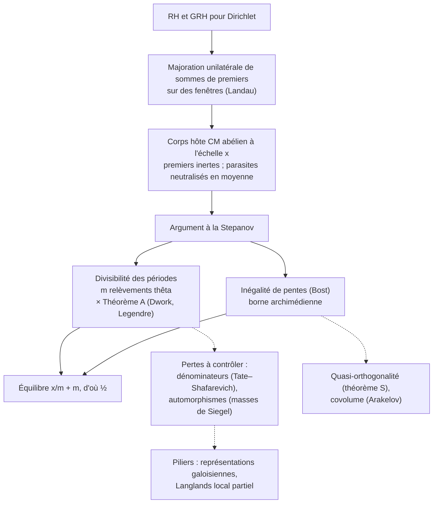

# La preuve de l'hypothèse de Riemann généralisée d'Alpöge

*Version 1.0, 23 novembre 2026. Document de travail : il sera corrigé à mesure que les lectures avancent (historique en fin de document). [English version](synthese_en.html).*

***Gérard Rozsavolgyi**, guidant **Claude (Anthropic)**. Les scripts d'analyse de l'export, la lecture du code et la rédaction ont été faits par Claude sous sa direction, puis relus. Sources : l'export de la preuve publié par A. Sutherland [Su] (`solution.ndjson.zst` : 1 468 418 déclarations, soit exactement la fermeture des énoncés de `Main`), la note de l'auteur [A], et les autres lectures publiées [Z], [S], [R], [H], [G] (voir les Références). Notes de travail plus détaillées, avec les noms Lean : [carte de la preuve](carte.html). Outils d'analyse : [tools/](tools/).*

> **À qui s'adresse ce texte.** À un mathématicien qui connaît les corps de nombres, les fonctions L de Dirichlet et un peu d'analyse $p$-adique, mais qui n'est spécialiste ni de théorie analytique des nombres, ni de formes automorphes, ni de géométrie d'Arakelov. Les **prémisses** rappellent les fonctions L de Dirichlet et l'énoncé de GRH. La **partie I** expose la preuve sans vocabulaire Lean. La **partie II** dit où chaque étape se trouve dans le code et ce qu'elle pèse. La **partie III** fait le bilan.
>
> **Statut.** La validité formelle n'est pas en cause : compilation complète, axiomes standard, rejeu par plusieurs noyaux indépendants (vérifications publiées par Sutherland [Su] et Rubinstein [R], état au 23/11/2026). Ce texte cherche à **comprendre**. Les affirmations sont lues sur les énoncés de l'export, sauf celles marquées ⟦I⟧, qui sont des interprétations.

---

## Prémisses : caractères de Dirichlet, fonctions L, hypothèse de Riemann

*Ce qui suit est classique (Davenport, *Multiplicative Number Theory*, chap. 4 à 9 et 19). On fixe les notations du reste du texte.*

**Caractères de Dirichlet.** Un caractère de Dirichlet de module $N\ge1$ est un morphisme de groupes $\chi:(\mathbb Z/N\mathbb Z)^\times\to\mathbb C^\times$, prolongé à ℤ par $\chi(n)=\chi(n\bmod N)$ si $\gcd(n,N)=1$ et $\chi(n)=0$ sinon. C'est une fonction complètement multiplicative et $N$-périodique, à valeurs dans les racines de l'unité (et 0).

- Son **ordre** $o$ est son ordre dans le groupe des caractères : $\chi^o=1$. Les caractères d'ordre 2 sont les caractères **quadratiques**, par exemple le symbole de Legendre $(\cdot/p)$ ou $\chi_{-4}(n)=(-1)^{(n-1)/2}$ pour $n$ impair.
- Il est **pair** ou **impair** selon que $\chi(-1)=+1$ ou $-1$ ; on note $\kappa\in\{0,1\}$ avec $\chi(-1)=(-1)^\kappa$.
- Il est **primitif** s'il ne provient pas d'un caractère de module $N'<N$, $N'\mid N$. Tout χ est **induit** par un unique caractère primitif $\chi^\ast$, de module $f\mid N$ appelé **conducteur** : $\chi(n)=\chi^\ast(n)$ pour $\gcd(n,N)=1$. Le caractère **trivial** de module $N$ est induit par le caractère $1$ de module 1.
- **Orthogonalité** : pour $\gcd(n,N)=1$, $\frac1{\varphi(N)}\sum_{\chi\bmod N}\chi(n)=1$ si $n\equiv1\pmod N$ et $0$ sinon. C'est l'outil qui isole une progression arithmétique, ou, au § 2, une classe de Frobenius.

**La fonction $L(s,\chi)$.** Pour $\operatorname{Re}s>1$,
$$L(s,\chi)=\sum_{n\ge1}\frac{\chi(n)}{n^{s}}=\prod_{p}\Big(1-\frac{\chi(p)}{p^{s}}\Big)^{-1},$$
la série et le produit (d'Euler) convergeant absolument. Pour $\chi=1$, c'est $\zeta(s)$. On écrit $L(s,\chi)$ ; Mathlib et la partie II écrivent $L(\chi,s)$ (`LFunction χ s`), c'est la même fonction.

- **Dérivée logarithmique.** En dérivant le logarithme du produit d'Euler,
$$-\frac{L'}{L}(s,\chi)=\sum_{n\ge1}\frac{\Lambda(n)\chi(n)}{n^{s}},\qquad \Lambda(n)=\begin{cases}\log p & n=p^k,\ k\ge1,\\ 0&\text{sinon}\end{cases}$$
($\Lambda$ est la fonction de **von Mangoldt**). C'est **le** pont entre zéros et nombres premiers : un zéro de $L$ d'ordre $m$ est un pôle simple de $-L'/L$, de résidu $-m$.
- **Prolongement et équation fonctionnelle.** Si χ est primitif et $\chi\neq1$, $L(s,\chi)$ se prolonge en une fonction **entière** ; $\zeta$ se prolonge en une fonction méromorphe avec un seul pôle, simple, en $s=1$. Pour χ primitif de conducteur $N$, la fonction complétée
$$\xi(s,\chi)=\Big(\frac N\pi\Big)^{(s+\kappa)/2}\,\Gamma\Big(\frac{s+\kappa}2\Big)\,L(s,\chi)$$
vérifie $\xi(s,\chi)=\varepsilon(\chi)\,\xi(1-s,\bar\chi)$, avec $|\varepsilon(\chi)|=1$ (un quotient de sommes de Gauss). La symétrie $s\leftrightarrow1-s$ échange χ et $\bar\chi$.
- **Zéros.** Le produit d'Euler interdit les zéros pour $\operatorname{Re}s>1$, et Hadamard–de la Vallée Poussin les excluent sur $\operatorname{Re}s=1$. Les pôles de Γ donnent les **zéros triviaux** $s=-\kappa,-\kappa-2,-\kappa-4,\dots$ (pour ζ : $-2,-4,\dots$). Tous les autres, les **zéros non triviaux** $\rho=\beta+i\gamma$, sont dans la **bande critique** $0<\beta<1$. Il y en a une infinité, environ $\frac{T}{2\pi}\log\frac{NT}{2\pi}$ de hauteur $0<\gamma\le T$. Par l'équation fonctionnelle et la conjugaison ($\overline{L(\bar s,\chi)}=L(s,\bar\chi)$), si ρ est un zéro de $L(s,\chi)$, alors $1-\bar\rho$ en est un aussi : l'ensemble des zéros non triviaux est **symétrique par rapport à la droite critique** $\operatorname{Re}s=\tfrac12$.
- **Caractères non primitifs.** Si χ est induit par $\chi^\ast$, $L(s,\chi)=L(s,\chi^\ast)\prod_{p\mid N}(1-\chi^\ast(p)p^{-s})$ : les facteurs ajoutés ne s'annulent que sur $\operatorname{Re}s=0$.

**RH et GRH.**

- **RH** : tous les zéros non triviaux de ζ ont une partie réelle $\tfrac12$.
- **GRH pour χ** (hypothèse de Riemann généralisée, ici pour les fonctions L de Dirichlet) : tous les zéros non triviaux de $L(s,\chi^\ast)$ ont une partie réelle $\tfrac12$.

Grâce à la symétrie $\rho\leftrightarrow1-\bar\rho$, il revient au même de dire qu'**il n'y a aucun zéro dans le demi-plan $\operatorname{Re}s>\tfrac12$** : un zéro à gauche de la droite critique en a un miroir à droite. C'est sous cette forme, qui ne parle ni de zéros triviaux ni de primitivité, que le théorème est énoncé, y compris dans Lean : *pour tout caractère χ et tout $s$ avec $\operatorname{Re}s>\tfrac12$, $L(s,\chi)\neq0$*.

**Traduction en termes de nombres premiers.** Notons $\psi(x,\chi)=\sum_{n\le x}\Lambda(n)\chi(n)$ la **fonction de Tchebychev** tordue par χ ($\psi(x)=\psi(x,1)$). La **formule explicite** de Riemann–von Mangoldt l'écrit comme une somme d'ondes indexées par les zéros :
$$\psi(x,\chi)=\delta_\chi\,x-\sum_{\rho}\frac{x^\rho}{\rho}+(\text{termes bornés par }O(\log x)),\qquad \delta_\chi=\begin{cases}1&\chi=1\\0&\chi\ne1\end{cases}$$
Un zéro $\rho=\beta+i\gamma$ produit une oscillation d'amplitude $x^\beta$. D'où l'équivalence, pour tout ε > 0 :
$$\text{GRH pour }\chi\iff\psi(x,\chi)-\delta_\chi x=O_\varepsilon\big(x^{1/2+\varepsilon}\big).$$
Le sens ⇐ est le seul dont la preuve a besoin. Il vient de $-\frac{L'}{L}(s,\chi)=s\int_1^\infty\psi(x,\chi)\,x^{-s-1}\,dx$ : une borne $O(x^{\theta})$ rend l'intégrale convergente, donc $L'/L$ holomorphe, pour $\operatorname{Re}s>\theta$. **Démontrer GRH, c'est majorer des sommes sur les nombres premiers avec une erreur en racine carrée.**

*Notation.* Dans la suite, la lettre ψ **seule** désigne un caractère primitif (celui que l'on traite), et $\psi(x,\chi)$ la fonction de Tchebychev ; γ désigne la constante d'Euler $0{,}5772\ldots$, sauf dans $\rho=\beta+i\gamma$.

---

## Résumé en deux pages

**Théorème.** Pour tout caractère de Dirichlet χ, $L(s,\chi)\neq 0$ pour $\operatorname{Re}s>\tfrac12$. En particulier, l'hypothèse de Riemann est vraie.

**La preuve en six étapes.**

**1. Une majoration d'un seul côté suffit.** Il suffit de majorer une combinaison **à coefficients positifs** de sommes de nombres premiers tordues par les puissances de χ, avec une erreur $x^{1/2+\varepsilon}$, et seulement sur des **fenêtres** d'échelles $[Y,Y^{3/2}]$.

> **Définitions.**
>
> - *Somme de Tchebychev tordue* : $\sum_{n\le x}\Lambda(n)\chi(n)$, où $\Lambda(n)=\log p$ si $n=p^k$ et $0$ sinon. GRH pour χ équivaut à ce que cette somme soit $O(x^{1/2+\varepsilon})$.
> - *Positivité à la Landau* : une série de Dirichlet à coefficients $\ge0$ a une singularité au point réel de son abscisse de convergence. Pour une combinaison positive, une **majoration** suffit donc à exclure les zéros, sans minoration.

**2. Un corps auxiliaire par échelle.** À chaque échelle $x$, on choisit un grand corps auxiliaire, l'**hôte**, et l'on y compte les **premiers inertes**, pondérés selon leur Frobenius. Par orthogonalité, ce comptage fait apparaître χ, mais aussi des caractères **parasites**, que l'on neutralise par un choix **en moyenne** des paramètres de l'hôte.

> **Définitions.**
>
> - *Corps CM* : extension quadratique totalement imaginaire d'un corps totalement réel, par exemple $\mathbb Q(\zeta_n)$ ou $\mathbb Q(\sqrt{-d})$.
> - *Hôte* : un corps CM abélien $E\subset\mathbb Q(\zeta_{Qqd})$, de degré $\approx x^{2}$, construit sur deux premiers auxiliaires $q,d$. Il contient $\sqrt{-q}$, $\sqrt{-d}$ et le corps découpé par χ. Son groupe de Galois est abélien et explicite, si bien que tout comptage de premiers selon leur Frobenius se décompose en sommes tordues par ses caractères, parmi lesquels χ.
> - *Premier inerte* : $p$ est inerte dans $\mathbb Q(\sqrt{-d})$ si $p\mathcal O$ y reste premier, de corps résiduel $\mathbb F_{p^2}$. Cela équivaut à $\big(\tfrac{-d}{p}\big)=-1$ et concerne environ la moitié des premiers.
> - *Choix en moyenne* : on ne sait pas contrôler un caractère quadratique donné, puisque ce serait GRH. Mais dans une famille de taille $\exp(Y^{\varepsilon/5})$, **presque toutes** les paires $(q,d)$ ont de bonnes sommes (grand crible). Il en existe donc.

**3. Le moteur : un argument à la Stepanov.** On remplace « une fonction qui s'annule à un ordre élevé » par « une série thêta dont les **dérivées d'ordre $a$ en un point CM** sont divisibles par $p^{a\,p/(p^2-1)}$ », pour chaque premier $p$ inerte. C'est un lemme $p$-adique sur les groupes formels (« Théorème A », de type Dwork et Legendre).

> **Définitions.**
>
> - *Méthode de Stepanov* : pour une courbe sur $\mathbb F_q$, on construit une fonction auxiliaire qui s'annule à l'ordre $a$ en chaque point rationnel. Alors $a\cdot\#C(\mathbb F_q)\le\deg f$, et l'optimisation en $a$ donne $q+O(\sqrt q)$. Sur ℤ, « s'annuler à l'ordre $a$ » devient « être divisible par $p^{v}$ ».
> - *Série thêta* : série génératrice $\theta_L(z)=\sum_{v\in L}e^{2\pi i H(v)z}$ des représentations par une forme quadratique ou hermitienne $H$ ; c'est une forme automorphe.
> - *Point CM* : point d'un espace de modules de variétés abéliennes (courbe modulaire, variété de Shimura) correspondant à une variété à **multiplication complexe**, dont l'anneau d'endomorphismes est anormalement grand. L'exemple type est $\mathbb C/\mathbb Z[i]$, en $\tau=i$. Les formes modulaires y prennent des valeurs algébriques.
> - *Réduction supersingulière, groupe formel* : en $p$ inerte, la courbe CM réduite modulo $p$ est supersingulière. Son groupe formel, une loi de groupe donnée par une série entière, est de hauteur 2, de logarithme $\sum_e X^{p^{2e}}/p^e$. Cette rigidité rend la divisibilité calculable.
> - *Le taux $p/(p^2-1)$* : on a $D^af(0)=a!\cdot\mathrm{coeff}_a(f)$. Par Legendre, $v_p(a!)\approx a/(p-1)$, et les dénominateurs du groupe formel coûtent au plus $a/(p^2-1)$. Or $\frac1{p-1}-\frac1{p^2-1}=\frac{p}{p^2-1}=\frac1p+\frac1{p^3}+\cdots$.

**4. La multiplicité : une chaîne de relèvements.** Une seule dérivation ne suffit pas. On enchaîne $m$ **relèvements thêta** entre groupes unitaires de rangs croissants, et chacun ajoute sa couche de divisibilité. La longueur $m$ de la chaîne joue le rôle de l'ordre d'annulation.

> **Définitions.**
>
> - *Groupe unitaire* $U(X)$ : groupe des isométries d'un espace hermitien $X$ sur un corps CM. Si $X$ est **défini** (positif aux places infinies), le groupe est compact à l'infini et ses espaces de formes automorphes sont de dimension finie.
> - *Relèvement thêta* (Weil, Howe, Kudla) : il transporte une forme automorphe $f$ sur $U(X)$ vers une forme sur un autre groupe unitaire $U(X')$, en l'intégrant contre une série thêta à deux variables, le « noyau » : $\theta(f)(h)=\int f(g)\,\Theta(g,h)\,dg$ (sur un quotient adélique).
> - *Période* : intégrale d'une forme automorphe sur un sous-groupe (ici une période de Bessel, au sens de Gan–Gross–Prasad). Par les identités **seesaw** (Kudla), la période du relèvement itéré se calcule sur le groupe de départ, à travers les $m$ noyaux successifs.

**5. Le côté archimédien : l'inégalité de pentes.** La divisibilité force les périodes à être des multiples de grandes puissances de premiers. Une **inégalité de pentes** (Bost) empêche ces périodes d'être trop grosses aux places infinies. Par la formule du produit, les deux contraintes ne sont compatibles que si la somme sur les premiers est petite. Les termes archimédiens (masses de Siegel, formules de Rallis, périodes CM) reproduisent exactement le terme principal attendu.

> **Définitions.**
>
> - *Réseau hermitien* : un $\mathcal O_K$-module projectif $L$ muni de normes hermitiennes aux places infinies.
> - *Pente* : $\widehat\mu(L)=-\log\operatorname{covol}(L)/\operatorname{rang}(L)$, à une normalisation près. Diviser $L$ par $p^{v}$ l'augmente de $v\log p$ : **une différence de pentes est une somme de $\log p$**.
> - *Inégalité de pentes* : pour $\varphi:E\to F$ injectif, $\widehat\mu(E)\le\widehat\mu_{\max}(F)+h(\varphi)$, où $h(\varphi)$ mesure la norme de $\varphi$ aux places infinies. C'est une version arithmétique du lemme de Siegel et de Minkowski : un réseau ne peut pas être très « serré » s'il s'envoie sans trop dilater dans un réseau connu. La divisibilité augmente la pente, et l'inégalité la plafonne.
> - *Formule du produit* : pour $\alpha\ne0$ dans un corps de nombres, $\prod_v|\alpha|_v=1$. Être très divisible en $p$ oblige à être grand ailleurs.

**6. D'où vient le ½.** L'erreur a deux termes : $x/m$, qui décroît avec la longueur $m$ de la chaîne, et une perte $m$, qui croît avec elle. L'optimum $m\approx\sqrt x$ donne l'exposant $\tfrac12$.

> **Définitions.**
>
> - *Équilibre* : l'erreur relative vaut $\approx x/m+m\ge2\sqrt x$, avec égalité pour $m=\sqrt x$. La méthode bute exactement sur $\sqrt x$, la vraie taille des fluctuations (Littlewood). $m$ est la **longueur de la chaîne**, pas un rang.
> - *Les pertes à payer* : les dénominateurs des projections de Hecke, bornés par des groupes de Tate–Shafarevich ; les automorphismes des réseaux (masses de Siegel) ; une quasi-orthogonalité des périodes ; un covolume. Voir § 8.

Tout le reste, soit plus de 99 % des 17 millions de lignes, sert à **fabriquer** les objets auxquels ce mécanisme s'applique : groupes unitaires, réseaux, noyaux thêta, représentations galoisiennes, bornes de groupes de Tate–Shafarevich. Il sert aussi à **contrôler les pertes**.



*Lecture du schéma : une flèche pleine signifie « se ramène à » ou « repose sur » ; une flèche en pointillés mène aux pertes à contrôler et aux théories qui les contrôlent.*

---

# Partie I. La preuve

## 1. De RH à une inégalité sur les nombres premiers

Ce paragraphe ramène GRH à **une seule inégalité**, sans aucune arithmétique fine : uniquement de l'analyse complexe classique (Perron, Landau). Il tient en cinq étapes. Dans le code, c'est la partie légère : environ 73 000 déclarations, pour l'essentiel l'analyse de Mathlib (partie II).

### 1.1 Réduction aux caractères primitifs, groupés par niveaux

Si χ est induit par $\chi^\ast$, de module $N$,
$$L(s,\chi)=L(s,\chi^\ast)\prod_{p\mid N}\big(1-\chi^\ast(p)p^{-s}\big).$$
Chaque facteur a pour module $\ge 1-p^{-\operatorname{Re}s}>0$ si $\operatorname{Re}s>0$ : il ne s'annule pas à droite de l'axe imaginaire. Les zéros de $L(s,\chi)$ dans $\operatorname{Re}s>\tfrac12$ sont donc ceux de $L(s,\chi^\ast)$, et il suffit de traiter les caractères **primitifs**. RH est le cas $\chi^\ast=1$ (module 1), c'est-à-dire ζ ; les caractères triviaux de module $N$ s'y ramènent.

La preuve ne traite pas un caractère isolé, mais tout un **niveau** à la fois. Pour ψ primitif d'ordre $o$, on note
$$K_\psi=\{\chi_0=1,\ \chi_1,\dots,\chi_{o-1}\},\qquad \chi_j=\text{le caractère primitif qui induit }\psi^j .$$
C'est un ensemble de $o$ caractères primitifs, **stable par conjugaison** ($\overline{\psi^j}=\psi^{o-j}$), qui contient 1. On démontrera d'un coup que **ni ζ ni aucun des $L(s,\chi_j)$** ne s'annule pour $\operatorname{Re}s>\tfrac12$. Pour RH seule, $\psi=1$, $o=1$ et $K_\psi=\{1\}$.

### 1.2 Lisser : la somme de Tchebychev pondérée de Riesz

La fonction $\psi(x,\chi)$ des prémisses a deux défauts : elle saute en chaque puissance de premier, et sa formule explicite $\sum_\rho x^\rho/\rho$ ne converge que conditionnellement (car $\sum 1/|\rho|$ diverge). La preuve utilise plutôt le **poids de Riesz** $(y/n-1)_+$ :
$$S(y,\chi)=\sum_{n\le y}\Lambda(n)\chi(n)\Big(\frac yn-1\Big)=\int_1^y\Big(\sum_{n\le t}\frac{\Lambda(n)\chi(n)}{n}\Big)\,dt .$$
C'est une primitive (une moyenne) : elle est continue, et chaque intégration fait gagner un facteur $1/|\rho|$ dans la formule explicite.

**La formule de Perron.** Pour $c>1$ et $y>0$, le calcul des résidus en $s=1$ et $s=0$ donne
$$\frac1{2\pi i}\int_{c-i\infty}^{c+i\infty}\frac{(y/n)^s}{s(s-1)}\,ds=\Big(\frac yn-1\Big)_+ ,$$
d'où, en sommant contre $\Lambda(n)\chi(n)$ et en utilisant la dérivée logarithmique,
$$S(y,\chi)=\frac1{2\pi i}\int_{(c)}\Big(-\frac{L'}{L}(s,\chi)\Big)\frac{y^s}{s(s-1)}\,ds .$$
Le noyau décroît comme $|s|^{-2}$ : l'intégrale converge **absolument**, et on peut déplacer le contour vers la gauche en ramassant les résidus.

- **En $s=1$.** Pour $\chi\neq1$, $L(1,\chi)\ne0$ (Dirichlet), et le résidu vaut $-y\,\frac{L'}{L}(1,\chi)$. Pour ζ, le pôle de $-\zeta'/\zeta=\frac1{s-1}-\gamma+\cdots$ rencontre celui du noyau : pôle double, de résidu $y\log y-(1+\gamma)\,y$.
- **En chaque zéro non trivial ρ, de multiplicité $m_\rho$** : $-L'/L$ a un résidu $-m_\rho$, d'où le terme $-m_\rho\,y^\rho/(\rho(\rho-1))$.
- **En $s=0$ et aux zéros triviaux** : des termes $O(\log y)$.

On retire donc le terme principal, ce qui définit
$$g(y,\chi)=S(y,\chi)+y\,\frac{L'}{L}(1,\chi)\quad(\chi\ne1),\qquad G(y)=S(y,1)-y\log y+(1+\gamma)\,y ,$$
et l'on obtient la **formule explicite lissée** :
$$g(y,\chi)=-\sum_\rho m_\rho\,\frac{y^\rho}{\rho(\rho-1)}+O(\log y),$$
et de même pour $G$ avec les zéros de ζ. La série converge **absolument**, puisque $\sum_\rho1/|\rho|^2<\infty$. Deux conséquences :

1. **GRH ⇒ $g(y,\chi)=O(y^{1/2})$**, sans même de $\varepsilon$ : c'est la taille visée.
2. **Réciproquement**, par transformation de Mellin, $\int_1^\infty g(y,\chi)\,y^{-s-1}dy=-\frac{1}{s(s-1)}\frac{L'}{L}(s,\chi)+(\text{fraction rationnelle à pôles en }0,1)$. Un zéro ρ y apparaît comme un **pôle**. Une borne $|g(y,\chi)|=O(y^\theta)$ rend l'intégrale convergente pour $\operatorname{Re}s>\theta$, et exclut tout zéro de partie réelle $>\theta$.

Le point 2 demande une borne **en valeur absolue** : il faudrait contrôler les fluctuations de $g$ vers le haut **et** vers le bas. La suite de la réduction supprime une de ces deux exigences.

### 1.3 Combiner : une somme à coefficients positifs

Pour ψ primitif d'ordre $o$, on forme
$$G_\psi(y)=G(y)+\frac{1}{3o+1}\sum_{j=1}^{o-1}\operatorname{Re}g(y,\chi_j).$$
Comme $K_\psi$ est stable par conjugaison et $g(y,\bar\chi)=\overline{g(y,\chi)}$, la somme des parties réelles est la somme des $g(y,\chi_j)$ elles-mêmes. $G_\psi$ est donc la somme de Riesz, terme principal ôté, de la série de Dirichlet
$$D_\psi(s)=-\frac{\zeta'}{\zeta}(s)-\frac1{3o+1}\sum_{j=1}^{o-1}\frac{L'}{L}(s,\chi_j)=\sum_{n\ge1}\frac{c_n}{n^s},\qquad c_n=\Lambda(n)\Big(1+\frac1{3o+1}\sum_{j=1}^{o-1}\chi_j(n)\Big).$$

**Les coefficients sont positifs.** Si $n$ est premier au conducteur de ψ, $\chi_j(n)=\psi(n)^j$, et la somme géométrique $\sum_{j=1}^{o-1}\psi(n)^j$ vaut $o-1$ si $\psi(n)=1$, et $-1$ sinon. D'où
$$c_n=\Lambda(n)\cdot\begin{cases}\dfrac{4o}{3o+1}&\text{si }\psi(n)=1,\\[8pt]\dfrac{3o}{3o+1}&\text{sinon.}\end{cases}$$
Pour les puissances des premiers $p$ qui divisent le conducteur, on borne chaque $|\chi_j(n)|\le1$ : $c_n\ge\Lambda(n)\,\frac{2o+2}{3o+1}>0$. Dans tous les cas $c_n\ge0$, et $c_n=0$ seulement si $\Lambda(n)=0$.

**D'où vient $1/(3o+1)$.** Le profil 4 : 3 n'est pas arbitraire, il se lit sur la construction du § 2 (lu sur le code). Les premiers y sont échantillonnés selon leur classe modulo un sous-groupe d'indice $o$ d'un groupe de Frobenius, avec la proportion $4/(3o+1)$ pour la classe neutre et $3/(3o+1)$ pour chacune des $o-1$ autres. Le total vaut $(4+3(o-1))/(3o+1)=1$. Les coefficients de Fourier de cette distribution valent $1$ pour le caractère trivial et $\frac{4-3}{3o+1}=\frac1{3o+1}$ pour tous les autres : ce sont exactement les poids de $G_\psi$, et $c_n/\Lambda(n)$ est $o$ fois la proportion de la classe de $n$. Une distribution uniforme donnerait des poids nuls et ne verrait pas les $\chi_j$ ; une distribution strictement positive garantit la positivité. Pourquoi 4 : 3 plutôt qu'un autre mélange, le code ne le dit pas ⟦I⟧ : la positivité seule ne l'impose pas.

**Pas de compensation entre zéros.** La transformée de Mellin de $G_\psi$ est $D_\psi(s)/(s(s-1))$, à une fraction rationnelle près. Ses pôles dans $0<\operatorname{Re}s<1$ sont les zéros ρ de ζ ou de l'un des $L(s,\chi_j)$, avec le poids
$$w_\rho=m_\rho(\zeta)+\frac1{3o+1}\sum_{j=1}^{o-1}m_\rho(\chi_j)\;>\;0 .$$
Toutes les multiplicités entrent avec un signe $+$ : un zéro de l'une des fonctions ne peut pas être masqué par une autre. C'est l'idée de de la Vallée Poussin, qui combinait $\zeta(\sigma)^3|\zeta(\sigma+it)|^4|\zeta(\sigma+2it)|$ grâce à $3+4\cos\theta+\cos2\theta=2(1+\cos\theta)^2\ge0$.

### 1.4 Pourquoi une majoration suffit : l'argument de Landau

**Théorème de Landau.** Soit $f\ge0$ sur $[1,\infty)$ et $H(s)=\int_1^\infty f(y)\,y^{-s-1}dy$, d'abscisse de convergence $\sigma_c$. Alors $H$ n'a **pas** de prolongement holomorphe au voisinage du point **réel** $s=\sigma_c$. (Preuve : on développe $H$ en série de Taylor en un point réel $a>\sigma_c$. Les dérivées $(-1)^kH^{(k)}(a)=\int f(y)(\log y)^ky^{-a-1}dy$ sont positives ; si la série convergeait un peu au-delà de $\sigma_c$, on pourrait l'intervertir avec l'intégrale, qui convergerait donc au-delà de $\sigma_c$.)

**Application.** Supposons $G_\psi(y)\le y^\theta$ pour $y\ge y_0$, avec $\theta<1$. On pose $f(y)=y^\theta-G_\psi(y)\ge0$. Sa transformée est
$$H(s)=\frac{y_0^{\theta-s}}{s-\theta}-\int_{y_0}^\infty G_\psi(y)\,y^{-s-1}dy=\frac{1}{s-\theta}-\frac{D_\psi(s)}{s(s-1)}+(\text{fonction holomorphe pour }\operatorname{Re}s>0),$$
où « holomorphe » inclut la compensation du pôle en $s=1$ par les termes principaux. Supposons par l'absurde $\sigma_c>\theta$. D'après Landau, $\sigma_c$ est une singularité, donc un pôle de $D_\psi/(s(s-1))$ : un **zéro réel** $\beta=\sigma_c\in(\theta,1)$. Son résidu dans $D_\psi(s)/(s(s-1))$ est $-w_\beta/(\beta(\beta-1))=w_\beta/(\beta(1-\beta))>0$. Quand $\sigma\to\beta^+$, $H(\sigma)\to-\infty$, ce qui contredit $H(\sigma)=\int f\,y^{-\sigma-1}\ge0$. Donc $\sigma_c\le\theta$ : $H$ est holomorphe sur $\operatorname{Re}s>\theta$, et donc $D_\psi$ aussi. **Ni ζ ni aucun $L(s,\chi_j)$ n'a de zéro de partie réelle $>\theta$.**

**Lecture intuitive.** Dans la formule explicite, un zéro réel β contribue $+w_\beta\,y^\beta/(\beta(1-\beta))$ : il **pousse $G_\psi$ vers le haut**, et une majoration le voit directement. Un zéro complexe $\beta+i\gamma$ contribue une oscillation d'amplitude $\asymp y^\beta$, en $\cos(\gamma\log y+\varphi)$. Elle monte la moitié du temps, et la positivité des $w_\rho$ empêche les oscillations de différents zéros de se neutraliser durablement. Le théorème de Landau rend ce « toute oscillation finit par monter » rigoureux. **On n'a jamais besoin de minorer $G_\psi$.** C'est essentiel pour la suite : la méthode arithmétique (§§ 3 à 7) fournit une **inégalité**, pas une égalité asymptotique.

### 1.5 Sur des fenêtres seulement

La méthode des §§ 2 à 7 ne fournit pas la majoration pour **tout** $y$ grand, mais seulement sur des plages d'échelles où l'on a pu construire un corps hôte (§ 2) : il faut choisir $q$ et $d$ en fonction de la plage. La preuve démontre donc une forme de Landau **en fenêtres**. Lu sur l'export, dans le sens contraposé :

> **Critère en fenêtres.** Soit $\lambda>1$ et $0<\theta<1$. Si ζ ou l'un des $L(s,\chi_j)$ a un zéro de partie réelle $>\theta$, alors pour tout $Y$ assez grand, il existe $y\in[Y,Y^\lambda]$ tel que $G_\psi(y)>y^\theta$.

Autrement dit, un zéro au-delà de θ se voit dans **chaque** fenêtre $[Y,Y^\lambda]$ assez loin, et pas seulement « quelque part à l'infini ». Il suffit donc de majorer $G_\psi$ sur une suite de fenêtres $[Y_k,Y_k^\lambda]$, $Y_k\to\infty$. Le critère vaut pour tout $\lambda>1$ ; la suite de la preuve l'applique avec des plages $[Y,Y^{3/2}]$ ou $[Y,Y^2]$.

**Comment on localise ⟦I⟧.** La preuve de Landau n'utilise que les dérivées $(-1)^kH^{(k)}(a)=\int f(y)(\log y)^ky^{-a-1}dy$. En variable $u=\log y$, le noyau $u^ke^{-au}$ est une **densité gamma**, de moyenne $\approx k/a$ et de largeur relative $\approx k^{-1/2}$. En prenant $k\asymp\log Y$, la masse se concentre dans $u\in[\log Y,\lambda\log Y]$, c'est-à-dire dans la fenêtre. Le reste, exponentiellement petit en $k$ (donc une puissance négative de $Y$), est absorbé par la borne triviale $G_\psi(y)=O(y)$ (Mertens). Slijepčević juge cette forme en fenêtres nouvelle. Dans cette preuve, elle est indispensable : sans elle, il faudrait un même hôte pour toutes les échelles, ce que le choix en moyenne du § 2 ne fournit pas. Un texte ultérieur (hexagon:2611.00828) propose toutefois de la remplacer par un théorème d'oscillation classique, celui de Kaczorowski–Pintz.

### 1.6 Bilan

En appliquant 1.4 et 1.5 avec $\theta=\tfrac12+C\varepsilon$ pour chaque $\varepsilon>0$, puis en faisant $\varepsilon\to0$, on obtient l'absence de zéros pour $\operatorname{Re}s>\tfrac12$, simultanément pour ζ et pour tous les $L(s,\chi_j)$, $\chi_j\in K_\psi$. Comme tout caractère primitif appartient à son propre niveau $K_\psi$, cela donne GRH pour tous les caractères de Dirichlet.

> **Bilan.** Tout se ramène à démontrer, pour chaque ψ primitif, chaque ε > 0 assez petit et chaque échelle $x$ d'une suite de fenêtres $[Y_k,Y_k^\lambda]$, $Y_k\to\infty$ :
> $$\boxed{\;G_\psi(x)\;\le\;x^{1/2+C\varepsilon}\;}$$
> C'est une **majoration unilatérale** d'une somme pondérée de $\log p$, à **coefficients positifs**, avec une erreur en racine carrée. Les §§ 2 à 7 ne font rien d'autre.

## 2. Un corps auxiliaire par échelle

**L'hôte.** À l'échelle $x$, on choisit deux premiers $q\equiv 3\pmod 8$ et $d\equiv7\pmod{16}$, puis un corps CM abélien
$$E\subset\mathbb Q(\zeta_{Qqd}),\qquad \sqrt{-q},\sqrt{-d}\in E,\qquad [E:\mathbb Q]\approx x^{2+8\varepsilon},$$
qui contient le corps découpé par ψ. Le groupe de Galois $\{\pm1\}^2\times A$ et l'application d'Artin sont décrits explicitement. Précisément (lu sur l'export) : $|A|=c\cdot2^e$ avec $x^{2+8\varepsilon}\le c\cdot2^e\le2x^{2+8\varepsilon}$, donc $[E:\mathbb Q]=4|A|$ est compris entre $4x^{2+8\varepsilon}$ et $8x^{2+8\varepsilon}$. C'est **le même corps** qui porte la borne de Tate–Shafarevich du § 8 (a).

**L'identité.** On considère les premiers $p$ **inertes** dans $\mathbb Q(\sqrt{-d})$, pondérés selon leur classe de Frobenius dans $E$. Par orthogonalité des caractères de $\mathrm{Gal}(E/\mathbb Q)$, la somme de $\log p$ sur ces premiers s'écrit comme une combinaison des $g(\cdot,\chi)$ pour les caractères χ de $E$. Après une moyenne sur des translatés et un choix des poids, on retrouve exactement $G_\psi(x)$, avec le poids $1/(3o+1)$ (d'où ce poids). On retrouve aussi des **caractères parasites**, essentiellement des torsions par $(q/\cdot)$, $(d/\cdot)$ et leur produit.

**Les parasites, en moyenne.** Pour un caractère quadratique donné, on ne sait pas montrer que $g(y,\chi)=O(y^{1/2+\varepsilon})$ : c'est GRH elle-même. Mais on peut choisir $q$ et $d$ dans une famille de taille $\exp(Y^{\varepsilon/5})$, **gigantesque** devant les échelles. Un argument de moyenne quadratique, de type grand crible, montre que **presque toutes** les paires $(q,d)$ ont des sommes en racine carrée sur toute la plage $[Y,Y^A]$ ($A$ fixé), et aucun zéro près de $s=1$. Il en existe donc. Cet argument est inconditionnel et ne sert qu'à **dégager le terrain**.

> **Ce qui reste.** Majorer la somme sur les premiers inertes de $E$, par $p$, avec une erreur $x^{1/2+O(\varepsilon)}$. C'est le cœur de la preuve.

## 3. Le modèle : la preuve de Stepanov pour les courbes

Soit $C$ une courbe de genre $g$ sur $\mathbb F_q$. Stepanov (1969), puis Bombieri, majorent $N=\#C(\mathbb F_q)$ ainsi :

1. on construit une fonction auxiliaire $f$, de degré contrôlé, qui **s'annule à l'ordre au moins $a$** en chaque point rationnel ; on la fabrique par algèbre linéaire, c'est un lemme de Siegel ;
2. alors $a\cdot N\le\deg f$ ;
3. on optimise $a$, et on obtient $N\le q+O(g\sqrt q)$.

L'exposant ½ vient de l'**équilibre** entre l'ordre d'annulation et le degré.

**La difficulté sur ℤ.** « S'annuler à l'ordre $a$ » demande de dériver, et l'on ne dérive pas un entier. Alpöge (note, § 1) : « multiplicity is hard to find over the integers, corresponding to something like differentiating whole numbers ». La preuve remplace l'annulation par la **divisibilité**. Un entier algébrique non nul divisible par $p^v$ a une norme $\ge p^v$. Si l'on sait aussi que sa taille archimédienne est petite, la **formule du produit** borne $v$. C'est le schéma des méthodes de fonctions auxiliaires en transcendance (Thue–Siegel–Bombieri), dans sa forme moderne due à **Bost** : les inégalités de pentes.

## 4. La source de la divisibilité : dériver une série thêta en un point CM

### 4.1 L'énoncé

Prenons une série thêta d'un réseau hermitien, écrite près d'un point CM dans les **coordonnées d'un groupe formel**. En un premier $p$ inerte dans le corps CM, la réduction est **supersingulière** et le groupe formel est de **hauteur 2**. Son logarithme a la forme
$$\log_F(X)=\sum_{e\ge0}\frac{X^{p^{2e}}}{p^{e}},$$
à une torsion de Frobenius près sur l'indice. Le projet démontre l'énoncé suivant, qu'il appelle « Théorème A » :

> **Théorème A** (forme simplifiée). Soit $\Theta$ une série thêta, renormalisée par une exponentielle convenable, en coordonnées de groupe formel au point CM. Alors ses dérivées d'ordre $a$ au point CM vérifient
> $$v_p\big(D^{a}\Theta(0)\big)\;\ge\;a\cdot\frac{p}{p^2-1}\;-\;O(\log a)\;=\;a\Big(\frac1p+\frac1{p^3}+\frac1{p^5}+\cdots\Big)-O(\log a).$$

C'est la phrase de la note d'Alpöge : « $D^a\,\Omega\cdot\theta(0)$ is divisible by $p^{a/p+a/p^3+\cdots-O(\log a)}$ ». Mais l'exposant porte sur l'objet **renormalisé, en coordonnées de groupe formel**, et non sur la série thêta naïve dérivée en coordonnée analytique. Sur ce modèle naïf, pour ℤ[i], Rubinstein [R] ne retrouve pas l'exposant annoncé (exposants 6, 2, 1 pour $p=3,7,11$).

### 4.2 Pourquoi $p/(p^2-1)$ ⟦I⟧

Le nombre $p/(p^2-1)$ est une différence de deux taux. On a $D^a f(0)=a!\cdot[\text{coefficient de degré }a]$, et :

- **Legendre** : $v_p(a!)=\dfrac{a-s_p(a)}{p-1}\ge\dfrac{a}{p-1}-O(\log a)$. La dérivation fournit environ $a/(p-1)$.
- **Les dénominateurs** : le changement de variables par le groupe formel de hauteur 2, dont le logarithme a des termes $X^{p^{2e}}/p^e$, et l'exponentielle de renormalisation coûtent au plus $a/(p^2-1)$ sur le coefficient de degré $a$. Le projet établit cette borne de poids, $\rho(p)=1/(p^2-1)$ par degré, pour la série exponentielle (lemme « S »).
- **Bilan** : $\dfrac{1}{p-1}-\dfrac{1}{p^2-1}=\dfrac{p}{p^2-1}$, ce qui est exactement le gain observé.

La perte $O(\log a)$ vient du chiffre $s_p(a)$ dans Legendre et du nombre de « couches » $p^e\le a$.

### 4.3 Comment le Théorème A est démontré

La preuve occupe environ 0,02 % du volume. Elle se fait en trois temps.

1. **Réduction à un point générique.** On veut borner les coefficients d'un polynôme en les coordonnées d'un « repère », c'est-à-dire de vecteurs le long desquels on dérive. On le remplace par sa valeur en un point **résiduellement générique** : un point dont les coordonnées ont des réductions algébriquement indépendantes, de sorte que tout polynôme non nul modulo $p$ y est de valeur absolue 1. En un tel point, la valeur absolue est égale à la **norme de Gauss**, le maximum des coefficients. Un tel point existe dans un corps de fractions rationnelles muni de la valeur absolue de Gauss.
2. **Réduction à un monôme.** Le jet du repère s'exprime par des produits de mineurs, donc de déterminants, des dérivées de $\Theta$ le long du repère. On se ramène à borner $|\kappa!\cdot\mathrm{coeff}_\kappa(\cdots)|$ pour un seul multi-indice $\kappa$.
3. **Le cas d'un monôme.** On combine :
   - l'intégralité de la série de départ ;
   - l'**inverse du logarithme** de groupe formel ;
   - la borne de poids $\rho(p)$ pour l'exponentielle de renormalisation. Elle repose sur une hypothèse d'**intégralité de type Dwork**, et le **lemme de Dwork** est démontré dans le projet : $\exp(P)$ est $p$-entière si et seulement si $P^{\sigma}(X^p)-pP\in pW[[X]]$ ;
   - une condition de **quasi-orthogonalité tordue par Frobenius** sur les vecteurs du repère, $\sum_a x_a^{p^{j}}x'_a\equiv0 \pmod p$.

   Un étiquetage combinatoire des décalages impairs $j$ tels que $p^j\le a$ (seuls ceux-là apportent un terme $a/p^j$) coûte $O(\log a)$ lignes supplémentaires. C'est l'origine de la perte logarithmique.

### 4.4 Les exposants impairs et le Frobenius

En $p$ inerte, le Frobenius agit sur les plongements du corps CM par décalage. Le gain $a/p^{e}$ ne se réalise qu'aux **exposants impairs**. Il se lit sur les poids attachés à la place $t+e\cdot h_p$ de l'**orbite de Frobenius** de $p$ : on obtient $a/p^e$ si le poids à cette place n'est pas trop grand, et rien sinon. D'où une contrainte combinatoire. Les places « sélectionnées », où les poids sont grands, doivent rencontrer chaque segment court d'orbite de Frobenius en au plus deux points. La preuve l'obtient avec la construction de **Behrend** d'ensembles sans progression arithmétique de longueur 3, présente dans la fermeture. Alpöge (note, étape 19) : « precise choice of the Iwasawa tower, specifically using Behrend!! ».

## 5. La multiplicité : une chaîne de m relèvements thêta

Une seule dérivation en un seul point CM ne fournit pas assez. Il faut répéter, comme Stepanov exige l'annulation en **tous** les points. L'outil est la **correspondance thêta** : une forme automorphe sur un groupe unitaire $U(X_0)$ se relève, par intégration contre un noyau thêta, en une forme sur $U(X_1)$, de rang plus grand, et ainsi de suite :
$$U(X_0)\to U(X_1)\to\cdots\to U(X_m),\qquad \dim X_j=k+j(t+1).$$
Tous les espaces hermitiens sont **définis**, ce qui rend les groupes compacts à l'infini et les espaces de formes de dimension finie.

**Ce que dit le code.**

- La **période** d'une forme (une période de Bessel, au sens de Gan–Gross–Prasad) se factorise par la **composée des $m$ noyaux** :
  $$\mathrm{Pt}(\varphi)=\mathrm{PtL}\big(K_m\cdots K_1\,\varphi\big).$$
  C'est la forme matricielle des identités **seesaw** (Kudla) : la période du relèvement itéré est une période sur le groupe de départ.
- À chaque pas $j\to j+1$, l'opérateur local appliqué au noyau $K_j$ **gagne** une valuation au moins égale au gain de Legendre du § 4 pour ce relèvement, diminuée d'une perte $\mathrm{dG}_j\ge v_p(|\mathrm{Stab}_\Gamma(L)|)$. Cette perte est la partie $p$ de l'ordre du groupe d'automorphismes du réseau : un dénominateur de **masse de Siegel**.
- Le réseau sur lequel on travaille est **engendré** par l'application, en chaque point de l'orbite de Frobenius, d'un opérateur local **itéré m fois**, une fois par relèvement.
- Au total, pour chaque premier inerte $p$ :
  $$v_p(\text{période})\;\ge\;\sum_{j=1}^{m}\mathrm{gain}_j(p)\;-\;\text{pertes}(p),\qquad \mathrm{gain}_j(p)\approx\sum_{e\ \text{impair}}\Big(\frac{a}{p^{e}}-\mathrm{cap}_j(p,e)\Big)_+ ,$$
  où $\mathrm{cap}_j$ est le poids, de type Harish-Chandra, du $j$-ième relèvement.

**La comparaison avec les premiers est presque une identité.** La somme sur les premiers à majorer, pondérée de Riesz, s'écrit terme à terme $\sum_{i\ \text{impair}}\big(a/p^i-w_j(p,i)\big)_+$. C'est **la même forme**, avec **les mêmes poids** : la preuve choisit les poids des relèvements pour qu'ils coïncident avec ceux des sommes de premiers. La condition qui relie les deux côtés dit que, pour chaque premier inerte $p$,
$$\sum_{j=1}^m(\text{contribution de }p\text{ au }j\text{-ième terme de la somme})\;-\;\text{pertes}\;\le\;\sum_{j=1}^m\mathrm{gain}_j(p).$$

> **Où est la difficulté ?** Une fois les poids alignés, l'inégalité « premiers ≤ gains » est presque une identité. Toute la difficulté est de **construire** des réseaux, des noyaux et des périodes qui **réalisent** ces gains, et de **contrôler les pertes**.

## 6. Du côté archimédien : réseaux, pentes et formule du produit

**Réseaux hermitiens et pentes.** Sur un corps de nombres $K$, un réseau hermitien est un $\mathcal O_K$-module projectif muni de normes aux places infinies. Son **degré d'Arakelov** est $\widehat{\deg}=-\log\operatorname{covol}$, et sa **pente** est $\widehat\mu=\widehat{\deg}/\mathrm{rang}$. Le point clé est le suivant : si $L'$ est obtenu en **divisant** $L$ par un idéal $I$, c'est-à-dire $L=I\cdot L'$, alors
$$\widehat\mu(L')-\widehat\mu(L)\;=\;\sum_{\mathfrak p}v_{\mathfrak p}(I^{-1})\log N\mathfrak p\quad(\text{normalisé}).$$
**Une différence de pentes est une somme de $\log p$ sur des premiers.**

**La division.** À chaque mot $u$, qui indexe une forme de la famille, on associe un réseau de formes $N_u$ et l'accouplement des périodes $B_u:N_u\to R^\vee$, à valeurs dans un réseau cible entier. La divisibilité du § 5 permet de **diviser** $N_u$ tout en gardant $B_u$ **entier**. Deux énoncés, lus sur l'export, s'emboîtent :

- **Le lemme abstrait** (démontré dans le projet). Si les valuations des périodes sont $\ge\sigma(w)$ en chaque place $w$, avec $\sigma(w)$ **réel**, alors le réseau décalé de $\tau(w)$ en $w$ s'envoie encore dans les entiers pour tout entier $\tau(w)\le\lceil\sigma(w)\rceil$. La borne $\lceil\sigma\rceil$ est optimale : une valuation est un entier, donc $v\ge\sigma$ équivaut à $v\ge\lceil\sigma\rceil$.
- **La construction.** Elle divise par l'idéal fractionnaire $I_u=\prod_w w^{-\lfloor e_w\,\sigma_u(w)\rfloor}$, où $e_w$ est l'indice de ramification : elle prend la **partie entière inférieure**, un choix prudent qui reste dans le cadre du lemme ($\lfloor\cdot\rfloor\le\lceil\cdot\rceil$). La pente de $N_u$ monte alors exactement de
$$\widehat\mu(N_u)-\widehat\mu(N_u^{\mathrm{avant}})\;=\;\sum_w 2\,\frac{\log Nw}{[K:\mathbb Q]}\,\big\lfloor e_w\,\sigma_u(w)\big\rfloor .$$

La perte d'arrondi est comptée explicitement. L'écart entre ce saut et sa valeur sans arrondi, $\sum_w 2\,\frac{\log Nw}{[K:\mathbb Q]}\,e_w\,\sigma_u(w)$, est au plus $2\sum_w\frac{\log Nw}{[K:\mathbb Q]}$, la somme portant sur les seules places où $\sigma_u(w)\neq0$ : moins d'une unité par place active. Cette somme est elle-même majorée par des logarithmes des paramètres de l'hôte et de la chaîne. Le tout donne une erreur au plus $C\,X''$, avec $X''=x\,n\,e^{x^{\varepsilon/3}}$, où $n$ est l'ordre du groupe $A$ du § 2. Sur l'export, $[E:\mathbb Q]=4n$ exactement, et $n\le 2x^{2+8\varepsilon}$ (§ 2). Elle forme l'une des conditions de liaison qui alimentent l'inégalité finale (partie II).

**Elle est négligeable.** Une unité de la somme de premiers vaut $b=e^{x^\varepsilon}$ en pente : les poids de Riesz sont d'ordre $b$, et les paramètres vérifient $a=x\,b$. En unités de $G_\psi$, l'arrondi pèse donc au plus $C\,x\,n\,e^{x^{\varepsilon/3}-x^{\varepsilon}}$. Cette quantité tend vers 0 plus vite que toute puissance de $x$, alors que le budget d'erreur final est $x^{1/2+C\varepsilon}$. L'autre reste de la même condition est, lui, d'ordre $b$ (à des facteurs logarithmiques et de taille près) : l'arrondi est plus petit d'un facteur $e^{-x^{\varepsilon}(1-o(1))}$.

**L'inégalité de pentes (Bost).** Pour $\varphi:E\to F$ injectif de hauteur $h(\varphi)$, on a $\widehat\mu(E)\le\widehat\mu_{\max}(F)+h(\varphi)$. C'est une généralisation arithmétique du lemme de Siegel et de Minkowski. On l'applique aux $B_u$. Les pentes des réseaux divisés, qui contiennent les sommes de premiers, sont donc majorées par :

- la pente du réseau cible, calculée par des **volumes exacts** : masses de Siegel, nombres de classes, facteurs Γ ;
- les hauteurs $h(B_u)$, petites grâce à une **quasi-orthogonalité** : les périodes de formes différentes sont presque orthogonales. C'est le « théorème S » du projet, une formule de type Petersson ou Kuznetsov pour des coefficients de Bessel sur les groupes unitaires, avec une erreur $1+b^{-6}$ ;
- une **borne de covolume** des réseaux de formes automorphes, obtenue par géométrie d'Arakelov sur des modèles entiers de variétés de Shimura. Elle utilise Hironaka, Moriwaki, Hilbert–Samuel arithmétique et les compactifications toroïdales.

**Le bilan.** Divisibilité aux places finies et taille aux places infinies, combinées par la formule du produit :
$$\sum_{p\ \text{inerte}}(\text{contribution de }p)\;\le\;(\text{termes archimédiens explicites})\;+\;\text{pertes}.$$
Les termes archimédiens (formules de Rallis pour les normes des relèvements thêta, périodes CM par Chowla–Selberg, masses de Siegel) reproduisent **exactement le terme principal** de la somme de Tchebychev. Il ne reste que l'erreur.

## 7. D'où vient le ½

L'erreur par relèvement, divisée par la taille naturelle du terme, s'écrit à un facteur $x^{O(\varepsilon)}$ près :
$$\frac{\text{erreur}}{\text{terme}}\;\lesssim\;\underbrace{\frac{x}{m}}_{\text{erreur triviale répartie sur }m\text{ relèvements}}\;+\;\underbrace{m}_{\text{perte par relèvement, linéaire en }m}\;+\;\sqrt x .$$
Comme $x/m+m\ge2\sqrt x$, avec égalité pour $m=\sqrt x$, le projet impose
$$x^{1/2-\varepsilon}\le m\le x^{1/2+\varepsilon/2},$$
et l'erreur vaut $x^{1/2+O(\varepsilon)}$. La méthode bute exactement sur $\sqrt x$, qui est la vraie taille des fluctuations : Littlewood a montré que $\psi(x)-x$ n'est pas $o(\sqrt x)$. Alpöge, dans sa note : « for the von Mangoldt sum of length $X$, Claude's suggested length of chain of theta lifts, in view of each mimicking multiplicity, was $\sqrt X$. (And yet, what else could it be?) ».

*Attention* : $m$ est la **longueur de la chaîne**, pas le rang des réseaux. Le rang de base $k$ vérifie $k\ge x\,m$, soit au moins $x^{3/2}$.

## 8. Les pertes, et les théories qu'elles mobilisent

Le mécanisme des §§ 4 à 7 tient en quelques pages. Le reste de la preuve paie trois factures.

**(a) Les dénominateurs de Hecke, et les groupes de Tate–Shafarevich.** Pour isoler les formes utiles, on projette sur des espaces propres de Hecke. Cette projection ne préserve pas les réseaux entiers. Ses **dénominateurs** viennent des **congruences** entre systèmes de valeurs propres, donc d'extensions de représentations galoisiennes, et ils mangent la divisibilité gagnée. La preuve les borne par la longueur de groupes de **Tate–Shafarevich** de torsions de Tate sur l'hôte :
$$\sum_\ell\log\ell\sum_{1\le e<x^{401}}\operatorname{len}\,\mathrm{Sha}^1_\ell\big(E,\mathbb Q_\ell/\mathbb Z_\ell(-e)\big)\;\le\;\exp(x^\varepsilon/2).$$
C'est une borne **polynomiale en le conducteur**, effective et uniforme en ℓ. Elle est obtenue par des **congruences d'Eisenstein** sur $U(3)$ et $\mathrm{GSp}_4$, à la Ribet et Mazur–Wiles, avec le système d'Euler de Kato, des bornes de type Soulé et Ferrero–Washington ($\mu=0$). La partie de parité opposée passe par des nombres de Bernoulli. La constante 401 borne la plage des torsions. Alpöge : « fight for a significant weakening of Vandiver ». Cette étape pèse 8 % du volume.

**(b) Les représentations galoisiennes.** Les congruences demandent des représentations galoisiennes attachées aux formes automorphes polarisées des groupes unitaires, avec compatibilité local-global. Le projet les construit **sans la cohomologie étale des variétés de Shimura** :
- d'abord par relèvement thêta ;
- puis par **réalisation géométrique en poids 1** dans la cohomologie cohérente (formule de Lefschetz holomorphe) ;
- enfin par **congruences ℓ-adiques**.

Cette étape pèse 6 % du volume.

**(c) La correspondance de Langlands locale, en partie seulement.** Elle n'est démontrée qu'en **profondeur zéro** (théorie de Green des caractères de $\mathrm{GL}_n(\mathbb F_q)$), avec des valeurs arbitraires ailleurs. La preuve n'interroge la correspondance qu'en des places où cette version suffit.

**Et la fabrication des objets** (36 % du volume) : familles d'espaces hermitiens définis aux signatures prescrites, paramètres de séries discrètes, noyaux thêta à coefficients entiers, rationalité des périodes (vecteurs tests, Siegel–Weil), quasi-orthogonalité, covolume.

---

# Partie II. Carte du code

*Les noms ci-dessous permettent de retrouver chaque étape dans l'export. Les pourcentages sont des parts du volume de preuve dominé, calculées par arbre des dominateurs ; ils ne s'additionnent pas.*

| Étape (partie I) | Déclarations principales | Poids |
|---|---|---:|
| Énoncé, réduction | `riemannHypothesis`, `allChi`, `EveryCharacter`, `imprimitive` | 99,3 % (tout) |
| § 1 Landau sur fenêtres | `FormB`, `zeroFreeOn_of_tiedWin_cyc`, `level_gm_le_on_family_scales` | < 0,1 % |
| § 2 Hôte, paires en moyenne | `supplyChi`, `PairEx`, `QH.pair_share`, `QH.bad_share` | ≈ 0,1 % |
| § 4 Théorème A, Dwork | `DworkPowerSeriesWeights.thmAGauss`, `theorem_A_one_monomial_log_loss`, `lemmaS`, `FormalGroupSystem.Pf.sx_dwork` | ≈ 0,02 % |
| § 5 Chaîne et gains | `FormalGroupSystem.LowTermBound`, `PointsLemma`, `G.NP`, `yProd`, `gainP`, `LinkG_at` | ≈ 0,1 % |
| § 6 Division, pentes | `divClausesR_of`, `DivIntoDualShift`, `mu_diff`, `Frame_at`, `HypHigh` | ≈ 0,1 % |
| § 6 Théorème S | `GlobalTheory.CarrierGap.offDiag` | 1,4 % |
| § 6 Covolume | `topCovolSlim2_use_alt_alt` | 7,1 % |
| § 8 (a) Tate–Shafarevich | `VWin := ∀ ψ, VWinAt ψ 401`, `vwin_of_row` | 8,2 % |
| § 8 (b) Galois | `galoisLocalGlobalStrong_recParameter` (`Row0b`) | 6,3 % |
| § 8 (c) Langlands local | `recTExists` | faible |
| § 8 Fabrication | `nonempty_hyps_definite_side_of_closed_bound` | 35,8 % |
| Cœur automorphe (total) | `every_character_of_theta_integrals_local_matching` | 41,5 % |

**Faits établis sur l'export.**

- **Fermeture.** L'environnement de `Main` compte 2,70 M de constantes ; 1,48 M sont utilisées (55 %), dont 86 % appartiennent au projet. L'export ne contient que celles-là. Les axiomes sont standard.
- **Échafaudage « littérature » hors du chemin.** `LitN`, `published_inputs_combined`, `Published.LocalLanglandsGL` n'apparaissent pas dans l'export. La structure `OpenLiteratureStatements` est construite **anonymement** à partir de théorèmes démontrés ; 255 des 259 théorèmes `X_of_literature` n'utilisent pas leur hypothèse. Un seul énoncé `Published.*` est vide : `UnusedSlot72 := True`, sous le nom « pôle simple de Siegel–Eisenstein ».
- **Aucun énoncé de la littérature n'entre comme axiome.** Tout est démontré dans le projet.

**Ce que chaque étape lit sur l'export** (détails dans la [carte de la preuve](carte.html), § 11).

- **Le gain de Legendre.** `gam p = p/(p^2−1)` ; `gB = gam(p)·Σα − Σ_e min(α/p^{2e+1}, cap) − de`.
- **La perte d'automorphismes.** `dG_spec : v_p(|Stab_Γ(L)|) ≤ dG j`.
- **La chaîne de relèvements.** `lifts D = Icc 1 m` ; `yProd` itère `yv` m fois ; `ColChain` factorise la période par `chainMat K_1 … K_m`.
- **L'arrondi de la division.** `round_le` : $|\Delta\widehat\mu-\sum_w$ `sz w (sg u w)`$|\le 2\sum_{w:\,\mathrm{sg}\neq0}$ `lwP w` ; `nprimeMu_at` majore le membre de droite par $2(X''\log4+\log T+\log g_0+\log g_1+\log d+\log D_\Gamma)$ ; d'où `NprimeMuR L C` (erreur $\le C\cdot X''$), exigée par `LinkMu` et utilisée dans `places_at_of`. Échelles (`Scale`) : $b=e^{x^\varepsilon}$, $a=x\,b$, $b'=a/e^{x^{\varepsilon/3}}$, $w''=b'/(x\,n)$, donc $X''=a/w''=x\,n\,e^{x^{\varepsilon/3}}$, avec `n = Frame.ord`. Taille de $n$ : `HC.Der.finrank_E` donne $[E:\mathbb Q]=4\,$`ord` (le groupe de Galois est $(\mathbb Z^\times)^2\times\mathbb Z/\mathrm{ord}$, `card_GG`) ; `Ranks.mk` impose $2\,$`ord`$\le k$, et `size_window_at_five` établit `Win_at L 5`, donc $k\le x^5$ et $n\le x^5/2$. Plus précisément, la construction de la famille (`T3.supplyOfAdmOf`, sur le chemin de `riemannHypothesis` via `supplyOfAdm` → `supplyChi` → … → `everyCharacter`) appelle `Top.winPairs` et pose `hord : ord = c·2^e`, où `WinDatum` impose $x^{2+8\varepsilon}\le c\cdot2^e\le2x^{2+8\varepsilon}$ ; sa conclusion (`HostExW`) contient la borne de Ш `VVle` pour **le même** corps `E`. Dans `Lnk.Places_at`, le défaut d'arrondi vérifie `Rd ≤ RX ≤ C·X''`, à côté de `LT ≤ C·|TT|·m·(a/k + b')·log T` ; avec $k\ge x\,m$ (`Win_at`), $m\,a/k\le b$ : `LT` est d'ordre $b$.
- **La condition de taille.** `Win_at` impose `x^{1/2−ε} ≤ m ≤ x^{1/2+ε/2}` et `x·m ≤ k`.

---

# Partie III. Bilan

## Ce qui est nouveau ⟦I⟧

1. **Une multiplicité automorphe : Stepanov sur les entiers.** L'ordre d'annulation de Stepanov est remplacé par la divisibilité $p$-adique des dérivées de séries thêta en des points CM, au taux de Legendre $p/(p^2-1)$, accumulée le long d'une chaîne de $\approx\sqrt x$ relèvements thêta. C'est l'idée centrale. Selon la note d'Alpöge, elle combine son analogie (Stepanov, un jouet de Fourier, Bost) et une suggestion de l'agent (la longueur $\sqrt X$). Sur le partage des rôles, voir l'annexe A.
2. **Une positivité arithmétique concrète.** La positivité de Weil (Castelnuovo, indice de Hodge), qui fait marcher RH sur les corps de fonctions, trouve ici un analogue arithmétique effectif : l'inégalité de pentes de Bost sur des réseaux de formes automorphes explicites.
3. **L'exposant ½ par optimisation**, comme dans un lemme de Siegel, et non par l'équation fonctionnelle.
4. **Des résultats intermédiaires de valeur propre** :
   - bornes de Tate–Shafarevich polynomiales en le conducteur, effectives et uniformes ;
   - Landau sur fenêtres ;
   - représentations galoisiennes par thêta et poids 1 sans variétés de Shimura ;
   - une formule de Petersson quantitative pour les coefficients de Bessel des groupes unitaires.

## Ce qui est classique, ou classique recombiné

Formule explicite, positivité de Landau, grand crible, correspondance thêta et Siegel–Weil, formules de Rallis, Chowla–Selberg, lemme de Dwork, Legendre, Behrend, Hironaka, Moriwaki, Faltings–Chai, congruences d'Eisenstein, système d'Euler de Kato, Ferrero–Washington.

## Ce qu'on ne comprend pas encore

- **Pourquoi des poids alignés existent.** Les poids des relèvements doivent coïncider avec ceux des sommes de premiers, et la borne de Ш doit tenir dans le budget. La construction des familles qui y parviennent occupe 36 % du volume et n'a pas été lue en détail.
- **La preuve interne de la quasi-orthogonalité** (minorations de séries de Poincaré, 5,1 M de lignes) et celle de la borne de covolume.
- **La partie déformations** des bornes de Tate–Shafarevich, et les énoncés d'automorphie pour $\mathrm{GSp}_4$ et $U(3)$.
- **Ce qui est vraiment nécessaire.** Alpöge s'attend à des simplifications rapides. Les constantes (401, $1/52$, l'écart $120n^3$, …) ne semblent pas forcées.

## Ce qui est démontré, exactement

GRH pour **toutes les fonctions L de Dirichlet**, donc RH, et RH pour les fonctions zêta de Dedekind des **corps abéliens**. **Pas** GRH pour les corps non abéliens, les fonctions L d'Artin ou automorphes générales. Voir l'annexe C.

---

## Annexe A. Genèse : ce que disent les sources

*Cette annexe se limite aux faits mesurables sur l'artefact et à ce qu'affirme la note de l'auteur. Elle ne cherche pas à attribuer les idées.*

**L'artefact** (mesures sur le code et l'export) :

- 17,4 M de lignes, aucun commentaire, aucun historique de versions ;
- des régénérations empilées (`_alt_alt_alt…`) et des emplacements numérotés dont le nom est contredit par le contenu (`UnusedSlot80` : 2 121 déclarations utilisées) ;
- 52 764 tactiques défensives `first | … | …` ;
- une spécification courte et lisible (`Statements.lean`, `Main.lean`).

Rien dans l'artefact ne permet d'établir qui a écrit quoi.

**Le partage entre mécanisme et construction** (mesuré par l'arbre des dominateurs). Le mécanisme de la partie I pèse **moins de 0,5 % du volume** : Landau en fenêtres, Théorème A et taux $p/(p^2-1)$, division des réseaux et inégalité de pentes, équilibre $x/m+m$. Le reste fabrique les objets et contrôle les pertes : groupes unitaires, noyaux thêta entiers, quasi-orthogonalité, covolume, bornes de Tate–Shafarevich, représentations galoisiennes.

**Ce que dit la note** (`alpo.ge/remark.pdf`). Elle donne une chronologie en 20 étapes, du 6 octobre au 16 novembre 2026, qu'elle présente comme « a rough timeline Claude provided after a thorough search ». Correspondance avec la preuve reconstruite :

| Dans la preuve reconstruite | Étapes de la note | Date |
|---|---|---|
| Analogie de Stepanov | 1, 4 | 6/10 |
| Divisibilité de $D^a\Omega\theta(0)$ au point CM (Théorème A) | 2 | 9/10 |
| Inégalité de pentes de Bost | 13 | 6/10 |
| Tour d'Iwasawa, Behrend | 11, 19 | 6/10 et 19/10 |
| Positivité, signe de Guinand–Weil | 5, 6 | 8/10 et 20/10 |
| Chaîne de relèvements thêta | 3, 8 | 19/10 puis 15/11 |
| Normes des relèvements, seesaw, coût par relèvement, structures entières, Ш, covolumes | 9, 10, 12, 14, 15, 17, 18 | presque toutes le 15/11 |

Sur le partage des rôles, la note dit notamment : « The simple, new, Fourier-analytic ideas in the toy setting led us to examine chaining theta lifts » ; la longueur de chaîne $\sqrt X$ est « Claude's suggested length of chain of theta lifts » ; « Claude far outpaced me near the finish line ». L'auteur écrit aussi qu'il a « little mastery of automorphic forms on higher rank groups », et qu'il a produit une exposition de plus de 250 000 pages, non publiée. La note cite également des apports extérieurs (des résultats d'OpenAI, des collègues consultés).

Deux constats sur l'export complètent la note : le Théorème A (étape 2), l'inégalité de pentes (étape 13) et la construction de Behrend (étape 19) correspondent à des déclarations de la fermeture ; le « jouet de Fourier » de l'étape 3 (« qN = Mk + R », quadrique, revêtement d'ordre 6) n'y apparaît pas tel quel, ce que Rubinstein constate aussi.

---

## Annexe B. Glossaire

*Définitions minimales, au sens où elles servent dans ce texte.*

::: {.glossaire}
```{=latex}
\setlength{\tabcolsep}{9pt}\renewcommand{\arraystretch}{1.25}
```

| Terme | Définition |
|---|---|
| **Caractère de Dirichlet primitif** | Caractère χ mod N qui ne provient pas d'un caractère de module plus petit ; N est alors le **conducteur** |
| **$\Lambda(n)$** (von Mangoldt) | $\log p$ si $n=p^k$, $0$ sinon |
| **$\psi(x,\chi)$**, fonction de Tchebychev | $\displaystyle\psi(x,\chi)=\sum_{n\le x}\Lambda(n)\chi(n)$ ; GRH pour $\chi$ $\iff$ $\psi(x,\chi)=O(x^{1/2+\varepsilon})$ (pour $\chi\neq1$) |
| **Formule explicite** | Expression de $\psi(x,\chi)$ comme somme sur les zéros $\rho$ de $L(s,\chi)$ : $\displaystyle\psi(x,\chi)\approx-\sum_\rho \frac{x^\rho}{\rho}$ |
| **Théorème de Landau** | Une série de Dirichlet à coefficients ≥ 0 a une singularité au point réel de son abscisse de convergence ; d'où : une majoration suffit |
| **Grand crible** | Inégalités de moyenne quadratique sur une famille de caractères ; elles montrent que presque tous les caractères d'une grande famille ont des sommes petites |
| **Corps CM** | Extension quadratique totalement imaginaire d'un corps totalement réel (ex. ℚ(√−d)) |
| **Forme hermitienne, groupe unitaire** | Forme sesquilinéaire hermitienne sur $E^n$ ($E$ CM) ; le groupe unitaire est le groupe de ses isométries. **Définie** : positive à toutes les places infinies |
| **Masse de Siegel** | $\displaystyle\sum_{[L]}\frac{1}{\lvert\mathrm{Aut}(L)\rvert}$ sur les classes de réseaux d'un genre ; la formule de Siegel la calcule exactement |
| **Série thêta, Siegel–Weil** | La série thêta d'un réseau est la série génératrice de ses nombres de représentations ; Siegel–Weil : moyenne sur le genre = série d'Eisenstein |
| **Correspondance (relèvement) thêta** | Procédé qui transporte des formes automorphes d'un groupe unitaire à un autre via la représentation de Weil ; **domaine stable** : quand le second groupe est assez grand |
| **Réseau hermitien** | $\mathcal O_K$-module projectif de type fini muni de normes hermitiennes aux places infinies (« fibré vectoriel » sur $\operatorname{Spec}\mathcal O_K$) |
| **Degré arakelovien** | $\widehat{\deg}(L)=-\log\operatorname{covol}(L)$, normalisé ; se décompose en contributions locales finies ($\times\log p$) et archimédiennes |
| **Pente, Harder–Narasimhan** | $\widehat\mu=\widehat{\deg}/\mathrm{rang}$ ; $\widehat\mu_{\max}$ est la plus grande pente d'un sous-réseau (premier cran de la filtration de Harder–Narasimhan) |
| **Inégalité de pentes (Bost)** | Pour $\varphi:E\to F$ injectif, $\widehat\mu(E)\le\widehat\mu_{\max}(F)+h(\varphi)$, où $h(\varphi)$ est la hauteur de $\varphi$ ; généralise Minkowski |
| **Représentation galoisienne attachée** | $r:\mathrm{Gal}(\overline E/E)\to\mathrm{GL}_n(\overline{\mathbb Q}_\ell)$ dont les valeurs propres de Frobenius en p non ramifié égalent les paramètres de Satake de la forme automorphe en p |
| **Représentation de Weil–Deligne** | Version « linéarisée » d'une représentation galoisienne locale (Weil + monodromie) ; c'est le côté galoisien de Langlands local |
| **Langlands local** | Bijection entre représentations irréductibles de $\mathrm{GL}_n(K)$ ($K$ local) et représentations de Weil–Deligne de dimension n, préservant certains invariants |
| **Profondeur zéro, modéré** | Représentation de $\mathrm{GL}_n(K)$ ayant des vecteurs fixes sous le premier sous-groupe de congruence ; côté galoisien : inertie sauvage triviale |
| **Théorie de Green** | Description des caractères irréductibles de $\mathrm{GL}_n(\mathbb F_q)$ ; les « caractères réguliers » $\theta$ de $\mathbb F_{q^n}^\times$ paramètrent les cuspidales |
| **Formule de Lefschetz holomorphe** | Trace d'une correspondance sur la cohomologie cohérente (de Hodge) = somme sur les points fixes de termes locaux |
| **Géométrie d'Arakelov** | Géométrie des variétés sur Spec ℤ complétée par des métriques aux places infinies ; degrés, hauteurs, volumes arithmétiques |
| **Méthode de Stepanov** | Majoration du nombre de points d'une courbe sur $\mathbb F_q$ par une fonction auxiliaire qui s'annule à un ordre élevé en chaque point ; donne RH pour les courbes (Stepanov, Bombieri) |
| **Groupe formel, hauteur** | Loi de groupe donnée par une série formelle $F(X,Y)$ ; sur $\mathbb Z_p$, celui d'une courbe elliptique **supersingulière** est de hauteur 2, avec un logarithme du type $\sum_e X^{p^{2e}}/p^e$ |
| **Point CM** | Point d'une variété de Shimura correspondant à une variété abélienne à multiplication complexe ; la réduction en un premier inerte est supersingulière |
| **Formule de Legendre** | $v_p(a!)=\sum_{e\ge1}\lfloor a/p^e\rfloor=(a-s_p(a))/(p-1)$ ; ici, ses analogues restreints aux exposants impairs donnent le taux $p/(p^2-1)$ |
| **Lemme de Dwork** | Critère d'intégralité $p$-adique : $\exp(P)\in 1+X\,W[[X]]$ si et seulement si $P^{\sigma}(X^p)-pP\in pW[[X]]$ ; sert pour les exponentielles d'Artin–Hasse et pour les groupes formels |
| **Norme de Gauss** | Norme d'un polynôme $p$-adique égale au maximum des normes de ses coefficients ; elle est multiplicative, et égale à la valeur en un point résiduellement générique |
| **Période de Bessel (GGP)** | Intégrale d'une forme automorphe sur un sous-groupe, contre un caractère d'un unipotent et une forme d'un groupe plus petit ; les identités seesaw de Kudla relient celles des relèvements thêta |
| **Groupe de Tate–Shafarevich** | Noyau de la restriction $H^1(G_{E,S},\mathbb Q_\ell/\mathbb Z_\ell(-e))\to\prod_{v\mid\ell}H^1(E_v,\cdot)$ : classes globales localement triviales |
| **Congruence d'Eisenstein** | Congruence modulo ℓ entre une forme cuspidale et une série d'Eisenstein ; elle construit, ou ici borne, des classes de Selmer (Ribet, Mazur–Wiles) |

```{=latex}
\setlength{\tabcolsep}{6pt}\renewcommand{\arraystretch}{1}
```
:::

---

## Annexe C. Conséquences mathématiques

**Ce qui est démontré, exactement.** GRH pour **toutes les fonctions L de Dirichlet**, donc RH. La fonction zêta de Dedekind d'un **corps abélien** se factorise en produit de fonctions L de Dirichlet ; **GRH vaut donc pour tous les corps de nombres abéliens**, en particulier quadratiques et cyclotomiques. Elle n'est **pas** démontrée pour les corps non abéliens, ni pour les fonctions L d'Artin ou automorphes générales. Cette frontière décide de la plupart des conséquences.

### C.1 Conséquences classiques de RH (pour ζ)

- **Théorème des nombres premiers optimal** (von Koch) : $\pi(x)=\operatorname{li}(x)+O(\sqrt x\log x)$. Forme explicite (Schoenfeld) : $|\pi(x)-\operatorname{li}(x)|<\dfrac{\sqrt x\,\log x}{8\pi}$ pour $x\ge 2657$.
- **Écarts entre nombres premiers** (Cramér) : $p_{n+1}-p_n=O(\sqrt{p_n}\,\log p_n)$. Il y a un premier dans tout intervalle $[x,\,x+C\sqrt x\log x]$.
- **Fonction de Mertens** : $\displaystyle M(x)=\sum_{n\le x}\mu(n)=O(x^{1/2+\varepsilon})$, ainsi que toutes les reformulations équivalentes de RH (Riesz, Nyman–Beurling, critère de Li…).
- **Hypothèse de Lindelöf** : $\zeta(\tfrac12+it)\ll_\varepsilon |t|^{\varepsilon}$. Elle découle de RH.
- **Critère de Robin** : $\sigma(n)<e^{\gamma}\,n\log\log n$ pour tout $n>5040$. La page de Sutherland mentionne des fichiers « Robin1984 » et un export arithmétique combiné, ce qui suggère une dérivation formelle de ce critère (contenu non lu ici).

### C.2 Conséquences de GRH pour Dirichlet : nombres premiers en progressions et algorithmique

- **Premiers en progressions arithmétiques** : $\pi(x;q,a)=\dfrac{\operatorname{li}(x)}{\varphi(q)}+O\big(\sqrt x\,\log(qx)\big)$, uniformément en $q$.
- **Plus petit premier dans une progression** : $p(q,a)\ll(\varphi(q)\log q)^2$, c'est-à-dire, à toutes fins pratiques, la constante de Linnik égale à 2.
- **Plus petit non-résidu quadratique** : $n_p<2(\log p)^2$ (Ankeny, Bach). On trouve aussi des racines primitives petites (Shoup).
- **Algorithmes déterministes** :
  - **test de primalité de Miller** : il suffit de tester les bases $\le 2(\log n)^2$, d'où un test déterministe en temps polynomial. AKS l'était déjà inconditionnellement, mais Miller est bien plus rapide ;
  - calcul déterministe de racines carrées modulo $p$, et d'autres algorithmes qui dépendaient de GRH.
- **Plus de zéro de Siegel** pour les fonctions L de Dirichlet, ce qui **rend effectifs** des résultats jusque-là ineffectifs :
  - le théorème de Siegel $h(-d)\gg_\varepsilon d^{1/2-\varepsilon}$, dont la constante devient calculable ;
  - la minoration de Littlewood $h(-d)\gg\sqrt d/\log\log d$ ;
  - le théorème de Siegel–Walfisz et ce qui en dépend.
- **Corps quadratiques et cyclotomiques** (cas abélien) :
  - borne de Bach : le groupe des classes est engendré par les idéaux premiers de norme $\le 12(\log|d|)^2$. Le calcul des groupes de classes et des unités devient prouvé, et non plus seulement conditionnel ;
  - Chebotarev effectif (Lagarias–Odlyzko) **pour les extensions abéliennes de $\mathbb Q$**.

### C.3 Ce qui ne suit pas

Plusieurs conséquences célèbres de « GRH » supposent en réalité GRH pour des corps **non abéliens**, ou pour des fonctions L plus générales :

- **la conjecture d'Artin sur les racines primitives** (Hooley, 1967) : elle utilise GRH pour les corps de Kummer $\mathbb Q(\zeta_k,a^{1/k})$, qui ne sont pas abéliens. **Non couverte** ;
- **Chebotarev effectif général**, la borne de Bach pour les corps non abéliens, le caractère euclidien des anneaux d'entiers (Weinberger) dans le cas général. **Non couverts** ;
- GRH pour les formes modulaires, les courbes elliptiques (rangs, Birch et Swinnerton-Dyer…), les fonctions L automorphes de $\mathrm{GL}_n$ et d'Artin. **Non couvertes** ;
- les questions qui ne découlent pas de RH : nombres premiers jumeaux, Goldbach binaire, corrélation de paires (Montgomery), simplicité des zéros, indépendance linéaire de leurs ordonnées. **Inchangées**.

Pour chaque résultat « conditionnel à GRH » de la littérature, il faut donc vérifier **quelle** GRH est supposée.

### C.4 Conséquences méthodologiques (spéculatives ⟦I⟧)

- **Une méthode, plus qu'un résultat.** Rien n'oblige a priori l'argument à se limiter à Dirichlet : multiplicité par chaînes de relèvements thêta, pentes de Bost, groupes unitaires sur des corps CM, choix en moyenne des caractères auxiliaires. Une extension aux **caractères de Hecke** (et donc à GRH pour davantage de corps), voire à $\mathrm{GL}_2$, serait l'enjeu naturel. Rien dans l'export ne l'établit ; c'est une question ouverte.
- **Des résultats intermédiaires utiles en eux-mêmes** :
  - représentations galoisiennes par thêta, poids 1 et congruences, sans variétés de Shimura ;
  - correspondance de Langlands locale explicite en profondeur zéro ;
  - un Petersson quantitatif pour les coefficients de Bessel des groupes unitaires ;
  - une densité de zéros et des régions sans zéro démontrées formellement.
- **Une bibliothèque formelle** : Hironaka, Moriwaki, Grothendieck–Messing, compactifications toroïdales, etc. existent désormais en Lean, même sous une forme peu lisible.
- **Des conséquences formelles immédiates** : les énoncés finaux utilisent les définitions de Mathlib. Tout théorème Lean formulé « sous l'hypothèse `RiemannHypothesis` » devient inconditionnel en l'instanciant par `riemannHypothesis`.

### C.5 Conséquences pour la discipline

- **Un pan de la littérature devient inconditionnel**, mais seulement la partie qui dépend de GRH pour Dirichlet ou pour les corps abéliens. Ce tri reste à faire, article par article.
- **La recherche se déplace** : des énoncés « sous GRH » vers les questions plus fines que RH ne tranche pas (distribution statistique des zéros, moments, conjectures de corrélation), et vers l'**extension de la méthode** aux autres fonctions L.
- **Un précédent épistémique** : un résultat central est certain avant d'être compris, ce qui pose la question de la « preuve explicative » (partie III).

## Références

**La preuve et sa vérification**

- [A] L. Alpöge, note d'annonce, 20/11/2026 : <https://alpo.ge/remark.pdf>
- [Su] A. Sutherland, page de vérification et export de la preuve (`solution.ndjson.zst`, `challenge.ndjson.zst`) : <https://math.mit.edu/~drew/grh/>
- [R] M. Rubinstein, page de vérification : <https://www.math.uwaterloo.ca/~mrubinst/alpoge_claude_grh/>

**Autres synthèses et lectures publiées** (toutes rédigées avec des outils d'IA, à des degrés divers)

- [R] M. Rubinstein (avec Claude, Codex et Gemini), *The Alpöge–Claude proof of the Riemann hypothesis explained for the Riemann zeta function*, document de travail, 21–22/11/2026 : <https://www.math.uwaterloo.ca/~mrubinst/alpoge_claude_grh/zeta-paper.pdf>. L'exposition la plus détaillée, restreinte à ζ, dans le style de la théorie analytique classique.
- [S] S. Slijepčević, *Outline of Alpöge's proof of the generalised Riemann hypothesis*, hexagon:2611.00812 : <https://cantabpi.com/grh.pdf>
- [Z] R. Zhang, *A preliminary note on Alpöge's proposed proof of the generalized Riemann hypothesis*, hexagon:2611.00809 : <https://www.ihes.fr/~rzhang/files/GRH%20note.pdf>
- [H] twinheterodox, *Three simplifications in the Alpöge–Claude argument for Dirichlet GRH*, hexagon:2611.00828 : <https://hexagonmath.org/2611.00828v1>
- [G] `RH-Alpoge-Reconstruction` (lecture textuelle du source) : <https://github.com/jimjamzola/RH-Alpoge-Reconstruction>
- M. Lerma, *A Schematic RH Proof for Dummies* (vulgarisation) : <https://mlerma54.github.io/papers/ai_assisted/RH_Proof_for_Dummies.pdf>

**Références classiques**

- H. Davenport, *Multiplicative Number Theory*, 3ᵉ éd., Springer, 2000.
- J.-B. Bost, « Périodes et isogénies des variétés abéliennes sur les corps de nombres », Séminaire Bourbaki, exposé 795, 1995 (inégalités de pentes).
- S. A. Stepanov, « On the number of points of a hyperelliptic curve over a finite prime field », *Izv. Akad. Nauk SSSR* 33, 1969 ; E. Bombieri, « Counting points on curves over finite fields (d'après S. A. Stepanov) », Séminaire Bourbaki, exposé 430, 1973.

## Historique des versions

- **1.0** (23/11/2026) : première version publiée. Prémisses sur les fonctions L ; § 1 détaillé ; comparaison avec [R] et [H] ; annexe A réduite aux faits.

---

*Méthode : lecture en flux de l'export (62 Go décompressé) par [`tools/deps.c`](tools/deps.c) ; graphe des déclarations, dominateurs (Cooper–Harvey–Kennedy) et index inverse par [`analyse_export.py`](tools/analyse_export.py), [`revindex.py`](tools/revindex.py) et [`query.py`](tools/query.py) ; réimpression des énoncés par [`show.py`](tools/show.py). Toute conclusion négative (« X n'est pas utilisé ») est établie sur l'export et non par recherche textuelle. Les outils et ce texte ont été écrits avec Claude (Anthropic).*

