*Document de travail : il sera corrigé à mesure que les lectures avancent (historique en fin de document). [English version](synthese_en.html). Article d'exposition compagnon : [Descendre le graphe](article.html).*

*Sources : l'export de la preuve publié par A. Sutherland [Su] (`solution.ndjson.zst` : 1 468 418 déclarations, dont 1 468 414 dans la fermeture des cinq énoncés de `Main`), la note de l'auteur [A], et les autres lectures publiées [Z], [S], [R2], [H], [G] (voir les Références). Notes de travail plus détaillées, avec les noms Lean : [carte de la preuve](carte.html). Outils d'analyse : [tools/](tools/). Le rôle de Claude et de ChatGPT est précisé dans la note de méthode, en fin de document.*

> **À qui s'adresse ce texte ?** À un mathématicien qui connaît l'algèbre, l'analyse et les rudiments des corps de nombres, mais qui ne pratique ni les formes automorphes ni la géométrie d'Arakelov. Le prologue pose le problème ; la vue d'ensemble résume la preuve en cinq questions ; les prémisses rappellent les fonctions L de Dirichlet. La partie I répond aux cinq questions une à une, la partie II dit où chaque étape se trouve dans le code et comment les parties communiquent, la partie III dit ce qui reste à comprendre.
>
> **Comment lire les explications.** La validité formelle n'est pas en cause : compilation complète, axiomes standard, rejeu par plusieurs noyaux indépendants (Sutherland [Su], Rubinstein [R], état au 23/11/2026). Ce texte cherche à **comprendre**. Plusieurs statuts d'énoncés coexistent, et ils sont signalés une fois pour toutes ici :
>
> - les **mathématiques classiques** (Tchebychev, Stepanov, Landau, Honda, Siegel…) sont démontrées ou citées comme telles ;
> - les **modèles** et **ateliers** (le premier 3, une matrice 2×2, des opérateurs fictifs) illustrent un mécanisme par un objet plus simple : ce ne sont pas des sous-preuves de GRH, et les chiffres qui y figurent ne sont pas extraits du code ;
> - les mentions « **sur l'export** » sont lues sur les énoncés de l'export avec les outils de [tools/](tools/) ; celles marquées **⟦I⟧** sont des interprétations ;
> - les mentions « **dans le terme de preuve** » viennent de la lecture des preuves elles-mêmes, et non seulement des énoncés, avec `trace_app.py` ; une **reconstruction** est une démonstration indépendante qui établit la même conclusion à partir d'hypothèses explicitées, en principe celles de l'énoncé Lean, sans affirmer que Lean suit ce chemin.
>
> Les calculs numériques sont reproductibles avec [`tools/modeles.py`](tools/modeles.py) ; ils illustrent, ils ne prouvent rien d'asymptotique.

---

## Prologue. À la recherche d'une factorielle qui n'existe pas encore

Il y a deux manières de regarder un nombre aussi familier que $100!$. La première le voit comme le produit des cent premiers entiers : Stirling en donne la taille sans rencontrer un seul nombre premier. La seconde le voit comme un réservoir de facteurs premiers : 97 facteurs 2, 48 facteurs 3, 24 facteurs 5, et la formule de Legendre dit précisément combien,
$$v_p(N!)=\sum_{e\ge1}\left\lfloor\frac{N}{p^e}\right\rfloor .$$
Les deux lectures se rejoignent dans une identité, $\sum_{p}v_p(N!)\log p=\log(N!)$ : à gauche des nombres premiers, à droite de l'analyse réelle. Pour majorer une somme sur les premiers, il suffit parfois de construire un entier divisible par les bons nombres et de savoir borner sa taille. Tchebychev l'a fait en 1852.

Le problème de Riemann exige beaucoup plus : contrôler l'écart entre ce que l'on observe et ce que l'on prédit, à une échelle minuscule devant le terme principal. Dans la version lissée que nous utiliserons,
$$S(x)=\sum_{p^e\le x}\log p\left(\frac{x}{p^e}-1\right),\qquad G(x)=S(x)-x\log x+(1+\gamma)x .$$
À $x=10^6$, $S(x)\approx12\,238\,306$ et le terme principal vaut environ $12\,238\,295$ : leur différence est 11 (ici γ est la constante d'Euler ; plus loin, l'ordonnée d'un zéro $\rho=\tfrac12+i\gamma$ est aussi notée γ, et le contexte lève l'ambiguïté). L'hypothèse de Riemann dit que l'échelle naturelle de cette différence est $\sqrt x$. On peut voir $G$ comme un signal dont les zéros de ζ sont les fréquences : la partie imaginaire donne la vitesse d'oscillation en $\log x$, la partie réelle l'enveloppe. Un zéro de partie réelle 0,6 contribuerait un terme d'ordre $x^{0,6}$, et les arguments de non-compensation du § 1 interdiraient alors toute borne d'exposant inférieur.


Revenons à la factorielle. Son poids $\lfloor x/n\rfloor$ diffère du poids de Riesz $(x/n-1)_+$ d'au plus une unité pour chaque puissance de premier. Mais additionnées, ces petites différences coûtent un terme d'ordre $x$ : une approximation localement excellente est globalement trop grossière. Pour un entier $N$, la perte s'écrit exactement
$$D(N)=\log(N!)-S(N)=\sum_{n\le N}\Lambda(n)\big(1-\{N/n\}\big),$$
une somme de termes positifs. Elle est au plus $\psi(N)=O(N)$ (Tchebychev suffit). Elle est aussi au moins d'ordre $N$ : pour un premier $p\in\,]2N/3,N]$, on a $1-\{N/p\}=2-N/p\ge\tfrac12$, et ces premiers ont une somme de $\log p$ d'ordre $N$ (par le théorème des nombres premiers). Le défaut n'est donc pas un accident numérique : c'est une perte linéaire inévitable **pour la majoration naïve**.

**Pourquoi exactement γ ?** La perte est même asymptotiquement $\gamma N$. Posons $f(t)=1-\{1/t\}$ sur $]0,1]$, de sorte que $D(N)=\log(N!)-S(N)=\sum_{n\le N}\Lambda(n)f(n/N)$. Par le théorème des nombres premiers, les mesures $N^{-1}\sum_{n\le N}\Lambda(n)\,\delta_{n/N}$ convergent vers la mesure de Lebesgue sur $[\delta,1]$, où $f$ est bornée et n'a qu'un nombre fini de discontinuités ; la contribution de $]0,\delta]$ est au plus $\psi(\delta N)/N=O(\delta)$. Donc $D(N)/N\to\int_0^1f(t)\,dt$. Or, sur $]1/(k+1),1/k[$, $f(t)=k+1-1/t$, d'où $\int_{1/(k+1)}^{1/k}f=\frac1k-\log\frac{k+1}k$, et la somme sur $k\le K$ vaut $H_K-\log(K+1)\to\gamma$ :
$$\log(N!)-S(N)\;\sim\;\gamma N.\tag{F}$$
À $N=10^6$, on mesure $D(N)/N=0{,}577212$, contre $\gamma=0{,}577216$. Ce calcul n'utilise que le théorème des nombres premiers, pas RH. Il dit pourquoi la factorielle échoue : elle renseigne bien sur les premiers, mais avec une perte linéaire de pente exactement γ, qui masque des fluctuations en $\sqrt N$. On peut même aller plus loin, avec Stirling seul : pour $N$ entier,
$$D(N)=\gamma N+\tfrac12\log(2\pi N)-G(N)+O(1/N),$$
de sorte que, pour $0<\theta<1$, $D(N)-\gamma N=O(N^\theta)$ équivaut à $G(N)=O(N^\theta)$. Le point de vue factoriel n'est pas faux ; il déplace simplement tout le problème dans le reste de la perte. La preuve d'Alpöge cherche une **autre** quantité, dont le terme principal et les gains locaux se comparent avec un reste assez petit.

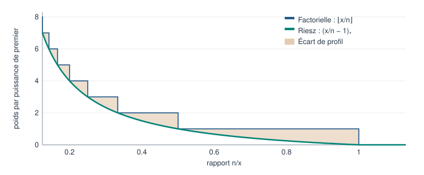

**Un deuxième essai : la lemniscate.** On peut chercher un objet moins grossier qu'une factorielle. Le sinus lemniscatique $s$, défini par $s(0)=0$, $s'(0)=1$ et $(s')^2=1-s^4$, vérifie $s''=-2s^3$. Si $s(z)=\sum_nA_nz^n/n!$, cela donne
$$A_{n+2}=-2\sum_{i+j+k=n}\frac{n!}{i!\,j!\,k!}A_iA_jA_k,$$
donc des **entiers** : $A_1=1$, $A_5=-12$, $A_9=3\,024$, et $A_n=0$ sauf pour $n\equiv1\pmod4$. Ces entiers sont très divisibles, et d'une façon arithmétique. En un premier $p\equiv3\pmod4$, $v_p(A_n)/n$ suit le taux $p/(p^2-1)$ (pour $n=161$ : $0{,}373$ contre $0{,}375$ si $p=3$, $0{,}143$ contre $0{,}146$ si $p=7$) . Aux premiers $p\equiv1\pmod4$, rien de tel n'est garanti, et la valuation n'est pas toujours nulle : $v_5(A_{161})=0$, mais $A_{41}=2^{20}3^{15}7^5\,11^3\,19^2\cdot23\cdot31\cdot179\cdot47\,272\,527\,433$, dont le dernier facteur, premier, est congru à 1 modulo 4. Le groupe formel structure une partie de l'arithmétique des coefficients, pas leur factorisation complète. C'est déjà la multiplication complexe par $\mathbb Z[i]$, celle de la courbe $y^2=x^3-x$ du § 3, qui opère. Et la taille se calcule sans les premiers. Les singularités les plus proches de 0 sont les quatre pôles simples $\pm(1\pm i)\varpi/2$, à distance $\varpi/\sqrt2$, de résidus de module 1. Comme $s(iz)=i\,s(z)$, leurs contributions s'ajoutent en phase exactement quand $n\equiv1\pmod4$, et la méthode de Darboux donne, le long de cette sous-suite,
$$|A_n|=4\,n!\,\Big(\frac{\sqrt2}{\varpi}\Big)^{n+1}\big(1+o(1)\big),$$
l'erreur venant des pôles suivants, plus éloignés ; le calcul exact le confirme à $10^{-6}$ près dès $n=101$. Sur tous les $n$, puisque $A_n=0$ hors de cette classe, seule la limite supérieure de $(|A_n|/n!)^{1/n}$ a un sens : elle vaut $\sqrt2/\varpi$.

Le bilan est pourtant décevant. La formule du produit compare la divisibilité à la taille : à $n=401$, les valuations effectives des premiers $p\equiv3\pmod4$, $p\le401$, n'expliquent que 52 % de $\log|A_n|$ (le cofacteur restant n'est pas factorisé). Ce n'est pas un accident de calcul, comme le montre le **profil théorique** des couches impaires,
$$I(n)=\sum_{\substack{p\le n\\p\equiv3\ (4)}}\log p\sum_{e\ \text{impair}}\Big\lfloor\frac n{p^e}\Big\rfloor=\tfrac12\,n\log n+O(n).$$
En effet, les couches $e\ge3$ coûtent $O(n)$, puisque $\sum_p\log p\sum_{e\ge3}p^{-e}<\infty$ ; l'arrondi de la première couche coûte $O(n)$ par Tchebychev ; et le théorème de Mertens dans les progressions arithmétiques donne $\sum_{p\le n,\,p\equiv3\,(4)}\log p/p=\tfrac12\log n+O(1)$. Comme $\log|A_n|=n\log n+O(n)$ par l'asymptotique précédente, $I(n)/\log|A_n|\to\tfrac12$ : ces premiers forment la moitié des premiers, et chacun ne fournit que ses couches impaires. C'est un énoncé sur le profil, non sur la factorisation effective, que le calcul à l'ordre 401 illustre sans la démontrer ; la convergence est lente, car les termes en $O(n)$ ne sont petits devant $n\log n$ qu'à une échelle logarithmique. Un facteur 2 au terme dominant rend l'inégalité inutilisable pour une estimation fine. De plus, le caractère qui découpe ces premiers, $\chi_{-4}$, est fixé une fois pour toutes : contrôler sa somme tordue serait GRH pour $\chi_{-4}$. Le modèle a la bonne **forme** de divisibilité, mais un seul objet, attaché à un seul corps, ne peut ni combler l'écart de taille ni échapper à son caractère. Il faudra des **familles** d'objets, des **couches empilées** et des tailles **exactes**. Ces chiffres sont reproduits par [`tools/lemniscate.py`](tools/lemniscate.py).

Les deux essais laissent deux énigmes. **Première énigme** : fabriquer un objet qui a presque le profil de divisibilité voulu, et dont la taille se calcule avec la même indépendance que celle d'une factorielle. Le nombre $\prod_p p^{\lfloor w(p)\rfloor}$ ne convient pas (pour connaître sa taille, il faudrait résoudre le problème), ni 0 (divisible par tout, mais dégénéré). **Seconde énigme** : améliorer la précision. Élever un objet à la puissance $m$ multiplie ses valuations par $m$, mais aussi son logarithme : divisée par $m$, l'inégalité ne dit rien de plus. Il faut une opération qui ajoute réellement de l'information, avec des coûts qui croissent moins vite que les gains.

La réponse d'Alpöge est surprenante : remplacer l'entier auxiliaire par des réseaux de formes automorphes ; dériver en des points à multiplication complexe pour obtenir la divisibilité ; composer des relèvements thêta pour accumuler les gains ; contrôler les tailles par des inégalités de pentes. Ces outils paraissent moins arbitraires quand on a compris à quelles contraintes ils répondent. Ce texte n'est pas une reconstitution historique de la découverte, mais une expérience de pensée : partir du problème, essayer les outils familiers, et identifier chaque fois ce qui empêche d'aller plus loin.

---

## Prémisses : caractères de Dirichlet, fonctions L, hypothèse de Riemann

*Ce qui suit est classique (Davenport, *Multiplicative Number Theory*, chap. 4 à 9 et 19). On fixe les notations du reste du texte.*

**Caractères de Dirichlet.** Un caractère de Dirichlet de module $N\ge1$ est un morphisme de groupes $\chi:(\mathbb Z/N\mathbb Z)^\times\to\mathbb C^\times$, prolongé à ℤ par $\chi(n)=\chi(n\bmod N)$ si $\gcd(n,N)=1$ et $\chi(n)=0$ sinon. C'est une fonction complètement multiplicative et $N$-périodique, à valeurs dans les racines de l'unité (et 0).

- Son **ordre** $o$ est son ordre dans le groupe des caractères : $\chi^o=1$. Les caractères d'ordre 2 sont les caractères **quadratiques**, par exemple le symbole de Legendre $(\cdot/p)$ ou $\chi_{-4}(n)=(-1)^{(n-1)/2}$ pour $n$ impair.
- Il est **pair** ou **impair** selon que $\chi(-1)=+1$ ou $-1$ ; on note $\kappa\in\{0,1\}$ avec $\chi(-1)=(-1)^\kappa$.
- Il est **primitif** s'il ne provient pas d'un caractère de module $N'<N$, $N'\mid N$. Tout χ est **induit** par un unique caractère primitif $\chi^\ast$, de module $f\mid N$ appelé **conducteur** : $\chi(n)=\chi^\ast(n)$ pour $\gcd(n,N)=1$. Le caractère **trivial** de module $N$ est induit par le caractère $1$ de module 1. Dans les transcriptions Lean, où le module est fixé, `χ = 1` désigne le caractère principal $\chi_{0,N}$ de ce module ; dans les formules pour ζ et pour $\psi(x)=\psi(x,\mathbf 1)$, le caractère trivial est de conducteur 1.
- **Orthogonalité** : pour $\gcd(n,N)=1$, $\frac1{\varphi(N)}\sum_{\chi\bmod N}\chi(n)=1$ si $n\equiv1\pmod N$ et $0$ sinon. C'est l'outil qui isole une progression arithmétique, ou, au § 2, une classe de Frobenius.

**La fonction $L(s,\chi)$.** Pour $\operatorname{Re}s>1$,
$$L(s,\chi)=\sum_{n\ge1}\frac{\chi(n)}{n^{s}}=\prod_{p}\Big(1-\frac{\chi(p)}{p^{s}}\Big)^{-1},$$
la série et le produit (d'Euler) convergeant absolument. Pour le caractère trivial $\mathbf 1$ de module 1, c'est $\zeta(s)$ ; pour le caractère principal $\chi_{0,N}$ de module $N$, $L(s,\chi_{0,N})=\zeta(s)\prod_{p\mid N}(1-p^{-s})$. On écrit $L(s,\chi)$ ; Mathlib et la partie II écrivent $L(\chi,s)$ (`LFunction χ s`), c'est la même fonction.

- **Dérivée logarithmique.** En dérivant le logarithme du produit d'Euler,
$$-\frac{L'}{L}(s,\chi)=\sum_{n\ge1}\frac{\Lambda(n)\chi(n)}{n^{s}},\qquad \Lambda(n)=\begin{cases}\log p & n=p^k,\ k\ge1,\\ 0&\text{sinon}\end{cases}$$
($\Lambda$ est la fonction de **von Mangoldt**). C'est **le** pont entre zéros et nombres premiers : un zéro de $L$ d'ordre $m$ est un pôle simple de $-L'/L$, de résidu $-m$.

- **Prolongement et équation fonctionnelle.** Si χ est primitif et $\chi\neq1$, $L(s,\chi)$ se prolonge en une fonction **entière** ; $\zeta$ se prolonge en une fonction méromorphe avec un seul pôle, simple, en $s=1$. Pour χ primitif de conducteur $N$, la fonction complétée
$$\xi(s,\chi)=\Big(\frac N\pi\Big)^{(s+\kappa)/2}\,\Gamma\Big(\frac{s+\kappa}2\Big)\,L(s,\chi)$$
vérifie $\xi(s,\chi)=\varepsilon(\chi)\,\xi(1-s,\bar\chi)$, avec $|\varepsilon(\chi)|=1$ (un quotient de sommes de Gauss). La symétrie $s\leftrightarrow1-s$ échange χ et $\bar\chi$.

- **Zéros.** Le produit d'Euler interdit les zéros pour $\operatorname{Re}s>1$, et Hadamard–de la Vallée Poussin les excluent sur $\operatorname{Re}s=1$. Les pôles de Γ donnent les **zéros triviaux** $s=-\kappa,-\kappa-2,-\kappa-4,\dots$ (pour ζ : $-2,-4,\dots$). Tous les autres, les **zéros non triviaux** $\rho=\beta+i\gamma$, sont dans la **bande critique** $0<\beta<1$. Il y en a une infinité, environ $\frac{T}{2\pi}\log\frac{NT}{2\pi}$ de hauteur $0<\gamma\le T$. Par l'équation fonctionnelle et la conjugaison ($\overline{L(\bar s,\chi)}=L(s,\bar\chi)$), si ρ est un zéro de $L(s,\chi)$, alors $1-\bar\rho$ en est un aussi : l'ensemble des zéros non triviaux est **symétrique par rapport à la droite critique** $\operatorname{Re}s=\tfrac12$.
- **Caractères non primitifs.** Si χ est induit par $\chi^\ast$, $L(s,\chi)=L(s,\chi^\ast)\prod_{p\mid N}(1-\chi^\ast(p)p^{-s})$ : les facteurs ajoutés ne s'annulent que sur $\operatorname{Re}s=0$.

**RH et GRH.**

- **RH** : tous les zéros non triviaux de ζ ont une partie réelle $\tfrac12$.
- **GRH pour χ** (hypothèse de Riemann généralisée, ici pour les fonctions L de Dirichlet) : tous les zéros non triviaux de $L(s,\chi^\ast)$ ont une partie réelle $\tfrac12$.

Grâce à la symétrie $\rho\leftrightarrow1-\bar\rho$, il revient au même de dire qu'**il n'y a aucun zéro dans le demi-plan $\operatorname{Re}s>\tfrac12$** : un zéro à gauche de la droite critique en a un miroir à droite. C'est sous cette forme, qui ne parle ni de zéros triviaux ni de primitivité, que le théorème est énoncé, y compris dans Lean : *pour tout caractère χ et tout $s$ avec $\operatorname{Re}s>\tfrac12$, $L(s,\chi)\neq0$*, sauf en $s=1$ pour le caractère principal de chaque module, dont la fonction L a un pôle (en Lean, l'hypothèse `χ ≠ 1 ∨ s ≠ 1`, car `LFunction` prend au pôle une valeur conventionnelle).

**Traduction en termes de nombres premiers.** Notons $\psi(x,\chi)=\sum_{n\le x}\Lambda(n)\chi(n)$ la **fonction de Tchebychev** tordue par χ ($\psi(x)=\psi(x,1)$). La **formule explicite** de Riemann–von Mangoldt l'écrit comme une somme d'ondes indexées par les zéros :
$$\psi(x,\chi)=\delta_\chi\,x-\sum_{\rho}\frac{x^\rho}{\rho}+(\text{termes bornés par }O(\log x)),\qquad \delta_\chi=\begin{cases}1&\chi=1\\0&\chi\ne1\end{cases}$$
Cette formule vaut pour χ primitif, les zéros étant comptés avec multiplicité. Pour un caractère non primitif, on retire les contributions des premiers qui divisent le module sans diviser le conducteur : cela coûte $O_N(\log x)$ pour la somme non lissée, mais peut coûter un terme linéaire en $x$ pour la somme de Riesz, raison de plus pour rester dans le cas primitif (§ 1.2). La somme sur les zéros est prise symétriquement, $|\operatorname{Im}\rho|\le T$ avec $T\to\infty$, et l'identité vaut pour $\psi_0(x,\chi)$, demi-somme des limites aux points de saut, qui diffère de ψ d'au plus $\frac12\log x$ ; les constantes sont des $O_{\chi,\varepsilon}$.
Un zéro $\rho=\beta+i\gamma$ produit une oscillation d'amplitude $x^\beta$. D'où l'équivalence, pour tout ε > 0 :
$$\text{GRH pour }\chi\iff\psi(x,\chi)-\delta_\chi x=O_\varepsilon\big(x^{1/2+\varepsilon}\big).$$
Le sens ⇐ est celui dont nous avons besoin. Pour $\operatorname{Re}s>1$, on a
$$-\frac{L'}{L}(s,\chi)-\delta_\chi\frac{s}{s-1}=s\int_1^\infty\big(\psi(x,\chi)-\delta_\chi x\big)x^{-s-1}\,dx.$$
Une borne $O(x^\theta)$ sur la quantité centrée rend cette intégrale holomorphe pour $\operatorname{Re}s>\theta$ ; le terme rationnel ne peut masquer aucun pôle provenant d'un zéro non trivial. Le pôle en $1$ pour ζ est donc traité séparément. **Démontrer GRH, c'est majorer des sommes sur les nombres premiers avec une erreur en racine carrée.**

*Notation.* Dans la suite, la lettre ψ **seule** désigne un caractère primitif (celui que l'on traite), et $\psi(x,\chi)$ la fonction de Tchebychev ; γ désigne la constante d'Euler $0{,}5772\ldots$, sauf dans $\rho=\beta+i\gamma$.

---

## Vue d'ensemble : la preuve en cinq questions

**Théorème.** Pour tout caractère de Dirichlet χ, $L(s,\chi)\neq0$ pour $\operatorname{Re}s>\tfrac12$ (hors du pôle $s=1$ du caractère principal). En particulier, l'hypothèse de Riemann est vraie.

**La stratégie en une phrase.** On majore une somme de nombres premiers comme Tchebychev majorait $\theta(2n)-\theta(n)$ : par la **formule du produit**, appliquée à un objet arithmétique **très divisible** et de **taille connue**. Mais on empile les couches de divisibilité comme Stepanov empile les ordres d'annulation, ce qui vise l'exposant ½ : la construction fournit $O_\varepsilon(x^{1/2+\varepsilon})$ sur des fenêtres appropriées. Une fois GRH établie, la formule explicite lissée donne $O(\sqrt x)$ pour un caractère fixé ; ce sont deux étapes distinctes.

**Le point de départ (§ 1).** Une analyse classique (formule explicite lissée, positivité de Landau) ramène GRH à **une seule inégalité**, vraie sur une suite de fenêtres d'échelles :
$$G_\psi(x)\;\le\;x^{1/2+C\varepsilon},$$
où $G_\psi$ est une somme de $\log p$ à **coefficients positifs**, pondérée par le poids de Riesz $(x/n-1)_+$, et dont on a retranché le terme principal. Il suffit d'une **majoration** : les zéros hors de la droite critique poussent toujours, tôt ou tard, $G_\psi$ vers le haut. Tout le reste de la preuve établit cette inégalité. Chaque réponse ci-dessous laisse une dette, la réalisation effective de ce qu'elle décrit ; les trois principales sont rassemblées dans le tableau « Trois articulations encore opaques », à la fin de la partie II. Les cinq questions qui suivent sont cinq obstacles successifs, non cinq théories à apprendre.

**Deux modèles réduits** servent de guide :

| | Tchebychev (1852) | Stepanov (1969) | Alpöge (2026) |
|---|---|---|---|
| On majore | $\theta(2n)-\theta(n)$ | $\#\{x:g(x)\text{ carré}\}$ sur $\mathbb F_p$ | $G_\psi(x)$ |
| Objet | l'entier $\binom{2n}n$ | un polynôme $F$ | un réseau de périodes de formes automorphes |
| « Être multiple » | $v_p=1$ pour $p\in\,]n,2n]$ | $F$ s'annule à l'ordre $a$ sur $S$ | divisibilité $p$-adique en $m$ couches |
| Taille | $\binom{2n}n\le4^n$ | $\deg F$ | pentes, volumes exacts |
| Bilan | $\sum v_p\log p=\log M$ | $a\,\lvert S\rvert\le\deg F$ | formule du produit pour les réseaux |
| Erreur | $O(x)$ | $O(\sqrt p)$ | $O(x^{1/2+\varepsilon})$ |

### Q1. Pourquoi la divisibilité d'un objet renseigne-t-elle sur les premiers ? (§ 2)

Un entier non nul $M$ vérifie $\sum_pv_p(M)\log p=\log|M|$. S'il est divisible par les premiers voulus et si l'on connaît sa taille **sans connaître les premiers**, on majore une somme de $\log p$. La qualité de la borne dépend du **profil** $p\mapsto v_p(M)$. Celui de $\binom{2n}n$ est une dent de scie, qui touche aussi des premiers « parasites », d'où une perte d'un facteur $\log4$. Celui de $y!$ est presque le poids de Riesz, et il donne déjà $G(y)\le\gamma\,y+O(\log y)$. **Toute la preuve vise à remplacer $\gamma y$ par une borne d'exposant $\tfrac12+\varepsilon$.** Trois contre-exemples fixent le cahier des charges : l'objet doit être non nul, son profil doit suivre le poids, et sa taille doit se calculer sans les premiers.

### Q2. Pourquoi la multiplication complexe donne-t-elle la divisibilité voulue ? (§ 3)

La dérivation fournit des factorielles, $D^af(0)=a!\cdot\mathrm{coeff}_a(f)$, donc le gain de Legendre $a/(p-1)$. Mais une série thêta n'est entière que dans la coordonnée d'un **groupe formel**, et le passage à la coordonnée où l'on dérive coûte des dénominateurs :

- en réduction **ordinaire** (hauteur 1), la minoration ne garantit plus aucun gain linéaire ;
- en réduction **supersingulière** (hauteur 2), ils n'effacent, pour le dire en image, que les couches paires : la minoration garantit $a\big(\tfrac1p+\tfrac1{p^3}+\cdots\big)-O(\log a)=a\,\tfrac{p}{p^2-1}-O(\log a)$.

La multiplication complexe rend la réduction supersingulière en **tous les premiers inertes**. Sur $y^2=x^3-x$, $v_3(D^{161}\exp(0))=61\approx161\cdot\frac38$, alors que $v_5$ est nul dans ce calcul (ce qui n'est pas une loi générale aux premiers décomposés). Le profil obtenu, $\frac am\cdot\frac{1-\chi_{-d}(m)}2$ pour $m$ premier à $d$ (le premier ramifié $d$ est traité à part), est celui de Legendre, restreint par un caractère quadratique. Ce caractère est un **parasite** : il faut contrôler la somme tordue centrée $g(y,\chi_{-d})$, ce que l'on obtient en choisissant le corps CM dans une famille immense (grand crible). C'est aussi pourquoi la preuve change de corps à chaque fenêtre.

### Q3. Pourquoi les relèvements thêta simulent-ils la multiplicité de Stepanov ? (§ 4)

Stepanov compte les points d'une courbe par une fonction auxiliaire qui s'annule à l'ordre $a$ sur tous les points, avec un degré **bien inférieur** à $a$ fois le degré naïf. Il y parvient parce que la dérivation ignore les $X^{jp}$, qui valent $X^j$ sur $\mathbb F_p$. Élever une fonction à la puissance $a$ ne servirait à rien : il faut des couches **nouvelles**. Sur ℤ, une couche est un gain $p$-adique au point CM (Q2). Le **relèvement thêta** fournit l'opération qui en ajoute une et qui se compose. Sur l'export, la période se factorise par le produit de matrices $K_m\cdots K_1$, et les valuations d'un produit s'additionnent :
$$v_p(\text{période})\;\ge\;\sum_{j=1}^m\mathrm{gain}_j(p)-\text{pertes}.$$
Les groupes unitaires grandissent à chaque pas, pour que chaque couche soit neuve. Que chaque étage apporte bien son gain, à un coût contrôlé, la croissance des groupes ne le prouve pas : c'est ce qu'exige l'interface `LinkG_at` (§ 4 et partie II). **La longueur $m$ de la chaîne joue le rôle de l'ordre d'annulation.** Sur l'export, les gains ne sont pas seulement empilés : ils sont **distribués**. Le Théorème A rend des lignes admissibles, et une propriété de rang $p$-adique le long des arêtes de Hecke (`LPprime`) propage leur divisibilité à une proportion $1-\kappa$ des directions du réseau ; la croissance des groupes ne garantit pas à elle seule ce rang (§ 3.5).

### Q4. Pourquoi les contraintes archimédiennes font-elles réapparaître le terme principal ? (§ 5)

Appliquée à $y!$, la formule du produit donne deux calculs égaux : Legendre ($\sum\Lambda(m)\lfloor y/m\rfloor$), qui demande les premiers, et Stirling ($y\log y-y+\cdots$), qui ne les demande pas. La raison est que $-\zeta'$ a un **pôle** (double) en $s=1$ et reste **holomorphe aux zéros de ζ**, là où $-\zeta'/\zeta$ a des pôles. Les tailles archimédiennes de la preuve sont du même type : masses de Siegel, normes de Rallis, périodes CM. Ce sont des produits de valeurs de Γ, de puissances de π et de valeurs de ζ ou de fonctions L en des points où les identités nécessaires s'établissent sans supposer GRH ; la masse de $E_8$ vaut $1/696\,729\,600$, et l'intégrale de $dx/y$ le long de la branche réelle de $y^2=x^3-x$, de 1 à l'infini, vaut $\varpi=\Gamma(1/4)^2/2\sqrt{2\pi}$ (la constante de la lemniscate ; le cycle réel complet donne $2\varpi$), qu'il faut encore normaliser pour obtenir la quantité de `CM.DegSt` (§ 5). Elles ne voient pas les fluctuations. À condition de reproduire exactement le bon terme principal, ce qui demande une identité et pas seulement des volumes exacts (atelier 5), celui-ci **se simplifie** dans l'inégalité, et il ne reste que : fluctuations ≤ pertes. Pour un terme principal d'ordre $x\log x$ et une erreur visée $x^{1/2+O(\varepsilon)}$, cela exige une **exactitude** relative de l'ordre de $x^{-1/2}/\log x$. C'est pourquoi la preuve utilise des égalités (`SiegelMassRatioCM`) et une quasi-orthogonalité à erreur $e^{-6x^\varepsilon}$.

### Q5. Pourquoi l'équilibre des paramètres produit-il exactement une erreur en racine carrée ? (§ 6)

L'erreur par terme, lue sur l'export et après les contrôles de paramètres, vaut $\lesssim4x/m+4m+2\sqrt x$, à des facteurs $x^{O(\varepsilon)}$ près. Le **coût fixe**, de l'ordre de $x$, est l'imprécision d'une seule couche, amortie sur $m$ relèvements. Le **coût marginal**, en $m$, vient de ce que chaque relèvement perd proportionnellement à la longueur de la chaîne. Comme $x/m+m\ge2\sqrt x$, l'optimum est $m\approx\sqrt x$, et le code impose $x^{1/2-\varepsilon}\le m\le x^{1/2+\varepsilon/2}$. Ce ½ n'est pas fortuit. On ne peut pas descendre plus bas : un zéro sur la droite critique est une singularité de la transformée de Mellin de $G$, ce qui interdit tout exposant inférieur (§ 6.3) ; les données jusqu'à $10^7$ le montrent sans le prouver. Avec un coût fixe en $x$ et une perte quadratique par relèvement, et si toutes les autres contraintes restaient satisfaites, la même machinerie ne démontrerait que l'absence de zéros pour $\operatorname{Re}s>2/3$.

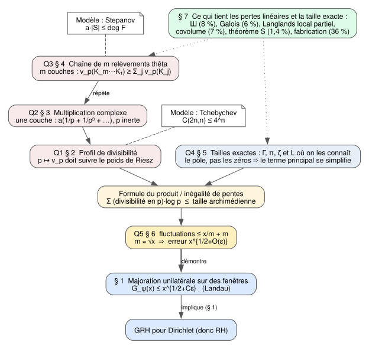

**Trois étages.** La preuve se lit en trois implications : des paramètres admissibles permettent de **fabriquer** des objets qui satisfont simultanément un contrat ; un théorème de **comptabilité** déduit de ce contrat une borne à une échelle, où le terme principal se compense (§ 6.2) ; l'**optimisation** des paramètres et la réduction analytique de Landau en tirent GRH (§§ 1, 6). Le premier étage est de loin le plus lourd ; les deux derniers sont presque entièrement lus.

### Ce que dit le graphe des dépendances

Sur les 1,47 M de déclarations de la fermeture, ce qui appartient **en propre** au mécanisme pèse **moins de 0,5 %** : c'est l'union des sous-arbres dominés de 13 nœuds explicites, de la réduction de Landau à `linkCore` (définition et listes dans l'article, § 4.3). Ce chiffre ne compte pas les dépendances partagées. Le reste garantit les trois exigences de Q1 et la condition de Q5 :

- l'**exactitude archimédienne** : covolume (7 %), théorème S (1,4 %), masses ;
- le **contrôle de la division** : la borne sur les places tordues (`LinkN`), alimentée par les représentations galoisiennes (6 %) et par les groupes de Tate–Shafarevich (8 %), ces derniers fournis avec le corps hôte ; s'y ajoute Langlands local partiel ;
- l'**existence des objets** : familles de groupes unitaires définis aux paramètres prescrits (36 %).

L'échafaudage « littérature » est hors du chemin, et aucun énoncé publié n'entre comme axiome (partie II). Le principe est petit et peu coûteux ; ce qui est massif, c'est la fabrication et l'entretien des organes qui le rendent applicable.

**Comment lire la suite.** La partie I suit l'ordre des questions : § 1 (réduction), puis §§ 2 à 6 (Q1 à Q5), puis § 7 (les pertes). Chaque section donne un exemple élémentaire, un calcul, un contre-exemple, puis le cas réel, et se termine par ce que le graphe en dit. Des **ateliers** suivent un même premier, 3, d'un bout à l'autre (§§ 2 à 5), et deux **interludes** introduisent les séries thêta (§ 4) et les pentes (§ 5).

---

# Partie I. Le mécanisme de la preuve

## 1. De RH à une inégalité sur les nombres premiers

Ce paragraphe ramène GRH à **une seule inégalité**, sans aucune arithmétique fine : uniquement de l'analyse complexe classique (Perron, Landau). Il tient en cinq étapes. Dans le code, c'est la partie légère : environ 73 000 déclarations, pour l'essentiel l'analyse de Mathlib (partie II).

### 1.1 Réduction aux caractères primitifs, groupés par niveaux

Si χ est induit par $\chi^\ast$, de module $N$,
$$L(s,\chi)=L(s,\chi^\ast)\prod_{p\mid N}\big(1-\chi^\ast(p)p^{-s}\big).$$
Chaque facteur a pour module $\ge 1-p^{-\operatorname{Re}s}>0$ si $\operatorname{Re}s>0$ : il ne s'annule pas à droite de l'axe imaginaire. Les zéros de $L(s,\chi)$ dans $\operatorname{Re}s>\tfrac12$ sont donc ceux de $L(s,\chi^\ast)$, et il suffit de traiter les caractères **primitifs**. RH est le cas $\chi^\ast=1$ (module 1), c'est-à-dire ζ ; les caractères triviaux de module $N$ s'y ramènent.

La preuve ne traite pas un caractère isolé, mais tout un **niveau** à la fois. Pour ψ primitif d'ordre $o$, on note
$$K_\psi=\{\chi_0=1,\ \chi_1,\dots,\chi_{o-1}\},\qquad \chi_j=\text{le caractère primitif qui induit }\psi^j .$$
C'est un ensemble de $o$ caractères primitifs, **stable par conjugaison** ($\overline{\psi^j}=\psi^{o-j}$), qui contient 1. On démontrera d'un coup que **ni ζ ni aucun des $L(s,\chi_j)$** ne s'annule pour $\operatorname{Re}s>\tfrac12$. Pour RH seule, $\psi=1$, $o=1$ et $K_\psi=\{1\}$.

### 1.2 Lisser : la somme de Tchebychev pondérée de Riesz

La fonction $\psi(x,\chi)$ des prémisses a deux défauts : elle saute en chaque puissance de premier, et sa formule explicite $\sum_\rho x^\rho/\rho$ ne converge que conditionnellement (car $\sum 1/|\rho|$ diverge). La preuve utilise plutôt le **poids de Riesz** $(y/n-1)_+$ :
$$S(y,\chi)=\sum_{n\le y}\Lambda(n)\chi(n)\Big(\frac yn-1\Big)=\int_1^y\Big(\sum_{n\le t}\frac{\Lambda(n)\chi(n)}{n}\Big)\,dt .$$
C'est une primitive (une moyenne) : elle est continue, et chaque intégration fait gagner un facteur $1/|\rho|$ dans la formule explicite.

**La formule de Perron.** Pour $c>1$ et $y>0$, le calcul des résidus en $s=1$ et $s=0$ donne
$$\frac1{2\pi i}\int_{c-i\infty}^{c+i\infty}\frac{(y/n)^s}{s(s-1)}\,ds=\Big(\frac yn-1\Big)_+ ,$$
d'où, en sommant contre $\Lambda(n)\chi(n)$ et en utilisant la dérivée logarithmique,
$$S(y,\chi)=\frac1{2\pi i}\int_{(c)}\Big(-\frac{L'}{L}(s,\chi)\Big)\frac{y^s}{s(s-1)}\,ds .$$
Le noyau décroît comme $|s|^{-2}$ : l'intégrale converge **absolument**, et on peut déplacer le contour vers la gauche en ramassant les résidus.

- **En $s=1$.** Pour $\chi\neq1$, $L(1,\chi)\ne0$ (Dirichlet), et le résidu vaut $-y\,\frac{L'}{L}(1,\chi)$. Pour ζ, le pôle de $-\zeta'/\zeta=\frac1{s-1}-\gamma+\cdots$ rencontre celui du noyau : pôle double, de résidu $y\log y-(1+\gamma)\,y$.
- **En chaque zéro non trivial ρ, de multiplicité $m_\rho$** : $-L'/L$ a un résidu $-m_\rho$, d'où le terme $-m_\rho\,y^\rho/(\rho(\rho-1))$.
- **En $s=0$ et aux zéros triviaux** : des termes $O(\log y)$.

On retire donc le terme principal, ce qui définit
$$g(y,\chi)=S(y,\chi)+y\,\frac{L'}{L}(1,\chi)\quad(\chi\ne1),\qquad G(y)=S(y,1)-y\log y+(1+\gamma)\,y ,$$
et l'on obtient la **formule explicite lissée** :
$$g(y,\chi)=-\sum_\rho m_\rho\,\frac{y^\rho}{\rho(\rho-1)}+O(\log y),$$
et de même pour $G$ avec les zéros de ζ. La série converge **absolument**, puisque $\sum_\rho1/|\rho|^2<\infty$. Deux conséquences :

1. **GRH ⇒ $g(y,\chi)=O(y^{1/2})$**, sans même de $\varepsilon$ : c'est la taille visée.
2. **Réciproquement**, par transformation de Mellin, $\int_1^\infty g(y,\chi)\,y^{-s-1}dy=-\frac{1}{s(s-1)}\frac{L'}{L}(s,\chi)+(\text{fraction rationnelle à pôles en }0,1)$. Un zéro ρ y apparaît comme un **pôle**. Une borne $|g(y,\chi)|=O(y^\theta)$ rend l'intégrale convergente pour $\operatorname{Re}s>\theta$, et exclut tout zéro de partie réelle $>\theta$.

Le point 2 demande une borne **en valeur absolue** : il faudrait contrôler les fluctuations de $g$ vers le haut **et** vers le bas. La suite de la réduction supprime une de ces deux exigences.

### 1.3 Combiner : une somme à coefficients positifs

Pour ψ primitif d'ordre $o$, on forme
$$G_\psi(y)=G(y)+\frac{1}{3o+1}\sum_{j=1}^{o-1}\operatorname{Re}g(y,\chi_j).$$
Comme $K_\psi$ est stable par conjugaison et $g(y,\bar\chi)=\overline{g(y,\chi)}$, la somme des parties réelles est la somme des $g(y,\chi_j)$ elles-mêmes. $G_\psi$ est donc la somme de Riesz, terme principal ôté, de la série de Dirichlet
$$D_\psi(s)=-\frac{\zeta'}{\zeta}(s)-\frac1{3o+1}\sum_{j=1}^{o-1}\frac{L'}{L}(s,\chi_j)=\sum_{n\ge1}\frac{c_n}{n^s},\qquad c_n=\Lambda(n)\Big(1+\frac1{3o+1}\sum_{j=1}^{o-1}\chi_j(n)\Big).$$

**Les coefficients sont positifs.** Si $n$ est premier au conducteur de ψ, $\chi_j(n)=\psi(n)^j$, et la somme géométrique $\sum_{j=1}^{o-1}\psi(n)^j$ vaut $o-1$ si $\psi(n)=1$, et $-1$ sinon. D'où
$$c_n=\Lambda(n)\cdot\begin{cases}\dfrac{4o}{3o+1}&\text{si }\psi(n)=1,\\[8pt]\dfrac{3o}{3o+1}&\text{sinon.}\end{cases}$$
Pour les puissances des premiers $p$ qui divisent le conducteur, on borne chaque $|\chi_j(n)|\le1$ : $c_n\ge\Lambda(n)\,\frac{2o+2}{3o+1}>0$. Dans tous les cas $c_n\ge0$, et $c_n=0$ seulement si $\Lambda(n)=0$.

**D'où vient $1/(3o+1)$.** Le profil 4 : 3 n'est pas arbitraire, il se lit sur l'export (`Formalism.HC.Frame.lam`, consommé par `BernoulliSumsFrobeniusOrbits.topsFrame`, sur les orbites de Frobenius de l'hôte du § 3.4). Côté analytique, `Level.wt` donne le poids 1 à un éventuel caractère réel impair distingué (`psK`) et $1/(3o+1)$ aux autres ; sur le chemin principal (`Level.cyc`), aucun caractère n'est distingué. Les premiers y sont échantillonnés selon leur classe modulo un sous-groupe d'indice $o$ d'un groupe de Frobenius, avec la proportion $4/(3o+1)$ pour la classe neutre et $3/(3o+1)$ pour chacune des $o-1$ autres. Le total vaut $(4+3(o-1))/(3o+1)=1$. Les coefficients de Fourier de cette distribution valent $1$ pour le caractère trivial et $\frac{4-3}{3o+1}=\frac1{3o+1}$ pour tous les autres : ce sont exactement les poids de $G_\psi$, et $c_n/\Lambda(n)$ est $o$ fois la proportion de la classe de $n$. Une distribution uniforme donnerait des poids nuls et ne verrait pas les $\chi_j$ ; une distribution strictement positive garantit la positivité. Pourquoi 4 : 3 plutôt qu'un autre mélange, le code ne le dit pas ⟦I⟧ : la positivité seule ne l'impose pas. Un rapport $r:1$ entre la classe neutre et les autres donnerait des coefficients $(r-1)/(r+o-1)$, positifs dès que $r>1$ ; $r=4/3$ donne $1/(3o+1)$. L'origine de ce rapport est à chercher dans la construction de l'hôte et des orbites épaisses. Notons enfin que la positivité d'une distribution sur les classes n'entraîne pas celle de ses coefficients de Fourier : c'est le calcul explicite du profil 4 : 3 qui la donne.

**Pas de compensation entre zéros.** La transformée de Mellin de $G_\psi$ est $D_\psi(s)/(s(s-1))$, à une fraction rationnelle près. Ses pôles dans $0<\operatorname{Re}s<1$ sont les zéros ρ de ζ ou de l'un des $L(s,\chi_j)$, avec le poids
$$w_\rho=m_\rho(\zeta)+\frac1{3o+1}\sum_{j=1}^{o-1}m_\rho(\chi_j)\;>\;0 .$$
Toutes les multiplicités entrent avec un signe $+$ : un zéro de l'une des fonctions ne peut pas être masqué par une autre. C'est l'idée de de la Vallée Poussin, qui combinait $\zeta(\sigma)^3|\zeta(\sigma+it)|^4|\zeta(\sigma+2it)|$ grâce à $3+4\cos\theta+\cos2\theta=2(1+\cos\theta)^2\ge0$.

### 1.4 Pourquoi une majoration suffit : l'argument de Landau

**Théorème de Landau.** Soit $f\ge0$ sur $[1,\infty)$ et $H(s)=\int_1^\infty f(y)\,y^{-s-1}dy$, d'abscisse de convergence $\sigma_c$. Alors $H$ n'a **pas** de prolongement holomorphe au voisinage du point **réel** $s=\sigma_c$. (Preuve : on développe $H$ en série de Taylor en un point réel $a>\sigma_c$. Les dérivées $(-1)^kH^{(k)}(a)=\int f(y)(\log y)^ky^{-a-1}dy$ sont positives ; si la série convergeait un peu au-delà de $\sigma_c$, on pourrait l'intervertir avec l'intégrale, qui convergerait donc au-delà de $\sigma_c$.)

**Application.** Supposons $G_\psi(y)\le y^\theta$ pour $y\ge y_0$, avec $0<\theta<1$. On pose $f(y)=y^\theta-G_\psi(y)\ge0$ pour $y\ge y_0$, et $f=0$ en deçà. Sa transformée est
$$H(s)=\frac{y_0^{\theta-s}}{s-\theta}-\int_{y_0}^\infty G_\psi(y)y^{-s-1}\,dy.$$
En utilisant la définition de $G_\psi$ et en prolongeant la transformée depuis $\operatorname{Re}s>1$, on obtient
$$H(s)=\frac{1}{s-\theta}-\frac{D_\psi(s)}{s(s-1)}+R(s)+E(s),$$
où $R$ est la fraction rationnelle venant des termes principaux et $E$ est entière (la modification sur un intervalle compact). C'est la combinaison $-D_\psi(s)/(s(s-1))+R(s)$, et non $R$ seule, qui est holomorphe en $s=1$.

Supposons par l'absurde $\sigma_c>\theta$. D'après Landau, $\sigma_c$ est une singularité, donc un pôle de $D_\psi/(s(s-1))$ : un **zéro réel** $\beta=\sigma_c\in(\theta,1)$. Son résidu dans $D_\psi(s)/(s(s-1))$ est $-w_\beta/(\beta(\beta-1))=w_\beta/(\beta(1-\beta))>0$. Quand $\sigma\to\beta^+$, $H(\sigma)\to-\infty$, ce qui contredit $H(\sigma)=\int f\,y^{-\sigma-1}\ge0$. Donc $\sigma_c\le\theta$ : $H$ est holomorphe sur $\operatorname{Re}s>\theta$, et donc $D_\psi$ aussi en dehors de son pôle en $s=1$. **Ni ζ ni aucun $L(s,\chi_j)$ n'a de zéro de partie réelle $>\theta$.**

**Lecture intuitive.** Imaginons un zéro réel $\beta>\theta$. Sa contribution au terme lissé est positive : $w_\beta y^\beta/[\beta(1-\beta)]$. Elle pousse naturellement vers le haut la somme que nous voulons majorer. Pour un zéro complexe, le signal oscille, et plusieurs signaux peuvent momentanément s'annuler. Ce n'est pas la positivité des coefficients de la série de Dirichlet, prise seule, qui exclut une compensation durable : le raisonnement de Landau utilise la non-négativité de $y^\theta-G_\psi(y)$ et le signe précis des résidus aux singularités réelles. Il transforme une information sur un seul côté de la courbe en une propriété d'holomorphie sur tout un demi-plan.

Il y a là un gain stratégique considérable. Si la méthode arithmétique produit naturellement une inégalité dans un seul sens, nous n'avons pas à chercher une seconde construction donnant la minoration. Nous savons maintenant quelle sorte de certificat arithmétique il faut fabriquer.

### 1.5 Sur des fenêtres seulement

La méthode des §§ 2 à 7 ne fournit pas la majoration pour **tout** $y$ grand, mais seulement sur des plages d'échelles où l'on a pu construire un corps hôte (§ 3.4) : il faut choisir $q$ et $d$ en fonction de la plage. La preuve démontre donc une forme de Landau **en fenêtres**. Lu sur l'export, dans le sens contraposé :

> **Critère en fenêtres.** Soit $\lambda>1$ et $0<\theta<1$. Si ζ ou l'un des $L(s,\chi_j)$ a un zéro de partie réelle $>\theta$, alors pour tout $Y$ assez grand, il existe $y\in[Y,Y^\lambda]$ tel que $G_\psi(y)>y^\theta$.

Autrement dit, un zéro au-delà de θ se voit dans **chaque** fenêtre $[Y,Y^\lambda]$ assez loin, et pas seulement « quelque part à l'infini ». Il suffit donc de majorer $G_\psi$ sur une suite de fenêtres $[Y_k,Y_k^\lambda]$, $Y_k\to\infty$. Le critère vaut pour tout $\lambda>1$ ; la suite de la preuve l'applique avec des plages $[Y,Y^{3/2}]$ ou $[Y,Y^2]$.

**Comment on localise, sur l'export.** L'énoncé est `Level.FormBAt` : si l'ensemble $\{y: G_\psi(y)\le y^\theta\}$ contient des fenêtres $[Y,Y^\lambda]$ pour des $Y$ arbitrairement grands, aucune des fonctions n'a de zéro de partie réelle $>\theta$. Il est démontré par `Comparison₂.formB` et `Deduction.zeroFree_of_rpow_window` (environ 140 000 lignes pour une centaine de déclarations propres). La preuve suit Landau, avec un ingrédient probabiliste :

- en variable $u=\log y$, la transformée devient une transformée de Laplace, et ses dérivées sont des moments $\int g(u)\,u^ke^{-\sigma u}/k!\,du$ (`iteratedDeriv_laplace`) ;
- le noyau gamma $u^ke^{-\sigma u}/k!$ est majoré par $\sigma^{-k}$ (`landau_kernel_max`), et sa masse hors d'un intervalle $[U,V]$ est majorée par une **borne de Chernoff**, $e^{-lV}(\sigma-l)^{-k-1}+e^{lU}(\sigma+l)^{-k-1}$ (`landau_tails_chernoff`) ;
- avec $k\asymp\log Y$, la masse se concentre dans la fenêtre, où l'hypothèse s'applique ; ailleurs, la borne triviale de Mertens $\sum_{n\le y}\Lambda(n)/n\le\log y+2$ (`mertens_upper`) suffit ;
- on en tire une borne sur les coefficients de Taylor en $\sigma$ et en $\sigma+i\gamma$ (`landau_window_key`), puis un lemme de **dichotomie** (`landau_dichotomy`) conclut. Si la singularité la plus proche est un zéro complexe, le rayon de convergence l'exclut ; si c'est un zéro réel isolé $\beta>\theta$, le signe de son résidu l'exclut : positif dans la transformée de $G_\psi$, négatif dans celle de $y^\theta-G_\psi$, qui est l'intégrale d'une fonction positive sur la fenêtre (§ 1.4).

**Un modèle du noyau gamma.** Pourquoi des dérivées d'ordre élevé localisent-elles une intégrale de Laplace ? La masse de $u^ke^{-\sigma u}/k!$ sur $u\ge0$ vaut $\sigma^{-k-1}$ ; normalisée, c'est la densité gamma $q_{k,\sigma}(u)=\sigma^{k+1}u^ke^{-\sigma u}/k!$, de moyenne $(k+1)/\sigma$ et de variance $(k+1)/\sigma^2$. En variable $u=\log y$, la fenêtre $[Y,Y^\lambda]$ devient $[L,\lambda L]$ avec $L=\log Y$. Choisir $k+1\approx\sigma(1+\lambda)L/2$ place la moyenne au milieu de la fenêtre ; l'écart-type est $O(\sqrt L)$, alors que la demi-largeur de la fenêtre est proportionnelle à $L$. Bienaymé–Tchebychev donne une masse extérieure $O(1/L)$, Chernoff beaucoup mieux. Ce modèle explique la localisation ; il ne suffit pas à contrôler l'intégrale pondérée par la fonction à majorer, pour laquelle la croissance hors fenêtre, les paramètres complexes et la dichotomie restent nécessaires.

).](fig/landau_fenetres.svg)

Slijepčević juge cette forme en fenêtres nouvelle. Dans l'architecture de cette preuve, un critère **localisé** est indispensable : sans elle, il faudrait un même hôte pour toutes les échelles, ce que le choix en moyenne ne fournit pas. Un texte ultérieur (hexagon:2611.00828) propose toutefois de la remplacer par un théorème d'oscillation classique, celui de Kaczorowski–Pintz.

**Une fenêtre plutôt qu'une trajectoire entière.** Mettons $u=\log y$. Un intervalle $[Y,Y^{3/2}]$ devient $[\log Y,\tfrac32\log Y]$ : sa longueur tend vers l'infini. Une oscillation élémentaire de fréquence $\gamma$ traverse donc beaucoup de périodes à l'intérieur de cette fenêtre. Cela explique qualitativement pourquoi l'on peut espérer y détecter un zéro. Mais dans une superposition infinie de fréquences, l'argument n'est pas une preuve : la localisation rigoureuse rapportée dans l'export est précisément la difficulté du critère. En échange, le corps auxiliaire pourra dépendre de la fenêtre. Ce détail analytique est donc une condition de faisabilité de toute la construction algébrique, et non un simple raffinement de Landau.

### 1.6 Bilan

En appliquant 1.4 et 1.5 avec $\theta=\tfrac12+C\varepsilon$ pour chaque $\varepsilon>0$, puis en faisant $\varepsilon\to0$, on obtient l'absence de zéros pour $\operatorname{Re}s>\tfrac12$, simultanément pour ζ et pour tous les $L(s,\chi_j)$, $\chi_j\in K_\psi$. Comme tout caractère primitif appartient à son propre niveau $K_\psi$, cela donne GRH pour tous les caractères de Dirichlet.

> **Bilan.** Tout se ramène à démontrer, pour chaque ψ primitif, chaque ε > 0 assez petit et chaque échelle $x$ d'une suite de fenêtres $[Y_k,Y_k^\lambda]$, $Y_k\to\infty$ :
> $$\boxed{\;G_\psi(x)\;\le\;x^{1/2+C\varepsilon}\;}$$
> C'est une **majoration unilatérale** d'une somme pondérée de $\log p$, à **coefficients positifs**, avec une erreur en racine carrée. Les §§ 2 à 7 ne font rien d'autre.

## 2. Le modèle réduit : Tchebychev, ou pourquoi la divisibilité renseigne sur les premiers

Le § 1 a ramené GRH à une majoration de $G_\psi(x)$, une somme pondérée de $\log p$. Il reste à savoir **comment majorer une somme de $\log p$**. L'outil de la preuve est la divisibilité, et le plus simple pour comprendre comment il fonctionne est de partir d'un argument de 1852 qui contient déjà tout le mécanisme, à une précision près.

### 2.1 Un entier, deux tailles

Soit $M$ un entier **non nul**. Sa factorisation donne une identité :
$$\sum_p v_p(M)\,\log p \;=\; \log|M| .$$
Le membre de gauche est une somme de $\log p$ : c'est le type de quantité qu'on veut majorer. Le membre de droite est une **taille** ordinaire, mesurée par la valeur absolue réelle. Pour majorer une somme de $\log p$, on cherche donc un entier non nul qui vérifie deux choses :

- **aux places finies**, il est divisible par les premiers qui nous intéressent : $v_p(M)\ge w(p)$ ;
- **à la place infinie**, on connaît sa taille : $|M|\le H$.

On en tire $\sum_p w(p)\log p\le\log H$. C'est la **formule du produit**, $\prod_v|M|_v=1$, lue en logarithmes : un nombre très divisible est grand, et la taille limite donc la divisibilité.

### 2.2 L'exemple de Tchebychev

On prend $M=\binom{2n}{n}$.

- **Places finies.** Tout premier $p\in\,]n,2n]$ divise $(2n)!$ mais pas $(n!)^2$, donc $v_p(M)=1$.
- **Place infinie.** $M$ est l'un des termes de $\sum_k\binom{2n}{k}=4^n$, donc $M\le4^n$.
- **Conclusion.** $\theta(2n)-\theta(n)=\sum_{n<p\le2n}\log p\;\le\;n\log4$.

Pour $n=10$ : $\binom{20}{10}=184\,756=2^2\cdot11\cdot13\cdot17\cdot19$, et l'on lit $\log(11\cdot13\cdot17\cdot19)\approx10{,}7\le10\log4\approx13{,}9$. On somme ensuite sur les dyadiques $x,x/2,x/4,\dots$, ce qui donne $\theta(x)\le2x\log4$ (Erdős obtient même $\theta(x)<x\log4$ en raffinant).

| $n$ | $\theta(2n)-\theta(n)$ | $\log\binom{2n}{n}$ | $n\log 4$ |
|---:|---:|---:|---:|
| 10 | 10,7 | 12,1 | 13,9 |
| 1 000 | 983,6 | 1 382,3 | 1 386,3 |
| 10⁶ | 1 000 103,5 | 1 386 286,9 | 1 386 294,4 |

*(Calculé par [`tools/modeles.py`](tools/modeles.py).)*

La majoration est juste, mais elle perd un facteur $\log4\approx1{,}39$ : c'est une erreur en $O(x)$, alors que la preuve vise $O(\sqrt x)$. **D'où vient cette perte ?** Ce n'est pas la borne archimédienne, qui est presque exacte : la troisième colonne colle à la quatrième, à $\tfrac12\log(\pi n)$ près (Stirling). Ce n'est pas non plus la divisibilité : Legendre donne $v_p(M)$ **exactement**. Ce qui perd, c'est **le profil** de la divisibilité.

### 2.3 Ce qui compte : le profil $p\mapsto v_p(M)$

Par Legendre, $v_p\binom{2n}{n}=\sum_{k\ge1}f(n/p^k)$, avec $f(t)=\lfloor2t\rfloor-2\lfloor t\rfloor$. Cette fonction vaut 1 si la partie fractionnaire de $t$ est $\ge\tfrac12$, et 0 sinon. On voulait l'indicatrice de $]n,2n]$. On obtient une **dent de scie**, qui vaut aussi 1 sur $]n/2,2n/3]$, sur $]n/3,2n/5]$, etc., et qui vaut plus pour les petits premiers :

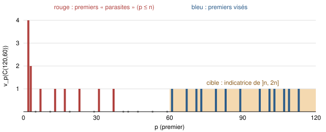

En sommant sur $p$, on obtient l'identité de Tchebychev :
$$\log\binom{2n}{n}=\psi(2n)-\psi(n)+\psi(2n/3)-\psi(2n/4)+\psi(2n/5)-\cdots$$
L'objet ne « voit » pas $\psi(2n)-\psi(n)$ seule, mais une **combinaison** de sommes de premiers. Les termes en trop, les **parasites**, sont positifs dans leur ensemble. On ne peut que les jeter, et c'est là qu'on perd $0{,}39\,n$.

> **La règle de fonctionnement.** Avec un objet $M$, on majore $\sum_p v_p(M)\log p$, et rien d'autre. La qualité de la borne dépend de l'écart entre le **profil de divisibilité** $p\mapsto v_p(M)$ et le **poids visé**. Le programme de la preuve est de fabriquer des objets dont le profil, après normalisation et sommation, reproduit celui de Riesz avec une erreur en $x^{1/2+O(\varepsilon)}$.

**Le même calcul avec le poids de Riesz.** La formule de Legendre s'écrit aussi
$$\log\lfloor y\rfloor!=\sum_{m\le y}\Lambda(m)\Big\lfloor\frac ym\Big\rfloor .$$
Le profil de $y!$ est donc $\lfloor y/m\rfloor$, et le poids de Riesz du § 1.2 est $y/m-1$. Les deux ne diffèrent que d'une dent de scie, puisque $y/m-1<\lfloor y/m\rfloor\le y/m$. Le premier objet venu, $y!$, donne donc déjà une borne sur la somme de Riesz $S(y)$, à une erreur près **en $O(y)$**. Numériquement, $\log y!-S(y)\approx\gamma\,y$ :

| $y$ | $S(y)$ | $y\log y-(1+\gamma)y$ | $\log y!$ | $\log y!-S(y)$ | $\gamma y$ |
|---:|---:|---:|---:|---:|---:|
| 10³ | 5 332,1 | 5 330,5 | 5 912,1 | 580,1 | 577,2 |
| 10⁶ | 12 238 305,9 | 12 238 294,9 | 12 815 518,4 | 577 212,5 | 577 215,7 |

La deuxième colonne est le terme principal qu'on retranche pour définir $G$ (§ 1.2). La factorielle donne $G(y)\le\gamma y+O(\log y)$, et la preuve doit obtenir $G(y)\le y^{1/2+\varepsilon}$. La construction vise à ramener cette erreur linéaire à $y^{1/2+O(\varepsilon)}$. Ce n'est pas qu'une analogie ⟦I⟧ : au § 3, le gain de divisibilité du Théorème A vient précisément de la factorielle $a!$ dans $D^af(0)=a!\cdot\mathrm{coeff}_a(f)$.

### Atelier 1. Quel profil faut-il réellement obtenir ?

Dans le tableau du § 2.3, la différence entre $\log y!$ et $S(y)$ est proche de $\gamma y$. Ce nombre n'est pas une erreur d'arrondi informatique. Pour un entier $y$,

$$\log y!-S(y)=\sum_{n\le y}\Lambda(n)\big(1-\{y/n\}\big),$$

où $\{t\}=t-\lfloor t\rfloor$. Chaque écart appartient à $]0,1]$. La majoration triviale de la somme est $\psi(y)$, d'ordre $y$. Voilà exactement le type d'obstacle qui nous intéresse : un petit défaut local répété sur une grande famille de premiers peut dominer complètement la fluctuation que l'on recherche.

Pour la suite, fixons un exemple numérique volontairement minuscule : $x=81$ et le premier $p=3$. Dans $S(81)$, les puissances $3,9,27,81$ portent respectivement les poids $26,8,2,0$. La contribution du premier 3 est donc $36\log3$. Dans $81!$, Legendre donne au contraire $27+9+3+1=40$. La différence, $4\log3$, est la dette de ce seul premier. Nous allons retrouver 3 au § 3, puis au § 4 dans un modèle de composition, et au § 5 dans un calcul de covolume.

Cet exemple suggère de changer de stratégie. Plutôt que de chercher des entiers ayant d'emblée toutes les valuations nécessaires, cherchons une opération qui fournit la bonne *forme fonctionnelle* $a/p^e$, puis un moyen d'en retrancher un seuil. Pour $a=bx$, l'identité

$$\left(\frac{a}{p^e}-b\right)_+=b\left(\frac{x}{p^e}-1\right)_+$$

explique pourquoi un facteur d'échelle $b$ sera utile. Le premier problème est d'obtenir les gains bruts ; le second, de disposer de poids qui réalisent la troncature. L'un sans l'autre ne suffit pas. Nous venons de passer d'une question sur les premiers à une question de construction.

### 2.4 Trois contre-exemples : ce que l'objet doit vérifier

| Objet | Ce qui ne va pas | Exigence correspondante dans la preuve |
|---|---|---|
| $M=0$ | Il est divisible par tout et sa taille est nulle, mais l'identité $\sum v_p\log p=\log\lvert M\rvert$ n'a plus de sens | **Non-nullité.** Chez Bost, l'application $\varphi$ doit être injective. Dans la preuve, ce rôle revient à la quasi-orthogonalité des périodes ⟦I⟧ (§ 5.4) |
| $M=2^N$ | Il est énorme en 2 et muet ailleurs | **Le profil doit suivre le poids**, premier par premier : c'est l'alignement des poids du § 4.3 |
| $M=\operatorname{ppcm}(1,\dots,y)=e^{\psi(y)}$ | Son profil est parfait, mais on ne connaît sa taille que si l'on connaît déjà les premiers : la borne est une tautologie | **La taille archimédienne doit se calculer sans les premiers** : par l'analyse (Stirling) ou par la géométrie (volumes, masses de Siegel). C'est la question 4, au § 5 |

Un quatrième point vaut pour tout objet. La divisibilité donne $v_p(M)\ge w(p)$, une **inégalité**, et donc seulement une **majoration** de la somme de premiers. Chez Tchebychev, la minoration $\psi(2n)\ge n\log4-\log(2n+1)$ demande un **autre** argument : $\binom{2n}{n}$ divise $\operatorname{ppcm}(1,\dots,2n)$. C'est pour cela que le § 1 a tant travaillé à **se passer de minoration** (Landau, § 1.4). La réduction analytique et le mécanisme arithmétique sont ajustés l'un à l'autre : le second ne produit que ce que le premier sait utiliser.

### 2.5 Le même schéma dans la preuve

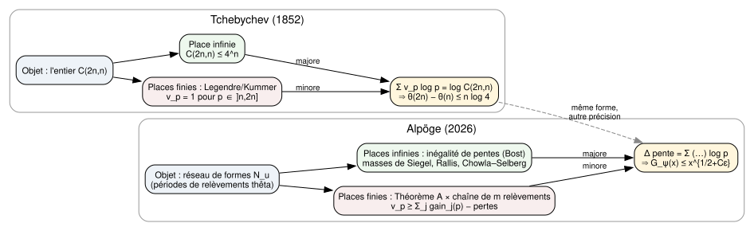

| Tchebychev | Alpöge | Où (partie II) |
|---|---|---|
| Un entier $\binom{2n}{n}$ | Un **réseau** $N_u$ de formes automorphes : beaucoup d'entiers à la fois, ses périodes | `divClausesR_of`, `DivIntoDualShift` |
| $v_p$ par Legendre | $v_p\ge\sum_{j=1}^m\mathrm{gain}_j(p)-\text{pertes}$ : Théorème A, itéré le long de la chaîne | `gainP`, `LinkG_at`, `thmAGauss` |
| $\binom{2n}{n}\le4^n$ | Inégalité de pentes, avec des volumes exacts | § 5.4 ; covolume : `topCovolSlim2_use_alt_alt` |
| $\log M=\sum v_p\log p$ | Une différence de pentes est une somme de $\log p$ | `mu_diff` |
| Profil en dent de scie, perte $O(x)$ | Profil aligné sur le poids de Riesz, perte $O(\sqrt x)$ | `gB`, `gam p = p/(p^2−1)` |

Pourquoi un réseau, et pas un seul entier ? Un entier fournit une inégalité. Un réseau de rang $r$ en fournit $r$, moyennées par la pente, et permet de **diviser** par un idéal tout en restant entier (§ 5.4) ⟦I⟧. Le rang $k\ge x^{3/2-\varepsilon}$ (§ 6.2) mesure la quantité d'information qu'il faut accumuler pour gagner le facteur $\sqrt x$.

**Ce que dit le graphe.** Sur l'export, tout ce paragraphe, c'est-à-dire la formule du produit, la division des réseaux et le calcul des pentes, pèse **environ 0,1 %** du volume de la fermeture (poids dominé, en lignes de l'export ; partie II). Le principe est peu coûteux. Ce qui coûte, ce sont les trois exigences du § 2.4. La non-nullité passe par la quasi-orthogonalité (théorème S, 1,4 %) et par la fabrication des familles (36 %). La taille calculable sans les premiers passe par le covolume (7 %). Le profil juste passe par les gains (`LinkG`, qu'alimente Behrend) et par la division (`LinkN`, qu'alimentent Galois, 6 %, et Ш, 8 %). Le graphe des interfaces (partie II) **soutient** les liens entre le théorème S et la non-nullité, et entre les gains et Behrend. Il **précise** le rôle de Ш, et il ne tranche pas pour le covolume.

> **Réponse à la question 1.** Un entier non nul ne peut pas être à la fois très divisible et petit : $\sum_pv_p(M)\log p=\log|M|$. Si l'on connaît sa taille sans connaître les premiers, et si son profil de divisibilité suit le poids voulu, on majore la somme de premiers. Tchebychev le fait avec $\binom{2n}{n}$, à $O(x)$ près, parce que le profil est une dent de scie. La preuve le fait à $x^{1/2+O(\varepsilon)}$ près sur des fenêtres, parce que son profil est aligné, mais aussi parce que l'objet est non dégénéré et que son budget archimédien est exact : l'alignement seul ne suffit pas. Les questions 2 et 3 expliquent d'où vient ce profil.

## 3. Pourquoi la multiplication complexe donne la divisibilité voulue

Le § 2 a fixé le cahier des charges. Il faut un objet non nul, de taille calculable, dont le profil de divisibilité $m\mapsto v(m)$ suive le poids de Riesz $(y/m-1)_+$. Le premier candidat, $y!$, a presque ce profil : $\lfloor y/m\rfloor$. Mais il est rigide. On ne peut ni le multiplier en familles, ni le faire vivre sur un réseau, ni l'itérer. Il faut une source de factorielles **à l'intérieur d'un objet géométrique**. Il y en a une, la dérivation :
$$D^af(0)=a!\cdot\mathrm{coeff}_a(f).$$
Si $f$ est à coefficients entiers, sa dérivée $a$-ième est divisible par $a!$. On obtient Legendre gratuitement : $v_p\ge a/(p-1)$, à $O(\log a)$ près. Il reste une question, qui décide de tout : **dans quelle coordonnée dérive-t-on ?**

### 3.1 Le problème de la coordonnée

La factorielle est déjà dans la dérivée. Si $f(X)=\sum_{n\ge0}c_nX^n$ est une série à coefficients dans $\mathbb Z_p$, alors $D^af(0)=a!c_a$ est divisible au moins autant que $a!$. Il semblerait donc que la divisibilité voulue soit gratuite. Pourquoi a-t-on besoin de courbes elliptiques ? Parce que la coordonnée dans laquelle $f$ est entière n'est pas forcément celle dans laquelle on doit la dériver.

Prenons une situation familière. La multiplication de deux nombres voisins de 1 s'écrit, après avoir retranché 1,

$$F(X,Y)=X+Y+XY.$$

Cette loi de groupe, écrite sous forme de série entière au voisinage de son neutre, est un *groupe formel*. Elle respecte l'associativité, l'élément neutre et l'inverse, non seulement pour les nombres mais comme identité entre séries. Le logarithme formel $\log_F(X)=\log(1+X)$ transforme cette loi en addition :

$$\log_F(F(X,Y))=\log_F(X)+\log_F(Y).$$

La coordonnée additive $z=\log_F(X)$ permet de dériver suivant une direction naturelle, et l'inverse s'écrit $X=\exp_F(z)=e^z-1$. Mais les coefficients $1/a!$ introduisent exactement les dénominateurs que l'on espérait gagner ! Pour $f(X)=X$, on a $D^a f(\exp_F(z))|_{z=0}=1$ pour tout $a\ge1$. Aucun facteur $p$ n'a survécu. Même une fonction parfaitement entière en $X$ peut donc n'apporter aucune divisibilité après linéarisation.

Les courbes elliptiques possèdent aussi une loi de groupe. Au voisinage du point à l'infini, on peut choisir un paramètre local (par exemple $t=-x/y$ pour une équation de Weierstrass) et exprimer l'addition par une série $F(X,Y)$. La série $[p]_F(X)$, obtenue en additionnant $X$ à lui-même $p$ fois, commence modulo $p$ en degré $p^h$ pour une certaine hauteur $h$. À bonne réduction, une courbe elliptique est ordinaire si $h=1$ et supersingulière si $h=2$.

Dans le modèle particulier de hauteur 2 étudié ici, on peut travailler avec un logarithme $p$-typique de la forme

$$\log_F(X)=\sum_{e\ge0}\frac{(-1)^eX^{p^{2e}}}{p^e}.$$

Le terme de degré $p^{2e}$ a un dénominateur de valuation $e$, et non $2e$. Le logarithme de hauteur 2 est beaucoup plus lacunaire que le logarithme multiplicatif. L'idée est que le coût de la linéarisation peut alors être inférieur au gain de la factorielle. Ce n'est pas une propriété automatique de toute série de hauteur 2 : la coordonnée choisie, l'intégralité et la renormalisation interviennent dans le résultat réel.

| Groupe formel | Logarithme modèle | Ce que l'exemple $f(X)=X$ montre |
|---|---|---|
| Additif | $X$ | $D^aX=0$ pour $a>1$ ; pour une série entière générale, le gain de Legendre est garanti |
| Multiplicatif, hauteur 1 | $\log(1+X)$ | $D^a(e^z-1)|_{z=0}=1$ pour $a\ge1$ |
| Modèle de hauteur 2 | $\sum_e(-1)^e X^{p^{2e}}/p^e$ | Si le coût par degré est borné par $1/(p^2-1)$, il reste au moins $ap/(p^2-1)-O(\log a)$ |

Reste un problème : comment assurer le cas favorable pour un grand ensemble de premiers ? Une courbe à multiplication complexe par un corps quadratique imaginaire $K$ est supersingulière aux premiers de bonne réduction inertes dans $K$. La multiplication complexe fournit ainsi une sélection arithmétique de premiers, décrite par un caractère quadratique. Il est temps d'en voir un exemple entièrement calculable.

### 3.2 Le calcul sur $y^2=x^3-x$

La courbe $y^2=x^3-x$ a multiplication complexe par $\mathbb Z[i]$, via $(x,y)\mapsto(-x,iy)$. Les premiers inertes dans $\mathbb Q(i)$ sont les $p\equiv3\pmod4$. On peut voir directement pourquoi ils sont supersinguliers.

Pour $p$ impair, la réduction est bonne. Si $\chi_p$ désigne le symbole de Legendre (avec $\chi_p(0)=0$), le nombre de solutions en $y$ de $y^2=x^3-x$ est $1+\chi_p(x^3-x)$. D'où

$$\#E(\mathbb F_p)=p+1+\sum_{x\in\mathbb F_p}\chi_p(x^3-x).$$

Lorsque $p\equiv3\pmod4$, $\chi_p(-1)=-1$ et $(-x)^3-(-x)=-(x^3-x)$. Les contributions de $x$ et de $-x$ se compensent exactement. Il ne reste que $p+1$. Nous venons de démontrer, sur cet exemple, la conséquence de la multiplication complexe que l'on utilise ensuite. Pour $p\equiv1\pmod4$, la même involution ne fait plus disparaître la somme.

Le comptage confirme :

| $p$ | 3 | 5 | 7 | 11 | 13 | 17 | 19 | 23 | 29 |
|---|---|---|---|---|---|---|---|---|---|
| $p \bmod 4$ | 3 | 1 | 3 | 3 | 1 | 1 | 3 | 3 | 1 |
| $\#E(\mathbb F_p)$ | 4 | 8 | 8 | 12 | 8 | 16 | 20 | 24 | 40 |
| $a_p=p+1-\#E$ | **0** | −2 | **0** | **0** | 6 | 2 | **0** | **0** | −10 |

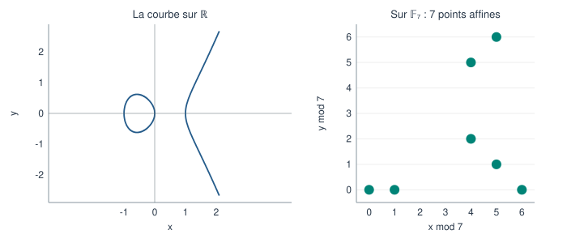

Pour $p$ inerte, $a_p=0$ : le Frobenius vérifie $F^2-a_pF+p=0$, donc $F^2=-p$. **Deux applications du Frobenius coûtent un facteur $p$.** C'est toute la supersingularité. Sur les coefficients $a_n$ de la fonction L de la courbe, la récurrence $a_{p^{k+1}}=a_pa_{p^k}-p\,a_{p^{k-1}}$ donne alors $a_{p^{2e}}=(-p)^e$ et $a_{p^{2e+1}}=0$. Un théorème de Honda (1968) dit que le groupe formel de $E$ est strictement isomorphe sur ℤ à celui dont le logarithme est $\sum_na_n\,t^n/n$ : le calcul qui suit porte donc bien sur la courbe elle-même. Le coefficient de $t^{p^{2e}}$ vaut donc $(-p)^e/p^{2e}=(-1)^e/p^e$ : c'est la hauteur 2. Pour $p$ décomposé, $a_p$ est inversible modulo $p$, $a_{p^e}$ est une unité $p$-adique, le coefficient de $t^{p^e}$ est en $1/p^e$, et l'on retombe sur la hauteur 1.

On inverse ce logarithme, avec des fractions exactes, et l'on calcule les valuations des dérivées de $\exp_E$ en 0 ([`tools/modeles.py`](tools/modeles.py)) :

| $a$ | 9 | 25 | 49 | 81 | 121 | 161 |
|---|---:|---:|---:|---:|---:|---:|
| $v_3(a!)$ (Legendre) | 4 | 10 | 22 | 40 | 58 | 76 |
| $v_3(D^a\exp_E(0))$, $p=3$ inerte | 3 | 9 | 18 | 30 | 45 | 61 |
| $a\cdot3/8$ | 3,4 | 9,4 | 18,4 | 30,4 | 45,4 | 60,4 |
| $v_5(D^a\exp_E(0))$, $p=5$ décomposé | 0 | 0 | 0 | 0 | 0 | 0 |

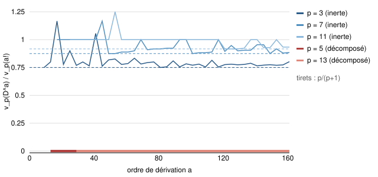

Le contraste est total. Pour un premier inerte, la minoration garantit asymptotiquement la fraction $\frac{p/(p^2-1)}{1/(p-1)}=\frac p{p+1}$ du gain de Legendre (3/4 pour $p=3$, 7/8 pour $p=7$), à une perte $O(\log a)$ près ; les valeurs calculées peuvent la dépasser ponctuellement. Pour les premiers décomposés 5 et 13, la valuation observée est nulle pour tous les ordres impairs calculés, $a\le161$ (les coefficients d'ordre pair de l'exponentielle formelle sont nuls, puisque le logarithme est impair, et leur valuation vaut $+\infty$) : en réduction ordinaire, le calcul des dénominateurs ne garantit aucun gain, et ici il n'y en a aucun.

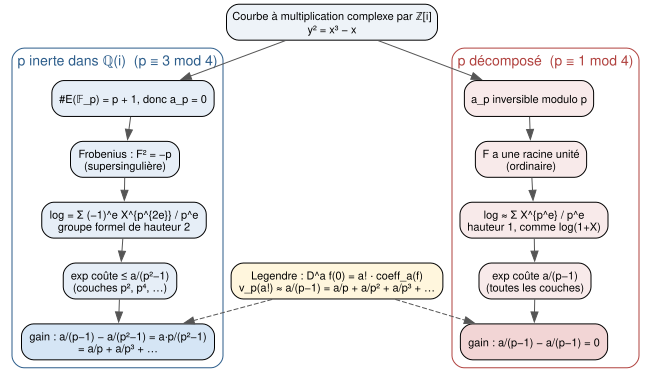

**Ce qui est soustrait dans le modèle des taux.** Legendre compte les multiples de $p$, puis de $p^2$, de $p^3$, etc. :
$$\frac a{p-1}=\frac ap+\frac a{p^2}+\frac a{p^3}+\cdots$$
Le majorant du coût de hauteur 2 vaut $\frac a{p^2-1}=\frac a{p^2}+\frac a{p^4}+\cdots$ : ce sont **les couches paires**. Il reste les couches impaires :
$$v_p\big(D^a\exp_F(0)\big)\gtrsim\frac ap+\frac a{p^3}+\frac a{p^5}+\cdots=a\,\frac{p}{p^2-1}.$$

### 3.3 Le profil obtenu, et pourquoi c'est le bon

On lit ce gain sur les puissances de premiers $m=p^e$, comme pour le poids de Riesz du § 1.2. L'objet gagne $a/m$ en $m=p^e$ si $p$ est inerte et $e$ impair, et rien sinon. Or, pour un caractère quadratique $\chi_{-d}$ attaché au corps CM $K=\mathbb Q(\sqrt{-d})$ et pour $p\nmid d$,
$$\frac{1-\chi_{-d}(p^e)}2=\begin{cases}1&\text{si }p\text{ est inerte et }e\text{ impair},\\0&\text{sinon.}\end{cases}$$
C'est **exactement** la même condition. Le profil fourni par la multiplication complexe est donc
$$m\;\longmapsto\;\frac am\cdot\frac{1-\chi_{-d}(m)}2 ,$$
c'est-à-dire le profil de Legendre, celui de $y!$ au § 2.3, restreint par un caractère quadratique. Avec $a\leftrightarrow y$, ce que l'objet permet de majorer est
$$\sum_m\Lambda(m)\Big(\frac ym-1\Big)_+\frac{1-\chi_{-d}(m)}2=\tfrac12\,S(y,1)-\tfrac12\,S(y,\chi_{-d}).$$
**La multiplication complexe donne le bon profil, sur la moitié des premiers, et cette moitié est découpée par un caractère.**

**Le premier ramifié.** Comme $d$ est premier, le seul premier où $\chi_{-d}$ s'annule est $p=d$ : là, $\frac{1-\chi_{-d}(d^e)}2=\frac12$, ni 0 ni 1. Le membre de gauche contient donc aussi la demi-contribution $\frac12\log d\sum_{e\ge1}(y/d^e-1)_+\le\frac{y\log d}{2(d-1)}$, qui n'est pas un comptage d'inertie. L'identité de droite reste exacte sur tous les entiers ; seule son interprétation demande d'exclure $p=d$. Dans la preuve, ce terme disparaît : le lemme `ramifiedPrimeTerm_eq_zero_of_lt_ramifiedPrime` montre que la part de $d$ dans `ASK` est nulle dès que toutes les échelles restent sous $d$ ($a/w\le N<d$), et `askExp` l'utilise. Les autres premiers exceptionnels (2, $q$ et les facteurs de $Q_S$, § 3.4) sont décomposés dans $\mathbb Q(\sqrt{-d})$ : le facteur y vaut 0, et ils ne comptent pas.

### Atelier 2. Suivre le premier 3

Reprenons $x=81$ et choisissons, uniquement pour illustrer le mécanisme, $b=3$, $a=bx=243$. La courbe précédente est supersingulière en 3. Le gain brut de type hauteur 2 est porté par les puissances impaires. Si nous pouvions fixer le seuil à $b$, il nous resterait :

| $p^e$ | $a/p^e$ | $(a/p^e-b)_+$ | Gain retenu (e impair) |
|---:|---:|---:|---:|
| 3 | 81 | 78 | 78 |
| 9 | 27 | 24 | 0 |
| 27 | 9 | 6 | 6 |
| 81 | 3 | 0 | 0 |
| 243 | 1 | 0 | 0 |

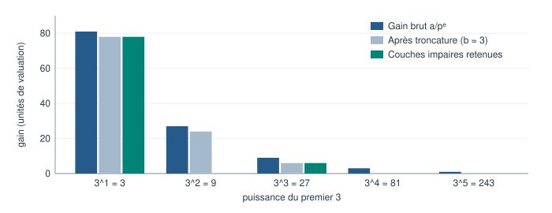

Le total vaut $84$, soit exactement $3(26+2)$. Divisé par $b$, c'est la partie impaire de la contribution de 3 à la somme de Riesz du prologue. Les autres puissances ne sont pas vues par cette courbe ; le caractère quadratique encode cette sélection. Ce n'est pas encore une valuation effectivement obtenue par un opérateur de la preuve : nous n'avons pas démontré que le seuil voulu puisse être réalisé. Nous avons seulement identifié l'expression que doit produire la construction locale.

L'intérêt de la multiplication complexe devient alors plus concret. Elle fournit une règle de sélection uniforme en $p$, et ses gains sont de la forme $a/p^e$ dont nous avons besoin. Le défaut — seuls certains premiers et certaines puissances apparaissent — a lui-même une structure de caractère. On peut donc espérer le traiter par l'orthogonalité et par une moyenne sur les corps, plutôt que de corriger chaque premier individuellement.

### 3.4 Le prix à payer : un caractère parasite, que l'on moyenne

Nous savons maintenant ce qui manque : le profil sélectionné par $K$ contient la moitié de la somme non tordue et une moitié tordue. Pour le caractère non trivial $\chi_{-d}$, la somme brute $S(y,\chi_{-d})$ comporte en général un terme linéaire, $-yL'(1,\chi_{-d})/L(1,\chi_{-d})$. C'est le reste centré $g(y,\chi_{-d})$ qu'il faut maîtriser à l'échelle voulue, conjointement avec les termes principaux et les places ramifiées.

Avec un corps fixé, par exemple $\mathbb Q(i)$, ce contrôle reviendrait à une autre difficulté de type GRH. Il serait circulaire de le postuler. Mais nous n'avons pas besoin du même corps pour toutes les échelles, grâce au critère en fenêtres du § 1.5.

Pour comprendre le changement de perspective, imaginons des signes indépendants $\epsilon_p\in\{\pm1\}$ et une somme $\sum_{p\le y}c_p\epsilon_p$. Sa moyenne est nulle et sa variance vaut $\sum_pc_p^2$. Une estimation de second moment donne donc beaucoup de choix pour lesquels la somme est petite relativement à sa borne triviale. Dans le problème réel, les caractères quadratiques ne sont pas des signes indépendants, et la moyenne doit contrôler des familles de sommes lissées, des termes principaux et une plage entière d'échelles. Le grand crible remplace l'indépendance fictive par des estimations effectives. Le modèle ne prouve aucune de ces estimations ; il explique pourquoi l'on fait varier $d$ plutôt que d'affronter un caractère fixé.

Sur l'export, la preuve dispose de familles gigantesques devant les échelles et d'un choix inconditionnel des paramètres sur une plage $[Y,Y^A]$. Lus sur l'export, `QH.pair_share` et `QH.bad_share` disent précisément ceci : pour tout $\eta>0$, une proportion au moins $1-\eta$ des premiers $q\equiv3\pmod8$ de $]e^{z/2},e^z]$, $z=Y^{\varepsilon/5}$, puis des premiers $d\equiv7\pmod{16}$ de $]e^{z'/2},e^{z'}]$, $z'\asymp z\log^2Y$, avec $q\prod_{3\le p\le z}p\mid d+1$ (`primeSetTwoBounds` ; cette divisibilité force $\left(\frac{-d}p\right)=1$ pour tout premier impair $p\le z$ et $\left(\frac{-d}q\right)=1$ : c'est là que naissent les conditions de l'hôte), sont **bons** (`GoodQ`, `GoodD`) au sens de trois conditions (`Box`) : pour chaque caractère primitif ψ issu des torsions par $\left(\frac\cdot q\right)$ et $\left(\frac\cdot d\right)$, pas de zéro dans le rectangle $\operatorname{Re}s>1-\frac1{400}$, $|\operatorname{Im}s|\le Q$, $|L'/L(1,\psi)|\le C\log Y$, et $|G_\psi(y)|\le y^{1/2+\tau}$ pour **tout** $y$ de la fenêtre $[Y,X]$, $X\le Y^K$. C'est une borne uniforme sur toute la fenêtre, pour la somme **centrée** $G_\psi$, non pour la somme brute. Elle vient d'une moyenne quadratique de type grand crible (`QH.meanSqK`), d'une estimation de densité de zéros (`QH.count_bad`) et du théorème de Siegel (`excBound` : $\beta\le1-c\,q^{-\varepsilon}$ pour un caractère réel non trivial), dont la constante est classiquement ineffective. L'ensemble est léger : la fermeture de `pair_share` compte 75 645 déclarations, dont 1 200 en propre.

**L'hôte réel.** La preuve fait la même chose avec plus de structure. Elle doit aussi voir les $\chi_j$ de $K_\psi$ (§ 1.1) et garder des coefficients positifs (§ 1.3). À l'échelle $x$, elle choisit deux premiers $q\equiv3\pmod8$ et $d\equiv7\pmod{16}$, puis un corps CM abélien
$$E\subset\mathbb Q(\zeta_{Q_Sqd}),\qquad\sqrt{-q},\sqrt{-d}\in E,\qquad[E:\mathbb Q]\approx x^{2+8\varepsilon},$$
qui contient le corps découpé par ψ. Sur l'export, $|A|=c\cdot2^e$ avec $x^{2+8\varepsilon}\le c\cdot2^e\le2x^{2+8\varepsilon}$, et $[E:\mathbb Q]=4|A|$. Les premiers inertes dans $\mathbb Q(\sqrt{-d})$ y sont pondérés selon leur classe de Frobenius. Par orthogonalité, on retrouve exactement $G_\psi(x)$, avec le poids $1/(3o+1)$ du § 1.3, plus des parasites, qui sont des torsions par $(q/\cdot)$, $(d/\cdot)$ et leur produit, neutralisés par le choix en moyenne de $(q,d)$. C'est **le même corps** $E$ qui porte la borne de Tate–Shafarevich du § 7 (a).

**Les conditions exactes, lues sur l'export.**

- **La paire.** Elle vérifie `HostHyp` : $q$ et $d$ premiers, $q\equiv3\pmod8$, $d\equiv7\pmod{16}$ et $\left(\frac{-d}q\right)=1$.
- **Une condition plus forte** (`Top.pairHyp`) : tout premier impair $p\le Y^{\varepsilon/5}$ est décomposé dans $\mathbb Q(\sqrt{-d})$. S'y ajoutent les identités de réciprocité $\left(\frac{-q}a\right)=\left(\frac aq\right)$ et $\left(\frac{-d}a\right)=\left(\frac ad\right)$ pour $a$ impair, qui reflètent $q,d\equiv3\pmod4$.
- **La structure galoisienne.** Le groupe est modélisé comme $E_0\times H$, avec $E_0=\mathbb Z/2\times\mathbb Z/2$ et un sous-groupe Φ d'indice 2 (`D5.InPhi`). Un premier est inerte (`IsInert`) s'il diffère de 2, $q$ et $d$, et si son Frobenius sort de Φ.
- **Les faits de ramification** (`HostFactsS`). Ils portent sur un **ensemble exceptionnel** fini $S$, qui contient 2 et $q$ mais pas $d$. Hors de $S\cup\{d\}$, tout est non ramifié ; $d$ est ramifié avec une inertie d'ordre 2 ; pour $p\in S$, l'inertie et le Frobenius restent dans Φ, et ces premiers ne sont jamais comptés comme inertes. La construction (`HostRaw.mk`, `hostFactsS`) prend $S$ égal à l'ensemble des premiers divisant $Q_Sq$, où le module $Q_S$ est premier à $qd$, divisible par $2^{e+2}$, et n'a que des facteurs impairs $\ell$ avec $\left(\frac{-d}\ell\right)=1$. Pour les premiers du conducteur de ψ (par exemple 5 pour $\psi=(\frac\cdot5)$), deux raisons distinctes jouent : ils sont ramifiés dans le corps découpé par ψ, que $E$ contient, donc dans $E$ ; et, comme facteurs de $Q_S$, ils sont décomposés dans $\mathbb Q(\sqrt{-d})$ par hypothèse de construction, donc absents des sommes. Le sous-groupe Φ est exactement $\mathrm{Gal}(E/\mathbb Q(\sqrt{-d}))$ (`toE` en fait la coordonnée testée par `InPhi`). La version 3.2 écrivait « hors de $\{2,q\}$ et de $d$, tout est non ramifié » : c'était une transcription erronée.
- **Les sommes tronquées** (`askExp`). `ASK` se développe par orthogonalité en sommes $\sum_n\Lambda(n)\psi(n)\,(a/n-w)_+$ : la troncature de Riesz est écrite dans la définition même.

**Lecture ⟦I⟧.**

- Φ est le sous-groupe qui fixe $\sqrt{-d}$ (vérifié sur l'export, voir ci-dessus) ; les congruences s'expliquent alors en partie. $d\equiv7\pmod8$ donne $-d\equiv1\pmod8$, donc 2 est décomposé dans $\mathbb Q(\sqrt{-d})$ ; et $\left(\frac{-d}q\right)=1$ rend $q$ décomposé.
- La condition sur les petits premiers garantit qu'**aucun premier inerte n'est plus petit que $Y^{\varepsilon/5}$**. Or les pertes par premier ($\mathrm{flG}(p)$, en $\log_pa$) et les bornes de gain ($4|TT|a/p$) se dégradent pour les petits $p$.
- Cette condition n'est satisfaite que par une proportion d'environ $2^{-\pi(Y^{\varepsilon/5})}$ des $d$, ce qui explique la taille $\exp(Y^{\varepsilon/5})$ de la famille.

Le rôle précis de $q\equiv3\pmod8$ et du raffinement modulo 16 reste ouvert. Ces conditions sont consommées par la construction de l'hôte (`hostOfFieldOf`), par la borne de Ш (`vwinAt_of_joint`) et par le traitement des parasites (`CharacterBoxes`).

### 3.5 Dans la preuve : le Théorème A

Le calcul du § 3.2 se fait sur une courbe elliptique. La preuve fait le même calcul pour une **série thêta** de réseau hermitien, en un point CM d'une variété de Shimura unitaire, en coordonnées de groupe formel :

> **Théorème A** (forme simplifiée). Soit $\Theta$ une série thêta, renormalisée par une exponentielle convenable, en coordonnées de groupe formel au point CM. Pour $p$ inerte,
> $$v_p\big(D^{a}\Theta(0)\big)\;\ge\;a\cdot\frac{p}{p^2-1}\;-\;O(\log a)=a\Big(\frac1p+\frac1{p^3}+\cdots\Big)-O(\log a).$$

C'est la phrase de la note : « $D^a\,\Omega\cdot\theta(0)$ is divisible by $p^{a/p+a/p^3+\cdots-O(\log a)}$ ». Le § 3.1 explique une observation de Rubinstein [R2]. Sur la série thêta naïve de ℤ[i], dérivée dans la coordonnée analytique, il ne retrouve pas cet exposant (il trouve 6, 2 et 1 pour $p=3$, 7, 11). Le gain n'existe que pour l'objet **renormalisé, en coordonnée de groupe formel** : c'est le changement de coordonnée qui décide de ce qui reste de $a!$.

**La preuve du Théorème A** pèse environ 0,02 % du volume. Elle se fait en trois temps.

1. **Point générique.** Les coefficients à borner sont des polynômes en les coordonnées d'un « repère » de directions de dérivation. On les évalue en un point **résiduellement générique**, où la valeur absolue d'un polynôme est égale à sa **norme de Gauss**, le maximum de ses coefficients.
2. **Monôme.** Le jet s'exprime par des mineurs des dérivées de $\Theta$. On se ramène à un seul multi-indice $\kappa$, c'est-à-dire à $|\kappa!\cdot\mathrm{coeff}_\kappa|$.
3. **Un monôme.** On combine l'intégralité de la série de départ, l'inverse du logarithme formel et la borne $\rho(p)=1/(p^2-1)$ par degré pour l'exponentielle de renormalisation (lemme « S »). Cette borne repose sur le **lemme de Dwork**, démontré dans le projet : $\exp(P)$ est $p$-entière si et seulement si $P^{\sigma}(X^p)-pP\in pW[[X]]$. Pour $P=X$, on retrouve que $e^X$ n'est pas entière, et c'est le cas multiplicatif du § 3.1. Une condition de **quasi-orthogonalité tordue par Frobenius**, $\sum_a x_a^{p^{j}}x'_a\equiv0\pmod p$, porte sur les vecteurs du repère. L'étiquetage des décalages impairs $j$ avec $p^j\le a$ coûte $O(\log a)$, et c'est la perte logarithmique.

**Les hypothèses exactes du Théorème A.** La hauteur 2 ne suffit pas à elle seule. L'énoncé exact (`ThmAGauss`) suppose $p\ge3$, une extension non ramifiée de degré pair (noté $d$ dans l'énoncé, sans rapport avec le premier $d$ de l'hôte), des coordonnées de groupe formel données par l'inverse $g$ du logarithme formel ($g\circ\log=X$), une série $U$ entière dans ces coordonnées, une exponentielle de renormalisation dont les coefficients vérifient une condition de type Dwork (`BHyp`), et des repères de taille au plus $a$ avec $2\log_pa+2\le N_0-1$. La perte est explicite : $dN_0N_1(\log_pa+1)$.

**Les exposants impairs et les ensembles sans relation courte.** Dans un corps CM de grand degré, le Frobenius d'un premier inerte agit sur les plongements par décalage, et le gain $a/p^e$ se lit en la place $t+e\cdot h_p$ de son **orbite**. On ne l'obtient que si le poids à cette place n'est pas trop grand. Les positions des places « épaisses », à grand poids, doivent donc éviter de trop se rapprocher le long des orbites. L'export (`NoRel T L`) exige, pour $s_1,s_2,s_3\in T$ distincts et des entiers $i\ne j$ non nuls de valeur absolue au plus $L$, que $j(s_2-s_1)\ne i(s_3-s_1)$. C'est plus fort que l'absence de progression arithmétique à trois termes ($i=1$, $j=2$), qui ne borne pas le nombre de points par segment : $\{0,1,3\}$ est sans progression à trois termes et a trois points dans $[0,3]$, mais ne vérifie pas `NoRel` dès $L\ge3$, puisque $3\cdot(1-0)=1\cdot(3-0)$. Un tel ensemble, de densité de type Behrend, est obtenu par la construction de **Behrend** (`hostThickExists`). Ce qu'il sert à préserver, et par quel canal, est exposé au § 7 (« Préserver les gains »).

**Deux lemmes élémentaires, avec statut de modèle.** Ils ne reconstruisent pas `LinkG_at`, mais ils isolent deux mécanismes que cette interface combine.

*Lemme d'orbite.* Dans un groupe abélien $G$, si $T$ vérifie la condition `NoRel T L` ci-dessus, alors tout segment d'orbite $\{s+rg:0\le r\le L\}$ contient au plus deux points **distincts** de $T$. En effet, si $s+r_1g$, $s+r_2g$, $s+r_3g$ sont trois points distincts de $T$, posons $i=r_2-r_1$ et $j=r_3-r_1$ : ce sont des entiers distincts, non nuls, de valeur absolue au plus $L$, et $j(s_2-s_1)=jig=i(s_3-s_1)$, ce qui est exclu. Aucune division n'intervient, même en présence de torsion. Dans l'export, `NoRel` porte sur un `Finset ℕ` et des relations dans ℤ : le lemme s'applique avec $G=\mathbb Z$, et il ne dit rien, sans argument supplémentaire, des relations modulo la longueur de l'orbite ni des visites répétées d'un même point. Le traitement effectif distingue orbites longues et courtes (§ 7).

*Lemme des profils tronqués.* Pour une famille finie de gains $g_i\ge0$, posons $F_g(b)=\sum_i(g_i-b)_+$ et $N_g(t)=\#\{i:g_i>t\}$. Alors $F_g(b)=\int_b^\infty N_g(t)\,dt$, puisque $(g_i-b)_+=\int_b^\infty\mathbf 1_{t<g_i}\,dt$ ; $F_g$ est convexe et décroissante, de dérivée à droite $-N_g(b)$. Si les gains sont rangés par ordre décroissant,
$$F_g(b)=\max_{0\le k\le r}\Big(\sum_{i\le k}g_i-kb\Big),\qquad\sum_{i\le k}g_i=\min_{b\ge0}\big(F_g(b)+kb\big),$$
le maximum étant atteint en gardant les gains qui dépassent $b$, et le minimum pour $b$ entre $g_{k+1}$ et $g_k$. Dominer un profil tronqué pour **tous** les seuils équivaut donc à dominer **toutes** les sommes partielles supérieures, et non le seul total : $(8,2)$ et $(5,5)$ ont le même total, mais $F(4)$ vaut 4 pour l'un et 2 pour l'autre. C'est exactement la forme du gain exigé par `LinkG_at` (§ 3.3, atelier 2), $\sum_{e\text{ impair}}(a/p^e-b)_+$, avec $g=(a/p^e)_{e\text{ impair}}$. Le Théorème A minore un total, $a\,p/(p^2-1)$ ; `LinkG_at` demande un profil tronqué. La lecture de `LinkG_at` comme certificat de domination de profils, après pertes, est une hypothèse de travail ⟦I⟧, que seule une famille effective de gains, lue dans la construction, pourrait confirmer. Une identité élémentaire précise l'écart : pour des seuils $w_e\ge0$,
$$\sum_{e\ \text{impair}}\Big(\frac a{p^e}-w_e\Big)_+=a\,\frac p{p^2-1}-\sum_{e\ \text{impair}}\min\Big(\frac a{p^e},w_e\Big),$$
puisque $(x-w)_+=x-\min(x,w)$ : le profil tronqué est le gain brut du Théorème A diminué d'un **coût de troncature**. Sur l'export, les seuils (`cap`) sont définis par blocs de segments, et les gains de `LinkG` proviennent d'un « premier » et d'un « second » théorème de famille, le second étant une borne de valuation le long des orbites, tous deux tirés d'un même paquet de résultats locaux (modèle local, platitude, projecteurs extrémaux ; article, § 5.5). Comment ces résultats réalisent le coût de troncature voulu reste à lire.

**La chaîne des gains, lue sur l'export.** Le gain exigé par `LinkG_at` combine cinq éléments, que l'on lit séparément.

*Admissibilité.* Le premier ingrédient est le Théorème A de la route d'origine, noté ici $A_{\rm orig}$ pour le distinguer des Théorèmes A, B, C de la réécriture de Sernau. Sous la forme d'une borne uniforme (sa conclusion avec une perte de constante 1, `SplitConstantsUniformBound 11 1`), il rend **admissibles** les lignes « servies » de la construction. Il n'est pas dans la fermeture des deux théorèmes de famille qui concluent `LPprime` : la divisibilité qu'il fournit et sa propagation aux réseaux sont démontrées séparément.

*Le flot.* Le coût de troncature a, sur l'export, la forme exacte d'un **programme de flot** sur l'orbite de Frobenius. Sur une orbite de longueur $d$, avec des capacités $D_s\ge0$ aux positions $s\in\mathbb Z/d$ et un premier $l$, avec $d\ge2$, un flot attribue des quantités $x_{s,i}\ge0$ aux couches **impaires** $i<d$. Une couche lancée en $s$ pèse $l^i$ en $s$ et $1$ en $s+i$, d'où les contraintes $\sum_il^ix_{s,i}+\sum_ix_{s-i,i}\le D_s$. Le corollaire du Théorème A minore la valuation par le gain brut $\frac l{l^2-1}\sum_sD_s$ diminué du flot maximal $F^*$ (`lpF`). En sommant les contraintes, $\sum_{s,i}(l^i+1)x_{s,i}\le\sum_sD_s$, d'où $F^*\le\frac{\sum_sD_s}{l+1}$, puisque $l^i+1\ge l+1$ ; le certificat dual est la constante $y_s=\frac1{l+1}$. **Il y a égalité si et seulement si** la solution unique du système cyclique $l\,x_s+x_{s-1}=D_s$ est non négative, car l'égalité force la saturation de toutes les contraintes et l'annulation des couches $i\ge3$. Cette solution vaut
$$x_s=\frac{\sum_{k=0}^{d-1}(-1)^kl^{d-1-k}D_{s-k}}{l^d-(-1)^d}.$$
La condition locale $D_{s-1}\le l\,D_s$ pour tout $s$ suffit, en groupant les termes deux par deux. Elle n'est pas nécessaire : pour $l=3$ et $D=(3,1,0,0)$, la solution $x=(1,0,0,0)$ est non négative sans que l'équilibre ait lieu. Le lemme lu sur l'export (`LemmaFe`) suppose $d$ pair et $D_{a'}\le l\,D_a$ pour tous $a,a'$, ce qui est un cas particulier. Dans le cas saturé, le gain restant vaut $\frac l{l^2-1}\sum_sD_s-\frac{\sum_sD_s}{l+1}=\frac{\sum_sD_s}{l^2-1}$. Si la solution cyclique a une composante négative, la borne n'est pas atteinte, et il faut résoudre le programme général. Le théorème nommé `linear_programming_input_of_hypotheses` n'utilise pas ce programme : il empaquette les deux théorèmes de famille (E8). Les deux « programmations linéaires » ne doivent pas être confondues, et le lien entre les capacités $D_s$, les seuils `cap` et les gains effectifs reste à établir.

*Le rang à précision.* Le second ingrédient est une propriété de **rang $p$-adique**, `LPprime`, que concluent les deux théorèmes de famille. Pour tout réseau $L$ de $\mathbb Q_q^{m+1}$, avec $\mathbb Q_q$ non ramifiée sur $\mathbb Q_p$, il existe des arêtes de Hecke en $p$ aboutissant à $L$ et des fonctionnelles attachées à leurs sources, séparées modulo une puissance de l'uniformisante, dont l'accouplement avec l'espace cible est de rang au moins $(1-\kappa)\dim$ à la précision $p^D$. Cette propriété est exigée sous une condition de pavage des orbites de Frobenius. Le « rang à la précision $p^D$ » a un sens exact. `GoodRankK` demande une application $O$-linéaire $u:O^n\to A$ et une matrice $M$ à coefficients dans $O$ telles que $M\,\Phi(u(x))=p^Dx$ pour tout $x\in O^n$, où $\Phi$ rassemble les fonctionnelles. Pour la matrice entière $B=\Phi\circ u$, cela **équivaut** à : $B$ est injective et ses $n$ facteurs invariants vérifient $s_i\le D$. En effet, si $B=U\,\big[\mathrm{diag}(p^{s_i});0\big]\,V$ (forme de Smith), $M=V^{-1}\big[\mathrm{diag}(p^{D-s_i})\mid0\big]U^{-1}$ convient quand tous les $s_i\le D$. Réciproquement, $MB=p^DI_n$ force l'injectivité, et la colonne $i$ de $MU$, restreinte aux $n$ premières composantes, vaut $p^{D-s_i}$ fois la colonne $i$ de $V^{-1}$, qui a un coefficient inversible : d'où $D-s_i\ge0$. Comme la longueur de l'image de $B$ modulo $p^{D'}$ est $\sum_i(D'-s_i)_+$, on en tire $\operatorname{len}\ge n(D'-D)$ pour $D'\ge D$ : le rang à précision est une borne inférieure sur une longueur tronquée, de la même forme que les profils ci-dessus. C'est une caractérisation de la restriction $B=\Phi\circ u$, non du rang de $\Phi$ en général ; et que l'accouplement réel soit entier n'a pas été vérifié.

*L'assemblage des arêtes.* La preuve de `LPprime` a deux étages, et le premier est élémentaire et reconstruit. Tout réseau de rang $k$ reçoit au moins $\frac{q^k-1}{q-1}$ arêtes de Hecke de type 1, avec $q=p^{n'}$ : c'est le nombre d'hyperplans de $\mathbb F_q^k$. Si chaque arête fournit, à la précision $p^D$, un rang au moins égal à $(1-\kappa)\dim V$ divisé par ce nombre, les rangs s'additionnent. Le lemme qui le permet tient en deux lignes. Soit $R$ un anneau de valuation discrète d'uniformisante $\pi$. Si les blocs diagonaux vérifient $M_jB_j=\pi^DI_{r_j}$ et si les blocs croisés de $MB$, pour $M=\operatorname{diag}(M_j)$, sont dans $\pi^{D+1}R$, alors $MB=\pi^D(I+\pi C)$ avec $C$ entière. Comme $I+\pi C$ est inversible sur $R$, $M'=(I+\pi C)^{-1}M$ vérifie $M'B=\pi^DI$. C'est la matrice **normalisée** qui est inversible, non nécessairement la matrice brute. Sur l'export, la séparation se fait modulo $w^{c^*}$ avec $c^*>8D$ (`isUnit_det_of_one_add`, `goodRank_core`) ; les unités relatives de $w$, $p$, $D$ et $c^*$ sont à vérifier.

*Le comptage des poids.* Le second étage, le rang par arête, est obtenu par une récurrence sur le plus haut poids $\lambda$ d'un module de Weyl de $\mathrm{GL}_{m+1}$. Elle part des poids « plats » $(A,0,\dots,0,-B)$, avec une perte de précision explicite et logarithmique en $a$ à chaque pas, et compare les dimensions par la formule de dimension de Weyl. Les poids de base portent, aux positions retenues, des coefficients $a_s$ en tête et $-b_s$ en queue, qui rappellent la paire $(a,b)$ de la troncature de Riesz ⟦I⟧. Lu sur l'export, le cœur de cette récurrence est un énoncé classique de théorie des représentations. Le module de Weyl dual est réalisé comme espace de polynômes en les coefficients d'une matrice, homogènes d'un poids donné et invariants par addition de colonnes (`dualWeyl`). Le réseau attaché à un réseau $L$ est le produit tensoriel, sur les positions de l'orbite de Frobenius, de ces modules tordus par les puissances de σ (`HL`). Pour chaque arête, le modèle local fournit une base commune aux deux réseaux de l'arête, $(x_i)$ pour la source et $(p^{\pi_i}x_i)$ pour le but (`elementary_divisor_basis`) : la dilatation de l'arête agit diagonalement sur des vecteurs de poids ⟦I⟧. Le rang par arête revient alors à compter les vecteurs de cette base dont l'exposant tient dans la précision. La formule de dimension de Weyl ne contrôle pas, à elle seule, la distribution de ces exposants : ce comptage (`cloud_count`) et la base de produit tensoriel (`ten_basis`) ne sont pas lus.

**Pourquoi le point CM est-il utile au-delà de l'exemple elliptique ?** Une série thêta encode des données d'un réseau, mais on souhaite en extraire des valeurs et des dérivées qui vivent dans des structures arithmétiques. Un point CM est un point de l'espace de modules représentant une variété abélienne à multiplication complexe. Ses endomorphismes et ses réductions imposent de fortes contraintes à la géométrie locale. Il permet donc de relier une fonction analytique à une série entière dans une coordonnée formelle, où les valuations ont un sens. Le passage au cas de grand rang, les renormalisations et les conditions de Frobenius sont précisément ce que réalise le Théorème A ; il serait trompeur de considérer le calcul de la courbe elliptique comme sa preuve.

### 3.6 Ce que dit le graphe

Les deux organes de cette question sont minuscules. Le Théorème A (`DworkPowerSeriesWeights.thmAGauss`, `theorem_A_one_monomial_log_loss`, `lemmaS`, `FormalGroupSystem.Pf.sx_dwork`) pèse environ 0,02 %. L'hôte et le choix en moyenne des paires (`supplyChi`, `PairEx`, `QH.pair_share`, `QH.bad_share`) pèsent environ 0,1 %. Le gain de divisibilité est **local et bon marché**, au sens du poids propre seulement : une déclaration partagée peut être coûteuse à reconstruire tout en ayant un poids dominé faible. Ce qui coûte, c'est de le **préserver** jusqu'au réseau final, à travers la division. Sur l'export (partie II, graphe des interfaces), la borne de Ш du **même** corps $E$ (8 %) est fournie avec l'hôte (`supplyChi`). Elle réapparaît dans `LinkN`, la borne sur les places tordues, qui doit tenir dans le budget de perte par relèvement et conditionne la division (`DIVinN`). La multiplication complexe crée le profil, et Ш garantit qu'on peut diviser sans le perdre. Le mécanisme proposé, par les dénominateurs de Hecke, reste ⟦I⟧ (§ 7 (a)).

**Ce qui manque encore.** Une dérivation au point CM fournit un taux de gain avec une perte logarithmique locale. La conversion de cette perte en erreur globale exige de tenir compte des seuils, du nombre de places et de la normalisation $a=xb$ ; le rapprochement avec l’erreur de la factorielle est une motivation ⟦I⟧ et non une estimation indépendante. Pour descendre à $\sqrt y$, il faut **répéter** la dérivation, comme Stepanov fait s'annuler sa fonction à un ordre élevé. C'est la question 3.

> **Réponse à la question 2.** La dérivation fournit des factorielles, donc la divisibilité de Legendre, à condition de dériver dans une coordonnée où l'objet est entier. Pour une forme modulaire, cette coordonnée est celle d'un groupe formel, et le passage à la coordonnée linéaire coûte des dénominateurs. Dans le modèle de hauteur 1 (réduction ordinaire), le contrôle des dénominateurs ne garantit aucun gain linéaire. Dans le modèle de hauteur 2, sous les hypothèses d'intégralité et de renormalisation, il reste une minoration de taux $p/(p^2-1)$, avec des pertes logarithmiques ; la décomposition en couches impaires décrit ce taux, pas une annulation coefficient par coefficient. Le Théorème A réalise les hypothèses nécessaires ; sur l'export, il rend les lignes servies admissibles, et une propriété distincte de rang $p$-adique le long des arêtes de Hecke (`LPprime`) propage la divisibilité aux réseaux, pour fournir les poids de Riesz tronqués de `LinkG_at` (§ 3.5). La multiplication complexe rend la réduction supersingulière en **tous** les premiers inertes de bonne réduction, c'est-à-dire inertes dans $\mathbb Q(\sqrt{-d})$ (et non dans l'hôte $E$ tout entier). Le profil obtenu, $\frac am\cdot\frac{1-\chi_{-d}(m)}2$ pour $m$ premier à $d$, est le profil de Legendre restreint par un caractère quadratique. Ce caractère est le prix à payer : on le neutralise en faisant varier le corps CM dans une famille immense.

## 4. Pourquoi les relèvements thêta simulent la multiplicité de Stepanov

Les §§ 2 et 3 ont identifié la forme du profil désiré et une source locale de divisibilité. Pour obtenir une précision proche de $\sqrt y$, la preuve copie un argument de 1969 qui démontre l'hypothèse de Riemann **pour les courbes sur un corps fini** par des moyens élémentaires. C'est le modèle revendiqué par Alpöge dès la première ligne de sa note, et c'est le second modèle réduit de ce texte. On présente une construction classique simplifiée, parce que toute la suite en reprend l’architecture. Les constantes de la borne sont schématiques.

### 4.1 Stepanov : compter des points en comptant des zéros

**Le principe.** Un polynôme non nul $F\in\mathbb F_p[X]$ a au plus $\deg F$ racines, comptées avec multiplicité :
$$\sum_{x\in\mathbb F_p}\operatorname{ord}_x(F)\;\le\;\deg F .$$
C'est l'identité du § 2.1 dans $\mathbb F_p[X]$ : l'ordre d'annulation en $x$ joue le rôle de $v_p$, et le degré celui de $\log|M|$. Si $F$ s'annule **à l'ordre $a$** en chaque point d'un ensemble $S$, on obtient
$$a\cdot|S|\le\deg F .$$

**Le problème.** Soit $g\in\mathbb F_p[X]$ de degré $m$, sans facteur carré, et
$$S=\{x\in\mathbb F_p:\ g(x)\text{ est un carré non nul}\}=\{x:\ g(x)^c=1\},\qquad c=\tfrac{p-1}2 .$$
Compter $S$, c'est compter les points de la courbe $y^2=g(x)$ : chaque $x\in S$ donne deux points. Pour $g=x^3-x$, la courbe du § 3.2, on a $\#E(\mathbb F_p)=2|S|+4$. On attend $|S|\approx p/2$, avec des fluctuations de l'ordre de $\sqrt p$ :

| $p$ | 10 007 | 10 009 | 10 301 | 100 003 |
|---|---:|---:|---:|---:|
| $\lvert S\rvert$ | 5 002 | 5 006 | 5 250 | 50 000 |
| $\lvert S\rvert-p/2$ | −1,5 | +1,5 | **+99,5** | −1,5 |
| $\sqrt p$ | 100,0 | 100,0 | 101,5 | 316,2 |

Pour $p=10\,301$, l'écart atteint presque $\sqrt p$, ce qui est la borne de Weil. Pour $p\equiv3\pmod4$, il vaut toujours $-1{,}5$, puisque $a_p=0$ (§ 3.2).

**Trois tentatives qui échouent.** Chacune a son équivalent au § 2.4.

| Fonction auxiliaire | Ordre sur $S$ | Degré | Borne obtenue | Équivalent au § 2 |
|---|---|---|---|---|
| $\prod_{x\in S}(X-x)$ | 1 | $\lvert S\rvert$ | $\lvert S\rvert\le\lvert S\rvert$ | le ppcm : une tautologie, car il faut connaître $S$ |
| $g^c-1$ | au moins 1 | $mc=m(p-1)/2$ | $\lvert S\rvert\le mp/2$ | $\binom{2n}n$ : la bonne idée, mais une perte d'un facteur constant |
| $(g^c-1)^a$ | $a$ | $a\,mp/2$ | $\lvert S\rvert\le mp/2$ | **une multiplicité gratuite ne sert à rien** |

La troisième ligne est la leçon. Élever une fonction à la puissance $a$ multiplie l'ordre d'annulation par $a$, mais elle multiplie aussi le degré par $a$. Le rapport ne bouge pas. Pour gagner, il faut une fonction qui s'annule à l'ordre $a$ pour **un degré nettement inférieur à $a$ fois le degré d'une fonction qui s'annule à l'ordre 1**.

**Le tour de Stepanov.** On cherche $F$ sous la forme
$$F(X)=\sum_{j<J}\big(r_j(X)+s_j(X)\,g(X)^c\big)\,X^{jp},\qquad\deg r_j,\deg s_j<K\approx p/2 ,$$
où les coefficients de $r_j$ et $s_j$ sont des inconnues. Deux faits font tout.

1. **Sur $S$, les grandes puissances disparaissent.** $x^p=x$ pour $x\in\mathbb F_p$, et $g(x)^c=1$ pour $x\in S$. Restreinte à $S$, $F$ coïncide avec $\sum_j(r_j+s_j)\,X^j$, un polynôme de **petit** degré, environ $K+J$.
2. **La dérivation ne voit pas $X^{jp}$.** En caractéristique $p$, $\frac{d}{dX}X^{jp}=jp\,X^{jp-1}=0$ : les $X^{jp}$ se comportent comme des **constantes** pour la dérivation. La dérivée de $g^c$ vaut $c\,g'g^{c-1}$, qui reste de la forme $g^c\times$(petit polynôme)$/g$.

La $k$-ième dérivée de $F$, multipliée par $g^k$ et restreinte à $S$, est donc encore un polynôme de petit degré, environ $K+J+km$. Exiger qu'il soit **identiquement nul** garantit que $D^kF$ s'annule sur tout $S$. Cela fait environ $K+J+km$ conditions linéaires, **quel que soit $|S|$**. On ne vérifie pas l'annulation point par point : on l'obtient d'un coup, par une identité.

**Un point à ne pas escamoter : pourquoi $F\ne0$ ?** L'algèbre linéaire donne un vecteur non nul de coefficients, mais cela ne garantit pas toujours une fonction auxiliaire non nulle. Dans cette construction, on peut imposer $K\le c=(p-1)/2$ et démontrer l'indépendance nécessaire. Écrivons $F=R+g^cS_0$ avec $R,S_0$ dans l'espace engendré par les monômes $X^{jp+i}$, $0\le i<K$. Soit $\alpha$ une racine simple de $g$ dans une clôture algébrique de $\mathbb F_p$. Dans la coordonnée $t=X-\alpha$, cet espace est contenu dans les sommes de monômes $t^{jp+i}$, car $(\alpha+t)^p=\alpha^p+t^p$ et $i<K$. L'ordre en $t$ de tout polynôme non nul de cet espace appartient donc, modulo $p$, à $[0,K-1]$. Celui de $g^cS_0$, s'il est non nul, appartient à $[c,c+K-1]$ modulo $p$. Ces intervalles sont disjoints. Si $R$ et $S_0$ sont tous deux non nuls, leurs ordres sont distincts : leur somme ne peut être nulle. Si un seul est non nul, le résultat est immédiat. Enfin, dans chaque bloc, les degrés $jp+i$ sont distincts. Un vecteur de coefficients non nul fournit bien un $F$ non nul.

Cette vérification est instructive pour la suite : la non-dégénérescence n'est pas un détail. On retrouvera une exigence analogue dans l'injectivité d'une application de périodes. L'analogie n'est pas une identité de preuves.

**Le comptage, avec des entiers explicites.** Prenons $p$ impair, $g$ non constant et sans facteur carré, $K=c=(p-1)/2$ et $1\le a\le p-2$ (pour $a=p-1$, le dénominateur $2K-a$ ci-dessous serait nul) ; la condition $a<p$ rend les $k!$, $k<a$, inversibles, de sorte que l'annulation des dérivées entraîne bien une multiplicité au moins $a$ (ici $m=\deg g$ ; au § 6, $m$ désignera la longueur de la chaîne). Après multiplication par $g^k$ et réduction sur $S$, la $k$-ième dérivée devient un polynôme de degré au plus $K+J-2+km$ : l'annuler identiquement coûte au plus $K+J-1+km$ conditions, soit au total au plus $a(K+J-1)+m\,a(a-1)/2$. Il y a $2JK$ inconnues. Il suffit donc de choisir $J$ avec $(2K-a)J>a(K-1)+m\,a(a-1)/2$, par exemple la partie entière du quotient augmentée de 1 : c'est un **lemme de Siegel** sur $\mathbb F_p$. Alors $F\ne0$ (ci-dessus), $\deg F\le(J-1)p+K-1+cm$, et
$$|S|\;\le\;\frac{(J-1)p+K-1+c\,m}{a}.$$
Pour $a\asymp\sqrt p$, cela donne $p/2+O_m(\sqrt p)$. En développant $J$, on lit deux coûts :
$$\frac{\deg F}{a}\;\approx\;\frac p2\;+\;\frac{m+1}{2}\Big(\underbrace{\frac pa}_{\text{coût fixe, amorti}}+\underbrace{a}_{\text{coût marginal}}\Big).$$

- Le **coût fixe**, de l'ordre de $mp/2$, est le degré de $g^c$, la partie qui fait apparaître $S$. On le paie une fois, et il est **amorti** sur les $a$ ordres d'annulation.
- Le **coût marginal**, de l'ordre de $m$ par ordre, vient de ce que chaque dérivée ajoute $m$ au degré des conditions.

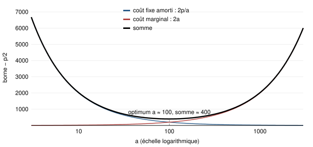

| $a$ | 1 | 10 | 30 | **100** | 300 | 1 000 |
|---|---:|---:|---:|---:|---:|---:|
| borne explicite pour $\lvert S\rvert$ ($p=10\,007$, $m=3$ ; vrai : 5 002) | 20 011 | 7 004 | 5 670 | **5 303** | 5 670 | 7 235 |

Ces valeurs sont celles de la recette ci-dessus, entiers compris ; le minimum, 5 289, est atteint en $a=70$, et la borne dépasse alors $p/2$ de 286, contre $\sqrt p\approx100$. Avec $a=1$, la borne est pire que triviale. Avec $a\approx\sqrt p$, elle vaut $p/2+O(m\sqrt p)$. La minoration s'obtient en appliquant le même argument à $\eta g$, avec η un non-carré, ce qui compte les $x$ où $g(x)$ n'est pas un carré, puis en retirant les zéros de $g$ (au plus $m$) : la méthode ne produit elle aussi que des **majorations**, comme au § 1.4. Ensemble, elles donnent $|S|=p/2+O(m\sqrt p)$. C’est la borne de type Weil pour le nombre de points, à constantes non optimisées ; en affinant la méthode et en travaillant sur les extensions finies, on rejoint la preuve de l’hypothèse de Riemann pour les courbes. Ce n'est pas une simple substitution de $q=p^r$ à $p$ : la recette suppose $a<p$, alors que $a\asymp\sqrt q$ finit par dépasser $p$, et il faut des dérivées de Hasse. Voir Stepanov et Bombieri dans les références. **Le ½ vient de l'équilibre entre un coût amorti en $1/a$ et un coût marginal en $a$.** La question 5 y reviendra.

### 4.2 Sur ℤ : ce qui manque

Transposer, c'est trouver des équivalents de trois choses.

| Stepanov ($\mathbb F_p[X]$) | Sur ℤ | Ce qui le fournit chez Alpöge |
|---|---|---|
| $\operatorname{ord}_x(F)$, l'annulation en un point | $v_p$, la divisibilité par un premier | § 2 |
| Une **dérivée** de plus : un ordre de plus | une **couche** de divisibilité de plus | ? |
| $D^kF=0$ sur **tout** $S$ d'un coup, par une identité | la divisibilité en **tous** les premiers inertes d'un coup | Théorème A, uniforme en $p$ (§ 3) |
| Lemme de Siegel : $F$ existe | une forme existe, avec une taille contrôlée | inégalité de pentes (§ 5.4) |

La deuxième ligne est la difficulté. Alpöge (note, § 1) : « multiplicity is hard to find over the integers, corresponding to something like differentiating whole numbers ». Le § 3 a fourni **une** dérivation : $D^a$ en un point CM, qui donne le profil $a(1/p+1/p^3+\cdots)$. Augmenter $a$ ne suffit pas, comme la troisième tentative du § 4.1 ⟦I⟧ : la divisibilité croît avec $a$, la taille archimédienne aussi, et la perte $O(\log a)$ par premier reste un coût fixe en $O(y)$ que rien n'amortit. Il faut un analogue de « dériver encore », c'est-à-dire une **opération qui ajoute une couche de divisibilité, et qui se compose**.

### Interlude. Qu'est-ce qu'une série thêta et pourquoi un groupe unitaire ?

Nous allons rencontrer des objets qui appartiennent normalement à un cours de formes automorphes. Il n'est pas nécessaire de suivre un tel cours pour comprendre le rôle qu'ils jouent ici. Partons d'un objet que l'on sait calculer.

Pour $|q|<1$, considérons

$$\theta(q)=\sum_{n\in\mathbb Z}q^{n^2}=1+2q+2q^4+2q^9+\cdots.$$

Cette fonction ressemble à une série génératrice de combinatoire. Son carré est la série thêta du réseau carré :

$$\theta(q)^2=\sum_{(a,b)\in\mathbb Z^2}q^{a^2+b^2}=\sum_{n\ge0}r_2(n)q^n.$$

Le coefficient $r_2(n)$ est le nombre de représentations de $n$ par la forme quadratique $a^2+b^2$. Par exemple, $r_2(5)=8$. Le réseau $\mathbb Z^2$ est aussi le réseau des entiers de Gauss $\mathbb Z[i]$, de norme $|a+ib|^2$. Le lien avec la courbe du § 3 n'est pas accidentel : le même corps quadratique imaginaire fournit ici une géométrie hermitienne et là des endomorphismes supplémentaires.

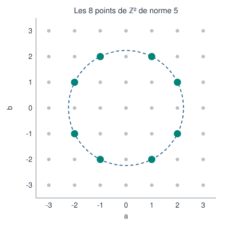

Un autre phénomène explique la puissance de cet objet. Pour $t>0$, la formule de sommation de Poisson appliquée à une gaussienne donne

$$\sum_{n\in\mathbb Z}e^{-\pi t n^2}=t^{-1/2}\sum_{n\in\mathbb Z}e^{-\pi n^2/t}.$$

La même fonction décrit donc simultanément un réseau et son dual, avec une loi de transformation analytique très rigide. En écrivant $q=e^{\pi iz}$, on obtient une fonction de $z$ dans le demi-plan supérieur, possédant notamment une loi sous $z\mapsto-1/z$. Voilà le premier exemple de ce que l'on cherche dans une forme automorphe : une fonction soumise à des règles de transformation par un groupe, et dont les coefficients contiennent une arithmétique. Les détails (groupe, poids, multiplicateurs et conditions de croissance) sont importants pour les théorèmes, mais ne sont pas nécessaires à ce premier aperçu.

Sur un corps CM $K$ de conjugaison $v\mapsto\bar v$, une forme hermitienne est une généralisation de la norme complexe. Sur $K^r$ on peut considérer, par exemple,

$$H(v,w)=\sum_{j=1}^rv_j\overline{w_j}.$$

Son groupe d'isométries est le groupe unitaire $U(H)$. Si la forme est définie positive à toutes les places infinies, les groupes réels correspondants sont compacts. On peut travailler avec des réseaux entiers dans cet espace hermitien, puis avec leurs classes d'isométrie. Pour un niveau fixé, le caractère défini permet, dans le cadre adélique approprié, des descriptions de dimension finie. La version réelle est une théorie de fonctions sur un quotient arithmétique, avec éventuellement des valeurs vectorielles ; le modèle fini ci-dessous en donne une intuition.

Supposons que l'on dispose de deux familles finies de classes de réseaux $[L]$ et $[L']$. Une fonction $f$ sur la première peut être transportée sur la seconde par un noyau de nombres $K(L',L)$ :

$$Tf(L')=\sum_{[L]}\frac{K(L',L)}{|\operatorname{Aut}(L)|}f(L).$$

L'opération est simplement une multiplication matricielle, avec un poids de mesure lié au stabilisateur. Dans la correspondance thêta réelle, le noyau vient de la représentation de Weil et l'intégrale est adélique ; le choix des vecteurs et des niveaux intervient. Il ne suffit pas de prendre une série génératrice quelconque pour obtenir un relèvement automorphe. Mais le modèle fait déjà apparaître trois propriétés que nous cherchions : des coefficients arithmétiques, une opération linéaire composable et des dénominateurs naturels à contrôler.

Pourquoi une période ? Pour extraire d'une fonction une donnée numérique, l'analyse utilise souvent une intégrale ou un coefficient de Fourier. Une période automorphe est, schématiquement, une intégrale sur un sous-groupe ou un quotient, parfois avec un caractère ou un vecteur test. Dans la preuve, les périodes de Bessel relient les noyaux, leurs valeurs arithmétiques et des structures entières. Nous n'avons pas besoin de calculer une période réelle de Bessel pour comprendre pourquoi une application d'évaluation ou de période peut être représentée par une matrice. C'est ce qui nous permet de passer du local au global et, à la section suivante, d'empiler les gains.

### 4.3 La chaîne de relèvements thêta

**Le relèvement thêta.** Une forme automorphe φ sur un groupe unitaire $U(X_0)$ se transporte en une forme sur un groupe unitaire plus grand $U(X_1)$, en l'intégrant contre une série thêta à deux variables, le **noyau**. On recommence :
$$U(X_0)\xrightarrow{K_1}U(X_1)\xrightarrow{K_2}\cdots\xrightarrow{K_m}U(X_m),\qquad\dim X_j=k+j(t+1).$$
Tous les espaces hermitiens sont **définis**. Les groupes sont alors compacts à l'infini, et, à niveau et type à l'infini fixés, les espaces de formes sont de **dimension finie** : chaque $K_j$ est une **matrice**, de taille $c_{j}\times c_{j-1}$.

**Ce que dit l'export.** La chaîne est littéralement un produit de matrices :

```
chainMat Kj i  :=  Fin.induction 1 (fun j A => Kj j * A)      -- K_i ⋯ K_1
ColChain.fact  :  Pt(φ)(F) = PtL( chainMat Kj (last) · φ )(F)
```

La **période** de φ (une période de Bessel, au sens de Gan–Gross–Prasad) est une période sur le dernier groupe du vecteur $K_m\cdots K_1\varphi$. C'est la forme matricielle des identités **seesaw** de Kudla.

**Pourquoi les couches s'ajoutent.** Si chaque coefficient de $A$ est divisible par $p^{\alpha}$ et chaque coefficient de $B$ par $p^{\beta}$, chaque coefficient de $AB$ est divisible par $p^{\alpha+\beta}$, car une somme de multiples de $p^{\alpha+\beta}$ en est un. Donc
$$v_p(K_m\cdots K_1)\;\ge\;\sum_{j=1}^m v_p(K_j),$$
exactement comme $\operatorname{ord}_x(FG)=\operatorname{ord}_xF+\operatorname{ord}_xG$. Chaque noyau, évalué près des points CM de l'orbite de Frobenius de $p$, apporte son gain du § 3, noté `gainP p j`. Il perd la partie $p$ de l'ordre du groupe d'automorphismes du réseau, $\mathrm{dG}_j\ge v_p(|\mathrm{Stab}_\Gamma(L)|)$ (`dG_spec`), qui est un dénominateur de **masse de Siegel**. Au total, pour chaque premier inerte $p$ :
$$v_p(\text{période})\;\ge\;\sum_{j=1}^{m}\mathrm{gain}_j(p)\;-\;\sum_{j=1}^m\mathrm{dG}_j,\qquad\mathrm{gain}_j(p)\approx\sum_{e\ \text{impair}}\Big(\frac{a}{p^{e}}-\mathrm{cap}_j(p,e)\Big)_+ ,$$
où $\mathrm{cap}_j$ est un poids, de type Harish-Chandra, propre au $j$-ième relèvement. **La longueur $m$ de la chaîne joue le rôle de l'ordre d'annulation $a$ de Stepanov.**

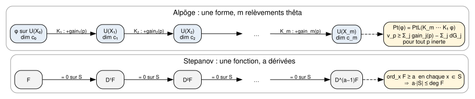

**Pourquoi pas une puissance ?** Composer $m$ fois le même noyau, ou multiplier $m$ copies d'une même série thêta, ce serait la tentative $(g^c-1)^a$ : la taille archimédienne serait multipliée comme la divisibilité. La chaîne utilise des groupes de rangs croissants. On peut espérer que les espaces de formes offrent de nouvelles directions exploitables, comme les inconnues de Stepanov doivent dépasser les conditions ($2JK>a(K+J)+\cdots$). L'export impose $k\ge x\,m$ (`Win_at`) : le rang de base croît avec la longueur de la chaîne ⟦I⟧, à la manière du comptage de dimensions qui garantit l'existence de $F$.

**Les poids sont alignés.** La somme de premiers à majorer, pondérée de Riesz, s'écrit terme à terme $\sum_{i\ \text{impair}}\big(a/p^i-w_j(p,i)\big)_+$. C'est **la même forme que le gain** tronqué. Quatre profils sont pourtant à distinguer : le poids de Riesz demandé, le gain brut du Théorème A, le gain après troncature (le programme de flot du § 3.5) et le gain que fournit effectivement `LinkG_at`. La construction choisit les seuils $\mathrm{cap}_j$ des relèvements en fonction des $w_j$ ; que l'on ait identité terme à terme, ou seulement une domination avec un reste quantifié, ce qui suffirait, n'a pas été établi en suivant les instanciations. C'est l'exigence « le profil doit suivre le poids » du § 2.4, réalisée couche par couche. La possibilité de réaliser simultanément ces seuils est un résultat de construction, et non une conséquence de la simple forme des expressions. La condition qui relie les deux côtés (`LinkG_at`) dit que, pour chaque premier inerte $p$,
$$\sum_{j=1}^m(\text{contribution de }p\text{ au }j\text{-ième terme})\;-\;\text{pertes}\;\le\;\sum_{j=1}^m\mathrm{gain}_j(p).$$
Une fois les poids alignés, cette inégalité est presque une identité. Toute la difficulté est de **construire** des réseaux, des noyaux et des périodes qui **réalisent** ces gains, et de **contrôler les pertes**.

### Atelier 3. Composer sans perdre les gains

Nous avons identifié, dans l'atelier 2, un gain désiré de $84$ au premier 3. Imaginons quatre opérateurs successifs entre réseaux, dont les coefficients sont divisibles par $3^{84}$. La composée aurait des coefficients divisibles par $3^{336}$. Ce calcul est une conséquence immédiate de $v_3(AB)\ge v_3(A)+v_3(B)$, où $v_3(A)$ est le minimum des valuations des entrées. L'inégalité peut être stricte : $A=(1\ \ 1)$ et $B={}^t(1\ \ p-1)$ donnent $AB=p$, alors que $v_p(A)=v_p(B)=0$. Elle ne garantit ni l'injectivité, ni que les gains soient ceux qu'on cherche colonne par colonne. Mais supposons que, pour extraire une composante utile à chaque étape, on doive diviser par $3^2$. Le gain garanti n'est plus que $4(84-2)=328$. Chaque dénominateur intervient avec le signe contraire à chaque gain.

Il s'agit d'un bilan fictif : ni les quatre opérateurs ni les valeurs 84 et 2 ne sont des objets extraits de Lean. Il montre exactement ce qu'il faut contrôler lorsque les noyaux sont composés. Dans la preuve, les valuations sont locales, les gains dépendent des places et des poids, et la chaîne doit fonctionner simultanément pour un grand nombre de premiers.

On peut maintenant comprendre pourquoi la multiplication des valuations ne constitue pas à elle seule une preuve. Le modèle $K_j=3^{84}I$ produirait bien les gains ci-dessus, mais la norme de la composée serait elle aussi multipliée par $3^{336}$. L'inégalité ne gagnerait rien. Le véritable enjeu est le rapport entre le gain de divisibilité, le coût archimédien et le coût de la projection sur les objets utiles. La croissance des groupes est une manière de construire une famille de noyaux différents ; elle n'établit pas, à elle seule, un gain net. La comparaison des pentes va précisément mesurer ce rapport.

### 4.4 Le dictionnaire complet

| Stepanov | Alpöge |
|---|---|
| Courbe $y^2=g(x)$ sur $\mathbb F_p$ | Somme de Tchebychev tordue sur les premiers inertes de l'hôte $E$ |
| Points $x\in S$ | Premiers inertes $p$ |
| Fonction auxiliaire $F$ | Une forme φ et ses relèvements ; le réseau $N_u$ de leurs périodes |
| Ordre d'annulation $a$ | Longueur $m$ de la chaîne |
| $D^kF=0$ sur $S$ par une identité | Théorème A, valable en tous les $p$ inertes à la fois |
| $X^{jp}$, constantes pour la dérivation | Frobenius et points CM : les couches impaires $a/p^e$ (§ 3) ⟦I⟧ |
| $\operatorname{ord}(FG)=\operatorname{ord}F+\operatorname{ord}G$ | $v_p(K_m\cdots K_1)\ge\sum_jv_p(K_j)$ |
| Lemme de Siegel (existence de $F$) | Familles de formes sur des groupes définis ; inégalité de pentes de Bost (§ 5.4) |
| $a\cdot\lvert S\rvert\le\deg F$ | Différence de pentes ≤ termes archimédiens (§ 5) |
| Coût fixe $p/a$, coût marginal $a$ | Erreur $x/m$, perte $m$ par relèvement (§ 6) |
| $a\approx\sqrt p$ | $m\approx\sqrt x$ |

Cette transposition, des fonctions auxiliaires sur les corps finis vers la divisibilité et les pentes sur ℤ, prolonge les méthodes de transcendance de Thue, Siegel et Bombieri, dont les inégalités de pentes de **Bost** sont la forme moderne.

### 4.5 Ce que dit le graphe

La chaîne et le calcul des gains (`chainMat`, `ColChain`, `yProd`, `gainP`, `LinkG_at`) pèsent environ **0,1 %** de la fermeture (poids dominé, en lignes de l'export). Comme pour le Théorème A, le mécanisme de la multiplicité est petit. Ce qui pèse, c'est ce que la chaîne **suppose** :

- des espaces hermitiens définis aux signatures prescrites à chaque étage ;
- des noyaux à coefficients **entiers**, sans quoi l'additivité des valuations ne veut rien dire ;
- des périodes rationnelles (vecteurs tests, Siegel–Weil).

C'est la « fabrication des objets », 36 % du volume (§ 7). Les dénominateurs $\mathrm{dG}_j$ renvoient aux masses de Siegel, dont le calcul archimédien est l'objet de la question 4.

> **Réponse à la question 3.** Stepanov majore $|S|$ par une fonction qui s'annule à l'ordre $a$ sur $S$ avec un degré bien inférieur à $a$ fois le degré naïf. Il y parvient parce que la dérivation ignore les $X^{jp}$, qui valent $X^j$ sur $S$. Une multiplicité obtenue par puissance ne sert à rien : il faut des couches **nouvelles**, qui s'ajoutent. Sur ℤ, la couche est un gain de divisibilité $p$-adique au point CM (§ 3). Les relèvements thêta fournissent l'opération qui en ajoute une, et qui se compose : la période du $m$-ième relèvement est le produit $K_m\cdots K_1$ de matrices de noyaux, et les valuations d'un produit s'additionnent. Les groupes de rangs croissants fournissent des noyaux distincts ; la nouveauté effective de chaque couche et son coût reposent sur la construction. La longueur $m$ de la chaîne joue le rôle de l'ordre d'annulation, et elle s'équilibre comme lui en $\sqrt x$.

## 5. Pourquoi les contraintes archimédiennes font réapparaître le terme principal

Les §§ 2 à 4 décrivent le mécanisme qui doit fournir la moitié $p$-adique de l'identité du § 2.1, $\sum_pv_p(M)\log p=\log|M|$. On dispose maintenant d'un objet (un réseau de périodes) dont la divisibilité, premier par premier, suit le poids de Riesz, avec $m$ couches empilées. Il reste l'autre moitié : **la taille**. Chez Tchebychev, c'était $\binom{2n}{n}\le4^n$, et cela tenait en une ligne. Ici, c'est la partie la plus délicate, pour une raison simple. La somme de premiers à majorer vaut $y\log y$, à un terme principal près, et l'on veut une erreur $\sqrt y$. La borne archimédienne doit donc **reproduire le terme principal exactement**, et ne laisser de place qu'aux fluctuations. Ce paragraphe explique pourquoi c'est possible, et ce que cela exige.

### 5.1 Un même nombre, vu des deux côtés

Revenons à $y!$ (§ 2.3). La formule du produit, appliquée à ce seul entier, donne deux façons de calculer son logarithme :
$$\underbrace{\sum_{m\le y}\Lambda(m)\Big\lfloor\frac ym\Big\rfloor}_{\text{places finies : Legendre}}\;=\;\log y!\;=\;\underbrace{y\log y-y+\tfrac12\log(2\pi y)+O(1/y)}_{\text{place infinie : Stirling}} .$$
Le membre de gauche demande de connaître tous les premiers. Celui de droite ne les connaît pas : c'est de l'analyse réelle, l'intégrale de $\log t$ corrigée par Euler–Maclaurin. Les deux sont **égaux**. Le terme principal $y\log y-y$ du côté des premiers est donc calculé, sans un seul premier, par la taille archimédienne.

Avec $\binom{2n}{n}$, l'identité de Tchebychev (§ 2.3) et Stirling donnent de même :

| $n$ | $\log\binom{2n}{n}$ (exact) | Stirling : $n\log4-\frac12\log(\pi n)$ | $n\log4$, prédit par $\psi(x)\sim x$ |
|---:|---:|---:|---:|
| 10 | 12,1268 | 12,1393 | 13,8629 |
| 1 000 | 1 382,2680 | 1 382,2681 | 1 386,2944 |
| 10⁶ | 1 386 286,8810 | 1 386 286,8810 | 1 386 294,3611 |

Le côté archimédien connaît le terme principal $n\log4=\sum_k(-1)^{k+1}\,2n/k$, celui que donnerait $\psi(x)=x$. Il le connaît à $\frac12\log(\pi n)$ près, sans erreur liée aux premiers.

**Pourquoi.** Les deux côtés sont gouvernés par des séries de Dirichlet différentes :
$$\sum_n\frac{\log n}{n^s}=-\zeta'(s)\qquad\text{et}\qquad\sum_n\frac{\Lambda(n)}{n^s}=-\frac{\zeta'}{\zeta}(s).$$
On passe de l'une à l'autre en multipliant par $\zeta(s)$, puisque $\log n=\sum_{d\mid n}\Lambda(d)$ : c'est la convolution par 1 qui produit les $\lfloor y/m\rfloor$. Or $-\zeta'$ n'a **qu'un pôle, en $s=1$** : les zéros de ζ, qui sont des pôles de $\zeta'/\zeta$, sont tués par la multiplication par ζ. La série $-\zeta'$ explique pourquoi les zéros ne donnent pas de pôles dans ce calcul ; Stirling fournit indépendamment l’évaluation précise de la factorielle.

> **Le principe illustré par la factorielle.** La convolution par 1 fait disparaître les pôles de $-\zeta'/\zeta$ aux zéros de ζ. La quantité $\log y!$ possède donc un calcul archimédien qui ne dépend pas d'une estimation de ces oscillations. Pour la preuve réelle, les formules de masses, de normes et de périodes doivent produire le terme principal approprié avec une précision suffisante. Cette coïncidence nécessite une identité ou un calcul spécifique : elle ne découle pas du simple fait que les volumes sont connus exactement.


C'est aussi ce qui limite $y!$ ⟦I⟧. Son profil $\lfloor y/m\rfloor$ revient, du côté des séries de Dirichlet, à **multiplier par $\zeta(s)$**. La dent de scie qui le sépare du poids de Riesz contient les fluctuations avec le signe opposé, et elle les annule : $y!$ ne peut rien dire des zéros. Le profil produit par la chaîne (§ 4.3) doit suivre le poids de Riesz lui-même, sans ce facteur ζ.

### 5.2 Quelle précision ? Un contre-exemple

Le terme principal est énorme et la cible minuscule :

| $y$ | terme principal $y\log y$ | cible $\sqrt y$ | précision relative exigée |
|---:|---:|---:|---:|
| 10⁶ | $1{,}4\cdot10^{7}$ | $10^{3}$ | $7\cdot10^{-5}$ |
| 10²⁰ | $4{,}6\cdot10^{21}$ | $10^{10}$ | $2\cdot10^{-12}$ |

*Contre-exemple.* Remplaçons Stirling par la borne grossière $y!\le y^y$. On obtient $S(y)\le y\log y$, donc $G(y)\le(1+\gamma)\,y$. Oublier un seul terme, ici $-y$, fait une erreur de la taille de $y$, mille fois la cible dès $y=10^6$. Une borne archimédienne qui perd **un facteur constant** est fatale, et un facteur $1+o(1)$ ne suffit pas non plus. Il faut des **égalités**, ou des inégalités dont l’erreur additive est au plus de l’ordre de $x^{1/2+O(\varepsilon)}$ ; une précision relative de $x^{-1/2}/\log x$ correspond à la cible stricte $\sqrt x$ pour un terme principal en $x\log x$.

C'est la différence de nature entre les deux côtés. Le côté $p$-adique peut perdre (des $O(\log a)$ par premier, des dénominateurs de Hecke), à condition que les pertes totales restent sous $\sqrt x$. Le côté archimédien doit être **exact sur le terme principal**.

### 5.3 Des volumes exacts : trois exemples

Pour certains objets arithmétiques, des formules exactes de taille existent. Les trois exemples ci-dessous font apparaître des ingrédients récurrents : des valeurs de Γ, des puissances de π, un discriminant, et des valeurs de ζ ou de fonctions L en des points où les identités nécessaires s'établissent sans supposer GRH.

**(a) Une masse de Siegel.** Les réseaux unimodulaires pairs de rang 8 forment une seule classe, $E_8$. La formule de masse de Siegel donne
$$\sum_{[L]}\frac1{|\mathrm{Aut}\,L|}=\frac{|B_4|}{8}\cdot\frac{|B_2|}{4}\cdot\frac{|B_4|}{8}\cdot\frac{|B_6|}{12}=\frac1{696\,729\,600},$$
qui est bien $1/|W(E_8)|$. À des rangs supérieurs, les nombres de Bernoulli font apparaître des valeurs comme $\zeta(12)$. Par l'équation fonctionnelle, $|B_{2j}|=2\,(2j)!\,\zeta(2j)/(2\pi)^{2j}$. Une masse est donc un produit de **factorielles** (des valeurs de Γ), de **puissances de π** et de $\zeta(2),\zeta(4),\dots$ : des valeurs de ζ en $s\ge2$, où le produit d'Euler converge absolument. Le produit d’Euler en ces points est absolument convergent ; le calcul n’exige donc pas de connaître les zéros de ζ.

**Le rang 16, où la formule voit deux réseaux.** En rang 16, le genre contient deux classes : $E_8\oplus E_8$, avec $|\mathrm{Aut}|=2\,|W(E_8)|^2=970\,864\,271\,032\,320\,000$, et $D_{16}^+$, avec $|\mathrm{Aut}|=2^{15}\cdot16!=685\,597\,979\,049\,984\,000$. La somme des inverses vaut exactement
$$\frac1{970\,864\,271\,032\,320\,000}+\frac1{685\,597\,979\,049\,984\,000}=\frac{691}{277\,667\,181\,515\,243\,520\,000},$$
ce que donne la formule de masse (vérifié en fractions exactes). Le 691 est le numérateur de $B_{12}$, donc de $\zeta(12)$. Comme $|B_{2j}|=2(2j)!\,\zeta(2j)/(2\pi)^{2j}$, une masse est un produit de factorielles, de puissances de π et de valeurs $\zeta(2j)$. **Tous les premiers y figurent, mais à travers des produits eulériens absolument convergents, donc contrôlables sans connaître les zéros** : c'est le même phénomène que Stirling au § 5.1. Cette propriété ne suffit pas, à elle seule, à établir la compensation du terme principal : il y faut les identités du § 5.5.

**(b) Une période CM.** Pour la courbe du § 3, $y^2=x^3-x$, l'intégrale de $dx/y$ le long de la branche réelle, de 1 à l'infini, se calcule exactement :
$$\int_1^\infty\frac{dx}{\sqrt{x^3-x}}=\frac{\Gamma(1/4)^2}{2\sqrt{2\pi}}=2{,}622057\ldots$$
C'est la constante ϖ de la lemniscate, vérifiée numériquement dans [`tools/modeles.py`](tools/modeles.py). Le cycle réel complet parcourt deux branches : sa période pour $dx/y$ vaut $2\varpi$, et ϖ pour la différentielle invariante usuelle $dx/2y$. La quantité normalisée de `CM.DegSt` demande encore d'autres conventions : ϖ n'est pas directement Ω. La **formule de Chowla–Selberg** généralise ce calcul. La taille archimédienne d'un objet CM est un produit de valeurs $\Gamma(a/d)^{\pm1}$, avec des exposants donnés par le caractère $\chi_{-d}$ du corps CM.

**(c) La norme d'un relèvement thêta.** La **formule de Rallis** exprime la norme $\langle\theta(\varphi),\theta(\varphi)\rangle$ d'un relèvement comme le produit d'une valeur spéciale de fonction L de φ et de facteurs locaux explicites. Elle est présente dans la fermeture, avec 308 déclarations :

- la convergence du produit scalaire de Rallis est démontrée par la **méthode du doublement** (`rallis_of_dm`, environ 64 000 lignes), et elle entre dans le cœur par l'hypothèse `ThetaLocalInputs` ;
- la propriété de tour est démontrée (`LowerLiftsZero` : les relèvements vers des rangs inférieurs sont nuls) ;
- des facteurs archimédiens apparaissent (`ArchimedeanRallisFirst` à `Fifth`) ;
- les facteurs de normalisation sont des produits de fonctions L de Hecke, pris en convergence absolue (`trivPar_euler`, $\operatorname{Re}s>n/2+1$).

Comme pour les masses, les fonctions L n'y interviennent qu'en des points où les identités nécessaires s'établissent sans supposer GRH ; les estimations uniformes de $L'/L(1,\chi)$ quand le conducteur varie restent, elles, non triviales. Le rôle exact de ces normes dans la taille de chaque maillon de la chaîne n'a pas été suivi ⟦I⟧.

### Interlude. Du déterminant au degré d'Arakelov

Pourquoi introduire des pentes au lieu de se contenter de la formule du produit ? Parce que la preuve ne construit pas un seul entier auxiliaire, mais une famille d'applications entre réseaux. Il faut une mesure de taille qui tienne compte de la dimension et qui soit compatible avec la division locale.

Commençons par un exemple à deux dimensions. Prenons

$$A=\begin{pmatrix}3&2\\6&-2\end{pmatrix}. $$

La première colonne est divisible par 3 ; la seconde par 2. Le déterminant est non nul et multiple de 6, donc $6\le|\det A|$. L'inégalité de Hadamard fournit de l'autre côté

$$6\le|\det A|\le\|A_1\|\|A_2\|=\sqrt{45}\sqrt8.$$

Cette inégalité est déjà de la forme voulue : $\log3+\log2\le\log\|A_1\|+\log\|A_2\|$. On a majoré une somme de logarithmes de premiers par des normes euclidiennes.

Le même calcul peut être formulé sans parler explicitement de divisibilité des colonnes. L'application $A:\mathbb Z^2\to\mathbb Z^2$ reste entière sur le réseau agrandi

$$L'=\tfrac13\mathbb Z e_1\oplus\tfrac12\mathbb Z e_2.$$

Le covolume de $L'$ vaut $1/6$ ; sa pente (dans notre convention euclidienne non normalisée par le corps) vaut $-\log(1/6)/2=\tfrac12\log6$. La pente du réseau initial était nulle. Diviser les coordonnées a donc transformé les valuations en une augmentation de pente.

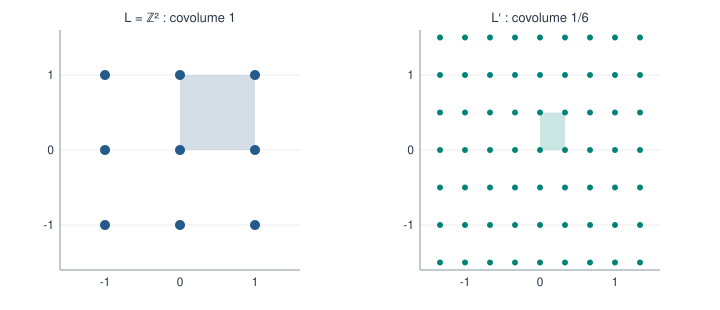

La matrice $A$ transforme $L'$ en un sous-réseau de $\mathbb Z^2$ de covolume entier au moins 1. D'où $|\det A|/6\ge1$, exactement la première inégalité. Cette lecture met en évidence l'injectivité : si le déterminant était nul, aucune information de ce type ne serait disponible. Pour les réseaux de rangs différents, on travaille avec des volumes dans l'espace image, des sous-réseaux et la pente maximale. Une version abstraite de l'inégalité de Hadamard conduit aux inégalités de pentes de Bost, qui permettent d'opérer sur des corps de nombres et avec des normes à plusieurs places.

**Pourquoi le théorème S ?** Un volume est sensible à la dépendance entre vecteurs. Deux vecteurs unitaires presque colinéaires ont un parallélogramme d'aire presque nulle. Plus généralement, si $N$ vecteurs unitaires ont des produits scalaires hors diagonale bornés par $\eta$, leur matrice de Gram $G=I+E$ satisfait $\|E\|_{\mathrm{op}}\le(N-1)\eta$. Si $(N-1)\eta<1$, elle est inversible, et toutes ses valeurs propres sont comprises entre $1-(N-1)\eta$ et $1+(N-1)\eta$. On contrôle alors aussi le déterminant de Gram. Ce lemme élémentaire n'est pas le théorème S ; il fait comprendre pourquoi une estimation quantitative de quasi-orthogonalité peut fournir à la fois un contrôle du rang, des normes et des volumes. Dans le problème réel, les dimensions croissent, ce qui rend la petitesse de l'erreur cruciale.

**Propager les pentes.** Une inégalité de pentes ne suffit pas toujours, et un exemple de dimension 2 montre pourquoi. Le réseau $Q=\mathbb Ze_1\oplus\mathbb Z(Me_2)$ de $\mathbb R^2$, avec $M>1$, a une pente maximale nulle, atteinte par $\mathbb Ze_1$, et une pente moyenne $-\frac12\log M$. Une application isométrique $\mathbb Z\to\mathbb Ze_1$ contrôle une direction, mais ne dit rien de $M$ ; une famille d'applications de bonne hauteur n'aide pas davantage si toutes visent la même direction. Ce qui compte est le **rang** de la somme des images, et la façon dont il résiste quand on retire des directions. Rubinstein [R2, proposition M4] en tire une démonstration de l'inégalité de pente moyenne, distincte du chemin Lean `TheoremF`. Son cœur se ramène à un lemme élémentaire. Soient des pentes cibles $y_1,\dots,y_D$, une pente de référence $s$, un $R>0$ avec $y_i\ge s-R$, et $N(t)=\#\{i:y_i<s-t\}$. Si $N(t)/D\le f(t)$ pour $0<t<R$, alors
$$\frac1D\sum_iy_i\;\ge\;s-\int_0^R\min\big(1,f(t)\big)\,dt,$$
puisque $(s-y_i)_+=\int_0^R\mathbf 1_{y_i<s-t}\,dt$. Dans [R2], une borne de rang robuste fournit $f(t)=(\eta+4\,\mathrm{sp}/(\mathrm{sp}+t))/(1-\delta_*)$, où $\mathrm{sp}>0$ mesure la dispersion des pentes sources, avec $\eta\ge0$ et $0\le\delta_*<1$. L'intégrale non tronquée $\int_0^Rf=(4\,\mathrm{sp}\log(1+R/\mathrm{sp})+\eta R)/(1-\delta_*)$ majore celle de $\min(1,f)$, et fait apparaître un logarithme qui semblait arbitraire dans le budget. La version tronquée se calcule aussi exactement. Si $\eta\ge1-\delta_*$, on a $\min(1,f)=1$ et la borne ne dit rien de plus que $y_i\ge s-R$. Sinon, $f$ vaut 1 en $t_*=\mathrm{sp}\big(4/(1-\delta_*-\eta)-1\big)>0$, et avec $u=\min(R,t_*)$,
$$\int_0^R\min(1,f)\,dt=u+\frac{\eta(R-u)+4\,\mathrm{sp}\log\frac{\mathrm{sp}+R}{\mathrm{sp}+u}}{1-\delta_*}.$$
Quand $R\gg\mathrm{sp}$, le terme logarithmique additionne les déficits sur une plage d'échelles. Le théorème S prend alors un autre visage. Il ne sert pas seulement à rendre des périodes presque orthogonales : il garantit que l'information de divisibilité se **propage** à presque toutes les directions du réseau cible, et la pente mesure ce qui survit à ce transfert. C'est une lecture ⟦I⟧ de l'architecture : nous n'avons pas vérifié que `TheoremF` est une instance de ce principe.

Nous avons donc une inégalité arithmétique et une estimation géométrique qui se rencontrent. Le dernier pas est de savoir à quel terme principal elles se comparent.

### Atelier 4. Le premier 3 vu par la pente

Dans le modèle de l'atelier 3, nous avions garanti un gain $3^{328}$ sur une composée fictive. Si celle-ci s'envoie dans un réseau entier, on peut, dans le modèle où le gain est uniforme, remplacer le réseau source $L$ par $3^{-328}L$. À norme archimédienne fixée, le covolume est divisé par $3^{328r}$ en rang $r$. La pente augmente donc de $328\log3$, indépendamment du rang. Divisée par les quatre couches et par $b=3$, la contribution normalisée est $(328/12)\log3$, à comparer aux $28\log3$ de la partie impaire de Riesz pour 3. On lit immédiatement la perte due aux dénominateurs. Les autres premiers produisent des termes additifs semblables. C'est l'idée du transfert de la somme locale vers une pente globale.

### 5.4 Dans la preuve

**Pentes : la formule du produit pour les réseaux.** Un réseau hermitien sur un corps de nombres $K$ est un $\mathcal O_K$-module projectif muni de normes aux places infinies. Son degré d'Arakelov est $\widehat{\deg}=-\log\operatorname{covol}$, et sa pente est $\widehat\mu=\widehat{\deg}/\mathrm{rang}$. Le degré se décompose en contributions des places finies, des longueurs locales fois $\log N\mathfrak p$, et en contributions des places infinies, des normes. C'est la formule du produit du § 2.1, pour un réseau au lieu d'un entier. Pour un idéal entier $I$, poser $L'=I^{-1}L$ augmente sa pente de
$$\widehat\mu(L')-\widehat\mu(L)=\sum_{\mathfrak p}v_{\mathfrak p}(I)\log N\mathfrak p\quad(\text{normalisé}).$$
La divisibilité des périodes (§ 4.3) permet de diviser le réseau de formes $N_u$ tout en gardant entier l'accouplement des périodes $B_u:N_u\to R^\vee$ (`divClausesR_of`, `DivIntoDualShift`). Dans les conventions de la reconstruction, le réseau est agrandi par multiplication par l’idéal fractionnaire $I_u=\prod_ww^{-\lfloor e_w\sigma_u(w)\rfloor}$. Elle prend la partie entière inférieure, et cette perte d'arrondi, comptée explicitement (`round_le`, `NprimeMuR`), est de l'ordre de $x\,n\,e^{x^{\varepsilon/3}}$. C'est un facteur $e^{-x^\varepsilon(1-o(1))}$ en dessous des autres restes : elle est négligeable.

**Le plafond : inégalité de pentes.** Pour $\varphi:E\to F$ injectif, $\widehat\mu(E)\le\widehat\mu_{\max}(F)+h(\varphi)$ (Bost). C'est le lemme de Siegel de Stepanov (§ 4.1), en version arithmétique. On l'applique aux $B_u$ (`FrameF`). Trois ingrédients le rendent exact au degré voulu :

- **la hauteur des $B_u$ est presque nulle**. Les périodes de formes différentes sont presque orthogonales : c'est le théorème S, une formule de type Petersson ou Kuznetsov pour des coefficients de Bessel, avec un facteur $1+b^{-6}$, où $b=e^{x^\varepsilon}$, proche de 1 avec un défaut **super-polynomialement petit**, bien en dessous des $x^{-1/2}$ exigés au § 5.2 ;
- **la pente du réseau cible** est calculée par des volumes exacts ;
- **une borne de covolume** pour les réseaux de formes automorphes, par géométrie d'Arakelov sur des modèles entiers de variétés de Shimura (Hironaka, Moriwaki, Hilbert–Samuel arithmétique, compactifications toroïdales).

**Trois propriétés, une seule carte.** L'inégalité de pentes demande une application qui soit à la fois entière, de petite hauteur et de grand rang. Trois applications ayant chacune l'une de ces propriétés ne suffisent pas : sur $\mathbb Z^2$ euclidien, $f_1=\mathrm{diag}(M,0)$ est entière, $f_2=\mathrm{diag}(1/M,0)$ est de petite norme, $f_3=\mathrm{diag}(M,M)$ est de rang 2, et aucune information ne passe de l'une à l'autre. Rubinstein [R2] signale que sa reconstruction doit identifier trois telles cartes. Dans Lean, l'énoncé général du bilan (`TheoremF`) exige les trois propriétés **d'une même famille** $B_i$ : l'intégralité ($B_i(N_i)$ contenu dans le réseau cible), la hauteur et le rang (par une matrice définie à partir de la matrice de $B_i$). Là où la donnée réelle entre (`frame_at_of`), $B$ est instancié par **un seul champ** de la structure de division, `DivData.Bk`, l'accouplement des périodes $B_u:N_u\to R^\vee$. Le raccord est donc assuré par construction ; ce qui reste à comprendre est pourquoi l'accouplement fabriqué possède les trois propriétés (article, § 5.7).

**Les termes archimédiens, lus sur l'export.**

- **La masse est une égalité.** `SiegelMassRatioCM` affirme une **égalité**, et non une inégalité, pour le rapport des masses des réseaux hermitiens standard de rangs $M$ et $M-1$ sur un corps CM $K$ non ramifié ($M\ge3$, $f$ places infinies) :
  $$\frac{\mathrm{mass}_M}{\mathrm{mass}_{M-1}}=\frac{\big((M-1)!\,(v/\pi)^M\big)^{f}}{\sqrt{(2v)^{f}}}\cdot\prod_{\mathfrak P}\mathrm{eulerFac}(K,M,\mathfrak P),\qquad v=\tfrac12|\mathrm{disc}\,K|^{1/2f}.$$
  On y trouve exactement la structure de l'exemple (a) : une factorielle $(M-1)!=\Gamma(M)$, des puissances de π, le discriminant, et un **produit d'Euler en $s=M\ge3$**, en convergence absolue (`massRatioRightSide`, `lValEta`).
- **La taille de chaque colonne.** `Count_at` encadre la taille $\log T(u)$ d'une colonne par
  $$\sum_{j\in\text{lifts}}\frac1f\sum_{\tau}\log\frac{w_{j,\tau}\,v}{\pi}+m\log(g_0g_1)-C(\dots)\;\le\;\log T(u)\;\le\;C\,m\,L .$$
  C'est une somme, **sur les $m$ relèvements** et sur les places CM τ, de termes en $\log(w\,v/\pi)$, de type Γ. Le côté archimédien s'empile donc maillon par maillon, comme le côté $p$-adique du § 4.3.
- **La constante du terme principal.** Elle est fournie inconditionnellement (`Lnk.char_at`) : $\ell(\psi)=(L'/L)(1,\chi)$, la valeur en $s=1$ qui définit $g(y,\chi)=S(y,\chi)+y\,(L'/L)(1,\chi)$ au § 1.2.

**L'assemblage** se fait dans `linkCore` :
$$\sum\mathrm{ASK}\;\le\;\mathrm{Ga}+\text{perte},\qquad\mathrm{Ga}\;\lesssim\;\Delta\widehat\mu,\qquad\widehat\mu(N_u)\;\le\;\widehat\mu_{\mathrm{dual}}(R)+\cdots$$

- Le premier membre est la somme de von Mangoldt aux premiers inertes (`ASK`).
- `Ga` est la somme des gains locaux pondérés par $\log N\mathfrak p$ (`Loss7`, `SlopesN_at`).
- La pente est plafonnée par l'inégalité de pentes (`FrameF`) et par les termes de type Γ (`Count_at`).

D'où : **somme de premiers ≤ termes archimédiens + perte $x^{O(\varepsilon)}$**. Sur l'export, on lit ces inégalités et les termes archimédiens. La simplification exacte du terme principal est l'identité `key_identity5`. Ses trois sources sont : Stirling pour $a\log a-a$ ; une formule de Chowla–Selberg pour la hauteur des droites CM (`CM.DegSt`, démontrée), qui fournit $-\gamma+L'(1,\chi)/L(1,\chi)$ ; et les termes Γ de `Count5` pour la moyenne des $\log w$ (partie II, « Cinq points éclaircis », point 2). La taille archimédienne est celle de $a!\,\Omega^{-a}$ : la dérivée $a$-ième de la série thêta renormalisée par la période Ω.

**Un modèle exact de la normalisation.** Soit $L$ une droite hermitienne sur $\mathbb Z$, engendrée par $e$ de norme $r>0$, et posons $\widehat{\deg} L=-\log r$. Alors $\widehat{\deg} L^{\otimes a}=a\,\widehat{\deg} L$ et $\widehat{\deg} L^\vee=-\widehat{\deg} L$. Si $2\widehat{\deg} L=\log\Omega$, la norme de $e^{\otimes2a}$ vaut $r^{2a}=\Omega^{-a}$, et le vecteur $a!\,e^{\otimes2a}$ a pour logarithme de norme
$$\log(a!)-a\log\Omega,$$
exactement la forme du terme archimédien du bilan. Ce modèle ne dit pas que l'objet Lean est cette puissance tensorielle : l'exposant $2a$, le signe et les métriques doivent être lus dans la construction réelle. Il montre seulement pourquoi le facteur 2 de `CM.DegSt` ($2\widehat{\deg}=\log\Omega$) est structurant. Sur un corps de nombres, le degré normalisé par $[K:\mathbb Q]$ garde ces deux identités ; reste à vérifier, flèche par flèche, les conventions (norme ou norme au carré, degré brut ou normalisé) le long du chemin `CM.DegSt` → `LamDegSt` → `numGood_of_famQ` → bornes par pages → `LinkDIV_at`.

### Atelier 5. D'où vient la constante du terme principal ?

Le modèle de Stirling doit être exploité sans lui faire dire davantage qu'il ne dit. Dans le cas de Riesz, le terme principal n'est pas $y\log y-y$ mais $y\log y-(1+\gamma)y$. D'où vient cette différence ? Nous pouvons l'identifier exactement par un calcul analytique classique, avant de chercher son correspondant automorphe.

Écrivons $s=1+h$. La série de Laurent de ζ donne

$$-\frac{\zeta'}{\zeta}(1+h)=\frac1h-\gamma+O(h),\qquad \frac{y^{1+h}}{(1+h)h}=y\left(\frac1h+\log y-1+O(h)\right).$$

Le coefficient de $h^{-1}$ dans le produit vaut $y\log y-(1+\gamma)y$. L'origine des trois termes est distincte : le $y\log y$ vient du développement de $y^h$, le $-y$ du facteur $(1+h)^{-1}$, le $-\gamma y$ de la partie régulière de la dérivée logarithmique. Pour un caractère primitif non trivial, la singularité en $s=1$ vient seulement du noyau ; la constante linéaire est $-L'(1,\chi)/L(1,\chi)$.

Une construction arithmétique qui prétend majorer la somme de Riesz à l'échelle $\sqrt y$ doit donc retrouver ces constantes, pas seulement le coefficient de $y\log y$. On peut le résumer comme une obligation de compensation. Si $M(y)$ désigne le terme principal et si le gain de pente donne $M(y)+G(y)-E_1$, tandis que le plafond archimédien vaut $M(y)+E_2$, alors

$$M(y)+G(y)-E_1\le M(y)+E_2\quad\Longrightarrow\quad G(y)\le E_1+E_2.$$

Mais si le plafond était $M(y)+cy+E_2$ avec $c>0$, la méthode ne donnerait que $G(y)\le cy+E_1+E_2$. La différence d'une constante est décisive. C'est pourquoi les données `Count_at`, `SiegelMassRatioCM` et `Lnk.char_at` sont intéressantes ensemble : la première donne des termes logarithmiques, la seconde une identité de masses, la troisième les constantes analytiques. Le rapprochement ne prouve pas encore leur compensation. Il faudrait pour cela suivre l'assemblage de ces expressions dans `linkCore` et `Deduction.ch_top`, avec les normalisations exactes. Ce travail est identifié ici comme un chantier, non remplacé par une analogie avec Stirling. L'export répond (partie II, « Cinq points éclaircis », point 2). Le terme principal y est défini en toutes lettres, `MAIN(a, w) = a·(log a − 1 − γ + ℓ(χ) − moyenne des log w)`. Côté archimédien, $a\log a-a$ vient de Stirling appliqué à $a!$ ; $-\gamma+\ell(\chi)$ vient d'une **formule de Chowla–Selberg pour la hauteur**, démontrée dans le projet (`CM.DegSt` : le double du degré d'Arakelov d'une droite CM vaut $\gamma+\log(2\pi/\mathrm{rd}_E)-L'(1,\chi)/L(1,\chi)$) ; la moyenne des $\log w$ vient des termes Γ des colonnes. L'identité `key_identity5` assemble ces trois sources. Le calcul se refait terme à terme, à partir de l'hypothèse de division `DIV` (partie II, « Cinq points éclaircis », point 2), qui borne le saut de pente par
$$\sum_t\Big[m\big(\mathrm{ph}(a_t)-a_t\log\Omega\big)-a_t\log T(u)\Big]+\mathrm{EDiv},\qquad\mathrm{ph}(y)=y\log y-y,\qquad\log\Omega:=\gamma+\log\frac\pi v-\ell(\chi).\tag{D}$$

**Le calcul, terme à terme.** Les énoncés lus suffisent à refaire l'algèbre. `Count5` n'est pas une égalité : il **minore** $\log T(u)$ par
$$\Lambda_5=\sum_j\frac1f\sum_\rho\log\frac{w_{j\rho}v}{\pi}+m\,\mathrm{lg}-c_{\mathrm{Count}}\Big(L_a+\frac{m^2L_a}k\Big),\qquad f=|\Phi|,$$
et le majore par $c_{\mathrm{Count}}\,m\,L$. Comme $\log T(u)$ entre dans (D) avec le signe moins, la minoration suffit. Pour une colonne de taille $a$, remplaçons $\log T(u)$ par $\Lambda_5$, et notons $\overline{\log w_j}$ la moyenne sur Φ :
$$m\big(a\log a-a\big)-ma\Big(\gamma+\log\frac\pi v-\ell(\chi)\Big)-a\sum_j\Big(\overline{\log w_j}+\log\frac v\pi\Big)-ma\,\mathrm{lg}+a\,c_{\mathrm{Count}}\Big(L_a+\frac{m^2L_a}k\Big).$$
Les termes en $\log(\pi/v)$ et $\log(v/\pi)$ se compensent, et il reste
$$\sum_{j<m}a\Big(\log a-1-\gamma+\ell(\chi)-\overline{\log w_j}\Big)-ma\,\mathrm{lg}+a\,c_{\mathrm{Count}}\Big(L_a+\frac{m^2L_a}k\Big)=\sum_{j<m}\mathrm{MAIN}(a,w_j)-ma\,\mathrm{lg}+a\,c_{\mathrm{Count}}\Big(L_a+\frac{m^2L_a}k\Big).\tag{C}$$
Sommée sur les colonnes, c'est exactement l'identité `key_identity5`, où $\Lambda_5$ s'appelle `Lam5` : l'algèbre est reconstruite, et Lean la vérifie. Le terme de preuve montre comment : `key_identity5` pose `h := Data.key_identity …`, dont la conclusion fait intervenir `L` et un terme $2\log\Gamma/(fk)$, puis conclut par `linear_combination h` ; une fois `Lam5` déplié, le terme en `La` figure des deux côtés de `key_identity5` et s'annule. La compensation effective est donc dans `key_identity`. C'est une compensation **symbolique**. Elle dit que les expressions se compensent ; que des objets réels réalisent les encadrements qu'elle suppose relève de la fabrication (partie II). Il reste à justifier que $\log\Omega$, défini par cette formule, est bien la taille d'une période : c'est l'objet d'un théorème que l'on verra au § 5.5, une formule de Chowla–Selberg.

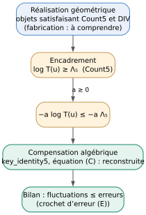{width=38%}

Il y a là une symétrie remarquable. **La même factorielle $a!$** donne la divisibilité de Legendre côté $p$-adique (§ 3) et le terme principal de Stirling côté archimédien. Comme $\log y!=\sum\Lambda(m)\lfloor y/m\rfloor$, un même nombre est lu des deux côtés de la formule du produit.

### 5.5 La période Ω : une formule de Chowla–Selberg

L'atelier 5 a laissé une dette. Le côté archimédien contient $-a\log\Omega$, avec
$$\log\Omega:=\gamma+\log\frac\pi v-\ell(\chi),\qquad \ell(\chi)=\frac{L'}{L}(1,\chi),$$
et c'est ce terme qui fournit la constante $-\gamma+\ell(\chi)$ du terme principal. Mais pourquoi la taille d'un objet géométrique connaîtrait-elle $\gamma$ et la dérivée logarithmique d'une fonction L ? La réponse tient en trois idées classiques : une période est une taille ; une période CM se calcule par des valeurs de Γ ; et les valeurs de Γ se traduisent en fonctions L.

**Une période est une taille.** Une courbe elliptique sur ℂ est un quotient $\mathbb C/\Lambda$. Sa différentielle invariante $\omega=dx/y$ s'intègre le long des lacets en des **périodes**, qui engendrent le réseau Λ. Pour $y^2=x^3-x$, c'est la constante ϖ de la lemniscate (§ 5.3 (b)). En géométrie d'Arakelov, on munit la droite engendrée par ω de la norme $\|\omega\|^2=\frac i2\int\omega\wedge\bar\omega$, c'est-à-dire de l'aire du domaine fondamental de Λ. Le degré d'Arakelov de cette droite hermitienne, la **hauteur de Faltings** au signe près, est donc essentiellement $-\log$ de la période. **Une période est exactement le genre de taille archimédienne qu'une inégalité de pentes sait utiliser.**

**Une période CM se calcule par la fonction Γ.** Pour une courbe générale, la période n'est pas donnée par une formule comparable. Pour une courbe à multiplication complexe par l'anneau des entiers de $K=\mathbb Q(\sqrt{-d})$, Chowla et Selberg (1967) montrent qu'elle vaut, à un nombre algébrique et une puissance de π près,
$$\prod_{a=1}^{d-1}\Gamma\Big(\frac ad\Big)^{\chi_{-d}(a)\,w/(4h)},$$
où $h$ est le nombre de classes et $w$ le nombre de racines de l'unité de $K$. Pour $\mathbb Z[i]$ ($d=4$), on ne voit apparaître que $\Gamma(1/4)$ et $\Gamma(3/4)=\pi\sqrt2/\Gamma(1/4)$, d'où la formule de la lemniscate.

**Des valeurs de Γ aux fonctions L, en deux étapes.**

1. *Lerch.* On écrit $L(s,\chi)=d^{-s}\sum_a\chi(a)\,\zeta(s,a/d)$, avec la fonction zêta de Hurwitz. Comme $\partial_s\zeta(0,x)=\log\Gamma(x)-\tfrac12\log2\pi$ et $\sum_a\chi(a)=0$,
$$L'(0,\chi)=\sum_{a=1}^{d-1}\chi(a)\log\Gamma\Big(\frac ad\Big)-L(0,\chi)\log d .$$
Le logarithme d'un produit de valeurs de Γ pondéré par χ **est** la dérivée de $L(s,\chi)$ en 0.

2. *Équation fonctionnelle.* Pour χ réel impair de conducteur $d$, $\Lambda(s)=(d/\pi)^{(s+1)/2}\Gamma\big(\frac{s+1}2\big)L(s,\chi)$ vérifie $\Lambda(s)=\Lambda(1-s)$. En dérivant logarithmiquement en $s=0$, et avec $\frac{\Gamma'}\Gamma(\tfrac12)=-\gamma-2\log2$ et $\frac{\Gamma'}\Gamma(1)=-\gamma$, on obtient
$$\frac{L'}{L}(0,\chi)=\gamma+\log\frac{2\pi}d-\frac{L'}{L}(1,\chi).$$
La constante d'Euler apparaît ici, par la fonction Γ du facteur archimédien de l'équation fonctionnelle.

Mis bout à bout : **le logarithme d'une période CM est une combinaison de $\gamma$, de $\log2\pi$, de $\log d$ et de $L'/L(1,\chi)$.** C'est exactement la forme de $\log\Omega$.

**L'exemple de $\mathbb Z[i]$, vérifié numériquement.**

| Quantité | Valeur |
|---|---:|
| $L'/L(1,\chi_{-4})=\gamma+2\log2+3\log\pi-4\log\Gamma(\frac14)$ | 0,245610 |
| $L'/L(0,\chi_{-4})$ par Lerch, $\big(\log\Gamma(\frac14)-\log\Gamma(\frac34)\big)/L(0)-\log4$ | 0,783189 |
| $L'/L(0,\chi_{-4})$ par l'équation fonctionnelle, $\gamma+\log\frac{2\pi}4-L'/L(1)$ | 0,783189 |
| $\frac12\big(\gamma+\log\frac{2\pi}{2}-L'/L(1)\big)$ | 0,738168 |
| $\log\big(\Gamma(\frac14)^2/2\pi\big)=\log\big(\varpi\sqrt{2/\pi}\big)$ | 0,738168 |

La dernière ligne est $\log(\varpi\sqrt{2/\pi})$ : la demi-période ϖ, multipliée par un facteur de normalisation $\sqrt{2/\pi}$. Les deux dernières lignes sont **égales** : dans ces normalisations, le logarithme de la demi-période normalisée vaut la moitié de l'expression qui définit `CM.logOm` pour $\mathbb Q(i)$. Le lien avec le $v$ de $\log\Omega$ (atelier 5) est précisé ci-dessous : $v=\mathrm{rd}_E/2$.

**L'énoncé de l'export.** Le théorème `CM.DegSt`, démontré dans le projet (`CM.PureDeg.degSt`, fermeture de 114 806 déclarations), énonce cette relation dans la généralité requise :
```
CM.DegSt := ∀ E (corps CM) H χ (caractère de Kronecker) … ,
    2 · deg h (eigLat …)  =  CM.logOm E χ
CM.logOm E χ := γ + log (2π / rootDiscr E) − deriv (LFunction χ) 1 / LFunction χ 1
```
**Le double du degré d'Arakelov d'une droite propre d'un objet CM de type (1,0) vaut $\gamma+\log(2\pi/\mathrm{rd}_E)-L'(1,\chi)/L(1,\chi)$**, avec `LFunction` et `deriv` de Mathlib. Pour $E=\mathbb Q(\sqrt{-d})$, le discriminant racine vaut $\sqrt d$, et l'équation fonctionnelle ci-dessus réécrit le second membre en $\frac{L'}L(0,\chi)+\frac12\log d$. On reconnaît la formule de Chowla–Selberg pour la hauteur de Faltings, $h=-\tfrac12\frac{L'}L(0,\chi)-\tfrac14\log d$ (Colmez, dans la normalisation de Deligne), à condition d'identifier le degré de la droite propre à $-h$ ; l'identification des conventions est notre lecture ⟦I⟧. Dans l'export, le cas de base est construit à partir d'une courbe elliptique à multiplication complexe par $\mathbb Q(\sqrt{-d})$, avec $d\equiv3\pmod4$ et $d\ge7$, de réseau $\mathbb Z+\frac{1+i\sqrt d}2\mathbb Z$ (`CMCurve`). Le théorème entre dans le cœur par `ArcCM.known_holds`, sur la branche de fabrication `ontoX`.

**Les normalisations, lues sur l'export.** Le $\log\Omega$ du bilan (atelier 5) et le `logOm` du théorème CM sont la même quantité, à condition de bien lire trois définitions. Le corps $E$ n'est pas le corps quadratique : c'est le **grand corps hôte**, de degré environ $x^{2+8\varepsilon}$, et $\mathrm{rd}_E$ est son discriminant racine.

| Objet | Expression | Déclaration |
|---------------------|-----------------------------------------|------------------------|
| discriminant racine de l'hôte | $\mathrm{rd}_E=\lvert d_E\rvert^{1/[E:\mathbb Q]}$ | `Host.rdE`, `NumberField.rootDiscr` |
| paramètre $v$ | $v=\mathrm{rd}_E/2$, par définition | `Host.v` |
| caractère | $\chi_{-d}$, caractère quadratique modulo $d$ premier, $d\equiv3\pmod4$ | `chiK`, `IsKroneckerChar` |
| constante $\ell$ | $\ell=\operatorname{Re}\,L'/L(1,\chi_{-d})$ | `dlogL D 1`, `logDerivativeAtOne` |
| $\log\Omega$ du bilan | $\gamma+\log(\pi/v)-\ell$ | `SizeData₂.logOm`, `NumDatum.logOm` |
| `logOm` du théorème CM | $\gamma+\log(2\pi/\mathrm{rd}_E)-L'/L(1,\chi)$ | `CM.logOm` |
| raccord | $\operatorname{Re}\,\mathtt{CM.logOm}(E,\chi_{-d})=\log\Omega$, par dépliage des définitions | `exists_kronecker_logOm_re`, `exists_kronecker_cmLogPeriod_eq` |
| degré d'une droite propre | $2\deg_h=\mathtt{CM.logOm}(E,\chi)$ | `CM.DegSt` (`eigLat`) |
| degré normalisé | $\mathrm{ndeg}=\deg/[K:\mathbb Q]=\tfrac12\log\Omega$ | `MLine.ndeg`, `LamDegSt`, `lamDegSt_logOm₂` |
| usage dans le bilan | $-a\log\Omega$, par colonne et par étage | `SizeData₂.MAIN`, `RecNums.logOm`, `HtNums.logOmτ` |

Pour $E=\mathbb Q(i)$, $\mathrm{rd}_E=2$ et $v=1$ : on retrouve la ligne $\frac12(\gamma+\log\frac{2\pi}2-L'/L(1,\chi_{-4}))$ du tableau précédent. Deux points restent non lus. Le passage du degré $\deg_h$ de `CM.DegSt` au degré normalisé de `LamDegSt` se fait par `lam_ind_len_deg` et `cmLieStatements_iff_library`, dont nous n'avons lu que les énoncés. Et l'identification du degré d'Arakelov à l'opposé d'une hauteur de Faltings reste une interprétation ⟦I⟧ : un degré n'est pas, en général, le logarithme d'une période individuelle.

**Pourquoi c'est exactement ce qu'il fallait.** Le terme principal de la somme de premiers est le résidu en $s=1$ de $-\frac{L'}L(s)\frac{y^s}{s(s-1)}$. Sa constante vient du développement de Laurent en 1 : $-\gamma$ pour ζ, et $-\frac{L'}L(1,\chi)$ pour un caractère non trivial ; le signe $+a\ell(\chi)$ de `MAIN` vient de ce que les premiers inertes sont sélectionnés par $(1-\chi_{-d})/2$, qui retranche la somme tordue (§ 1.2 ; atelier 5). C'est une donnée **analytique** en $s=1$. Le théorème CM dit que cette même donnée est la **taille géométrique** d'une droite en un point CM. Voilà pourquoi la preuve dérive ses séries thêta *en un point CM* : c'est l'endroit où la taille archimédienne d'une dérivée renormalisée, $a!\,\Omega^{-a}$, connaît à la fois Stirling (par $a!$) et la constante du terme principal (par Ω). Le terme $\log(\pi/v)$ qui reste dans $\log\Omega$ est compensé par les termes $\log(w\,v/\pi)$ de `CountF` (atelier 5).

**Le double rôle de la multiplication complexe.** Le même objet CM sert deux fois. Aux places finies, la réduction supersingulière en un premier inerte et le groupe formel de hauteur 2 donnent les couches impaires de divisibilité (§ 3). Aux places infinies, la formule de Chowla–Selberg donne la constante $-\gamma+\ell(\chi)$ du terme principal, et Stirling donne $a\log a-a$ (équation (C)). Les deux contributions se rencontrent dans l'inégalité de pentes.

| Origine | Contribution, par colonne et par étage |
|---|---|
| Stirling, $\log a!$ | $a\log a-a$ |
| Chowla–Selberg, $-a\log\Omega$ | $-a\gamma+a\ell(\chi)-a\log(\pi/v)$ |
| termes Γ des colonnes | $-a\,\overline{\log w}-a\log(v/\pi)$ |
| total | $\mathrm{MAIN}(a,w)=a\big(\log a-1-\gamma+\ell(\chi)-\overline{\log w}\big)$ |

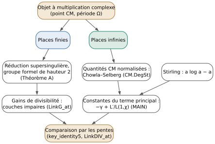

Ce tableau dit d'où vient chaque terme, et non seulement qu'un chemin existe dans le graphe. Ce qui reste à lire, ce sont les preuves du transport, `numGood_of_famQ` et les bornes par pages, dont le chemin est donné en partie II (« Cinq points éclaircis »).

**Des degrés CM aux bornes de réseau : l'étape des pages.** Le chemin de la formule CM vers la division passe par des « bornes par pages » (partie II). Le squelette de la preuve, lu avec `trace_app.py --outline`, en isole l'étape centrale, que l'on peut reconstruire entièrement. À l'étage $j$, notons $K$ le corps de coefficients, de degré $\delta$ ; $V$ l'espace des formes paraboliques ; $M\subset V$ un réseau ; $S_\sigma(F)$ la taille de $F$ au plongement $\sigma$, et $\mathrm{meanLogSup}(F)=\frac1\delta\sum_\sigma\log S_\sigma(F)$ ; $W\subset V$ le noyau commun des fonctionnelles « coefficient du jet en un point CM » (c'est exactement ce que disent `KillQ` et `DetectQ`) ; et $Q=M/(M\cap W)$, de rang $\rho$. Une fonctionnelle $\varphi$ est **numériquement bonne** (`NumGood`) s'il existe une droite hermitienne $N$, de degré normalisé $\le B_{\rm deg}$, telle que $\varphi(M)\subset\mathfrak b^{-1}I_N$ aux places finies, avec $\mathfrak b=\prod_\lambda\lambda^{b(\lambda)}$, et $\|\varphi(F)\|_{N,\sigma}\le e^{C_{\rm arch}}S_\sigma(F)$ aux places infinies.

La reconstruction se fait en deux temps : un lemme de séparation, qui fournit des fonctionnelles indépendantes sur un corps commun, puis une borne de quotient par un argument de déterminant sur ce corps.

> **Lemme (séparation).** Soient $W\subset V$ comme ci-dessus et $\mathcal F$ une famille de formes $K$-linéaires $V\to K_1$, à valeurs dans des extensions finies $K_1$ de $K$. Supposons que (1) toutes s'annulent sur $W$ ; (2) tout vecteur de $V\setminus W$ est détecté par au moins une d'entre elles ; (3) la famille est stable par plongement de corps au-dessus de $K$. Alors il existe une extension finie galoisienne $L/K$ et $\rho=\dim_K(V/W)$ formes de $\mathcal F$, plongées dans $L$, dont les prolongements $L$-linéaires induisent un isomorphisme $L\otimes_K(V/W)\simeq L^\rho$.

*Démonstration.* Si $\rho=0$, il n'y a rien à démontrer. Sinon, on extrait un nombre fini de formes dont le noyau commun sur $K$ est $W$, en diminuant la dimension du noyau à chaque étape grâce à (2). On prend une extension galoisienne $L$ contenant leurs corps de valeurs, et l'on ajoute toutes leurs conjuguées, ce que (3) permet. Le noyau commun de leurs prolongements dans $L\otimes V$ est stable par Galois, donc provient par descente d'un sous-espace de $V$ ; par (2), ce sous-espace est $W$. Les prolongements engendrent donc le dual de $L\otimes(V/W)$, et l'on en extrait $\rho$ indépendants. $\square$

La condition (3) n'est pas décorative. La seule forme $\varphi(x,y)=x+\sqrt2\,y$, à valeurs dans $\mathbb Q(\sqrt2)$, détecte tout vecteur non nul de $\mathbb Q^2$, mais son prolongement à $\mathbb Q(\sqrt2)^2$ a un noyau de dimension 1 : une famille qui détecte sur $K$ ne détecte pas nécessairement après extension des scalaires. Sa conjuguée $x-\sqrt2\,y$ répare le défaut.

> **Proposition (borne de quotient).** Supposons les formes du lemme numériquement bonnes, pour les mêmes $\mathfrak b$, $C_{\rm arch}$ et $B_{\rm deg}$, les degrés étant normalisés par $\delta_L=[L:\mathbb Q]$. Alors, pour toute famille $t_1,\dots,t_\rho\in M$ dont les images engendrent $V/W$, le quotient $Q/\langle t_i\rangle$ a des longueurs locales $\ell_\lambda\le n(\lambda)+\rho\,b(\lambda)$, avec
> $$\frac1{\delta_L}\sum_{\lambda'}n(\lambda')\log N\lambda'\;\le\;\sum_{i=1}^\rho\Big(\mathrm{meanLogSup}(t_i)+C_{\rm arch}+B_{\rm deg}+\tfrac12\log\rho\Big),$$
> la somme portant sur les places finies $\lambda'$ de $L$.

*Démonstration.* Soient $\varphi_1,\dots,\varphi_\rho$ les formes du lemme. L'application $\Phi=(\varphi_k)$ est injective sur $L\otimes Q$, et la matrice $A=(\varphi_k(t_i))$ est inversible. Son déterminant $\Delta$ est une section non nulle de la droite $\bigotimes_kN_k$ sur $L$, de degré normalisé $\le\rho B_{\rm deg}$. Aux places finies, $\Phi(Q)\subset\bigoplus_k\mathfrak b^{-1}I_{N_k}$ : la longueur de $Q/\langle t\rangle$ en $\lambda'$ est au plus $\mathrm{ord}_{\lambda'}\Delta-\mathrm{ord}_{\lambda'}\big(\bigotimes I_{N_k}\big)+\rho\,b(\lambda')$, et l'on note $n(\lambda')$ la somme des deux premiers termes. $n(\lambda')$ peut être négatif, mais $n(\lambda')+\rho\,b(\lambda')$, qui majore une longueur, ne l'est pas ; on ne remplace pas $n$ par sa partie positive, ce qui fausserait la formule du produit. La formule du produit sur $L$ donne $\frac1{\delta_L}\sum_{\lambda'}n(\lambda')\log N\lambda'=\widehat{\deg}_n\big(\bigotimes N_k\big)+\frac1{\delta_L}\sum_\sigma\log\|\Delta\|_\sigma$. Le premier terme est $\le\rho B_{\rm deg}$. Pour le second, l'inégalité de Hadamard majore $\|\Delta\|_\sigma$ par le produit des normes des colonnes de $A$, chacune au plus $\sqrt\rho\,e^{C_{\rm arch}}S_\sigma(t_i)$. $\square$

*Pourquoi changer de corps ne coûte rien.* Une extension de DVR de ramification $e_{\mathfrak P/\mathfrak p}$ multiplie la longueur d'un module fini par $e_{\mathfrak P/\mathfrak p}$. Comme $\log N\mathfrak P=f_{\mathfrak P/\mathfrak p}\log N\mathfrak p$ et $\sum_{\mathfrak P\mid\mathfrak p}e_{\mathfrak P/\mathfrak p}f_{\mathfrak P/\mathfrak p}=[L:K]$, la somme pondérée et normalisée $\frac1{[L:\mathbb Q]}\sum_{\mathfrak P}\ell_{\mathfrak P}\log N\mathfrak P$ est égale à la somme correspondante sur $K$. La borne obtenue sur $L$ est donc une borne sur $K$.

**Ce que fait l'export.** C'est un argument de déterminant à la Siegel, où les fonctionnelles sont des dérivées en des points CM. `NumGood` porte sur une forme `φ : V →ₗ[K] K₁` à valeurs dans un corps de nombres $K_1$ quelconque, avec des longueurs comptées aux places de $K_1$ (indice de ramification compris) et des degrés normalisés par $[K_1:\mathbb Q]$ ; `DetectQ` quantifie sur tous ces $K_1$. Le lemme de séparation est `FreeQuotientRank.kerCore_holds` (19 621 lignes propres), démontré par clôture normale du compositum et descente galoisienne (`GaloisDescentStatement`). Le pont `qbridge_of_numGood` démontre la condition (3) pour `NumGood` (témoin `comp (AlgHom.toLinearMap e) f`) et conclut `QBridgeAt`, qui contient exactement les hypothèses de la proposition sur un corps commun. Les constantes coïncident : l'hypothèse du pont est « hauteur de $t_i$ $+\,C_{\rm arch}+B_{\rm deg}+\frac12\log\rho\le$ borne visée », et la constante finale de `qat_of_kill_detect` est $C_c=C_h+3C_0+C_d$ ($C_h$ pour les hauteurs des $t_i$, $3C_0$ pour les trois bornes archimédiennes de `RoomAt`, $C_d$ pour $\log\dim$). Le lemme et la proposition sont des reconstructions indépendantes : les preuves Lean de `kerCore_holds` et de l'étape du déterminant (`qat_of_bridge'`) ne sont pas lues ligne à ligne. Une première version de cette reconstruction avait omis le changement de corps ; le contre-exemple ci-dessus l'a révélé, et l'export montrait que le lemme de séparation y pourvoit (article, § 7.4). Ce qui reste est l'**existence** de fonctionnelles CM numériquement bonnes, avec $B_{\rm deg}$ relié à $\frac12\log\Omega$ par le théorème CM (`cmArcDatumFamily_functional_bounded_linear_on_cuspForms`, `numGood_of_famQ`).

### 5.6 Ce que dit le graphe

Le côté archimédien est **lourd**, à l'inverse du côté $p$-adique :

| Organe | Poids dominé |
|---|---:|
| Borne de covolume (`topCovolSlim2_use_alt_alt`, Arakelov) | 7,1 % |
| Quasi-orthogonalité (théorème S, `CarrierGap.offDiag`) | 1,4 % |
| Familles de groupes définis et masses (`hypotheses_nonempty_of_unramified_exponents_alt`, qui livre `SiegelMassRatioCM`) | ≈ 15 %, à l'intérieur des 36 % de fabrication |
| Formule de pente par longueurs locales (`placesF_min'`) | 196 000 lignes |
| Division, arrondi, pentes (mécanisme) | ≈ 0,1 % |

Le contraste a la même source que le § 5.2 ⟦I⟧. Une borne $p$-adique peut être approchée, puisqu'il suffit de minorer des valuations. Une taille archimédienne doit être **exacte**, et l'exactitude coûte : des formules de masse démontrées en entier, une formule de Petersson quantitative, la géométrie d'Arakelov des variétés de Shimura.

> **Réponse à la question 4.** La divisibilité permet de diviser un réseau source tout en préservant l'intégralité d'une application de périodes. Une inégalité de pentes borne cette division en fonction des normes et des volumes cibles. Les masses de Siegel, les périodes CM et les formules de normes fournissent des expressions précises du côté archimédien. Comme pour Stirling, leur précision permet la compensation des termes principaux. Dans le cas réel, l'export l'établit : la taille de la dérivée $a$-ième renormalisée, $a!\,\Omega^{-a}$, donne $a\log a-a$ par Stirling et $-\gamma+L'(1,\chi)/L(1,\chi)$ par une formule de Chowla–Selberg pour la hauteur CM (`CM.DegSt`), et `key_identity5` assemble ces termes en `MAIN`. Une fois cette compensation obtenue, on a transformé la question sur les zéros en une question sur la somme des pertes. C'est le rôle annoncé du § 6.

**Transition.** Après simplification du terme principal, il reste une inégalité entre des fluctuations et des **pertes**. Les pertes ont deux sources, que l'on a déjà rencontrées : le coût fixe, réparti sur les $m$ couches (la dent de scie, les $O(\log a)$), et le coût marginal de chaque relèvement (les dénominateurs $\mathrm{dG}_j$, les termes $C\,m\,L$ de `Count_at`). Le § 4.1 a montré, chez Stepanov, comment un coût amorti et un coût marginal s'équilibrent. La question 5 fait le même calcul pour la chaîne, et montre pourquoi le résultat est exactement $\sqrt x$.

## 6. Pourquoi l'équilibre des paramètres produit exactement une erreur en racine carrée

Le § 5 a laissé une inégalité débarrassée de son terme principal : **fluctuations ≤ pertes**. Tout dépend maintenant de la taille des pertes, et celle-ci dépend d'un paramètre libre, la longueur $m$ de la chaîne. Une chaîne trop courte ne gagne pas assez de couches. Une chaîne trop longue accumule trop de pertes. Ce paragraphe montre que l'optimum donne $\sqrt x$, que le code impose exactement cet optimum, et surtout qu'**une borne unilatérale avec un exposant strictement inférieur à 1/2 est incompatible avec les zéros connus** : l'exposant ½ n'est pas un accident d'optimisation.

### 6.1 Le modèle : deux coûts, un minimum

Chez Stepanov (§ 4.1), la borne valait $p/2+\frac{m+1}2\big(p/a+a\big)$. Il y a un **coût fixe** $p$, payé une fois et réparti sur les $a$ ordres d'annulation, et un **coût marginal** qui croît avec $a$, parce que la $k$-ième dérivée ajoute $k\,m$ au degré des conditions. L'inégalité arithmético-géométrique fait le reste :
$$\frac{F}{a}+c\,a\;\ge\;2\sqrt{cF},\qquad\text{avec égalité pour }a=\sqrt{F/c}.$$
Si le coût fixe est de l'ordre de la taille du problème ($F\approx p$) et le coût marginal de l'ordre de 1 ($c\approx1$), l'erreur optimale est $\sqrt p$. C'est toute l'arithmétique du ½. Il reste à vérifier que la chaîne de relèvements a exactement cette forme.

### 6.2 Le crochet d'erreur, lu sur l'export

**Le contrat de comptabilité.** Le mécanisme est écrit sous la forme d'un théorème de comptabilité, `each_unit_bound_statement`, qui démontre `PointwiseBoundVariant D C X''`. Ses onze hypothèses portent sur un même record de données. Pour chaque translaté, il conclut $\mathrm{ASK}\le\mathrm{MAIN}+\mathrm{ErrX5at}$. Le ch. 58 de l'exposition de Nelson pour la route d'origine [Ne0] décrit ce même bilan, et l'expérience E17 du carnet `raccords.md` en identifie les prédicats sur l'export ainsi que l'interface de `linkCore` qui fournit chacun d'eux. Deux problèmes se séparent alors. Le problème de **fabrication** consiste à réaliser simultanément ces hypothèses. Le problème de **comptabilité** consiste à en déduire le bilan, indépendamment de la manière dont elles sont obtenues.

Notations : $S=\mathrm{ASK}$ (la somme des $P_{t,w_j}(a_t)$), $\Gamma$ le gain total net, $\mathcal L$ les termes locaux communs, $E_u$ les termes locaux de niveau et tordus, $A=\sum_ta_t$, $h_u$ la hauteur de l'application de périodes, $T_u$ le premier auxiliaire, $\mu_R=\mu(R^\vee)$ la pente du réseau cible, $\mu(N_u)$ et $\mu(M_u)$ celles des réseaux source et de base. Les $e_i$ sont des majorants d'erreurs, non les exposants de pertes de la fenêtre.

| Nelson | Prédicat Lean | Ce qu'il borne | Interface de `linkCore` |
|---|---|---|---|
| A1 | `LossBounds` | $S-\Gamma$ et l'excès de colongueur $I$ | `LossFS` |
| A2, A2⁺ | `QuotientSlopeBoundsWith` | pente moyenne de $N_u$ minorée, pente maximale majorée | `SlopesNF` |
| A3 | `SlopeIneq`, `HHBound`, `FParams` | théorème des cadres : $\mu_R$ minorée par la pente moyenne des sources | `FrameF`, `LatF` |
| A4 | `DIV` | $\mu_R+h_u-\mathcal L$ majorée par Stirling, la période CM et $\log T_u$ | `LinkDIV` |
| A5, A5⁻ | `EComp5` | $\lvert E_u-mAg\rvert\le c\,mB_0$ | `LinkDIV` |
| A6, A6′ | `Count5` | $\log T_u$ minoré ; ses variations et sa majoration | `CountF` |
| A7, A7⁺ | `Slopes` | $\mu(M_u)$ minorée ; $\mu_{\max}(M_u)$ majorée | `SlopesMF` |
| H | `HComp` | écart des $h_u+A\log T_u$ entre mots | `LinkDIV` |
| signes | `HidaSetting` | positivité des paramètres | — |

Le `HidaSetting` du record n'est qu'un paquet de conditions de signe, sans rapport avec le cadre de Hida du Théorème B des arcs. Trois entrées, la borne de division, les termes locaux et l'écart des hauteurs, sortent du même lien, `LinkDIV`.

**La compensation.** Écrivons $P=m\sum_t\varphi(a_t)-mA\log\Omega$, avec $\varphi(t)=t\log t-t$, et $Q=\sum_j\frac1f\sum_\rho\log\frac{w_j(\rho)v}\pi$. Sous forme simplifiée, les entrées utiles s'écrivent :

| | Inégalité |
|---|---|
| A1 | $S\le\Gamma+e_1$ |
| A2 | $\mu(M_u)+\Gamma+\mathcal L-E_u-e_2\le\mu(N_u)$ |
| A3 | $\langle\mu(N)-h\rangle-e_3\le\mu_R$, en moyenne sur les mots, pondérée par les rangs $d_u$ |
| A4 | $\mu_R+h_u-\mathcal L\le P-A\log T_u+e_4$ |
| A5 | $E_u\le mAg+e_5$ |
| A6 | $\log T_u\ge Q+mg-e_6$ |
| A7 | $\mu(M_u)\ge-e_7$ |

Par A1, A2 et A7, $S\le\mu(N_u)-\mathcal L+E_u+e_1+e_2+e_7$ pour chaque mot. En moyenne sur les mots, puis par A3, $S\le\mu_R+\langle h\rangle-\mathcal L+\langle E\rangle+e_1+e_2+e_3+e_7$. A4, moyennée, remplace $\mu_R+\langle h\rangle-\mathcal L$ par $P-A\langle\log T\rangle+e_4$ : **les hauteurs se compensent**. Enfin A5 et $A$ fois A6 donnent $-A\langle\log T\rangle+\langle E\rangle\le-AQ+Ae_6+e_5$ : **le niveau $mAg$ disparaît**. Au total,
$$S\;\le\;P-AQ+e_1+e_2+e_3+e_4+e_5+Ae_6+e_7 .$$
Par l'identité de compensation (§ 5.5 ; E1, `key_identity5`), $P-AQ=\mathrm{MAIN}$, puisque $\log v$ et $\log\pi$ s'éliminent : **le terme principal apparaît avec son signe**. C'est le Théorème 58.1.1 de Nelson, dérivé comme le font ses exercices 58.1.1 à 58.1.4, et le certificat est la combinaison $(1,1,1,1,1,A,1)$ des sept lignes. La preuve Lean suit ce chemin (carnet, E19). Elle ne passe pas par une inégalité A3 séparée : `Ga_bound5` minore le seuil $s=\langle\mu(N)-h\rangle$ par $\Gamma+\mu_R-\dots$ à partir de A2 et A4 à A7 (`s_lower5`), le majore par $\mu_R+\dots$ par le théorème des cadres (`SlopeIneq`), et **la pente cible $\mu_R$ se compense**. Sa conclusion, $\mathrm{ASK}\le\mathrm{Main}+\mathrm{ErrX5at}$, a pour erreur `ErrX5at` exactement la somme des erreurs des entrées, avec le multiplicateur $A$ sur celle de A6.

*Réserves.* (i) A3 est utilisée sous la forme du théorème des cadres, $s-\log\lvert\mathcal W\rvert-(1-\delta_F)^{-1}\big(4u_F\log(1+Z/u_F)+(\eta_F+4\sqrt{e_F})Z\big)\le\mu_R$. Nelson (exercice 59.1.5) en déduit la forme moyennée, avec $e_3=\log\lvert\mathcal W\rvert+8\log(1+x^{C_H})(U+b)+12b$, à condition que $u_F\le U$. Cet étalement est borné par `u_function_le_mean` grâce à l'écart des hauteurs `HComp` ; sans lui, il ne l'est pas (exercice 59.1.6). (ii) La dérivation est lue au niveau des énoncés intermédiaires ; les preuves de `s_lower5` et de `u_function_le_mean` ne sont pas lues ligne à ligne. (iii) Les coefficients réels des $e_i$ sont ceux du record, rappelés en E17 ; l'exposant final reste celui du § 6.4.

**Le crochet.** Le théorème `Deduction.ch_top` (129 861 lignes propres) majore l'écart total entre la somme de premiers et son terme principal, sommé sur les colonnes $t$ et les relèvements $j<m$ :
$$\sum_{t}\sum_{j<m}\big(\mathrm{ASK}-\mathrm{MAIN}\big)\;\le\;x^{C\varepsilon}\cdot\mathrm{errorBracketSizeWindows},$$
avec, mot pour mot dans l'export,
```
errorBracketSizeWindows x ε n nT nT2 m b k a
  = nT·a·(1 + m²/k)  +  m·( 2·n·m·b·x^ε  +  nT2·k·b·x^ε / (n·(n·x^(−ε))) ).
```
Il y a $n_T\,m$ termes, chacun de taille naturelle $b$. Divisons le crochet $\mathcal E$ par $n_Tmb$ :
$$\frac{\mathcal E}{n_Tmb}=\frac a{mb}+\frac{am}{kb}+\frac{2n}{n_T}\,m\,x^\varepsilon+\frac{n_{T2}}{n_T}\,\frac k{n^2}\,x^{2\varepsilon}.\tag{E}$$
Avec $a\le2xb$, $n_T\ge n\,x^{-\varepsilon/8}/2$ et $n_{T2}\le n$ (`SizeWindows`, d'où $n_{T2}/n_T\le2x^{\varepsilon/8}$), cela donne $x^{O(\varepsilon)}(x/m+xm/k+m+k/n^2)$. Les contraintes $k\ge xm$ et $k\le n^2x^{1/2-\varepsilon}$, dont l'intervalle n'est non vide que si $xm\le n^2x^{1/2-\varepsilon}$, ramènent alors l'erreur **par terme**, à $x^{O(\varepsilon)}$ près, à
$$\text{erreur normalisée}\;\lesssim\;\underbrace{\frac{4x}{m}}_{(1)}+\underbrace{4m}_{(2)}+\underbrace{2\sqrt x}_{(3)} .$$

Chaque terme a une origine identifiable, et chacun a son équivalent chez Stepanov.

1. **Le coût fixe, amorti.** Le terme $n_T\,a$ est payé **une fois par colonne**, quel que soit $m$. Sur l'export, il rassemble les restes de la division, de la pente des réseaux de départ et des tailles de colonnes (`core_ineq`) : ce sont des propriétés du réseau, payées une fois, alors que la somme de premiers est comparée $m$ fois (partie II, « Cinq points éclaircis »). Réparti sur les $m$ relèvements, il devient $x/m$. Le facteur $1+m^2/k$ serait dangereux si $m^2$ dépassait $k$. C'est exactement ce qu'empêche la contrainte $k\ge x\,m$ de `Win_at` : elle donne $m^2/k\le m/x\le1$. **Voilà à quoi sert le rang de base gigantesque**, $k\ge x^{3/2-\varepsilon}$.
2. **Le coût marginal.** Le terme $2n\,m^2b$ est quadratique en $m$, donc linéaire **par relèvement**. Sur l'export, la perte de chaque mot est proportionnelle à la longueur de la chaîne : $\mathrm{Ee}\le m\,(\mathrm{sumA}\cdot\mathrm{lg}+c_E\,B_0)$ (`exponent_le_upper`), où le budget par relèvement vérifie lui-même $B_0\le2\,n\,m\,b\,x^\varepsilon$ (`BNBoundsU` ; partie II, « Cinq points éclaircis »). Chez Stepanov, la $k$-ième dérivée coûte $k\,m$ conditions. Ici, le $j$-ième relèvement opère en rang $k+j(t+1)$, qui croît linéairement avec $j$ ⟦I⟧. Que ces pertes restent petites après sommation sur toutes les places (nombre de places, degrés locaux, poids, facteurs $f$ et $N$) n'est pas reconstruit ici.
3. **Un plafond.** Le dernier terme est borné par $\sqrt x$ grâce à une autre contrainte de taille, $k\le n^2x^{1/2-\varepsilon}$ (`RestSize`). Les paramètres sont calibrés pour que **rien** ne dépasse $\sqrt x$.

Comme $x/m+m\ge2\sqrt x$, l'optimum est $m=\sqrt x$. Le code impose précisément la fenêtre (`Win_at`, `RestSize`)
$$x^{1/2-\varepsilon}\;\le\;m\;\le\;x^{1/2+\varepsilon/2},$$
et l'erreur vaut alors $x^{1/2+O(\varepsilon)}$.

![Erreur par terme de la chaîne pour $x=10^6$ : $4x/m+4m$, minimale en $m=\sqrt x=1000$. Le code impose $m\in[x^{1/2-\varepsilon},x^{1/2+\varepsilon/2}]$, une fenêtre étroite autour de ce minimum.](fig/chaine_equilibre.svg)

*Attention* : $m$ est la **longueur de la chaîne**, pas le rang des réseaux. Le rang de base $k$ vérifie $k\ge x\,m$, soit au moins $x^{3/2-\varepsilon}$ puisque $m\ge x^{1/2-\varepsilon}$.

**Faisabilité des exposants.** L'optimisation du majorant réduit ne dit pas encore que les paramètres sont admissibles. Écrivons $m=x^\alpha$, $k=x^\kappa$, $n=x^\nu$, et demandons que chacun des quatre termes $x/m$, $xm/k$, $m$, $k/n^2$ soit au plus $x^\theta$ :
$$1-\alpha\le\theta,\qquad1+\alpha-\kappa\le\theta,\qquad\alpha\le\theta,\qquad\kappa-2\nu\le\theta.$$
Pour $\theta=\tfrac12$, les deux premières bornes sur α imposent $\alpha=\tfrac12$, puis $1\le\kappa\le2\nu+\tfrac12$ : le modèle seul se contente de $\nu\ge\tfrac14$. Mais la fenêtre effective $xm\le k\le n^2x^{1/2-\varepsilon}$ impose $\kappa\ge\tfrac32$, donc $\nu\ge\tfrac12+\tfrac\varepsilon2$. La construction choisit beaucoup plus grand, $n\asymp x^{2+8\varepsilon}$, et [R2] rapporte $k\asymp x^{9/2+10\varepsilon}$, d'où $k/n^2\asymp x^{1/2-6\varepsilon}$ : la contrainte $k/n^2$ est satisfaite avec marge, et ce sont donc d'autres contraintes de la fabrication, non reconstruites, qui fixent la taille de l'hôte. Ce calcul ne montre ni que ces paramètres sont admissibles dans Lean, ni qu'un exposant serait une obstruction pour toute autre méthode ; un programme linéaire sur les exposants des contraintes effectivement extraites dirait lesquelles sont actives.

### 6.3 Pourquoi l'exposant ½ est optimal, et ce que cela impose aux pertes

**Les fluctuations observées et le seuil analytique.** On calcule $G(y)$ directement sur les premiers jusqu'à $10^7$, et on le compare à la formule explicite du § 1.2, réduite aux dix premiers zéros de ζ :


La constante $\log2\pi$ vient du résidu en $s=0$ pour ζ. Chaque zéro $\rho=\frac12+i\gamma$ contribue une onde $-2\,\mathrm{Re}\,y^{\rho}/(\rho(\rho-1))$, d'amplitude $\approx2\sqrt y/\gamma^2$. Elles ne s'éteignent pas : ζ a une infinité de zéros sur la droite critique (Hardy), et $G(y)/\sqrt y$ ne tend pas vers 0. Pour $\psi$ lui-même, Littlewood montre même $\psi(x)-x=\Omega_\pm(\sqrt x\,\log\log\log x)$. **Une borne globale $O(y^{\theta})$ avec $\theta<\tfrac12$ est impossible**, puisque les zéros sur la droite critique donnent des pôles de la transformée de Mellin de $G$.

**Contre-exemples : d'autres équilibres.** Supposons une méthode de même forme, avec un coût fixe $x$ et une perte marginale en $m^\beta$. Pour $\beta>0$, l'échelle optimale est $m\asymp x^{1/(1+\beta)}$, et l'erreur vaut $x^{\beta/(1+\beta)}$. Par Landau (§ 1.4), une erreur $x^\theta$ exclut les zéros de partie réelle $>\theta$.

| Perte par relèvement | Échelle de $m$ | Erreur | Ce qu'on démontrerait, si ce modèle était un budget global valide |
|---|---|---|---|
| $m^{1/2}$ | $x^{2/3}$ | $x^{1/3}$ | **incompatible** avec les zéros critiques : une hypothèse du modèle (ou la réduction analytique) doit échouer |
| $m$ (Alpöge) | $x^{1/2}$ | $x^{1/2}$ | **GRH** |
| $m^2$ | $x^{1/3}$ | $x^{2/3}$ | seulement l'absence de zéros pour $\operatorname{Re}s>2/3$ |
| constante | tout $m\gtrsim x$ (l'infimum est la constante) | $O(1)$ | **incompatible** avec les zéros critiques, sous la même réserve |

Si l'on varie simultanément les deux coûts, le modèle général $x^\alpha/m+m^\beta$ (avec $\alpha,\beta>0$) possède un minimum de l'ordre de $x^{\alpha\beta/(1+\beta)}$, pour $m\asymp x^{\alpha/(1+\beta)}$. Par exemple, $\alpha=3/4$, $\beta=2$ donnent aussi l'exposant $1/2$. La linéarité n'est donc pas une nécessité universelle. Elle est décisive dans l'architecture particulière où le coût fixe est de l'ordre de $x$, et où les autres termes sont déjà au plus de l'ordre de $\sqrt x$. Dans le crochet réel, le terme supplémentaire en $\sqrt x$ reste présent : on ne peut conclure à une contradiction en optimisant seulement les deux autres termes.

L'optimalité de l'exposant est une question différente. Une borne unilatérale de la forme $G(y)=O(y^\theta)$ ou $G(y)\le Cy^\theta$, avec $0<\theta<1/2$, contredirait le critère de Landau et l'existence de zéros de ζ sur la droite critique. Cela donne un argument analytique, indépendamment de la figure et de l'analogie avec Littlewood pour la somme non lissée. Les données numériques aident à voir la fluctuation, mais ne sont pas la preuve de cette obstruction.

Une seule singularité suffit même à exclure $G(y)=o(\sqrt y)$. Pour un zéro $\rho=\frac12+it$, la transformée $\int_1^\infty G(y)y^{-s-1}dy$ a en ρ un pôle de résidu non nul ; donc $h\int_1^\infty G(y)y^{-\rho-h-1}dy$ tend vers ce résidu quand $h\downarrow0$. Si l'on avait $G(y)=o(\sqrt y)$, cette quantité serait $h\cdot o(1/h)\to0$ : contradiction. L'argument n'utilise aucune donnée numérique.

La troisième ligne du tableau montre aussi ce qui sépare GRH d'une simple région sans zéros. Avec une perte quadratique par relèvement, si tous les autres contrôles restaient valides, le modèle donnerait une région sans zéros $\operatorname{Re}s>2/3$, ce qui serait déjà un résultat nouveau. **La linéarité de la perte par relèvement est ce qui fait de la méthode une preuve de GRH** ⟦I⟧. C'est pourquoi le contrôle des pertes (`LossFS`, `exponent_le_upper`) est un point sensible de la construction.

### 6.4 Le ε, et la conclusion

La borne obtenue n'est pas $\sqrt x$, mais $x^{1/2+O(\varepsilon)}$. Les pertes logarithmiques ($b=e^{x^\varepsilon}$, $\log T$, les marges $x^{\varepsilon}$) et la largeur de la fenêtre de $m$ coûtent des facteurs $x^{O(\varepsilon)}$. Sur l'export, le lemme inconditionnel `level_gm_le_on_family_scales` (337 déclarations propres) convertit la chaîne en
$$G_\psi(x)\;\le\;x^{1/2+(e_D+e_L+7)\varepsilon}$$
sur les fenêtres d'échelles. $e_D$ est la perte de division (la constante de `LinkDIV`), et $e_L$ la perte de `LossFS`. C'est exactement la majoration encadrée du § 1.6, avec $C=e_D+e_L+7$. Ce passage exige que $e_D$ et $e_L$ ne dépendent pas de ε, et c'est ce que dit l'export : `ChebyshevInequalityAtWindowScale` s'écrit $\exists\,e_D,e_L,\varepsilon_1>0,\ \forall\varepsilon<\varepsilon_1,\ \exists$ une famille…, les exposants étant fixés avant ε. On fait tendre ε vers 0, et Landau en fenêtres (§§ 1.4 et 1.5) donne l'absence de zéros pour $\operatorname{Re}s>\tfrac12$.

### 6.5 Ce que dit le graphe

L'équilibre lui-même ne coûte presque rien : quelques inégalités entre paramètres (`Win_at`, `RestSize`, `errorBracketSizeWindows`). Le ½ est une **contrainte que les objets doivent satisfaire**, et non un théorème difficile. Ce qui coûte, c'est de **fabriquer** des familles qui la satisfont : des hôtes de degré $\approx x^{2+8\varepsilon}$, des rangs $k\in[x\,m,x^5]$ (`size_window_at_five`), et des pertes par relèvement linéaires en $m$. Ces familles relèvent des 36 % de fabrication (§ 7). La preuve de `ch_top` (environ 130 000 lignes) est une comptabilité.

> **Réponse à la question 5.** Le modèle dominant des pertes comporte deux parts, en plus d'un reste contrôlé par les autres contraintes de taille. Un coût fixe, de l'ordre de $x$, est l'imprécision d'une seule couche de divisibilité, et il est amorti sur les $m$ relèvements : $x/m$. Un coût marginal, linéaire en $m$ par relèvement, est borné dans l’export par un terme en $m$ ; son lien précis avec la croissance des rangs reste à reconstruire. Leur somme est minimale en $m=\sqrt x$, où elle vaut $2\sqrt x$, exactement comme $p/a+a$ chez Stepanov. Ce ½ n'est pas fortuit. Un zéro sur la droite critique interdit tout exposant strictement inférieur à $1/2$ (§ 6.3) ; la figure montre les fluctuations jusqu'à $10^7$, sans le prouver. Dans cette architecture, les deux coûts linéaires permettent d’atteindre cet exposant, avec les autres termes contrôlés. Avec une perte par relèvement quadratique, elle ne démontrerait qu'une région sans zéros.

### Atelier 6. La comparaison dans un réseau

Le principe des §§ 2 et 5 tient en une ligne. Pour un réseau entier de base $v_1,\dots,v_n$, de matrice $A$, la divisibilité minore $\log|\det A|$ et l'inégalité de Hadamard le majore :
$$\sum_pe_p\log p\;\le\;\log|\det A|\;\le\;\sum_i\log\|v_i\|,$$
où $p^{e_p}$ divise $\det A$. Les colonnes $(1,1)$ et $(1,7)$ donnent $\det A=6$, divisible par 2 et par 3, et un produit des longueurs $\sqrt2\cdot\sqrt{50}=10$ ; le déterminant de Gram vaut $36=6^2$. Avec des familles de vecteurs, l'assemblage final de la preuve est une comparaison du même type, entre trois réels.

**L'exercice** (d'après P. D. Nelson [Ne], ch. 35). Une famille de $n$ vecteurs indépendants dans un espace de dimension $d$, avec $\tfrac d2\le n\le d$, a un covolume $c$ et un indice $\delta$. On suppose
$$d(H-3F)\le c+2\delta,\qquad c\le n(H-\rho+F),\qquad \delta\le dI .$$
La première inégalité est une **borne inférieure** : une famille qui engendre presque tout l'espace ne peut pas avoir à la fois un petit covolume et un petit indice. La deuxième est une **borne de taille** : chaque vecteur est court, d'exposant $H-\rho+F$, où $\rho$ est le **gain** par vecteur. La troisième **borne l'indice**. Ici $c$ et $\delta$ sont des quantités **logarithmiques** (logarithme du covolume, somme pondérée des longueurs pour l'indice), et l'indice se prend dans un réseau saturé du même rang : on raisonne sur trois réels. Si $H+F\ge0$, alors $n\rho\le d(4F+2I)$.

*Solution.* En enchaînant les trois bornes, $d(H-3F)\le n(H-\rho+F)+2dI$, donc, exactement, $n\rho\le d(4F+2I)-(d-n)(H+F)$. Comme $n\le d$ et $H+F\ge0$, le dernier terme est négatif ou nul, d'où $n\rho\le d(4F+2I)$ ; avec $n\ge d/2$ et $F,I\ge0$, $\rho\le8F+4I$. Le gain par vecteur est donc borné par les seules erreurs ; c'est ce qui borne le reste des sommes de premiers.

*Contre-exemple.* L'hypothèse $H+F\ge0$ ne peut pas être retirée. Avec $d=2$, $n=1$, $H=-10$ et $F=I=\delta=0$, la famille $c=-20$, $\rho=10$ vérifie les trois bornes, mais $n\rho=10>0=d(4F+2I)$.

**Dans la preuve.** La réécriture de Sernau [Se] réalise ce modèle nom pour nom (carnet, E20). Dans la preuve de `New.star_inequality`, $H$ est `mainAmount`, $F=f\,a\,(\log b)^4$, $\rho=m\cdot\mathrm{rem}$ et $I=10\log(1+2b^2)\cdot f\,a\,(\log b)^3$ ; le covolume et l'indice sont logarithmiques, l'indice étant pris dans le réseau cible des formes tordues. Le pas « $H+F\ge0$ » y figure explicitement (`mainAmount_nonneg`), et $d_T\le2n$ vient de $4/b^2\le\frac12$. Les rôles :

- la borne inférieure est le **Théorème C** (`New.Data.integral_forms_long`) ;
- les formes courtes et leur indice forment le **Théorème A** (`span_short_integralRamified_eq_top`, `indexLe_normalizedPoincare`) ;
- le fait que peu de translatés engendrent presque toute la cible est le **Théorème B** (`enough_forms`, sans rapport avec le Théorème B des arcs ci-dessus) ;
- la conclusion est `New.star_inequality`, soit $m\cdot\mathrm{rem}\le f\,a\,(\log b)^5$.

Le Théorème C porte 45 % du poids de cette édition, à travers les bornes de Selmer et la construction de représentations galoisiennes. La preuve d'origine, celle que lit cette synthèse, assemble autrement. Elle combine sept inégalités de pentes, notées (A1)–(A7) dans l'exposition de la route d'origine [Ne0, ch. 58–59], et leur somme donne directement la borne du § 6.4, $G_m(x)\le x^{1/2+9\varepsilon}$ (`ChebyshevInequalityOnWindows`). Sur l'export, ces inégalités sont les onze hypothèses du théorème de comptabilité `each_unit_bound_statement` : `LossBounds` (A1), `QuotientSlopeBoundsWith` (A2), `SlopeIneq` (A3), `DIV` (A4), `EComp5` (A5), `Count5` (A6), `Slopes` (A7), auxquelles s'ajoutent `HComp` (l'écart des hauteurs) et des conditions de signe ; sa conclusion, `ASK ≤ Main + ErrX5at`, est la somme $\sum_{t,j}(P-M)\le e$. Le principe est le même : une minoration par la divisibilité, une majoration par la taille, et un gain borné par les erreurs.

**Transition.** Dans le régime de paramètres de cette construction, le ½ dépend notamment du contrôle linéaire des pertes et de la possibilité de diviser les réseaux. D’autres architectures pourraient atteindre la même précision autrement. Le dernier paragraphe de la partie I dit ce que coûtent ces conditions : les groupes de Tate–Shafarevich à borner, les représentations galoisiennes à construire, et la correspondance de Langlands locale à fournir.

## 7. Les pertes, et les théories qu'elles mobilisent

Le mécanisme des §§ 2 à 6 tient en quelques pages. Il ne fonctionne qu'à trois conditions. Les pertes doivent rester **linéaires** en la longueur de la chaîne (§ 6). La **division** des réseaux doit être possible sans perdre le profil gagné (§§ 4.3 et 5.4). Le côté archimédien doit rester **exact** (§ 5). Les deux dernières ont été traitées au § 5 (covolume, théorème S, masses). Le reste de la preuve paie trois factures, qui portent surtout sur la division et sur les objets eux-mêmes. Sur l'export, elles entrent par le corps hôte et par `LinkN` (partie II, graphe des interfaces).

### Trois difficultés cachées derrière une inégalité

À ce stade, le lecteur peut raisonnablement se demander pourquoi la preuve a besoin de tant de théories. Nous avons écrit quelques inégalités relativement simples, et pourtant leur justification mobilise des millions de déclarations. Il faut imaginer que chaque flèche de l'argument porte des obligations simultanées : non seulement l'opérateur doit exister, mais son image doit avoir le bon rang, son coefficient doit être entier aux places pertinentes, son coût doit être maîtrisé et ses normes doivent être évaluables. Une seule défaillance peut annuler la précision recherchée.

**Un modèle de projection.** Considérons $T=\begin{pmatrix}0&1\\0&\ell\end{pmatrix}$ pour un premier $\ell$. Les valeurs propres sont 0 et $\ell$, distinctes sur $\mathbb Q$. Le projecteur sur l'espace propre de valeur $\ell$ est

$$P=\frac{T}{\ell}=\begin{pmatrix}0&1/\ell\\0&1\end{pmatrix}.$$

Il vérifie $P^2=P$, mais n'est plus entier. Pourquoi ? Les deux valeurs propres deviennent égales modulo $\ell$. Il faut diviser par leur différence pour isoler un espace propre. Les opérateurs de Hecke fournissent des systèmes de valeurs propres beaucoup plus riches, et des congruences peuvent rendre l'isolation des formes utilement arithmétiques coûteuse. Le modèle montre pourquoi un dénominateur peut apparaître même si tous les opérateurs de départ sont entiers.

Les représentations galoisiennes permettent, dans de nombreux problèmes automorphes, de traduire des congruences de valeurs propres en informations cohomologiques sur des représentations. Les groupes de type Tate–Shafarevich mesurent alors certaines obstructions ou classes qui satisfont des contraintes locales. Il n'est pas nécessaire de maîtriser ces théories pour comprendre ce qu'on voudrait contrôler : la quantité de divisibilité perdue quand on impose des conditions arithmétiques supplémentaires.

**(a) Les dénominateurs de Hecke, et les groupes de Tate–Shafarevich.** Pour isoler les formes utiles, on projette sur des espaces propres de Hecke. Cette projection ne préserve pas les réseaux entiers. Ses **dénominateurs** peuvent venir de **congruences** entre systèmes de valeurs propres, et ils mangent la divisibilité gagnée. Dans de nombreux problèmes automorphes, ces congruences se lisent sur des extensions de représentations galoisiennes : c'est la **motivation** ⟦I⟧ du rôle de Ш, non une implication générale. Ce que fait la preuve est plus précis : elle borne la longueur de groupes de **Tate–Shafarevich** de torsions de Tate sur l'hôte :
$$\sum_\ell\log\ell\sum_{1\le e<x^{401}}\operatorname{len}\,\mathrm{Sha}^1_\ell\big(E,\mathbb Q_\ell/\mathbb Z_\ell(-e)\big)\;\le\;\exp(x^\varepsilon/2).$$
C'est l'énoncé exact de l'export (`VAt`, via `VVle`) : les longueurs de Ш sont finies pour toutes les torsions $e<x^{401}$, et leur somme pondérée est au plus $\exp(x^\varepsilon/2)$. La note d'Alpöge présente le résultat comme une borne **polynomiale en le conducteur**, effective et uniforme en ℓ ; l'énoncé intermédiaire qui donnerait cette dépendance n'a pas été lu. Elle est obtenue par des **congruences d'Eisenstein** sur $U(3)$ et $\mathrm{GSp}_4$, à la Ribet et Mazur–Wiles, avec le système d'Euler de Kato, des bornes de type Soulé et Ferrero–Washington ($\mu=0$). La partie de parité opposée passe par des nombres de Bernoulli. La constante 401 borne la plage des torsions. Alpöge : « fight for a significant weakening of Vandiver ». Cette étape pèse 8 % du volume. *Sur l'export* (partie II, graphe des interfaces), cette borne est fournie avec le corps hôte (`VWin`, consommée par `supplyChi`), et elle apparaît comme terme `vvTerm` de `LinkN`, qui borne la masse des places tordues dans le budget de perte par relèvement et conditionne la division. Le passage par les dénominateurs de Hecke décrit ci-dessus est une lecture ⟦I⟧, que les énoncés n'explicitent pas.

**Un modèle exact de pertes d'intégralité.** Soit $R$ un anneau de valuation discrète, d'uniformisante π, de corps résiduel à $q$ éléments, et $L\subseteq L'$ deux réseaux de même rang. La forme normale de Smith donne des bases avec $L'=\bigoplus_iRe_i$ et $L=\bigoplus_iR\pi^{a_i}e_i$, d'où
$$\operatorname{len}_R(L'/L)=\sum_ia_i,\qquad\log|L'/L|=\log q\sum_ia_i.$$
Une division par des exposants locaux est donc une perte additive de longueur, et pour une chaîne $L_0\subseteq\cdots\subseteq L_m$ de même rang, $\operatorname{len}(L_m/L_0)=\sum_j\operatorname{len}(L_j/L_{j-1})$. Si des modules finis de défauts $M_w$ s'injectent **ensemble** dans un module fini $H$, c'est-à-dire $\bigoplus_wM_w\hookrightarrow H$, alors $\sum_w\operatorname{len}M_w\le\operatorname{len}H$. Des injections séparées ne suffisent pas : avec $H=R/\pi R$ et plusieurs copies $M_w=H$, chaque injection existe, mais la somme des longueurs dépasse $\operatorname{len}H=1$. C'est la forme qu'aurait un contrôle des places tordues par des longueurs de Ш : il faudrait un morphisme **conjoint**, ou payer un facteur de multiplicité explicite. Ce modèle est un mécanisme possible ⟦I⟧ : le morphisme réel (restriction, quotient, groupe de Selmer, ou simple inégalité de comptage) n'a pas été identifié dans l'export.

**Ce qu'est le défaut local.** La fiche de la donnée locale (`NData`) permet d'aller au-delà de la motivation. En chaque place tordue $w$, de caractéristique ℓ, la preuve dispose d'une algèbre de Hecke locale $T$ agissant sur un module libre $M$, d'un réseau $L\subset M\otimes\mathbb Q_\ell$ et d'une partition de ses systèmes propres en « bons » et « mauvais », d'espaces propres $E_{\rm good}$ et $E_{\rm bad}$. Le défaut `etaLoc` est la longueur de
$$\big(E_{\rm good}\cap(L+E_{\rm bad})\big)\big/\big(L\cap E_{\rm good}\big),$$
c'est-à-dire le quotient de la projection de $L$ sur $E_{\rm good}$ par la trace de $L$ sur $E_{\rm good}$ : c'est **le module de congruences** de Ribet et Wiles. Sur le modèle ci-dessus, $T=\begin{pmatrix}0&1\\0&\ell\end{pmatrix}$, $L=\mathbb Z^2$, la projection de $L$ sur l'espace propre de valeur ℓ est $\mathbb Z(1/\ell,1)$, sa trace est $\mathbb Z(1,\ell)$, et le quotient est $\mathbb Z/\ell$ : le défaut vaut $1=v_\ell(\ell-0)$, exactement le dénominateur du projecteur. La motivation des dénominateurs de Hecke est donc la **définition** même de la quantité que Ш doit borner. La borne locale lue sur l'export (`PairedCharacterConditionAlt`) est
$$\mathrm{etaLoc}\;\le\;\sum_{\pi\ \text{bon}}\mathrm{mult}(\pi)\Big(\sum_{0<e<t}\operatorname{len}\text{Ш}(\ell,e)+\text{termes locaux}\Big),$$
sous des hypothèses qui font intervenir les représentations galoisiennes attachées aux systèmes propres et des caractères $\chi\cdot\mathrm{cyc}^{-(c-1)}$, torsions de Tate. Sa preuve passe par la théorie de Hodge $p$-adique (`conclusion41_of_pAdicHodge_alt`) et la réciprocité d'Artin ; son schéma est celui de la méthode de Ribet ⟦I⟧, où des congruences produisent des classes de cohomologie dont Ш majore la taille. Elle n'est pas reconstruite.

**Ce que dit le terme de preuve.** La borne effective (`etaSum_le`) n'est pas une injection conjointe. La masse des places tordues de l'étage $j$ est majorée par des termes de taille, par une somme sur les caractéristiques résiduelles des places tordues, chaque premier ℓ n'étant compté qu'une fois, et par $d_{Z_0}(j)\sum_\ell\mathrm{vvTerm}(\ell)$, avec $\mathrm{vvTerm}(\ell)=\log\ell\sum_{1\le e<t}\operatorname{len}\text{Ш}(\ell,e)$. Ш entre donc une fois par premier, avec un **facteur de multiplicité explicite** $d_{Z_0}(j)$ : c'est le second scénario du modèle ci-dessus. Les places concernées sont celles dont la caractéristique est l'un des deux premiers de l'hôte, sous une condition de « caractères appariés » qui exige la finitude des longueurs de Ш (`PairedCharacterConditionAlt`) ; le lien entre un défaut local et ces longueurs est dans la preuve de cette condition, non lue. Par ailleurs, la taille de la borne n'est pas l'obstacle : avec $b=e^{x^\varepsilon}$, $\exp(x^\varepsilon/2)/b=\exp(-x^\varepsilon/2)$, qui absorbe tout facteur polynomial en $x$. Cette observation de taille ne dit rien du mécanisme.

**(b) Les représentations galoisiennes.** Les congruences demandent des représentations galoisiennes attachées aux formes automorphes polarisées des groupes unitaires, avec compatibilité local-global. Le projet les construit **sans la cohomologie étale des variétés de Shimura** :

- d'abord par relèvement thêta ;
- puis par **réalisation géométrique en poids 1** dans la cohomologie cohérente (formule de Lefschetz holomorphe) ;
- enfin par **congruences ℓ-adiques**.

Cette étape pèse 6 % du volume.

**(c) La correspondance de Langlands locale, en partie seulement.** Elle n'est démontrée qu'en **profondeur zéro** (théorie de Green des caractères de $\mathrm{GL}_n(\mathbb F_q)$), avec des valeurs arbitraires ailleurs. La preuve n'interroge la correspondance qu'en des places où cette version suffit.

**Et la fabrication des objets** (36 % du volume) : familles d'espaces hermitiens définis aux signatures prescrites, paramètres de séries discrètes, noyaux thêta à coefficients entiers, rationalité des périodes (vecteurs tests, Siegel–Weil), quasi-orthogonalité, covolume.

---

### Préserver les gains : Behrend, grappes et arcs

Fabriquer des gains locaux ne suffit pas ; il faut encore que leurs positions ne se gênent pas le long des orbites de Frobenius. C'est le rôle des ensembles sans relation courte du § 3.5, dont la construction est celle de **Behrend** : une sélection presque dense (densité $N^{-c/\sqrt{\log N}}$) avec peu de collisions structurées. La note d'Alpöge le dit à l'étape 19 : « precise choice of the Iwasawa tower, specifically using Behrend!! ». L'export permet de suivre ce qu'elle préserve, et par quel canal.

**Une clause démontrée mais inerte.** Le théorème `dropping_proposition_holds` fournit un ensemble de positions $T_2$ de densité de Behrend, au moins $n_0\exp(-C\sqrt{\log n_0\log L})/L$, sans relation à trois termes. Pour tout translaté et toute orbite assez longue, **toute fenêtre de $L$ pas consécutifs en contient au plus deux points**, et l'orbite entière au plus un si elle est courte. Le lemme `no_three` le dit négativement : trois puissances consécutives du Frobenius ne tombent pas toutes sur des places épaisses. Mais ce théorème est **inerte** : il entre dans un paquet (`field_lemmas_except_seven`) dont les deux consommateurs n'extraient que d'autres clauses. On l'établit sur l'export en suivant les projections (carnet, E13).

**Le canal effectif.** La propriété utile est portée par un champ de l'hôte, `Host.second_set_no_relation`. Sur une orbite longue, elle donne qu'au plus deux places épaisses tombent dans une fenêtre. Les lettres épaisses se regroupent donc en grappes d'au plus deux, d'écart au plus $j$ et précédées de $j$ lettres non épaisses (`long_clusters`). Ces grappes sont l'hypothèse des « mots de page » sur l'orbite, dont la profondeur vaut $\min\{j : l_A\le(l-1)^j\}$. La chaîne remonte au lien côté Galois (`NLinkClose` → `linkN`), **non aux gains `LinkG`** : la propriété de Behrend ne sert pas à réaliser les poids des gains, comme le laissait entendre une version antérieure de cette synthèse.

**Le Théorème B des arcs.** Le lemme sur les mots est le Théorème B de l'export (`ThmB`, prouvé par `N.Ln17.thmB_at`, 2,7 M lignes), noté ici $B_{\rm arcs}$ pour le distinguer du Théorème B de la réécriture de Sernau. Il est lu au niveau de l'énoncé et du mécanisme. Une lettre est *épaisse* si sa taille tombe dans une bande $[b,b+\eta]$. Pour un morphisme de réseaux cristallins (modules de Wach), l'exposant du morphisme est borné par $C(n+1)\,r\,(h/l^2+(w+\eta)/l+S+1+\log_l(2h)+\eta\cdot\text{bande})+C\,n\,m\,e'$ sous l'une de deux hypothèses : soit les orientations alternent et il n'y a jamais trois lettres épaisses consécutives ; soit l'orientation est constante et il n'y a jamais $R$ lettres épaisses consécutives, auquel cas le terme $S+1+\log$ est multiplié par $R^2$. Il faut aussi les conditions de taille ($20w,20\eta,20S\le b$, au moins une lettre non épaisse) et le cadre de Hida : la condition combinatoire de Behrend ne suffit pas à elle seule. L'orbite se découpe en **arcs**, qui finissent à une lettre suivie d'une lettre non épaisse, et le coût d'un arc est majoré par le carré de sa longueur. Si le coût d'une grappe de longueur $r$ est majoré par $Cr^2$ avec $r\le R$, le total est au plus $CR\sum r$ : ce modèle explique le contrôle linéaire, sans prétendre que le coût réel croît quadratiquement. $B_{\rm arcs}$ est une borne supérieure, non une borne inférieure. C'est l'étape « premiers inertes » du lien `LinkN`, et les relèvements d'arcs eux-mêmes (théorie des modules de Wach) ne sont pas lus.

# Partie II. Carte du code

*Les noms ci-dessous permettent de retrouver chaque étape dans l'export. Les pourcentages sont des parts du volume de preuve dominé, calculées par arbre des dominateurs ; ils ne s'additionnent pas. Ils mesurent un volume exclusif de dépendances formelles, non une importance mathématique, et ils sont calculés en **lignes de l'export** (les enregistrements d'expressions, partagés dans tout l'export et attribués à la déclaration qui les introduit ; environ 1,07 milliard pour la fermeture), non en lignes de source. La fermeture de `riemannHypothesis` compte 1 468 390 déclarations, celle des cinq énoncés de `Main` 1 468 414 (l'export en compte 1 468 418, dont quatre hors de toute fermeture), et `allChi` en domine 1 409 557 (96 %).*

| Étape (partie I) | Déclarations principales | Poids |
|---|---|---:|
| Énoncé, réduction | `riemannHypothesis`, `allChi`, `EveryCharacter`, `imprimitive` | 99,3 % (tout) |
| § 1 Landau sur fenêtres | `FormB`, `zeroFreeOn_of_tiedWin_cyc`, `level_gm_le_on_family_scales` | < 0,1 % |
| § 3.4 Hôte, paires en moyenne | `supplyChi`, `PairEx`, `QH.pair_share`, `QH.bad_share` | ≈ 0,1 % |
| § 3 Théorème A, Dwork | `DworkPowerSeriesWeights.thmAGauss`, `theorem_A_one_monomial_log_loss`, `lemmaS`, `FormalGroupSystem.Pf.sx_dwork` | ≈ 0,02 % |
| § 4 Chaîne et gains | `FormalGroupSystem.LowTermBound`, `PointsLemma`, `G.NP`, `yProd`, `gainP`, `LinkG_at` | ≈ 0,1 % |
| § 5 Division, pentes | `divClausesR_of`, `DivIntoDualShift`, `mu_diff`, `Frame_at`, `HypHigh` | ≈ 0,1 % |
| § 5 Théorème S | `GlobalTheory.CarrierGap.offDiag` | 1,4 % |
| § 5 Covolume | `topCovolSlim2_use_alt_alt` | 7,1 % |
| § 7 (a) Tate–Shafarevich | `VWin := ∀ ψ, VWinAt ψ 401`, `vwin_of_row` | 8,2 % |
| § 7 (b) Galois | `galoisLocalGlobalStrong_recParameter` (`Row0b`) | 6,3 % |
| § 7 (c) Langlands local | `recTExists` | faible |
| § 7 Fabrication | `nonempty_hyps_definite_side_of_closed_bound` | 35,8 % |
| Cœur automorphe (total) | `every_character_of_theta_integrals_local_matching` | 41,5 % |

## Anatomie : le graphe des interfaces

L'arbre des dominateurs donne le **poids** des organes. Il ne dit pas comment ils communiquent. Pour cela, on lit sur l'export un second graphe, celui des **interfaces**.

- **Les nœuds** sont les prédicats à valeur dans `Prop` de `Formalism.MainNotions`, comme `Count_at`, `LinkG_at` ou `ChainTied` : 207 interfaces.
- **Les arêtes** sont les théorèmes de l'export qui prennent certaines interfaces en hypothèse et en concluent d'autres. Il y en a 390, extraites automatiquement des types par [`tools/interfaces.py`](tools/interfaces.py) (sortie : `analysis/interfaces.tsv`).
- **Les points d'entrée des organes**, c'est-à-dire la déclaration où chaque gros théorème est consommé, sont établis par remontée dans l'index inverse ([`tools/organes.py`](tools/organes.py), `revindex.py`).

### Une architecture en trois étages

**1. Les organes sont branchés comme hypothèses.** Chaque gros théorème (Ш, covolume, théorème S, masses, Galois) n'est consommé qu'en **un seul point d'entrée** : il a un unique référent direct dans l'export (`analysis/points_entree.txt`). Langlands local fait exception : `recTExists` est interrogé directement par 25 déclarations, dans les représentations galoisiennes et la borne de Ш. Le mécanisme ne les appelle pas : il est écrit **sous hypothèses**, et les organes sont injectés tout en haut. Le cœur a pour type
```
every_character_of_theta_integrals_local_matching :
  UnitaryGroupThirdPlaceHypotheses → ThetaLocalInputs → ThetaIntegralsAgree → LocalMatching
  → CovolumeBoundOfX → RecTExists → VWin → EveryCharacter
```
Ce sont sept entrées, dont le covolume, Langlands local et Ш. C'est la structure d'un argument « abstrait puis instancié ». Elle explique pourquoi ce qui appartient en propre au mécanisme est si léger dans l'arbre des dominateurs (§§ 2 à 6, moins de 0,5 %) : son sous-arbre dominé ne contient ni les grandes théories injectées en hypothèse, ni ses dépendances partagées, rattachées plus haut.

**2. Deux plaques tournantes redistribuent les organes.**

- **Le corps hôte** (`supplyChi`, § 3.4) reçoit les paires $(q,d)$ choisies en moyenne (`QH.pair_share` → `pairEx` → `supplyOfAdmOf`), les orbites de Frobenius « épaisses » de **Behrend** (`hostThickExists` → `hostOfFieldOf`) et la borne de **Ш**. Celle-ci est consommée exactement là : `zero_free_all_of_green_v_win` applique `supplyChi ψ (hV ψ)`.
- **La structure `HypsAlt`** (46 champs, produite par `nonempty_hyps_definite_side_of_closed_bound`, 35,8 %) reçoit le théorème S (champs `sO`, `sLp`), les masses (`hG`, `hU`), le Théorème A (par les lignes servies, `hServ`), le covolume (bornes `L3` des termes, `eventual_L3_of_covolume_alt`) et Langlands local.

**3. Les Link transmettent des inégalités au cœur du mécanisme.** `HypsAlt` est dépliée en neuf Link (`goal_of_shape_of_hyps`, puis `topDesWin`). Ceux-ci alimentent les quatorze interfaces de `linkCore`, qui conclut `ChainTied`. `level_gm_le_on_family_scales` en déduit l'inégalité de Tchebychev sur les fenêtres, et Landau conclut.

**Les quatorze interfaces de `linkCore`, lues comme un bilan de pentes.** Elles se lisent comme un seul raisonnement. Les réseaux en jeu sont, pour chaque mot $u$, un réseau « membre » `lat_u` de formes automorphes, et le réseau $N_u$ obtenu en l'**agrandissant par division** : il contient `lat_u`.

- **`PlacesF` puis `SlopesNF` : la pente monte.** Passer de `lat_u` à $N_u$ change la pente par une somme sur les places finies, longueurs locales fois $\log N(w)$. Le saut principal s'appelle `Ga` :
  $$\mathrm{Ga}=\sum_w\mathrm{sz}\Big(w,\ \sum_j\mathrm{gainD}(j,w)-\tau(w)\Big),$$
  c'est la somme, sur les places $w$, des **gains locaux de tous les étages $j$** moins un exposant de division $\tau(w)$. Le lemme `placesF_min'` (196 000 lignes) organise ce calcul.
- **`FrameF` : la pente est plafonnée.** C'est l'inégalité de pentes, appliquée aux accouplements de périodes $B_u:N_u\to R^\vee$, à valeurs dans un réseau cible entier. Elle n'est utile que si la hauteur des $B_u$ est petite, donc si les $B_u$ sont presque des isométries. C'est le rôle d'une condition de **quasi-orthogonalité** : les périodes de formes différentes doivent être presque orthogonales (le théorème S, § 5.4).
- **`LatF` et `SlopesMF` : les réseaux de départ sont sous contrôle.** Rangs positifs, dualité du réseau cible, et pentes des réseaux membres encadrées par $\pm C|TT|a\,L_a$. C'est le coût fixe du § 6.2.
- **`CountF` : les tailles archimédiennes.** La taille $\log T(u)$ d'une colonne est encadrée par une somme de termes de type Γ, $\sum_j\frac1f\sum_\tau\log(w_{j,\tau}v/\pi)$, un terme par étage et par place CM.
- **`LossFS` : premiers ≤ gains.** La somme de von Mangoldt `ASK` est majorée par `Ga` plus une perte $C|TT|\,m\,b\,x^{e_L\varepsilon}$.
- **`WinF` : la fenêtre des paramètres**, avec $x^{1/2-\varepsilon}\le m\le x^{1/2+\varepsilon/2}$, $x\,m\le k$, etc.
- **`CharF` : la constante du terme principal**, $\ell(\psi)=(L'/L)(1,\chi)$, fournie inconditionnellement par `Lnk.char_at`.

Mis bout à bout, cela donne :
$$\mathrm{ASK}\;\lesssim\;\mathrm{Ga}\;\lesssim\;\Delta\widehat\mu\;\lesssim\;\text{(plafond de Bost)}\;=\;\text{(termes archimédiens)}+\text{pertes}.$$
Le premier membre est la somme de premiers ; le dernier est calculable sans les premiers. C'est la structure de Tchebychev, $\sum v_p\log p=\log|M|\le\log H$, réalisée par des pentes.

```{=latex}
\begin{landscape}
```


```{=latex}
\end{landscape}
```

Quelques arêtes, lues telles quelles :

| Arête | Théorème (poids dominé) | Ce qui passe |
|---|---|---|
| `LinkS` → `FrameRealF` → `FrameF` | `frameRealF_of''`, `frameF_of` (231 k) | la quasi-orthogonalité rend le repère presque unitaire, donc l'inégalité de pentes utilisable |
| `LinkS` → `RRRankF`, `MatKF` | `rrRankF_of`, `matKF_of` | rangs et matrices de la division : la **non-dégénérescence** |
| `LinkG` → `LossesSmallShares` → `LossFS` | `losses_of_small_share_weight` (392 k) | premiers inertes ≤ gains locaux + perte |
| `LinkG`, `LinkMu` → `PlacesF` → `SlopesNF` | `placesF_min'` (196 k), `slopesNF_of` | Δ pente = Σ longueurs locales × log N𝔭 |
| `LinkDIV` → `LinkMu` | `linkMu_of_linkDIV` | la division fixe les sauts de pente |
| `LinkN` → `DIVinN` | `divinN_of_hypV` | la borne sur les places tordues conditionne la division |
| Galois → `LinkN` | `linkN_of_twGood_galoisPreconditions` (24,8 M lignes) | représentations galoisiennes ⇒ `LinkN` |
| `ColChain.fact` → `LinkDIVt` | `height_chain_atR` → `divClausesR_of` → … → `linkDIVt_of_bridge_kernel` | la factorisation par la chaîne sert la **division** |
| Behrend → `LinkG` | `field_lemmas_except_seven` → `linkG_fam_noKer` (1,3 M) | les orbites de Frobenius épaisses servent les **gains** |

### Interprétations soutenues, corrigées ou encore ouvertes

La partie I contient plusieurs interprétations, marquées ⟦I⟧. Le graphe des interfaces permet d'en tester certaines. « Soutenue » signifie qu'un chemin de dépendances est établi et que les énoncés lus sont compatibles avec l'interprétation ; cela ne démontre pas que le rôle est exactement celui décrit (niveaux 1 à 3 de l'échelle de validation de l'article). Les flèches de la dernière colonne suivent le flux des résultats vers leur usage, c'est-à-dire le sens inverse du graphe de dépendances.

| Interprétation (partie I) | Verdict | Sur l'export |
|---|---|---|
| La non-nullité passe par la quasi-orthogonalité (§§ 2.4, 5.4) | **soutenue** | théorème S → `LinkS` → conditions de rang (`RRRankF`, `MatKF`) et repère presque unitaire (`FrameRealF`) → inégalité de pentes |
| Behrend sert les couches impaires des gains (§ 3.5) | **soutenue** | `Behrend.box` → orbites de Frobenius épaisses → `LinkG` (les gains) et l'hôte |
| La chaîne sert la division (§§ 4.3, 5.4) | **soutenue** | `ColChain.fact` → `divClausesR_of` → `LinkDIVt` |
| Les masses donnent des tailles exactes (§ 5) | **soutenue** | `SiegelMassRatioCM` (une égalité) → `HypsAlt` (`hG`, `hU`) → `NuFull ∧ MuRank`, `LinkGLOBAL` |
| Ш contrôle le profil, et par là les pertes (§§ 2.5, 3.6, 6.5, 7) | **précisée** | Ш entre en deux points : il est fourni avec l'**hôte** (`supplyChi`), et il apparaît comme terme `vvTerm` dans `LinkN` (« somme sur les places tordues ≤ taille + Ш »), qui conditionne la **division** (`DIVinN`). Par `DIVinN`, cette masse doit tenir, pour chaque relèvement, dans le budget $x^\varepsilon(B_0+N_c)$, celui-là même qui forme le coût marginal du § 6 (voir ci-dessous). Ш n'entre pas dans `LossFS`. La lecture « Ш borne les dénominateurs de Hecke » reste ⟦I⟧ |
| Le covolume donne la taille calculable sans les premiers (§ 2.5) | **non tranchée** | le covolume entre dans `HypsAlt` par des bornes `L3` sur les termes d'une série (`CovolumeBoundThirdPlaceSeries`). Son lien avec une interface précise de `linkCore` n'est pas établi |
| Théorème A ⇒ gains (§ 3) | **précisée** | le Théorème A entre par les lignes servies de la sélection (`hServ_of_linkR` → `allRows_of_open0_alt`) et par le lien admissible tordu de la forme de Green (`closed_family_admissible_twist_link_alt`), pas directement par `LinkG` |

La correction principale porte sur Ш : dans l'export, il accompagne le **corps hôte** et protège la **division**, en bornant la masse des places tordues dans le budget par relèvement. La section suivante suit ce chemin jusqu'au lien de division.

### Cinq points éclaircis sur l'export (version 3.1)

La version 3.0 signalait plusieurs zones obscures : pourquoi la chaîne aide vraiment, d'où vient le terme principal côté archimédien, ce que sont les « places tordues », ce que dit exactement le lien entre premiers et gains, et comment la formule CM atteint la division. Les choix fins de l'hôte, la preuve de Landau en fenêtres et la présence de Rallis sont traités aux §§ 3.4, 1.5 et 5.3. Les énoncés de l'export y répondent en grande partie.

**1. L'amortissement.** La quantité que borne `Deduction.ch_top` est
```
gapA = Σ_{t ∈ TT} Σ_{j < m} ( ASK(a_t, t, w_j) − Re MAIN(a_t, w_j) )
MAIN(a, w) = a · ( log a − 1 − γ + ℓ(χ) − (1/|Φ|) Σ_{ρ∈Φ} log w(ρ) )
```
- **Le terme principal est écrit en toutes lettres.** $a(\log a-1-\gamma)$ est exactement le terme principal de Riesz $y\log y-(1+\gamma)y$ de l'atelier 5. $\ell(\chi)=(L'/L)(1,\chi)$ est la constante du § 1.2. La moyenne des $\log w(\rho)$ vient de ce que la somme est prise aux échelles $a/w(\rho)$.
- **Côté premiers, la soustraction est une identité exacte.** `ch_balance` établit $\mathrm{ASK}-\mathrm{MAIN}=\mathrm{De}$, où `De` est une combinaison, par orthogonalité des caractères de l'hôte, de sommes de Riesz centrées $G_\psi$ aux échelles $a/w$. `gapA` est donc une somme de $n_T\,m$ valeurs de $G_\psi$ : une par colonne $t$ et **une par relèvement $j$**. Borner une somme ne borne pas chacun de ses termes : $\frac12(u_1+u_2)\le1$ n'exclut pas $u_1=100$, $u_2=-98$. Le terme de preuve de `core_gm` montre comment l'écueil est évité. Le lemme `gmA_eq` établit que la combinaison produite par la somme sur les colonnes, pondérée par $1/(3o+1)$ sur les caractères gardés du niveau, est **identiquement** `Level.Gm`, la quantité du § 1.3 : la cible est cette combinaison à coefficients positifs, celle sur laquelle Landau opère. Les caractères parasites sont bornés **un par un** (`sigA_le`, par l'hypothèse ponctuelle `EAtH.bdG` que fournit le choix des paires, § 3.4), et l'échantillonnage des colonnes respecte le profil 4 : 3 à $x^{-1+\varepsilon}$ près (`EAtH.shares`).
- **Côté pentes, les erreurs sont payées une fois.** `LErr.core_ineq` énumère les restes, chacun avec sa constante. Ceux qui sont en $n_T\,a$, sans facteur $m$, viennent de la division (`cDiv`), de la pente des réseaux de départ (`cSlope`), de la taille des colonnes (`cCount`) et des arrondis : ce sont des propriétés **du réseau**. Ceux qui portent un facteur $m$ viennent des pertes par relèvement.

C'est le mécanisme de Stepanov, lu sur l'export. La somme de premiers est comparée $m$ fois, mais l'inégalité de pentes ne s'applique qu'une fois au réseau divisé, dont le saut de pente additionne les gains des $m$ couches ($\mathrm{Ga}=\sum_w\mathrm{sz}(w,\sum_j\mathrm{gainD}(j,w)-\tau(w))$). Le coût fixe se répartit donc sur $m$ termes : c'est le $x/m$ du § 6.

**2. La compensation du terme principal : Stirling plus Chowla–Selberg.** Côté archimédien, l'hypothèse `DIV` borne la pente du réseau divisé par
$$\sum_t\Big[m\big(\mathrm{ph}(a_t)-a_t\log\Omega\big)-a_t\log T(u)\Big]+\mathrm{EDiv},\qquad\mathrm{ph}(y)=y\log y-y,\qquad\log\Omega:=\gamma+\log\frac{\pi}{v}-\ell(\chi).$$
Ici $v=\mathrm{rd}_E/2$, la moitié du discriminant racine du grand corps hôte (par définition, `Host.v`), et ℓ porte sur le caractère quadratique modulo $d$ ; le tableau complet des normalisations est au § 5.5. Trois ingrédients se lisent dans cette expression.

- **$\mathrm{ph}(a)$ est le terme principal de Stirling**, $\log a!\approx a\log a-a$. C'est la taille archimédienne de la factorielle $a!$ qui fournit aussi la divisibilité de Legendre (§ 3).
- **$-a\log\Omega$ est la contribution d'une période** élevée à la puissance $a$ : la taille de « $D^a\,\Omega\cdot\theta(0)$ », selon la formule même de la note d'Alpöge.
- **$\log T(u)$ porte les termes de type Γ** des colonnes. `Count5` n'est pas une égalité : il minore $\log T(u)$ par $\sum_j\frac1f\sum_\rho\log(w_{j\rho}v/\pi)+m\,\mathrm{lg}-c_{\mathrm{Count}}(L_a+m^2L_a/k)$ (la quantité `Lam5`), et le majore par $c_{\mathrm{Count}}\,m\,L$. La minoration suffit, puisque $\log T(u)$ entre avec le signe moins.

L'identité algébrique `key_identity5` vérifie alors
$$\mathrm{SDiv}-\mathrm{sumA}\cdot\mathrm{Lam5}+m\cdot\mathrm{sumA}\cdot\mathrm{lg}\;=\;\mathrm{Main}+\mathrm{sumA}\cdot c_{\mathrm{Count}}\big(L_a+m^2L_a/k\big) :$$
la taille archimédienne reproduit **exactement** le terme principal, à une erreur près. Reste à savoir pourquoi $\log\Omega$, défini comme ci-dessus, est bien la taille d'une période. C'est le contenu de `GlobalTheory.CM.DegSt`, démontré dans le projet (`CM.PureDeg.degSt`, fermeture de 114 806 déclarations) :
$$2\,\widehat{\deg}\big(\text{droite propre d'un objet CM de type }(1,0)\big)\;=\;\gamma+\log\frac{2\pi}{\mathrm{rd}_E}-\frac{L'(1,\chi)}{L(1,\chi)},$$
où χ est le caractère de Kronecker du corps CM et $\mathrm{rd}_E$ son discriminant racine. Le second membre est `CM.logOm`, écrit avec `LFunction` et `deriv` de Mathlib. **C'est une formule de Chowla–Selberg pour la hauteur** : le degré d'Arakelov d'une droite CM s'exprime par la dérivée logarithmique de $L(s,\chi)$ en 1. Elle est construite à partir d'une courbe elliptique à multiplication complexe par $\mathbb Q(\sqrt{-d})$, $d\equiv3\pmod4$ (`CMCurve`, réseau $\mathbb Z+\frac{1+i\sqrt d}2\mathbb Z$), et elle entre dans le cœur par `ArcCM.known_holds`, sur la branche `ontoX` de la fabrication.

Le terme principal $a\log a-(1+\gamma)a+a\,\ell(\chi)$ de la somme de premiers est donc reproduit, côté archimédien, par trois sources indépendantes : **Stirling** pour $a\log a-a$, **Chowla–Selberg** pour $-\gamma+\ell(\chi)$ (à $\log(\pi/v)$ près, compensé par les termes Γ), et **les termes Γ des colonnes** pour la moyenne des $\log w$. C'est la réponse précise à la question 4, au niveau de la compensation **symbolique** : les preuves de `numGood_of_famQ` et des bornes par pages ne sont pas lues.

**3. Le budget par relèvement, les places tordues et Ш.** Le coût marginal a une source explicite : `BNBoundsU` impose $B_0\le2\,n\,m\,b\,x^{\varepsilon}$, où $B_0$ est le **budget de pertes par relèvement**. Plusieurs familles de pertes doivent y tenir :

- les valuations « mangées » aux premiers spéciaux (`OtherLoss.inertLoss_primeSum` : $\sum_p2\log p\,|\mathrm{EatI}(j,p)|\le C\,B_0$) ;
- les termes ramifiés hors diagonale et de niveau ;
- la masse des places tordues.

En chaque place $w$ du support, la donnée locale $\mu_w$ (`Rows.Data.muAt`) vaut soit la valeur de base $\mu_0$, soit une valeur tordue (`muAt_or`), et ce choix est stable par conjugaison. Une place est **tordue** (`TwistedAt`) si $\mu_w\neq\mu_0$. En une telle place, la composante locale des données thêta est tordue par un caractère ψ qui doit vérifier `IntegralHeckeForms.TwOK` : ψ est autodual conjugué, de noyau ouvert, ramifié exactement en un ensemble de places décomposées, à valeurs dans des racines de l'unité, et trivial au-dessus de ℓ (`BlochKatoReduction.Gen.TrivAbove`). `LinkN` borne la masse pondérée de ces places,
$$\mathrm{etaSum}(j)=\sum_{w\ \text{tordue}}\mathrm{lwP}(w)\,e_w\,\eta_j(w)\;\le\;d_{Z_0}(j)\Big(C\,(f\,m\,b\,L^2+\log^2x\cdot N_c)+\sum_\ell\log\ell\sum_{1\le e<t}\mathrm{len}\,\text{Ш}(\ell,e)\Big),$$
`DIVinN` en déduit $\mathrm{etaSum}(j)\le D_0\,C\,x^\varepsilon(B_0+N_c)$, et `DIVinN` est consommé par `linkDIVt_of_rowsF`, qui produit le lien de division `LinkDIVt`. L'erreur de division `EDiv` contient précisément le terme $c_{\mathrm{Div}}\,m\,(B_0+N_c)\,x^{e_{\mathrm{Div}}\varepsilon}$.

Le chemin complet est donc : **Ш borne la masse des places tordues, et cette masse doit tenir dans le budget par relèvement de la division, qui forme le coût marginal en $m$.** Le rôle de Ш est plus central que ne le disait la version 2.0. La lecture « Ш borne les dénominateurs de Hecke » reçoit un appui : les places tordues sont celles où l'intégralité de formes de Hecke tordues (`IntegralHeckeForms`) est exigée. Le mécanisme cohomologique précis (pourquoi des longueurs de Ш bornent ces masses) n'a pas été lu ⟦I⟧.

**4. Ce que dit `LinkG_at`.** C'est l'inégalité « premiers ≤ gains », place par place. Pour toute place inerte $w$ de caractéristique $p\le X''$, et pour chaque relèvement $j$, on a $0\le\mathrm{gain}(j,w)\le4\,|TT|\,a/p$, et
$$\sum_{j}\sum_{t}\mathrm{vonMangoldtClassSum}(j,t,p)\;-\;\mathrm{loG}(p)\;-\;m\,\mathrm{flG}(p)\;\le\;\sum_{j}\mathrm{gain}(j,w)\;-\;\tau(w),$$
où $\mathrm{flG}(p)=C f N^2\log_pa+Cf(\log_pa)^2$ est la **perte logarithmique par premier et par relèvement** : le $O(\log a)$ du Théorème A (§ 3.5), payé une fois par couche. S'y ajoutent des conditions de division ($\mathrm{lenMN}\le\mathrm{duS}\,(\tau+\mathrm{io})$, et aucune division aux places non servies). La contribution d'un premier à la somme de von Mangoldt, sommée sur les $m$ relèvements, est donc majorée par les gains locaux moins l'exposant de division $\tau(w)$. Le lien est produit par `linkG_fam_noKer` (1,3 M lignes), qui utilise Behrend.

**5. Le transport de la formule CM jusqu'à la division.** Le chemin se lit dans l'index inverse.

1. `CM.DegSt` alimente `ArcCM.Known` (`known_holds`), puis `lamDegSt_logOm₂` : pour les objets CM de l'hôte, le degré normalisé de chaque droite vaut $\tfrac12\log\Omega$.
2. `numGood_of_famQ` (1,65 M lignes) et `cmArcDatumFamily_functional_bounded_linear_on_cuspForms` en déduisent une borne sur une **fonctionnelle linéaire sur les formes paraboliques**. Cette fonctionnelle est un coefficient du jet de F **en un point CM** (`cfOf` d'une donnée `ArcDatum`), c'est-à-dire une dérivée au point CM. Elle est « numériquement bonne » (`NumGood`) : bornée aux places infinies, avec un terme de degré `BdegAt` qui fait intervenir $\log\Omega$, et contrôlée en valuation aux places finies.
3. Ces bornes remontent par des bornes de réseaux par pages (`quotientBound_of_kill_detect_constantRoom`, `recursive_page_lattice_bound`) jusqu'à la fabrication (`ontoX`, `HypsAlt`).
4. Elles reviennent dans les enregistrements numériques de la division (`RecNums.logOm`, `HtNums.logOmτ`, `HtNums.le_hu`), puis dans `LinkDIV_at`, qui exige $\widehat\mu_{\mathrm{dual}}(R)+h(u)-\mathrm{Fo}\le\texttt{SizeData₂.MAIN}(u)+\text{erreurs}$, avec $\texttt{SizeData₂.MAIN}(u)=\sum_t\big[m(\mathrm{ph}(a_t)-a_t\log\Omega)-a_t\log T(u)\big]$.

`Lnk.Mod.data_DIV` n'est qu'une traduction de cette inégalité dans les données du bilan. **La taille archimédienne qui plafonne la pente est celle des fonctionnelles « dérivée en un point CM », et le théorème CM la calcule** : le graphe appuie ainsi le schéma $a!\,\Omega^{-a}$, sans le démontrer. L'étape du déterminant est reconstruite indépendamment à partir des hypothèses lues (§ 5.5) ; le terme Lean de `qat_of_bridge'` n'a pas été lu en entier. La construction des fonctionnelles `NumGood` et le transport des normalisations restent ouverts.

**Ce qui reste ouvert.**

- Pourquoi des longueurs de Ш bornent la masse des places tordues.
- La réalisation des gains $\mathrm{gain}(j,w)$ par les relèvements.

**Faits établis sur l'export.**

- **Fermeture.** L'environnement de `Main` compte 2 701 132 constantes ; 1 484 733 sont utilisées (55 %), dont 86 % appartiennent au projet. L'export ne contient que celles-là, regroupées en 1 468 418 déclarations (un bloc inductif, avec ses constructeurs et récurseurs, compte pour une) : c'est ce dernier univers qui sert de dénominateur dans tout le texte. Les axiomes sont standard.
- **Échafaudage « littérature » hors du chemin.** `LitN`, `published_inputs_combined`, `Published.LocalLanglandsGL` n'apparaissent pas dans l'export. La structure `OpenLiteratureStatements` est construite **anonymement** à partir de théorèmes démontrés ; sur les 259 déclarations de l'espace de noms `UpperTheory.LiteratureTheorems`, 4 seulement lisent un champ du paquet d'hypothèses. Ce décompte ne porte pas sur la même population que celui de [B] (191 sur 195 théorèmes de suffixe `_of_literature`) : les deux chiffres ne se contredisent pas, mais ne sont pas interchangeables. Un seul énoncé `Published.*` est vide : `UnusedSlot72 := True`, sous le nom « pôle simple de Siegel–Eisenstein ».
- **Aucun énoncé de la littérature n'entre comme axiome.** Tout est démontré dans le projet.

**Ce que chaque étape lit sur l'export** (détails dans la [carte de la preuve](carte.html), § 11).

- **Le gain de Legendre.** `gam p = p/(p^2−1)` ; `gB = gam(p)·Σα − Σ_e min(α/p^{2e+1}, cap) − de`.
- **La perte d'automorphismes.** `dG_spec : v_p(|Stab_Γ(L)|) ≤ dG j`.
- **La chaîne de relèvements.** `lifts D = Icc 1 m` ; `yProd` itère `yv` m fois ; `ColChain` factorise la période par `chainMat K_1 … K_m`.
- **L'arrondi de la division.** `round_le` : $|\Delta\widehat\mu-\sum_w$ `sz w (sg u w)`$|\le 2\sum_{w:\,\mathrm{sg}\neq0}$ `lwP w` ; `nprimeMu_at` majore le membre de droite par $2(X''\log4+\log T+\log g_0+\log g_1+\log d+\log D_\Gamma)$ ; d'où `NprimeMuR L C` (erreur $\le C\cdot X''$), exigée par `LinkMu` et utilisée dans `places_at_of`. Échelles (`Scale`) : $b=e^{x^\varepsilon}$, $a=x\,b$, $b'=a/e^{x^{\varepsilon/3}}$, $w''=b'/(x\,n)$, donc $X''=a/w''=x\,n\,e^{x^{\varepsilon/3}}$, avec `n = Frame.ord`. Taille de $n$ : `HC.Der.finrank_E` donne $[E:\mathbb Q]=4\,$`ord` (le groupe de Galois est $(\mathbb Z^\times)^2\times\mathbb Z/\mathrm{ord}$, `card_GG`) ; `Ranks.mk` impose $2\,$`ord`$\le k$, et `size_window_at_five` établit `Win_at L 5`, donc $k\le x^5$ et $n\le x^5/2$. Plus précisément, la construction de la famille (`T3.supplyOfAdmOf`, sur le chemin de `riemannHypothesis` via `supplyOfAdm` → `supplyChi` → … → `everyCharacter`) appelle `Top.winPairs` et pose `hord : ord = c·2^e`, où `WinDatum` impose $x^{2+8\varepsilon}\le c\cdot2^e\le2x^{2+8\varepsilon}$ ; sa conclusion (`HostExW`) contient la borne de Ш `VVle` pour **le même** corps `E`. Dans `Lnk.Places_at`, le défaut d'arrondi vérifie `Rd ≤ RX ≤ C·X''`, à côté de `LT ≤ C·|TT|·m·(a/k + b')·log T` ; avec $k\ge x\,m$ (`Win_at`), $m\,a/k\le b$ : `LT` est d'ordre $b$.
- **La condition de taille.** `Win_at` impose `x^{1/2−ε} ≤ m ≤ x^{1/2+ε/2}` et `x·m ≤ k`.

---

## Trois articulations encore opaques

Le squelette de la preuve, avec ce qui en est compris nœud par nœud, est donné dans l'article compagnon (§ 7.2) ; la méthode des frontières de lecture y est décrite au § 6. Pour le lecteur de cette synthèse, l'essentiel tient en trois lignes.

| Articulation | Compris ou identifié | Reste à reconstruire |
|---|---|---|
| `LinkG_at` | admissibilité (Théorème A), rang local $p$-adique (`LPprime`, au sens des facteurs invariants), seuils de troncature, source locale des deux théorèmes de famille | la preuve du rang local, et sa transformation en profil de gains par les orbites, la programmation linéaire et le sandwich de réseaux |
| `LinkDIV_at` | normalisations CM, compensation algébrique, accouplement commun (`DivData.Bk`) ; borne de réseau par déterminant une fois `NumGood` admis (§ 5.5) | l'existence de fonctionnelles détectrices bien bornées, et le transport exact de leurs droites, métriques, degrés et normes |
| `VWin` / `LinkN` | `etaLoc` comme module de congruences, sommation par premier et facteur de multiplicité, insertion dans le budget | le transfert de la congruence vers les classes de cohomologie galoisienne, les conditions locales, la preuve de la borne de longueur |

Les difficultés transversales (fabrication simultanée des objets, covolume, théorème S, Landau en fenêtres) demeurent, et ne diminuent pas les raccords établis.

# Partie III. Bilan

## Ce qui semble nouveau ⟦I⟧

*Au vu des sources consultées ; établir la nouveauté demanderait une comparaison systématique avec la littérature.*

1. **Une multiplicité automorphe : Stepanov sur les entiers** (§ 4). L'ordre d'annulation de Stepanov devient la divisibilité $p$-adique de périodes de formes automorphes. Chaque couche vient d'une dérivation au point CM, et les couches s'empilent le long d'une chaîne de $m\approx\sqrt x$ relèvements thêta : la période se factorise par le produit $K_m\cdots K_1$, et les valuations s'additionnent. C'est l'idée centrale. Selon la note d'Alpöge, elle combine son analogie (Stepanov, un jouet de Fourier, Bost) et une suggestion de l'agent (la longueur $\sqrt X$). Sur le partage des rôles, voir l'annexe A.
2. **La multiplication complexe comme source de factorielles** (§ 3). Dans le modèle supersingulier, le taux garanti par la minoration est $p/(p+1)$ fois le taux de Legendre ; dans le modèle ordinaire, le calcul ne garantit pas de gain linéaire positif. Le profil obtenu est celui de $y!$ restreint par un caractère quadratique, et le prix à payer, un caractère parasite, est neutralisé en faisant varier le corps CM dans une famille immense, une fenêtre d'échelles à la fois.
3. **Une positivité arithmétique concrète, et exacte** (§ 5). La positivité de Weil (Castelnuovo, indice de Hodge), qui fait marcher RH sur les corps de fonctions, trouve ici un analogue arithmétique effectif : l'inégalité de pentes de Bost sur des réseaux de formes automorphes explicites. Son côté archimédien est calculé **exactement** : masses de Siegel, valeurs de Γ, produits d'Euler en convergence absolue. Le calcul de ces quantités ne requiert pas en lui-même la localisation des zéros de ζ. Leur compensation avec le terme principal doit être établie dans l’assemblage, que cette synthèse ne reconstruit pas intégralement.
4. **L'exposant ½ par optimisation, au plancher** (§ 6). Il vient de l'équilibre $x/m+m$, comme dans un lemme de Siegel, et non de l'équation fonctionnelle. Il coïncide avec la taille réelle des fluctuations : par Hardy et le critère de Landau, aucun exposant inférieur n'est possible. Dans cette architecture, où le coût fixe est d'ordre $x$, c'est la **linéarité** de la perte par relèvement qui distingue une preuve de GRH d'une simple région sans zéros (§ 6.3).
5. **Une architecture « abstraite puis instanciée »** (partie II). Le mécanisme est écrit sous hypothèses : neuf Link et quatorze interfaces de `linkCore`. Les théories lourdes y sont injectées tout en haut, par deux plaques tournantes, le corps hôte et `HypsAlt`. C'est ce qui rend le mécanisme lisible malgré les 17 millions de lignes.
6. **Des résultats intermédiaires de valeur propre** :
   - bornes effectives de Tate–Shafarevich sur des familles de corps CM, uniformes en ℓ ;
   - Landau sur fenêtres ;
   - représentations galoisiennes par thêta et poids 1, sans cohomologie étale des variétés de Shimura ;
   - une formule de Petersson quantitative pour les coefficients de Bessel des groupes unitaires.

## Ce qui est classique, ou classique recombiné

Tchebychev, Stepanov et Bombieri, formule explicite, positivité de Landau, grand crible, théorème de Honda sur les groupes formels, correspondance thêta et Siegel–Weil, formule de masse de Siegel, formules de Rallis, Chowla–Selberg, lemme de Dwork, Legendre, Behrend, Hironaka, Moriwaki, Faltings–Chai, congruences d'Eisenstein, système d'Euler de Kato, Ferrero–Washington.

## Ce qu'on ne comprend pas encore

**Sur le mécanisme** (partie I) :

- **Pourquoi des poids alignés existent.** Les gains des relèvements doivent dominer, couche par couche, les poids des sommes de premiers (§ 4.3) ; l'identité exacte des profils n'est pas établie. La construction des familles qui y parviennent occupe 36 % du volume et n'a pas été lue en détail. Le graphe des applications en localise la source : un paquet local de résultats de modèle, de platitude et de projecteurs extrémaux, d'où sortent les deux théorèmes de famille qui alimentent `LinkG` (§ 3.5).
- **Pourquoi la perte par relèvement est linéaire.** Sur l'export, c'est un budget imposé, $B_0\le2\,n\,m\,b\,x^\varepsilon$ (`BNBoundsU`), dans lequel les familles doivent faire tenir les pertes aux premiers spéciaux, aux places tordues et aux places ramifiées. Pourquoi ce budget est réalisable (croissance des rangs, § 6.2) reste une lecture.
- **La simplification exacte du terme principal.** Son mécanisme est maintenant lu (`MAIN`, `key_identity5`, `CM.DegSt` : Stirling plus Chowla–Selberg). Le chemin qui transporte la formule CM jusqu'à la division est établi (partie II, point 5), mais ses preuves (`numGood_of_famQ`, bornes par pages) n'ont pas été lues. Une page est un étage $j<m$ de la chaîne : les bornes par pages sont des bornes de réseau étage par étage (`recursive_page_lattice_bound`). Le rôle exact des normes de Rallis dans la taille des maillons n'est pas suivi.
- **Les choix fins de l'hôte.** Les conditions exactes sont lues (§ 3.4) : `HostHyp`, la décomposition des petits premiers, la structure $E_0\times H$, et 2 et $q$ absorbés dans Φ. Restent le rôle de $q\equiv3\pmod8$ et du raffinement modulo 16, et le profil 4 : 3 qui donne le poids $1/(3o+1)$ (§ 1.3).
- **Ce qui a été réglé.** Deux raccords que la lecture des énoncés laissait ouverts sont réglés par celle des termes de preuve : les trois propriétés de l'inégalité de pentes portent sur un même champ par construction (§ 5.4), et la somme sur les colonnes produit exactement la combinaison visée, les parasites étant bornés un par un (partie II, « Cinq points éclaircis », point 1).

**Sur les organes** (partie II) :

- **Le rôle exact de Ш.** Sur l'export, Ш accompagne le corps hôte et borne, dans `LinkN`, la masse des places tordues (où la donnée locale $\mu_w$ diffère de $\mu_0$), qui doit tenir dans le budget par relèvement $B_0$. Le défaut local est désormais lu : c'est le module de congruences du projecteur de Hecke (§ 7 (a)). Reste la preuve de sa borne par Ш, par la théorie de Hodge $p$-adique.
- **Le point d'arrivée du covolume.** Il entre dans `HypsAlt` par des bornes `L3`, mais son lien avec une interface précise de `linkCore` n'est pas établi.
- **Les preuves internes** de la quasi-orthogonalité (minorations de séries de Poincaré, 5,1 M de lignes) et de la borne de covolume ; la partie déformations des bornes de Tate–Shafarevich ; les énoncés d'automorphie pour $\mathrm{GSp}_4$ et $U(3)$.

**Sur la nécessité** : Alpöge s'attend à des simplifications rapides. Les constantes (401, $1/52$, l'écart $120n^3$, …) ne semblent pas forcées. Le § 6.3 identifie plutôt une contrainte sur l’exposant global des pertes, dans cette architecture et pour les autres paramètres fixés.

## Ce qui est porté, inerte ou remplacé

Trois contrôles sur l'export, et une comparaison, montrent qu'une part de ce qui est « dans la preuve » n'y est pas exploitée, ou peut être réalisée autrement.

- **Des clauses inertes.** Un théorème livre souvent un paquet de conclusions dont ses consommateurs ne lisent qu'une partie. En suivant les projections dans tous les référents, on trouve que 5 729 théorèmes du projet (6,43 % des candidats) livrent au moins une conclusion que personne ne lit. Ces théorèmes totalisent 19 107 composantes, dont 8 525 inertes ; c'est une proportion propre à ces seuls théorèmes, non un taux global. Le paquet de Behrend du § 7 (« Préserver les gains ») en est un exemple : la propriété utile passe par l'hôte.
- **Une géométrie vide.** Les objets relevés par Nielsen (un prédicat `anyGeometry` toujours vrai, un modèle géométrique dégénéré, des identifications par réflexivité) sont dans la fermeture. Selon un critère syntaxique, ils n'en sortent que derrière des énoncés d'existence, dont les consommateurs ne connaissent que les propriétés énoncées, et ces propriétés disent seulement que le témoin recopie d'autres données. La « hauteur géométrique » n'est qu'un nom pour une expression explicite. Les inégalités centrales n'en dépendent pas, ce que confirme la contre-expertise de Zeng [Z].
- **Une preuve compressée.** L. Sernau a publié une réécriture de la preuve [Se], vérifiée par Sutherland et par Rubinstein [Su2, R3]. Son édition lisible compte environ 300 000 lignes de source et 216 559 déclarations dans la fermeture de `riemannHypothesis`, contre 1 468 390. Aucune déclaration du projet d'origine n'y survit sous son nom. Les noms des objets précédents n'y sont pas retrouvés, ni ceux de `LPprime`, du Théorème B des arcs et des modules de Wach ; la route courte peut remplacer ou internaliser les propriétés correspondantes. Siegel–Weil, Selmer et les représentations galoisiennes y restent, ainsi que la construction de Behrend de Mathlib, qui sélectionne les places éparses. La même analyse n'y trouve que 165 composantes inertes, contre 8 525.

Ces constats ne mettent pas en cause la validité. Ils disent qu'**être dans la fermeture ne signifie pas être utilisé**, et qu'une même architecture admet des réalisations plus courtes. Une réécriture globale témoigne qu'on peut se passer d'un ingrédient sous sa forme d'origine ; elle ne prouve ni que cet ingrédient était vide dans l'original, ni qu'on peut le retirer isolément. Le Théorème B des arcs, par exemple, y a été remplacé par d'autres arguments. Le cas le mieux caractérisé est la minoration du covolume cible : la géométrie d'Arakelov sur les variétés de Shimura de l'original (Hilbert–Samuel, Moriwaki) n'apparaît plus dans la route courte, qui obtient la borne par le déterminant d'une chaîne de relèvements et des bornes de Selmer (carnet, E21).

## État de la compréhension

| Composante | État |
|---|---|
| Réduction aux sommes de Riesz, positivité, Landau classique | reconstruits |
| Landau en fenêtres | principe compris ; localisation lue, non reconstruite |
| Modèles (Tchebychev, Stepanov, groupes formels, lemniscate) | reconstruits |
| Théorème A | hypothèses et stratégie identifiées |
| Accumulation des gains le long de la chaîne | comprise algébriquement |
| Fabrication des gains (`LinkG`) | chaîne lue : admissibilité (Théorème A) et rang $p$-adique (`LPprime`) ; assemblage de `LPprime` reconstruit, rang par arête (modules de Weyl) non lu |
| Compensation du terme principal | reconstruite (identité) |
| Normalisations CM | lues |
| Transport des degrés vers la division | étape des pages reconstruite, sur le corps commun que fournit la descente galoisienne de l'export (§ 5.5, `kerCore_holds`) ; existence des fonctionnelles CM non lue |
| Raccord des trois propriétés de l'inégalité de pentes | réglé par construction |
| Passage de `gapA` à $G_\psi$ | reconstruit |
| Contrôle des places tordues par Ш | défaut = module de congruences (reconstruit) ; borne locale lue ; preuve (Hodge $p$-adique) non lue |
| Bilan de comptabilité de la route d'origine | onze prédicats appariés à Nelson et rattachés à leurs interfaces (E17) ; dérivation reconstruite et lue dans Lean au niveau des énoncés intermédiaires, coefficients exacts compris (§ 6.2, E19) |
| Optimisation du budget | reconstruite au niveau du modèle et des bornes lues |
| Fabrication globale des objets (`HypsAlt`) | branchement lu (6 données, 40 certificats), réalisation non lue |
| Théorème B des arcs (premiers inertes, `LinkN`) | énoncé et mécanisme lus (majoration quadratique du coût des suites épaisses) ; relèvements d'arcs (modules de Wach) non lus |
| Parties inertes ou vides (Behrend, `anyGeometry`, modèle dégénéré) | établies sur l'export (suivi des projections, frontière en données) ; absentes de la preuve compressée |

Ces appréciations portent sur l'exposition, non sur la validité de la preuve. On ne peut pas encore écrire, à partir de cette synthèse, une démonstration classique complète de GRH, même en admettant les grands théorèmes auxiliaires.

## Une sixième question : pourquoi était-il difficile d'imaginer cette preuve ? ⟦I⟧

Le parcours que nous venons de faire est un enchaînement de changements de représentation. Il ne consiste pas à raffiner directement la théorie analytique des nombres premiers. Il commence par remplacer l'emplacement de zéros complexes par une inégalité réelle sur une somme lissée ; il transforme ensuite cette inégalité en un problème de profil de divisibilité, puis ce profil en une question de dérivées, de groupes formels et de composition de noyaux ; enfin il traduit ces gains en pentes et optimise un budget d'erreur.

Une difficulté conceptuelle est qu'aucun de ces changements n'a de sens isolément. Les séries thêta et la multiplication complexe fournissent de la divisibilité, mais celle-ci serait stérile sans un calcul archimédien. L'inégalité de Bost serait une inégalité de géométrie des nombres parmi d'autres sans un profil local accordé à Riesz. Et même une chaîne qui accumule de grands gains ne sert à rien si ses pertes grandissent aussi vite, ou si l'application finale est dégénérée. Le problème n'est pas de choisir un « bon théorème », mais de construire une famille d'objets qui satisfait plusieurs cahiers des charges presque contradictoires.

On peut donc distinguer trois niveaux de compréhension. Le premier est celui des modèles : l'entier, la factorielle, la courbe elliptique, la matrice. Le deuxième est celui des interfaces : les gains, les projections, la division, le plafond de pente, les paramètres. Le troisième est celui de la réalisation simultanée de toutes ces interfaces dans des objets réels. Ce texte a développé les deux premiers et préserve les informations disponibles sur le troisième. Ce dernier niveau ne saurait être remplacé par un récit séduisant.

L'expérience d'une preuve assistée par IA est également intéressante sous cet angle : une piste mathématique peut nécessiter de traverser des bibliothèques de théories que peu de chercheurs maîtrisent simultanément. Mais attribuer telle invention au mathématicien ou à l'agent exigerait des traces historiques que l'artefact ne fournit pas. L'annexe A sépare donc les faits documentés des conjectures sur le processus de découverte.

**Le programme de travail restant.** Trois articulations méritent maintenant une reconstruction mathématique détaillée : (i) la réalisation des poids qui rendent `LinkG_at` applicable, (ii) les preuves du transport de la formule de Chowla–Selberg (`CM.DegSt`) jusqu'à la division, dont le chemin est établi (`numGood_of_famQ`, bornes par pages, `LinkDIV_at`) et dont la compensation finale est lue (`ch_balance`, `MAIN`, `key_identity5`), (iii) la réalisabilité du budget linéaire $B_0$ (`BNBoundsU`, `inertLoss_primeSum`, `DIVinN`), et en particulier pourquoi Ш borne la masse des places tordues. Si ces trois ponts sont explicités, les cinq questions seront non seulement motivées, mais reliées par une véritable chaîne de déductions.

## Ce qui est démontré, exactement

GRH pour **toutes les fonctions L de Dirichlet**, donc RH, et RH pour les fonctions zêta de Dedekind des **corps abéliens**. **Pas** GRH pour les corps non abéliens, les fonctions L d'Artin ou automorphes générales. Voir l'annexe C.

---

## Annexe A. Genèse : ce que disent les sources

*Cette annexe se limite aux faits mesurables sur l'artefact et à ce qu'affirme la note de l'auteur. Elle ne cherche pas à attribuer les idées.*

**L'artefact** (mesures sur le code et l'export) :

- 17,4 M de lignes, aucun commentaire, aucun historique de versions ;
- des régénérations empilées (`_alt_alt_alt…`) et des emplacements numérotés dont le nom est contredit par le contenu (`UnusedSlot80` : 2 121 déclarations utilisées) ;
- 52 764 tactiques défensives `first | … | …` ;
- une spécification courte et lisible (`Statements.lean`, `Main.lean`).

Rien dans l'artefact ne permet d'établir qui a écrit quoi.

**Le partage entre mécanisme et construction** (mesuré par l'arbre des dominateurs). Ce qui appartient en propre au mécanisme de la partie I pèse **moins de 0,5 % du volume** (union de 13 sous-arbres dominés, voir l'article, § 4.3) : Landau en fenêtres, Théorème A et taux $p/(p^2-1)$, division des réseaux et inégalité de pentes, équilibre $x/m+m$. Le reste fabrique les objets et contrôle les pertes : groupes unitaires, noyaux thêta entiers, quasi-orthogonalité, covolume, bornes de Tate–Shafarevich, représentations galoisiennes.

**Ce que dit la note** (`alpo.ge/remark.pdf`). Elle donne une chronologie en 20 étapes, du 6 octobre au 16 novembre 2026, qu'elle présente comme « a rough timeline Claude provided after a thorough search ». Correspondance avec la preuve reconstruite :

| Dans la preuve reconstruite | Étapes de la note | Date |
|---|---|---|
| Analogie de Stepanov | 1, 4 | 6/10 |
| Divisibilité de $D^a\Omega\theta(0)$ au point CM (Théorème A) | 2 | 9/10 |
| Inégalité de pentes de Bost | 13 | 6/10 |
| Tour d'Iwasawa, Behrend | 11, 19 | 6/10 et 19/10 |
| Positivité, signe de Guinand–Weil | 5, 6 | 8/10 et 20/10 |
| Chaîne de relèvements thêta | 3, 8 | 19/10 puis 15/11 |
| Normes des relèvements, seesaw, coût par relèvement, structures entières, Ш, covolumes | 9, 10, 12, 14, 15, 17, 18 | presque toutes le 15/11 |

Sur le partage des rôles, la note dit notamment : « The simple, new, Fourier-analytic ideas in the toy setting led us to examine chaining theta lifts » ; la longueur de chaîne $\sqrt X$ est « Claude's suggested length of chain of theta lifts » ; « Claude far outpaced me near the finish line ». L'auteur écrit aussi qu'il a « little mastery of automorphic forms on higher rank groups », et qu'il a produit une exposition de plus de 250 000 pages, non publiée. La note cite également des apports extérieurs (des résultats d'OpenAI, des collègues consultés).

Deux constats sur l'export complètent la note : le Théorème A (étape 2), l'inégalité de pentes (étape 13) et la construction de Behrend (étape 19) correspondent à des déclarations de la fermeture ; le « jouet de Fourier » de l'étape 3 (« qN = Mk + R », quadrique, revêtement d'ordre 6) n'y apparaît pas tel quel, ce que Rubinstein constate aussi.

---

## Annexe B. Glossaire

*Définitions minimales, au sens où elles servent dans ce texte. Les notions que la partie I explique par l'exemple n'y figurent plus : Legendre et Tchebychev (§ 2), Stepanov (§ 4.1), la formule explicite et Landau (§ 1), la fonction de von Mangoldt (prémisses).*

::: {.glossaire}
```{=latex}
\setlength{\tabcolsep}{9pt}\renewcommand{\arraystretch}{1.25}
```

| Terme | Définition |
|---|---|
| **Grand crible** | Inégalités de moyenne quadratique sur une famille de caractères ; elles montrent que presque tous les caractères d'une grande famille ont des sommes petites |
| **Corps CM** | Extension quadratique totalement imaginaire d'un corps totalement réel (ex. ℚ(√−d)) |
| **Forme hermitienne, groupe unitaire** | Forme sesquilinéaire hermitienne sur $E^n$ ($E$ CM) ; le groupe unitaire est le groupe de ses isométries. **Définie** : positive à toutes les places infinies |
| **Masse de Siegel** | $\displaystyle\sum_{[L]}\frac{1}{\lvert\mathrm{Aut}(L)\rvert}$ sur les classes de réseaux d'un genre ; la formule de Siegel la calcule exactement |
| **Série thêta, Siegel–Weil** | La série thêta d'un réseau est la série génératrice de ses nombres de représentations ; Siegel–Weil : moyenne sur le genre = série d'Eisenstein |
| **Correspondance (relèvement) thêta** | Procédé qui transporte des formes automorphes d'un groupe unitaire à un autre via la représentation de Weil ; **domaine stable** : quand le second groupe est assez grand |
| **Réseau hermitien** | $\mathcal O_K$-module projectif de type fini muni de normes hermitiennes aux places infinies (« fibré vectoriel » sur $\operatorname{Spec}\mathcal O_K$) |
| **Degré arakelovien** | $\widehat{\deg}(L)=-\log\operatorname{covol}(L)$, normalisé ; se décompose en contributions locales finies ($\times\log p$) et archimédiennes |
| **Pente, Harder–Narasimhan** | $\widehat\mu=\widehat{\deg}/\mathrm{rang}$ ; $\widehat\mu_{\max}$ est la plus grande pente d'un sous-réseau (premier cran de la filtration de Harder–Narasimhan) |
| **Inégalité de pentes (Bost)** | Pour $\varphi:E\to F$ injectif, $\widehat\mu(E)\le\widehat\mu_{\max}(F)+h(\varphi)$, où $h(\varphi)$ est la hauteur de $\varphi$ ; généralise Minkowski |
| **Représentation galoisienne attachée** | $r:\mathrm{Gal}(\overline E/E)\to\mathrm{GL}_n(\overline{\mathbb Q}_\ell)$ dont les valeurs propres de Frobenius en p non ramifié égalent les paramètres de Satake de la forme automorphe en p |
| **Langlands local** | Bijection entre représentations irréductibles de $\mathrm{GL}_n(K)$ ($K$ local) et représentations de Weil–Deligne de dimension n, préservant certains invariants ; le côté galoisien est formé des représentations de **Weil–Deligne** (représentations du groupe de Weil munies d'une monodromie) |
| **Profondeur zéro, modéré** | Représentation de $\mathrm{GL}_n(K)$ ayant des vecteurs fixes sous le premier sous-groupe de congruence ; côté galoisien : inertie sauvage triviale |
| **Théorie de Green** | Description des caractères irréductibles de $\mathrm{GL}_n(\mathbb F_q)$ ; les « caractères réguliers » $\theta$ de $\mathbb F_{q^n}^\times$ paramètrent les cuspidales |
| **Formule de Lefschetz holomorphe** | Trace d'une correspondance sur la cohomologie cohérente (de Hodge) = somme sur les points fixes de termes locaux |
| **Géométrie d'Arakelov** | Géométrie des variétés sur Spec ℤ complétée par des métriques aux places infinies ; degrés, hauteurs, volumes arithmétiques |
| **Groupe formel, hauteur** | Loi de groupe donnée par une série formelle $F(X,Y)$ ; sur $\mathbb Z_p$, celui d'une courbe elliptique **supersingulière** est de hauteur 2, avec un logarithme du type $\sum_e X^{p^{2e}}/p^e$ |
| **Ordinaire, supersingulier** | Une courbe elliptique à bonne réduction en $p$ est ordinaire si son groupe formel y est de hauteur 1, supersingulière s'il est de hauteur 2 ; pour une courbe CM, supersingulière exactement aux premiers inertes (§ 3) |
| **Point CM** | Point d'une variété de Shimura correspondant à une variété abélienne à multiplication complexe ; la réduction en un premier inerte est supersingulière |
| **Lemme de Dwork** | Critère d'intégralité $p$-adique : $\exp(P)\in 1+X\,W[[X]]$ si et seulement si $P^{\sigma}(X^p)-pP\in pW[[X]]$ ; sert pour les exponentielles d'Artin–Hasse et pour les groupes formels |
| **Norme de Gauss** | Norme d'un polynôme $p$-adique égale au maximum des normes de ses coefficients ; elle est multiplicative, et égale à la valeur en un point résiduellement générique |
| **Période de Bessel (GGP)** | Intégrale d'une forme automorphe sur un sous-groupe, contre un caractère d'un unipotent et une forme d'un groupe plus petit ; les identités seesaw de Kudla relient celles des relèvements thêta |
| **Groupe de Tate–Shafarevich** | Noyau de la restriction $H^1(G_{E,S},\mathbb Q_\ell/\mathbb Z_\ell(-e))\to\prod_{v\mid\ell}H^1(E_v,\cdot)$ : classes globales localement triviales. Noté Ш, la lettre cyrillique « cha », initiale de Chafarevitch (notation de Cassels) |
| **Congruence d'Eisenstein** | Congruence modulo ℓ entre une forme cuspidale et une série d'Eisenstein ; elle construit, ou ici borne, des classes de Selmer (Ribet, Mazur–Wiles) |

```{=latex}
\setlength{\tabcolsep}{6pt}\renewcommand{\arraystretch}{1}
```
:::

---

## Annexe C. Conséquences mathématiques

**Ce qui est démontré, exactement.** GRH pour **toutes les fonctions L de Dirichlet**, donc RH. La fonction zêta de Dedekind d'un **corps abélien** se factorise en produit de fonctions L de Dirichlet ; **GRH vaut donc pour tous les corps de nombres abéliens**, en particulier quadratiques et cyclotomiques. Elle n'est **pas** démontrée pour les corps non abéliens, ni pour les fonctions L d'Artin ou automorphes générales. Cette frontière décide de la plupart des conséquences.

*Ces implications sont des résultats classiques de la littérature, dont les hypothèses et constantes sont à vérifier dans les sources ; elles ne sont pas toutes formalisées dans Lean.*

### C.1 Conséquences classiques de RH (pour ζ)

- **Théorème des nombres premiers optimal** (von Koch) : $\pi(x)=\operatorname{li}(x)+O(\sqrt x\log x)$. Forme explicite (Schoenfeld) : $|\pi(x)-\operatorname{li}(x)|<\dfrac{\sqrt x\,\log x}{8\pi}$ pour $x\ge 2657$.
- **Écarts entre nombres premiers** (Cramér) : $p_{n+1}-p_n=O(\sqrt{p_n}\,\log p_n)$. Il y a un premier dans tout intervalle $[x,\,x+C\sqrt x\log x]$.
- **Fonction de Mertens** : $\displaystyle M(x)=\sum_{n\le x}\mu(n)=O(x^{1/2+\varepsilon})$, ainsi que toutes les reformulations équivalentes de RH (Riesz, Nyman–Beurling, critère de Li…).
- **Hypothèse de Lindelöf** : $\zeta(\tfrac12+it)\ll_\varepsilon |t|^{\varepsilon}$. Elle découle de RH.
- **Critère de Robin** : $\sigma(n)<e^{\gamma}\,n\log\log n$ pour tout $n>5040$. C'est une conséquence classique de RH. Indépendamment, la page de Sutherland mentionne des fichiers « Robin1984 », ce qui suggère une dérivation formelle de ce critère ; ce contenu n'a pas été lu ici.

### C.2 Conséquences de GRH pour Dirichlet : nombres premiers en progressions et algorithmique

- **Premiers en progressions arithmétiques** : pour $\gcd(a,q)=1$, $\pi(x;q,a)=\dfrac{\operatorname{li}(x)}{\varphi(q)}+O\big(\sqrt x\,\log(qx)\big)$, uniformément en $q\le x$ (Davenport, ch. 20).
- **Plus petit premier dans une progression** : $p(q,a)\ll(\varphi(q)\log q)^2$ pour $\gcd(a,q)=1$ : l'**exposant de Linnik** vaut 2, à des facteurs logarithmiques près (Bach–Sorenson ; constantes et hypothèses à vérifier dans la source).
- **Plus petit non-résidu quadratique** : $n_p<2(\log p)^2$ (Ankeny, Bach). On trouve aussi des racines primitives petites (Shoup).
- **Algorithmes déterministes** :
  - **test de primalité de Miller** : sous GRH, il suffit de tester les bases $\le 2(\log n)^2$ (Bach), d'où un test déterministe en temps polynomial. AKS l'était déjà inconditionnellement, avec une complexité théorique plus élevée ;
  - calcul déterministe de racines carrées modulo $p$, et d'autres algorithmes qui dépendaient de GRH.
- **Plus de zéro de Siegel** pour les fonctions L de Dirichlet, ce qui **rend effectifs** des résultats jusque-là ineffectifs :
  - le théorème de Siegel $h(-d)\gg_\varepsilon d^{1/2-\varepsilon}$, dont la constante devient calculable ;
  - la minoration de Littlewood $h(-d)\gg\sqrt d/\log\log d$ ;
  - le théorème de Siegel–Walfisz et ce qui en dépend.
- **Corps quadratiques et cyclotomiques** (cas abélien) :
  - borne de Bach : sous GRH pour le corps considéré, ici abélien, le groupe des classes est engendré par les idéaux premiers de norme $\le 12(\log|d_K|)^2$, où $d_K$ est le discriminant du corps. Cette borne sur des générateurs devient inconditionnelle ; le calcul complet du groupe des classes et la certification des unités demandent d'autres arguments ;
  - Chebotarev effectif (Lagarias–Odlyzko) **pour les extensions abéliennes de $\mathbb Q$**.

### C.3 Ce qui ne suit pas

Plusieurs conséquences célèbres de « GRH » supposent en réalité GRH pour des corps **non abéliens**, ou pour des fonctions L plus générales :

- **la conjecture d'Artin sur les racines primitives** (Hooley, 1967) : elle utilise GRH pour les corps de Kummer $\mathbb Q(\zeta_k,a^{1/k})$, qui ne sont pas abéliens. **Non couverte** ;
- la **forme améliorée sous GRH** du Chebotarev effectif (Lagarias–Odlyzko) pour les extensions non abéliennes (des versions effectives inconditionnelles existent, plus faibles), la borne de Bach pour les corps non abéliens, le caractère euclidien des anneaux d'entiers (Weinberger) dans le cas général. **Non couverts** ;
- GRH pour les formes modulaires, les courbes elliptiques (rangs, Birch et Swinnerton-Dyer…), les fonctions L automorphes de $\mathrm{GL}_n$ et d'Artin. **Non couvertes** ;
- les questions qui ne découlent pas de RH : nombres premiers jumeaux, Goldbach binaire, corrélation de paires (Montgomery), simplicité des zéros, indépendance linéaire de leurs ordonnées. **Inchangées**.

Pour chaque résultat « conditionnel à GRH » de la littérature, il faut donc vérifier **quelle** GRH est supposée.

### C.4 Conséquences méthodologiques (spéculatives ⟦I⟧)

- **Une méthode, plus qu'un résultat.** Rien n'oblige a priori l'argument à se limiter à Dirichlet : multiplicité par chaînes de relèvements thêta, pentes de Bost, groupes unitaires sur des corps CM, choix en moyenne des caractères auxiliaires. Une extension aux **caractères de Hecke** (et donc à GRH pour davantage de corps), voire à $\mathrm{GL}_2$, serait l'enjeu naturel. Rien dans l'export ne l'établit ; c'est une question ouverte.
- **Des résultats intermédiaires utiles en eux-mêmes** :
  - représentations galoisiennes par thêta, poids 1 et congruences, sans recours à la cohomologie étale des variétés de Shimura ;
  - correspondance de Langlands locale explicite en profondeur zéro ;
  - un Petersson quantitatif pour les coefficients de Bessel des groupes unitaires ;
  - une densité de zéros et des régions sans zéro démontrées formellement.
- **Une bibliothèque formelle** : Hironaka, Moriwaki, Grothendieck–Messing, compactifications toroïdales, etc. apparaissent dans la fermeture sous la forme des énoncés dont la preuve a besoin ; cela ne signifie pas que ces théories soient formalisées sous une forme générale et réutilisable.
- **Des conséquences formelles immédiates** : les énoncés finaux utilisent les définitions de Mathlib. Tout théorème Lean formulé « sous l'hypothèse `RiemannHypothesis` » devient inconditionnel en l'instanciant par `riemannHypothesis`.

### C.5 Conséquences pour la discipline

- **Un pan de la littérature devient inconditionnel**, mais seulement la partie qui dépend de GRH pour Dirichlet ou pour les corps abéliens. Ce tri reste à faire, article par article.
- **La recherche se déplace** : des énoncés « sous GRH » vers les questions plus fines que RH ne tranche pas (distribution statistique des zéros, moments, conjectures de corrélation), et vers l'**extension de la méthode** aux autres fonctions L.
- **Un précédent épistémique** : un résultat central est certain avant d'être compris, ce qui pose la question de la « preuve explicative » (partie III).

## Annexe D. Index des notations

| Symbole | Sens | Où |
|------------|----------------------------------------------|------------|
| $\psi(x,\chi)$ | fonction de Tchebychev tordue par χ | prémisses |
| ψ (caractère) | caractère primitif d'ordre $o$ qui définit $G_\psi$ | § 1.3 |
| γ | constante d'Euler ; aussi l'ordonnée d'un zéro $\rho=\frac12+i\gamma$ | prologue, § 1 |
| $\chi_{0,N}$, $\mathbf 1$ | caractère principal modulo $N$ ; caractère trivial de conducteur 1 | prémisses |
| $S$, $G$, $g$ | somme de Riesz ; sommes centrées pour ζ et pour χ | § 1.2 |
| $D(N)$ | perte de la factorielle, $\log(N!)-S(N)$ | prologue |
| $p,e$ | premier inerte et exposant de la puissance $p^e$ | §§ 2–3 |
| $x$, $a$, $b$ | échelle ; ordre de dérivation $a=bx$ ; seuil des poids | §§ 3, 6 |
| $m$ | longueur de la chaîne de relèvements (au § 4.1 seulement : degré de $g$) | §§ 4, 6 |
| $k$, $n$ | rang de base des réseaux ; taille de l'hôte | § 6.2 |
| $n_T$, $n_{T2}$ | nombres de colonnes du crochet d'erreur | § 6.2 |
| $E$, $K$ | corps hôte ; corps CM quadratique | § 3.4 |
| $v$, Ω, Φ | $v=\mathrm{rd}_E/2$, moitié du discriminant racine de l'hôte ; période normalisée ; $\mathrm{Gal}(E/\mathbb Q(\sqrt{-d}))$ | §§ 3.4, 5 |
| `ASK`, `MAIN` | somme de von Mangoldt sur les premiers inertes ; son terme principal | partie II |
| `Ga`, $B_0$ | saut de pente dû aux gains ; budget de pertes par relèvement | partie II |

Les symboles des modèles (§§ 2 et 4.1) sont locaux ; ceux en police `machine` sont des noms de l'export.

## Références

**La preuve et sa vérification**

- [A] L. Alpöge, note d'annonce, 20/11/2026 : <https://alpo.ge/remark.pdf>
- [Su] A. Sutherland, page de vérification et export de la preuve (`solution.ndjson.zst`, `challenge.ndjson.zst`) : <https://math.mit.edu/~drew/grh/>
- [R] M. Rubinstein, page de vérification : <https://www.math.uwaterloo.ca/~mrubinst/alpoge_claude_grh/>

**Autres synthèses et lectures publiées** (toutes rédigées avec des outils d'IA, à des degrés divers)

- [Ne] P. D. Nelson (dir.), *GRH via exercises*, fiches rédigées et relues par des agents d'IA, 26/11/2026, suit la réécriture [Se] : <https://ultronozm.github.io/grh-workbook/>
- [Ne0] P. D. Nelson (dir.), *GRH via exercises*, instantané « original-route » du 25/11/2026, qui suit le code publié en premier (celui de cette synthèse) ; il signale lui-même pouvoir mal énoncer hypothèses ou attributions : <https://ultronozm.github.io/grh-workbook/original-route/>
- [Se] L. Sernau (avec Anthropic et Claude), *A short Lean 4 proof of the Generalized Riemann Hypothesis*, commit `72fead1`, 25/11/2026 : <https://github.com/lsernau/grh-lean>
- [Su2] A. Sutherland, vérification de la preuve courte et exports : <https://math.mit.edu/~drew/shortgrh/>
- [R3] M. Rubinstein, contrôle de l'édition compacte : <https://mrubinst.github.io/grh-lean-compact-check/>
- [Z] Z. Zeng, *The Invalidity of "The Invalidity of Alpöge's Proof of the Riemann Hypothesis"*, 23–24/11/2026 : <https://github.com/ArtificialZeng/Riemann-hypothesis-Auditing>
- [R2] M. Rubinstein (avec Claude, Codex et Gemini), *The Alpöge–Claude proof of the Riemann hypothesis explained for the Riemann zeta function*, document de travail, 21–22/11/2026 : <https://www.math.uwaterloo.ca/~mrubinst/alpoge_claude_grh/zeta-paper.pdf>. L'exposition la plus détaillée, restreinte à ζ, dans le style de la théorie analytique classique.
- [S] S. Slijepčević, *Outline of Alpöge's proof of the generalised Riemann hypothesis*, hexagon:2611.00812 : <https://cantabpi.com/grh.pdf>
- [Z] R. Zhang, *A preliminary note on Alpöge's proposed proof of the generalized Riemann hypothesis*, hexagon:2611.00809 : <https://www.ihes.fr/~rzhang/files/GRH%20note.pdf>
- [H] twinheterodox, *Three simplifications in the Alpöge–Claude argument for Dirichlet GRH*, hexagon:2611.00828 : <https://hexagonmath.org/2611.00828v1>
- [G] `RH-Alpoge-Reconstruction` (lecture textuelle du source) : <https://github.com/jimjamzola/RH-Alpoge-Reconstruction>
- M. Lerma, *A Schematic RH Proof for Dummies* (vulgarisation) : <https://mlerma54.github.io/papers/ai_assisted/RH_Proof_for_Dummies.pdf>

**Références classiques**

- H. Davenport, *Multiplicative Number Theory*, 3ᵉ éd., Springer, 2000.
- J.-B. Bost, « Périodes et isogénies des variétés abéliennes sur les corps de nombres », Séminaire Bourbaki, exposé 795, 1995 (inégalités de pentes).
- S. A. Stepanov, « On the number of points of a hyperelliptic curve over a finite prime field », *Izv. Akad. Nauk SSSR* 33, 1969 ; E. Bombieri, « Counting points on curves over finite fields (d'après S. A. Stepanov) », Séminaire Bourbaki, exposé 430, 1973.

## Historique des versions

- **4.4** (26/11/2026) : relecture `synthes10.md` (note de stabilisation nº 10). § 5.5 réécrit en un lemme de séparation (descente galoisienne) suivi de la borne de quotient sur le corps commun, avec la conservation des longueurs ; flot énoncé pour $d\ge2$, solution non négative ; deux branches d'hypothèses du Théorème B des arcs ; § 4.3 : quatre profils distingués, alignement exact non établi ; statut conditionnel du bilan au § 6.2 rendu explicite ; « trois étages » dans la vue d'ensemble ; statuts de lecture précisés. Bilan original lu dans Lean, coefficients compris (E19) ; bilan court identifié au modèle à trois réels (E20) ; divergence Arakelov / Selmer (E21) ; chiffres des clauses inertes refaits avec l'outil corrigé (E22).
- **4.3** (26/11/2026) : relecture `suggestions9bis.md`. Contrat de comptabilité de la route d'origine et calcul des trois compensations en tête du § 6.2 (E17, Nelson ch. 58–59) ; § 3.5 réécrit en cinq éléments (admissibilité, flot avec sa solution exacte et son certificat dual, rang à précision, assemblage par matrice normalisée, comptage des poids) ; Behrend, grappes et Théorème B des arcs déplacés au § 7 (« Préserver les gains ») ; proposition des pages corrigée : elle vaut sur un corps commun, que l'export obtient par descente galoisienne (`NumGood`, `kerCore_holds`) ; Atelier 6 sous sa forme exacte ; section renommée « Ce qui est porté, inerte ou remplacé », racines des fermetures harmonisées.
- **4.2** (26/11/2026) : lectures E10–E16 sur l'export. Preuve de `LPprime` (assemblage reconstruit ; modules de Weyl et bases de poids) ; `NoRel` : le paquet de Behrend est inerte, la propriété passe par l'hôte et les grappes de lettres épaisses (§ 3.5) ; Théorème B des arcs ; clauses inertes sur tout l'export ; objections de Nielsen ; Atelier 6 (comparaison dans un réseau, d'après [Ne]) ; « Ce qui n'est pas nécessaire », avec la preuve compressée [Se].
- **4.1** (25/11/2026) : relecture `suggestions8.md`. Correction de la démonstration des pages (choix de $F_k$ dans le noyau commun, hors de $W$ ; cas $\rho=0$ ; signe de $n(\lambda)$). Sens exact du rang à précision de `LPprime` (facteurs invariants de Smith, § 3.5). `HypsAlt` : 6 données et 40 certificats (et non 2 et 44). Tableau des articulations révisé ; distribution des gains (Q3) ; préambule sur la lecture des termes de preuve. Le coût de troncature est l'optimum d'un programme de flot sur l'orbite, calculé exactement sous capacités équilibrées (`LemmaFe`, § 3.5) ; droite cible des fonctionnelles CM, lue par tranchage arrière (§ 5.5) ; structure de la preuve de `LPprime` (assemblage des arêtes reconstruit ; rang par arête par récurrence sur le plus haut poids, bases de poids communes aux deux réseaux d'une arête, § 3.5) ; le lemme d'orbite est une clause de `dropping_proposition_holds`, avec la densité de Behrend, mais cette clause est inerte : la propriété effective passe par l'hôte et les grappes de lettres épaisses, au service du lien côté Galois (§ 3.5).
- **4.0** (25/11/2026) : relecture `suggestions7.md` et `suggestions7bis.md`. Reconstruction de l'étape des pages, des degrés CM aux bornes de réseau, par un argument de déterminant (§ 5.5). Le défaut local des places tordues est le module de congruences du projecteur de Hecke (§ 7 (a)). Chaîne des gains : le Théorème A rend les lignes admissibles, une propriété de rang $p$-adique (`LPprime`) propage la divisibilité (§ 3.5). Lecture des termes de preuve par le graphe des applications instanciées (`tools/trace_app.py`, résultats dans `analysis/raccords.md`) : les trois propriétés de l'inégalité de pentes portent sur un même champ `DivData.Bk` (§ 5.4) ; la somme sur les colonnes donne exactement `Level.Gm` (partie II) ; Ш entre dans `LinkN` une fois par premier avec un facteur de multiplicité (§ 7) ; provenance des gains et des « pages ». Identité du coût de troncature (§ 3.5) ; tableau de l'état de la compréhension (partie III).
- **3.9** (25/11/2026) : la synthèse devient le texte mathématique de référence, avant le recentrage de l'article sur la méthode (v1.0). Y sont transférés : la période Ω et la formule de Chowla–Selberg (nouveau § 5.5 : Lerch, équation fonctionnelle, tableau numérique pour $\mathbb Z[i]$, normalisations lues sur l'export, double rôle de la multiplication complexe) ; le calcul (C) terme à terme et la figure de compensation (atelier 5) ; les masses en rang 16 (§ 5.3) ; les hypothèses exactes du Théorème A (§ 3.5) ; la lecture complète de `pair_share` (§ 3.4) ; `Level.wt` (§ 1.3) ; les quatorze interfaces de `linkCore` lues comme un bilan (partie II) ; le raccord des trois cartes de [R2] (partie III).
- **3.8** (25/11/2026) : relecture `suggestions6.md`. Lemniscate corrigée et démontrée : premiers décomposés (facteur premier $\equiv1\pmod4$ de $A_{41}$), asymptotique de Darboux le long de $n\equiv1\pmod4$, profil théorique $I(n)=\tfrac12n\log n+O(n)$ ; intégrale tronquée exacte dans la propagation des pentes ; tableau des coûts conditionné ; signes des résidus dans Landau en fenêtres ; faisabilité des exposants (§ 6.2) ; lemmes d'orbite et des profils tronqués (§ 3.5) ; modèle tensoriel de la normalisation (§ 5.4) ; modèle de longueur (§ 7) ; univers de comptage précisés.
- **3.7** (25/11/2026) : la lemniscate comme deuxième essai dans le prologue (divisibilité au taux $p/(p^2-1)$, mais facteur 2 au terme dominant ; [`tools/lemniscate.py`](tools/lemniscate.py)) ; la propagation des pentes après le théorème S (exemple de dimension 2, lemme de déficit, proposition M4 de [R2]) ; clés [R] et [R2] distinguées ; relecture de cohérence (points d'entrée des organes, transitions du prologue, formulations « appuie » plutôt que « confirme ») ; points d'entrée et profil 4 : 3 vérifiés sur l'export (`analysis/points_entree.txt`, `extraits/Formalism.HC.Frame.lam.txt`).
- **3.6** (25/11/2026) : note de relecture 5 (`suggestions5.md`). Propriété exacte des orbites de Behrend lue sur l'export (`NoRel`) ; identité exacte $D(N)=\gamma N+\frac12\log(2\pi N)-G(N)+O(1/N)$ ; Stepanov : $a\le p-2$, minoration par $\eta g$, extensions ; Q1 corrigée ($x^{1/2+O(\varepsilon)}$, non-dégénérescence, budget) ; § 6.3 renommé ; annexe C nuancée ; index des notations (annexe D).
- **3.5** (25/11/2026) : note de relecture 4 bis (`suggestions4bis.md`). Caractère principal $\chi_{0,N}$ distingué du caractère trivial $\mathbf 1$ ; formule explicite précisée (multiplicités, $\psi_0$, cas non primitif) ; exposant ½ visé et $x^{1/2+\varepsilon}$ obtenu distingués ; perte de la factorielle asymptotiquement $\gamma N$ (équation (F), par le théorème des nombres premiers) ; modèle du noyau gamma pour Landau en fenêtres, avec figure ; borne de Stepanov rendue explicite ; normalisation de la période de la lemniscate ; crochet d'erreur normalisé (E), avec $n_{T2}\le n$ lu sur l'export ; argument de Mellin pour l'optimalité de ½ ; Φ $=\mathrm{Gal}(E/\mathbb Q(\sqrt{-d}))$ vérifié ; tableau des trois articulations ouvertes ; annexe C nuancée ; note de méthode et d'usage de l'IA ; titre « Comprendre la preuve formelle… ».
- **3.4** (25/11/2026) : troisième note de relecture (`suggestions3.md`). `Count5` lu comme un encadrement, et non une égalité ; borne de Ш citée sous sa forme exacte (`VAt`) ; part propre du mécanisme définie par 13 sous-arbres ; vue d'ensemble harmonisée avec les chapitres ($G\le\gamma y+O(\log y)$, image des couches paires, rôle de `LinkG_at`, précision relative, facteurs $x^{O(\varepsilon)}$, conditionnel pour $2/3$) ; identité exacte de la perte de la factorielle ; conventions (γ, $\chi=1$, formule explicite) ; partie I renommée « Le mécanisme de la preuve ». Signature réduite à la page de titre.
- **3.3** (24/11/2026) : seconde note de relecture (`suggestions2.md`). Faits de ramification de l'hôte corrigés sur l'export (`HostRaw.mk` : ensemble exceptionnel $S$, premiers du conducteur décomposés dans $\mathbb Q(\sqrt{-d})$) ; uniformité en ε vérifiée (`ChebyshevInequalityAtWindowScale`) ; union des fermetures de `Main` corrigée (1 468 414, quatre déclarations hors fermeture) ; exception du pôle en $s=1$ harmonisée ; contribution d'une paire de zéros ; dimension finie à niveau fixé ; verdicts « confirmée » ramenés à « soutenue ». Page de titre avant le sommaire.
- **3.2** (24/11/2026) : corrections issues de la note de relecture (`suggestions.md`) : unité des poids (lignes de l'export, non lignes de source), fermetures comparées (`riemannHypothesis`, `Main`, `allChi`), $k\ge x^{3/2-\varepsilon}$, le lien entre congruences de Hecke et Ш présenté comme une motivation, « ce qui semble nouveau », cohomologie étale des variétés de Shimura.
- **3.1** (24/11/2026) : fusion relue par Claude. Récit et ateliers de la 3.0 ; vue d'ensemble chiffrée de la 2.0 ; précautions regroupées dans « Comment lire les explications » ; théorème de Honda rétabli ; corrections de la 2.0 adoptées (somme tordue centrée $g$ et non $S$ au § 3.4, premiers ramifiés, tableau du § 3.1, nécessité de la linéarité au § 6.3, nuance sur la compensation du terme principal au § 5.1) ; figures sources rétablies et les six nouvelles figures portées en bibliothèque standard dans [`tools/modeles.py`](tools/modeles.py). Les versions précédentes restent disponibles (`synthese_v1.md`, `synthese_v2.md`, `synthese_v3/`). Analyse complémentaire de l'export : amortissement (`ch_top`, `core_ineq`), compensation du terme principal (`MAIN`, `key_identity5`, formule CM `CM.DegSt`), places tordues et chemin de Ш (`LinkN`, `DIVinN`), contenu de `LinkG_at`, conditions exactes de l'hôte (`HostHyp`, `pairHyp`, `HostFactsS`), preuve de Landau en fenêtres (Chernoff), présence de Rallis, et chemin de la formule CM jusqu'à la division. Un article d'exposition qui descend le graphe en est tiré (`article.md`).
- **3.0** (24/11/2026, proposition éditoriale) : prologue problématisé, récit par obstacles, fil rouge de Riesz et du premier 3 ; développements sur les groupes formels, la géométrie de la courbe CM, la non-nullité dans le modèle de Stepanov, les séries thêta et les pentes ; exemples de projection et de quasi-orthogonalité ; six figures nouvelles. Proposée avec ChatGPT, sans nouvelle exploration de l'export ; plusieurs affirmations sont nuancées ou corrigées dans l'exposé classique.
- **2.0** (24/11/2026) : de l'anatomie à la physiologie. La partie I est réorganisée autour de cinq questions (§§ 2 à 6), avec deux modèles réduits (Tchebychev, Stepanov), des calculs sur $y^2=x^3-x$, des contre-exemples et 11 figures ; calculs reproductibles dans [`tools/modeles.py`](tools/modeles.py). Le résumé devient une vue d'ensemble en cinq questions. La partie II gagne un graphe des interfaces lu sur l'export ([`tools/interfaces.py`](tools/interfaces.py), [`tools/organes.py`](tools/organes.py)), qui confirme quatre interprétations et corrige le rôle attribué à Ш. La partie III est mise à jour et le glossaire réduit. La version 1.0 reste disponible (`synthese_v1.md`).
- **1.0** (23/11/2026) : première version publiée. Prémisses sur les fonctions L ; § 1 détaillé ; comparaison avec [R] et [H] ; annexe A réduite aux faits.

---

## Note de méthode et usage de l'IA

**Usage de l'IA.** Claude (Anthropic) a écrit les outils d'analyse, lu les énoncés de l'export et rédigé le texte, sous la direction de l'auteur, qui a fixé les questions, l'organisation et les exigences de rigueur, et relu chaque version. ChatGPT (OpenAI) a proposé la refonte narrative de la version 3 et relu les versions suivantes ; chacune de ses propositions a été vérifiée sur l'export ou sur les sources avant d'être adoptée, et plusieurs ont été corrigées (voir l'historique). Aucun passage n'a encore été relu par un spécialiste extérieur.

*Méthode : lecture en flux de l'export (62 Go décompressé) par [`tools/deps.c`](tools/deps.c) ; graphe des déclarations, dominateurs (Cooper–Harvey–Kennedy) et index inverse par [`analyse_export.py`](tools/analyse_export.py), [`revindex.py`](tools/revindex.py) et [`query.py`](tools/query.py) ; réimpression des énoncés par [`show.py`](tools/show.py) ; graphe des interfaces par [`interfaces.py`](tools/interfaces.py) et [`organes.py`](tools/organes.py) ; modèles réduits et figures par [`modeles.py`](tools/modeles.py). Toute conclusion négative (« X n'est pas utilisé ») est établie sur l'export et non par recherche textuelle. Les outils et le texte ont été écrits avec Claude (Anthropic) ; la refonte narrative de la version 3 a été proposée avec ChatGPT, puis vérifiée et fusionnée.*

