*Working document: it will be corrected as the readings progress (history at the end). Translated from the French original: [version française](synthese.html). Companion expository article, in French (English translation in preparation): [Descending the Dependency Graph](article.html).*

*Sources: the proof export published by A. Sutherland [Su] (`solution.ndjson.zst`: 1,468,418 declarations, 1,468,414 of them in the closure of the five statements of `Main`), the author's note [A], and the other published readings [Z], [S], [R2], [H], [G] (see References). More detailed working notes, with Lean names, in French: [map of the proof](carte.html). Analysis tools: [tools/](tools/). The roles of Claude and ChatGPT are set out in the method note at the end of the document.*

> **Intended reader.** A mathematician who knows algebra, analysis and the basics of number fields, but who practises neither automorphic forms nor Arakelov geometry. The prologue sets the problem; the overview summarizes the proof in five questions; the preliminaries recall Dirichlet L-functions. Part I answers the five questions one by one, Part II says where each step lives in the code and how the parts communicate, Part III says what remains to be understood.
>
> **How to read the explanations.** Formal validity is not in question: full compilation, standard axioms, replay by several independent kernels (Sutherland [Su], Rubinstein [R], as of 23/11/2026). This text aims to **understand**. Several statuses of statements coexist, and they are flagged here once and for all:
>
> - **classical mathematics** (Chebyshev, Stepanov, Landau, Honda, Siegel…) is proved or cited as such;
> - **models** and **workshops** (the prime 3, a 2×2 matrix, fictitious operators) illustrate a mechanism by a simpler object: they are not actual steps in the proof of GRH, and the numbers in them are not extracted from the code;
> - statements "**on the export**" are read on the statements of the export with the tools in [tools/](tools/); those marked **⟦I⟧** are interpretations;
> - statements "**in the proof term**" come from reading the proofs themselves, not only the statements, with `trace_app.py`; a **reconstruction** is an independent proof establishing the same conclusion from explicit hypotheses, in principle those of the Lean statement, without claiming that Lean follows that route.
>
> The numerical computations can be reproduced with [`tools/modeles.py`](tools/modeles.py); they illustrate, they prove nothing asymptotic.

---

## Prologue. In search of a factorial that does not yet exist

There are two ways of looking at a number as familiar as $100!$. The first sees it as the product of the first hundred integers: Stirling gives its size without meeting a single prime. The second sees it as a reservoir of prime factors: 97 factors 2, 48 factors 3, 24 factors 5, and Legendre's formula says exactly how many,
$$v_p(N!)=\sum_{e\ge1}\left\lfloor\frac{N}{p^e}\right\rfloor .$$
The two readings meet in an identity, $\sum_{p}v_p(N!)\log p=\log(N!)$: primes on the left, real analysis on the right. To bound a sum over primes, it is sometimes enough to build an integer divisible by the right numbers and to know how to bound its size. Chebyshev did it in 1852.

The Riemann problem demands much more: controlling the gap between what is observed and what is predicted, at a scale tiny compared with the main term. In the smoothed version we shall use,
$$S(x)=\sum_{p^e\le x}\log p\left(\frac{x}{p^e}-1\right),\qquad G(x)=S(x)-x\log x+(1+\gamma)x .$$
At $x=10^6$, $S(x)\approx12{,}238{,}306$ and the main term is about $12{,}238{,}295$: their difference is 11 (here γ is Euler's constant; further on, the ordinate of a zero $\rho=\tfrac12+i\gamma$ is also written γ, and the context removes the ambiguity). The Riemann hypothesis says that the natural scale of this difference is $\sqrt x$. One can see $G$ as a signal whose frequencies are the zeros of ζ: the imaginary part gives the speed of oscillation in $\log x$, the real part the envelope. A zero with real part 0.6 would contribute a term of order $x^{0.6}$, and the non-cancellation arguments of § 1 would then rule out any bound with a smaller exponent.


Back to the factorial. Its weight $\lfloor x/n\rfloor$ differs from the Riesz weight $(x/n-1)_+$ by at most one unit for each prime power. But added up, these small differences cost a term of order $x$: an approximation that is excellent locally is too coarse globally. For an integer $N$, the loss is exactly
$$D(N)=\log(N!)-S(N)=\sum_{n\le N}\Lambda(n)\big(1-\{N/n\}\big),$$
a sum of nonnegative terms. It is at most $\psi(N)=O(N)$ (Chebyshev suffices). It is also at least of order $N$: for a prime $p\in\,]2N/3,N]$, one has $1-\{N/p\}=2-N/p\ge\tfrac12$, and these primes have a sum of $\log p$ of order $N$ (by the prime number theorem). The defect is thus no numerical accident: it is an unavoidable linear loss **for the naive upper bound**.

**Why exactly γ?** The loss is even asymptotically $\gamma N$. Put $f(t)=1-\{1/t\}$ on $]0,1]$, so that $D(N)=\log(N!)-S(N)=\sum_{n\le N}\Lambda(n)f(n/N)$. By the prime number theorem, the measures $N^{-1}\sum_{n\le N}\Lambda(n)\,\delta_{n/N}$ converge to Lebesgue measure on $[\delta,1]$, where $f$ is bounded with finitely many discontinuities; the contribution of $]0,\delta]$ is at most $\psi(\delta N)/N=O(\delta)$. Hence $D(N)/N\to\int_0^1f(t)\,dt$. On $]1/(k+1),1/k[$, $f(t)=k+1-1/t$, so $\int_{1/(k+1)}^{1/k}f=\frac1k-\log\frac{k+1}k$, and the sum over $k\le K$ is $H_K-\log(K+1)\to\gamma$:
$$\log(N!)-S(N)\;\sim\;\gamma N.\tag{F}$$
At $N=10^6$, one measures $D(N)/N=0.577212$, against $\gamma=0.577216$. This computation uses only the prime number theorem, not RH. It says why the factorial fails: it does carry information on the primes, but with a linear loss of slope exactly γ, which hides fluctuations of size $\sqrt N$. One can go further with Stirling alone: for integer $N$,
$$D(N)=\gamma N+\tfrac12\log(2\pi N)-G(N)+O(1/N),$$
so that, for $0<\theta<1$, $D(N)-\gamma N=O(N^\theta)$ is equivalent to $G(N)=O(N^\theta)$. The factorial point of view is not wrong; it simply moves the whole problem into the remainder of the loss. Alpöge's proof looks for **another** quantity, whose main term and local gains can be compared with a small enough remainder.

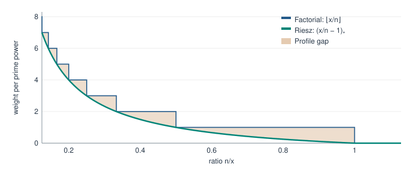

**A second attempt: the lemniscate.** One may look for an object less coarse than a factorial. The lemniscatic sine $s$, defined by $s(0)=0$, $s'(0)=1$ and $(s')^2=1-s^4$, satisfies $s''=-2s^3$. If $s(z)=\sum_nA_nz^n/n!$, this gives
$$A_{n+2}=-2\sum_{i+j+k=n}\frac{n!}{i!\,j!\,k!}A_iA_jA_k,$$
hence **integers**: $A_1=1$, $A_5=-12$, $A_9=3{,}024$, and $A_n=0$ unless $n\equiv1\pmod4$. These integers are highly divisible, and in an arithmetic way. At a prime $p\equiv3\pmod4$, $v_p(A_n)/n$ follows the rate $p/(p^2-1)$ (for $n=161$: $0.373$ against $0.375$ if $p=3$, $0.143$ against $0.146$ if $p=7$). At primes $p\equiv1\pmod4$, nothing of the kind is guaranteed, and the valuation does not always vanish: $v_5(A_{161})=0$, but $A_{41}=2^{20}3^{15}7^5\,11^3\,19^2\cdot23\cdot31\cdot179\cdot47{,}272{,}527{,}433$, whose last factor, a prime, is congruent to 1 modulo 4. The formal group structures part of the arithmetic of the coefficients, not their complete factorization. This is already complex multiplication by $\mathbb Z[i]$, that of the curve $y^2=x^3-x$ of § 3, at work. And the size can be computed without the primes. The singularities nearest to 0 are the four simple poles $\pm(1\pm i)\varpi/2$, at distance $\varpi/\sqrt2$, with residues of modulus 1. Since $s(iz)=i\,s(z)$, their contributions add up in phase exactly when $n\equiv1\pmod4$, and Darboux's method gives, along this subsequence,
$$|A_n|=4\,n!\,\Big(\frac{\sqrt2}{\varpi}\Big)^{n+1}\big(1+o(1)\big),$$
the error coming from the next, more distant poles; the exact computation confirms it to within $10^{-6}$ from $n=101$ on. Over all $n$, since $A_n=0$ outside this class, only the upper limit of $(|A_n|/n!)^{1/n}$ makes sense: it equals $\sqrt2/\varpi$.

The balance is nevertheless disappointing. The product formula compares divisibility with size: at $n=401$, the actual valuations of the primes $p\equiv3\pmod4$, $p\le401$, account for only 52 % of $\log|A_n|$ (the remaining cofactor is not factored). This is no computational accident, as the **theoretical profile** of the odd layers shows,
$$I(n)=\sum_{\substack{p\le n\\p\equiv3\ (4)}}\log p\sum_{e\ \text{odd}}\Big\lfloor\frac n{p^e}\Big\rfloor=\tfrac12\,n\log n+O(n).$$
Indeed, the layers $e\ge3$ cost $O(n)$, since $\sum_p\log p\sum_{e\ge3}p^{-e}<\infty$; rounding the first layer costs $O(n)$ by Chebyshev; and Mertens' theorem in arithmetic progressions gives $\sum_{p\le n,\,p\equiv3\,(4)}\log p/p=\tfrac12\log n+O(1)$. Since $\log|A_n|=n\log n+O(n)$ by the previous asymptotics, $I(n)/\log|A_n|\to\tfrac12$: these primes are half of all primes, and each provides only its odd layers. This is a statement about the profile, not about the actual factorization, which the computation at order 401 illustrates without proving it; convergence is slow, since the $O(n)$ terms are small compared with $n\log n$ only on a logarithmic scale. A factor 2 in the leading term makes the inequality useless for a fine estimate. Moreover, the character cutting out these primes, $\chi_{-4}$, is fixed once and for all: controlling its twisted sum would be GRH for $\chi_{-4}$. The model has the right **shape** of divisibility, but a single object, attached to a single field, can neither close the size gap nor escape its character. One will need **families** of objects, **stacked layers** and **exact** sizes. These figures are reproduced by [`tools/lemniscate.py`](tools/lemniscate.py).

The two attempts leave two riddles. **First riddle**: build an object that has almost the desired divisibility profile, and whose size can be computed with the same independence as that of a factorial. The number $\prod_p p^{\lfloor w(p)\rfloor}$ does not work (to know its size one would have to solve the problem), nor does 0 (divisible by everything, but degenerate). **Second riddle**: improve the precision. Raising an object to the power $m$ multiplies its valuations by $m$, but also its logarithm: divided by $m$, the inequality says nothing more. One needs an operation that genuinely adds information, with costs growing more slowly than the gains.

Alpöge's answer is surprising: replace the auxiliary integer by lattices of automorphic forms; differentiate at points with complex multiplication to obtain divisibility; compose theta lifts to accumulate the gains; control the sizes by slope inequalities. These tools look less arbitrary once one has understood which constraints they answer. This text is not a historical reconstruction of the discovery, but a thought experiment: start from the problem, try the familiar tools, and identify each time what prevents going further.

---

## Preliminaries: Dirichlet characters, L-functions, the Riemann hypothesis

*What follows is classical (Davenport, *Multiplicative Number Theory*, ch. 4–9 and 19). It fixes the notation for the rest of the text.*

**Dirichlet characters.** A Dirichlet character of modulus $N\ge1$ is a group homomorphism $\chi:(\mathbb Z/N\mathbb Z)^\times\to\mathbb C^\times$, extended to ℤ by $\chi(n)=\chi(n\bmod N)$ if $\gcd(n,N)=1$ and $\chi(n)=0$ otherwise. It is completely multiplicative and $N$-periodic, with values in the roots of unity (and 0).

- Its **order** $o$ is its order in the group of characters: $\chi^o=1$. Characters of order 2 are the **quadratic** characters, for instance the Legendre symbol $(\cdot/p)$ or $\chi_{-4}(n)=(-1)^{(n-1)/2}$ for odd $n$.
- It is **even** or **odd** according as $\chi(-1)=+1$ or $-1$; write $\kappa\in\{0,1\}$ with $\chi(-1)=(-1)^\kappa$.
- It is **primitive** if it does not come from a character of modulus $N'<N$, $N'\mid N$. Every χ is **induced** by a unique primitive character $\chi^\ast$, whose modulus $f\mid N$ is the **conductor**: $\chi(n)=\chi^\ast(n)$ for $\gcd(n,N)=1$. The **trivial** character of modulus $N$ is induced by the character $1$ of modulus 1. In the Lean transcriptions, where the modulus is fixed, `χ = 1` denotes the principal character $\chi_{0,N}$ of that modulus; in the formulas for ζ and for $\psi(x)=\psi(x,\mathbf 1)$, the trivial character has conductor 1.
- **Orthogonality**: for $\gcd(n,N)=1$, $\frac1{\varphi(N)}\sum_{\chi\bmod N}\chi(n)=1$ if $n\equiv1\pmod N$ and $0$ otherwise. This is the tool that isolates an arithmetic progression or, in § 2, a Frobenius class.

**The function $L(s,\chi)$.** For $\operatorname{Re}s>1$,
$$L(s,\chi)=\sum_{n\ge1}\frac{\chi(n)}{n^{s}}=\prod_{p}\Big(1-\frac{\chi(p)}{p^{s}}\Big)^{-1},$$
the series and the (Euler) product converging absolutely. For the trivial character $\mathbf 1$ of modulus 1, this is $\zeta(s)$; for the principal character $\chi_{0,N}$ of modulus $N$, $L(s,\chi_{0,N})=\zeta(s)\prod_{p\mid N}(1-p^{-s})$. We write $L(s,\chi)$; Mathlib and Part II write $L(\chi,s)$ (`LFunction χ s`), which is the same function.

- **Logarithmic derivative.** Differentiating the logarithm of the Euler product,
$$-\frac{L'}{L}(s,\chi)=\sum_{n\ge1}\frac{\Lambda(n)\chi(n)}{n^{s}},\qquad \Lambda(n)=\begin{cases}\log p & n=p^k,\ k\ge1,\\ 0&\text{otherwise}\end{cases}$$
($\Lambda$ is the **von Mangoldt** function). This is **the** bridge between zeros and primes: a zero of $L$ of order $m$ is a simple pole of $-L'/L$ with residue $-m$.

- **Continuation and functional equation.** If χ is primitive and $\chi\neq1$, $L(s,\chi)$ extends to an **entire** function; $\zeta$ extends to a meromorphic function with a single pole, simple, at $s=1$. For χ primitive of conductor $N$, the completed function
$$\xi(s,\chi)=\Big(\frac N\pi\Big)^{(s+\kappa)/2}\,\Gamma\Big(\frac{s+\kappa}2\Big)\,L(s,\chi)$$
satisfies $\xi(s,\chi)=\varepsilon(\chi)\,\xi(1-s,\bar\chi)$, with $|\varepsilon(\chi)|=1$ (a ratio of Gauss sums). The symmetry $s\leftrightarrow1-s$ exchanges χ and $\bar\chi$.

- **Zeros.** The Euler product forbids zeros for $\operatorname{Re}s>1$, and Hadamard–de la Vallée Poussin exclude them on $\operatorname{Re}s=1$. The poles of Γ give the **trivial zeros** $s=-\kappa,-\kappa-2,-\kappa-4,\dots$ (for ζ: $-2,-4,\dots$). All others, the **non-trivial zeros** $\rho=\beta+i\gamma$, lie in the **critical strip** $0<\beta<1$. There are infinitely many, about $\frac{T}{2\pi}\log\frac{NT}{2\pi}$ with height $0<\gamma\le T$. By the functional equation and conjugation ($\overline{L(\bar s,\chi)}=L(s,\bar\chi)$), if ρ is a zero of $L(s,\chi)$ then so is $1-\bar\rho$: the set of non-trivial zeros is **symmetric about the critical line** $\operatorname{Re}s=\tfrac12$.
- **Non-primitive characters.** If χ is induced by $\chi^\ast$, $L(s,\chi)=L(s,\chi^\ast)\prod_{p\mid N}(1-\chi^\ast(p)p^{-s})$: the extra factors vanish only on $\operatorname{Re}s=0$.

**RH and GRH.**

- **RH**: all non-trivial zeros of ζ have real part $\tfrac12$.
- **GRH for χ** (the generalized Riemann hypothesis, here for Dirichlet L-functions): all non-trivial zeros of $L(s,\chi^\ast)$ have real part $\tfrac12$.

By the symmetry $\rho\leftrightarrow1-\bar\rho$, this is the same as saying that **there is no zero in the half-plane $\operatorname{Re}s>\tfrac12$**: a zero to the left of the critical line has a mirror image to the right. The theorem is stated in this form, which mentions neither trivial zeros nor primitivity, including in Lean: *for every character χ and every $s$ with $\operatorname{Re}s>\tfrac12$, $L(s,\chi)\neq0$*, except at $s=1$ for the principal character of each modulus, whose L-function has a pole (in Lean, the hypothesis `χ ≠ 1 ∨ s ≠ 1`, since `LFunction` takes a conventional value at the pole).

**Translation into primes.** Let $\psi(x,\chi)=\sum_{n\le x}\Lambda(n)\chi(n)$ be the **Chebyshev function** twisted by χ ($\psi(x)=\psi(x,1)$). The Riemann–von Mangoldt **explicit formula** writes it as a sum of waves indexed by the zeros:
$$\psi(x,\chi)=\delta_\chi\,x-\sum_{\rho}\frac{x^\rho}{\rho}+(\text{terms bounded by }O(\log x)),\qquad \delta_\chi=\begin{cases}1&\chi=1\\0&\chi\ne1\end{cases}$$
This formula holds for primitive χ, zeros being counted with multiplicity. For a non-primitive character, one removes the contributions of the primes dividing the modulus but not the conductor: this costs $O_N(\log x)$ for the unsmoothed sum, but may cost a term linear in $x$ for the Riesz sum, one more reason to stay in the primitive case (§ 1.2). The sum over zeros is taken symmetrically, $|\operatorname{Im}\rho|\le T$ with $T\to\infty$, and the identity holds for $\psi_0(x,\chi)$, the mean of the one-sided limits at jump points, which differs from ψ by at most $\frac12\log x$; the constants are $O_{\chi,\varepsilon}$.
A zero $\rho=\beta+i\gamma$ produces an oscillation of amplitude $x^\beta$. Hence, for every ε > 0:
$$\text{GRH for }\chi\iff\psi(x,\chi)-\delta_\chi x=O_\varepsilon\big(x^{1/2+\varepsilon}\big).$$
The direction ⇐ is the one we need. For $\operatorname{Re}s>1$,
$$-\frac{L'}{L}(s,\chi)-\delta_\chi\frac{s}{s-1}=s\int_1^\infty\big(\psi(x,\chi)-\delta_\chi x\big)x^{-s-1}\,dx.$$
A bound $O(x^\theta)$ on the centered quantity makes this integral holomorphic for $\operatorname{Re}s>\theta$; the rational term cannot hide any pole coming from a nontrivial zero. The pole at $1$ for ζ is thus treated separately. **Proving GRH means bounding sums over primes with a square-root error.**

*Notation.* Below, the letter ψ **on its own** denotes a primitive character (the one being treated), and $\psi(x,\chi)$ the Chebyshev function; γ denotes Euler's constant $0.5772\ldots$, except in $\rho=\beta+i\gamma$.

---

## Overview: the proof in five questions

**Theorem.** For every Dirichlet character χ, $L(s,\chi)\neq0$ for $\operatorname{Re}s>\tfrac12$ (away from the pole $s=1$ of the principal character). In particular, the Riemann hypothesis holds.

**The strategy in one sentence.** One bounds a sum over primes the way Chebyshev bounded $\theta(2n)-\theta(n)$: by the **product formula**, applied to an arithmetic object that is **highly divisible** and of **known size**. But the layers of divisibility are stacked the way Stepanov stacks orders of vanishing, and this aims at the exponent ½: the construction gives $O_\varepsilon(x^{1/2+\varepsilon})$ on suitable windows. Once GRH is established, the smoothed explicit formula gives $O(\sqrt x)$ for a fixed character; these are two distinct steps.

**The starting point (§ 1).** A classical analysis (smoothed explicit formula, Landau positivity) reduces GRH to **a single inequality**, true on a sequence of windows of scales:
$$G_\psi(x)\;\le\;x^{1/2+C\varepsilon},$$
where $G_\psi$ is a sum of $\log p$ with **non-negative coefficients**, weighted by the Riesz weight $(x/n-1)_+$, with its main term removed. An **upper bound** is enough: zeros off the critical line always end up pushing $G_\psi$ upwards. The whole rest of the proof establishes this inequality. Each answer below leaves a debt, the actual realization of what it describes; the three main ones are gathered in the table "Three junctions still opaque", at the end of Part II. The five questions that follow are five successive obstacles, not five theories to learn.

**Two toy models** serve as guides:

| | Chebyshev (1852) | Stepanov (1969) | Alpöge (2026) |
|---|---|---|---|
| What is bounded | $\theta(2n)-\theta(n)$ | $\#\{x:g(x)\text{ a square}\}$ over $\mathbb F_p$ | $G_\psi(x)$ |
| Object | the integer $\binom{2n}n$ | a polynomial $F$ | a lattice of periods of automorphic forms |
| "Being a multiple" | $v_p=1$ for $p\in(n,2n]$ | $F$ vanishes to order $a$ on $S$ | $p$-adic divisibility in $m$ layers |
| Size | $\binom{2n}n\le4^n$ | $\deg F$ | slopes, exact volumes |
| Balance | $\sum v_p\log p=\log M$ | $a\,\lvert S\rvert\le\deg F$ | product formula for lattices |
| Error | $O(x)$ | $O(\sqrt p)$ | $O(x^{1/2+\varepsilon})$ |

### Q1. Why can the divisibility of an object tell us about primes? (§ 2)

A nonzero integer $M$ satisfies $\sum_pv_p(M)\log p=\log|M|$. If it is divisible by the right primes, and if its size is known **without knowing the primes**, one gets an upper bound for a sum of $\log p$. The quality of the bound depends on the **profile** $p\mapsto v_p(M)$. That of $\binom{2n}n$ is a sawtooth that also hits "parasitic" primes, hence a loss of a factor $\log4$. That of $y!$ is almost the Riesz weight, and it already gives $G(y)\le\gamma\,y+O(\log y)$. **The whole proof aims to replace $\gamma y$ by a bound with exponent $\tfrac12+\varepsilon$.** Three counterexamples fix the specification: the object must be nonzero, its profile must follow the weight, and its size must be computable without the primes.

### Q2. Why does complex multiplication give the required divisibility? (§ 3)

Differentiation provides factorials, $D^af(0)=a!\cdot\mathrm{coeff}_a(f)$, hence the Legendre gain $a/(p-1)$. But a theta series is integral only in the coordinate of a **formal group**, and passing to the coordinate in which one differentiates costs denominators:

- for **ordinary** reduction (height 1), the lower bound no longer guarantees any linear gain;
- for **supersingular** reduction (height 2), they erase, to put it figuratively, only the even layers: the lower bound guarantees $a\big(\tfrac1p+\tfrac1{p^3}+\cdots\big)-O(\log a)=a\,\tfrac{p}{p^2-1}-O(\log a)$.

Complex multiplication makes the reduction supersingular at **all inert primes**. On $y^2=x^3-x$, $v_3(D^{161}\exp(0))=61\approx161\cdot\frac38$, while $v_5$ is zero in this computation (which is not a general law at split primes). The resulting profile, $\frac am\cdot\frac{1-\chi_{-d}(m)}2$ for $m$ prime to $d$ (the ramified prime $d$ is treated separately), is Legendre's, restricted by a quadratic character. That character is an **unwanted twist**: the centered twisted sum $g(y,\chi_{-d})$ must be controlled, which is achieved by choosing the CM field in a huge family (large sieve). This is also why the proof changes field in each window.

### Q3. Why do theta lifts simulate Stepanov's multiplicity? (§ 4)

Stepanov counts the points of a curve with an auxiliary function that vanishes to order $a$ at all the points, with a degree **much smaller** than $a$ times the naive degree. He manages this because differentiation ignores the $X^{jp}$, which equal $X^j$ on $\mathbb F_p$. Raising a function to the power $a$ would be useless: one needs **new** layers. Over ℤ, a layer is a $p$-adic gain at the CM point (Q2). The **theta lift** provides the operation that adds one and that composes. On the export, the period factors through the product of matrices $K_m\cdots K_1$, and the valuations of a product add up:
$$v_p(\text{period})\;\ge\;\sum_{j=1}^m\mathrm{gain}_j(p)-\text{losses}.$$
The unitary groups grow at each step, so that each layer may be new. That each stage really brings its gain, at a controlled cost, is not proved by the growth of the groups: it is what the interface `LinkG_at` requires (§ 4 and Part II). **The length $m$ of the chain plays the role of the order of vanishing.** On the export, the gains are not merely stacked: they are **distributed**. Theorem A makes lines admissible, and a $p$-adic rank property along Hecke edges (`LPprime`) propagates their divisibility to a proportion $1-\kappa$ of the directions of the lattice; the growth of the groups does not by itself guarantee this rank (§ 3.5).

### Q4. Why do the archimedean constraints bring back the expected main term? (§ 5)

Applied to $y!$, the product formula gives two equal computations: Legendre ($\sum\Lambda(m)\lfloor y/m\rfloor$), which needs the primes, and Stirling ($y\log y-y+\cdots$), which does not. The reason is that $-\zeta'$ has a (double) **pole** at $s=1$ and remains **holomorphic at the zeros of ζ**, where $-\zeta'/\zeta$ has poles. The archimedean sizes in the proof are of the same kind: Siegel masses, Rallis norms, CM periods. They are products of values of Γ, powers of π and values of ζ or of L-functions at points where the identities needed can be established without assuming GRH; the mass of $E_8$ is $1/696\,729\,600$, and the integral of $dx/y$ along the real branch of $y^2=x^3-x$, from 1 to infinity, is $\varpi=\Gamma(1/4)^2/2\sqrt{2\pi}$ (the lemniscate constant; the full real cycle gives $2\varpi$), which must still be normalized to obtain the quantity of `CM.DegSt` (§ 5). They do not see the fluctuations. Provided they reproduce exactly the right main term, which requires an identity and not merely exact volumes (workshop 5), that term **cancels** in the inequality, and all that remains is: fluctuations ≤ losses. For a main term of order $x\log x$ and a target error $x^{1/2+O(\varepsilon)}$, this demands a relative **accuracy** of order $x^{-1/2}/\log x$. That is why the proof uses equalities (`SiegelMassRatioCM`) and a quasi-orthogonality with error $e^{-6x^\varepsilon}$.

### Q5. Why does balancing the parameters produce exactly a square-root error? (§ 6)

The error per term, read on the export and after the parameter controls, is $\lesssim4x/m+4m+2\sqrt x$, up to factors $x^{O(\varepsilon)}$. The **fixed cost**, of order $x$, is the imprecision of a single layer, amortized over $m$ lifts. The **marginal cost**, of order $m$, comes from each lift losing in proportion to the length of the chain. Since $x/m+m\ge2\sqrt x$, the optimum is $m\approx\sqrt x$, and the code imposes $x^{1/2-\varepsilon}\le m\le x^{1/2+\varepsilon/2}$. This ½ is not accidental. One cannot go lower: a zero on the critical line is a singularity of the Mellin transform of $G$, which rules out any smaller exponent (§ 6.3); the data up to $10^7$ show this without proving it. With a fixed cost of order $x$ and a quadratic loss per lift, and if all the other constraints remained satisfied, the same machinery would only prove the absence of zeros for $\operatorname{Re}s>2/3$.

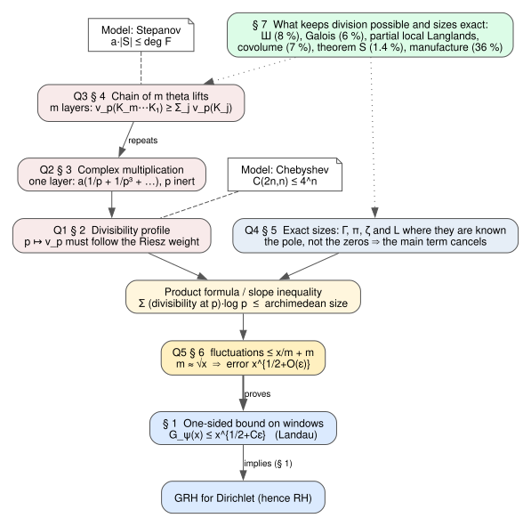

**Three levels.** The proof reads as three implications: admissible parameters make it possible to **construct** objects that satisfy a contract simultaneously; an **accounting** theorem derives from this contract a bound at one scale, where the main term cancels (§ 6.2); the **optimization** of the parameters and Landau's analytic reduction yield GRH (§§ 1, 6). The first level is by far the heaviest; the last two are almost entirely read.

### What the dependency graph says

Of the 1.47 M declarations in the closure, what belongs to the mechanism **alone** weighs **less than 0.5 %**: it is the union of the dominated subtrees of 13 explicit nodes, from the Landau reduction to `linkCore` (definition and lists in the article, § 4.3). This figure does not count shared dependencies. The rest guarantees the three requirements of Q1 and the condition of Q5:

- **archimedean exactness**: covolume (7 %), Theorem S (1.4 %), masses;
- **control of the division**: the bound on twisted places (`LinkN`), fed by Galois representations (6 %) and by Tate–Shafarevich groups (8 %), the latter supplied together with the host field; plus partial local Langlands;
- **existence of the objects**: families of definite unitary groups with prescribed parameters (36 %).

The "literature" scaffolding is off the path, and no published statement enters as an axiom (Part II). The principle is small and cheap; what is massive is the construction and upkeep of the components that make it applicable.

**How to read what follows.** Part I follows the order of the questions: § 1 (reduction), then §§ 2–6 (Q1 to Q5), then § 7 (the losses). Each section gives an elementary example, a computation, a counterexample, then the real case, and ends with what the graph says about it. **Workshops** follow one and the same prime, 3, from end to end (§§ 2–5), and two **interludes** introduce theta series (§ 4) and slopes (§ 5).

---

# Part I. The mechanism of the proof

## 1. From RH to an inequality about primes

This section reduces GRH to **a single inequality**, with no fine arithmetic at all: only classical complex analysis (Perron, Landau). It takes five steps. In the code, this is the light part: about 73,000 declarations, mostly Mathlib analysis (Part II).

### 1.1 Reduction to primitive characters, grouped into levels

If χ is induced by $\chi^\ast$, of modulus $N$,
$$L(s,\chi)=L(s,\chi^\ast)\prod_{p\mid N}\big(1-\chi^\ast(p)p^{-s}\big).$$
Each factor has modulus $\ge 1-p^{-\operatorname{Re}s}>0$ if $\operatorname{Re}s>0$: it does not vanish to the right of the imaginary axis. The zeros of $L(s,\chi)$ in $\operatorname{Re}s>\tfrac12$ are therefore those of $L(s,\chi^\ast)$, and it suffices to treat **primitive** characters. RH is the case $\chi^\ast=1$ (modulus 1), i.e. ζ; trivial characters of modulus $N$ reduce to it.

The proof does not treat an isolated character but a whole **level** at once. For ψ primitive of order $o$, write
$$K_\psi=\{\chi_0=1,\ \chi_1,\dots,\chi_{o-1}\},\qquad \chi_j=\text{the primitive character inducing }\psi^j .$$
This is a set of $o$ primitive characters, **closed under conjugation** ($\overline{\psi^j}=\psi^{o-j}$), containing 1. One proves in one go that **neither ζ nor any of the $L(s,\chi_j)$** vanishes for $\operatorname{Re}s>\tfrac12$. For RH alone, $\psi=1$, $o=1$ and $K_\psi=\{1\}$.

### 1.2 Smoothing: the Riesz-weighted Chebyshev sum

The function $\psi(x,\chi)$ from the preliminaries has two defects: it jumps at every prime power, and its explicit formula $\sum_\rho x^\rho/\rho$ converges only conditionally (since $\sum 1/|\rho|$ diverges). The proof uses instead the **Riesz weight** $(y/n-1)_+$:
$$S(y,\chi)=\sum_{n\le y}\Lambda(n)\chi(n)\Big(\frac yn-1\Big)=\int_1^y\Big(\sum_{n\le t}\frac{\Lambda(n)\chi(n)}{n}\Big)\,dt .$$
It is an antiderivative (an average): it is continuous, and each integration gains a factor $1/|\rho|$ in the explicit formula.

**Perron's formula.** For $c>1$ and $y>0$, computing the residues at $s=1$ and $s=0$ gives
$$\frac1{2\pi i}\int_{c-i\infty}^{c+i\infty}\frac{(y/n)^s}{s(s-1)}\,ds=\Big(\frac yn-1\Big)_+ ,$$
hence, summing against $\Lambda(n)\chi(n)$ and using the logarithmic derivative,
$$S(y,\chi)=\frac1{2\pi i}\int_{(c)}\Big(-\frac{L'}{L}(s,\chi)\Big)\frac{y^s}{s(s-1)}\,ds .$$
The kernel decays like $|s|^{-2}$: the integral converges **absolutely**, and the contour can be shifted to the left, picking up residues.

- **At $s=1$.** For $\chi\neq1$, $L(1,\chi)\ne0$ (Dirichlet), and the residue is $-y\,\frac{L'}{L}(1,\chi)$. For ζ, the pole of $-\zeta'/\zeta=\frac1{s-1}-\gamma+\cdots$ meets that of the kernel: a double pole, with residue $y\log y-(1+\gamma)\,y$.
- **At each non-trivial zero ρ of multiplicity $m_\rho$**: $-L'/L$ has residue $-m_\rho$, giving the term $-m_\rho\,y^\rho/(\rho(\rho-1))$.
- **At $s=0$ and at the trivial zeros**: terms $O(\log y)$.

One therefore removes the main term, which defines
$$g(y,\chi)=S(y,\chi)+y\,\frac{L'}{L}(1,\chi)\quad(\chi\ne1),\qquad G(y)=S(y,1)-y\log y+(1+\gamma)\,y ,$$
and one obtains the **smoothed explicit formula**:
$$g(y,\chi)=-\sum_\rho m_\rho\,\frac{y^\rho}{\rho(\rho-1)}+O(\log y),$$
and likewise for $G$ with the zeros of ζ. The series converges **absolutely**, since $\sum_\rho1/|\rho|^2<\infty$. Two consequences:

1. **GRH ⇒ $g(y,\chi)=O(y^{1/2})$**, without even an $\varepsilon$: this is the target size.
2. **Conversely**, by Mellin transform, $\int_1^\infty g(y,\chi)\,y^{-s-1}dy=-\frac{1}{s(s-1)}\frac{L'}{L}(s,\chi)+(\text{rational function with poles at }0,1)$. A zero ρ appears there as a **pole**. A bound $|g(y,\chi)|=O(y^\theta)$ makes the integral converge for $\operatorname{Re}s>\theta$ and excludes any zero with real part $>\theta$.

Point 2 requires a bound **in absolute value**: one would have to control the fluctuations of $g$ upwards **and** downwards. The rest of the reduction removes one of these two requirements.

### 1.3 Combining: a sum with non-negative coefficients

For ψ primitive of order $o$, form
$$G_\psi(y)=G(y)+\frac{1}{3o+1}\sum_{j=1}^{o-1}\operatorname{Re}g(y,\chi_j).$$
Since $K_\psi$ is closed under conjugation and $g(y,\bar\chi)=\overline{g(y,\chi)}$, the sum of the real parts equals the sum of the $g(y,\chi_j)$ themselves. $G_\psi$ is thus the Riesz sum, main term removed, of the Dirichlet series
$$D_\psi(s)=-\frac{\zeta'}{\zeta}(s)-\frac1{3o+1}\sum_{j=1}^{o-1}\frac{L'}{L}(s,\chi_j)=\sum_{n\ge1}\frac{c_n}{n^s},\qquad c_n=\Lambda(n)\Big(1+\frac1{3o+1}\sum_{j=1}^{o-1}\chi_j(n)\Big).$$

**The coefficients are non-negative.** If $n$ is coprime to the conductor of ψ, $\chi_j(n)=\psi(n)^j$, and the geometric sum $\sum_{j=1}^{o-1}\psi(n)^j$ equals $o-1$ if $\psi(n)=1$ and $-1$ otherwise. Hence
$$c_n=\Lambda(n)\cdot\begin{cases}\dfrac{4o}{3o+1}&\text{if }\psi(n)=1,\\[8pt]\dfrac{3o}{3o+1}&\text{otherwise.}\end{cases}$$
For powers of primes $p$ dividing the conductor, bound each $|\chi_j(n)|\le1$: $c_n\ge\Lambda(n)\,\frac{2o+2}{3o+1}>0$. In every case $c_n\ge0$, and $c_n=0$ only if $\Lambda(n)=0$.

**Where $1/(3o+1)$ comes from.** The 4 : 3 profile is not arbitrary; it can be read on the export (`Formalism.HC.Frame.lam`, consumed by `BernoulliSumsFrobeniusOrbits.topsFrame`, on the Frobenius orbits of the host of § 3.4). On the analytic side, `Level.wt` gives weight 1 to a possible distinguished odd real character (`psK`) and $1/(3o+1)$ to the others; on the main path (`Level.cyc`), no character is distinguished. Primes are sampled there according to their class modulo a subgroup of index $o$ of a Frobenius group, with proportion $4/(3o+1)$ for the neutral class and $3/(3o+1)$ for each of the $o-1$ others. The total is $(4+3(o-1))/(3o+1)=1$. The Fourier coefficients of this distribution are $1$ for the trivial character and $\frac{4-3}{3o+1}=\frac1{3o+1}$ for all others: exactly the weights of $G_\psi$, and $c_n/\Lambda(n)$ is $o$ times the proportion of the class of $n$. A uniform distribution would give zero weights and would not see the $\chi_j$; a strictly positive distribution guarantees positivity. Why 4 : 3 rather than another mixture, the code does not say ⟦I⟧: positivity alone does not force it. A ratio $r:1$ between the neutral class and the others would give coefficients $(r-1)/(r+o-1)$, positive as soon as $r>1$; $r=4/3$ gives $1/(3o+1)$. The origin of this ratio is to be sought in the construction of the host and of the thick orbits. Note finally that positivity of a distribution on the classes does not imply positivity of its Fourier coefficients: it is the explicit computation of the 4 : 3 profile that gives it.

**No cancellation between zeros.** The Mellin transform of $G_\psi$ is $D_\psi(s)/(s(s-1))$, up to a rational function. Its poles in $0<\operatorname{Re}s<1$ are the zeros ρ of ζ or of one of the $L(s,\chi_j)$, with weight
$$w_\rho=m_\rho(\zeta)+\frac1{3o+1}\sum_{j=1}^{o-1}m_\rho(\chi_j)\;>\;0 .$$
All multiplicities enter with a $+$ sign: a zero of one of the functions cannot be masked by another. This is the idea of de la Vallée Poussin, who combined $\zeta(\sigma)^3|\zeta(\sigma+it)|^4|\zeta(\sigma+2it)|$ thanks to $3+4\cos\theta+\cos2\theta=2(1+\cos\theta)^2\ge0$.

### 1.4 Why an upper bound suffices: Landau's argument

**Landau's theorem.** Let $f\ge0$ on $[1,\infty)$ and $H(s)=\int_1^\infty f(y)\,y^{-s-1}dy$, with abscissa of convergence $\sigma_c$. Then $H$ has **no** holomorphic continuation to a neighbourhood of the **real** point $s=\sigma_c$. (Proof: expand $H$ in a Taylor series at a real point $a>\sigma_c$. The derivatives $(-1)^kH^{(k)}(a)=\int f(y)(\log y)^ky^{-a-1}dy$ are non-negative; if the series converged a little beyond $\sigma_c$, it could be interchanged with the integral, which would then converge beyond $\sigma_c$.)

**Application.** Suppose $G_\psi(y)\le y^\theta$ for $y\ge y_0$, with $0<\theta<1$. Put $f(y)=y^\theta-G_\psi(y)\ge0$ for $y\ge y_0$, and $f=0$ below. Its transform is
$$H(s)=\frac{y_0^{\theta-s}}{s-\theta}-\int_{y_0}^\infty G_\psi(y)y^{-s-1}\,dy.$$
Using the definition of $G_\psi$ and continuing the transform from $\operatorname{Re}s>1$, one gets
$$H(s)=\frac{1}{s-\theta}-\frac{D_\psi(s)}{s(s-1)}+R(s)+E(s),$$
where $R$ is the rational function coming from the main terms and $E$ is entire (the modification on a compact interval). It is the combination $-D_\psi(s)/(s(s-1))+R(s)$, not $R$ alone, that is holomorphic at $s=1$.

Suppose for contradiction that $\sigma_c>\theta$. By Landau, $\sigma_c$ is a singularity, hence a pole of $D_\psi/(s(s-1))$: a **real zero** $\beta=\sigma_c\in(\theta,1)$. Its residue in $D_\psi(s)/(s(s-1))$ is $-w_\beta/(\beta(\beta-1))=w_\beta/(\beta(1-\beta))>0$. As $\sigma\to\beta^+$, $H(\sigma)\to-\infty$, contradicting $H(\sigma)=\int f\,y^{-\sigma-1}\ge0$. Hence $\sigma_c\le\theta$: $H$ is holomorphic on $\operatorname{Re}s>\theta$, and so is $D_\psi$ apart from its pole at $s=1$. **Neither ζ nor any $L(s,\chi_j)$ has a zero with real part $>\theta$.**

**Intuitive reading.** Imagine a real zero $\beta>\theta$. Its contribution to the smoothed term is positive: $w_\beta y^\beta/[\beta(1-\beta)]$. It naturally pushes upwards the sum we want to bound. For a complex zero, the signal oscillates, and several signals can momentarily cancel. It is not the positivity of the coefficients of the Dirichlet series, taken alone, that rules out a lasting cancellation: Landau's reasoning uses the non-negativity of $y^\theta-G_\psi(y)$ and the precise sign of the residues at real singularities. It turns information on one side of the curve into a holomorphy property on a whole half-plane.

This is a considerable strategic gain. If the arithmetic method naturally produces an inequality in one direction only, we need not look for a second construction giving the lower bound. We now know what kind of arithmetic certificate must be constructed.

### 1.5 On windows only

The method of §§ 2–7 does not provide the bound for **all** large $y$, but only on ranges of scales where a host field could be built (§ 3.4): $q$ and $d$ must be chosen depending on the range. The proof therefore establishes a **windowed** form of Landau. As read on the export, in contrapositive form:

> **Window criterion.** Let $\lambda>1$ and $0<\theta<1$. If ζ or one of the $L(s,\chi_j)$ has a zero with real part $>\theta$, then for every sufficiently large $Y$ there is $y\in[Y,Y^\lambda]$ with $G_\psi(y)>y^\theta$.

In other words, a zero beyond θ shows up in **every** sufficiently remote window $[Y,Y^\lambda]$, not just "somewhere at infinity". It therefore suffices to bound $G_\psi$ on a sequence of windows $[Y_k,Y_k^\lambda]$, $Y_k\to\infty$. The criterion holds for every $\lambda>1$; the rest of the proof applies it with ranges $[Y,Y^{3/2}]$ or $[Y,Y^2]$.

**How the localization is done, on the export.** The statement is `Level.FormBAt`: if the set $\{y: G_\psi(y)\le y^\theta\}$ contains windows $[Y,Y^\lambda]$ for arbitrarily large $Y$, none of the functions has a zero with real part $>\theta$. It is proved by `Comparison₂.formB` and `Deduction.zeroFree_of_rpow_window` (about 140,000 lines for some hundred declarations dominated by the node). The proof follows Landau, with a probabilistic ingredient:

- in the variable $u=\log y$, the transform becomes a Laplace transform, and its derivatives are moments $\int g(u)\,u^ke^{-\sigma u}/k!\,du$ (`iteratedDeriv_laplace`);
- the gamma kernel $u^ke^{-\sigma u}/k!$ is bounded by $\sigma^{-k}$ (`landau_kernel_max`), and its mass outside an interval $[U,V]$ is bounded by a **Chernoff bound**, $e^{-lV}(\sigma-l)^{-k-1}+e^{lU}(\sigma+l)^{-k-1}$ (`landau_tails_chernoff`);
- with $k\asymp\log Y$, the mass concentrates in the window, where the hypothesis applies; elsewhere, Mertens' trivial bound $\sum_{n\le y}\Lambda(n)/n\le\log y+2$ (`mertens_upper`) suffices;
- this gives a bound on the Taylor coefficients at $\sigma$ and at $\sigma+i\gamma$ (`landau_window_key`), and a **dichotomy** lemma (`landau_dichotomy`) concludes. If the nearest singularity is a complex zero, the radius of convergence excludes it; if it is an isolated real zero $\beta>\theta$, the sign of its residue excludes it: positive in the transform of $G_\psi$, negative in that of $y^\theta-G_\psi$, which is the integral of a non-negative function on the window (§ 1.4).

**A model of the gamma kernel.** Why do high-order derivatives localize a Laplace integral? The mass of $u^ke^{-\sigma u}/k!$ on $u\ge0$ is $\sigma^{-k-1}$; normalized, it is the gamma density $q_{k,\sigma}(u)=\sigma^{k+1}u^ke^{-\sigma u}/k!$, with mean $(k+1)/\sigma$ and variance $(k+1)/\sigma^2$. In the variable $u=\log y$, the window $[Y,Y^\lambda]$ becomes $[L,\lambda L]$ with $L=\log Y$. Choosing $k+1\approx\sigma(1+\lambda)L/2$ puts the mean in the middle of the window; the standard deviation is $O(\sqrt L)$, while the half-width of the window is proportional to $L$. Chebyshev's inequality gives an outside mass $O(1/L)$, Chernoff much better. This model explains the localization; it does not suffice to control the integral weighted by the function to be bounded, for which growth outside the window, complex parameters and the dichotomy remain necessary.

).](fig/landau_fenetres_en.svg)

Slijepčević judges this windowed form to be new. In the architecture of this proof, a **localized** criterion is indispensable: without it, a single host would be needed for all scales, which the averaged choice does not provide. A later text (hexagon:2611.00828) proposes, however, to replace it by a classical oscillation theorem, that of Kaczorowski–Pintz.

**A window rather than a whole trajectory.** Put $u=\log y$. An interval $[Y,Y^{3/2}]$ becomes $[\log Y,\tfrac32\log Y]$: its length tends to infinity. An elementary oscillation of frequency $\gamma$ therefore goes through many periods inside this window. This explains qualitatively why one may hope to detect a zero there. But for an infinite superposition of frequencies, the argument is not a proof: the rigorous localization reported in the export is precisely the difficulty of the criterion. In exchange, the auxiliary field may depend on the window. This analytic detail is therefore a feasibility condition for the whole algebraic construction, not a mere refinement of Landau.

### 1.6 Conclusion

Applying 1.4 and 1.5 with $\theta=\tfrac12+C\varepsilon$ for each $\varepsilon>0$, then letting $\varepsilon\to0$, one obtains the absence of zeros for $\operatorname{Re}s>\tfrac12$, simultaneously for ζ and for all the $L(s,\chi_j)$, $\chi_j\in K_\psi$. Since every primitive character belongs to its own level $K_\psi$, this gives GRH for all Dirichlet characters.

> **Conclusion.** Everything reduces to proving, for each primitive ψ, each sufficiently small ε > 0 and each scale $x$ in a sequence of windows $[Y_k,Y_k^\lambda]$, $Y_k\to\infty$:
> $$\boxed{\;G_\psi(x)\;\le\;x^{1/2+C\varepsilon}\;}$$
> This is a **one-sided upper bound** on a weighted sum of $\log p$, with **non-negative coefficients**, with a square-root error. §§ 2–7 do nothing else.

## 2. The toy model: Chebyshev, or why divisibility tells us about primes

§ 1 reduced GRH to an upper bound for $G_\psi(x)$, a weighted sum of $\log p$. It remains to know **how to bound a sum of $\log p$**. The tool of the proof is divisibility, and the simplest way to see how it works is to start from an argument of 1852 that already contains the whole mechanism, up to a matter of precision.

### 2.1 One integer, two sizes

Let $M$ be a **nonzero** integer. Its factorization gives an identity:
$$\sum_p v_p(M)\,\log p \;=\; \log|M| .$$
The left-hand side is a sum of $\log p$: the kind of quantity one wants to bound. The right-hand side is an ordinary **size**, measured by the real absolute value. To bound a sum of $\log p$, one therefore looks for a nonzero integer with two properties:

- **at the finite places**, it is divisible by the primes of interest: $v_p(M)\ge w(p)$;
- **at the infinite place**, its size is known: $|M|\le H$.

One gets $\sum_p w(p)\log p\le\log H$. This is the **product formula**, $\prod_v|M|_v=1$, read in logarithms: a highly divisible number is large, so size limits divisibility.

### 2.2 Chebyshev's example

Take $M=\binom{2n}{n}$.

- **Finite places.** Every prime $p\in(n,2n]$ divides $(2n)!$ but not $(n!)^2$, so $v_p(M)=1$.
- **Infinite place.** $M$ is one of the terms of $\sum_k\binom{2n}{k}=4^n$, so $M\le4^n$.
- **Conclusion.** $\theta(2n)-\theta(n)=\sum_{n<p\le2n}\log p\;\le\;n\log4$.

For $n=10$: $\binom{20}{10}=184\,756=2^2\cdot11\cdot13\cdot17\cdot19$, and one reads $\log(11\cdot13\cdot17\cdot19)\approx10.7\le10\log4\approx13.9$. Summing over the dyadic ranges $x,x/2,x/4,\dots$ then gives $\theta(x)\le2x\log4$ (Erdős even gets $\theta(x)<x\log4$ by refining).

| $n$ | $\theta(2n)-\theta(n)$ | $\log\binom{2n}{n}$ | $n\log 4$ |
|---:|---:|---:|---:|
| 10 | 10.7 | 12.1 | 13.9 |
| 1,000 | 983.6 | 1,382.3 | 1,386.3 |
| 10⁶ | 1,000,103.5 | 1,386,286.9 | 1,386,294.4 |

*(Computed by [`tools/modeles.py`](tools/modeles.py).)*

The bound is correct, but it loses a factor $\log4\approx1.39$: it is an error of order $O(x)$, while the proof aims at $O(\sqrt x)$. **Where does this loss come from?** Not from the archimedean bound, which is almost exact: the third column sticks to the fourth, up to $\tfrac12\log(\pi n)$ (Stirling). Not from divisibility either: Legendre gives $v_p(M)$ **exactly**. What loses is **the profile** of divisibility.

### 2.3 What matters: the profile $p\mapsto v_p(M)$

By Legendre, $v_p\binom{2n}{n}=\sum_{k\ge1}f(n/p^k)$, with $f(t)=\lfloor2t\rfloor-2\lfloor t\rfloor$. This function is 1 if the fractional part of $t$ is $\ge\tfrac12$, and 0 otherwise. We wanted the indicator of $(n,2n]$. We get a **sawtooth**, which is also 1 on $(n/2,2n/3]$, on $(n/3,2n/5]$, etc., and larger for small primes:

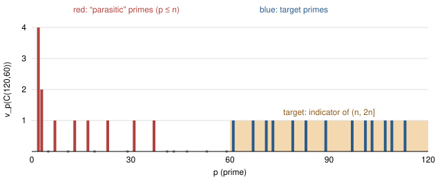

Summing over $p$ gives Chebyshev's identity:
$$\log\binom{2n}{n}=\psi(2n)-\psi(n)+\psi(2n/3)-\psi(2n/4)+\psi(2n/5)-\cdots$$
The object does not "see" $\psi(2n)-\psi(n)$ alone, but a **combination** of prime sums. The extra terms, the **unwanted twists**, are positive as a whole. They can only be thrown away, and that is where $0.39\,n$ is lost.

> **The working rule.** With an object $M$, one bounds $\sum_p v_p(M)\log p$, and nothing else. The quality of the bound depends on the gap between the **divisibility profile** $p\mapsto v_p(M)$ and the **target weight**. The programme of the proof is to construct objects whose profile, after normalization and summation, reproduces the Riesz profile with an error of order $x^{1/2+O(\varepsilon)}$.

**The same computation with the Riesz weight.** Legendre's formula can also be written
$$\log\lfloor y\rfloor!=\sum_{m\le y}\Lambda(m)\Big\lfloor\frac ym\Big\rfloor .$$
The profile of $y!$ is therefore $\lfloor y/m\rfloor$, and the Riesz weight of § 1.2 is $y/m-1$. The two differ only by a sawtooth, since $y/m-1<\lfloor y/m\rfloor\le y/m$. The first object that comes to mind, $y!$, thus already bounds the Riesz sum $S(y)$, up to an error **of order $O(y)$**. Numerically, $\log y!-S(y)\approx\gamma\,y$:

| $y$ | $S(y)$ | $y\log y-(1+\gamma)y$ | $\log y!$ | $\log y!-S(y)$ | $\gamma y$ |
|---:|---:|---:|---:|---:|---:|
| 10³ | 5,332.1 | 5,330.5 | 5,912.1 | 580.1 | 577.2 |
| 10⁶ | 12,238,305.9 | 12,238,294.9 | 12,815,518.4 | 577,212.5 | 577,215.7 |

The second column is the main term subtracted to define $G$ (§ 1.2). The factorial gives $G(y)\le\gamma y+O(\log y)$, and the proof must get $G(y)\le y^{1/2+\varepsilon}$. The construction aims to bring this linear error down to $y^{1/2+O(\varepsilon)}$. This is not just an analogy ⟦I⟧: in § 3, the divisibility gain of Theorem A comes precisely from the factorial $a!$ in $D^af(0)=a!\cdot\mathrm{coeff}_a(f)$.

### Workshop 1. Which profile must really be obtained?

In the table of § 2.3, the difference between $\log y!$ and $S(y)$ is close to $\gamma y$. This number is not a rounding error. For an integer $y$,

$$\log y!-S(y)=\sum_{n\le y}\Lambda(n)\big(1-\{y/n\}\big),$$

where $\{t\}=t-\lfloor t\rfloor$. Each gap lies in $(0,1]$. The trivial bound on the sum is $\psi(y)$, of order $y$. This is exactly the kind of obstacle we are interested in: a small local defect repeated over a large family of primes can completely dominate the fluctuation one is looking for.

For what follows, let us fix a deliberately tiny numerical example: $x=81$ and the prime $p=3$. In $S(81)$, the powers $3,9,27,81$ carry the weights $26,8,2,0$ respectively. The contribution of the prime 3 is therefore $36\log3$. In $81!$, Legendre gives instead $27+9+3+1=40$. The difference, $4\log3$, is the debt of this single prime. We shall meet 3 again in § 3, then in § 4 in a composition model, and in § 5 in a covolume computation.

This example suggests a change of strategy. Rather than looking for integers that have all the necessary valuations from the outset, let us look for an operation that provides the right *functional form* $a/p^e$, then a way of subtracting a threshold from it. For $a=bx$, the identity

$$\left(\frac{a}{p^e}-b\right)_+=b\left(\frac{x}{p^e}-1\right)_+$$

explains why a scale factor $b$ will be useful. The first problem is to obtain the raw gains; the second, to have weights that realize the truncation. One without the other is not enough. We have just moved from a question about primes to a question of construction.

### 2.4 Three counterexamples: what the object must satisfy

| Object | What goes wrong | Corresponding requirement in the proof |
|---|---|---|
| $M=0$ | It is divisible by everything and its size is zero, but the identity $\sum v_p\log p=\log\lvert M\rvert$ no longer makes sense | **Non-vanishing.** In Bost's setting, the map $\varphi$ must be injective. In the proof, this role falls to the quasi-orthogonality of periods ⟦I⟧ (§ 5.4) |
| $M=2^N$ | It is huge at 2 and silent elsewhere | **The profile must follow the weight**, prime by prime: this is the alignment of weights of § 4.3 |
| $M=\operatorname{lcm}(1,\dots,y)=e^{\psi(y)}$ | Its profile is perfect, but its size is known only if the primes are already known: the bound is a tautology | **The archimedean size must be computable without the primes**: by analysis (Stirling) or by geometry (volumes, Siegel masses). This is question 4, in § 5 |

A fourth point holds for any object. Divisibility gives $v_p(M)\ge w(p)$, an **inequality**, and hence only an **upper bound** for the prime sum. In Chebyshev's case, the lower bound $\psi(2n)\ge n\log4-\log(2n+1)$ needs **another** argument: $\binom{2n}{n}$ divides $\operatorname{lcm}(1,\dots,2n)$. This is why § 1 worked so hard to **do without a lower bound** (Landau, § 1.4). The analytic reduction and the arithmetic mechanism are fitted to each other: the latter produces only what the former can use.

### 2.5 The same scheme in the proof

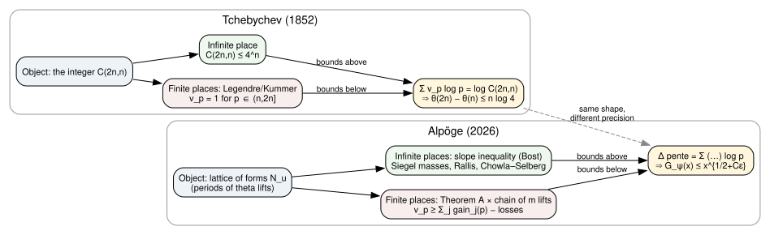

| Chebyshev | Alpöge | Where (Part II) |
|---|---|---|
| One integer $\binom{2n}{n}$ | A **lattice** $N_u$ of automorphic forms: many integers at once, its periods | `divClausesR_of`, `DivIntoDualShift` |
| $v_p$ by Legendre | $v_p\ge\sum_{j=1}^m\mathrm{gain}_j(p)-\text{losses}$: Theorem A, iterated along the chain | `gainP`, `LinkG_at`, `thmAGauss` |
| $\binom{2n}{n}\le4^n$ | Slope inequality, with exact volumes | § 5.4; covolume: `topCovolSlim2_use_alt_alt` |
| $\log M=\sum v_p\log p$ | A difference of slopes is a sum of $\log p$ | `mu_diff` |
| Sawtooth profile, loss $O(x)$ | Profile aligned with the Riesz weight, loss $O(\sqrt x)$ | `gB`, `gam p = p/(p^2−1)` |

Why a lattice, and not a single integer? One integer gives one inequality. A lattice of rank $r$ gives $r$ of them, averaged by the slope, and it allows one to **divide** by an ideal while staying integral (§ 5.4) ⟦I⟧. The rank $k\ge x^{3/2-\varepsilon}$ (§ 6.2) measures how much information must be accumulated to gain the factor $\sqrt x$.

**What the graph says.** On the export, everything in this paragraph, that is, the product formula, the division of lattices and the computation of slopes, weighs **about 0.1 %** of the volume of the closure (dominated weight, in export lines; Part II). The principle is cheap. What costs is the three requirements of § 2.4. Non-vanishing goes through quasi-orthogonality (Theorem S, 1.4 %) and through the construction of families (36 %). Size computable without the primes goes through the covolume (7 %). The right profile goes through the gains (`LinkG`, fed by Behrend) and through the division (`LinkN`, fed by Galois, 6 %, and Ш, 8 %). The interface graph (Part II) **supports** the links between Theorem S and non-vanishing, and between gains and Behrend. It **refines** the role of Ш, and it does not settle the case of the covolume.

> **Answer to question 1.** A nonzero integer cannot be both highly divisible and small: $\sum_pv_p(M)\log p=\log|M|$. If its size is known without knowing the primes, and if its divisibility profile follows the desired weight, one gets an upper bound for the prime sum. Chebyshev does this with $\binom{2n}n$, up to $O(x)$, because the profile is a sawtooth. The proof does it up to $x^{1/2+O(\varepsilon)}$ on windows, because its profile is aligned, but also because the object is non-degenerate and its archimedean budget is exact: alignment alone is not enough. Questions 2 and 3 explain where this profile comes from.

## 3. Why complex multiplication gives the required divisibility

§ 2 set the specification. One needs a nonzero object, of computable size, whose divisibility profile $m\mapsto v(m)$ follows the Riesz weight $(y/m-1)_+$. The first candidate, $y!$, almost has this profile: $\lfloor y/m\rfloor$. But it is rigid. It can be neither multiplied into families, nor made to live on a lattice, nor iterated. One needs a source of factorials **inside a geometric object**. There is one, differentiation:
$$D^af(0)=a!\cdot\mathrm{coeff}_a(f).$$
If $f$ has integer coefficients, its $a$-th derivative is divisible by $a!$. Legendre comes for free: $v_p\ge a/(p-1)$, up to $O(\log a)$. One question remains, and it decides everything: **in which coordinate does one differentiate?**

### 3.1 The coordinate problem

The factorial is already in the derivative. If $f(X)=\sum_{n\ge0}c_nX^n$ is a series with coefficients in $\mathbb Z_p$, then $D^af(0)=a!c_a$ is at least as divisible as $a!$. It would seem, then, that the desired divisibility comes for free. Why are elliptic curves needed? Because the coordinate in which $f$ is integral is not necessarily the one in which it must be differentiated.

Take a familiar situation. The multiplication of two numbers close to 1 reads, after subtracting 1,

$$F(X,Y)=X+Y+XY.$$

This group law, written as a power series near its identity, is a *formal group*. It respects associativity, the identity element and the inverse, not only for numbers but as an identity between series. The formal logarithm $\log_F(X)=\log(1+X)$ turns this law into addition:

$$\log_F(F(X,Y))=\log_F(X)+\log_F(Y).$$

The additive coordinate $z=\log_F(X)$ allows differentiation along a natural direction, and the inverse is $X=\exp_F(z)=e^z-1$. But the coefficients $1/a!$ introduce exactly the denominators one hoped to gain! For $f(X)=X$, one has $D^a f(\exp_F(z))|_{z=0}=1$ for all $a\ge1$. No factor $p$ has survived. Even a perfectly integral function in $X$ may thus bring no divisibility at all after linearization.

Elliptic curves also have a group law. Near the point at infinity, one can choose a local parameter (for instance $t=-x/y$ for a Weierstrass equation) and express addition by a series $F(X,Y)$. The series $[p]_F(X)$, obtained by adding $X$ to itself $p$ times, starts mod $p$ in degree $p^h$ for a certain height $h$. With good reduction, an elliptic curve is ordinary if $h=1$ and supersingular if $h=2$.

In the particular height-2 model studied here, one can work with a $p$-typical logarithm of the form

$$\log_F(X)=\sum_{e\ge0}\frac{(-1)^eX^{p^{2e}}}{p^e}.$$

The term of degree $p^{2e}$ has a denominator of valuation $e$, not $2e$. The height-2 logarithm is much more lacunary than the multiplicative logarithm. The idea is that the cost of linearization can then be lower than the gain of the factorial. This is not an automatic property of every height-2 series: the chosen coordinate, integrality and renormalization enter the actual result.

| Formal group | Model logarithm | What the example $f(X)=X$ shows |
|---|---|---|
| Additive | $X$ | $D^aX=0$ for $a>1$; for a general integral series, the Legendre gain is guaranteed |
| Multiplicative, height 1 | $\log(1+X)$ | $D^a(e^z-1)|_{z=0}=1$ for $a\ge1$ |
| Height-2 model | $\sum_e(-1)^e X^{p^{2e}}/p^e$ | If the cost per degree is bounded by $1/(p^2-1)$, at least $ap/(p^2-1)-O(\log a)$ remains |

One problem remains: how to secure the favourable case for a large set of primes? A curve with complex multiplication by an imaginary quadratic field $K$ is supersingular at the primes of good reduction that are inert in $K$. Complex multiplication thus provides an arithmetic selection of primes, described by a quadratic character. It is time to see a fully computable example.

### 3.2 The computation on $y^2=x^3-x$

The curve $y^2=x^3-x$ has complex multiplication by $\mathbb Z[i]$, via $(x,y)\mapsto(-x,iy)$. The primes inert in $\mathbb Q(i)$ are the $p\equiv3\pmod4$. One can see directly why they are supersingular.

For odd $p$, the reduction is good. If $\chi_p$ denotes the Legendre symbol (with $\chi_p(0)=0$), the number of solutions in $y$ of $y^2=x^3-x$ is $1+\chi_p(x^3-x)$. Hence

$$\#E(\mathbb F_p)=p+1+\sum_{x\in\mathbb F_p}\chi_p(x^3-x).$$

When $p\equiv3\pmod4$, $\chi_p(-1)=-1$ and $(-x)^3-(-x)=-(x^3-x)$. The contributions of $x$ and $-x$ cancel exactly. Only $p+1$ remains. We have just proved, on this example, the consequence of complex multiplication that is used afterwards. For $p\equiv1\pmod4$, the same involution no longer makes the sum vanish.

The count confirms it:

| $p$ | 3 | 5 | 7 | 11 | 13 | 17 | 19 | 23 | 29 |
|---|---|---|---|---|---|---|---|---|---|
| $p \bmod 4$ | 3 | 1 | 3 | 3 | 1 | 1 | 3 | 3 | 1 |
| $\#E(\mathbb F_p)$ | 4 | 8 | 8 | 12 | 8 | 16 | 20 | 24 | 40 |
| $a_p=p+1-\#E$ | **0** | −2 | **0** | **0** | 6 | 2 | **0** | **0** | −10 |

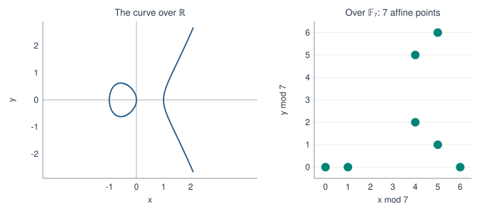

For inert $p$, $a_p=0$: Frobenius satisfies $F^2-a_pF+p=0$, hence $F^2=-p$. **Two applications of Frobenius cost a factor $p$.** That is all there is to supersingularity. On the coefficients $a_n$ of the L-function of the curve, the recursion $a_{p^{k+1}}=a_pa_{p^k}-p\,a_{p^{k-1}}$ then gives $a_{p^{2e}}=(-p)^e$ and $a_{p^{2e+1}}=0$. A theorem of Honda (1968) says that the formal group of $E$ is strictly isomorphic over ℤ to the one whose logarithm is $\sum_na_n\,t^n/n$: the computation that follows does concern the curve itself. The coefficient of $t^{p^{2e}}$ is therefore $(-p)^e/p^{2e}=(-1)^e/p^e$: this is height 2. For split $p$, $a_p$ is invertible mod $p$, $a_{p^e}$ is a $p$-adic unit, the coefficient of $t^{p^e}$ is of order $1/p^e$, and one is back to height 1.

Inverting this logarithm with exact fractions, one computes the valuations of the derivatives of $\exp_E$ at 0 ([`tools/modeles.py`](tools/modeles.py)):

| $a$ | 9 | 25 | 49 | 81 | 121 | 161 |
|---|---:|---:|---:|---:|---:|---:|
| $v_3(a!)$ (Legendre) | 4 | 10 | 22 | 40 | 58 | 76 |
| $v_3(D^a\exp_E(0))$, $p=3$ inert | 3 | 9 | 18 | 30 | 45 | 61 |
| $a\cdot3/8$ | 3.4 | 9.4 | 18.4 | 30.4 | 45.4 | 60.4 |
| $v_5(D^a\exp_E(0))$, $p=5$ split | 0 | 0 | 0 | 0 | 0 | 0 |

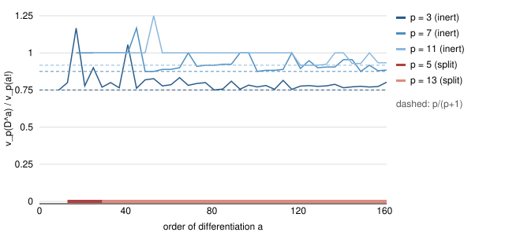

The contrast is total. For an inert prime, the lower bound guarantees asymptotically the fraction $\frac{p/(p^2-1)}{1/(p-1)}=\frac p{p+1}$ of the Legendre gain (3/4 for $p=3$, 7/8 for $p=7$), up to a loss $O(\log a)$; computed values may exceed it at times. For the split primes 5 and 13, the observed valuation is zero for all odd orders computed, $a\le161$ (the even-order coefficients of the formal exponential vanish, since the logarithm is odd, and their valuation is $+\infty$): with ordinary reduction, the computation of the denominators guarantees no gain, and here there is none.

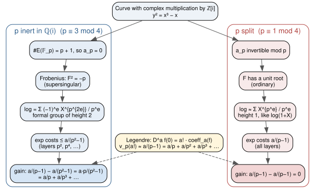

**What is subtracted in the rate model.** Legendre counts the multiples of $p$, then of $p^2$, of $p^3$, etc.:
$$\frac a{p-1}=\frac ap+\frac a{p^2}+\frac a{p^3}+\cdots$$
The upper bound on the height-2 cost is $\frac a{p^2-1}=\frac a{p^2}+\frac a{p^4}+\cdots$: these are **the even layers**. The odd layers remain:
$$v_p\big(D^a\exp_F(0)\big)\gtrsim\frac ap+\frac a{p^3}+\frac a{p^5}+\cdots=a\,\frac{p}{p^2-1}.$$

### 3.3 The resulting profile, and why it is the right one

Read this gain on prime powers $m=p^e$, as for the Riesz weight of § 1.2. The object gains $a/m$ at $m=p^e$ if $p$ is inert and $e$ odd, and nothing otherwise. Now, for the quadratic character $\chi_{-d}$ attached to the CM field $K=\mathbb Q(\sqrt{-d})$ and for $p\nmid d$,
$$\frac{1-\chi_{-d}(p^e)}2=\begin{cases}1&\text{if }p\text{ is inert and }e\text{ odd},\\0&\text{otherwise.}\end{cases}$$
This is **exactly** the same condition. The profile provided by complex multiplication is therefore
$$m\;\longmapsto\;\frac am\cdot\frac{1-\chi_{-d}(m)}2 ,$$
that is, the Legendre profile, that of $y!$ in § 2.3, restricted by a quadratic character. With $a\leftrightarrow y$, what the object can bound is
$$\sum_m\Lambda(m)\Big(\frac ym-1\Big)_+\frac{1-\chi_{-d}(m)}2=\tfrac12\,S(y,1)-\tfrac12\,S(y,\chi_{-d}).$$
**Complex multiplication gives the right profile, on half of the primes, and this half is cut out by a character.**

**The ramified prime.** Since $d$ is prime, the only prime at which $\chi_{-d}$ vanishes is $p=d$: there, $\frac{1-\chi_{-d}(d^e)}2=\frac12$, neither 0 nor 1. The left-hand side therefore also contains the half-contribution $\frac12\log d\sum_{e\ge1}(y/d^e-1)_+\le\frac{y\log d}{2(d-1)}$, which is not an inertia count. The right-hand identity remains exact over all integers; only its interpretation requires excluding $p=d$. In the proof, this term disappears: the lemma `ramifiedPrimeTerm_eq_zero_of_lt_ramifiedPrime` shows that the share of $d$ in `ASK` vanishes as soon as all the scales stay below $d$ ($a/w\le N<d$), and `askExp` uses it. The other exceptional primes (2, $q$ and the factors of $Q_S$, § 3.4) split in $\mathbb Q(\sqrt{-d})$: the factor vanishes there, and they do not count.

### Workshop 2. Following the prime 3

Take again $x=81$ and choose, only to illustrate the mechanism, $b=3$, $a=bx=243$. The previous curve is supersingular at 3. The raw gain of height-2 type is carried by the odd powers. If we could set the threshold at $b$, we would be left with:

| $p^e$ | $a/p^e$ | $(a/p^e-b)_+$ | Gain kept (odd e) |
|---:|---:|---:|---:|
| 3 | 81 | 78 | 78 |
| 9 | 27 | 24 | 0 |
| 27 | 9 | 6 | 6 |
| 81 | 3 | 0 | 0 |
| 243 | 1 | 0 | 0 |

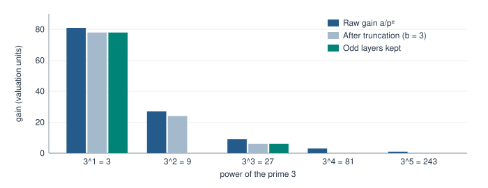

The total is $84$, exactly $3(26+2)$. Divided by $b$, it is the odd part of the contribution of 3 to the Riesz sum of the prologue. The other powers are not seen by this curve; the quadratic character encodes this selection. This is not yet a valuation actually obtained by an operator of the proof: we have not shown that the desired threshold can be realized. We have only identified the expression the local construction must produce.

The interest of complex multiplication then becomes more concrete. It provides a selection rule uniform in $p$, and its gains have the form $a/p^e$ we need. The defect (only some primes and some powers appear) itself has the structure of a character. One can therefore hope to treat it by orthogonality and by averaging over fields, rather than correcting each prime individually.

### 3.4 The price: an unwanted twisting character, which one averages away

We now know what is missing: the profile selected by $K$ contains half of the untwisted sum and a twisted half. For the nontrivial character $\chi_{-d}$, the raw sum $S(y,\chi_{-d})$ generally contains a linear term, $-yL'(1,\chi_{-d})/L(1,\chi_{-d})$. It is the centered remainder $g(y,\chi_{-d})$ that must be controlled at the required scale, together with the main terms and the ramified places.

With a fixed field, for example $\mathbb Q(i)$, this control would amount to another GRH-type difficulty. It would be circular to assume it. But we do not need the same field for all scales, thanks to the windowed criterion of § 1.5.

To understand the change of perspective, imagine independent signs $\epsilon_p\in\{\pm1\}$ and a sum $\sum_{p\le y}c_p\epsilon_p$. Its mean is zero and its variance is $\sum_pc_p^2$. A second-moment estimate therefore gives many choices for which the sum is small relative to its trivial bound. In the real problem, quadratic characters are not independent signs, and the average must control families of smoothed sums, main terms and a whole range of scales. The large sieve replaces the fictitious independence by effective estimates. The model proves none of these estimates; it explains why one varies $d$ rather than facing a fixed character.

On the export, the proof has families gigantic compared with the scales and an unconditional choice of parameters over a range $[Y,Y^A]$. Read on the export, `QH.pair_share` and `QH.bad_share` say precisely this: for every $\eta>0$, a proportion at least $1-\eta$ of the primes $q\equiv3\pmod8$ in $]e^{z/2},e^z]$, $z=Y^{\varepsilon/5}$, then of the primes $d\equiv7\pmod{16}$ in $]e^{z'/2},e^{z'}]$, $z'\asymp z\log^2Y$, with $q\prod_{3\le p\le z}p\mid d+1$ (`primeSetTwoBounds`; this divisibility forces $\left(\frac{-d}p\right)=1$ for every odd prime $p\le z$ and $\left(\frac{-d}q\right)=1$: this is where the conditions on the host are born), are **good** (`GoodQ`, `GoodD`) in the sense of three conditions (`Box`): for each primitive character ψ coming from the twists by $\left(\frac\cdot q\right)$ and $\left(\frac\cdot d\right)$, no zero in the rectangle $\operatorname{Re}s>1-\frac1{400}$, $|\operatorname{Im}s|\le Q$, $|L'/L(1,\psi)|\le C\log Y$, and $|G_\psi(y)|\le y^{1/2+\tau}$ for **every** $y$ in the window $[Y,X]$, $X\le Y^K$. This is a bound uniform over the whole window, for the **centered** sum $G_\psi$, not for the raw sum. It comes from a mean square of large-sieve type (`QH.meanSqK`), a zero-density estimate (`QH.count_bad`) and Siegel's theorem (`excBound`: $\beta\le1-c\,q^{-\varepsilon}$ for a nontrivial real character), whose constant is classically ineffective. The whole is light: the closure of `pair_share` has 75,645 declarations, 1,200 of them its own.

**The real host.** The proof does the same thing with more structure. It must also see the $\chi_j$ of $K_\psi$ (§ 1.1) and keep non-negative coefficients (§ 1.3). At scale $x$, it chooses two primes $q\equiv3\pmod8$ and $d\equiv7\pmod{16}$, then an abelian CM field
$$E\subset\mathbb Q(\zeta_{Q_Sqd}),\qquad\sqrt{-q},\sqrt{-d}\in E,\qquad[E:\mathbb Q]\approx x^{2+8\varepsilon},$$
containing the field cut out by ψ. On the export, $|A|=c\cdot2^e$ with $x^{2+8\varepsilon}\le c\cdot2^e\le2x^{2+8\varepsilon}$, and $[E:\mathbb Q]=4|A|$. The primes inert in $\mathbb Q(\sqrt{-d})$ are weighted there according to their Frobenius class. By orthogonality one recovers exactly $G_\psi(x)$, with the weight $1/(3o+1)$ of § 1.3, plus unwanted twists, by $(q/\cdot)$, $(d/\cdot)$ and their product, neutralized by the averaged choice of $(q,d)$. It is **the same field** $E$ that carries the Tate–Shafarevich bound of § 7 (a).

**The exact conditions, extracted from the export.**

- **The pair.** It satisfies `HostHyp`: $q$ and $d$ prime, $q\equiv3\pmod8$, $d\equiv7\pmod{16}$ and $\left(\frac{-d}q\right)=1$.
- **A stronger condition** (`Top.pairHyp`): every odd prime $p\le Y^{\varepsilon/5}$ splits in $\mathbb Q(\sqrt{-d})$. There are also the reciprocity identities $\left(\frac{-q}a\right)=\left(\frac aq\right)$ and $\left(\frac{-d}a\right)=\left(\frac ad\right)$ for odd $a$, which reflect $q,d\equiv3\pmod4$.
- **The Galois structure.** The group is modelled as $E_0\times H$, with $E_0=\mathbb Z/2\times\mathbb Z/2$ and a subgroup Φ of index 2 (`D5.InPhi`). A prime is inert (`IsInert`) if it differs from 2, $q$ and $d$, and its Frobenius lies outside Φ.
- **The ramification facts** (`HostFactsS`). They concern a finite **exceptional set** $S$, containing 2 and $q$ but not $d$. Outside $S\cup\{d\}$, everything is unramified; $d$ is ramified with inertia of order 2; for $p\in S$, inertia and Frobenius stay in Φ, and these primes are never counted as inert. The construction (`HostRaw.mk`, `hostFactsS`) takes $S$ to be the set of primes dividing $Q_Sq$, where the modulus $Q_S$ is prime to $qd$, divisible by $2^{e+2}$, and has only odd factors $\ell$ with $\left(\frac{-d}\ell\right)=1$. For the primes of the conductor of ψ (for instance 5 for $\psi=(\frac\cdot5)$), two distinct reasons apply: they are ramified in the field cut out by ψ, which $E$ contains, hence in $E$; and, as factors of $Q_S$, they split in $\mathbb Q(\sqrt{-d})$ by construction, hence are absent from the sums. The subgroup Φ is exactly $\mathrm{Gal}(E/\mathbb Q(\sqrt{-d}))$ (`toE` makes it the coordinate tested by `InPhi`). Versions up to 3.4 of this English text wrote "outside $\{2,q\}$ and $d$, everything is unramified": that was an incorrect transcription.
- **The truncated sums** (`askExp`). `ASK` expands by orthogonality into sums $\sum_n\Lambda(n)\psi(n)\,(a/n-w)_+$: the Riesz truncation is written into the very definition.

**Reading ⟦I⟧.**

- Φ is the subgroup fixing $\sqrt{-d}$ (checked on the export, see above); the congruences are then partly explained. $d\equiv7\pmod8$ gives $-d\equiv1\pmod8$, so 2 splits in $\mathbb Q(\sqrt{-d})$; and $\left(\frac{-d}q\right)=1$ makes $q$ split.
- The condition on small primes guarantees that **no inert prime is smaller than $Y^{\varepsilon/5}$**. Now the per-prime losses ($\mathrm{flG}(p)$, of order $\log_pa$) and the gain bounds ($4|TT|a/p$) get worse for small $p$.
- This condition is satisfied only by a proportion of about $2^{-\pi(Y^{\varepsilon/5})}$ of the $d$, which explains the size $\exp(Y^{\varepsilon/5})$ of the family.

The precise role of $q\equiv3\pmod8$ and of the refinement mod 16 remains open. These conditions are consumed by the construction of the host (`hostOfFieldOf`), by the Ш bound (`vwinAt_of_joint`) and by the treatment of the parasites (`CharacterBoxes`).

### 3.5 In the proof: Theorem A

The computation of § 3.2 is done on an elliptic curve. The proof does the same computation for a **theta series** of a Hermitian lattice, at a CM point of a unitary Shimura variety, in formal-group coordinates:

> **Theorem A** (simplified form). Let $\Theta$ be a theta series, renormalized by a suitable exponential, in formal-group coordinates at the CM point. For inert $p$,
> $$v_p\big(D^{a}\Theta(0)\big)\;\ge\;a\cdot\frac{p}{p^2-1}\;-\;O(\log a)=a\Big(\frac1p+\frac1{p^3}+\cdots\Big)-O(\log a).$$

This is the sentence of the note: "$D^a\,\Omega\cdot\theta(0)$ is divisible by $p^{a/p+a/p^3+\cdots-O(\log a)}$". § 3.1 explains an observation of Rubinstein [R2]. On the naive theta series of ℤ[i], differentiated in the analytic coordinate, he does not recover this exponent (he finds 6, 2 and 1 for $p=3$, 7, 11). The gain exists only for the **renormalized object, in formal-group coordinates**: it is the change of coordinate that decides what remains of $a!$.

**The proof of Theorem A** weighs about 0.02 % of the volume. It proceeds in three steps.

1. **Generic point.** The coefficients to be bounded are polynomials in the coordinates of a "frame" of differentiation directions. They are evaluated at a **residually generic** point, where the absolute value of a polynomial equals its **Gauss norm**, the maximum of its coefficients.
2. **Monomial.** The jet is expressed through minors of the derivatives of $\Theta$. One reduces to a single multi-index $\kappa$, that is, to $|\kappa!\cdot\mathrm{coeff}_\kappa|$.
3. **A monomial.** One combines the integrality of the initial series, the inverse of the formal logarithm and the bound $\rho(p)=1/(p^2-1)$ per degree for the renormalizing exponential (lemma "S"). This bound rests on **Dwork's lemma**, proved in the project: $\exp(P)$ is $p$-integral if and only if $P^{\sigma}(X^p)-pP\in pW[[X]]$. For $P=X$, one recovers that $e^X$ is not integral, which is the multiplicative case of § 3.1. A condition of **Frobenius-twisted quasi-orthogonality**, $\sum_a x_a^{p^{j}}x'_a\equiv0\pmod p$, bears on the frame vectors. Labelling the odd shifts $j$ with $p^j\le a$ costs $O(\log a)$, and that is the logarithmic loss.

**The exact hypotheses of Theorem A.** Height 2 alone is not enough. The exact statement (`ThmAGauss`) assumes $p\ge3$, an unramified extension of even degree (written $d$ in the statement, unrelated to the prime $d$ of the host), formal-group coordinates given by the inverse $g$ of the formal logarithm ($g\circ\log=X$), a series $U$ integral in these coordinates, a renormalizing exponential whose coefficients satisfy a Dwork-type condition (`BHyp`), and frames of size at most $a$ with $2\log_pa+2\le N_0-1$. The loss is explicit: $dN_0N_1(\log_pa+1)$.

**Odd exponents and sets without short relations.** In a CM field of large degree, the Frobenius of an inert prime acts on the embeddings by shifting, and the gain $a/p^e$ is read at the place $t+e\cdot h_p$ of its **orbit**. It is obtained only if the weight at that place is not too large. The positions of the "thick" places, of large weight, must therefore avoid coming too close along the orbits. The export (`NoRel T L`) requires, for distinct $s_1,s_2,s_3\in T$ and distinct non-zero integers $i\ne j$ of absolute value at most $L$, that $j(s_2-s_1)\ne i(s_3-s_1)$. This is stronger than the absence of three-term arithmetic progressions ($i=1$, $j=2$), which does not bound the number of points per segment: $\{0,1,3\}$ has no three-term progression and has three points in $[0,3]$, but fails `NoRel` as soon as $L\ge3$, since $3\cdot(1-0)=1\cdot(3-0)$. Such a set, of Behrend-type density, is obtained by **Behrend**'s construction (`hostThickExists`). What it serves to preserve, and through which channel, is explained in § 7 ("Preserving the gains").

**Two elementary lemmas, as models.** They do not reconstruct `LinkG_at`, but they isolate two mechanisms that this interface combines.

*Orbit lemma.* In an abelian group $G$, if $T$ satisfies the condition `NoRel T L` above, then every orbit segment $\{s+rg:0\le r\le L\}$ contains at most two **distinct** points of $T$. Indeed, if $s+r_1g$, $s+r_2g$, $s+r_3g$ are three distinct points of $T$, set $i=r_2-r_1$ and $j=r_3-r_1$: these are distinct non-zero integers of absolute value at most $L$, and $j(s_2-s_1)=jig=i(s_3-s_1)$, which is excluded. No division is involved, even with torsion. In the export, `NoRel` bears on a `Finset ℕ` and relations in ℤ: the lemma applies with $G=\mathbb Z$, and without further argument it says nothing about relations modulo the length of the orbit or about repeated visits to the same point. The actual treatment distinguishes long and short orbits (§ 7).

*Truncated-profile lemma.* For a finite family of gains $g_i\ge0$, set $F_g(b)=\sum_i(g_i-b)_+$ and $N_g(t)=\#\{i:g_i>t\}$. Then $F_g(b)=\int_b^\infty N_g(t)\,dt$, since $(g_i-b)_+=\int_b^\infty\mathbf 1_{t<g_i}\,dt$; $F_g$ is convex and non-increasing, with right derivative $-N_g(b)$. If the gains are sorted in decreasing order,
$$F_g(b)=\max_{0\le k\le r}\Big(\sum_{i\le k}g_i-kb\Big),\qquad\sum_{i\le k}g_i=\min_{b\ge0}\big(F_g(b)+kb\big),$$
the maximum being reached by keeping the gains above $b$, and the minimum for $b$ between $g_{k+1}$ and $g_k$. Dominating a truncated profile for **all** thresholds is therefore equivalent to dominating **all** upper partial sums, not just the total: $(8,2)$ and $(5,5)$ have the same total, but $F(4)$ is 4 for one and 2 for the other. This is exactly the shape of the gain required by `LinkG_at` (§ 3.3, Workshop 2), $\sum_{e\text{ odd}}(a/p^e-b)_+$, with $g=(a/p^e)_{e\text{ odd}}$. Theorem A bounds a total from below, $a\,p/(p^2-1)$; `LinkG_at` asks for a truncated profile. Reading `LinkG_at` as a certificate of profile domination, after losses, is a working hypothesis ⟦I⟧, which only an effective family of gains, read in the construction, could confirm. An elementary identity makes the gap precise: for thresholds $w_e\ge0$,
$$\sum_{e\ \text{odd}}\Big(\frac a{p^e}-w_e\Big)_+=a\,\frac p{p^2-1}-\sum_{e\ \text{odd}}\min\Big(\frac a{p^e},w_e\Big),$$
since $(x-w)_+=x-\min(x,w)$: the truncated profile is the raw gain of Theorem A minus a **truncation cost**. On the export, the thresholds (`cap`) are defined by segment blocks, and the gains of `LinkG` come from a "first" and a "second" family theorem, the second being a valuation bound along orbits, both drawn from one bundle of local results (local model, flatness, extremal projectors; article, § 5.5). How these results realize the required truncation cost remains to be read.

**The chain of gains, read on the export.** The gain required by `LinkG_at` combines five elements, which we read separately.

*Admissibility.* The first ingredient is the Theorem A of the original route, written here $A_{\rm orig}$ to distinguish it from the Theorems A, B, C of Sernau's rewriting. As a uniform bound (its conclusion with a loss of constant 1, `SplitConstantsUniformBound 11 1`), it makes the "served" lines of the construction **admissible**. It is not in the closure of the two family theorems that conclude `LPprime`: the divisibility it provides and its propagation to lattices are proved separately.

*The flow.* On the export, the truncation cost has the exact form of a **flow program** on the Frobenius orbit. On an orbit of length $d$, with capacities $D_s\ge0$ at the positions $s\in\mathbb Z/d$ and a prime $l$, with $d\ge2$, a flow assigns quantities $x_{s,i}\ge0$ to the **odd** layers $i<d$. A layer launched at $s$ weighs $l^i$ at $s$ and $1$ at $s+i$, hence the constraints $\sum_il^ix_{s,i}+\sum_ix_{s-i,i}\le D_s$. The corollary of Theorem A bounds the valuation from below by the raw gain $\frac l{l^2-1}\sum_sD_s$ minus the maximal flow $F^*$ (`lpF`). Summing the constraints, $\sum_{s,i}(l^i+1)x_{s,i}\le\sum_sD_s$, hence $F^*\le\frac{\sum_sD_s}{l+1}$, since $l^i+1\ge l+1$; the dual certificate is the constant $y_s=\frac1{l+1}$. **Equality holds if and only if** the unique solution of the cyclic system $l\,x_s+x_{s-1}=D_s$ is non-negative, since equality forces all constraints to be saturated and the layers $i\ge3$ to vanish. This solution is
$$x_s=\frac{\sum_{k=0}^{d-1}(-1)^kl^{d-1-k}D_{s-k}}{l^d-(-1)^d}.$$
The local condition $D_{s-1}\le l\,D_s$ for all $s$ suffices, by grouping the terms in pairs. It is not necessary: for $l=3$ and $D=(3,1,0,0)$, the solution $x=(1,0,0,0)$ is non-negative although balance fails. The lemma read on the export (`LemmaFe`) assumes $d$ even and $D_{a'}\le l\,D_a$ for all $a,a'$, which is a special case. In the saturated case, the remaining gain is $\frac l{l^2-1}\sum_sD_s-\frac{\sum_sD_s}{l+1}=\frac{\sum_sD_s}{l^2-1}$. If the cyclic solution has a negative component, the bound is not attained, and the general program must be solved. The theorem named `linear_programming_input_of_hypotheses` does not use this program: it packages the two family theorems (E8). The two "linear programmings" must not be confused, and the link between the capacities $D_s$, the thresholds `cap` and the actual gains remains to be established.

*The rank to precision.* The second ingredient is a **$p$-adic rank** property, `LPprime`, concluded by the two family theorems. For every lattice $L$ of $\mathbb Q_q^{m+1}$, with $\mathbb Q_q$ unramified over $\mathbb Q_p$, there exist Hecke edges at $p$ ending at $L$ and functionals attached to their sources, separated modulo a power of the uniformizer, whose pairing with the target space has rank at least $(1-\kappa)\dim$ to precision $p^D$. This property is required under a tiling condition on the Frobenius orbits. The "rank to precision $p^D$" has an exact meaning. `GoodRankK` asks for an $O$-linear map $u:O^n\to A$ and a matrix $M$ with entries in $O$ such that $M\,\Phi(u(x))=p^Dx$ for all $x\in O^n$, where $\Phi$ gathers the functionals. For the integral matrix $B=\Phi\circ u$, this is **equivalent** to: $B$ is injective and its $n$ invariant factors satisfy $s_i\le D$. Indeed, if $B=U\,\big[\mathrm{diag}(p^{s_i});0\big]\,V$ (Smith form), $M=V^{-1}\big[\mathrm{diag}(p^{D-s_i})\mid0\big]U^{-1}$ works when all $s_i\le D$. Conversely, $MB=p^DI_n$ forces injectivity, and column $i$ of $MU$, restricted to the first $n$ components, is $p^{D-s_i}$ times column $i$ of $V^{-1}$, which has a unit entry: hence $D-s_i\ge0$. Since the length of the image of $B$ modulo $p^{D'}$ is $\sum_i(D'-s_i)_+$, we get $\operatorname{len}\ge n(D'-D)$ for $D'\ge D$: the rank to precision is a lower bound on a truncated length, of the same form as the profiles above. This characterizes the restriction $B=\Phi\circ u$, not the rank of $\Phi$ in general; and that the actual pairing is integral has not been checked.

*The assembly of edges.* The proof of `LPprime` has two levels, and the first is elementary and reconstructed. Every lattice of rank $k$ receives at least $\frac{q^k-1}{q-1}$ Hecke edges of type 1, with $q=p^{n'}$: this is the number of hyperplanes of $\mathbb F_q^k$. If each edge provides, to precision $p^D$, a rank at least $(1-\kappa)\dim V$ divided by that number, the ranks add up. The lemma that allows it fits in two lines. Let $R$ be a discrete valuation ring with uniformizer $\pi$. If the diagonal blocks satisfy $M_jB_j=\pi^DI_{r_j}$ and the off-diagonal blocks of $MB$, for $M=\operatorname{diag}(M_j)$, lie in $\pi^{D+1}R$, then $MB=\pi^D(I+\pi C)$ with $C$ integral. Since $I+\pi C$ is invertible over $R$, $M'=(I+\pi C)^{-1}M$ satisfies $M'B=\pi^DI$. It is the **normalized** matrix that is invertible, not necessarily the raw one. On the export, separation is modulo $w^{c^*}$ with $c^*>8D$ (`isUnit_det_of_one_add`, `goodRank_core`); the relative units of $w$, $p$, $D$ and $c^*$ remain to be checked.

*Counting the weights.* The second level, the rank per edge, is obtained by induction on the highest weight $\lambda$ of a Weyl module of $\mathrm{GL}_{m+1}$. It starts from "flat" weights $(A,0,\dots,0,-B)$, with an explicit loss of precision, logarithmic in $a$, at each step, and compares dimensions through the Weyl dimension formula. The base weights carry, at the selected positions, coefficients $a_s$ at the head and $-b_s$ at the tail, which recall the pair $(a,b)$ of the Riesz truncation ⟦I⟧. Read on the export, the core of this induction is a classical statement of representation theory. The dual Weyl module is realized as a space of polynomials in the entries of a matrix, homogeneous of a given weight and invariant under column additions (`dualWeyl`). The lattice attached to a lattice $L$ is the tensor product, over the positions of the Frobenius orbit, of these modules twisted by the powers of σ (`HL`). For each edge, the local model provides a basis common to the two lattices of the edge, $(x_i)$ for the source and $(p^{\pi_i}x_i)$ for the target (`elementary_divisor_basis`): the dilation of the edge acts diagonally on weight vectors ⟦I⟧. The rank per edge then amounts to counting the vectors of this basis whose exponent fits within the precision. Weyl's dimension formula does not, by itself, control the distribution of these exponents: this count (`cloud_count`) and the tensor-product basis (`ten_basis`) are not read.

**Why is the CM point useful beyond the elliptic example?** A theta series encodes data of a lattice, but one wants to extract from it values and derivatives that live in arithmetic structures. A CM point is a point of the moduli space representing an abelian variety with complex multiplication. Its endomorphisms and its reductions impose strong constraints on the local geometry. It therefore makes it possible to relate an analytic function to a power series in a formal coordinate, where valuations make sense. The passage to large rank, the renormalizations and the Frobenius conditions are precisely what Theorem A achieves; it would be misleading to regard the elliptic-curve computation as its proof.

### 3.6 What the graph says

The two components of this question are tiny. Theorem A (`DworkPowerSeriesWeights.thmAGauss`, `theorem_A_one_monomial_log_loss`, `lemmaS`, `FormalGroupSystem.Pf.sx_dwork`) weighs about 0.02 %. The host and the averaged choice of pairs (`supplyChi`, `PairEx`, `QH.pair_share`, `QH.bad_share`) weigh about 0.1 %. The divisibility gain is **local and cheap**, in the sense of its own weight only: a shared declaration may be costly to reconstruct while having a small dominated weight. What costs is **preserving** it all the way to the final lattice, through the division. On the export (Part II, interface graph), the Ш bound for **the same** field $E$ (8 %) is supplied together with the host (`supplyChi`). It reappears in `LinkN`, the bound on twisted places, which must fit in the per-lift loss budget and conditions the division (`DIVinN`). Complex multiplication creates the profile, and Ш guarantees that one can divide without losing it. The proposed mechanism, through Hecke denominators, remains ⟦I⟧ (§ 7 (a)).

**What is still missing.** A differentiation at the CM point provides a gain rate with a local logarithmic loss. Converting this loss into a global error requires taking into account the thresholds, the number of places and the normalization $a=xb$; the comparison with the error of the factorial is a motivation ⟦I⟧, not an independent estimate. To get down to $\sqrt y$, one must **repeat** the differentiation, as Stepanov makes his function vanish to high order. This is question 3.

> **Answer to question 2.** Differentiation provides factorials, hence Legendre divisibility, provided one differentiates in a coordinate in which the object is integral. For a modular form, that coordinate is the one of a formal group, and passing to the linear coordinate costs denominators. In the height-1 model (ordinary reduction), the control of the denominators guarantees no linear gain. In the height-2 model, under the integrality and renormalization hypotheses, a lower bound of rate $p/(p^2-1)$ remains, with logarithmic losses; the decomposition into odd layers describes this rate, not a cancellation coefficient by coefficient. Theorem A realizes the hypotheses needed; on the export, it makes the served lines admissible, and a distinct $p$-adic rank property along Hecke edges (`LPprime`) propagates the divisibility to the lattices, to provide the truncated Riesz weights of `LinkG_at` (§ 3.5). Complex multiplication makes the reduction supersingular at **all** inert primes of good reduction, that is, primes inert in $\mathbb Q(\sqrt{-d})$ (not in the whole host $E$). The resulting profile, $\frac am\cdot\frac{1-\chi_{-d}(m)}2$ for $m$ prime to $d$, is the Legendre profile restricted by a quadratic character. That character is the price to pay: it is neutralized by letting the CM field vary in a huge family.

## 4. Why theta lifts simulate Stepanov's multiplicity

§§ 2 and 3 identified the shape of the desired profile and a local source of divisibility. To reach a precision close to $\sqrt y$, the proof copies an argument of 1969 that proves the Riemann hypothesis **for curves over a finite field** by elementary means. It is the model Alpöge claims from the first line of his note, and it is the second toy model of this text. We present a simplified classical construction, because everything that follows reuses its architecture. The constants of the bound are schematic.

### 4.1 Stepanov: counting points by counting zeros

**The principle.** A nonzero polynomial $F\in\mathbb F_p[X]$ has at most $\deg F$ roots, counted with multiplicity:
$$\sum_{x\in\mathbb F_p}\operatorname{ord}_x(F)\;\le\;\deg F .$$
This is the identity of § 2.1 in $\mathbb F_p[X]$: the order of vanishing at $x$ plays the role of $v_p$, and the degree that of $\log|M|$. If $F$ vanishes **to order $a$** at every point of a set $S$, one gets
$$a\cdot|S|\le\deg F .$$

**The problem.** Let $g\in\mathbb F_p[X]$ be squarefree of degree $m$, and
$$S=\{x\in\mathbb F_p:\ g(x)\text{ is a nonzero square}\}=\{x:\ g(x)^c=1\},\qquad c=\tfrac{p-1}2 .$$
Counting $S$ means counting the points of the curve $y^2=g(x)$: each $x\in S$ gives two points. For $g=x^3-x$, the curve of § 3.2, $\#E(\mathbb F_p)=2|S|+4$. One expects $|S|\approx p/2$, with fluctuations of order $\sqrt p$:

| $p$ | 10,007 | 10,009 | 10,301 | 100,003 |
|---|---:|---:|---:|---:|
| $\lvert S\rvert$ | 5,002 | 5,006 | 5,250 | 50,000 |
| $\lvert S\rvert-p/2$ | −1.5 | +1.5 | **+99.5** | −1.5 |
| $\sqrt p$ | 100.0 | 100.0 | 101.5 | 316.2 |

For $p=10{,}301$, the deviation almost reaches $\sqrt p$, which is Weil's bound. For $p\equiv3\pmod4$, it is always $-1.5$, since $a_p=0$ (§ 3.2).

**Three attempts that fail.** Each has its counterpart in § 2.4.

| Auxiliary function | Order on $S$ | Degree | Resulting bound | Counterpart in § 2 |
|---|---|---|---|---|
| $\prod_{x\in S}(X-x)$ | 1 | $\lvert S\rvert$ | $\lvert S\rvert\le\lvert S\rvert$ | the lcm: a tautology, since $S$ must be known |
| $g^c-1$ | at least 1 | $mc=m(p-1)/2$ | $\lvert S\rvert\le mp/2$ | $\binom{2n}n$: the right idea, but a constant-factor loss |
| $(g^c-1)^a$ | $a$ | $a\,mp/2$ | $\lvert S\rvert\le mp/2$ | **free multiplicity is useless** |

The third line is the lesson. Raising a function to the power $a$ multiplies the order of vanishing by $a$, but it also multiplies the degree by $a$. The ratio does not move. To gain, one needs a function that vanishes to order $a$ with **a degree well below $a$ times the degree of a function vanishing to order 1**.

**Stepanov's trick.** One looks for $F$ of the form
$$F(X)=\sum_{j<J}\big(r_j(X)+s_j(X)\,g(X)^c\big)\,X^{jp},\qquad\deg r_j,\deg s_j<K\approx p/2 ,$$
where the coefficients of $r_j$ and $s_j$ are unknowns. Two facts do all the work.

1. **On $S$, the high powers disappear.** $x^p=x$ for $x\in\mathbb F_p$, and $g(x)^c=1$ for $x\in S$. Restricted to $S$, $F$ coincides with $\sum_j(r_j+s_j)\,X^j$, a polynomial of **small** degree, about $K+J$.
2. **Differentiation does not see $X^{jp}$.** In characteristic $p$, $\frac{d}{dX}X^{jp}=jp\,X^{jp-1}=0$: the $X^{jp}$ behave as **constants** for differentiation. The derivative of $g^c$ is $c\,g'g^{c-1}$, which remains of the form $g^c\times$(small polynomial)$/g$.

The $k$-th derivative of $F$, multiplied by $g^k$ and restricted to $S$, is therefore again a polynomial of small degree, about $K+J+km$. Requiring it to be **identically zero** guarantees that $D^kF$ vanishes on all of $S$. That makes about $K+J+km$ linear conditions, **whatever $|S|$ is**. The vanishing is not checked point by point: it is obtained all at once, through an identity.

**A point not to be skipped: why is $F\ne0$?** Linear algebra gives a nonzero vector of coefficients, but this does not always guarantee a nonzero auxiliary function. In this construction, one can impose $K\le c=(p-1)/2$ and prove the necessary independence. Write $F=R+g^cS_0$ with $R,S_0$ in the span of the monomials $X^{jp+i}$, $0\le i<K$. Let $\alpha$ be a simple root of $g$ in an algebraic closure of $\mathbb F_p$. In the coordinate $t=X-\alpha$, this space is contained in the sums of monomials $t^{jp+i}$, since $(\alpha+t)^p=\alpha^p+t^p$ and $i<K$. The order in $t$ of any nonzero polynomial of this space therefore lies, mod $p$, in $[0,K-1]$. That of $g^cS_0$, if nonzero, lies in $[c,c+K-1]$ mod $p$. These intervals are disjoint. If $R$ and $S_0$ are both nonzero, their orders are distinct: their sum cannot vanish. If only one is nonzero, the result is immediate. Finally, within each block, the degrees $jp+i$ are distinct. A nonzero vector of coefficients does give a nonzero $F$.

This check is instructive for what follows: non-degeneracy is not a detail. An analogous requirement will reappear in the injectivity of a period map. The analogy is not an identity of proofs.

**The count, with explicit integers.** Take $p$ odd, $g$ non-constant and squarefree, $K=c=(p-1)/2$ and $1\le a\le p-2$ (for $a=p-1$, the denominator $2K-a$ below would vanish); the condition $a<p$ makes the $k!$, $k<a$, invertible, so that the vanishing of derivatives really gives multiplicity at least $a$ (here $m=\deg g$; in § 6, $m$ will denote the length of the chain). After multiplication by $g^k$ and reduction on $S$, the $k$-th derivative becomes a polynomial of degree at most $K+J-2+km$: making it vanish identically costs at most $K+J-1+km$ conditions, hence in total at most $a(K+J-1)+m\,a(a-1)/2$. There are $2JK$ unknowns. It therefore suffices to choose $J$ with $(2K-a)J>a(K-1)+m\,a(a-1)/2$, for instance the integer part of the quotient plus 1: this is a **Siegel lemma** over $\mathbb F_p$. Then $F\ne0$ (above), $\deg F\le(J-1)p+K-1+cm$, and
$$|S|\;\le\;\frac{(J-1)p+K-1+c\,m}{a}.$$
For $a\asymp\sqrt p$, this gives $p/2+O_m(\sqrt p)$. Expanding $J$, one reads two costs:
$$\frac{\deg F}{a}\;\approx\;\frac p2\;+\;\frac{m+1}{2}\Big(\underbrace{\frac pa}_{\text{fixed cost, amortized}}+\underbrace{a}_{\text{marginal cost}}\Big).$$

- The **fixed cost**, of order $mp/2$, is the degree of $g^c$, the part that makes $S$ appear. It is paid once, and **amortized** over the $a$ orders of vanishing.
- The **marginal cost**, of order $m$ per order, comes from each derivative adding $m$ to the degree of the conditions.

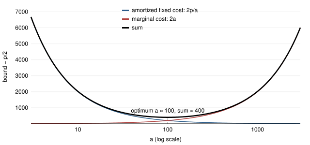

| $a$ | 1 | 10 | 30 | **100** | 300 | 1,000 |
|---|---:|---:|---:|---:|---:|---:|
| explicit bound for $\lvert S\rvert$ ($p=10{,}007$, $m=3$; true: 5,002) | 20,011 | 7,004 | 5,670 | **5,303** | 5,670 | 7,235 |

These values are those of the recipe above, integers included; the minimum, 5,289, is reached at $a=70$, and the bound then exceeds $p/2$ by 286, against $\sqrt p\approx100$. With $a=1$, the bound is worse than trivial. With $a\approx\sqrt p$, it is $p/2+O(m\sqrt p)$. The lower bound is obtained by applying the same argument to $\eta g$, with η a non-square, which counts the $x$ at which $g(x)$ is not a square, then removing the zeros of $g$ (at most $m$): this method too produces only **upper bounds**, as in § 1.4. Together, they give $|S|=p/2+O(m\sqrt p)$. This is the Weil-type bound for the number of points, with constants not optimized; by refining the method and working over finite extensions, one reaches the proof of the Riemann hypothesis for curves. This is not a mere substitution of $q=p^r$ for $p$: the recipe assumes $a<p$, whereas $a\asymp\sqrt q$ eventually exceeds $p$, and Hasse derivatives are needed. See Stepanov and Bombieri in the references. **The ½ comes from the balance between a cost amortized like $1/a$ and a marginal cost like $a$.** Question 5 returns to this.

### 4.2 Over ℤ: what is missing

Transposing means finding counterparts for three things.

| Stepanov ($\mathbb F_p[X]$) | Over ℤ | What provides it in Alpöge |
|---|---|---|
| $\operatorname{ord}_x(F)$, vanishing at a point | $v_p$, divisibility by a prime | § 2 |
| One more **derivative**: one more order | one more **layer** of divisibility | ? |
| $D^kF=0$ on **all** of $S$ at once, by an identity | divisibility at **all** inert primes at once | Theorem A, uniform in $p$ (§ 3) |
| Siegel lemma: $F$ exists | a form exists, with controlled size | slope inequality (§ 5.4) |

The second line is the difficulty. Alpöge (note, § 1): "multiplicity is hard to find over the integers, corresponding to something like differentiating whole numbers". § 3 provided **one** differentiation: $D^a$ at a CM point, which gives the profile $a(1/p+1/p^3+\cdots)$. Increasing $a$ is not enough, like the third attempt of § 4.1 ⟦I⟧: divisibility grows with $a$, so does the archimedean size, and the $O(\log a)$ loss per prime remains a fixed cost of order $O(y)$ that nothing amortizes. One needs a counterpart of "differentiate again", that is, an **operation that adds a layer of divisibility, and that composes**.

### Interlude. What is a theta series, and why a unitary group?

We are going to meet objects that normally belong to a course on automorphic forms. It is not necessary to take such a course to understand the role they play here. Let us start from an object we know how to compute.

For $|q|<1$, consider

$$\theta(q)=\sum_{n\in\mathbb Z}q^{n^2}=1+2q+2q^4+2q^9+\cdots.$$

This function looks like a generating series from combinatorics. Its square is the theta series of the square lattice:

$$\theta(q)^2=\sum_{(a,b)\in\mathbb Z^2}q^{a^2+b^2}=\sum_{n\ge0}r_2(n)q^n.$$

The coefficient $r_2(n)$ is the number of representations of $n$ by the quadratic form $a^2+b^2$. For example, $r_2(5)=8$. The lattice $\mathbb Z^2$ is also the lattice of Gaussian integers $\mathbb Z[i]$, with norm $|a+ib|^2$. The link with the curve of § 3 is no accident: the same imaginary quadratic field supplies here a Hermitian geometry and there extra endomorphisms.

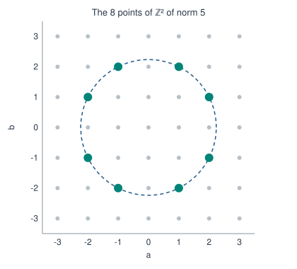

Another phenomenon explains the power of this object. For $t>0$, Poisson summation applied to a Gaussian gives

$$\sum_{n\in\mathbb Z}e^{-\pi t n^2}=t^{-1/2}\sum_{n\in\mathbb Z}e^{-\pi n^2/t}.$$

The same function thus describes simultaneously a lattice and its dual, with a very rigid analytic transformation law. Writing $q=e^{\pi iz}$, one gets a function of $z$ in the upper half-plane, with in particular a law under $z\mapsto-1/z$. This is the first example of what one looks for in an automorphic form: a function subject to transformation rules under a group, whose coefficients contain arithmetic. The details (group, weight, multipliers and growth conditions) matter for the theorems, but are not needed for this first glimpse.

Over a CM field $K$ with conjugation $v\mapsto\bar v$, a Hermitian form generalizes the complex norm. On $K^r$ one can consider, for example,

$$H(v,w)=\sum_{j=1}^rv_j\overline{w_j}.$$

Its isometry group is the unitary group $U(H)$. If the form is positive definite at all infinite places, the corresponding real groups are compact. One can work with integral lattices in this Hermitian space, then with their isometry classes. For a fixed level, definiteness allows, in the appropriate adelic setting, finite-dimensional descriptions. The real version is a theory of functions on an arithmetic quotient, possibly vector-valued; the finite model below gives an intuition of it.

Suppose we have two finite families of lattice classes $[L]$ and $[L']$. A function $f$ on the first can be transported to the second by a kernel of numbers $K(L',L)$:

$$Tf(L')=\sum_{[L]}\frac{K(L',L)}{|\operatorname{Aut}(L)|}f(L).$$

The operation is simply a matrix multiplication, with a measure weight tied to the stabilizer. In the real theta correspondence, the kernel comes from the Weil representation and the integral is adelic; the choice of vectors and levels matters. Taking an arbitrary generating series is not enough to obtain an automorphic lift. But the model already shows three properties we were looking for: arithmetic coefficients, a composable linear operation and natural denominators to be controlled.

Why a period? To extract a numerical datum from a function, analysis often uses an integral or a Fourier coefficient. An automorphic period is, schematically, an integral over a subgroup or a quotient, sometimes with a character or a test vector. In the proof, Bessel periods link the kernels, their arithmetic values and integral structures. We do not need to compute an actual Bessel period to understand why an evaluation or period map can be represented by a matrix. This is what lets us pass from local to global and, in the next section, stack the gains.

### 4.3 The chain of theta lifts

**The theta lift.** An automorphic form φ on a unitary group $U(X_0)$ is carried to a form on a larger unitary group $U(X_1)$ by integrating it against a two-variable theta series, the **kernel**. Repeat:
$$U(X_0)\xrightarrow{K_1}U(X_1)\xrightarrow{K_2}\cdots\xrightarrow{K_m}U(X_m),\qquad\dim X_j=k+j(t+1).$$
All the Hermitian spaces are **definite**. The groups are then compact at infinity, and, at fixed level and type at infinity, the spaces of forms are **finite-dimensional**: each $K_j$ is a **matrix**, of size $c_{j}\times c_{j-1}$.

**What the export says.** The chain is literally a product of matrices:

```
chainMat Kj i  :=  Fin.induction 1 (fun j A => Kj j * A)      -- K_i ⋯ K_1
ColChain.fact  :  Pt(φ)(F) = PtL( chainMat Kj (last) · φ )(F)
```

The **period** of φ (a Bessel period, in the sense of Gan–Gross–Prasad) is a period on the last group of the vector $K_m\cdots K_1\varphi$. This is the matrix form of Kudla's **seesaw** identities.

**Why the layers add up.** If every coefficient of $A$ is divisible by $p^{\alpha}$ and every coefficient of $B$ by $p^{\beta}$, every coefficient of $AB$ is divisible by $p^{\alpha+\beta}$, since a sum of multiples of $p^{\alpha+\beta}$ is one. Hence
$$v_p(K_m\cdots K_1)\;\ge\;\sum_{j=1}^m v_p(K_j),$$
exactly like $\operatorname{ord}_x(FG)=\operatorname{ord}_xF+\operatorname{ord}_xG$. Each kernel, evaluated near the CM points of the Frobenius orbit of $p$, brings its gain from § 3, denoted `gainP p j`. It loses the $p$-part of the order of the automorphism group of the lattice, $\mathrm{dG}_j\ge v_p(|\mathrm{Stab}_\Gamma(L)|)$ (`dG_spec`), which is a **Siegel mass** denominator. In total, for each inert prime $p$:
$$v_p(\text{period})\;\ge\;\sum_{j=1}^{m}\mathrm{gain}_j(p)\;-\;\sum_{j=1}^m\mathrm{dG}_j,\qquad\mathrm{gain}_j(p)\approx\sum_{e\ \text{odd}}\Big(\frac{a}{p^{e}}-\mathrm{cap}_j(p,e)\Big)_+ ,$$
where $\mathrm{cap}_j$ is a weight, of Harish-Chandra type, specific to the $j$-th lift. **The length $m$ of the chain plays the role of Stepanov's order of vanishing $a$.**

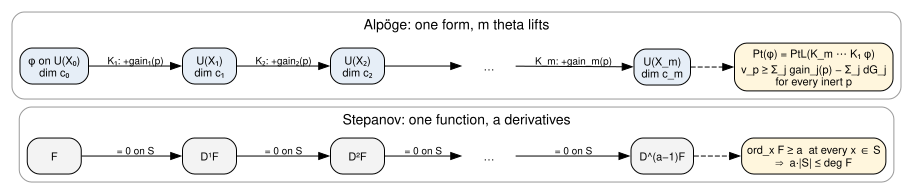

**Why not a power?** Composing the same kernel $m$ times, or multiplying $m$ copies of the same theta series, would be the attempt $(g^c-1)^a$: the archimedean size would be multiplied like the divisibility. The chain uses groups of increasing ranks. One may hope that the spaces of forms offer new usable directions, as Stepanov's unknowns must outnumber the conditions ($2JK>a(K+J)+\cdots$). The export imposes $k\ge x\,m$ (`Win_at`): the base rank grows with the length of the chain ⟦I⟧, like the dimension count that guarantees the existence of $F$.

**The weights are aligned.** The prime sum to be bounded, with Riesz weights, is written term by term as $\sum_{i\ \text{odd}}\big(a/p^i-w_j(p,i)\big)_+$. It is **the same shape as the truncated gain**. Four profiles must nevertheless be distinguished: the requested Riesz weight, the raw gain of Theorem A, the gain after truncation (the flow program of § 3.5) and the gain actually provided by `LinkG_at`. The construction chooses the thresholds $\mathrm{cap}_j$ of the lifts according to the $w_j$; whether there is term-by-term identity, or only domination with a quantified remainder, which would suffice, has not been established by following the instantiations. This is the requirement "the profile must follow the weight" of § 2.4, realized layer by layer. The possibility of realizing these thresholds simultaneously is a result of the construction, not a consequence of the mere shape of the expressions. The condition linking the two sides (`LinkG_at`) says that, for each inert prime $p$,
$$\sum_{j=1}^m(\text{contribution of }p\text{ to the }j\text{-th term})\;-\;\text{losses}\;\le\;\sum_{j=1}^m\mathrm{gain}_j(p).$$
Once the weights are aligned, this inequality is almost an identity. The whole difficulty is to **build** lattices, kernels and periods that **realize** these gains, and to **control the losses**.

### Workshop 3. Composing without losing the gains

In workshop 2 we identified a desired gain of $84$ at the prime 3. Imagine four successive operators between lattices, whose coefficients are divisible by $3^{84}$. The composite would have coefficients divisible by $3^{336}$. This is an immediate consequence of $v_3(AB)\ge v_3(A)+v_3(B)$, where $v_3(A)$ is the minimum of the valuations of the entries. The inequality may be strict: $A=(1\ \ 1)$ and $B={}^t(1\ \ p-1)$ give $AB=p$, while $v_p(A)=v_p(B)=0$. It guarantees neither injectivity nor that the gains are the ones sought, column by column. But suppose that, to extract a useful component at each step, one has to divide by $3^2$. The guaranteed gain is then only $4(84-2)=328$. Each denominator enters with the opposite sign to each gain.

This is a fictitious balance: neither the four operators nor the values 84 and 2 are objects extracted from Lean. It shows exactly what must be controlled when kernels are composed. In the proof, valuations are local, gains depend on the places and the weights, and the chain must work simultaneously for a large number of primes.

We can now understand why multiplying valuations does not by itself constitute a proof. The model $K_j=3^{84}I$ would indeed produce the gains above, but the norm of the composite would also be multiplied by $3^{336}$. The inequality would gain nothing. The real issue is the ratio between the divisibility gain, the archimedean cost and the cost of projecting onto the useful objects. The growth of the groups is a way of building a family of different kernels; it does not by itself establish a net gain. The comparison of slopes will measure precisely this ratio.

### 4.4 The full dictionary

| Stepanov | Alpöge |
|---|---|
| Curve $y^2=g(x)$ over $\mathbb F_p$ | Twisted Chebyshev sum over the inert primes of the host $E$ |
| Points $x\in S$ | Inert primes $p$ |
| Auxiliary function $F$ | A form φ and its lifts; the lattice $N_u$ of their periods |
| Order of vanishing $a$ | Length $m$ of the chain |
| $D^kF=0$ on $S$ by an identity | Theorem A, valid at all inert $p$ at once |
| $X^{jp}$, constants for differentiation | Frobenius and CM points: the odd layers $a/p^e$ (§ 3) ⟦I⟧ |
| $\operatorname{ord}(FG)=\operatorname{ord}F+\operatorname{ord}G$ | $v_p(K_m\cdots K_1)\ge\sum_jv_p(K_j)$ |
| Siegel lemma (existence of $F$) | Families of forms on definite groups; Bost's slope inequality (§ 5.4) |
| $a\cdot\lvert S\rvert\le\deg F$ | Difference of slopes ≤ archimedean terms (§ 5) |
| Fixed cost $p/a$, marginal cost $a$ | Error $x/m$, loss $m$ per lift (§ 6) |
| $a\approx\sqrt p$ | $m\approx\sqrt x$ |

This transposition, from auxiliary functions over finite fields to divisibility and slopes over ℤ, extends the transcendence methods of Thue, Siegel and Bombieri, of which **Bost**'s slope inequalities are the modern form.

### 4.5 What the graph says

The chain and the computation of the gains (`chainMat`, `ColChain`, `yProd`, `gainP`, `LinkG_at`) weigh about **0.1 %** of the closure (dominated weight, in export lines). As with Theorem A, the multiplicity mechanism is small. What weighs is what the chain **presupposes**:

- definite Hermitian spaces with prescribed signatures at every level;
- kernels with **integral** coefficients, without which the additivity of valuations means nothing;
- rational periods (test vectors, Siegel–Weil).

This is the "construction of the objects", 36 % of the volume (§ 7). The denominators $\mathrm{dG}_j$ point to Siegel masses, whose archimedean computation is the subject of question 4.

> **Answer to question 3.** Stepanov bounds $|S|$ with a function that vanishes to order $a$ on $S$ with a degree well below $a$ times the naive degree. He manages this because differentiation ignores the $X^{jp}$, which equal $X^j$ on $S$. A multiplicity obtained by taking a power is useless: one needs **new** layers, which add up. Over ℤ, a layer is a $p$-adic divisibility gain at the CM point (§ 3). Theta lifts provide the operation that adds one, and that composes: the period of the $m$-th lift is the product $K_m\cdots K_1$ of kernel matrices, and the valuations of a product add up. Groups of increasing ranks provide distinct kernels; the actual novelty of each layer and its cost rest on the construction. The length $m$ of the chain plays the role of the order of vanishing, and it balances like it at $\sqrt x$.

## 5. Why the archimedean constraints bring back the expected main term

§§ 2 to 4 describe the mechanism that must provide the $p$-adic half of the identity of § 2.1, $\sum_pv_p(M)\log p=\log|M|$. We now have an object (a lattice of periods) whose divisibility, prime by prime, follows the Riesz weight, with $m$ stacked layers. The other half remains: **the size**. For Chebyshev, it was $\binom{2n}{n}\le4^n$, and it took one line. Here, it is the most delicate part, for a simple reason. The prime sum to be bounded is $y\log y$ up to a main term, and one wants a $\sqrt y$ error. The archimedean bound must therefore **reproduce the main term exactly**, and leave room only for the fluctuations. This section explains why that is possible, and what it demands.

### 5.1 One number, seen from both sides

Back to $y!$ (§ 2.3). The product formula, applied to this single integer, gives two ways of computing its logarithm:
$$\underbrace{\sum_{m\le y}\Lambda(m)\Big\lfloor\frac ym\Big\rfloor}_{\text{finite places: Legendre}}\;=\;\log y!\;=\;\underbrace{y\log y-y+\tfrac12\log(2\pi y)+O(1/y)}_{\text{infinite place: Stirling}} .$$
The left-hand side requires knowing all the primes. The right-hand side does not know them: it is real analysis, the integral of $\log t$ corrected by Euler–Maclaurin. The two are **equal**. The main term $y\log y-y$ on the prime side is thus computed, without a single prime, by the archimedean size.

With $\binom{2n}{n}$, Chebyshev's identity (§ 2.3) and Stirling likewise give:

| $n$ | $\log\binom{2n}{n}$ (exact) | Stirling: $n\log4-\frac12\log(\pi n)$ | $n\log4$, predicted by $\psi(x)\sim x$ |
|---:|---:|---:|---:|
| 10 | 12.1268 | 12.1393 | 13.8629 |
| 1,000 | 1,382.2680 | 1,382.2681 | 1,386.2944 |
| 10⁶ | 1,386,286.8810 | 1,386,286.8810 | 1,386,294.3611 |

The archimedean side knows the main term $n\log4=\sum_k(-1)^{k+1}\,2n/k$, the one $\psi(x)=x$ would give. It knows it up to $\frac12\log(\pi n)$, with no error coming from the primes.

**Why.** The two sides are governed by different Dirichlet series:
$$\sum_n\frac{\log n}{n^s}=-\zeta'(s)\qquad\text{and}\qquad\sum_n\frac{\Lambda(n)}{n^s}=-\frac{\zeta'}{\zeta}(s).$$
One passes from one to the other by multiplying by $\zeta(s)$, since $\log n=\sum_{d\mid n}\Lambda(d)$: this convolution by 1 is what produces the $\lfloor y/m\rfloor$. But $-\zeta'$ has **only one pole, at $s=1$**: the zeros of ζ, which are poles of $\zeta'/\zeta$, are killed by the multiplication by ζ. The series $-\zeta'$ explains why the zeros give no poles in this computation; Stirling independently provides the precise evaluation of the factorial.

> **The principle, illustrated by the factorial.** Convolution by 1 removes the poles of $-\zeta'/\zeta$ at the zeros of ζ. The quantity $\log y!$ therefore has an archimedean computation that does not depend on an estimate of these oscillations. For the real proof, the formulas for masses, norms and periods must produce the appropriate main term with sufficient precision. This coincidence requires a specific identity or computation: it does not follow from the mere fact that the volumes are known exactly.


This is also what limits $y!$ ⟦I⟧. Its profile $\lfloor y/m\rfloor$ amounts, on the Dirichlet-series side, to **multiplying by $\zeta(s)$**. The sawtooth separating it from the Riesz weight contains the fluctuations with the opposite sign, and cancels them: $y!$ can say nothing about the zeros. The profile produced by the chain (§ 4.3) must follow the Riesz weight itself, without that factor ζ.

### 5.2 How much precision? A counterexample

The main term is huge and the target tiny:

| $y$ | main term $y\log y$ | target $\sqrt y$ | required relative precision |
|---:|---:|---:|---:|
| 10⁶ | $1.4\cdot10^{7}$ | $10^{3}$ | $7\cdot10^{-5}$ |
| 10²⁰ | $4.6\cdot10^{21}$ | $10^{10}$ | $2\cdot10^{-12}$ |

*Counterexample.* Replace Stirling by the crude bound $y!\le y^y$. One gets $S(y)\le y\log y$, hence $G(y)\le(1+\gamma)\,y$. Forgetting a single term, here $-y$, makes an error of size $y$, a thousand times the target already at $y=10^6$. An archimedean bound that loses **a constant factor** is fatal, and a factor $1+o(1)$ is not enough either. One needs **equalities**, or inequalities whose additive error is at most of order $x^{1/2+O(\varepsilon)}$; a relative precision of $x^{-1/2}/\log x$ corresponds to the strict target $\sqrt x$ for a main term of order $x\log x$.

This is the difference in nature between the two sides. The $p$-adic side may lose (some $O(\log a)$ per prime, Hecke denominators), provided the total losses stay below $\sqrt x$. The archimedean side must be **exact on the main term**.

### 5.3 Exact volumes: three examples

For some arithmetic objects, exact size formulas exist. The three examples below show recurring ingredients: values of Γ, powers of π, a discriminant, and values of ζ or of L-functions at points where the identities needed can be established without assuming GRH.

**(a) A Siegel mass.** The even unimodular lattices of rank 8 form a single class, $E_8$. Siegel's mass formula gives
$$\sum_{[L]}\frac1{|\mathrm{Aut}\,L|}=\frac{|B_4|}{8}\cdot\frac{|B_2|}{4}\cdot\frac{|B_4|}{8}\cdot\frac{|B_6|}{12}=\frac1{696\,729\,600},$$
which is indeed $1/|W(E_8)|$. In higher ranks, the Bernoulli numbers bring in values such as $\zeta(12)$. By the functional equation, $|B_{2j}|=2\,(2j)!\,\zeta(2j)/(2\pi)^{2j}$. A mass is therefore a product of **factorials** (values of Γ), **powers of π** and $\zeta(2),\zeta(4),\dots$: values of ζ at $s\ge2$, where the Euler product converges absolutely. Since the Euler product converges absolutely at these points, the computation does not require knowing the zeros of ζ.

**Rank 16, where the formula sees two lattices.** In rank 16, the genus contains two classes: $E_8\oplus E_8$, with $|\mathrm{Aut}|=2\,|W(E_8)|^2=970\,864\,271\,032\,320\,000$, and $D_{16}^+$, with $|\mathrm{Aut}|=2^{15}\cdot16!=685\,597\,979\,049\,984\,000$. The sum of the inverses is exactly
$$\frac1{970\,864\,271\,032\,320\,000}+\frac1{685\,597\,979\,049\,984\,000}=\frac{691}{277\,667\,181\,515\,243\,520\,000},$$
which is what the mass formula gives (checked in exact fractions). The 691 is the numerator of $B_{12}$, hence of $\zeta(12)$. Since $|B_{2j}|=2(2j)!\,\zeta(2j)/(2\pi)^{2j}$, a mass is a product of factorials, powers of π and values $\zeta(2j)$. **All the primes appear, but through absolutely convergent Euler products, hence controllable without knowing the zeros**: the same phenomenon as Stirling in § 5.1. This property alone does not establish the cancellation of the main term: that requires the identities of § 5.5.

**(b) A CM period.** For the curve of § 3, $y^2=x^3-x$, the integral of $dx/y$ along the real branch, from 1 to infinity, can be computed exactly:
$$\int_1^\infty\frac{dx}{\sqrt{x^3-x}}=\frac{\Gamma(1/4)^2}{2\sqrt{2\pi}}=2.622057\ldots$$
This is the lemniscate constant ϖ, checked numerically in [`tools/modeles.py`](tools/modeles.py). The full real cycle runs over two branches: its period for $dx/y$ is $2\varpi$, and ϖ for the usual invariant differential $dx/2y$. The normalized quantity of `CM.DegSt` requires further conventions: ϖ is not directly Ω. The **Chowla–Selberg formula** generalizes this computation. The archimedean size of a CM object is a product of values $\Gamma(a/d)^{\pm1}$, with exponents given by the character $\chi_{-d}$ of the CM field.

**(c) The norm of a theta lift.** The **Rallis formula** expresses the norm $\langle\theta(\varphi),\theta(\varphi)\rangle$ of a lift as the product of a special value of an L-function of φ and explicit local factors. It is present in the closure, with 308 declarations:

- the convergence of the Rallis inner product is proved by the **doubling method** (`rallis_of_dm`, about 64,000 lines), and it enters the core through the hypothesis `ThetaLocalInputs`;
- the tower property is proved (`LowerLiftsZero`: lifts to lower ranks vanish);
- archimedean factors appear (`ArchimedeanRallisFirst` to `Fifth`);
- the normalizing factors are products of Hecke L-functions, taken in absolute convergence (`trivPar_euler`, $\operatorname{Re}s>n/2+1$).

As with the masses, L-functions appear only at points where the identities needed can be established without assuming GRH; uniform estimates of $L'/L(1,\chi)$ as the conductor varies remain non-trivial. The exact role of these norms in the size of each link of the chain has not been followed ⟦I⟧.

### Interlude. From the determinant to the Arakelov degree

Why introduce slopes instead of being content with the product formula? Because the proof does not build a single auxiliary integer, but a family of maps between lattices. One needs a measure of size that takes the dimension into account and is compatible with local division.

Let us start with a two-dimensional example. Take

$$A=\begin{pmatrix}3&2\\6&-2\end{pmatrix}. $$

The first column is divisible by 3; the second by 2. The determinant is nonzero and a multiple of 6, so $6\le|\det A|$. Hadamard's inequality gives on the other side

$$6\le|\det A|\le\|A_1\|\|A_2\|=\sqrt{45}\sqrt8.$$

This inequality already has the desired shape: $\log3+\log2\le\log\|A_1\|+\log\|A_2\|$. A sum of logarithms of primes has been bounded by Euclidean norms.

The same computation can be phrased without explicitly mentioning divisibility of columns. The map $A:\mathbb Z^2\to\mathbb Z^2$ remains integral on the enlarged lattice

$$L'=\tfrac13\mathbb Z e_1\oplus\tfrac12\mathbb Z e_2.$$

The covolume of $L'$ is $1/6$; its slope (in our Euclidean convention, not normalized by the field) is $-\log(1/6)/2=\tfrac12\log6$. The slope of the initial lattice was zero. Dividing the coordinates has thus turned the valuations into an increase of slope.

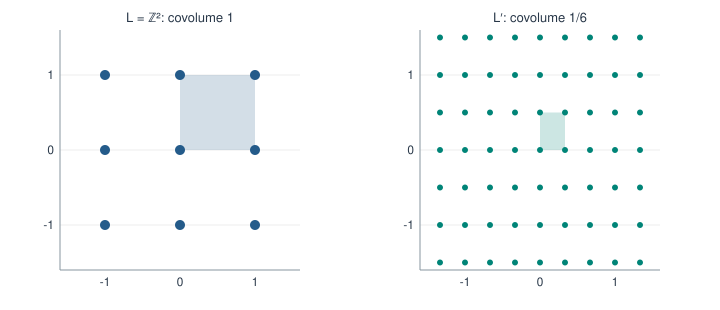

The matrix $A$ maps $L'$ onto a sublattice of $\mathbb Z^2$ of integer covolume at least 1. Hence $|\det A|/6\ge1$, exactly the first inequality. This reading brings out injectivity: if the determinant were zero, no information of this kind would be available. For lattices of different ranks, one works with volumes in the target space, sublattices and the maximal slope. An abstract version of Hadamard's inequality leads to Bost's slope inequalities, which work over number fields and with norms at several places.

**Why Theorem S?** A volume is sensitive to dependence between vectors. Two almost collinear unit vectors span a parallelogram of almost zero area. More generally, if $N$ unit vectors have off-diagonal inner products bounded by $\eta$, their Gram matrix $G=I+E$ satisfies $\|E\|_{\mathrm{op}}\le(N-1)\eta$. If $(N-1)\eta<1$, it is invertible, and all its eigenvalues lie between $1-(N-1)\eta$ and $1+(N-1)\eta$. One then also controls the Gram determinant. This elementary lemma is not Theorem S; it shows why a quantitative quasi-orthogonality estimate can provide control of rank, norms and volumes at once. In the real problem, the dimensions grow, which makes the smallness of the error crucial.

**Propagating slopes.** A slope inequality is not always enough, and a two-dimensional example shows why. The lattice $Q=\mathbb Ze_1\oplus\mathbb Z(Me_2)$ in $\mathbb R^2$, with $M>1$, has maximal slope 0, reached by $\mathbb Ze_1$, and mean slope $-\frac12\log M$. An isometric map $\mathbb Z\to\mathbb Ze_1$ controls one direction but says nothing about $M$; a family of maps of good height does not help either if they all aim at the same direction. What counts is the **rank** of the sum of the images, and how it resists when directions are removed. Rubinstein [R2, Proposition M4] derives from this a proof of the mean-slope inequality, distinct from the Lean route `TheoremF`. Its core reduces to an elementary lemma. Let target slopes $y_1,\dots,y_D$, a reference slope $s$, some $R>0$ with $y_i\ge s-R$, and $N(t)=\#\{i:y_i<s-t\}$. If $N(t)/D\le f(t)$ for $0<t<R$, then
$$\frac1D\sum_iy_i\;\ge\;s-\int_0^R\min\big(1,f(t)\big)\,dt,$$
since $(s-y_i)_+=\int_0^R\mathbf 1_{y_i<s-t}\,dt$. In [R2], a robust rank bound provides $f(t)=(\eta+4\,\mathrm{sp}/(\mathrm{sp}+t))/(1-\delta_*)$, where $\mathrm{sp}>0$ measures the spread of the source slopes, with $\eta\ge0$ and $0\le\delta_*<1$. The untruncated integral $\int_0^Rf=(4\,\mathrm{sp}\log(1+R/\mathrm{sp})+\eta R)/(1-\delta_*)$ bounds that of $\min(1,f)$ from above, and brings out a logarithm that seemed arbitrary in the budget. The truncated version can also be computed exactly. If $\eta\ge1-\delta_*$, then $\min(1,f)=1$ and the bound says nothing more than $y_i\ge s-R$. Otherwise $f$ equals 1 at $t_*=\mathrm{sp}\big(4/(1-\delta_*-\eta)-1\big)>0$, and with $u=\min(R,t_*)$,
$$\int_0^R\min(1,f)\,dt=u+\frac{\eta(R-u)+4\,\mathrm{sp}\log\frac{\mathrm{sp}+R}{\mathrm{sp}+u}}{1-\delta_*}.$$
When $R\gg\mathrm{sp}$, the logarithmic term adds up the deficits over a range of scales. Theorem S then takes on a different face. It does not merely make periods almost orthogonal: it guarantees that the divisibility information **propagates** to almost all directions of the target lattice, and the slope measures what survives this transfer. This is a reading ⟦I⟧ of the architecture: we have not checked that `TheoremF` is an instance of this principle.

We thus have an arithmetic inequality and a geometric estimate that meet. The last step is to know which main term they are compared with.

### Workshop 4. The prime 3 seen through the slope

In the model of workshop 3, we had guaranteed a gain $3^{328}$ on a fictitious composite. If it maps into an integral lattice, one can, in the model where the gain is uniform, replace the source lattice $L$ by $3^{-328}L$. At fixed archimedean norm, the covolume is divided by $3^{328r}$ in rank $r$. The slope therefore increases by $328\log3$, independently of the rank. Divided by the four layers and by $b=3$, the normalized contribution is $(328/12)\log3$, to be compared with the $28\log3$ of the odd part of Riesz for 3. One reads off at once the loss due to the denominators. The other primes produce similar additive terms. This is the idea of transferring the local sum to a global slope.

### 5.4 In the proof

**Slopes: the product formula for lattices.** A Hermitian lattice over a number field $K$ is a projective $\mathcal O_K$-module with norms at the infinite places. Its Arakelov degree is $\widehat{\deg}=-\log\operatorname{covol}$, and its slope is $\widehat\mu=\widehat{\deg}/\mathrm{rank}$. The degree decomposes into contributions of the finite places, local lengths times $\log N\mathfrak p$, and of the infinite places, norms. This is the product formula of § 2.1, for a lattice instead of an integer. For an integral ideal $I$, setting $L'=I^{-1}L$ raises its slope by
$$\widehat\mu(L')-\widehat\mu(L)=\sum_{\mathfrak p}v_{\mathfrak p}(I)\log N\mathfrak p\quad(\text{normalized}).$$
The divisibility of the periods (§ 4.3) makes it possible to divide the lattice of forms $N_u$ while keeping the period pairing $B_u:N_u\to R^\vee$ integral (`divClausesR_of`, `DivIntoDualShift`). In the conventions of the reconstruction, the lattice is enlarged by multiplication by the fractional ideal $I_u=\prod_ww^{-\lfloor e_w\sigma_u(w)\rfloor}$. It takes the integer part, and this rounding loss, accounted for explicitly (`round_le`, `NprimeMuR`), is of order $x\,n\,e^{x^{\varepsilon/3}}$. That is a factor $e^{-x^\varepsilon(1-o(1))}$ below the other remainders: it is negligible.

**The ceiling: slope inequality.** For $\varphi:E\to F$ injective, $\widehat\mu(E)\le\widehat\mu_{\max}(F)+h(\varphi)$ (Bost). This is Stepanov's Siegel lemma (§ 4.1), in arithmetic form. It is applied to the $B_u$ (`FrameF`). Three ingredients make it exact to the required degree:

- **the height of the $B_u$ is almost zero**. Periods of different forms are almost orthogonal: this is Theorem S, a Petersson- or Kuznetsov-type formula for Bessel coefficients, with a factor $1+b^{-6}$, where $b=e^{x^\varepsilon}$, close to 1 with a **super-polynomially small** defect, well below the $x^{-1/2}$ required in § 5.2;
- **the slope of the target lattice** is computed by exact volumes;
- **a covolume bound** for lattices of automorphic forms, through Arakelov geometry on integral models of Shimura varieties (Hironaka, Moriwaki, arithmetic Hilbert–Samuel, toroidal compactifications).

**Three properties, one map.** The slope inequality needs a map that is at once integral, of small height and of large rank. Three maps each having one of these properties do not suffice: on Euclidean $\mathbb Z^2$, $f_1=\mathrm{diag}(M,0)$ is integral, $f_2=\mathrm{diag}(1/M,0)$ has small norm, $f_3=\mathrm{diag}(M,M)$ has rank 2, and no information passes from one to another. Rubinstein [R2] points out that his reconstruction must identify three such maps. In Lean, the general statement of the balance (`TheoremF`) requires the three properties **of one and the same family** $B_i$: integrality ($B_i(N_i)$ contained in the target lattice), height, and rank (through a matrix defined from the matrix of $B_i$). Where the actual datum enters (`frame_at_of`), $B$ is instantiated by **a single field** of the division structure, `DivData.Bk`, the period pairing $B_u:N_u\to R^\vee$. The junction is thus ensured by construction; what remains to be understood is why the constructed pairing has the three properties (article, § 5.7).

**The archimedean terms, extracted from the export.**

- **The mass is an equality.** `SiegelMassRatioCM` asserts an **equality**, not an inequality, for the ratio of the masses of the standard Hermitian lattices of ranks $M$ and $M-1$ over an unramified CM field $K$ ($M\ge3$, $f$ infinite places):
  $$\frac{\mathrm{mass}_M}{\mathrm{mass}_{M-1}}=\frac{\big((M-1)!\,(v/\pi)^M\big)^{f}}{\sqrt{(2v)^{f}}}\cdot\prod_{\mathfrak P}\mathrm{eulerFac}(K,M,\mathfrak P),\qquad v=\tfrac12|\mathrm{disc}\,K|^{1/2f}.$$
  One finds exactly the structure of example (a): a factorial $(M-1)!=\Gamma(M)$, powers of π, the discriminant, and an **Euler product at $s=M\ge3$**, in absolute convergence (`massRatioRightSide`, `lValEta`).
- **The size of each column.** `Count_at` bounds the size $\log T(u)$ of a column by
  $$\sum_{j\in\text{lifts}}\frac1f\sum_{\tau}\log\frac{w_{j,\tau}\,v}{\pi}+m\log(g_0g_1)-C(\dots)\;\le\;\log T(u)\;\le\;C\,m\,L .$$
  This is a sum, **over the $m$ lifts** and over the CM places τ, of terms in $\log(w\,v/\pi)$, of Γ type. The archimedean side thus stacks up link by link, like the $p$-adic side of § 4.3.
- **The constant of the main term.** It is supplied unconditionally (`Lnk.char_at`): $\ell(\psi)=(L'/L)(1,\chi)$, the value at $s=1$ that defines $g(y,\chi)=S(y,\chi)+y\,(L'/L)(1,\chi)$ in § 1.2.

**The assembly** takes place in `linkCore`:
$$\sum\mathrm{ASK}\;\le\;\mathrm{Ga}+\text{loss},\qquad\mathrm{Ga}\;\lesssim\;\Delta\widehat\mu,\qquad\widehat\mu(N_u)\;\le\;\widehat\mu_{\mathrm{dual}}(R)+\cdots$$

- The first term is the von Mangoldt sum over the inert primes (`ASK`).
- `Ga` is the sum of local gains weighted by $\log N\mathfrak p$ (`Loss7`, `SlopesN_at`).
- The slope is capped by the slope inequality (`FrameF`) and by the Γ-type terms (`Count_at`).

Hence: **prime sum ≤ archimedean terms + loss $x^{O(\varepsilon)}$**. On the export, one reads these inequalities and the archimedean terms. The exact cancellation of the main term is the identity `key_identity5`. Its three sources are: Stirling for $a\log a-a$; a Chowla–Selberg formula for the height of CM lines (`CM.DegSt`, proved), which supplies $-\gamma+L'(1,\chi)/L(1,\chi)$; and the Γ terms of `Count5` for the mean of the $\log w$ (Part II, "Five points clarified", point 2). The archimedean size is that of $a!\,\Omega^{-a}$: the $a$-th derivative of the theta series renormalized by the period Ω.

**An exact model of the normalization.** Let $L$ be a Hermitian line over $\mathbb Z$, generated by $e$ of norm $r>0$, and set $\widehat{\deg} L=-\log r$. Then $\widehat{\deg} L^{\otimes a}=a\,\widehat{\deg} L$ and $\widehat{\deg} L^\vee=-\widehat{\deg} L$. If $2\widehat{\deg} L=\log\Omega$, the norm of $e^{\otimes2a}$ is $r^{2a}=\Omega^{-a}$, and the vector $a!\,e^{\otimes2a}$ has log-norm
$$\log(a!)-a\log\Omega,$$
exactly the shape of the archimedean term of the balance. This model does not say that the Lean object is this tensor power: the exponent $2a$, the sign and the metrics must be read in the actual construction. It only shows why the factor 2 of `CM.DegSt` ($2\widehat{\deg}=\log\Omega$) is structural. Over a number field, the degree normalized by $[K:\mathbb Q]$ keeps both identities; what remains is to check, arrow by arrow, the conventions (norm or squared norm, raw or normalized degree) along the path `CM.DegSt` → `LamDegSt` → `numGood_of_famQ` → page bounds → `LinkDIV_at`.

### Workshop 5. Where does the constant of the main term come from?

Stirling's model must be used without making it say more than it says. In the Riesz case, the main term is not $y\log y-y$ but $y\log y-(1+\gamma)y$. Where does this difference come from? We can identify it exactly by a classical analytic computation, before looking for its automorphic counterpart.

Write $s=1+h$. The Laurent series of ζ gives

$$-\frac{\zeta'}{\zeta}(1+h)=\frac1h-\gamma+O(h),\qquad \frac{y^{1+h}}{(1+h)h}=y\left(\frac1h+\log y-1+O(h)\right).$$

The coefficient of $h^{-1}$ in the product is $y\log y-(1+\gamma)y$. The three terms have distinct origins: $y\log y$ comes from the expansion of $y^h$, $-y$ from the factor $(1+h)^{-1}$, $-\gamma y$ from the regular part of the logarithmic derivative. For a nontrivial primitive character, the singularity at $s=1$ comes only from the kernel; the linear constant is $-L'(1,\chi)/L(1,\chi)$.

An arithmetic construction that claims to bound the Riesz sum at the scale $\sqrt y$ must therefore recover these constants, not only the coefficient of $y\log y$. This can be summarized as a compensation obligation. If $M(y)$ denotes the main term and the slope gain gives $M(y)+G(y)-E_1$, while the archimedean ceiling is $M(y)+E_2$, then

$$M(y)+G(y)-E_1\le M(y)+E_2\quad\Longrightarrow\quad G(y)\le E_1+E_2.$$

But if the ceiling were $M(y)+cy+E_2$ with $c>0$, the method would only give $G(y)\le cy+E_1+E_2$. A difference in a constant is decisive. This is why the data `Count_at`, `SiegelMassRatioCM` and `Lnk.char_at` are interesting together: the first gives logarithmic terms, the second an identity of masses, the third the analytic constants. Putting them side by side does not yet prove their compensation. That would require following the assembly of these expressions in `linkCore` and `Deduction.ch_top`, with the exact normalizations. This work is identified here as a task, not replaced by an analogy with Stirling. The export answers (Part II, "Five points clarified", point 2). The main term is defined there in full, `MAIN(a, w) = a·(log a − 1 − γ + ℓ(χ) − mean of the log w)`. On the archimedean side, $a\log a-a$ comes from Stirling applied to $a!$; $-\gamma+\ell(\chi)$ comes from a **Chowla–Selberg formula for the height**, proved in the project (`CM.DegSt`: twice the Arakelov degree of a CM line equals $\gamma+\log(2\pi/\mathrm{rd}_E)-L'(1,\chi)/L(1,\chi)$); the mean of the $\log w$ comes from the Γ terms of the columns. The identity `key_identity5` assembles these three sources. The computation can be redone term by term, starting from the division hypothesis `DIV` (Part II, "Five points clarified", point 2), which bounds the slope jump by
$$\sum_t\Big[m\big(\mathrm{ph}(a_t)-a_t\log\Omega\big)-a_t\log T(u)\Big]+\mathrm{EDiv},\qquad\mathrm{ph}(y)=y\log y-y,\qquad\log\Omega:=\gamma+\log\frac\pi v-\ell(\chi).\tag{D}$$

**The computation, term by term.** The statements read suffice to redo the algebra. `Count5` is not an equality: it **bounds $\log T(u)$ from below** by
$$\Lambda_5=\sum_j\frac1f\sum_\rho\log\frac{w_{j\rho}v}{\pi}+m\,\mathrm{lg}-c_{\mathrm{Count}}\Big(L_a+\frac{m^2L_a}k\Big),\qquad f=|\Phi|,$$
and from above by $c_{\mathrm{Count}}\,m\,L$. Since $\log T(u)$ enters (D) with a minus sign, the lower bound suffices. For a column of size $a$, replace $\log T(u)$ by $\Lambda_5$, and write $\overline{\log w_j}$ for the mean over Φ:
$$m\big(a\log a-a\big)-ma\Big(\gamma+\log\frac\pi v-\ell(\chi)\Big)-a\sum_j\Big(\overline{\log w_j}+\log\frac v\pi\Big)-ma\,\mathrm{lg}+a\,c_{\mathrm{Count}}\Big(L_a+\frac{m^2L_a}k\Big).$$
The terms in $\log(\pi/v)$ and $\log(v/\pi)$ cancel, and what remains is
$$\sum_{j<m}a\Big(\log a-1-\gamma+\ell(\chi)-\overline{\log w_j}\Big)-ma\,\mathrm{lg}+a\,c_{\mathrm{Count}}\Big(L_a+\frac{m^2L_a}k\Big)=\sum_{j<m}\mathrm{MAIN}(a,w_j)-ma\,\mathrm{lg}+a\,c_{\mathrm{Count}}\Big(L_a+\frac{m^2L_a}k\Big).\tag{C}$$
Summed over the columns, this is exactly the identity `key_identity5`, where $\Lambda_5$ is called `Lam5`: the algebra is reconstructed, and Lean checks it. The proof term shows how: `key_identity5` sets `h := Data.key_identity …`, whose conclusion involves `L` and a term $2\log\Gamma/(fk)$, then concludes with `linear_combination h`; once `Lam5` is unfolded, the `La` term appears on both sides of `key_identity5` and cancels. The actual cancellation is therefore in `key_identity`. It is a **symbolic** cancellation. It says that the expressions cancel; that actual objects realize the bounds it assumes is a matter for the construction (Part II). It remains to justify that $\log\Omega$, defined by this formula, really is the size of a period: this is the content of a theorem we shall meet in § 5.5, a Chowla–Selberg formula.

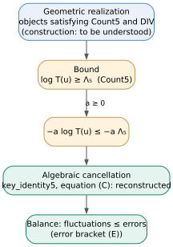{width=38%}

There is a remarkable symmetry here. **The same factorial $a!$** gives Legendre's divisibility on the $p$-adic side (§ 3) and Stirling's main term on the archimedean side. Since $\log y!=\sum\Lambda(m)\lfloor y/m\rfloor$, one and the same number is read on both sides of the product formula.

### 5.5 The period Ω: a Chowla–Selberg formula

Workshop 5 left a debt. The archimedean side contains $-a\log\Omega$, with
$$\log\Omega:=\gamma+\log\frac\pi v-\ell(\chi),\qquad \ell(\chi)=\frac{L'}{L}(1,\chi),$$
and it is this term that supplies the constant $-\gamma+\ell(\chi)$ of the main term. But why would the size of a geometric object know $\gamma$ and the logarithmic derivative of an L-function? The answer rests on three classical ideas: a period is a size; a CM period is computed by values of Γ; and values of Γ translate into L-functions.

**A period is a size.** An elliptic curve over ℂ is a quotient $\mathbb C/\Lambda$. Its invariant differential $\omega=dx/y$ integrates along loops into **periods**, which generate the lattice Λ. For $y^2=x^3-x$, it is the lemniscate constant ϖ (§ 5.3 (b)). In Arakelov geometry, the line generated by ω is given the norm $\|\omega\|^2=\frac i2\int\omega\wedge\bar\omega$, the area of the fundamental domain of Λ. The Arakelov degree of this Hermitian line, the **Faltings height** up to sign, is therefore essentially $-\log$ of the period. **A period is exactly the kind of archimedean size a slope inequality can use.**

**A CM period is computed by the Γ function.** For a general curve, the period is not given by a comparable formula. For a curve with complex multiplication by the ring of integers of $K=\mathbb Q(\sqrt{-d})$, Chowla and Selberg (1967) show that it equals, up to an algebraic number and a power of π,
$$\prod_{a=1}^{d-1}\Gamma\Big(\frac ad\Big)^{\chi_{-d}(a)\,w/(4h)},$$
where $h$ is the class number and $w$ the number of roots of unity of $K$. For $\mathbb Z[i]$ ($d=4$), only $\Gamma(1/4)$ and $\Gamma(3/4)=\pi\sqrt2/\Gamma(1/4)$ appear, whence the lemniscate formula.

**From values of Γ to L-functions, in two steps.**

1. *Lerch.* Write $L(s,\chi)=d^{-s}\sum_a\chi(a)\,\zeta(s,a/d)$, with the Hurwitz zeta function. Since $\partial_s\zeta(0,x)=\log\Gamma(x)-\tfrac12\log2\pi$ and $\sum_a\chi(a)=0$,
$$L'(0,\chi)=\sum_{a=1}^{d-1}\chi(a)\log\Gamma\Big(\frac ad\Big)-L(0,\chi)\log d .$$
The logarithm of a product of values of Γ weighted by χ **is** the derivative of $L(s,\chi)$ at 0.

2. *Functional equation.* For χ real and odd of conductor $d$, $\Lambda(s)=(d/\pi)^{(s+1)/2}\Gamma\big(\frac{s+1}2\big)L(s,\chi)$ satisfies $\Lambda(s)=\Lambda(1-s)$. Differentiating logarithmically at $s=0$, with $\frac{\Gamma'}\Gamma(\tfrac12)=-\gamma-2\log2$ and $\frac{\Gamma'}\Gamma(1)=-\gamma$, one gets
$$\frac{L'}{L}(0,\chi)=\gamma+\log\frac{2\pi}d-\frac{L'}{L}(1,\chi).$$
Euler's constant appears here, through the Γ function of the archimedean factor of the functional equation.

Put together: **the logarithm of a CM period is a combination of $\gamma$, $\log2\pi$, $\log d$ and $L'/L(1,\chi)$.** This is exactly the shape of $\log\Omega$.

**The example of $\mathbb Z[i]$, checked numerically.**

| Quantity | Value |
|---|---:|
| $L'/L(1,\chi_{-4})=\gamma+2\log2+3\log\pi-4\log\Gamma(\frac14)$ | 0.245610 |
| $L'/L(0,\chi_{-4})$ by Lerch, $\big(\log\Gamma(\frac14)-\log\Gamma(\frac34)\big)/L(0)-\log4$ | 0.783189 |
| $L'/L(0,\chi_{-4})$ by the functional equation, $\gamma+\log\frac{2\pi}4-L'/L(1)$ | 0.783189 |
| $\frac12\big(\gamma+\log\frac{2\pi}{2}-L'/L(1)\big)$ | 0.738168 |
| $\log\big(\Gamma(\frac14)^2/2\pi\big)=\log\big(\varpi\sqrt{2/\pi}\big)$ | 0.738168 |

The last line is $\log(\varpi\sqrt{2/\pi})$: the half-period ϖ, multiplied by a normalization factor $\sqrt{2/\pi}$. The last two lines are **equal**: in these normalizations, the logarithm of the normalized half-period equals one half of the expression defining `CM.logOm` for $\mathbb Q(i)$. The link with the $v$ of $\log\Omega$ (Workshop 5) is made precise below: $v=\mathrm{rd}_E/2$.

**The statement of the export.** The theorem `CM.DegSt`, proved in the project (`CM.PureDeg.degSt`, closure of 114,806 declarations), states this relation in the required generality:
```
CM.DegSt := ∀ E (CM field) H χ (Kronecker character) … ,
    2 · deg h (eigLat …)  =  CM.logOm E χ
CM.logOm E χ := γ + log (2π / rootDiscr E) − deriv (LFunction χ) 1 / LFunction χ 1
```
**Twice the Arakelov degree of an eigenline of a CM object of type (1,0) equals $\gamma+\log(2\pi/\mathrm{rd}_E)-L'(1,\chi)/L(1,\chi)$**, with Mathlib's `LFunction` and `deriv`. For $E=\mathbb Q(\sqrt{-d})$, the root discriminant is $\sqrt d$, and the functional equation above rewrites the right-hand side as $\frac{L'}L(0,\chi)+\frac12\log d$. One recognizes the Chowla–Selberg formula for the Faltings height, $h=-\tfrac12\frac{L'}L(0,\chi)-\tfrac14\log d$ (Colmez, in Deligne's normalization), provided the degree of the eigenline is identified with $-h$; the identification of conventions is our reading ⟦I⟧. In the export, the base case is built from an elliptic curve with complex multiplication by $\mathbb Q(\sqrt{-d})$, with $d\equiv3\pmod4$ and $d\ge7$, of lattice $\mathbb Z+\frac{1+i\sqrt d}2\mathbb Z$ (`CMCurve`). The theorem enters the core through `ArcCM.known_holds`, on the construction branch `ontoX`.

**The normalizations, read on the export.** The $\log\Omega$ of the balance (Workshop 5) and the `logOm` of the CM theorem are the same quantity, provided three definitions are read correctly. The field $E$ is not the quadratic field: it is the **large host field**, of degree about $x^{2+8\varepsilon}$, and $\mathrm{rd}_E$ is its root discriminant.

| Object | Expression | Declaration |
|---------------------|-----------------------------------------|------------------------|
| root discriminant of the host | $\mathrm{rd}_E=\lvert d_E\rvert^{1/[E:\mathbb Q]}$ | `Host.rdE`, `NumberField.rootDiscr` |
| parameter $v$ | $v=\mathrm{rd}_E/2$, by definition | `Host.v` |
| character | $\chi_{-d}$, quadratic character modulo the prime $d$, $d\equiv3\pmod4$ | `chiK`, `IsKroneckerChar` |
| constant $\ell$ | $\ell=\operatorname{Re}\,L'/L(1,\chi_{-d})$ | `dlogL D 1`, `logDerivativeAtOne` |
| $\log\Omega$ of the balance | $\gamma+\log(\pi/v)-\ell$ | `SizeData₂.logOm`, `NumDatum.logOm` |
| `logOm` of the CM theorem | $\gamma+\log(2\pi/\mathrm{rd}_E)-L'/L(1,\chi)$ | `CM.logOm` |
| bridge | $\operatorname{Re}\,\mathtt{CM.logOm}(E,\chi_{-d})=\log\Omega$, by unfolding the definitions | `exists_kronecker_logOm_re`, `exists_kronecker_cmLogPeriod_eq` |
| degree of an eigenline | $2\deg_h=\mathtt{CM.logOm}(E,\chi)$ | `CM.DegSt` (`eigLat`) |
| normalized degree | $\mathrm{ndeg}=\deg/[K:\mathbb Q]=\tfrac12\log\Omega$ | `MLine.ndeg`, `LamDegSt`, `lamDegSt_logOm₂` |
| use in the balance | $-a\log\Omega$, per column and per stage | `SizeData₂.MAIN`, `RecNums.logOm`, `HtNums.logOmτ` |

For $E=\mathbb Q(i)$, $\mathrm{rd}_E=2$ and $v=1$: one recovers the line $\frac12(\gamma+\log\frac{2\pi}2-L'/L(1,\chi_{-4}))$ of the previous table. Two points remain unread. The passage from the degree $\deg_h$ of `CM.DegSt` to the normalized degree of `LamDegSt` goes through `lam_ind_len_deg` and `cmLieStatements_iff_library`, of which we have read only the statements. And the identification of the Arakelov degree with minus a Faltings height remains an interpretation ⟦I⟧: a degree is not, in general, the logarithm of an individual period.

**Why this is exactly what was needed.** The main term of the prime sum is the residue at $s=1$ of $-\frac{L'}L(s)\frac{y^s}{s(s-1)}$. Its constant comes from the Laurent expansion at 1: $-\gamma$ for ζ, and $-\frac{L'}L(1,\chi)$ for a nontrivial character; the sign $+a\ell(\chi)$ in `MAIN` comes from the inert primes being selected by $(1-\chi_{-d})/2$, which subtracts the twisted sum (§ 1.2; Workshop 5). It is an **analytic** datum at $s=1$. The CM theorem says that this same datum is the **geometric size** of a line at a CM point. This is why the proof differentiates its theta series *at a CM point*: it is the place where the archimedean size of a renormalized derivative, $a!\,\Omega^{-a}$, knows both Stirling (through $a!$) and the constant of the main term (through Ω). The term $\log(\pi/v)$ left in $\log\Omega$ is compensated by the terms $\log(w\,v/\pi)$ of `CountF` (Workshop 5).

**The double role of complex multiplication.** The same CM object serves twice. At the finite places, supersingular reduction at an inert prime and the formal group of height 2 give the odd layers of divisibility (§ 3). At the infinite places, the Chowla–Selberg formula gives the constant $-\gamma+\ell(\chi)$ of the main term, and Stirling gives $a\log a-a$ (equation (C)). The two contributions meet in the slope inequality.

| Origin | Contribution, per column and per stage |
|---|---|
| Stirling, $\log a!$ | $a\log a-a$ |
| Chowla–Selberg, $-a\log\Omega$ | $-a\gamma+a\ell(\chi)-a\log(\pi/v)$ |
| Γ terms of the columns | $-a\,\overline{\log w}-a\log(v/\pi)$ |
| total | $\mathrm{MAIN}(a,w)=a\big(\log a-1-\gamma+\ell(\chi)-\overline{\log w}\big)$ |

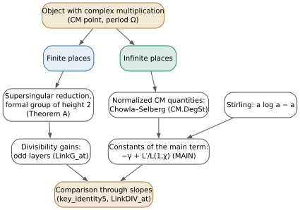

This table says where each term comes from, not only that a path exists in the graph. What remains to be read are the proofs of the transport, `numGood_of_famQ` and the page bounds, whose path is given in Part II ("Five points clarified").

**From CM degrees to lattice bounds: the page step.** The path of the CM formula to the division goes through "page bounds" (Part II). The skeleton of the proof, read with `trace_app.py --outline`, isolates its central step, which can be fully reconstructed. At stage $j$, let $K$ be the coefficient field, of degree $\delta$; $V$ the space of cusp forms; $M\subset V$ a lattice; $S_\sigma(F)$ the size of $F$ at the embedding $\sigma$, and $\mathrm{meanLogSup}(F)=\frac1\delta\sum_\sigma\log S_\sigma(F)$; $W\subset V$ the common kernel of the "coefficient of the jet at a CM point" functionals (this is exactly what `KillQ` and `DetectQ` say); and $Q=M/(M\cap W)$, of rank $\rho$. A functional $\varphi$ is **numerically good** (`NumGood`) if there is a Hermitian line $N$, of normalized degree $\le B_{\rm deg}$, such that $\varphi(M)\subset\mathfrak b^{-1}I_N$ at the finite places, with $\mathfrak b=\prod_\lambda\lambda^{b(\lambda)}$, and $\|\varphi(F)\|_{N,\sigma}\le e^{C_{\rm arch}}S_\sigma(F)$ at the infinite places.

The reconstruction has two steps: a separation lemma, which provides independent functionals over a common field, then a quotient bound by a determinant argument over that field.

> **Lemma (separation).** Let $W\subset V$ be as above and $\mathcal F$ a family of $K$-linear forms $V\to K_1$, with values in finite extensions $K_1$ of $K$. Assume that (1) they all vanish on $W$; (2) every vector of $V\setminus W$ is detected by at least one of them; (3) the family is stable under field embeddings over $K$. Then there exist a finite Galois extension $L/K$ and $\rho=\dim_K(V/W)$ forms of $\mathcal F$, embedded into $L$, whose $L$-linear extensions induce an isomorphism $L\otimes_K(V/W)\simeq L^\rho$.

*Proof.* If $\rho=0$, there is nothing to prove. Otherwise, extract finitely many forms whose common kernel over $K$ is $W$, decreasing the dimension of the kernel at each step thanks to (2). Take a Galois extension $L$ containing their fields of values, and add all their conjugates, which (3) allows. The common kernel of their extensions in $L\otimes V$ is Galois-stable, hence comes by descent from a subspace of $V$; by (2), this subspace is $W$. The extensions therefore span the dual of $L\otimes(V/W)$, and one extracts $\rho$ independent ones. $\square$

Condition (3) is not decorative. The single form $\varphi(x,y)=x+\sqrt2\,y$, with values in $\mathbb Q(\sqrt2)$, detects every non-zero vector of $\mathbb Q^2$, but its extension to $\mathbb Q(\sqrt2)^2$ has a kernel of dimension 1: a family that detects over $K$ need not detect after extension of scalars. Its conjugate $x-\sqrt2\,y$ repairs the defect.

> **Proposition (quotient bound).** Assume the forms of the lemma are numerically good, for the same $\mathfrak b$, $C_{\rm arch}$ and $B_{\rm deg}$, degrees being normalized by $\delta_L=[L:\mathbb Q]$. Then, for every family $t_1,\dots,t_\rho\in M$ whose images span $V/W$, the quotient $Q/\langle t_i\rangle$ has local lengths $\ell_\lambda\le n(\lambda)+\rho\,b(\lambda)$, with
> $$\frac1{\delta_L}\sum_{\lambda'}n(\lambda')\log N\lambda'\;\le\;\sum_{i=1}^\rho\Big(\mathrm{meanLogSup}(t_i)+C_{\rm arch}+B_{\rm deg}+\tfrac12\log\rho\Big),$$
> the sum running over the finite places $\lambda'$ of $L$.

*Proof.* Let $\varphi_1,\dots,\varphi_\rho$ be the forms of the lemma. The map $\Phi=(\varphi_k)$ is injective on $L\otimes Q$, and the matrix $A=(\varphi_k(t_i))$ is invertible. Its determinant $\Delta$ is a non-zero section of the line $\bigotimes_kN_k$ over $L$, of normalized degree $\le\rho B_{\rm deg}$. At the finite places, $\Phi(Q)\subset\bigoplus_k\mathfrak b^{-1}I_{N_k}$: the length of $Q/\langle t\rangle$ at $\lambda'$ is at most $\mathrm{ord}_{\lambda'}\Delta-\mathrm{ord}_{\lambda'}\big(\bigotimes I_{N_k}\big)+\rho\,b(\lambda')$, and we write $n(\lambda')$ for the sum of the first two terms. $n(\lambda')$ may be negative, but $n(\lambda')+\rho\,b(\lambda')$, which bounds a length, is not; one does not replace $n$ by its positive part, which would break the product formula. The product formula over $L$ gives $\frac1{\delta_L}\sum_{\lambda'}n(\lambda')\log N\lambda'=\widehat{\deg}_n\big(\bigotimes N_k\big)+\frac1{\delta_L}\sum_\sigma\log\|\Delta\|_\sigma$. The first term is $\le\rho B_{\rm deg}$. For the second, Hadamard's inequality bounds $\|\Delta\|_\sigma$ by the product of the norms of the columns of $A$, each at most $\sqrt\rho\,e^{C_{\rm arch}}S_\sigma(t_i)$. $\square$

*Why changing the field costs nothing.* An extension of DVRs with ramification $e_{\mathfrak P/\mathfrak p}$ multiplies the length of a finite module by $e_{\mathfrak P/\mathfrak p}$. Since $\log N\mathfrak P=f_{\mathfrak P/\mathfrak p}\log N\mathfrak p$ and $\sum_{\mathfrak P\mid\mathfrak p}e_{\mathfrak P/\mathfrak p}f_{\mathfrak P/\mathfrak p}=[L:K]$, the weighted normalized sum $\frac1{[L:\mathbb Q]}\sum_{\mathfrak P}\ell_{\mathfrak P}\log N\mathfrak P$ equals the corresponding sum over $K$. The bound obtained over $L$ is therefore a bound over $K$.

**What the export does.** This is a Siegel-type determinant argument, where the functionals are derivatives at CM points. `NumGood` bears on a form `φ : V →ₗ[K] K₁` with values in an arbitrary number field $K_1$, with lengths counted at the places of $K_1$ (ramification index included) and degrees normalized by $[K_1:\mathbb Q]$; `DetectQ` quantifies over all such $K_1$. The separation lemma is `FreeQuotientRank.kerCore_holds` (19,621 own lines), proved by normal closure of the compositum and Galois descent (`GaloisDescentStatement`). The bridge `qbridge_of_numGood` proves condition (3) for `NumGood` (witness `comp (AlgHom.toLinearMap e) f`) and concludes `QBridgeAt`, which contains exactly the hypotheses of the proposition over a common field. The constants match: the hypothesis of the bridge is "height of $t_i$ $+\,C_{\rm arch}+B_{\rm deg}+\frac12\log\rho\le$ target bound", and the final constant of `qat_of_kill_detect` is $C_c=C_h+3C_0+C_d$ ($C_h$ for the heights of the $t_i$, $3C_0$ for the three archimedean bounds of `RoomAt`, $C_d$ for $\log\dim$). The lemma and the proposition are independent reconstructions: the Lean proofs of `kerCore_holds` and of the determinant step (`qat_of_bridge'`) have not been read line by line. A first version of this reconstruction had omitted the change of field; the counterexample above revealed it, and the export showed that the separation lemma takes care of it (article, § 7.4). What remains is the **existence** of numerically good CM functionals, with $B_{\rm deg}$ related to $\frac12\log\Omega$ by the CM theorem (`cmArcDatumFamily_functional_bounded_linear_on_cuspForms`, `numGood_of_famQ`).

### 5.6 What the graph says

The archimedean side is **heavy**, the opposite of the $p$-adic side:

| Organ | Dominated weight |
|---|---:|
| Covolume bound (`topCovolSlim2_use_alt_alt`, Arakelov) | 7.1 % |
| Quasi-orthogonality (Theorem S, `CarrierGap.offDiag`) | 1.4 % |
| Families of definite groups and masses (`hypotheses_nonempty_of_unramified_exponents_alt`, which delivers `SiegelMassRatioCM`) | ≈ 15 %, inside the 36 % of construction |
| Slope formula via local lengths (`placesF_min'`) | 196,000 lines |
| Division, rounding, slopes (mechanism) | ≈ 0.1 % |

The contrast has the same source as § 5.2 ⟦I⟧. A $p$-adic bound may be approximate, since it is enough to bound valuations from below. An archimedean size must be **exact**, and exactness is expensive: mass formulas proved in full, a quantitative Petersson formula, the Arakelov geometry of Shimura varieties.

> **Answer to question 4.** Divisibility makes it possible to divide a source lattice while preserving the integrality of a period map. A slope inequality bounds this division in terms of the target norms and volumes. Siegel masses, CM periods and norm formulas provide precise expressions on the archimedean side. As for Stirling, their precision allows the main terms to cancel. In the real case, the export establishes it: the size of the renormalized $a$-th derivative, $a!\,\Omega^{-a}$, gives $a\log a-a$ by Stirling and $-\gamma+L'(1,\chi)/L(1,\chi)$ by a Chowla–Selberg formula for the CM height (`CM.DegSt`), and `key_identity5` assembles these terms into `MAIN`. Once this compensation is obtained, the question about zeros has been turned into a question about the sum of the losses. This is the announced role of § 6.

**Transition.** Once the main term has cancelled, an inequality remains between fluctuations and **losses**. The losses have two sources, already met: the fixed cost, spread over the $m$ layers (the sawtooth, the $O(\log a)$), and the marginal cost of each lift (the denominators $\mathrm{dG}_j$, the terms $C\,m\,L$ of `Count_at`). § 4.1 showed, in Stepanov's case, how an amortized cost and a marginal cost balance. Question 5 does the same computation for the chain, and shows why the result is exactly $\sqrt x$.

## 6. Why balancing the parameters produces exactly a square-root error

§ 5 left an inequality rid of its main term: **fluctuations ≤ losses**. Everything now depends on the size of the losses, and that depends on a free parameter, the length $m$ of the chain. A chain that is too short does not gain enough layers. A chain that is too long accumulates too many losses. This section shows that the optimum gives $\sqrt x$, that the code imposes exactly this optimum, and above all that **a one-sided bound with an exponent strictly below 1/2 is incompatible with the known zeros**: the exponent ½ is not an accident of optimization.

### 6.1 The model: two costs, one minimum

In Stepanov's case (§ 4.1), the bound was $p/2+\frac{m+1}2\big(p/a+a\big)$. There is a **fixed cost** $p$, paid once and spread over the $a$ orders of vanishing, and a **marginal cost** that grows with $a$, because the $k$-th derivative adds $k\,m$ to the degree of the conditions. The arithmetic–geometric mean inequality does the rest:
$$\frac{F}{a}+c\,a\;\ge\;2\sqrt{cF},\qquad\text{with equality for }a=\sqrt{F/c}.$$
If the fixed cost is of the order of the size of the problem ($F\approx p$) and the marginal cost of order 1 ($c\approx1$), the optimal error is $\sqrt p$. That is all the arithmetic of the ½. It remains to check that the chain of lifts has exactly this shape.

### 6.2 The error bracket, extracted from the export

**The accounting contract.** The mechanism is written as an accounting theorem, `each_unit_bound_statement`, which proves `PointwiseBoundVariant D C X''`. Its eleven hypotheses bear on one and the same data record. For each translate, it concludes $\mathrm{ASK}\le\mathrm{MAIN}+\mathrm{ErrX5at}$. Chapter 58 of Nelson's exposition of the original route [Ne0] describes this same balance, and experiment E17 of the notebook `raccords.md` identifies its predicates on the export, together with the interface of `linkCore` that supplies each of them. Two problems then separate. The **construction** problem is to realize these hypotheses simultaneously. The **accounting** problem is to deduce the balance from them, independently of how they are obtained.

Notation: $S=\mathrm{ASK}$ (the sum of the $P_{t,w_j}(a_t)$), $\Gamma$ the total net gain, $\mathcal L$ the common local terms, $E_u$ the local terms at the level and twisted places, $A=\sum_ta_t$, $h_u$ the height of the period map, $T_u$ the auxiliary prime, $\mu_R=\mu(R^\vee)$ the slope of the target lattice, $\mu(N_u)$ and $\mu(M_u)$ those of the source and base lattices. The $e_i$ are error bounds, not the loss exponents of the window.

| Nelson | Lean predicate | What it bounds | Interface of `linkCore` |
|---|---|---|---|
| A1 | `LossBounds` | $S-\Gamma$ and the excess colength $I$ | `LossFS` |
| A2, A2⁺ | `QuotientSlopeBoundsWith` | mean slope of $N_u$ from below, maximal slope from above | `SlopesNF` |
| A3 | `SlopeIneq`, `HHBound`, `FParams` | frame theorem: $\mu_R$ bounded below by the mean slope of the sources | `FrameF`, `LatF` |
| A4 | `DIV` | $\mu_R+h_u-\mathcal L$ bounded above by Stirling, the CM period and $\log T_u$ | `LinkDIV` |
| A5, A5⁻ | `EComp5` | $\lvert E_u-mAg\rvert\le c\,mB_0$ | `LinkDIV` |
| A6, A6′ | `Count5` | $\log T_u$ bounded below; its variations and upper bound | `CountF` |
| A7, A7⁺ | `Slopes` | $\mu(M_u)$ bounded below; $\mu_{\max}(M_u)$ bounded above | `SlopesMF` |
| H | `HComp` | spread of the $h_u+A\log T_u$ between words | `LinkDIV` |
| signs | `HidaSetting` | positivity of the parameters | — |

The record's `HidaSetting` is only a bundle of sign conditions, unrelated to the Hida setting of the arc Theorem B. Three inputs, the division bound, the local terms and the spread of the heights, come from the same link, `LinkDIV`.

**The cancellation.** Write $P=m\sum_t\varphi(a_t)-mA\log\Omega$, with $\varphi(t)=t\log t-t$, and $Q=\sum_j\frac1f\sum_\rho\log\frac{w_j(\rho)v}\pi$. In simplified form, the useful inputs read:

| | Inequality |
|---|---|
| A1 | $S\le\Gamma+e_1$ |
| A2 | $\mu(M_u)+\Gamma+\mathcal L-E_u-e_2\le\mu(N_u)$ |
| A3 | $\langle\mu(N)-h\rangle-e_3\le\mu_R$, on average over the words, weighted by the ranks $d_u$ |
| A4 | $\mu_R+h_u-\mathcal L\le P-A\log T_u+e_4$ |
| A5 | $E_u\le mAg+e_5$ |
| A6 | $\log T_u\ge Q+mg-e_6$ |
| A7 | $\mu(M_u)\ge-e_7$ |

By A1, A2 and A7, $S\le\mu(N_u)-\mathcal L+E_u+e_1+e_2+e_7$ for each word. Averaging over the words, then by A3, $S\le\mu_R+\langle h\rangle-\mathcal L+\langle E\rangle+e_1+e_2+e_3+e_7$. A4, averaged, replaces $\mu_R+\langle h\rangle-\mathcal L$ by $P-A\langle\log T\rangle+e_4$: **the heights cancel**. Finally A5 and $A$ times A6 give $-A\langle\log T\rangle+\langle E\rangle\le-AQ+Ae_6+e_5$: **the level $mAg$ disappears**. Altogether,
$$S\;\le\;P-AQ+e_1+e_2+e_3+e_4+e_5+Ae_6+e_7 .$$
By the cancellation identity (§ 5.5; E1, `key_identity5`), $P-AQ=\mathrm{MAIN}$, since $\log v$ and $\log\pi$ cancel: **the main term appears with its sign**. This is Nelson's Theorem 58.1.1, derived as in his exercises 58.1.1 to 58.1.4, and the certificate is the combination $(1,1,1,1,1,A,1)$ of the seven lines. The Lean proof follows this route (notebook, E19). It does not go through a separate inequality A3: `Ga_bound5` bounds the threshold $s=\langle\mu(N)-h\rangle$ from below by $\Gamma+\mu_R-\dots$ from A2 and A4 to A7 (`s_lower5`), from above by $\mu_R+\dots$ through the frame theorem (`SlopeIneq`), and **the target slope $\mu_R$ cancels**. Its conclusion, $\mathrm{ASK}\le\mathrm{Main}+\mathrm{ErrX5at}$, has as error `ErrX5at` exactly the sum of the errors of the inputs, with multiplier $A$ on that of A6.

*Caveats.* (i) A3 is used in its frame-theorem form, $s-\log\lvert\mathcal W\rvert-(1-\delta_F)^{-1}\big(4u_F\log(1+Z/u_F)+(\eta_F+4\sqrt{e_F})Z\big)\le\mu_R$. Nelson (exercise 59.1.5) deduces the averaged form from it, with $e_3=\log\lvert\mathcal W\rvert+8\log(1+x^{C_H})(U+b)+12b$, provided $u_F\le U$. This spread is bounded by `u_function_le_mean` thanks to the spread of heights `HComp`; without it, it is not (exercise 59.1.6). (ii) The derivation is read at the level of the intermediate statements; the proofs of `s_lower5` and `u_function_le_mean` have not been read line by line. (iii) The actual coefficients of the $e_i$ are those of the record, recalled in E17; the final exponent remains that of § 6.4.

**The bracket.** The theorem `Deduction.ch_top` (129,861 lines dominated by the node) bounds the total gap between the prime sum and its main term, summed over the columns $t$ and the lifts $j<m$:
$$\sum_{t}\sum_{j<m}\big(\mathrm{ASK}-\mathrm{MAIN}\big)\;\le\;x^{C\varepsilon}\cdot\mathrm{errorBracketSizeWindows},$$
with, word for word in the export,
```
errorBracketSizeWindows x ε n nT nT2 m b k a
  = nT·a·(1 + m²/k)  +  m·( 2·n·m·b·x^ε  +  nT2·k·b·x^ε / (n·(n·x^(−ε))) ).
```
There are $n_T\,m$ terms, each of natural size $b$. Divide the bracket $\mathcal E$ by $n_Tmb$:
$$\frac{\mathcal E}{n_Tmb}=\frac a{mb}+\frac{am}{kb}+\frac{2n}{n_T}\,m\,x^\varepsilon+\frac{n_{T2}}{n_T}\,\frac k{n^2}\,x^{2\varepsilon}.\tag{E}$$
With $a\le2xb$, $n_T\ge n\,x^{-\varepsilon/8}/2$ and $n_{T2}\le n$ (`SizeWindows`, whence $n_{T2}/n_T\le2x^{\varepsilon/8}$), this gives $x^{O(\varepsilon)}(x/m+xm/k+m+k/n^2)$. The constraints $k\ge xm$ and $k\le n^2x^{1/2-\varepsilon}$, whose interval is non-empty only if $xm\le n^2x^{1/2-\varepsilon}$, then reduce the error **per term**, up to $x^{O(\varepsilon)}$, to
$$\text{normalized error}\;\lesssim\;\underbrace{\frac{4x}{m}}_{(1)}+\underbrace{4m}_{(2)}+\underbrace{2\sqrt x}_{(3)} .$$

Each term has an identifiable origin, and each has its counterpart in Stepanov.

1. **The fixed cost, amortized.** The term $n_T\,a$ is paid **once per column**, whatever $m$ is. On the export, it gathers the remainders of the division, of the slope of the starting lattices and of the column sizes (`core_ineq`): these are properties of the lattice, paid once, whereas the prime sum is compared $m$ times (Part II, "Five points clarified"). Spread over the $m$ lifts, it becomes $x/m$. The factor $1+m^2/k$ would be dangerous if $m^2$ exceeded $k$. This is exactly what the constraint $k\ge x\,m$ of `Win_at` prevents: it gives $m^2/k\le m/x\le1$. **That is what the gigantic base rank is for**, $k\ge x^{3/2-\varepsilon}$.
2. **The marginal cost.** The term $2n\,m^2b$ is quadratic in $m$, hence linear **per lift**. On the export, the loss of each word is proportional to the length of the chain: $\mathrm{Ee}\le m\,(\mathrm{sumA}\cdot\mathrm{lg}+c_E\,B_0)$ (`exponent_le_upper`), where the per-lift budget itself satisfies $B_0\le2\,n\,m\,b\,x^\varepsilon$ (`BNBoundsU`; Part II, "Five points clarified"). For Stepanov, the $k$-th derivative costs $k\,m$ conditions. Here, the $j$-th lift operates in rank $k+j(t+1)$, which grows linearly with $j$ ⟦I⟧. That these losses stay small after summation over all places (number of places, local degrees, weights, factors $f$ and $N$) is not reconstructed here.
3. **A ceiling.** The last term is bounded by $\sqrt x$ thanks to another size constraint, $k\le n^2x^{1/2-\varepsilon}$ (`RestSize`). The parameters are calibrated so that **nothing** exceeds $\sqrt x$.

Since $x/m+m\ge2\sqrt x$, the optimum is $m=\sqrt x$. The code imposes precisely the window (`Win_at`, `RestSize`)
$$x^{1/2-\varepsilon}\;\le\;m\;\le\;x^{1/2+\varepsilon/2},$$
and the error is then $x^{1/2+O(\varepsilon)}$.

![Error per term of the chain for $x=10^6$: $4x/m+4m$, minimal at $m=\sqrt x=1000$. The code imposes $m\in[x^{1/2-\varepsilon},x^{1/2+\varepsilon/2}]$, a narrow window around this minimum.](fig/chaine_equilibre_en.svg)

*Caution*: $m$ is the **length of the chain**, not the rank of the lattices. The base rank $k$ satisfies $k\ge x\,m$, that is, at least $x^{3/2-\varepsilon}$ since $m\ge x^{1/2-\varepsilon}$.

**Feasibility of the exponents.** Optimizing the reduced bound does not yet say that the parameters are admissible. Write $m=x^\alpha$, $k=x^\kappa$, $n=x^\nu$, and require each of the four terms $x/m$, $xm/k$, $m$, $k/n^2$ to be at most $x^\theta$:
$$1-\alpha\le\theta,\qquad1+\alpha-\kappa\le\theta,\qquad\alpha\le\theta,\qquad\kappa-2\nu\le\theta.$$
For $\theta=\tfrac12$, the two bounds on α force $\alpha=\tfrac12$, then $1\le\kappa\le2\nu+\tfrac12$: the model alone is content with $\nu\ge\tfrac14$. But the effective window $xm\le k\le n^2x^{1/2-\varepsilon}$ forces $\kappa\ge\tfrac32$, hence $\nu\ge\tfrac12+\tfrac\varepsilon2$. The construction chooses much larger, $n\asymp x^{2+8\varepsilon}$, and [R2] reports $k\asymp x^{9/2+10\varepsilon}$, so $k/n^2\asymp x^{1/2-6\varepsilon}$: the constraint $k/n^2$ holds with room to spare, so other constraints of the construction, not reconstructed, fix the size of the host. This computation shows neither that these parameters are admissible in Lean, nor that an exponent would be an obstruction for any other method; a linear program on the exponents of the constraints actually extracted would tell which ones are active.

### 6.3 Why the exponent ½ is optimal, and what this imposes on the losses

**The observed fluctuations and the analytic threshold.** One computes $G(y)$ directly from the primes up to $10^7$, and compares it with the explicit formula of § 1.2, reduced to the first ten zeros of ζ:

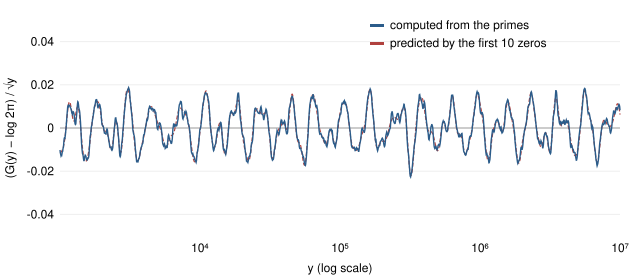

The constant $\log2\pi$ comes from the residue at $s=0$ for ζ. Each zero $\rho=\frac12+i\gamma$ contributes a wave $-2\,\mathrm{Re}\,y^{\rho}/(\rho(\rho-1))$, of amplitude $\approx2\sqrt y/\gamma^2$. They do not die out: ζ has infinitely many zeros on the critical line (Hardy), and $G(y)/\sqrt y$ does not tend to 0. For $\psi$ itself, Littlewood even shows $\psi(x)-x=\Omega_\pm(\sqrt x\,\log\log\log x)$. **A global bound $O(y^{\theta})$ with $\theta<\tfrac12$ is impossible**, since the zeros on the critical line give poles of the Mellin transform of $G$.

**Counterexamples: other balances.** Suppose a method of the same shape, with a fixed cost $x$ and a marginal loss of order $m^\beta$. For $\beta>0$, the optimal scale is $m\asymp x^{1/(1+\beta)}$, and the error is $x^{\beta/(1+\beta)}$. By Landau (§ 1.4), an error $x^\theta$ excludes zeros of real part $>\theta$.

| Loss per lift | Scale of $m$ | Error | What one would prove, if this model were a valid global budget |
|---|---|---|---|
| $m^{1/2}$ | $x^{2/3}$ | $x^{1/3}$ | **incompatible** with the critical zeros: some hypothesis of the model (or the analytic reduction) must fail |
| $m$ (Alpöge) | $x^{1/2}$ | $x^{1/2}$ | **GRH** |
| $m^2$ | $x^{1/3}$ | $x^{2/3}$ | only the absence of zeros for $\operatorname{Re}s>2/3$ |
| constant | any $m\gtrsim x$ (the infimum is the constant) | $O(1)$ | **incompatible** with the critical zeros, with the same proviso |

Varying both costs at once, the general model $x^\alpha/m+m^\beta$ (with $\alpha,\beta>0$) has a minimum of order $x^{\alpha\beta/(1+\beta)}$, at $m\asymp x^{\alpha/(1+\beta)}$. For instance, $\alpha=3/4$, $\beta=2$ also give the exponent $1/2$. Linearity is therefore not a universal necessity. It is decisive in the particular architecture where the fixed cost is of order $x$ and the other terms are already at most of order $\sqrt x$. In the real bracket, the extra term of order $\sqrt x$ remains: one cannot conclude to a contradiction by optimizing only the other two terms.

The optimality of the exponent is a different question. A one-sided bound of the form $G(y)=O(y^\theta)$ or $G(y)\le Cy^\theta$, with $0<\theta<1/2$, would contradict Landau's criterion and the existence of zeros of ζ on the critical line. This gives an analytic argument, independent of the figure and of the analogy with Littlewood for the unsmoothed sum. The numerical data help to see the fluctuation, but are not the proof of this obstruction.

A single singularity even suffices to exclude $G(y)=o(\sqrt y)$. For a zero $\rho=\frac12+it$, the transform $\int_1^\infty G(y)y^{-s-1}dy$ has at ρ a pole with nonzero residue; so $h\int_1^\infty G(y)y^{-\rho-h-1}dy$ tends to this residue as $h\downarrow0$. If one had $G(y)=o(\sqrt y)$, this quantity would be $h\cdot o(1/h)\to0$: a contradiction. The argument uses no numerical data.

The third line of the table also shows what separates GRH from a mere zero-free region. With a quadratic loss per lift, if all the other controls remained valid, the model would give a zero-free region $\operatorname{Re}s>2/3$, which would already be a new result. **The linearity of the loss per lift is what makes the method a proof of GRH** ⟦I⟧. That is why the control of the losses (`LossFS`, `exponent_le_upper`) is a sensitive point of the construction.

### 6.4 The ε, and the conclusion

The bound obtained is not $\sqrt x$, but $x^{1/2+O(\varepsilon)}$. The logarithmic losses ($b=e^{x^\varepsilon}$, $\log T$, the margins $x^{\varepsilon}$) and the width of the window for $m$ cost factors $x^{O(\varepsilon)}$. On the export, the unconditional lemma `level_gm_le_on_family_scales` (337 declarations dominated by the node) converts the chain into
$$G_\psi(x)\;\le\;x^{1/2+(e_D+e_L+7)\varepsilon}$$
on the windows of scales. $e_D$ is the division loss (the constant of `LinkDIV`), and $e_L$ the loss of `LossFS`. This is exactly the boxed bound of § 1.6, with $C=e_D+e_L+7$. This step requires $e_D$ and $e_L$ not to depend on ε, and that is what the export says: `ChebyshevInequalityAtWindowScale` reads $\exists\,e_D,e_L,\varepsilon_1>0,\ \forall\varepsilon<\varepsilon_1,\ \exists$ a family…, the exponents being fixed before ε. Letting ε tend to 0, Landau on windows (§§ 1.4 and 1.5) gives the absence of zeros for $\operatorname{Re}s>\tfrac12$.

### 6.5 What the graph says

The balance itself costs almost nothing: a few inequalities between parameters (`Win_at`, `RestSize`, `errorBracketSizeWindows`). The ½ is a **constraint the objects must satisfy**, not a hard theorem. What costs is **constructing** families that satisfy it: hosts of degree $\approx x^{2+8\varepsilon}$, ranks $k\in[x\,m,x^5]$ (`size_window_at_five`), and losses per lift linear in $m$. These families belong to the 36 % of construction (§ 7). The proof of `ch_top` (about 130,000 lines) is bookkeeping.

> **Answer to question 5.** The dominant model of the losses has two parts, plus a remainder controlled by the other size constraints. A fixed cost, of order $x$, is the imprecision of a single layer of divisibility, and it is amortized over the $m$ lifts: $x/m$. A marginal cost, linear in $m$ per lift, is bounded in the export by a term in $m$; its precise link with the growth of ranks remains to be reconstructed. Their sum is minimal at $m=\sqrt x$, where it equals $2\sqrt x$, exactly like $p/a+a$ for Stepanov. This ½ is not accidental. A zero on the critical line rules out any exponent strictly below $1/2$ (§ 6.3); the figure shows the fluctuations up to $10^7$, without proving it. In this architecture, the two linear costs make it possible to reach this exponent, with the other terms controlled. With a quadratic loss per lift, it would only prove a zero-free region.

### Workshop 6. The comparison in a lattice

The principle of §§ 2 and 5 fits in one line. For an integral lattice with basis $v_1,\dots,v_n$ and matrix $A$, divisibility bounds $\log|\det A|$ from below and Hadamard's inequality bounds it from above:
$$\sum_pe_p\log p\;\le\;\log|\det A|\;\le\;\sum_i\log\|v_i\|,$$
where $p^{e_p}$ divides $\det A$. The columns $(1,1)$ and $(1,7)$ give $\det A=6$, divisible by 2 and by 3, and a product of lengths $\sqrt2\cdot\sqrt{50}=10$; the Gram determinant is $36=6^2$. With families of vectors, the final assembly of the proof is a comparison of the same kind, between three real numbers.

**The exercise** (after P. D. Nelson [Ne], ch. 35). A family of $n$ independent vectors in a space of dimension $d$, with $\tfrac d2\le n\le d$, has covolume $c$ and index $\delta$. Assume
$$d(H-3F)\le c+2\delta,\qquad c\le n(H-\rho+F),\qquad \delta\le dI .$$
The first inequality is a **lower bound**: a family that spans almost the whole space cannot have both a small covolume and a small index. The second is a **size bound**: each vector is short, of exponent $H-\rho+F$, where $\rho$ is the **gain** per vector. The third **bounds the index**. Here $c$ and $\delta$ are **logarithmic** quantities (logarithm of the covolume, weighted sum of lengths for the index), and the index is taken in a saturated lattice of the same rank: we reason on three real numbers. If $H+F\ge0$, then $n\rho\le d(4F+2I)$.

*Solution.* Chaining the three bounds, $d(H-3F)\le n(H-\rho+F)+2dI$, hence, exactly, $n\rho\le d(4F+2I)-(d-n)(H+F)$. Since $n\le d$ and $H+F\ge0$, the last term is non-positive, hence $n\rho\le d(4F+2I)$; with $n\ge d/2$ and $F,I\ge0$, $\rho\le8F+4I$. The gain per vector is thus bounded by the errors alone; this is what bounds the remainder of the prime sums.

*Counterexample.* The hypothesis $H+F\ge0$ cannot be dropped. With $d=2$, $n=1$, $H=-10$ and $F=I=\delta=0$, the family $c=-20$, $\rho=10$ satisfies the three bounds, but $n\rho=10>0=d(4F+2I)$.

**In the proof.** Sernau's rewriting [Se] realizes this model name for name (notebook, E20). In the proof of `New.star_inequality`, $H$ is `mainAmount`, $F=f\,a\,(\log b)^4$, $\rho=m\cdot\mathrm{rem}$ and $I=10\log(1+2b^2)\cdot f\,a\,(\log b)^3$; covolume and index are logarithmic, the index being taken in the target lattice of twisted forms. The step "$H+F\ge0$" appears explicitly (`mainAmount_nonneg`), and $d_T\le2n$ comes from $4/b^2\le\frac12$. The roles:

- the lower bound is **Theorem C** (`New.Data.integral_forms_long`);
- the short forms and their index form **Theorem A** (`span_short_integralRamified_eq_top`, `indexLe_normalizedPoincare`);
- the fact that few translates span almost the whole target is **Theorem B** (`enough_forms`, unrelated to the arc Theorem B above);
- the conclusion is `New.star_inequality`, namely $m\cdot\mathrm{rem}\le f\,a\,(\log b)^5$.

Theorem C carries 45 % of the weight of that edition, through the Selmer bounds and the construction of Galois representations. The original proof, the one this synthesis reads, assembles differently. It combines seven slope inequalities, labelled (A1)–(A7) in the exposition of the original route [Ne0, ch. 58–59], and their sum gives directly the bound of § 6.4, $G_m(x)\le x^{1/2+9\varepsilon}$ (`ChebyshevInequalityOnWindows`). On the export, these inequalities are the eleven hypotheses of the accounting theorem `each_unit_bound_statement`: `LossBounds` (A1), `QuotientSlopeBoundsWith` (A2), `SlopeIneq` (A3), `DIV` (A4), `EComp5` (A5), `Count5` (A6), `Slopes` (A7), plus `HComp` (the spread of the heights) and sign conditions; its conclusion, `ASK ≤ Main + ErrX5at`, is the sum $\sum_{t,j}(P-M)\le e$. The principle is the same: a lower bound by divisibility, an upper bound by size, and a gain bounded by the errors.

**Transition.** In the parameter regime of this construction, the ½ depends in particular on the linear control of the losses and on the possibility of dividing the lattices. Other architectures might reach the same precision otherwise. The last section of Part I says what these conditions cost: Tate–Shafarevich groups to bound, Galois representations to build, and the local Langlands correspondence to supply.

## 7. The losses, and the theories they call on

The mechanism of §§ 2–6 fits in a few pages. It works only under three conditions. The losses must remain **linear** in the length of the chain (§ 6). The **division** of lattices must be possible without losing the gained profile (§§ 4.3 and 5.4). The archimedean side must remain **exact** (§ 5). The last two were treated in § 5 (covolume, Theorem S, masses). The rest of the proof pays three bills, which bear mostly on the division and on the objects themselves. On the export, they enter through the host field and through `LinkN` (Part II, interface graph).

### Three difficulties hidden behind an inequality

At this point, the reader may reasonably wonder why the proof needs so many theories. We have written a few relatively simple inequalities, and yet their justification mobilizes millions of declarations. One must imagine that each arrow of the argument carries simultaneous obligations: not only must the operator exist, but its image must have the right rank, its coefficient must be integral at the relevant places, its cost must be under control and its norms must be computable. A single failure can wipe out the precision sought.

**A projection model.** Consider $T=\begin{pmatrix}0&1\\0&\ell\end{pmatrix}$ for a prime $\ell$. The eigenvalues are 0 and $\ell$, distinct over $\mathbb Q$. The projector onto the $\ell$-eigenspace is

$$P=\frac{T}{\ell}=\begin{pmatrix}0&1/\ell\\0&1\end{pmatrix}.$$

It satisfies $P^2=P$, but is no longer integral. Why? The two eigenvalues become equal mod $\ell$. One must divide by their difference to isolate an eigenspace. Hecke operators provide much richer systems of eigenvalues, and congruences can make the isolation of arithmetically useful forms costly. The model shows why a denominator can appear even if all the initial operators are integral.

In many automorphic problems, Galois representations make it possible to translate congruences of eigenvalues into cohomological information about representations. Tate–Shafarevich-type groups then measure certain obstructions, or classes satisfying local constraints. One need not master these theories to understand what one would like to control: the amount of divisibility lost when additional arithmetic conditions are imposed.

**(a) Hecke denominators, and Tate–Shafarevich groups.** To isolate the useful forms, one projects onto Hecke eigenspaces. This projection does not preserve integral lattices. Its **denominators** may come from **congruences** between systems of eigenvalues, and they eat up the divisibility gained. In many automorphic problems, such congruences are read on extensions of Galois representations: this is the **motivation** ⟦I⟧ for the role of Ш, not a general implication. What the proof does is more precise: it bounds the length of **Tate–Shafarevich** groups of Tate twists over the host:
$$\sum_\ell\log\ell\sum_{1\le e<x^{401}}\operatorname{len}\,\mathrm{Sha}^1_\ell\big(E,\mathbb Q_\ell/\mathbb Z_\ell(-e)\big)\;\le\;\exp(x^\varepsilon/2).$$
This is the exact statement of the export (`VAt`, via `VVle`): the lengths of Ш are finite for all twists $e<x^{401}$, and their weighted sum is at most $\exp(x^\varepsilon/2)$. Alpöge's note presents the result as a bound **polynomial in the conductor**, effective and uniform in ℓ; the intermediate statement that would give this dependence has not been read. It is obtained by **Eisenstein congruences** on $U(3)$ and $\mathrm{GSp}_4$, in the style of Ribet and Mazur–Wiles, with Kato's Euler system, Soulé-type bounds and Ferrero–Washington ($\mu=0$). The part of opposite parity goes through Bernoulli numbers. The constant 401 bounds the range of twists. Alpöge: "fight for a significant weakening of Vandiver". This step weighs 8 % of the volume. *On the export* (Part II, interface graph), this bound is supplied together with the host field (`VWin`, consumed by `supplyChi`), and it appears as the term `vvTerm` of `LinkN`, which bounds the mass of the twisted places within the per-lift loss budget and conditions the division. The route through Hecke denominators described above is a reading ⟦I⟧ that the statements do not make explicit.

**An exact model of integrality losses.** Let $R$ be a discrete valuation ring with uniformizer π and residue field with $q$ elements, and $L\subseteq L'$ two lattices of the same rank. The Smith normal form gives bases with $L'=\bigoplus_iRe_i$ and $L=\bigoplus_iR\pi^{a_i}e_i$, hence
$$\operatorname{len}_R(L'/L)=\sum_ia_i,\qquad\log|L'/L|=\log q\sum_ia_i.$$
Dividing by local exponents is thus an additive loss of length, and for a chain $L_0\subseteq\cdots\subseteq L_m$ of the same rank, $\operatorname{len}(L_m/L_0)=\sum_j\operatorname{len}(L_j/L_{j-1})$. If finite defect modules $M_w$ inject **jointly** into a finite module $H$, that is $\bigoplus_wM_w\hookrightarrow H$, then $\sum_w\operatorname{len}M_w\le\operatorname{len}H$. Separate injections do not suffice: with $H=R/\pi R$ and several copies $M_w=H$, each injection exists, but the sum of lengths exceeds $\operatorname{len}H=1$. This is the shape a control of twisted places by lengths of Ш would have: it would need a **joint** morphism, or an explicit multiplicity factor. The model is a possible mechanism ⟦I⟧: the actual morphism (restriction, quotient, Selmer group, or a mere counting inequality) has not been identified in the export.

**What the local defect is.** The record of the local datum (`NData`) takes us beyond the motivation. At each twisted place $w$, of characteristic ℓ, the proof has a local Hecke algebra $T$ acting on a free module $M$, a lattice $L\subset M\otimes\mathbb Q_\ell$, and a partition of its eigensystems into "good" and "bad" ones, with eigenspaces $E_{\rm good}$ and $E_{\rm bad}$. The defect `etaLoc` is the length of
$$\big(E_{\rm good}\cap(L+E_{\rm bad})\big)\big/\big(L\cap E_{\rm good}\big),$$
the quotient of the projection of $L$ onto $E_{\rm good}$ by the trace of $L$ on $E_{\rm good}$: it is **the congruence module** of Ribet and Wiles. On the model above, $T=\begin{pmatrix}0&1\\0&\ell\end{pmatrix}$, $L=\mathbb Z^2$, the projection of $L$ onto the eigenspace for ℓ is $\mathbb Z(1/\ell,1)$, its trace is $\mathbb Z(1,\ell)$, and the quotient is $\mathbb Z/\ell$: the defect is $1=v_\ell(\ell-0)$, exactly the denominator of the projector. The Hecke-denominator motivation is therefore the very **definition** of the quantity that Ш must bound. The local bound read on the export (`PairedCharacterConditionAlt`) is
$$\mathrm{etaLoc}\;\le\;\sum_{\pi\ \text{good}}\mathrm{mult}(\pi)\Big(\sum_{0<e<t}\operatorname{len}\text{Ш}(\ell,e)+\text{local terms}\Big),$$
under hypotheses involving the Galois representations attached to the eigensystems and characters $\chi\cdot\mathrm{cyc}^{-(c-1)}$, Tate twists. Its proof goes through $p$-adic Hodge theory (`conclusion41_of_pAdicHodge_alt`) and Artin reciprocity; its pattern is that of Ribet's method ⟦I⟧, where congruences produce cohomology classes whose size Ш bounds. It is not reconstructed.

**What the proof term says.** The actual bound (`etaSum_le`) is not a joint injection. The mass of the twisted places at stage $j$ is bounded by size terms, by a sum over the residue characteristics of the twisted places, each prime ℓ counted only once, and by $d_{Z_0}(j)\sum_\ell\mathrm{vvTerm}(\ell)$, with $\mathrm{vvTerm}(\ell)=\log\ell\sum_{1\le e<t}\operatorname{len}\text{Ш}(\ell,e)$. Ш thus enters once per prime, with an **explicit multiplicity factor** $d_{Z_0}(j)$: this is the second scenario of the model above. The places concerned are those whose characteristic is one of the two primes of the host, under a "paired characters" condition requiring the lengths of Ш to be finite (`PairedCharacterConditionAlt`); the link between a local defect and these lengths lies in the proof of that condition, not read. Moreover, the size of the bound is not the obstacle: with $b=e^{x^\varepsilon}$, $\exp(x^\varepsilon/2)/b=\exp(-x^\varepsilon/2)$, which absorbs any polynomial factor in $x$. This size observation says nothing about the mechanism.

**(b) Galois representations.** The congruences require Galois representations attached to polarized automorphic forms on unitary groups, with local-global compatibility. The project builds them **without the étale cohomology of Shimura varieties**:

- first by theta lifting;
- then by **geometric realization in weight 1** in coherent cohomology (holomorphic Lefschetz formula);
- finally by **ℓ-adic congruences**.

This step weighs 6 % of the volume.

**(c) The local Langlands correspondence, only partly.** It is proved only in **depth zero** (Green's theory of the characters of $\mathrm{GL}_n(\mathbb F_q)$), with arbitrary values elsewhere. The proof queries the correspondence only at places where this version suffices.

**And the construction of the objects** (36 % of the volume): families of definite Hermitian spaces with prescribed signatures, discrete-series parameters, theta kernels with integral coefficients, rationality of periods (test vectors, Siegel–Weil), quasi-orthogonality, covolume.

---

### Preserving the gains: Behrend, clusters and arcs

Producing local gains is not enough; their positions must also not interfere along the Frobenius orbits. This is the role of the sets without short relations of § 3.5, whose construction is **Behrend**'s: an almost dense selection (density $N^{-c/\sqrt{\log N}}$) with few structured collisions. Alpöge's note says so at step 19: "precise choice of the Iwasawa tower, specifically using Behrend!!". The export makes it possible to follow what it preserves, and through which channel.

**A proved but inert clause.** The theorem `dropping_proposition_holds` provides a set of positions $T_2$ of Behrend density, at least $n_0\exp(-C\sqrt{\log n_0\log L})/L$, with no three-term relation. For every translate and every long enough orbit, **every window of $L$ consecutive steps contains at most two of its points**, and the whole orbit at most one if it is short. The lemma `no_three` says it negatively: three consecutive powers of Frobenius do not all land on thick places. But this theorem is **inert**: it enters a bundle (`field_lemmas_except_seven`) whose two consumers extract only other clauses. This is established on the export by following the projections (notebook, E13).

**The effective channel.** The useful property is carried by a field of the host, `Host.second_set_no_relation`. On a long orbit, it gives that at most two thick places fall in a window. The thick letters therefore group into clusters of at most two, with gap at most $j$ and preceded by $j$ non-thick letters (`long_clusters`). These clusters are the hypothesis of the "page words" on the orbit, whose depth is $\min\{j : l_A\le(l-1)^j\}$. The chain goes up to the Galois-side link (`NLinkClose` → `linkN`), **not to the `LinkG` gains**: the Behrend property does not serve to realize the weights of the gains, as an earlier version of this synthesis suggested.

**The arc Theorem B.** The lemma on words is the export's Theorem B (`ThmB`, proved by `N.Ln17.thmB_at`, 2.7 M lines), written here $B_{\rm arcs}$ to distinguish it from the Theorem B of Sernau's rewriting. It is read at the level of its statement and mechanism. A letter is *thick* if its size falls in a band $[b,b+\eta]$. For a morphism of crystalline lattices (Wach modules), the exponent of the morphism is bounded by $C(n+1)\,r\,(h/l^2+(w+\eta)/l+S+1+\log_l(2h)+\eta\cdot\text{band})+C\,n\,m\,e'$ under one of two hypotheses: either the orientations alternate and there are never three consecutive thick letters; or the orientation is constant and there are never $R$ consecutive thick letters, in which case the term $S+1+\log$ is multiplied by $R^2$. The size conditions ($20w,20\eta,20S\le b$, at least one non-thick letter) and the Hida setting are also needed: Behrend's combinatorial condition is not enough by itself. The orbit is cut into **arcs**, which end at a letter followed by a non-thick letter, and the cost of an arc is bounded by the square of its length. If the cost of a cluster of length $r$ is bounded by $Cr^2$ with $r\le R$, the total is at most $CR\sum r$: this model explains the linear control, without claiming that the actual cost grows quadratically. $B_{\rm arcs}$ is an upper bound, not a lower bound. It is the "inert primes" step of the link `LinkN`, and the arc lifts themselves (theory of Wach modules) are not read.

# Part II. Map of the code

*The names below make it possible to find each step in the export. Percentages are shares of the dominated proof volume, computed from the dominator tree; they do not add up. They measure an exclusive volume of formal dependencies, not mathematical importance, and they are computed in **export lines** (the expression records, shared across the whole export and attributed to the declaration that introduces them; about 1.07 billion for the closure), not source lines. The closure of `riemannHypothesis` has 1,468,390 declarations, that of the five statements of `Main` 1,468,414 (the export has 1,468,418, four of which lie outside every closure), and `allChi` dominates 1,409,557 of them (96 %).*

| Step (Part I) | Main declarations | Weight |
|---|---|---:|
| Statement, reduction | `riemannHypothesis`, `allChi`, `EveryCharacter`, `imprimitive` | 99.3 % (all) |
| § 1 Landau on windows | `FormB`, `zeroFreeOn_of_tiedWin_cyc`, `level_gm_le_on_family_scales` | < 0.1 % |
| § 3.4 Host, pairs on average | `supplyChi`, `PairEx`, `QH.pair_share`, `QH.bad_share` | ≈ 0.1 % |
| § 3 Theorem A, Dwork | `DworkPowerSeriesWeights.thmAGauss`, `theorem_A_one_monomial_log_loss`, `lemmaS`, `FormalGroupSystem.Pf.sx_dwork` | ≈ 0.02 % |
| § 4 Chain and gains | `FormalGroupSystem.LowTermBound`, `PointsLemma`, `G.NP`, `yProd`, `gainP`, `LinkG_at` | ≈ 0.1 % |
| § 5 Division, slopes | `divClausesR_of`, `DivIntoDualShift`, `mu_diff`, `Frame_at`, `HypHigh` | ≈ 0.1 % |
| § 5 Theorem S | `GlobalTheory.CarrierGap.offDiag` | 1.4 % |
| § 5 Covolume | `topCovolSlim2_use_alt_alt` | 7.1 % |
| § 7 (a) Tate–Shafarevich | `VWin := ∀ ψ, VWinAt ψ 401`, `vwin_of_row` | 8.2 % |
| § 7 (b) Galois | `galoisLocalGlobalStrong_recParameter` (`Row0b`) | 6.3 % |
| § 7 (c) Local Langlands | `recTExists` | small |
| § 7 Manufacture | `nonempty_hyps_definite_side_of_closed_bound` | 35.8 % |
| Automorphic core (total) | `every_character_of_theta_integrals_local_matching` | 41.5 % |

## Anatomy: the interface graph

The dominator tree gives the **weight** of the components. It does not say how they communicate. For that, one reads a second graph on the export, the graph of **interfaces**.

- **The nodes** are the `Prop`-valued predicates of `Formalism.MainNotions`, such as `Count_at`, `LinkG_at` or `ChainTied`: 207 interfaces.
- **The edges** are the theorems of the export that take some interfaces as hypotheses and conclude others. There are 390 of them, extracted automatically from the types by [`tools/interfaces.py`](tools/interfaces.py) (output: `analysis/interfaces.tsv`).
- **The entry points of the components**, that is, the declaration where each big theorem is consumed, are established by walking up the reverse index ([`tools/organes.py`](tools/organes.py), `revindex.py`).

### A three-storey architecture

**1. The components are plugged in as hypotheses.** Each big theorem (Ш, covolume, Theorem S, masses, Galois) is consumed at **a single entry point**: it has a unique direct referent in the export (`analysis/points_entree.txt`). Local Langlands is the exception: `recTExists` is queried directly by 25 declarations, in the Galois representations and the Ш bound. The mechanism does not call them: it is written **under hypotheses**, and the components are injected at the very top. The core has type
```
every_character_of_theta_integrals_local_matching :
  UnitaryGroupThirdPlaceHypotheses → ThetaLocalInputs → ThetaIntegralsAgree → LocalMatching
  → CovolumeBoundOfX → RecTExists → VWin → EveryCharacter
```
That is seven inputs, among them the covolume, local Langlands and Ш. This is the structure of an argument "abstract, then instantiated". It explains why what belongs to the mechanism alone is so light in the dominator tree (§§ 2–6, less than 0.5 %): its dominated subtree contains neither the large theories injected as hypotheses nor its shared dependencies, which are attached higher up.

**2. Two hubs redistribute the components.**

- **The host field** (`supplyChi`, § 3.4) receives the pairs $(q,d)$ chosen on average (`QH.pair_share` → `pairEx` → `supplyOfAdmOf`), **Behrend**'s "thick" Frobenius orbits (`hostThickExists` → `hostOfFieldOf`) and the **Ш** bound. The latter is consumed exactly there: `zero_free_all_of_green_v_win` applies `supplyChi ψ (hV ψ)`.
- **The structure `HypsAlt`** (46 fields, produced by `nonempty_hyps_definite_side_of_closed_bound`, 35.8 %) receives Theorem S (fields `sO`, `sLp`), the masses (`hG`, `hU`), Theorem A (through the served rows, `hServ`), the covolume (`L3` bounds on the terms, `eventual_L3_of_covolume_alt`) and local Langlands.

**3. The Links pass inequalities on to the core of the mechanism.** `HypsAlt` is unfolded into nine Links (`goal_of_shape_of_hyps`, then `topDesWin`). These feed the fourteen interfaces of `linkCore`, which concludes `ChainTied`. `level_gm_le_on_family_scales` derives from it the Chebyshev inequality on windows, and Landau concludes.

**The fourteen interfaces of `linkCore`, read as a slope balance.** They read as a single argument. The lattices involved are, for each word $u$, a "member" lattice `lat_u` of automorphic forms, and the lattice $N_u$ obtained by **enlarging it by division**: it contains `lat_u`.

- **`PlacesF` then `SlopesNF`: the slope goes up.** Passing from `lat_u` to $N_u$ changes the slope by a sum over the finite places, local lengths times $\log N(w)$. The main jump is called `Ga`:
  $$\mathrm{Ga}=\sum_w\mathrm{sz}\Big(w,\ \sum_j\mathrm{gainD}(j,w)-\tau(w)\Big),$$
  the sum, over the places $w$, of the **local gains of all stages $j$** minus a division exponent $\tau(w)$. The lemma `placesF_min'` (196,000 lines) organizes this computation.
- **`FrameF`: the slope is capped.** This is the slope inequality, applied to the period pairings $B_u:N_u\to R^\vee$, with values in an integral target lattice. It is useful only if the height of the $B_u$ is small, that is, if the $B_u$ are almost isometries. This is the role of a **quasi-orthogonality** condition: periods of different forms must be almost orthogonal ("Theorem S", § 5.4).
- **`LatF` and `SlopesMF`: the starting lattices are under control.** Positive ranks, duality of the target lattice, and slopes of the member lattices bounded by $\pm C|TT|a\,L_a$. This is the fixed cost of § 6.2.
- **`CountF`: the archimedean sizes.** The size $\log T(u)$ of a column is bounded by a sum of Γ-type terms, $\sum_j\frac1f\sum_\tau\log(w_{j,\tau}v/\pi)$, one term per stage and per CM place.
- **`LossFS`: primes ≤ gains.** The von Mangoldt sum `ASK` is bounded by `Ga` plus a loss $C|TT|\,m\,b\,x^{e_L\varepsilon}$.
- **`WinF`: the window of parameters**, with $x^{1/2-\varepsilon}\le m\le x^{1/2+\varepsilon/2}$, $x\,m\le k$, etc.
- **`CharF`: the constant of the main term**, $\ell(\psi)=(L'/L)(1,\chi)$, supplied unconditionally by `Lnk.char_at`.

Put end to end, this gives:
$$\mathrm{ASK}\;\lesssim\;\mathrm{Ga}\;\lesssim\;\Delta\widehat\mu\;\lesssim\;\text{(Bost's ceiling)}\;=\;\text{(archimedean terms)}+\text{losses}.$$
The first term is the prime sum; the last is computable without the primes. This is Chebyshev's structure, $\sum v_p\log p=\log|M|\le\log H$, realized with slopes.

```{=latex}
\begin{landscape}
```


```{=latex}
\end{landscape}
```

Some edges, read as they are:

| Edge | Theorem (dominated weight) | What passes |
|---|---|---|
| `LinkS` → `FrameRealF` → `FrameF` | `frameRealF_of''`, `frameF_of` (231 k) | quasi-orthogonality makes the frame almost unitary, hence the slope inequality usable |
| `LinkS` → `RRRankF`, `MatKF` | `rrRankF_of`, `matKF_of` | ranks and matrices of the division: **non-degeneracy** |
| `LinkG` → `LossesSmallShares` → `LossFS` | `losses_of_small_share_weight` (392 k) | inert primes ≤ local gains + loss |
| `LinkG`, `LinkMu` → `PlacesF` → `SlopesNF` | `placesF_min'` (196 k), `slopesNF_of` | Δ slope = Σ local lengths × log N𝔭 |
| `LinkDIV` → `LinkMu` | `linkMu_of_linkDIV` | the division fixes the slope jumps |
| `LinkN` → `DIVinN` | `divinN_of_hypV` | the bound on twisted places conditions the division |
| Galois → `LinkN` | `linkN_of_twGood_galoisPreconditions` (24.8 M lines) | Galois representations ⇒ `LinkN` |
| `ColChain.fact` → `LinkDIVt` | `height_chain_atR` → `divClausesR_of` → … → `linkDIVt_of_bridge_kernel` | the factorization through the chain serves the **division** |
| Behrend → `LinkG` | `field_lemmas_except_seven` → `linkG_fam_noKer` (1.3 M) | thick Frobenius orbits serve the **gains** |

### Interpretations supported, corrected or still open

Part I contains several interpretations, marked ⟦I⟧. The interface graph makes it possible to test some of them. "Supported" means that a dependency path is established and that the statements read are compatible with the interpretation; it does not show that the role is exactly the one described (levels 1 to 3 of the validation scale of the article). The arrows in the last column follow the flow of results towards their use, that is, the reverse of the dependency graph.

| Interpretation (Part I) | Verdict | On the export |
|---|---|---|
| Non-vanishing goes through quasi-orthogonality (§§ 2.4, 5.4) | **supported** | Theorem S → `LinkS` → rank conditions (`RRRankF`, `MatKF`) and almost unitary frame (`FrameRealF`) → slope inequality |
| Behrend serves the odd layers of the gains (§ 3.5) | **supported** | `Behrend.box` → thick Frobenius orbits → `LinkG` (the gains) and the host |
| The chain serves the division (§§ 4.3, 5.4) | **supported** | `ColChain.fact` → `divClausesR_of` → `LinkDIVt` |
| The masses give exact sizes (§ 5) | **supported** | `SiegelMassRatioCM` (an equality) → `HypsAlt` (`hG`, `hU`) → `NuFull ∧ MuRank`, `LinkGLOBAL` |
| Ш controls the profile, and thereby the losses (§§ 2.5, 3.6, 6.5, 7) | **refined** | Ш enters at two points: it is supplied with the **host** (`supplyChi`), and it appears as the term `vvTerm` in `LinkN` ("sum over twisted places ≤ size + Ш"), which conditions the **division** (`DIVinN`). Through `DIVinN`, this mass must fit, for each lift, in the budget $x^\varepsilon(B_0+N_c)$, the very budget that forms the marginal cost of § 6 (see below). Ш does not enter `LossFS`. The reading "Ш bounds the Hecke denominators" remains ⟦I⟧ |
| The covolume gives the size computable without the primes (§ 2.5) | **not settled** | the covolume enters `HypsAlt` through `L3` bounds on the terms of a series (`CovolumeBoundThirdPlaceSeries`). Its link with a specific interface of `linkCore` is not established |
| Theorem A ⇒ gains (§ 3) | **refined** | Theorem A enters through the served rows of the selection (`hServ_of_linkR` → `allRows_of_open0_alt`) and through the admissible twisted link of the Green shape (`closed_family_admissible_twist_link_alt`), not directly through `LinkG` |

The main correction concerns Ш: on the export, it accompanies the **host field** and protects the **division**, by bounding the mass of the twisted places within the per-lift budget. The next section follows this path to the division link.

### Five points clarified on the export (version 3.1)

Version 3.0 flagged several obscure areas: why the chain really helps, where the main term comes from on the archimedean side, what the "twisted places" are, what exactly the link between primes and gains says, and how the CM formula reaches the division. The fine choices of the host, the proof of Landau on windows and the presence of Rallis are treated in §§ 3.4, 1.5 and 5.3. The statements of the export answer them to a large extent.

**1. Amortization.** The quantity bounded by `Deduction.ch_top` is
```
gapA = Σ_{t ∈ TT} Σ_{j < m} ( ASK(a_t, t, w_j) − Re MAIN(a_t, w_j) )
MAIN(a, w) = a · ( log a − 1 − γ + ℓ(χ) − (1/|Φ|) Σ_{ρ∈Φ} log w(ρ) )
```
- **The main term is written out in full.** $a(\log a-1-\gamma)$ is exactly the Riesz main term $y\log y-(1+\gamma)y$ of workshop 5. $\ell(\chi)=(L'/L)(1,\chi)$ is the constant of § 1.2. The mean of the $\log w(\rho)$ comes from the sum being taken at the scales $a/w(\rho)$.
- **On the prime side, the subtraction is an exact identity.** `ch_balance` proves $\mathrm{ASK}-\mathrm{MAIN}=\mathrm{De}$, where `De` is a combination, by orthogonality of the characters of the host, of centered Riesz sums $G_\psi$ at the scales $a/w$. `gapA` is thus a sum of $n_T\,m$ values of $G_\psi$: one per column $t$ and **one per lift $j$**. Bounding a sum does not bound each of its terms: $\frac12(u_1+u_2)\le1$ does not exclude $u_1=100$, $u_2=-98$. The proof term of `core_gm` shows how the pitfall is avoided. The lemma `gmA_eq` proves that the combination produced by the sum over the columns, weighted by $1/(3o+1)$ on the kept characters of the level, is **identically** `Level.Gm`, the quantity of § 1.3: the target is this combination with non-negative coefficients, the one Landau works on. The unwanted characters are bounded **one by one** (`sigA_le`, through the pointwise hypothesis `EAtH.bdG` supplied by the choice of pairs, § 3.4), and the sampling of the columns follows the 4 : 3 profile up to $x^{-1+\varepsilon}$ (`EAtH.shares`).
- **On the slope side, the errors are paid once.** `LErr.core_ineq` lists the remainders, each with its constant. Those of order $n_T\,a$, without a factor $m$, come from the division (`cDiv`), the slope of the starting lattices (`cSlope`), the column sizes (`cCount`) and the roundings: properties **of the lattice**. Those carrying a factor $m$ come from the per-lift losses.

This is Stepanov's mechanism, read on the export. The prime sum is compared $m$ times, but the slope inequality is applied only once to the divided lattice, whose slope jump adds up the gains of the $m$ layers ($\mathrm{Ga}=\sum_w\mathrm{sz}(w,\sum_j\mathrm{gainD}(j,w)-\tau(w))$). The fixed cost is therefore spread over $m$ terms: this is the $x/m$ of § 6.

**2. The cancellation of the main term: Stirling plus Chowla–Selberg.** On the archimedean side, the hypothesis `DIV` bounds the slope of the divided lattice by
$$\sum_t\Big[m\big(\mathrm{ph}(a_t)-a_t\log\Omega\big)-a_t\log T(u)\Big]+\mathrm{EDiv},\qquad\mathrm{ph}(y)=y\log y-y,\qquad\log\Omega:=\gamma+\log\frac{\pi}{v}-\ell(\chi).$$
Here $v=\mathrm{rd}_E/2$, half the root discriminant of the large host field (by definition, `Host.v`), and ℓ refers to the quadratic character modulo $d$; the full table of normalizations is in the § 5.5. Three ingredients can be read in this expression.

- **$\mathrm{ph}(a)$ is Stirling's main term**, $\log a!\approx a\log a-a$. It is the archimedean size of the factorial $a!$ that also provides Legendre's divisibility (§ 3).
- **$-a\log\Omega$ is the contribution of a period** raised to the power $a$: the size of "$D^a\,\Omega\cdot\theta(0)$", in the very formula of Alpöge's note.
- **$\log T(u)$ carries the Γ-type terms** of the columns. `Count5` is not an equality: it bounds $\log T(u)$ from below by $\sum_j\frac1f\sum_\rho\log(w_{j\rho}v/\pi)+m\,\mathrm{lg}-c_{\mathrm{Count}}(L_a+m^2L_a/k)$ (the quantity `Lam5`), and from above by $c_{\mathrm{Count}}\,m\,L$. The lower bound suffices, since $\log T(u)$ enters with a minus sign.

The algebraic identity `key_identity5` then checks that
$$\mathrm{SDiv}-\mathrm{sumA}\cdot\mathrm{Lam5}+m\cdot\mathrm{sumA}\cdot\mathrm{lg}\;=\;\mathrm{Main}+\mathrm{sumA}\cdot c_{\mathrm{Count}}\big(L_a+m^2L_a/k\big) :$$
the archimedean size reproduces the main term **exactly**, up to an error. It remains to know why $\log\Omega$, defined as above, really is the size of a period. This is the content of `GlobalTheory.CM.DegSt`, proved in the project (`CM.PureDeg.degSt`, closure of 114,806 declarations):
$$2\,\widehat{\deg}\big(\text{eigenline of a CM object of type }(1,0)\big)\;=\;\gamma+\log\frac{2\pi}{\mathrm{rd}_E}-\frac{L'(1,\chi)}{L(1,\chi)},$$
where χ is the Kronecker character of the CM field and $\mathrm{rd}_E$ its root discriminant. The right-hand side is `CM.logOm`, written with Mathlib's `LFunction` and `deriv`. **This is a Chowla–Selberg formula for the height**: the Arakelov degree of a CM line is expressed by the logarithmic derivative of $L(s,\chi)$ at 1. It is built from an elliptic curve with complex multiplication by $\mathbb Q(\sqrt{-d})$, $d\equiv3\pmod4$ (`CMCurve`, lattice $\mathbb Z+\frac{1+i\sqrt d}2\mathbb Z$), and it enters the core through `ArcCM.known_holds`, on the construction branch `ontoX`.

The main term $a\log a-(1+\gamma)a+a\,\ell(\chi)$ of the prime sum is therefore reproduced, on the archimedean side, by three independent sources: **Stirling** for $a\log a-a$, **Chowla–Selberg** for $-\gamma+\ell(\chi)$ (up to $\log(\pi/v)$, compensated by the Γ terms), and **the Γ terms of the columns** for the mean of the $\log w$. This is the precise answer to question 4, at the level of the **symbolic** cancellation: the proofs of `numGood_of_famQ` and of the page bounds have not been read.

**3. The per-lift budget, the twisted places and Ш.** The marginal cost has an explicit source: `BNBoundsU` imposes $B_0\le2\,n\,m\,b\,x^{\varepsilon}$, where $B_0$ is the **per-lift loss budget**. Several kinds of losses must fit in it:

- the valuations "eaten" at special primes (`OtherLoss.inertLoss_primeSum`: $\sum_p2\log p\,|\mathrm{EatI}(j,p)|\le C\,B_0$);
- the ramified off-diagonal and level terms;
- the mass of the twisted places.

At each place $w$ of the support, the local datum $\mu_w$ (`Rows.Data.muAt`) is either the base value $\mu_0$ or a twisted value (`muAt_or`), and this choice is stable under conjugation. A place is **twisted** (`TwistedAt`) if $\mu_w\neq\mu_0$. At such a place, the local component of the theta data is twisted by a character ψ that must satisfy `IntegralHeckeForms.TwOK`: ψ is conjugate self-dual, with open kernel, ramified exactly at a set of split places, with values in roots of unity, and trivial above ℓ (`BlochKatoReduction.Gen.TrivAbove`). `LinkN` bounds the weighted mass of these places,
$$\mathrm{etaSum}(j)=\sum_{w\ \text{twisted}}\mathrm{lwP}(w)\,e_w\,\eta_j(w)\;\le\;d_{Z_0}(j)\Big(C\,(f\,m\,b\,L^2+\log^2x\cdot N_c)+\sum_\ell\log\ell\sum_{1\le e<t}\mathrm{len}\,\text{Ш}(\ell,e)\Big),$$
`DIVinN` derives $\mathrm{etaSum}(j)\le D_0\,C\,x^\varepsilon(B_0+N_c)$, and `DIVinN` is consumed by `linkDIVt_of_rowsF`, which produces the division link `LinkDIVt`. The division error `EDiv` contains precisely the term $c_{\mathrm{Div}}\,m\,(B_0+N_c)\,x^{e_{\mathrm{Div}}\varepsilon}$.

The complete path is therefore: **Ш bounds the mass of the twisted places, and this mass must fit in the per-lift budget of the division, which forms the marginal cost in $m$.** The role of Ш is more central than version 2.0 said. The reading "Ш bounds the Hecke denominators" receives support: the twisted places are those where integrality of twisted Hecke forms (`IntegralHeckeForms`) is required. The precise cohomological mechanism (why lengths of Ш bound these masses) has not been read ⟦I⟧.

**4. What `LinkG_at` says.** It is the inequality "primes ≤ gains", place by place. For every inert place $w$ of characteristic $p\le X''$, and for each lift $j$, one has $0\le\mathrm{gain}(j,w)\le4\,|TT|\,a/p$, and
$$\sum_{j}\sum_{t}\mathrm{vonMangoldtClassSum}(j,t,p)\;-\;\mathrm{loG}(p)\;-\;m\,\mathrm{flG}(p)\;\le\;\sum_{j}\mathrm{gain}(j,w)\;-\;\tau(w),$$
where $\mathrm{flG}(p)=C f N^2\log_pa+Cf(\log_pa)^2$ is the **logarithmic loss per prime and per lift**: the $O(\log a)$ of Theorem A (§ 3.5), paid once per layer. There are also division conditions ($\mathrm{lenMN}\le\mathrm{duS}\,(\tau+\mathrm{io})$, and no division at places that are not served). The contribution of a prime to the von Mangoldt sum, summed over the $m$ lifts, is therefore bounded by the local gains minus the division exponent $\tau(w)$. The link is produced by `linkG_fam_noKer` (1.3 M lines), which uses Behrend.

**5. The transport of the CM formula to the division.** The path can be read in the reverse index.

1. `CM.DegSt` feeds `ArcCM.Known` (`known_holds`), then `lamDegSt_logOm₂`: for the CM objects of the host, the normalized degree of each line is $\tfrac12\log\Omega$.
2. `numGood_of_famQ` (1.65 M lines) and `cmArcDatumFamily_functional_bounded_linear_on_cuspForms` derive from it a bound on a **linear functional on cusp forms**. This functional is a coefficient of the jet of F **at a CM point** (`cfOf` of an `ArcDatum`), that is, a derivative at the CM point. It is "numerically good" (`NumGood`): bounded at the infinite places, with a degree term `BdegAt` involving $\log\Omega$, and controlled in valuation at the finite places.
3. These bounds go up through page lattice bounds (`quotientBound_of_kill_detect_constantRoom`, `recursive_page_lattice_bound`) to the construction (`ontoX`, `HypsAlt`).
4. They come back into the numerical records of the division (`RecNums.logOm`, `HtNums.logOmτ`, `HtNums.le_hu`), then into `LinkDIV_at`, which requires $\widehat\mu_{\mathrm{dual}}(R)+h(u)-\mathrm{Fo}\le\texttt{SizeData₂.MAIN}(u)+\text{errors}$, with $\texttt{SizeData₂.MAIN}(u)=\sum_t\big[m(\mathrm{ph}(a_t)-a_t\log\Omega)-a_t\log T(u)\big]$.

`Lnk.Mod.data_DIV` is only a translation of this inequality into the data of the balance. **The archimedean size that caps the slope is that of the "derivative at a CM point" functionals, and the CM theorem computes it**: the graph thus supports the $a!\,\Omega^{-a}$ scheme, without proving it. The determinant step is reconstructed independently from the hypotheses read (§ 5.5); the Lean term of `qat_of_bridge'` has not been read in full. The construction of the `NumGood` functionals and the transport of the normalizations remain open.

**What remains open.**

- Why lengths of Ш bound the mass of the twisted places.
- The realization of the gains $\mathrm{gain}(j,w)$ by the lifts.

**Facts established on the export.**

- **Closure.** The environment of `Main` has 2,701,132 constants; 1,484,733 are used (55 %), 86 % of which belong to the project. The export contains only those, grouped into 1,468,418 declarations (an inductive block, with its constructors and recursors, counts as one): this latter universe is the denominator throughout the text. The axioms are standard.
- **"Literature" scaffolding off the path.** `LitN`, `published_inputs_combined`, `Published.LocalLanglandsGL` do not appear in the export. The structure `OpenLiteratureStatements` is built **anonymously** from proved theorems; of the 259 declarations of the namespace `UpperTheory.LiteratureTheorems`, only 4 read a field of the hypothesis bundle. This count is not over the same population as that of [B] (191 of 195 theorems with suffix `_of_literature`): the two figures do not contradict each other, but they are not interchangeable. A single `Published.*` statement is empty: `UnusedSlot72 := True`, under the name "simple pole of Siegel–Eisenstein".
- **No literature statement enters as an axiom.** Everything is proved in the project.

**What each step reads on the export** (details in the [map of the proof](carte.html), § 11, in French).

- **The Legendre gain.** `gam p = p/(p^2−1)`; `gB = gam(p)·Σα − Σ_e min(α/p^{2e+1}, cap) − de`.
- **The automorphism loss.** `dG_spec : v_p(|Stab_Γ(L)|) ≤ dG j`.
- **The chain of lifts.** `lifts D = Icc 1 m`; `yProd` iterates `yv` m times; `ColChain` factors the period through `chainMat K_1 … K_m`.
- **Rounding in the division.** `round_le`: $|\Delta\widehat\mu-\sum_w$ `sz w (sg u w)`$|\le 2\sum_{w:\,\mathrm{sg}\neq0}$ `lwP w`; `nprimeMu_at` bounds the right-hand side by $2(X''\log4+\log T+\log g_0+\log g_1+\log d+\log D_\Gamma)$; hence `NprimeMuR L C` (error $\le C\cdot X''$), required by `LinkMu` and used in `places_at_of`. Scales (`Scale`): $b=e^{x^\varepsilon}$, $a=x\,b$, $b'=a/e^{x^{\varepsilon/3}}$, $w''=b'/(x\,n)$, so $X''=a/w''=x\,n\,e^{x^{\varepsilon/3}}$, with `n = Frame.ord`. Size of $n$: `HC.Der.finrank_E` gives $[E:\mathbb Q]=4\,$`ord` (the Galois group is $(\mathbb Z^\times)^2\times\mathbb Z/\mathrm{ord}$, `card_GG`); `Ranks.mk` imposes $2\,$`ord`$\le k$, and `size_window_at_five` establishes `Win_at L 5`, hence $k\le x^5$ and $n\le x^5/2$. More precisely, the construction of the family (`T3.supplyOfAdmOf`, on the path of `riemannHypothesis` via `supplyOfAdm` → `supplyChi` → … → `everyCharacter`) calls `Top.winPairs` and sets `hord : ord = c·2^e`, where `WinDatum` imposes $x^{2+8\varepsilon}\le c\cdot2^e\le2x^{2+8\varepsilon}$; its conclusion (`HostExW`) contains the Ш bound `VVle` for **the same** field `E`. In `Lnk.Places_at`, the rounding defect satisfies `Rd ≤ RX ≤ C·X''`, next to `LT ≤ C·|TT|·m·(a/k + b')·log T`; with $k\ge x\,m$ (`Win_at`), $m\,a/k\le b$: `LT` is of order $b$.
- **The size condition.** `Win_at` imposes `x^{1/2−ε} ≤ m ≤ x^{1/2+ε/2}` and `x·m ≤ k`.

---

## Three junctions still opaque

The skeleton of the proof, with what is understood node by node, is given in the companion article (§ 7.2); the method of reading frontiers is described there in § 6. For the reader of this exposition, the essentials fit in three lines.

| Junction | Understood or identified | Still to be reconstructed |
|---|---|---|
| `LinkG_at` | admissibility (Theorem A), local $p$-adic rank (`LPprime`, in the sense of invariant factors), truncation thresholds, local source of the two family theorems | the proof of the local rank, and its conversion into a gain profile through the orbits, the linear program and the lattice sandwich |
| `LinkDIV_at` | CM normalizations, algebraic cancellation, common pairing (`DivData.Bk`); lattice bound by determinant once `NumGood` is admitted (§ 5.5) | the existence of well-bounded detecting functionals, and the exact transport of their lines, metrics, degrees and norms |
| `VWin` / `LinkN` | `etaLoc` as a congruence module, summation per prime and multiplicity factor, insertion into the budget | the transfer from the congruence to Galois cohomology classes, the local conditions, the proof of the length bound |

The cross-cutting difficulties (simultaneous construction of the objects, covolume, Theorem S, windowed Landau) remain, and do not diminish the junctions established.

# Part III. Assessment

## What seems new ⟦I⟧

*In the light of the sources consulted; establishing novelty would require a systematic comparison with the literature.*

1. **An automorphic multiplicity: Stepanov over the integers** (§ 4). Stepanov's order of vanishing becomes the $p$-adic divisibility of periods of automorphic forms. Each layer comes from a differentiation at the CM point, and the layers stack up along a chain of $m\approx\sqrt x$ theta lifts: the period factors through the product $K_m\cdots K_1$, and the valuations add up. This is the central idea. According to Alpöge's note, it combines his analogy (Stepanov, a Fourier toy, Bost) and a suggestion of the agent (the length $\sqrt X$). On the division of roles, see Appendix A.
2. **Complex multiplication as a source of factorials** (§ 3). In the supersingular model, the rate guaranteed by the lower bound is $p/(p+1)$ times Legendre's rate; in the ordinary model, the computation guarantees no positive linear gain. The resulting profile is that of $y!$ restricted by a quadratic character, and the price to pay, a parasitic character, is neutralized by letting the CM field vary in a huge family, one window of scales at a time.
3. **A concrete, and exact, arithmetic positivity** (§ 5). Weil's positivity (Castelnuovo, Hodge index), which makes RH work over function fields, finds here an effective arithmetic analogue: Bost's slope inequality on lattices of explicit automorphic forms. Its archimedean side is computed **exactly**: Siegel masses, values of Γ, Euler products in absolute convergence. Computing these quantities does not in itself require locating the zeros of ζ. Their compensation with the main term must be established in the assembly, which this exposition does not reconstruct in full.
4. **The exponent ½ by optimization, at the floor** (§ 6). It comes from the balance $x/m+m$, as in a Siegel lemma, and not from the functional equation. It coincides with the true size of the fluctuations: by Hardy and Landau's criterion, no smaller exponent is possible. In this architecture, where the fixed cost is of order $x$, it is the **linearity** of the loss per lift that distinguishes a proof of GRH from a mere zero-free region (§ 6.3).
5. **An "abstract, then instantiated" architecture** (Part II). The mechanism is written under hypotheses: nine Links and fourteen interfaces of `linkCore`. The heavy theories are injected at the very top, through two hubs, the host field and `HypsAlt`. This is what keeps the mechanism readable despite the 17 million lines.
6. **Intermediate results of independent value**:
   - effective Tate–Shafarevich bounds over families of CM fields, uniform in ℓ;
   - Landau on windows;
   - Galois representations through theta and weight 1, without the étale cohomology of Shimura varieties;
   - a quantitative Petersson formula for the Bessel coefficients of unitary groups.

## What is classical, or classical recombined

Chebyshev, Stepanov and Bombieri, explicit formula, Landau positivity, large sieve, Honda's theorem on formal groups, theta correspondence and Siegel–Weil, Siegel's mass formula, Rallis formulas, Chowla–Selberg, Dwork's lemma, Legendre, Behrend, Hironaka, Moriwaki, Faltings–Chai, Eisenstein congruences, Kato's Euler system, Ferrero–Washington.

## What is not yet understood

**About the mechanism** (Part I):

- **Why aligned weights exist.** The gains of the lifts must dominate, layer by layer, the weights of the prime sums (§ 4.3); exact identity of the profiles is not established. The construction of families that achieve this takes 36 % of the volume and has not been read in detail. The application graph locates its source: a local bundle of local-model, flatness and extremal-projector results, from which come the two family theorems feeding `LinkG` (§ 3.5).
- **Why the loss per lift is linear.** On the export, it is an imposed budget, $B_0\le2\,n\,m\,b\,x^\varepsilon$ (`BNBoundsU`), within which the families must fit the losses at special primes, at twisted places and at ramified places. Why this budget is achievable (growth of ranks, § 6.2) remains a reading.
- **The exact cancellation of the main term.** Its mechanism is now read (`MAIN`, `key_identity5`, `CM.DegSt`: Stirling plus Chowla–Selberg). The path carrying the CM formula to the division is established (Part II, point 5), but its proofs (`numGood_of_famQ`, page bounds) have not been read. A page is a stage $j<m$ of the chain: the page bounds are lattice bounds stage by stage (`recursive_page_lattice_bound`). The exact role of the Rallis norms in the size of the links is not followed.
- **The fine choices of the host.** The exact conditions are read (§ 3.4): `HostHyp`, the splitting of small primes, the structure $E_0\times H$, and 2 and $q$ absorbed in Φ. What remains is the role of $q\equiv3\pmod8$ and of the refinement mod 16, and the 4 : 3 profile that gives the weight $1/(3o+1)$ (§ 1.3).
- **What has been settled.** Two junctions that reading the statements left open are settled by reading the proof terms: the three properties of the slope inequality bear on one and the same field by construction (§ 5.4), and the sum over the columns produces exactly the target combination, the unwanted characters being bounded one by one (Part II, "Five points clarified", point 1).

**About the components** (Part II):

- **The exact role of Ш.** On the export, Ш accompanies the host field and bounds, in `LinkN`, the mass of the twisted places (where the local datum $\mu_w$ differs from $\mu_0$), which must fit in the per-lift budget $B_0$. The local defect is now read: it is the congruence module of the Hecke projector (§ 7 (a)). What remains is the proof of its bound by Ш, through $p$-adic Hodge theory.
- **Where the covolume lands.** It enters `HypsAlt` through `L3` bounds, but its link with a specific interface of `linkCore` is not established.
- **The internal proofs** of quasi-orthogonality (lower bounds for Poincaré series, 5.1 M lines) and of the covolume bound; the deformation part of the Tate–Shafarevich bounds; the automorphy statements for $\mathrm{GSp}_4$ and $U(3)$.

**About necessity**: Alpöge expects quick simplifications. The constants (401, $1/52$, the gap $120n^3$, …) do not seem forced. § 6.3 identifies rather a constraint on the overall exponent of the losses, within this architecture and for the other parameters fixed.

## What is carried, inert or replaced

Three checks on the export, and one comparison, show that part of what is "in the proof" is not exploited there, or can be realized otherwise.

- **Inert clauses.** A theorem often delivers a bundle of conclusions, of which its consumers read only a part. Following the projections in all referents, 5,729 theorems of the project (6.43 % of the candidates) deliver at least one conclusion that nobody reads. These theorems total 19,107 components, of which 8,525 are inert; this is a proportion specific to these theorems only, not a global rate. The Behrend bundle of § 7 ("Preserving the gains") is an example: the useful property goes through the host.
- **An empty geometry.** The objects pointed out by Nielsen (an always-true predicate `anyGeometry`, a degenerate geometric model, identifications by reflexivity) are in the closure. By a syntactic criterion, they leave it only behind existence statements, whose consumers know only the stated properties, and these properties only say that the witness copies other data. The "geometric height" is only a name for an explicit expression. The central inequalities do not depend on them, as Zeng's counter-audit confirms [Z].
- **A compressed proof.** L. Sernau has published a rewriting of the proof [Se], verified by Sutherland and by Rubinstein [Su2, R3]. Its readable edition has about 300,000 source lines and 216,559 declarations in the closure of `riemannHypothesis`, against 1,468,390. No declaration of the original project survives under its name. The names of the objects above are not found there, nor those of `LPprime`, the arc Theorem B and the Wach modules; the short route may replace or internalize the corresponding properties. Siegel–Weil, Selmer and the Galois representations remain, as does Mathlib's Behrend construction, which selects the sparse places. The same analysis finds only 165 inert components there, against 8,525.

These findings do not question validity. They say that **being in the closure does not mean being used**, and that the same architecture admits shorter realizations. A global rewriting shows that an ingredient can be dispensed with in its original form; it proves neither that this ingredient was empty in the original, nor that it can be removed in isolation. The arc Theorem B, for instance, was replaced there by other arguments. The best characterized case is the lower bound on the target covolume: the original's Arakelov geometry on Shimura varieties (Hilbert–Samuel, Moriwaki) no longer appears in the short route, which obtains the bound through the determinant of a chain of lifts and Selmer bounds (notebook, E21).

## State of understanding

| Component | State |
|---|---|
| Reduction to Riesz sums, positivity, classical Landau | reconstructed |
| Windowed Landau | principle understood; localization read, not reconstructed |
| Models (Chebyshev, Stepanov, formal groups, lemniscate) | reconstructed |
| Theorem A | hypotheses and strategy identified |
| Accumulation of gains along the chain | understood algebraically |
| Construction of the gains (`LinkG`) | chain read: admissibility (Theorem A) and $p$-adic rank (`LPprime`); assembly of `LPprime` reconstructed, rank per edge (Weyl modules) not read |
| Cancellation of the main term | reconstructed (identity) |
| CM normalizations | read |
| Transport of degrees to the division | page step reconstructed, over the common field provided by the export's Galois descent (§ 5.5, `kerCore_holds`); existence of the CM functionals not read |
| Junction of the three properties of the slope inequality | settled by construction |
| Passage from `gapA` to $G_\psi$ | reconstructed |
| Control of twisted places by Ш | defect = congruence module (reconstructed); local bound read; proof ($p$-adic Hodge) not read |
| Accounting balance of the original route | eleven predicates matched to Nelson and tied to their interfaces (E17); derivation reconstructed and read in Lean at the level of the intermediate statements, exact coefficients included (§ 6.2, E19) |
| Optimization of the budget | reconstructed at the level of the model and the bounds read |
| Global construction of the objects (`HypsAlt`) | wiring read (6 data, 40 certificates), realization not read |
| Arc Theorem B (inert primes, `LinkN`) | statement and mechanism read (quadratic bound on the cost of thick runs); arc lifts (Wach modules) not read |
| Inert or empty parts (Behrend, `anyGeometry`, degenerate model) | established on the export (projection tracking, data frontier); absent from the compressed proof |

These assessments concern the exposition, not the validity of the proof. One cannot yet write, from this exposition, a complete classical proof of GRH, even admitting the large auxiliary theorems.

## A sixth question: why was this proof hard to imagine? ⟦I⟧

The path we have just followed is a sequence of changes of representation. It does not consist in directly refining the analytic theory of primes. It begins by replacing the location of complex zeros by a real inequality on a smoothed sum; it then turns this inequality into a problem of divisibility profile, then this profile into a question of derivatives, formal groups and composition of kernels; finally it translates these gains into slopes and optimizes an error budget.

A conceptual difficulty is that none of these changes makes sense in isolation. Theta series and complex multiplication provide divisibility, but it would be sterile without an archimedean computation. Bost's inequality would be one geometry-of-numbers inequality among others without a local profile tuned to Riesz. And even a chain that accumulates large gains is useless if its losses grow as fast, or if the final map is degenerate. The problem is not to choose a "good theorem", but to build a family of objects that satisfies several almost contradictory specifications.

One can thus distinguish three levels of understanding. The first is that of the models: the integer, the factorial, the elliptic curve, the matrix. The second is that of the interfaces: the gains, the projections, the division, the slope ceiling, the parameters. The third is that of the simultaneous realization of all these interfaces in actual objects. This text has developed the first two and preserves the information available on the third. This last level cannot be replaced by an appealing story.

The experience of an AI-assisted proof is also interesting from this angle: a mathematical route may require crossing libraries of theories that few researchers master simultaneously. But attributing a given invention to the mathematician or to the agent would require historical traces that the artefact does not provide. Appendix A therefore separates documented facts from conjectures about the process of discovery.

**The remaining work programme.** Three junctions now deserve a detailed mathematical reconstruction: (i) the realization of the weights that make `LinkG_at` applicable, (ii) the proofs of the transport of the Chowla–Selberg formula (`CM.DegSt`) to the division, whose path is established (`numGood_of_famQ`, page bounds, `LinkDIV_at`) and whose final compensation is read (`ch_balance`, `MAIN`, `key_identity5`), (iii) the achievability of the linear budget $B_0$ (`BNBoundsU`, `inertLoss_primeSum`, `DIVinN`), and in particular why Ш bounds the mass of the twisted places. If these three bridges are made explicit, the five questions will be not only motivated, but linked by a genuine chain of deductions.

## What is proved, exactly

GRH for **all Dirichlet L-functions**, hence RH, and RH for the Dedekind zeta functions of **abelian fields**. **Not** GRH for non-abelian fields, nor for Artin or general automorphic L-functions. See Appendix C.

---

## Appendix A. Genesis: what the sources say

*This appendix is limited to facts measurable on the artifact and to what the author's note states. It does not attempt to attribute ideas.*

**The artifact** (measurements on the code and the export):

- 17.4 M lines, no comments, no version history;
- stacked regenerations (`_alt_alt_alt…`) and numbered slots whose names are contradicted by their content (`UnusedSlot80`: 2,121 declarations used);
- 52,764 defensive tactics `first | … | …`;
- a short, readable specification (`Statements.lean`, `Main.lean`).

Nothing in the artifact makes it possible to establish who wrote what.

**The split between mechanism and construction** (measured with the dominator tree). What belongs to the mechanism of Part I alone weighs **less than 0.5 % of the volume** (union of 13 dominated subtrees, see the article, § 4.3): Landau on windows, Theorem A and the rate $p/(p^2-1)$, division of lattices and the slope inequality, the balance $x/m+m$. The rest builds the objects and controls the losses: unitary groups, integral theta kernels, quasi-orthogonality, covolume, Tate–Shafarevich bounds, Galois representations.

**What the note says** (`alpo.ge/remark.pdf`). It gives a 20-step chronology, from 6 October to 16 November 2026, which it presents as "a rough timeline Claude provided after a thorough search". Correspondence with the reconstructed proof:

| In the reconstructed proof | Steps of the note | Date |
|---|---|---|
| Stepanov analogy | 1, 4 | 6/10 |
| Divisibility of $D^a\Omega\theta(0)$ at the CM point (Theorem A) | 2 | 9/10 |
| Bost's slope inequality | 13 | 6/10 |
| Iwasawa tower, Behrend | 11, 19 | 6/10 and 19/10 |
| Positivity, Guinand–Weil sign | 5, 6 | 8/10 and 20/10 |
| Chain of theta lifts | 3, 8 | 19/10 then 15/11 |
| Norms of lifts, seesaw, cost per lift, integral structures, Ш, covolumes | 9, 10, 12, 14, 15, 17, 18 | almost all on 15/11 |

On the division of roles, the note says in particular: "The simple, new, Fourier-analytic ideas in the toy setting led us to examine chaining theta lifts"; the chain length $\sqrt X$ is "Claude's suggested length of chain of theta lifts"; "Claude far outpaced me near the finish line". The author also writes of having "little mastery of automorphic forms on higher rank groups", and of having produced an exposition of more than 250,000 pages, not published. The note also cites outside contributions (results by OpenAI, colleagues consulted).

Two observations on the export complement the note: Theorem A (step 2), the slope inequality (step 13) and Behrend's construction (step 19) correspond to declarations in the closure; the "Fourier toy model" of step 3 ("qN = Mk + R", quadric, sixfold cover) does not appear as such, which Rubinstein also observes.

---

## Appendix B. Glossary

*Minimal definitions, in the sense in which they are used in this text. Notions that Part I explains by example are no longer listed: Legendre and Chebyshev (§ 2), Stepanov (§ 4.1), the explicit formula and Landau (§ 1), the von Mangoldt function (preliminaries).*

::: {.glossaire}
```{=latex}
\setlength{\tabcolsep}{9pt}\renewcommand{\arraystretch}{1.25}
```

| Term | Definition |
|---|---|
| **Large sieve** | Mean-square inequalities over a family of characters; they show that almost all characters of a large family have small sums |
| **CM field** | Totally imaginary quadratic extension of a totally real field (e.g. ℚ(√−d)) |
| **Hermitian form, unitary group** | Hermitian sesquilinear form on $E^n$ ($E$ CM); the unitary group is its group of isometries. **Definite**: positive at all infinite places |
| **Siegel mass** | $\displaystyle\sum_{[L]}\frac{1}{\lvert\mathrm{Aut}(L)\rvert}$ over the classes of lattices in a genus; Siegel's formula computes it exactly |
| **Theta series, Siegel–Weil** | The theta series of a lattice is the generating series of its representation numbers; Siegel–Weil: average over the genus = Eisenstein series |
| **Theta correspondence (lift)** | Procedure that carries automorphic forms from one unitary group to another via the Weil representation; **stable range**: when the second group is large enough |
| **Hermitian lattice** | Finitely generated projective $\mathcal O_K$-module with Hermitian norms at the infinite places (a "vector bundle" on $\operatorname{Spec}\mathcal O_K$) |
| **Arakelov degree** | $\widehat{\deg}(L)=-\log\operatorname{covol}(L)$, normalized; decomposes into finite local contributions ($\times\log p$) and archimedean ones |
| **Slope, Harder–Narasimhan** | $\widehat\mu=\widehat{\deg}/\mathrm{rank}$; $\widehat\mu_{\max}$ is the largest slope of a sublattice (first step of the Harder–Narasimhan filtration) |
| **Slope inequality (Bost)** | For $\varphi:E\to F$ injective, $\widehat\mu(E)\le\widehat\mu_{\max}(F)+h(\varphi)$, where $h(\varphi)$ is the height of $\varphi$; generalizes Minkowski |
| **Attached Galois representation** | $r:\mathrm{Gal}(\overline E/E)\to\mathrm{GL}_n(\overline{\mathbb Q}_\ell)$ whose Frobenius eigenvalues at unramified p equal the Satake parameters of the automorphic form at p |
| **Local Langlands** | Bijection between irreducible representations of $\mathrm{GL}_n(K)$ ($K$ local) and n-dimensional Weil–Deligne representations, preserving certain invariants; the Galois side consists of **Weil–Deligne** representations (representations of the Weil group equipped with a monodromy) |
| **Depth zero, tame** | Representation of $\mathrm{GL}_n(K)$ with vectors fixed by the first congruence subgroup; Galois side: trivial wild inertia |
| **Green's theory** | Description of the irreducible characters of $\mathrm{GL}_n(\mathbb F_q)$; the "regular characters" $\theta$ of $\mathbb F_{q^n}^\times$ parametrize the cuspidal ones |
| **Holomorphic Lefschetz formula** | Trace of a correspondence on coherent (Hodge) cohomology = sum over fixed points of local terms |
| **Arakelov geometry** | Geometry of varieties over Spec ℤ completed by metrics at the infinite places; degrees, heights, arithmetic volumes |
| **Formal group, height** | Group law given by a formal power series $F(X,Y)$; over $\mathbb Z_p$, that of a **supersingular** elliptic curve has height 2, with a logarithm of the type $\sum_e X^{p^{2e}}/p^e$ |
| **Ordinary, supersingular** | An elliptic curve with good reduction at $p$ is ordinary if its formal group there has height 1, supersingular if it has height 2; for a CM curve, supersingular exactly at the inert primes (§ 3) |
| **CM point** | Point of a Shimura variety corresponding to an abelian variety with complex multiplication; its reduction at an inert prime is supersingular |
| **Dwork's lemma** | $p$-adic integrality criterion: $\exp(P)\in 1+X\,W[[X]]$ if and only if $P^{\sigma}(X^p)-pP\in pW[[X]]$; used for Artin–Hasse exponentials and formal groups |
| **Gauss norm** | Norm of a $p$-adic polynomial equal to the maximum of the norms of its coefficients; it is multiplicative and equals the value at a residually generic point |
| **Bessel period (GGP)** | Integral of an automorphic form over a subgroup, against a character of a unipotent and a form on a smaller group; Kudla's seesaw identities relate those of theta lifts |
| **Tate–Shafarevich group** | Kernel of the restriction $H^1(G_{E,S},\mathbb Q_\ell/\mathbb Z_\ell(-e))\to\prod_{v\mid\ell}H^1(E_v,\cdot)$: global classes that are locally trivial. Written Ш, the Cyrillic letter "sha", initial of Shafarevich (Cassels's notation) |
| **Eisenstein congruence** | Congruence mod ℓ between a cusp form and an Eisenstein series; it builds, or here bounds, Selmer classes (Ribet, Mazur–Wiles) |

```{=latex}
\setlength{\tabcolsep}{6pt}\renewcommand{\arraystretch}{1}
```
:::

---

## Appendix C. Mathematical consequences

**What is proved, exactly.** GRH for **all Dirichlet L-functions**, hence RH. The Dedekind zeta function of an **abelian field** factors as a product of Dirichlet L-functions; **GRH therefore holds for all abelian number fields**, in particular quadratic and cyclotomic ones. It is **not** proved for non-abelian fields, nor for Artin or general automorphic L-functions. This boundary decides most of the consequences.

*These implications are classical results from the literature, whose hypotheses and constants should be checked in the sources; they are not all formalized in Lean.*

### C.1 Classical consequences of RH (for ζ)

- **Optimal prime number theorem** (von Koch): $\pi(x)=\operatorname{li}(x)+O(\sqrt x\log x)$. Explicit form (Schoenfeld): $|\pi(x)-\operatorname{li}(x)|<\dfrac{\sqrt x\,\log x}{8\pi}$ for $x\ge 2657$.
- **Gaps between primes** (Cramér): $p_{n+1}-p_n=O(\sqrt{p_n}\,\log p_n)$. There is a prime in every interval $[x,\,x+C\sqrt x\log x]$.
- **Mertens function**: $\displaystyle M(x)=\sum_{n\le x}\mu(n)=O(x^{1/2+\varepsilon})$, together with all equivalent reformulations of RH (Riesz, Nyman–Beurling, Li's criterion…).
- **Lindelöf hypothesis**: $\zeta(\tfrac12+it)\ll_\varepsilon |t|^{\varepsilon}$. It follows from RH.
- **Robin's criterion**: $\sigma(n)<e^{\gamma}\,n\log\log n$ for all $n>5040$. This is a classical consequence of RH. Independently, Sutherland's page mentions "Robin1984" files, which suggests a formal derivation of this criterion; that content has not been read here.

### C.2 Consequences of GRH for Dirichlet: primes in progressions and algorithmics

- **Primes in arithmetic progressions**: for $\gcd(a,q)=1$, $\pi(x;q,a)=\dfrac{\operatorname{li}(x)}{\varphi(q)}+O\big(\sqrt x\,\log(qx)\big)$, uniformly in $q\le x$ (Davenport, ch. 20).
- **Least prime in a progression**: $p(q,a)\ll(\varphi(q)\log q)^2$ for $\gcd(a,q)=1$: **Linnik's exponent** is 2, up to logarithmic factors (Bach–Sorenson; constants and hypotheses to be checked in the source).
- **Least quadratic non-residue**: $n_p<2(\log p)^2$ (Ankeny, Bach). Small primitive roots also follow (Shoup).
- **Deterministic algorithms**:
  - **Miller's primality test**: under GRH, it suffices to test bases $\le 2(\log n)^2$ (Bach), giving a deterministic polynomial-time test. AKS already was one unconditionally, with a higher theoretical complexity;
  - deterministic computation of square roots mod $p$, and other algorithms that depended on GRH.
- **No more Siegel zero** for Dirichlet L-functions, which **makes effective** results that were ineffective until now:
  - Siegel's theorem $h(-d)\gg_\varepsilon d^{1/2-\varepsilon}$, whose constant becomes computable;
  - Littlewood's lower bound $h(-d)\gg\sqrt d/\log\log d$;
  - the Siegel–Walfisz theorem and what depends on it.
- **Quadratic and cyclotomic fields** (abelian case):
  - Bach's bound: under GRH for the field considered, here abelian, the class group is generated by prime ideals of norm $\le 12(\log|d_K|)^2$, where $d_K$ is the discriminant of the field. This bound on generators becomes unconditional; the full computation of the class group and the certification of units require further arguments;
  - effective Chebotarev (Lagarias–Odlyzko) **for abelian extensions of $\mathbb Q$**.

### C.3 What does not follow

Several famous consequences of "GRH" actually assume GRH for **non-abelian** fields, or for more general L-functions:

- **Artin's primitive root conjecture** (Hooley, 1967): it uses GRH for the Kummer fields $\mathbb Q(\zeta_k,a^{1/k})$, which are not abelian. **Not covered**;
- the **improved form under GRH** of effective Chebotarev (Lagarias–Odlyzko) for non-abelian extensions (weaker unconditional effective versions exist), Bach's bound for non-abelian fields, the Euclidean property of rings of integers (Weinberger) in general. **Not covered**;
- GRH for modular forms, elliptic curves (ranks, Birch and Swinnerton-Dyer…), automorphic L-functions of $\mathrm{GL}_n$ and Artin L-functions. **Not covered**;
- questions that do not follow from RH: twin primes, binary Goldbach, pair correlation (Montgomery), simplicity of zeros, linear independence of their ordinates. **Unchanged**.

For each result "conditional on GRH" in the literature, one must therefore check **which** GRH is assumed.

### C.4 Methodological consequences (speculative ⟦I⟧)

- **A method, more than a result.** Nothing a priori forces the argument to stay with Dirichlet: multiplicity through chains of theta lifts, Bost slopes, unitary groups over CM fields, averaged choice of auxiliary characters. An extension to **Hecke characters** (and thus to GRH for more fields), or even to $\mathrm{GL}_2$, would be the natural goal. Nothing in the export establishes it; it is an open question.
- **Intermediate results useful in themselves**:
  - Galois representations through theta, weight 1 and congruences, without recourse to the étale cohomology of Shimura varieties;
  - an explicit local Langlands correspondence in depth zero;
  - a quantitative Petersson formula for Bessel coefficients of unitary groups;
  - zero density and zero-free regions proved formally.
- **A formal library**: Hironaka, Moriwaki, Grothendieck–Messing, toroidal compactifications, etc. appear in the closure in the form of the statements the proof needs; this does not mean that these theories are formalized in a general, reusable form.
- **Immediate formal consequences**: the final statements use Mathlib's definitions. Every Lean theorem stated "under the hypothesis `RiemannHypothesis`" becomes unconditional by instantiating it with `riemannHypothesis`.

### C.5 Consequences for the discipline

- **Part of the literature becomes unconditional**, but only the part that depends on GRH for Dirichlet or for abelian fields. This sorting remains to be done, paper by paper.
- **Research shifts**: from statements "under GRH" towards the finer questions that RH does not settle (statistical distribution of zeros, moments, correlation conjectures), and towards **extending the method** to other L-functions.
- **An epistemic precedent**: a central result is certain before it is understood, which raises the question of an "explanatory proof" (Part III).

## Appendix D. Index of notation

| Symbol | Meaning | Where |
|------------|----------------------------------------------|------------|
| $\psi(x,\chi)$ | Chebyshev function twisted by χ | preliminaries |
| ψ (character) | primitive character of order $o$ defining $G_\psi$ | § 1.3 |
| γ | Euler's constant; also the ordinate of a zero $\rho=\frac12+i\gamma$ | prologue, § 1 |
| $\chi_{0,N}$, $\mathbf 1$ | principal character mod $N$; trivial character of conductor 1 | preliminaries |
| $S$, $G$, $g$ | Riesz sum; centered sums for ζ and for χ | § 1.2 |
| $D(N)$ | loss of the factorial, $\log(N!)-S(N)$ | prologue |
| $p,e$ | inert prime and exponent of the power $p^e$ | §§ 2–3 |
| $x$, $a$, $b$ | scale; differentiation order $a=bx$; threshold of the weights | §§ 3, 6 |
| $m$ | length of the chain of lifts (in § 4.1 only: degree of $g$) | §§ 4, 6 |
| $k$, $n$ | base rank of the lattices; size of the host | § 6.2 |
| $n_T$, $n_{T2}$ | numbers of columns in the error bracket | § 6.2 |
| $E$, $K$ | host field; quadratic CM field | § 3.4 |
| $v$, Ω, Φ | $v=\mathrm{rd}_E/2$, half the root discriminant of the host; normalized period; $\mathrm{Gal}(E/\mathbb Q(\sqrt{-d}))$ | §§ 3.4, 5 |
| `ASK`, `MAIN` | von Mangoldt sum over inert primes; its main term | Part II |
| `Ga`, $B_0$ | slope jump due to the gains; per-lift loss budget | Part II |

The symbols of the models (§§ 2 and 4.1) are local; those in `code` font are names from the export.

## References

**The proof and its verification**

- [A] L. Alpöge, announcement note, 20/11/2026: <https://alpo.ge/remark.pdf>
- [Su] A. Sutherland, verification page and proof export (`solution.ndjson.zst`, `challenge.ndjson.zst`): <https://math.mit.edu/~drew/grh/>
- [R] M. Rubinstein, verification page: <https://www.math.uwaterloo.ca/~mrubinst/alpoge_claude_grh/>

**Other published syntheses and readings** (all written with AI tools, to varying degrees)

- [Ne] P. D. Nelson (ed.), *GRH via exercises*, sheets written and refereed by AI agents, 26/11/2026, follows the rewriting [Se]: <https://ultronozm.github.io/grh-workbook/>
- [Ne0] P. D. Nelson (ed.), *GRH via exercises*, "original-route" snapshot of 25/11/2026, which follows the first-released code (the one of this synthesis); it warns that it may misstate hypotheses or attributions: <https://ultronozm.github.io/grh-workbook/original-route/>
- [Se] L. Sernau (with Anthropic and Claude), *A short Lean 4 proof of the Generalized Riemann Hypothesis*, commit `72fead1`, 25/11/2026: <https://github.com/lsernau/grh-lean>
- [Su2] A. Sutherland, verification of the short proof and exports: <https://math.mit.edu/~drew/shortgrh/>
- [R3] M. Rubinstein, check of the compact edition: <https://mrubinst.github.io/grh-lean-compact-check/>
- [Z] Z. Zeng, *The Invalidity of "The Invalidity of Alpöge's Proof of the Riemann Hypothesis"*, 23–24/11/2026: <https://github.com/ArtificialZeng/Riemann-hypothesis-Auditing>
- [R2] M. Rubinstein (with Claude, Codex and Gemini), *The Alpöge–Claude proof of the Riemann hypothesis explained for the Riemann zeta function*, working draft, 21–22/11/2026: <https://www.math.uwaterloo.ca/~mrubinst/alpoge_claude_grh/zeta-paper.pdf>. The most detailed exposition, restricted to ζ, in the style of classical analytic number theory.
- [S] S. Slijepčević, *Outline of Alpöge's proof of the generalised Riemann hypothesis*, hexagon:2611.00812: <https://cantabpi.com/grh.pdf>
- [Z] R. Zhang, *A preliminary note on Alpöge's proposed proof of the generalized Riemann hypothesis*, hexagon:2611.00809: <https://www.ihes.fr/~rzhang/files/GRH%20note.pdf>
- [H] twinheterodox, *Three simplifications in the Alpöge–Claude argument for Dirichlet GRH*, hexagon:2611.00828: <https://hexagonmath.org/2611.00828v1>
- [G] `RH-Alpoge-Reconstruction` (textual reading of the source): <https://github.com/jimjamzola/RH-Alpoge-Reconstruction>
- M. Lerma, *A Schematic RH Proof for Dummies* (popular account): <https://mlerma54.github.io/papers/ai_assisted/RH_Proof_for_Dummies.pdf>

**Classical references**

- H. Davenport, *Multiplicative Number Theory*, 3rd ed., Springer, 2000.
- J.-B. Bost, "Périodes et isogénies des variétés abéliennes sur les corps de nombres", Séminaire Bourbaki, exp. 795, 1995 (slope inequalities).
- S. A. Stepanov, "On the number of points of a hyperelliptic curve over a finite prime field", *Izv. Akad. Nauk SSSR* 33, 1969; E. Bombieri, "Counting points on curves over finite fields (d'après S. A. Stepanov)", Séminaire Bourbaki, exp. 430, 1973.

## Version history

- **4.4** (26/11/2026): review of `synthes10.md` (stabilization note no. 10). § 5.5 rewritten as a separation lemma (Galois descent) followed by the quotient bound over the common field, with the preservation of lengths; flow stated for $d\ge2$, non-negative solution; two branches of hypotheses of the arc Theorem B; § 4.3: four profiles distinguished, exact alignment not established; conditional status of the balance in § 6.2 made explicit; "three levels" in the overview; reading statuses clarified. Original balance read in Lean, coefficients included (E19); short balance identified with the three-real model (E20); Arakelov / Selmer divergence (E21); inert-clause figures redone with the corrected tool (E22).
- **4.3** (26/11/2026): review of `suggestions9bis.md`. Accounting contract of the original route and computation of the three cancellations at the start of § 6.2 (E17, Nelson ch. 58–59); § 3.5 rewritten in five elements (admissibility, flow with its exact solution and dual certificate, rank to precision, assembly by a normalized matrix, counting of weights); Behrend, clusters and the arc Theorem B moved to § 7 ("Preserving the gains"); page proposition corrected: it holds over a common field, which the export obtains by Galois descent (`NumGood`, `kerCore_holds`); Workshop 6 in its exact form; section renamed "What is carried, inert or replaced", roots of the closures harmonized.
- **4.2** (26/11/2026): readings E10–E16 on the export. Proof of `LPprime` (assembly reconstructed; Weyl modules and weight bases); `NoRel`: the Behrend bundle is inert, the property goes through the host and the clusters of thick letters (§ 3.5); arc Theorem B; inert clauses over the whole export; Nielsen's objections; Workshop 6 (comparison in a lattice, after [Ne]); "What is not needed", with the compressed proof [Se].
- **4.1** (25/11/2026): review of `suggestions8.md`. Correction of the page proof (choice of $F_k$ in the common kernel, outside $W$; case $\rho=0$; sign of $n(\lambda)$). Exact meaning of the rank to precision in `LPprime` (Smith invariant factors, § 3.5). `HypsAlt`: 6 data and 40 certificates (not 2 and 44). Revised table of junctions; distribution of gains (Q3); preamble on reading proof terms. The truncation cost is the optimum of a flow program on the orbit, computed exactly under balanced capacities (`LemmaFe`, § 3.5); target line of the CM functionals, read by backward slicing (§ 5.5); structure of the proof of `LPprime` (assembly of edges reconstructed; rank per edge by induction on the highest weight, weight bases common to the two lattices of an edge, § 3.5); the orbit lemma is a clause of `dropping_proposition_holds`, with Behrend density, but this clause is inert: the effective property goes through the host and the clusters of thick letters, serving the Galois-side link (§ 3.5).
- **4.0** (25/11/2026): review of `suggestions7.md` and `suggestions7bis.md`. Reconstruction of the page step, from CM degrees to lattice bounds, by a determinant argument (§ 5.5). The local defect of the twisted places is the congruence module of the Hecke projector (§ 7 (a)). Chain of gains: Theorem A makes the lines admissible, a $p$-adic rank property (`LPprime`) propagates the divisibility (§ 3.5). Reading of the proof terms through the graph of instantiated applications (`tools/trace_app.py`, results in `analysis/raccords.md`): the three properties of the slope inequality bear on a single field `DivData.Bk` (§ 5.4); the sum over the columns gives exactly `Level.Gm` (Part II); Ш enters `LinkN` once per prime with a multiplicity factor (§ 7); provenance of the gains and of the "pages". Truncation-cost identity (§ 3.5); table of the state of understanding (Part III).
- **3.9** (25/11/2026): the companion exposition becomes the mathematical reference text, before the article is refocused on method (v1.0). Moved here: the period Ω and the Chowla–Selberg formula (new § 5.5: Lerch, functional equation, numerical table for $\mathbb Z[i]$, normalizations read on the export, double role of complex multiplication); the computation (C) term by term and the cancellation figure (Workshop 5); the masses in rank 16 (§ 5.3); the exact hypotheses of Theorem A (§ 3.5); the full reading of `pair_share` (§ 3.4); `Level.wt` (§ 1.3); the fourteen interfaces of `linkCore` read as a balance (Part II); the junction of the three maps of [R2] (Part III).
- **3.8** (25/11/2026): review `suggestions6.md`. Lemniscate corrected and proved: split primes (prime factor $\equiv1\pmod4$ of $A_{41}$), Darboux asymptotics along $n\equiv1\pmod4$, theoretical profile $I(n)=\tfrac12n\log n+O(n)$; exact truncated integral in slope propagation; cost table made conditional; signs of the residues in windowed Landau; feasibility of the exponents (§ 6.2); orbit and truncated-profile lemmas (§ 3.5); tensor model of the normalization (§ 5.4); length model (§ 7); counting universes made precise.
- **3.7** (25/11/2026): the lemniscate as a second attempt in the prologue (divisibility at rate $p/(p^2-1)$, but a factor 2 in the leading term; [`tools/lemniscate.py`](tools/lemniscate.py)); slope propagation after Theorem S (two-dimensional example, deficit lemma, Proposition M4 of [R2]); keys [R] and [R2] distinguished; consistency review (entry points of the components, prologue transitions, "supports" rather than "confirms"); entry points and the 4 : 3 profile checked on the export (`analysis/points_entree.txt`, `extraits/Formalism.HC.Frame.lam.txt`).
- **3.6** (25/11/2026): review note 5 (`suggestions5.md`). Exact property of the Behrend orbits read on the export (`NoRel`); exact identity $D(N)=\gamma N+\frac12\log(2\pi N)-G(N)+O(1/N)$; Stepanov: $a\le p-2$, lower bound through $\eta g$, extensions; Q1 corrected ($x^{1/2+O(\varepsilon)}$, non-degeneracy, budget); § 6.3 renamed; Appendix C qualified; index of notation (Appendix D).
- **3.5** (25/11/2026): review note 4 bis (`suggestions4bis.md`). Principal character $\chi_{0,N}$ distinguished from the trivial character $\mathbf 1$; explicit formula made precise (multiplicities, $\psi_0$, non-primitive case); the exponent ½ aimed at distinguished from the $x^{1/2+\varepsilon}$ obtained; loss of the factorial asymptotically $\gamma N$ (equation (F), by the prime number theorem); gamma-kernel model for Landau on windows, with figure; Stepanov's bound made explicit; normalization of the lemniscate period; normalized error bracket (E), with $n_{T2}\le n$ read on the export; Mellin argument for the optimality of ½; Φ $=\mathrm{Gal}(E/\mathbb Q(\sqrt{-d}))$ checked; table of the three open junctions; Appendix C qualified; method and AI-use note; ramification facts of the host corrected in this English text (they had been corrected only in French in 3.3); title "Understanding Alpöge's Formal Proof…".
- **3.4** (25/11/2026): third review note (`suggestions3.md`). `Count5` read as a pair of bounds, not an equality; Ш bound quoted in its exact form (`VAt`); share of the mechanism alone defined by 13 subtrees; overview harmonized with the chapters ($G\le\gamma y+O(\log y)$, image of the even layers, role of `LinkG_at`, relative precision, factors $x^{O(\varepsilon)}$, conditional for $2/3$); exact identity for the loss of the factorial; conventions (γ, $\chi=1$, explicit formula); Part I renamed "The mechanism of the proof". Signature reduced to the title page.
- **3.3** (24/11/2026): second review note (`suggestions2.md`). Ramification facts of the host corrected on the export (`HostRaw.mk`: exceptional set $S$, primes of the conductor split in $\mathbb Q(\sqrt{-d})$); uniformity in ε checked (`ChebyshevInequalityAtWindowScale`); union of the closures of `Main` corrected (1,468,414, four declarations outside the closure); exception of the pole at $s=1$ harmonized; contribution of a pair of zeros; finite dimension at fixed level; "confirmed" verdicts lowered to "supported". Title page before the table of contents.
- **3.2** (24/11/2026): corrections from the review note (`suggestions.md`): unit of weights (export lines, not source lines), compared closures (`riemannHypothesis`, `Main`, `allChi`), $k\ge x^{3/2-\varepsilon}$, the link between Hecke congruences and Ш presented as a motivation, "what seems new", étale cohomology of Shimura varieties.
- **3.1** (24/11/2026): merge reviewed by Claude. Story and workshops of 3.0; figure-rich overview of 2.0; caveats gathered in "How to read the explanations"; Honda's theorem restored; corrections of 2.0 adopted (centered twisted sum $g$ rather than $S$ in § 3.4, ramified primes, table of § 3.1, necessity of linearity in § 6.3, nuance on the cancellation of the main term in § 5.1); source figures restored and the six new figures ported to the standard library in [`tools/modeles.py`](tools/modeles.py). Previous versions remain available (`synthese_v1.md`, `synthese_v2.md`, `synthese_v3/`, `synthese_en_v1.md`, `synthese_en_v2.md`). Further analysis of the export: amortization (`ch_top`, `core_ineq`), cancellation of the main term (`MAIN`, `key_identity5`, CM formula `CM.DegSt`), twisted places and the path of Ш (`LinkN`, `DIVinN`), content of `LinkG_at`, exact conditions on the host (`HostHyp`, `pairHyp`, `HostFactsS`), proof of Landau on windows (Chernoff), presence of Rallis, and the path of the CM formula to the division. An expository article walking down the graph is drawn from it (`article_en.md`).
- **3.0** (24/11/2026, editorial proposal): problem-driven prologue, story told through obstacles, running thread of Riesz and of the prime 3; developments on formal groups, the geometry of the CM curve, non-vanishing in Stepanov's model, theta series and slopes; examples of projection and quasi-orthogonality; six new figures. Proposed with ChatGPT, without new exploration of the export; several statements are qualified or corrected in the classical exposition.
- **2.1** (24/11/2026): corrections from the review of the French version 3: centered twisted sum $g$ rather than $S$ (§ 3.4), ramified primes (§ 3.3), additive row of the table (§ 3.1), Landau's argument stated more carefully (§ 1.4), additive precision (§ 5.2), nuance on the cancellation of the main term (§ 5.1), linearity not universally necessary (§ 6.3). New section "Two points clarified on the export" (Part II): amortization and per-lift budget, twisted places, revised role of Ш. The French version 3.1 adds a narrative layer (prologue, workshops, interludes) not yet translated.
- **2.0** (24/11/2026): from anatomy to physiology. Part I is reorganized around five questions (§§ 2–6), with two toy models (Chebyshev, Stepanov), computations on $y^2=x^3-x$, counterexamples and 11 figures; computations reproducible in [`tools/modeles.py`](tools/modeles.py). The summary becomes a five-question overview. Part II gains an interface graph read on the export ([`tools/interfaces.py`](tools/interfaces.py), [`tools/organes.py`](tools/organes.py)), which confirms four interpretations and corrects the role ascribed to Ш. Part III is updated and the glossary reduced. Version 1.0 remains available (`synthese_en_v1.md`).
- **1.0** (23/11/2026): first published version. Preliminaries on L-functions; detailed § 1; comparison with [R] and [H]; Appendix A reduced to facts.

---

## Method and AI-use note

**Use of AI.** Claude (Anthropic) wrote the analysis tools, read the statements of the export and drafted the text, under the direction of the author, who set the questions, the organization and the standards of rigour, and reviewed each version. ChatGPT (OpenAI) proposed the narrative rewrite of version 3 and reviewed later versions; each of its proposals was checked on the export or on the sources before being adopted, and several were corrected (see the history). No passage has yet been reviewed by an outside specialist.

*Method: streaming read of the export (62 GB decompressed) with [`tools/deps.c`](tools/deps.c); declaration graph, dominators (Cooper–Harvey–Kennedy) and reverse index with [`analyse_export.py`](tools/analyse_export.py), [`revindex.py`](tools/revindex.py) and [`query.py`](tools/query.py); reprinting of statements with [`show.py`](tools/show.py); interface graph with [`interfaces.py`](tools/interfaces.py) and [`organes.py`](tools/organes.py); toy models and figures with [`modeles.py`](tools/modeles.py). Every negative conclusion ("X is not used") is established on the export, not by text search. The tools and the text were written with Claude (Anthropic); the narrative rewrite of version 3 was proposed with ChatGPT, then checked and merged.*

