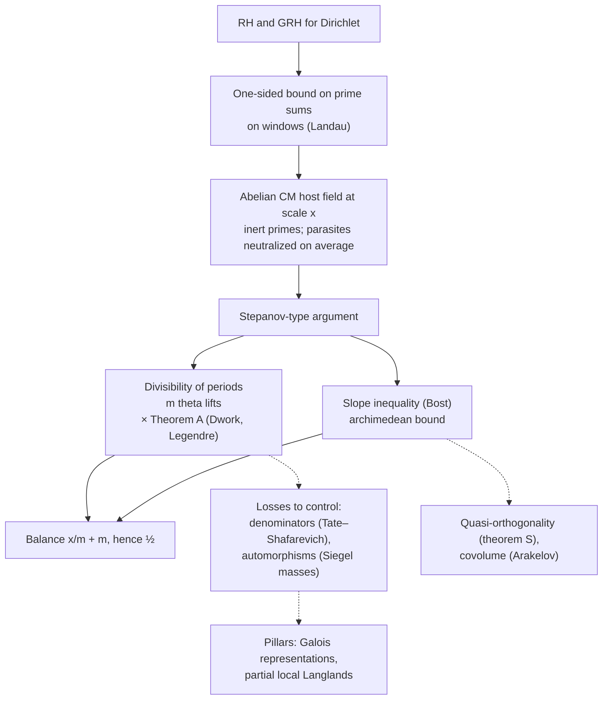

# Alpöge's proof of the generalized Riemann hypothesis

*Version 1.0, 23 November 2026. Working document: it will be corrected as the readings progress (history at the end). Translated from the French original: [version française](synthese.html).*

***Gérard Rozsavolgyi**, guiding **Claude (Anthropic)**. The export-analysis scripts, the reading of the code and the drafting were done by Claude under the author's direction, then reviewed. Sources: the proof export published by A. Sutherland [Su] (`solution.ndjson.zst`: 1,468,418 declarations, exactly the closure of the statements of `Main`), the author's note [A], and the other published readings [Z], [S], [R], [H], [G] (see References). More detailed working notes, with Lean names, in French: [map of the proof](carte.html). Analysis tools: [tools/](tools/).*

> **Intended reader.** A mathematician who knows number fields, Dirichlet L-functions and a little $p$-adic analysis, but is a specialist neither in analytic number theory, nor in automorphic forms, nor in Arakelov geometry. The **preliminaries** recall Dirichlet L-functions and the statement of GRH. **Part I** presents the proof without Lean vocabulary. **Part II** says where each step lives in the code and how much it weighs. **Part III** takes stock.
>
> **Status.** Formal validity is not in question: full compilation, standard axioms, replay by several independent kernels (checks published by Sutherland [Su] and Rubinstein [R], as of 23/11/2026). This text aims to **understand**. Claims are read off the statements in the export, except those marked ⟦I⟧, which are interpretations.

---

## Preliminaries: Dirichlet characters, L-functions, the Riemann hypothesis

*What follows is classical (Davenport, *Multiplicative Number Theory*, ch. 4–9 and 19). It fixes the notation for the rest of the text.*

**Dirichlet characters.** A Dirichlet character of modulus $N\ge1$ is a group homomorphism $\chi:(\mathbb Z/N\mathbb Z)^\times\to\mathbb C^\times$, extended to ℤ by $\chi(n)=\chi(n\bmod N)$ if $\gcd(n,N)=1$ and $\chi(n)=0$ otherwise. It is completely multiplicative and $N$-periodic, with values in the roots of unity (and 0).

- Its **order** $o$ is its order in the group of characters: $\chi^o=1$. Characters of order 2 are the **quadratic** characters, for instance the Legendre symbol $(\cdot/p)$ or $\chi_{-4}(n)=(-1)^{(n-1)/2}$ for odd $n$.
- It is **even** or **odd** according as $\chi(-1)=+1$ or $-1$; write $\kappa\in\{0,1\}$ with $\chi(-1)=(-1)^\kappa$.
- It is **primitive** if it does not come from a character of modulus $N'<N$, $N'\mid N$. Every χ is **induced** by a unique primitive character $\chi^\ast$, whose modulus $f\mid N$ is the **conductor**: $\chi(n)=\chi^\ast(n)$ for $\gcd(n,N)=1$. The **trivial** character of modulus $N$ is induced by the character $1$ of modulus 1.
- **Orthogonality**: for $\gcd(n,N)=1$, $\frac1{\varphi(N)}\sum_{\chi\bmod N}\chi(n)=1$ if $n\equiv1\pmod N$ and $0$ otherwise. This is the tool that isolates an arithmetic progression or, in § 2, a Frobenius class.

**The function $L(s,\chi)$.** For $\operatorname{Re}s>1$,
$$L(s,\chi)=\sum_{n\ge1}\frac{\chi(n)}{n^{s}}=\prod_{p}\Big(1-\frac{\chi(p)}{p^{s}}\Big)^{-1},$$
the series and the (Euler) product converging absolutely. For $\chi=1$ this is $\zeta(s)$. We write $L(s,\chi)$; Mathlib and Part II write $L(\chi,s)$ (`LFunction χ s`), which is the same function.

- **Logarithmic derivative.** Differentiating the logarithm of the Euler product,
$$-\frac{L'}{L}(s,\chi)=\sum_{n\ge1}\frac{\Lambda(n)\chi(n)}{n^{s}},\qquad \Lambda(n)=\begin{cases}\log p & n=p^k,\ k\ge1,\\ 0&\text{otherwise}\end{cases}$$
($\Lambda$ is the **von Mangoldt** function). This is **the** bridge between zeros and primes: a zero of $L$ of order $m$ is a simple pole of $-L'/L$ with residue $-m$.
- **Continuation and functional equation.** If χ is primitive and $\chi\neq1$, $L(s,\chi)$ extends to an **entire** function; $\zeta$ extends to a meromorphic function with a single pole, simple, at $s=1$. For χ primitive of conductor $N$, the completed function
$$\xi(s,\chi)=\Big(\frac N\pi\Big)^{(s+\kappa)/2}\,\Gamma\Big(\frac{s+\kappa}2\Big)\,L(s,\chi)$$
satisfies $\xi(s,\chi)=\varepsilon(\chi)\,\xi(1-s,\bar\chi)$, with $|\varepsilon(\chi)|=1$ (a ratio of Gauss sums). The symmetry $s\leftrightarrow1-s$ exchanges χ and $\bar\chi$.
- **Zeros.** The Euler product forbids zeros for $\operatorname{Re}s>1$, and Hadamard–de la Vallée Poussin exclude them on $\operatorname{Re}s=1$. The poles of Γ give the **trivial zeros** $s=-\kappa,-\kappa-2,-\kappa-4,\dots$ (for ζ: $-2,-4,\dots$). All others, the **non-trivial zeros** $\rho=\beta+i\gamma$, lie in the **critical strip** $0<\beta<1$. There are infinitely many, about $\frac{T}{2\pi}\log\frac{NT}{2\pi}$ with height $0<\gamma\le T$. By the functional equation and conjugation ($\overline{L(\bar s,\chi)}=L(s,\bar\chi)$), if ρ is a zero of $L(s,\chi)$ then so is $1-\bar\rho$: the set of non-trivial zeros is **symmetric about the critical line** $\operatorname{Re}s=\tfrac12$.
- **Non-primitive characters.** If χ is induced by $\chi^\ast$, $L(s,\chi)=L(s,\chi^\ast)\prod_{p\mid N}(1-\chi^\ast(p)p^{-s})$: the extra factors vanish only on $\operatorname{Re}s=0$.

**RH and GRH.**

- **RH**: all non-trivial zeros of ζ have real part $\tfrac12$.
- **GRH for χ** (the generalized Riemann hypothesis, here for Dirichlet L-functions): all non-trivial zeros of $L(s,\chi^\ast)$ have real part $\tfrac12$.

By the symmetry $\rho\leftrightarrow1-\bar\rho$, this is the same as saying that **there is no zero in the half-plane $\operatorname{Re}s>\tfrac12$**: a zero to the left of the critical line has a mirror image to the right. The theorem is stated in this form, which mentions neither trivial zeros nor primitivity, including in Lean: *for every character χ and every $s$ with $\operatorname{Re}s>\tfrac12$, $L(s,\chi)\neq0$*.

**Translation into primes.** Let $\psi(x,\chi)=\sum_{n\le x}\Lambda(n)\chi(n)$ be the **Chebyshev function** twisted by χ ($\psi(x)=\psi(x,1)$). The Riemann–von Mangoldt **explicit formula** writes it as a sum of waves indexed by the zeros:
$$\psi(x,\chi)=\delta_\chi\,x-\sum_{\rho}\frac{x^\rho}{\rho}+(\text{terms bounded by }O(\log x)),\qquad \delta_\chi=\begin{cases}1&\chi=1\\0&\chi\ne1\end{cases}$$
A zero $\rho=\beta+i\gamma$ produces an oscillation of amplitude $x^\beta$. Hence, for every ε > 0:
$$\text{GRH for }\chi\iff\psi(x,\chi)-\delta_\chi x=O_\varepsilon\big(x^{1/2+\varepsilon}\big).$$
The direction ⇐ is the only one the proof needs. It comes from $-\frac{L'}{L}(s,\chi)=s\int_1^\infty\psi(x,\chi)\,x^{-s-1}\,dx$: a bound $O(x^{\theta})$ makes the integral converge, hence $L'/L$ holomorphic, for $\operatorname{Re}s>\theta$. **Proving GRH means bounding sums over primes with a square-root error.**

*Notation.* Below, the letter ψ **on its own** denotes a primitive character (the one being treated), and $\psi(x,\chi)$ the Chebyshev function; γ denotes Euler's constant $0.5772\ldots$, except in $\rho=\beta+i\gamma$.

---

## Two-page summary

**Theorem.** For every Dirichlet character χ, $L(s,\chi)\neq 0$ for $\operatorname{Re}s>\tfrac12$. In particular, the Riemann hypothesis holds.

**The proof in six steps.**

**1. A one-sided bound suffices.** It suffices to bound from above a combination **with non-negative coefficients** of prime sums twisted by the powers of χ, with an error $x^{1/2+\varepsilon}$, and only on **windows** of scales $[Y,Y^{3/2}]$.

> **Definitions.**
>
> - *Twisted Chebyshev sum*: $\sum_{n\le x}\Lambda(n)\chi(n)$, where $\Lambda(n)=\log p$ if $n=p^k$ and $0$ otherwise. GRH for χ is equivalent to this sum being $O(x^{1/2+\varepsilon})$.
> - *Landau positivity*: a Dirichlet series with coefficients $\ge0$ has a singularity at the real point of its abscissa of convergence. For a non-negative combination, an **upper bound** therefore suffices to exclude zeros, without a lower bound.

**2. One auxiliary field per scale.** At each scale $x$, one chooses a large auxiliary field, the **host**, and counts there the **inert primes**, weighted according to their Frobenius. By orthogonality this count brings out χ, but also **parasitic** characters, which are neutralized by choosing the parameters of the host **on average**.

> **Definitions.**
>
> - *CM field*: a totally imaginary quadratic extension of a totally real field, for instance $\mathbb Q(\zeta_n)$ or $\mathbb Q(\sqrt{-d})$.
> - *Host*: an abelian CM field $E\subset\mathbb Q(\zeta_{Qqd})$ of degree $\approx x^{2}$, built on two auxiliary primes $q,d$. It contains $\sqrt{-q}$, $\sqrt{-d}$ and the field cut out by χ. Its Galois group is abelian and explicit, so any count of primes by Frobenius decomposes into sums twisted by its characters, χ among them.
> - *Inert prime*: $p$ is inert in $\mathbb Q(\sqrt{-d})$ if $p\mathcal O$ stays prime there, with residue field $\mathbb F_{p^2}$. This is equivalent to $\big(\tfrac{-d}{p}\big)=-1$ and concerns about half of all primes.
> - *Choice on average*: one cannot control a given quadratic character, since that would be GRH. But in a family of size $\exp(Y^{\varepsilon/5})$, **almost all** pairs $(q,d)$ have good sums (large sieve). So some exist.

**3. The engine: a Stepanov-type argument.** "A function vanishing to high order" is replaced by "a theta series whose **derivatives of order $a$ at a CM point** are divisible by $p^{a\,p/(p^2-1)}$", for each inert prime $p$. This is a $p$-adic lemma on formal groups ("Theorem A", of Dwork and Legendre type).

> **Definitions.**
>
> - *Stepanov's method*: for a curve over $\mathbb F_q$, one builds an auxiliary function vanishing to order $a$ at each rational point. Then $a\cdot\#C(\mathbb F_q)\le\deg f$, and optimizing in $a$ gives $q+O(\sqrt q)$. Over ℤ, "vanishing to order $a$" becomes "being divisible by $p^{v}$".
> - *Theta series*: the generating series $\theta_L(z)=\sum_{v\in L}e^{2\pi i H(v)z}$ of representations by a quadratic or Hermitian form $H$; it is an automorphic form.
> - *CM point*: a point of a moduli space of abelian varieties (modular curve, Shimura variety) corresponding to a variety with **complex multiplication**, whose endomorphism ring is unusually large. The typical example is $\mathbb C/\mathbb Z[i]$, at $\tau=i$. Modular forms take algebraic values there.
> - *Supersingular reduction, formal group*: at an inert $p$, the reduction mod $p$ of the CM curve is supersingular. Its formal group, a group law given by a power series, has height 2, with logarithm $\sum_e X^{p^{2e}}/p^e$. This rigidity makes divisibility computable.
> - *The rate $p/(p^2-1)$*: $D^af(0)=a!\cdot\mathrm{coeff}_a(f)$. By Legendre, $v_p(a!)\approx a/(p-1)$, and the denominators of the formal group cost at most $a/(p^2-1)$. And $\frac1{p-1}-\frac1{p^2-1}=\frac{p}{p^2-1}=\frac1p+\frac1{p^3}+\cdots$.

**4. Multiplicity: a chain of lifts.** A single differentiation is not enough. One chains $m$ **theta lifts** between unitary groups of increasing rank, and each adds its layer of divisibility. The length $m$ of the chain plays the role of the order of vanishing.

> **Definitions.**
>
> - *Unitary group* $U(X)$: the group of isometries of a Hermitian space $X$ over a CM field. If $X$ is **definite** (positive at the infinite places), the group is compact at infinity and its spaces of automorphic forms are finite-dimensional.
> - *Theta lift* (Weil, Howe, Kudla): it carries an automorphic form $f$ on $U(X)$ to a form on another unitary group $U(X')$ by integrating it against a theta series in two variables, the "kernel": $\theta(f)(h)=\int f(g)\,\Theta(g,h)\,dg$ (over an adelic quotient).
> - *Period*: the integral of an automorphic form over a subgroup (here a Bessel period, in the sense of Gan–Gross–Prasad). By the **seesaw** identities (Kudla), the period of the iterated lift is computed on the starting group, through the $m$ successive kernels.

**5. The archimedean side: the slope inequality.** Divisibility forces the periods to be multiples of large prime powers. A **slope inequality** (Bost) prevents these periods from being too large at the infinite places. By the product formula, the two constraints are compatible only if the sum over primes is small. The archimedean terms (Siegel masses, Rallis formulas, CM periods) reproduce exactly the expected main term.

> **Definitions.**
>
> - *Hermitian lattice*: a projective $\mathcal O_K$-module $L$ with Hermitian norms at the infinite places.
> - *Slope*: $\widehat\mu(L)=-\log\operatorname{covol}(L)/\operatorname{rank}(L)$, up to normalization. Dividing $L$ by $p^{v}$ increases it by $v\log p$: **a difference of slopes is a sum of $\log p$**.
> - *Slope inequality*: for $\varphi:E\to F$ injective, $\widehat\mu(E)\le\widehat\mu_{\max}(F)+h(\varphi)$, where $h(\varphi)$ measures the norm of $\varphi$ at the infinite places. It is an arithmetic version of Siegel's lemma and of Minkowski: a lattice cannot be very "tight" if it maps without much dilation into a known lattice. Divisibility raises the slope, and the inequality caps it.
> - *Product formula*: for $\alpha\ne0$ in a number field, $\prod_v|\alpha|_v=1$. Being highly divisible at $p$ forces being large elsewhere.

**6. Where the ½ comes from.** The error has two terms: $x/m$, which decreases with the length $m$ of the chain, and a loss $m$, which grows with it. The optimum $m\approx\sqrt x$ gives the exponent $\tfrac12$.

> **Definitions.**
>
> - *Balance*: the relative error is $\approx x/m+m\ge2\sqrt x$, with equality at $m=\sqrt x$. The method stops exactly at $\sqrt x$, the true size of the fluctuations (Littlewood). $m$ is the **length of the chain**, not a rank.
> - *The losses to be paid*: denominators of Hecke projections, bounded via Tate–Shafarevich groups; lattice automorphisms (Siegel masses); a quasi-orthogonality of periods; a covolume. See § 8.

Everything else, i.e. more than 99 % of the 17 million lines, serves to **build** the objects to which this mechanism applies: unitary groups, lattices, theta kernels, Galois representations, bounds on Tate–Shafarevich groups. It also serves to **control the losses**.



*Reading the diagram: a solid arrow means "reduces to" or "rests on"; a dashed arrow leads to the losses to be controlled and to the theories that control them.*

---

# Part I. The proof

## 1. From RH to an inequality about primes

This section reduces GRH to **a single inequality**, with no fine arithmetic at all: only classical complex analysis (Perron, Landau). It takes five steps. In the code, this is the light part: about 73,000 declarations, mostly Mathlib analysis (Part II).

### 1.1 Reduction to primitive characters, grouped into levels

If χ is induced by $\chi^\ast$, of modulus $N$,
$$L(s,\chi)=L(s,\chi^\ast)\prod_{p\mid N}\big(1-\chi^\ast(p)p^{-s}\big).$$
Each factor has modulus $\ge 1-p^{-\operatorname{Re}s}>0$ if $\operatorname{Re}s>0$: it does not vanish to the right of the imaginary axis. The zeros of $L(s,\chi)$ in $\operatorname{Re}s>\tfrac12$ are therefore those of $L(s,\chi^\ast)$, and it suffices to treat **primitive** characters. RH is the case $\chi^\ast=1$ (modulus 1), i.e. ζ; trivial characters of modulus $N$ reduce to it.

The proof does not treat an isolated character but a whole **level** at once. For ψ primitive of order $o$, write
$$K_\psi=\{\chi_0=1,\ \chi_1,\dots,\chi_{o-1}\},\qquad \chi_j=\text{the primitive character inducing }\psi^j .$$
This is a set of $o$ primitive characters, **closed under conjugation** ($\overline{\psi^j}=\psi^{o-j}$), containing 1. One proves in one go that **neither ζ nor any of the $L(s,\chi_j)$** vanishes for $\operatorname{Re}s>\tfrac12$. For RH alone, $\psi=1$, $o=1$ and $K_\psi=\{1\}$.

### 1.2 Smoothing: the Riesz-weighted Chebyshev sum

The function $\psi(x,\chi)$ from the preliminaries has two defects: it jumps at every prime power, and its explicit formula $\sum_\rho x^\rho/\rho$ converges only conditionally (since $\sum 1/|\rho|$ diverges). The proof uses instead the **Riesz weight** $(y/n-1)_+$:
$$S(y,\chi)=\sum_{n\le y}\Lambda(n)\chi(n)\Big(\frac yn-1\Big)=\int_1^y\Big(\sum_{n\le t}\frac{\Lambda(n)\chi(n)}{n}\Big)\,dt .$$
It is an antiderivative (an average): it is continuous, and each integration gains a factor $1/|\rho|$ in the explicit formula.

**Perron's formula.** For $c>1$ and $y>0$, computing the residues at $s=1$ and $s=0$ gives
$$\frac1{2\pi i}\int_{c-i\infty}^{c+i\infty}\frac{(y/n)^s}{s(s-1)}\,ds=\Big(\frac yn-1\Big)_+ ,$$
hence, summing against $\Lambda(n)\chi(n)$ and using the logarithmic derivative,
$$S(y,\chi)=\frac1{2\pi i}\int_{(c)}\Big(-\frac{L'}{L}(s,\chi)\Big)\frac{y^s}{s(s-1)}\,ds .$$
The kernel decays like $|s|^{-2}$: the integral converges **absolutely**, and the contour can be shifted to the left, picking up residues.

- **At $s=1$.** For $\chi\neq1$, $L(1,\chi)\ne0$ (Dirichlet), and the residue is $-y\,\frac{L'}{L}(1,\chi)$. For ζ, the pole of $-\zeta'/\zeta=\frac1{s-1}-\gamma+\cdots$ meets that of the kernel: a double pole, with residue $y\log y-(1+\gamma)\,y$.
- **At each non-trivial zero ρ of multiplicity $m_\rho$**: $-L'/L$ has residue $-m_\rho$, giving the term $-m_\rho\,y^\rho/(\rho(\rho-1))$.
- **At $s=0$ and at the trivial zeros**: terms $O(\log y)$.

One therefore removes the main term, which defines
$$g(y,\chi)=S(y,\chi)+y\,\frac{L'}{L}(1,\chi)\quad(\chi\ne1),\qquad G(y)=S(y,1)-y\log y+(1+\gamma)\,y ,$$
and one obtains the **smoothed explicit formula**:
$$g(y,\chi)=-\sum_\rho m_\rho\,\frac{y^\rho}{\rho(\rho-1)}+O(\log y),$$
and likewise for $G$ with the zeros of ζ. The series converges **absolutely**, since $\sum_\rho1/|\rho|^2<\infty$. Two consequences:

1. **GRH ⇒ $g(y,\chi)=O(y^{1/2})$**, without even an $\varepsilon$: this is the target size.
2. **Conversely**, by Mellin transform, $\int_1^\infty g(y,\chi)\,y^{-s-1}dy=-\frac{1}{s(s-1)}\frac{L'}{L}(s,\chi)+(\text{rational function with poles at }0,1)$. A zero ρ appears there as a **pole**. A bound $|g(y,\chi)|=O(y^\theta)$ makes the integral converge for $\operatorname{Re}s>\theta$ and excludes any zero with real part $>\theta$.

Point 2 requires a bound **in absolute value**: one would have to control the fluctuations of $g$ upwards **and** downwards. The rest of the reduction removes one of these two requirements.

### 1.3 Combining: a sum with non-negative coefficients

For ψ primitive of order $o$, form
$$G_\psi(y)=G(y)+\frac{1}{3o+1}\sum_{j=1}^{o-1}\operatorname{Re}g(y,\chi_j).$$
Since $K_\psi$ is closed under conjugation and $g(y,\bar\chi)=\overline{g(y,\chi)}$, the sum of the real parts equals the sum of the $g(y,\chi_j)$ themselves. $G_\psi$ is thus the Riesz sum, main term removed, of the Dirichlet series
$$D_\psi(s)=-\frac{\zeta'}{\zeta}(s)-\frac1{3o+1}\sum_{j=1}^{o-1}\frac{L'}{L}(s,\chi_j)=\sum_{n\ge1}\frac{c_n}{n^s},\qquad c_n=\Lambda(n)\Big(1+\frac1{3o+1}\sum_{j=1}^{o-1}\chi_j(n)\Big).$$

**The coefficients are non-negative.** If $n$ is coprime to the conductor of ψ, $\chi_j(n)=\psi(n)^j$, and the geometric sum $\sum_{j=1}^{o-1}\psi(n)^j$ equals $o-1$ if $\psi(n)=1$ and $-1$ otherwise. Hence
$$c_n=\Lambda(n)\cdot\begin{cases}\dfrac{4o}{3o+1}&\text{if }\psi(n)=1,\\[8pt]\dfrac{3o}{3o+1}&\text{otherwise.}\end{cases}$$
For powers of primes $p$ dividing the conductor, bound each $|\chi_j(n)|\le1$: $c_n\ge\Lambda(n)\,\frac{2o+2}{3o+1}>0$. In every case $c_n\ge0$, and $c_n=0$ only if $\Lambda(n)=0$.

**Where $1/(3o+1)$ comes from.** The 4 : 3 profile is not arbitrary; it can be read off the construction of § 2 (read on the code). Primes are sampled there according to their class modulo a subgroup of index $o$ of a Frobenius group, with proportion $4/(3o+1)$ for the neutral class and $3/(3o+1)$ for each of the $o-1$ others. The total is $(4+3(o-1))/(3o+1)=1$. The Fourier coefficients of this distribution are $1$ for the trivial character and $\frac{4-3}{3o+1}=\frac1{3o+1}$ for all others: exactly the weights of $G_\psi$, and $c_n/\Lambda(n)$ is $o$ times the proportion of the class of $n$. A uniform distribution would give zero weights and would not see the $\chi_j$; a strictly positive distribution guarantees positivity. Why 4 : 3 rather than another mixture, the code does not say ⟦I⟧: positivity alone does not force it.

**No cancellation between zeros.** The Mellin transform of $G_\psi$ is $D_\psi(s)/(s(s-1))$, up to a rational function. Its poles in $0<\operatorname{Re}s<1$ are the zeros ρ of ζ or of one of the $L(s,\chi_j)$, with weight
$$w_\rho=m_\rho(\zeta)+\frac1{3o+1}\sum_{j=1}^{o-1}m_\rho(\chi_j)\;>\;0 .$$
All multiplicities enter with a $+$ sign: a zero of one of the functions cannot be masked by another. This is the idea of de la Vallée Poussin, who combined $\zeta(\sigma)^3|\zeta(\sigma+it)|^4|\zeta(\sigma+2it)|$ thanks to $3+4\cos\theta+\cos2\theta=2(1+\cos\theta)^2\ge0$.

### 1.4 Why an upper bound suffices: Landau's argument

**Landau's theorem.** Let $f\ge0$ on $[1,\infty)$ and $H(s)=\int_1^\infty f(y)\,y^{-s-1}dy$, with abscissa of convergence $\sigma_c$. Then $H$ has **no** holomorphic continuation to a neighbourhood of the **real** point $s=\sigma_c$. (Proof: expand $H$ in a Taylor series at a real point $a>\sigma_c$. The derivatives $(-1)^kH^{(k)}(a)=\int f(y)(\log y)^ky^{-a-1}dy$ are non-negative; if the series converged a little beyond $\sigma_c$, it could be interchanged with the integral, which would then converge beyond $\sigma_c$.)

**Application.** Suppose $G_\psi(y)\le y^\theta$ for $y\ge y_0$, with $\theta<1$. Put $f(y)=y^\theta-G_\psi(y)\ge0$. Its transform is
$$H(s)=\frac{y_0^{\theta-s}}{s-\theta}-\int_{y_0}^\infty G_\psi(y)\,y^{-s-1}dy=\frac{1}{s-\theta}-\frac{D_\psi(s)}{s(s-1)}+(\text{a function holomorphic for }\operatorname{Re}s>0),$$
where "holomorphic" includes the cancellation of the pole at $s=1$ by the main terms. Suppose for contradiction that $\sigma_c>\theta$. By Landau, $\sigma_c$ is a singularity, hence a pole of $D_\psi/(s(s-1))$: a **real zero** $\beta=\sigma_c\in(\theta,1)$. Its residue in $D_\psi(s)/(s(s-1))$ is $-w_\beta/(\beta(\beta-1))=w_\beta/(\beta(1-\beta))>0$. As $\sigma\to\beta^+$, $H(\sigma)\to-\infty$, contradicting $H(\sigma)=\int f\,y^{-\sigma-1}\ge0$. Hence $\sigma_c\le\theta$: $H$ is holomorphic on $\operatorname{Re}s>\theta$, and so is $D_\psi$. **Neither ζ nor any $L(s,\chi_j)$ has a zero with real part $>\theta$.**

**Intuitive reading.** In the explicit formula, a real zero β contributes $+w_\beta\,y^\beta/(\beta(1-\beta))$: it **pushes $G_\psi$ upwards**, and an upper bound sees it directly. A complex zero $\beta+i\gamma$ contributes an oscillation of amplitude $\asymp y^\beta$, as $\cos(\gamma\log y+\varphi)$. It goes up half the time, and the positivity of the $w_\rho$ prevents the oscillations of different zeros from cancelling each other durably. Landau's theorem makes this "every oscillation eventually goes up" rigorous. **One never needs a lower bound on $G_\psi$.** This is essential for what follows: the arithmetic method (§§ 3–7) provides an **inequality**, not an asymptotic equality.

### 1.5 On windows only

The method of §§ 2–7 does not provide the bound for **all** large $y$, but only on ranges of scales where a host field could be built (§ 2): $q$ and $d$ must be chosen depending on the range. The proof therefore establishes a **windowed** form of Landau. As read on the export, in contrapositive form:

> **Window criterion.** Let $\lambda>1$ and $0<\theta<1$. If ζ or one of the $L(s,\chi_j)$ has a zero with real part $>\theta$, then for every sufficiently large $Y$ there is $y\in[Y,Y^\lambda]$ with $G_\psi(y)>y^\theta$.

In other words, a zero beyond θ shows up in **every** sufficiently remote window $[Y,Y^\lambda]$, not just "somewhere at infinity". It therefore suffices to bound $G_\psi$ on a sequence of windows $[Y_k,Y_k^\lambda]$, $Y_k\to\infty$. The criterion holds for every $\lambda>1$; the rest of the proof applies it with ranges $[Y,Y^{3/2}]$ or $[Y,Y^2]$.

**How one localizes ⟦I⟧.** Landau's proof uses only the derivatives $(-1)^kH^{(k)}(a)=\int f(y)(\log y)^ky^{-a-1}dy$. In the variable $u=\log y$, the kernel $u^ke^{-au}$ is a **gamma density**, with mean $\approx k/a$ and relative width $\approx k^{-1/2}$. Taking $k\asymp\log Y$, the mass concentrates in $u\in[\log Y,\lambda\log Y]$, i.e. in the window. The remainder, exponentially small in $k$ (hence a negative power of $Y$), is absorbed by the trivial bound $G_\psi(y)=O(y)$ (Mertens). Slijepčević considers this windowed form new. In this proof it is indispensable: without it one would need a single host for all scales, which the averaged choice of § 2 does not provide. A later text (hexagon:2611.00828) proposes, however, to replace it with a classical oscillation theorem, that of Kaczorowski–Pintz.

### 1.6 Conclusion

Applying 1.4 and 1.5 with $\theta=\tfrac12+C\varepsilon$ for each $\varepsilon>0$, then letting $\varepsilon\to0$, one obtains the absence of zeros for $\operatorname{Re}s>\tfrac12$, simultaneously for ζ and for all the $L(s,\chi_j)$, $\chi_j\in K_\psi$. Since every primitive character belongs to its own level $K_\psi$, this gives GRH for all Dirichlet characters.

> **Conclusion.** Everything reduces to proving, for each primitive ψ, each sufficiently small ε > 0 and each scale $x$ in a sequence of windows $[Y_k,Y_k^\lambda]$, $Y_k\to\infty$:
> $$\boxed{\;G_\psi(x)\;\le\;x^{1/2+C\varepsilon}\;}$$
> This is a **one-sided upper bound** on a weighted sum of $\log p$, with **non-negative coefficients**, with a square-root error. §§ 2–7 do nothing else.

## 2. One auxiliary field per scale

**The host.** At scale $x$, one chooses two primes $q\equiv 3\pmod 8$ and $d\equiv7\pmod{16}$, then an abelian CM field
$$E\subset\mathbb Q(\zeta_{Qqd}),\qquad \sqrt{-q},\sqrt{-d}\in E,\qquad [E:\mathbb Q]\approx x^{2+8\varepsilon},$$
containing the field cut out by ψ. The Galois group $\{\pm1\}^2\times A$ and the Artin map are described explicitly. Precisely (read on the export): $|A|=c\cdot2^e$ with $x^{2+8\varepsilon}\le c\cdot2^e\le2x^{2+8\varepsilon}$, so $[E:\mathbb Q]=4|A|$ lies between $4x^{2+8\varepsilon}$ and $8x^{2+8\varepsilon}$. This is **the same field** that carries the Tate–Shafarevich bound of § 8 (a).

**The identity.** One considers the primes $p$ **inert** in $\mathbb Q(\sqrt{-d})$, weighted according to their Frobenius class in $E$. By orthogonality of the characters of $\mathrm{Gal}(E/\mathbb Q)$, the sum of $\log p$ over these primes is a combination of the $g(\cdot,\chi)$ for the characters χ of $E$. After averaging over translates and choosing the weights, one recovers exactly $G_\psi(x)$, with the weight $1/(3o+1)$ (hence that weight). One also gets **parasitic characters**, essentially twists by $(q/\cdot)$, $(d/\cdot)$ and their product.

**The parasites, on average.** For a given quadratic character, one cannot show that $g(y,\chi)=O(y^{1/2+\varepsilon})$: that is GRH itself. But $q$ and $d$ can be chosen in a family of size $\exp(Y^{\varepsilon/5})$, **gigantic** compared with the scales. A mean-square argument, of large-sieve type, shows that **almost all** pairs $(q,d)$ have square-root sums over the whole range $[Y,Y^A]$ ($A$ fixed), and no zero near $s=1$. So some exist. This argument is unconditional and serves only to **clear the ground**.

> **What remains.** Bound the sum over the inert primes of $E$, prime by prime, with an error $x^{1/2+O(\varepsilon)}$. This is the heart of the proof.

## 3. The model: Stepanov's proof for curves

Let $C$ be a curve of genus $g$ over $\mathbb F_q$. Stepanov (1969), then Bombieri, bound $N=\#C(\mathbb F_q)$ as follows:

1. one builds an auxiliary function $f$, of controlled degree, that **vanishes to order at least $a$** at each rational point; it is produced by linear algebra, a Siegel lemma;
2. then $a\cdot N\le\deg f$;
3. one optimizes $a$ and obtains $N\le q+O(g\sqrt q)$.

The exponent ½ comes from the **balance** between the order of vanishing and the degree.

**The difficulty over ℤ.** "Vanishing to order $a$" requires differentiating, and one does not differentiate an integer. Alpöge (note, § 1): "multiplicity is hard to find over the integers, corresponding to something like differentiating whole numbers". The proof replaces vanishing by **divisibility**. A non-zero algebraic integer divisible by $p^v$ has norm $\ge p^v$. If its archimedean size is also known to be small, the **product formula** bounds $v$. This is the pattern of auxiliary-function methods in transcendence (Thue–Siegel–Bombieri), in its modern form due to **Bost**: slope inequalities.

## 4. The source of divisibility: differentiating a theta series at a CM point

### 4.1 The statement

Take a theta series of a Hermitian lattice, written near a CM point in the **coordinates of a formal group**. At a prime $p$ inert in the CM field, the reduction is **supersingular** and the formal group has **height 2**. Its logarithm has the form
$$\log_F(X)=\sum_{e\ge0}\frac{X^{p^{2e}}}{p^{e}},$$
up to a Frobenius twist on the index. The project proves the following statement, which it calls "Theorem A":

> **Theorem A** (simplified form). Let $\Theta$ be a theta series, renormalized by a suitable exponential, in formal-group coordinates at the CM point. Then its derivatives of order $a$ at the CM point satisfy
> $$v_p\big(D^{a}\Theta(0)\big)\;\ge\;a\cdot\frac{p}{p^2-1}\;-\;O(\log a)\;=\;a\Big(\frac1p+\frac1{p^3}+\frac1{p^5}+\cdots\Big)-O(\log a).$$

This is the sentence in Alpöge's note: "$D^a\,\Omega\cdot\theta(0)$ is divisible by $p^{a/p+a/p^3+\cdots-O(\log a)}$". But the exponent concerns the **renormalized object, in formal-group coordinates**, not the naive theta series differentiated in the analytic coordinate. On that naive model, for ℤ[i], Rubinstein [R] does not recover the announced exponent (exponents 6, 2, 1 for $p=3,7,11$).

### 4.2 Why $p/(p^2-1)$ ⟦I⟧

The number $p/(p^2-1)$ is a difference of two rates. We have $D^a f(0)=a!\cdot[\text{coefficient of degree }a]$, and:

- **Legendre**: $v_p(a!)=\dfrac{a-s_p(a)}{p-1}\ge\dfrac{a}{p-1}-O(\log a)$. Differentiation provides about $a/(p-1)$.
- **The denominators**: the change of variables through the height-2 formal group, whose logarithm has terms $X^{p^{2e}}/p^e$, and the renormalizing exponential cost at most $a/(p^2-1)$ on the coefficient of degree $a$. The project establishes this weight bound, $\rho(p)=1/(p^2-1)$ per degree, for the exponential series ("lemma S").
- **Balance**: $\dfrac{1}{p-1}-\dfrac{1}{p^2-1}=\dfrac{p}{p^2-1}$, which is exactly the observed gain.

The $O(\log a)$ loss comes from the digit sum $s_p(a)$ in Legendre and from the number of "layers" $p^e\le a$.

### 4.3 How Theorem A is proved

The proof takes about 0.02 % of the volume. It proceeds in three stages.

1. **Reduction to a generic point.** One wants to bound the coefficients of a polynomial in the coordinates of a "frame", i.e. vectors along which one differentiates. One replaces it by its value at a **residually generic** point: a point whose coordinates have algebraically independent reductions, so that any polynomial non-zero mod $p$ has absolute value 1 there. At such a point the absolute value equals the **Gauss norm**, the maximum of the coefficients. Such a point exists in a field of rational functions with the Gauss absolute value.
2. **Reduction to a monomial.** The jet of the frame is expressed through products of minors, hence determinants, of the derivatives of $\Theta$ along the frame. One reduces to bounding $|\kappa!\cdot\mathrm{coeff}_\kappa(\cdots)|$ for a single multi-index $\kappa$.
3. **The monomial case.** One combines:
   - the integrality of the starting series;
   - the **inverse of the formal-group logarithm**;
   - the weight bound $\rho(p)$ for the renormalizing exponential. It rests on a **Dwork-type integrality** hypothesis, and **Dwork's lemma** is proved in the project: $\exp(P)$ is $p$-integral if and only if $P^{\sigma}(X^p)-pP\in pW[[X]]$;
   - a **Frobenius-twisted quasi-orthogonality** condition on the frame vectors, $\sum_a x_a^{p^{j}}x'_a\equiv0 \pmod p$.

   A combinatorial labelling of the odd shifts $j$ with $p^j\le a$ (only these contribute a term $a/p^j$) costs $O(\log a)$ extra rows. This is the origin of the logarithmic loss.

### 4.4 Odd exponents and Frobenius

At an inert $p$, Frobenius acts on the embeddings of the CM field by a shift. The gain $a/p^{e}$ is realized only at **odd exponents**. It is read off the weights attached to the place $t+e\cdot h_p$ of the **Frobenius orbit** of $p$: one gets $a/p^e$ if the weight at that place is not too large, and nothing otherwise. Hence a combinatorial constraint. The "selected" places, where the weights are large, must meet each short segment of a Frobenius orbit in at most two points. The proof achieves this with **Behrend**'s construction of sets without 3-term arithmetic progressions, present in the closure. Alpöge (note, step 19): "precise choice of the Iwasawa tower, specifically using Behrend!!".

## 5. Multiplicity: a chain of m theta lifts

A single differentiation at a single CM point does not provide enough. One must repeat, just as Stepanov requires vanishing at **all** points. The tool is the **theta correspondence**: an automorphic form on a unitary group $U(X_0)$ lifts, by integration against a theta kernel, to a form on $U(X_1)$, of larger rank, and so on:
$$U(X_0)\to U(X_1)\to\cdots\to U(X_m),\qquad \dim X_j=k+j(t+1).$$
All Hermitian spaces are **definite**, which makes the groups compact at infinity and the spaces of forms finite-dimensional.

**What the code says.**

- The **period** of a form (a Bessel period, in the sense of Gan–Gross–Prasad) factors through the **composite of the $m$ kernels**:
  $$\mathrm{Pt}(\varphi)=\mathrm{PtL}\big(K_m\cdots K_1\,\varphi\big).$$
  This is the matrix form of the **seesaw** identities (Kudla): the period of the iterated lift is a period on the starting group.
- At each step $j\to j+1$, the local operator applied to the kernel $K_j$ **gains** a valuation at least equal to the Legendre gain of § 4 for that lift, minus a loss $\mathrm{dG}_j\ge v_p(|\mathrm{Stab}_\Gamma(L)|)$. This loss is the $p$-part of the order of the lattice's automorphism group: a **Siegel mass** denominator.
- The lattice one works on is **generated** by applying, at each point of the Frobenius orbit, a local operator **iterated m times**, once per lift.
- In total, for each inert prime $p$:
  $$v_p(\text{period})\;\ge\;\sum_{j=1}^{m}\mathrm{gain}_j(p)\;-\;\text{losses}(p),\qquad \mathrm{gain}_j(p)\approx\sum_{e\ \text{odd}}\Big(\frac{a}{p^{e}}-\mathrm{cap}_j(p,e)\Big)_+ ,$$
  where $\mathrm{cap}_j$ is the Harish-Chandra-type weight of the $j$-th lift.

**The comparison with primes is almost an identity.** The Riesz-weighted prime sum to be bounded is, term by term, $\sum_{i\ \text{odd}}\big(a/p^i-w_j(p,i)\big)_+$. It has **the same form**, with **the same weights**: the proof chooses the weights of the lifts so that they coincide with those of the prime sums. The condition linking the two sides says that, for each inert prime $p$,
$$\sum_{j=1}^m(\text{contribution of }p\text{ to the }j\text{-th term of the sum})\;-\;\text{losses}\;\le\;\sum_{j=1}^m\mathrm{gain}_j(p).$$

> **Where is the difficulty?** Once the weights are aligned, the inequality "primes ≤ gains" is almost an identity. All the difficulty lies in **building** lattices, kernels and periods that **realize** these gains, and in **controlling the losses**.

## 6. The archimedean side: lattices, slopes and the product formula

**Hermitian lattices and slopes.** Over a number field $K$, a Hermitian lattice is a projective $\mathcal O_K$-module with norms at the infinite places. Its **Arakelov degree** is $\widehat{\deg}=-\log\operatorname{covol}$, and its **slope** is $\widehat\mu=\widehat{\deg}/\mathrm{rank}$. The key point is this: if $L'$ is obtained by **dividing** $L$ by an ideal $I$, i.e. $L=I\cdot L'$, then
$$\widehat\mu(L')-\widehat\mu(L)\;=\;\sum_{\mathfrak p}v_{\mathfrak p}(I^{-1})\log N\mathfrak p\quad(\text{normalized}).$$
**A difference of slopes is a sum of $\log p$ over primes.**

**The division.** To each word $u$, which indexes a form of the family, one attaches a lattice of forms $N_u$ and the period pairing $B_u:N_u\to R^\vee$, with values in an integral target lattice. The divisibility of § 5 makes it possible to **divide** $N_u$ while keeping $B_u$ **integral**. Two statements, read on the export, fit together:

- **The abstract lemma** (proved in the project). If the valuations of the periods are $\ge\sigma(w)$ at each place $w$, with $\sigma(w)$ **real**, then the lattice shifted by $\tau(w)$ at $w$ still maps into the integers for every integer $\tau(w)\le\lceil\sigma(w)\rceil$. The bound $\lceil\sigma\rceil$ is optimal: a valuation is an integer, so $v\ge\sigma$ is equivalent to $v\ge\lceil\sigma\rceil$.
- **The construction.** It divides by the fractional ideal $I_u=\prod_w w^{-\lfloor e_w\,\sigma_u(w)\rfloor}$, where $e_w$ is the ramification index: it takes the **floor**, a cautious choice that stays within the lemma ($\lfloor\cdot\rfloor\le\lceil\cdot\rceil$). The slope of $N_u$ then rises by exactly
$$\widehat\mu(N_u)-\widehat\mu(N_u^{\mathrm{before}})\;=\;\sum_w 2\,\frac{\log Nw}{[K:\mathbb Q]}\,\big\lfloor e_w\,\sigma_u(w)\big\rfloor .$$

The rounding loss is accounted for explicitly. The gap between this jump and its unrounded value, $\sum_w 2\,\frac{\log Nw}{[K:\mathbb Q]}\,e_w\,\sigma_u(w)$, is at most $2\sum_w\frac{\log Nw}{[K:\mathbb Q]}$, the sum running only over the places where $\sigma_u(w)\neq0$: less than one unit per active place. That sum is itself bounded by logarithms of the parameters of the host and of the chain. Altogether this gives an error of at most $C\,X''$, with $X''=x\,n\,e^{x^{\varepsilon/3}}$, where $n$ is the order of the group $A$ of § 2. On the export, $[E:\mathbb Q]=4n$ exactly, and $n\le 2x^{2+8\varepsilon}$ (§ 2). It forms one of the linking conditions feeding the final inequality (Part II).

**It is negligible.** One unit of the prime sum is worth $b=e^{x^\varepsilon}$ in slope: the Riesz weights are of order $b$, and the parameters satisfy $a=x\,b$. In units of $G_\psi$, the rounding therefore weighs at most $C\,x\,n\,e^{x^{\varepsilon/3}-x^{\varepsilon}}$. This tends to 0 faster than any power of $x$, while the final error budget is $x^{1/2+C\varepsilon}$. The other remainder in the same condition is of order $b$ (up to logarithmic and size factors): the rounding is smaller by a factor $e^{-x^{\varepsilon}(1-o(1))}$.

**The slope inequality (Bost).** For $\varphi:E\to F$ injective of height $h(\varphi)$, $\widehat\mu(E)\le\widehat\mu_{\max}(F)+h(\varphi)$. This is an arithmetic generalization of Siegel's lemma and of Minkowski. It is applied to the $B_u$. The slopes of the divided lattices, which contain the prime sums, are thus bounded by:

- the slope of the target lattice, computed by **exact volumes**: Siegel masses, class numbers, Γ factors;
- the heights $h(B_u)$, small thanks to a **quasi-orthogonality**: the periods of different forms are almost orthogonal. This is the project's "theorem S", a Petersson- or Kuznetsov-type formula for Bessel coefficients on unitary groups, with an error $1+b^{-6}$;
- a **covolume bound** for lattices of automorphic forms, obtained by Arakelov geometry on integral models of Shimura varieties. It uses Hironaka, Moriwaki, arithmetic Hilbert–Samuel and toroidal compactifications.

**The balance.** Divisibility at the finite places and size at the infinite places, combined by the product formula:
$$\sum_{p\ \text{inert}}(\text{contribution of }p)\;\le\;(\text{explicit archimedean terms})\;+\;\text{losses}.$$
The archimedean terms (Rallis formulas for the norms of theta lifts, CM periods via Chowla–Selberg, Siegel masses) reproduce **exactly the main term** of the Chebyshev sum. Only the error remains.

## 7. Where the ½ comes from

The error per lift, divided by the natural size of the term, is, up to a factor $x^{O(\varepsilon)}$:
$$\frac{\text{error}}{\text{term}}\;\lesssim\;\underbrace{\frac{x}{m}}_{\text{trivial error spread over }m\text{ lifts}}\;+\;\underbrace{m}_{\text{loss per lift, linear in }m}\;+\;\sqrt x .$$
Since $x/m+m\ge2\sqrt x$, with equality at $m=\sqrt x$, the project imposes
$$x^{1/2-\varepsilon}\le m\le x^{1/2+\varepsilon/2},$$
and the error is $x^{1/2+O(\varepsilon)}$. The method stops exactly at $\sqrt x$, which is the true size of the fluctuations: Littlewood showed that $\psi(x)-x$ is not $o(\sqrt x)$. Alpöge's note: "for the von Mangoldt sum of length $X$, Claude's suggested length of chain of theta lifts, in view of each mimicking multiplicity, was $\sqrt X$. (And yet, what else could it be?)".

*Caution*: $m$ is the **length of the chain**, not the rank of the lattices. The base rank $k$ satisfies $k\ge x\,m$, i.e. at least $x^{3/2}$.

## 8. The losses, and the theories they call on

The mechanism of §§ 4–7 fits in a few pages. The rest of the proof pays three bills.

**(a) Hecke denominators, and Tate–Shafarevich groups.** To isolate the useful forms, one projects onto Hecke eigenspaces. This projection does not preserve integral lattices. Its **denominators** come from **congruences** between systems of eigenvalues, hence from extensions of Galois representations, and they eat up the divisibility gained. The proof bounds them by the length of **Tate–Shafarevich** groups of Tate twists over the host:
$$\sum_\ell\log\ell\sum_{1\le e<x^{401}}\operatorname{len}\,\mathrm{Sha}^1_\ell\big(E,\mathbb Q_\ell/\mathbb Z_\ell(-e)\big)\;\le\;\exp(x^\varepsilon/2).$$
This is a bound **polynomial in the conductor**, effective and uniform in ℓ. It is obtained by **Eisenstein congruences** on $U(3)$ and $\mathrm{GSp}_4$, in the style of Ribet and Mazur–Wiles, with Kato's Euler system, Soulé-type bounds and Ferrero–Washington ($\mu=0$). The part of opposite parity goes through Bernoulli numbers. The constant 401 bounds the range of twists. Alpöge: "fight for a significant weakening of Vandiver". This step weighs 8 % of the volume.

**(b) Galois representations.** The congruences require Galois representations attached to polarized automorphic forms on unitary groups, with local-global compatibility. The project builds them **without the étale cohomology of Shimura varieties**:
- first by theta lifting;
- then by **geometric realization in weight 1** in coherent cohomology (holomorphic Lefschetz formula);
- finally by **ℓ-adic congruences**.

This step weighs 6 % of the volume.

**(c) The local Langlands correspondence, only partly.** It is proved only in **depth zero** (Green's theory of the characters of $\mathrm{GL}_n(\mathbb F_q)$), with arbitrary values elsewhere. The proof queries the correspondence only at places where this version suffices.

**And the manufacture of the objects** (36 % of the volume): families of definite Hermitian spaces with prescribed signatures, discrete-series parameters, theta kernels with integral coefficients, rationality of periods (test vectors, Siegel–Weil), quasi-orthogonality, covolume.

---

# Part II. Map of the code

*The names below make it possible to find each step in the export. Percentages are shares of the dominated proof volume, computed from the dominator tree; they do not add up.*

| Step (Part I) | Main declarations | Weight |
|---|---|---:|
| Statement, reduction | `riemannHypothesis`, `allChi`, `EveryCharacter`, `imprimitive` | 99.3 % (all) |
| § 1 Landau on windows | `FormB`, `zeroFreeOn_of_tiedWin_cyc`, `level_gm_le_on_family_scales` | < 0.1 % |
| § 2 Host, pairs on average | `supplyChi`, `PairEx`, `QH.pair_share`, `QH.bad_share` | ≈ 0.1 % |
| § 4 Theorem A, Dwork | `DworkPowerSeriesWeights.thmAGauss`, `theorem_A_one_monomial_log_loss`, `lemmaS`, `FormalGroupSystem.Pf.sx_dwork` | ≈ 0.02 % |
| § 5 Chain and gains | `FormalGroupSystem.LowTermBound`, `PointsLemma`, `G.NP`, `yProd`, `gainP`, `LinkG_at` | ≈ 0.1 % |
| § 6 Division, slopes | `divClausesR_of`, `DivIntoDualShift`, `mu_diff`, `Frame_at`, `HypHigh` | ≈ 0.1 % |
| § 6 Theorem S | `GlobalTheory.CarrierGap.offDiag` | 1.4 % |
| § 6 Covolume | `topCovolSlim2_use_alt_alt` | 7.1 % |
| § 8 (a) Tate–Shafarevich | `VWin := ∀ ψ, VWinAt ψ 401`, `vwin_of_row` | 8.2 % |
| § 8 (b) Galois | `galoisLocalGlobalStrong_recParameter` (`Row0b`) | 6.3 % |
| § 8 (c) Local Langlands | `recTExists` | small |
| § 8 Manufacture | `nonempty_hyps_definite_side_of_closed_bound` | 35.8 % |
| Automorphic core (total) | `every_character_of_theta_integrals_local_matching` | 41.5 % |

**Facts established on the export.**

- **Closure.** The environment of `Main` has 2.70 M constants; 1.48 M are used (55 %), 86 % of which belong to the project. The export contains only those. The axioms are standard.
- **"Literature" scaffolding off the path.** `LitN`, `published_inputs_combined`, `Published.LocalLanglandsGL` do not appear in the export. The structure `OpenLiteratureStatements` is built **anonymously** from proved theorems; 255 of the 259 theorems `X_of_literature` do not use their hypothesis. A single `Published.*` statement is empty: `UnusedSlot72 := True`, under the name "simple pole of Siegel–Eisenstein".
- **No literature statement enters as an axiom.** Everything is proved in the project.

**What each step reads on the export** (details in the [map of the proof](carte.html), § 11, in French).

- **The Legendre gain.** `gam p = p/(p^2−1)`; `gB = gam(p)·Σα − Σ_e min(α/p^{2e+1}, cap) − de`.
- **The automorphism loss.** `dG_spec : v_p(|Stab_Γ(L)|) ≤ dG j`.
- **The chain of lifts.** `lifts D = Icc 1 m`; `yProd` iterates `yv` m times; `ColChain` factors the period through `chainMat K_1 … K_m`.
- **Rounding in the division.** `round_le`: $|\Delta\widehat\mu-\sum_w$ `sz w (sg u w)`$|\le 2\sum_{w:\,\mathrm{sg}\neq0}$ `lwP w`; `nprimeMu_at` bounds the right-hand side by $2(X''\log4+\log T+\log g_0+\log g_1+\log d+\log D_\Gamma)$; hence `NprimeMuR L C` (error $\le C\cdot X''$), required by `LinkMu` and used in `places_at_of`. Scales (`Scale`): $b=e^{x^\varepsilon}$, $a=x\,b$, $b'=a/e^{x^{\varepsilon/3}}$, $w''=b'/(x\,n)$, so $X''=a/w''=x\,n\,e^{x^{\varepsilon/3}}$, with `n = Frame.ord`. Size of $n$: `HC.Der.finrank_E` gives $[E:\mathbb Q]=4\,$`ord` (the Galois group is $(\mathbb Z^\times)^2\times\mathbb Z/\mathrm{ord}$, `card_GG`); `Ranks.mk` imposes $2\,$`ord`$\le k$, and `size_window_at_five` establishes `Win_at L 5`, hence $k\le x^5$ and $n\le x^5/2$. More precisely, the construction of the family (`T3.supplyOfAdmOf`, on the path of `riemannHypothesis` via `supplyOfAdm` → `supplyChi` → … → `everyCharacter`) calls `Top.winPairs` and sets `hord : ord = c·2^e`, where `WinDatum` imposes $x^{2+8\varepsilon}\le c\cdot2^e\le2x^{2+8\varepsilon}$; its conclusion (`HostExW`) contains the Ш bound `VVle` for **the same** field `E`. In `Lnk.Places_at`, the rounding defect satisfies `Rd ≤ RX ≤ C·X''`, next to `LT ≤ C·|TT|·m·(a/k + b')·log T`; with $k\ge x\,m$ (`Win_at`), $m\,a/k\le b$: `LT` is of order $b$.
- **The size condition.** `Win_at` imposes `x^{1/2−ε} ≤ m ≤ x^{1/2+ε/2}` and `x·m ≤ k`.

---

# Part III. Assessment

## What is new ⟦I⟧

1. **An automorphic multiplicity: Stepanov over the integers.** Stepanov's order of vanishing is replaced by the $p$-adic divisibility of derivatives of theta series at CM points, at the Legendre rate $p/(p^2-1)$, accumulated along a chain of $\approx\sqrt x$ theta lifts. This is the central idea. According to Alpöge's note, it combines the author's analogy (Stepanov, a Fourier toy model, Bost) and a suggestion of the agent (the length $\sqrt X$). On the division of roles, see Appendix A.
2. **A concrete arithmetic positivity.** Weil's positivity (Castelnuovo, Hodge index), which makes RH work over function fields, finds here an effective arithmetic analogue: Bost's slope inequality on lattices of explicit automorphic forms.
3. **The exponent ½ by optimization**, as in a Siegel lemma, and not through the functional equation.
4. **Intermediate results of independent value**:
   - Tate–Shafarevich bounds polynomial in the conductor, effective and uniform;
   - Landau on windows;
   - Galois representations through theta and weight 1, without Shimura varieties;
   - a quantitative Petersson formula for Bessel coefficients of unitary groups.

## What is classical, or classical recombined

Explicit formula, Landau positivity, large sieve, theta correspondence and Siegel–Weil, Rallis formulas, Chowla–Selberg, Dwork's lemma, Legendre, Behrend, Hironaka, Moriwaki, Faltings–Chai, Eisenstein congruences, Kato's Euler system, Ferrero–Washington.

## What is not yet understood

- **Why aligned weights exist.** The weights of the lifts must coincide with those of the prime sums, and the Ш bound must fit in the budget. The construction of the families that achieve this takes 36 % of the volume and has not been read in detail.
- **The internal proof of quasi-orthogonality** (lower bounds for Poincaré series, 5.1 M lines) and that of the covolume bound.
- **The deformation part** of the Tate–Shafarevich bounds, and the automorphy statements for $\mathrm{GSp}_4$ and $U(3)$.
- **What is really necessary.** Alpöge expects quick simplifications. The constants (401, $1/52$, the gap $120n^3$, …) do not seem forced.

## What is proved, exactly

GRH for **all Dirichlet L-functions**, hence RH, and RH for the Dedekind zeta functions of **abelian fields**. **Not** GRH for non-abelian fields, Artin L-functions or general automorphic L-functions. See Appendix C.

---

## Appendix A. Genesis: what the sources say

*This appendix is limited to facts measurable on the artifact and to what the author's note states. It does not attempt to attribute ideas.*

**The artifact** (measurements on the code and the export):

- 17.4 M lines, no comments, no version history;
- stacked regenerations (`_alt_alt_alt…`) and numbered slots whose names are contradicted by their content (`UnusedSlot80`: 2,121 declarations used);
- 52,764 defensive tactics `first | … | …`;
- a short, readable specification (`Statements.lean`, `Main.lean`).

Nothing in the artifact makes it possible to establish who wrote what.

**The split between mechanism and construction** (measured with the dominator tree). The mechanism of Part I weighs **less than 0.5 % of the volume**: Landau on windows, Theorem A and the rate $p/(p^2-1)$, division of lattices and the slope inequality, the balance $x/m+m$. The rest builds the objects and controls the losses: unitary groups, integral theta kernels, quasi-orthogonality, covolume, Tate–Shafarevich bounds, Galois representations.

**What the note says** (`alpo.ge/remark.pdf`). It gives a 20-step chronology, from 6 October to 16 November 2026, which it presents as "a rough timeline Claude provided after a thorough search". Correspondence with the reconstructed proof:

| In the reconstructed proof | Steps of the note | Date |
|---|---|---|
| Stepanov analogy | 1, 4 | 6/10 |
| Divisibility of $D^a\Omega\theta(0)$ at the CM point (Theorem A) | 2 | 9/10 |
| Bost's slope inequality | 13 | 6/10 |
| Iwasawa tower, Behrend | 11, 19 | 6/10 and 19/10 |
| Positivity, Guinand–Weil sign | 5, 6 | 8/10 and 20/10 |
| Chain of theta lifts | 3, 8 | 19/10 then 15/11 |
| Norms of lifts, seesaw, cost per lift, integral structures, Ш, covolumes | 9, 10, 12, 14, 15, 17, 18 | almost all on 15/11 |

On the division of roles, the note says in particular: "The simple, new, Fourier-analytic ideas in the toy setting led us to examine chaining theta lifts"; the chain length $\sqrt X$ is "Claude's suggested length of chain of theta lifts"; "Claude far outpaced me near the finish line". The author also writes of having "little mastery of automorphic forms on higher rank groups", and of having produced an exposition of more than 250,000 pages, not published. The note also cites outside contributions (results by OpenAI, colleagues consulted).

Two observations on the export complement the note: Theorem A (step 2), the slope inequality (step 13) and Behrend's construction (step 19) correspond to declarations in the closure; the "Fourier toy model" of step 3 ("qN = Mk + R", quadric, sixfold cover) does not appear as such, which Rubinstein also observes.

---

## Appendix B. Glossary

*Minimal definitions, in the sense in which they are used in this text.*

::: {.glossaire}
```{=latex}
\setlength{\tabcolsep}{9pt}\renewcommand{\arraystretch}{1.25}
```

| Term | Definition |
|---|---|
| **Primitive Dirichlet character** | A character χ mod N that does not come from a character of smaller modulus; N is then the **conductor** |
| **$\Lambda(n)$** (von Mangoldt) | $\log p$ if $n=p^k$, $0$ otherwise |
| **$\psi(x,\chi)$**, Chebyshev function | $\displaystyle\psi(x,\chi)=\sum_{n\le x}\Lambda(n)\chi(n)$; GRH for $\chi$ $\iff$ $\psi(x,\chi)=O(x^{1/2+\varepsilon})$ (for $\chi\neq1$) |
| **Explicit formula** | Expression of $\psi(x,\chi)$ as a sum over the zeros $\rho$ of $L(s,\chi)$: $\displaystyle\psi(x,\chi)\approx-\sum_\rho \frac{x^\rho}{\rho}$ |
| **Landau's theorem** | A Dirichlet series with coefficients ≥ 0 has a singularity at the real point of its abscissa of convergence; hence an upper bound suffices |
| **Large sieve** | Mean-square inequalities over a family of characters; they show that almost all characters of a large family have small sums |
| **CM field** | Totally imaginary quadratic extension of a totally real field (e.g. ℚ(√−d)) |
| **Hermitian form, unitary group** | Hermitian sesquilinear form on $E^n$ ($E$ CM); the unitary group is its group of isometries. **Definite**: positive at all infinite places |
| **Siegel mass** | $\displaystyle\sum_{[L]}\frac{1}{\lvert\mathrm{Aut}(L)\rvert}$ over the classes of lattices in a genus; Siegel's formula computes it exactly |
| **Theta series, Siegel–Weil** | The theta series of a lattice is the generating series of its representation numbers; Siegel–Weil: average over the genus = Eisenstein series |
| **Theta correspondence (lift)** | Procedure that carries automorphic forms from one unitary group to another via the Weil representation; **stable range**: when the second group is large enough |
| **Hermitian lattice** | Finitely generated projective $\mathcal O_K$-module with Hermitian norms at the infinite places (a "vector bundle" on $\operatorname{Spec}\mathcal O_K$) |
| **Arakelov degree** | $\widehat{\deg}(L)=-\log\operatorname{covol}(L)$, normalized; decomposes into finite local contributions ($\times\log p$) and archimedean ones |
| **Slope, Harder–Narasimhan** | $\widehat\mu=\widehat{\deg}/\mathrm{rank}$; $\widehat\mu_{\max}$ is the largest slope of a sublattice (first step of the Harder–Narasimhan filtration) |
| **Slope inequality (Bost)** | For $\varphi:E\to F$ injective, $\widehat\mu(E)\le\widehat\mu_{\max}(F)+h(\varphi)$, where $h(\varphi)$ is the height of $\varphi$; generalizes Minkowski |
| **Attached Galois representation** | $r:\mathrm{Gal}(\overline E/E)\to\mathrm{GL}_n(\overline{\mathbb Q}_\ell)$ whose Frobenius eigenvalues at unramified p equal the Satake parameters of the automorphic form at p |
| **Weil–Deligne representation** | "linearized" version of a local Galois representation (Weil + monodromy); the Galois side of local Langlands |
| **Local Langlands** | Bijection between irreducible representations of $\mathrm{GL}_n(K)$ ($K$ local) and n-dimensional Weil–Deligne representations, preserving certain invariants |
| **Depth zero, tame** | Representation of $\mathrm{GL}_n(K)$ with vectors fixed by the first congruence subgroup; Galois side: trivial wild inertia |
| **Green's theory** | Description of the irreducible characters of $\mathrm{GL}_n(\mathbb F_q)$; the "regular characters" $\theta$ of $\mathbb F_{q^n}^\times$ parametrize the cuspidal ones |
| **Holomorphic Lefschetz formula** | Trace of a correspondence on coherent (Hodge) cohomology = sum over fixed points of local terms |
| **Arakelov geometry** | Geometry of varieties over Spec ℤ completed by metrics at the infinite places; degrees, heights, arithmetic volumes |
| **Stepanov's method** | Bounding the number of points of a curve over $\mathbb F_q$ by an auxiliary function vanishing to high order at each point; gives RH for curves (Stepanov, Bombieri) |
| **Formal group, height** | Group law given by a formal power series $F(X,Y)$; over $\mathbb Z_p$, that of a **supersingular** elliptic curve has height 2, with a logarithm of the type $\sum_e X^{p^{2e}}/p^e$ |
| **CM point** | Point of a Shimura variety corresponding to an abelian variety with complex multiplication; its reduction at an inert prime is supersingular |
| **Legendre's formula** | $v_p(a!)=\sum_{e\ge1}\lfloor a/p^e\rfloor=(a-s_p(a))/(p-1)$; here its analogues restricted to odd exponents give the rate $p/(p^2-1)$ |
| **Dwork's lemma** | $p$-adic integrality criterion: $\exp(P)\in 1+X\,W[[X]]$ if and only if $P^{\sigma}(X^p)-pP\in pW[[X]]$; used for Artin–Hasse exponentials and formal groups |
| **Gauss norm** | Norm of a $p$-adic polynomial equal to the maximum of the norms of its coefficients; it is multiplicative and equals the value at a residually generic point |
| **Bessel period (GGP)** | Integral of an automorphic form over a subgroup, against a character of a unipotent and a form on a smaller group; Kudla's seesaw identities relate those of theta lifts |
| **Tate–Shafarevich group** | Kernel of the restriction $H^1(G_{E,S},\mathbb Q_\ell/\mathbb Z_\ell(-e))\to\prod_{v\mid\ell}H^1(E_v,\cdot)$: global classes that are locally trivial |
| **Eisenstein congruence** | Congruence mod ℓ between a cusp form and an Eisenstein series; it builds, or here bounds, Selmer classes (Ribet, Mazur–Wiles) |

```{=latex}
\setlength{\tabcolsep}{6pt}\renewcommand{\arraystretch}{1}
```
:::

---

## Appendix C. Mathematical consequences

**What is proved, exactly.** GRH for **all Dirichlet L-functions**, hence RH. The Dedekind zeta function of an **abelian field** factors as a product of Dirichlet L-functions; **GRH therefore holds for all abelian number fields**, in particular quadratic and cyclotomic ones. It is **not** proved for non-abelian fields, nor for Artin or general automorphic L-functions. This boundary decides most of the consequences.

### C.1 Classical consequences of RH (for ζ)

- **Optimal prime number theorem** (von Koch): $\pi(x)=\operatorname{li}(x)+O(\sqrt x\log x)$. Explicit form (Schoenfeld): $|\pi(x)-\operatorname{li}(x)|<\dfrac{\sqrt x\,\log x}{8\pi}$ for $x\ge 2657$.
- **Gaps between primes** (Cramér): $p_{n+1}-p_n=O(\sqrt{p_n}\,\log p_n)$. There is a prime in every interval $[x,\,x+C\sqrt x\log x]$.
- **Mertens function**: $\displaystyle M(x)=\sum_{n\le x}\mu(n)=O(x^{1/2+\varepsilon})$, together with all equivalent reformulations of RH (Riesz, Nyman–Beurling, Li's criterion…).
- **Lindelöf hypothesis**: $\zeta(\tfrac12+it)\ll_\varepsilon |t|^{\varepsilon}$. It follows from RH.
- **Robin's criterion**: $\sigma(n)<e^{\gamma}\,n\log\log n$ for all $n>5040$. Sutherland's page mentions "Robin1984" files and a combined arithmetic export, which suggests a formal derivation of this criterion (content not read here).

### C.2 Consequences of GRH for Dirichlet: primes in progressions and algorithmics

- **Primes in arithmetic progressions**: $\pi(x;q,a)=\dfrac{\operatorname{li}(x)}{\varphi(q)}+O\big(\sqrt x\,\log(qx)\big)$, uniformly in $q$.
- **Least prime in a progression**: $p(q,a)\ll(\varphi(q)\log q)^2$, i.e., for all practical purposes, Linnik's constant equal to 2.
- **Least quadratic non-residue**: $n_p<2(\log p)^2$ (Ankeny, Bach). Small primitive roots also follow (Shoup).
- **Deterministic algorithms**:
  - **Miller's primality test**: it suffices to test bases $\le 2(\log n)^2$, giving a deterministic polynomial-time test. AKS already was one unconditionally, but Miller is much faster;
  - deterministic computation of square roots mod $p$, and other algorithms that depended on GRH.
- **No more Siegel zero** for Dirichlet L-functions, which **makes effective** results that were ineffective until now:
  - Siegel's theorem $h(-d)\gg_\varepsilon d^{1/2-\varepsilon}$, whose constant becomes computable;
  - Littlewood's lower bound $h(-d)\gg\sqrt d/\log\log d$;
  - the Siegel–Walfisz theorem and what depends on it.
- **Quadratic and cyclotomic fields** (abelian case):
  - Bach's bound: the class group is generated by prime ideals of norm $\le 12(\log|d|)^2$. The computation of class groups and units becomes proved, no longer merely conditional;
  - effective Chebotarev (Lagarias–Odlyzko) **for abelian extensions of $\mathbb Q$**.

### C.3 What does not follow

Several famous consequences of "GRH" actually assume GRH for **non-abelian** fields, or for more general L-functions:

- **Artin's primitive root conjecture** (Hooley, 1967): it uses GRH for the Kummer fields $\mathbb Q(\zeta_k,a^{1/k})$, which are not abelian. **Not covered**;
- **general effective Chebotarev**, Bach's bound for non-abelian fields, the Euclidean property of rings of integers (Weinberger) in general. **Not covered**;
- GRH for modular forms, elliptic curves (ranks, Birch and Swinnerton-Dyer…), automorphic L-functions of $\mathrm{GL}_n$ and Artin L-functions. **Not covered**;
- questions that do not follow from RH: twin primes, binary Goldbach, pair correlation (Montgomery), simplicity of zeros, linear independence of their ordinates. **Unchanged**.

For each result "conditional on GRH" in the literature, one must therefore check **which** GRH is assumed.

### C.4 Methodological consequences (speculative ⟦I⟧)

- **A method, more than a result.** Nothing a priori forces the argument to stay with Dirichlet: multiplicity through chains of theta lifts, Bost slopes, unitary groups over CM fields, averaged choice of auxiliary characters. An extension to **Hecke characters** (and thus to GRH for more fields), or even to $\mathrm{GL}_2$, would be the natural goal. Nothing in the export establishes it; it is an open question.
- **Intermediate results useful in themselves**:
  - Galois representations through theta, weight 1 and congruences, without Shimura varieties;
  - an explicit local Langlands correspondence in depth zero;
  - a quantitative Petersson formula for Bessel coefficients of unitary groups;
  - zero density and zero-free regions proved formally.
- **A formal library**: Hironaka, Moriwaki, Grothendieck–Messing, toroidal compactifications, etc. now exist in Lean, even if in a barely readable form.
- **Immediate formal consequences**: the final statements use Mathlib's definitions. Every Lean theorem stated "under the hypothesis `RiemannHypothesis`" becomes unconditional by instantiating it with `riemannHypothesis`.

### C.5 Consequences for the discipline

- **Part of the literature becomes unconditional**, but only the part that depends on GRH for Dirichlet or for abelian fields. This sorting remains to be done, paper by paper.
- **Research shifts**: from statements "under GRH" towards the finer questions that RH does not settle (statistical distribution of zeros, moments, correlation conjectures), and towards **extending the method** to other L-functions.
- **An epistemic precedent**: a central result is certain before it is understood, which raises the question of an "explanatory proof" (Part III).

## References

**The proof and its verification**

- [A] L. Alpöge, announcement note, 20/11/2026: <https://alpo.ge/remark.pdf>
- [Su] A. Sutherland, verification page and proof export (`solution.ndjson.zst`, `challenge.ndjson.zst`): <https://math.mit.edu/~drew/grh/>
- [R] M. Rubinstein, verification page: <https://www.math.uwaterloo.ca/~mrubinst/alpoge_claude_grh/>

**Other published syntheses and readings** (all written with AI tools, to varying degrees)

- [R] M. Rubinstein (with Claude, Codex and Gemini), *The Alpöge–Claude proof of the Riemann hypothesis explained for the Riemann zeta function*, working draft, 21–22/11/2026: <https://www.math.uwaterloo.ca/~mrubinst/alpoge_claude_grh/zeta-paper.pdf>. The most detailed exposition, restricted to ζ, in the style of classical analytic number theory.
- [S] S. Slijepčević, *Outline of Alpöge's proof of the generalised Riemann hypothesis*, hexagon:2611.00812: <https://cantabpi.com/grh.pdf>
- [Z] R. Zhang, *A preliminary note on Alpöge's proposed proof of the generalized Riemann hypothesis*, hexagon:2611.00809: <https://www.ihes.fr/~rzhang/files/GRH%20note.pdf>
- [H] twinheterodox, *Three simplifications in the Alpöge–Claude argument for Dirichlet GRH*, hexagon:2611.00828: <https://hexagonmath.org/2611.00828v1>
- [G] `RH-Alpoge-Reconstruction` (textual reading of the source): <https://github.com/jimjamzola/RH-Alpoge-Reconstruction>
- M. Lerma, *A Schematic RH Proof for Dummies* (popular account): <https://mlerma54.github.io/papers/ai_assisted/RH_Proof_for_Dummies.pdf>

**Classical references**

- H. Davenport, *Multiplicative Number Theory*, 3rd ed., Springer, 2000.
- J.-B. Bost, "Périodes et isogénies des variétés abéliennes sur les corps de nombres", Séminaire Bourbaki, exp. 795, 1995 (slope inequalities).
- S. A. Stepanov, "On the number of points of a hyperelliptic curve over a finite prime field", *Izv. Akad. Nauk SSSR* 33, 1969; E. Bombieri, "Counting points on curves over finite fields (d'après S. A. Stepanov)", Séminaire Bourbaki, exp. 430, 1973.

## Version history

- **1.0** (23/11/2026): first published version. Preliminaries on L-functions; detailed § 1; comparison with [R] and [H]; Appendix A reduced to facts.

---

*Method: streaming read of the export (62 GB decompressed) with [`tools/deps.c`](tools/deps.c); declaration graph, dominators (Cooper–Harvey–Kennedy) and reverse index with [`analyse_export.py`](tools/analyse_export.py), [`revindex.py`](tools/revindex.py) and [`query.py`](tools/query.py); re-printing of statements with [`show.py`](tools/show.py). Every negative conclusion ("X is not used") is established on the export and not by text search. The tools and this text were written with Claude (Anthropic).*
